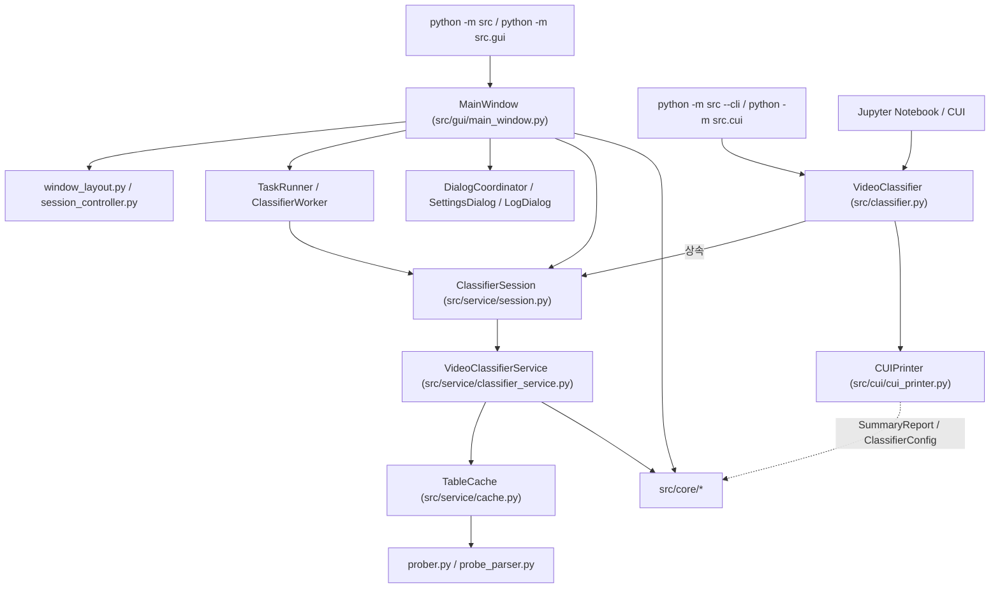
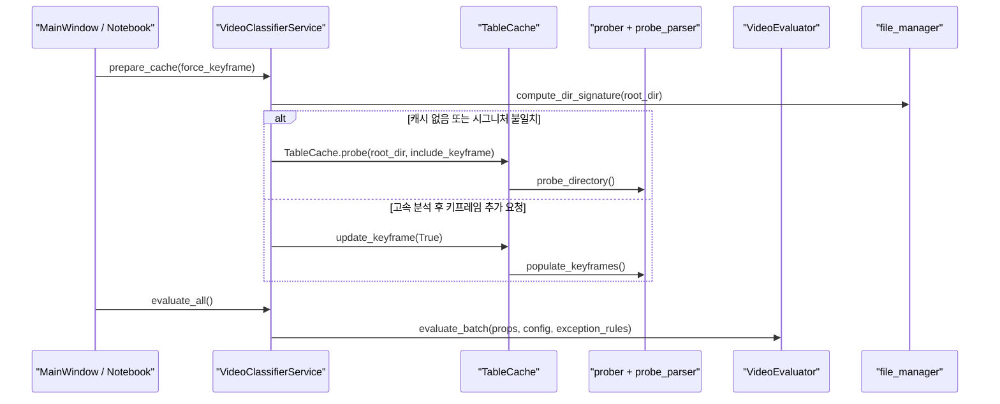

# 프로젝트 구조 및 아키텍처 (`ARCHITECTURE.md`)

`video_scripts`의 **계층 경계**, **모듈 책임**, **실행 흐름**, **설정, 검증 체계**를 정리한 아키텍처 기준 문서입니다.

콘솔(CUI), Jupyter 노트북 출력과 PyQt6 데스크톱 GUI가 동일한 분류 세션(`ClassifierSession`)을 공유하도록 구성되어 있습니다. 순수 도메인, 프로빙, 평가, 파일 IO를 담당하는 `src/core/`, 작업 폴더별 캐시와 분류 트랜잭션을 조율하고 UI 무관 세션을 제공하는 `src/service/`, 콘솔 테이블 출력(`src/cui/`)과 대시보드, 필터 테이블 UI(`src/gui/`)로 책임을 분리하고, `scripts/` 정적 검증 게이트와 `tests/` 단위 테스트 스위트로 계약 일관성을 유지합니다.

## 1. 핵심 설계 원칙

1. **3계층 단방향 의존성 (`cui`/`gui` -> `service` -> `core`)**
   - `src/core`: 도메인 모델, 설정, `ffprobe` 프로빙/파싱, 평가, 예외 조건식 AST, 파일 IO, 정렬(상위 계층 임포트 금지)
   - `src/service`: `root_dir`별 `TableCache`, 시그니처 동기화, 평가 오케스트레이션, UI 무관 분류 세션(`ClassifierSession`)
   - `src/cui`: 콘솔(Jupyter) 출력(`CUIPrinter`는 `SummaryReport`, `ClassifierConfig`로 결합, `Service` 직접 임포트 금지)
   - `src/gui`: PyQt6 UI, 세션은 `service`의 `ClassifierSession`과 `core` 모델, 설정 타입에 의존
   - [src/classifier.py](src/classifier.py) (`VideoClassifier`): 노트북/CUI 파사드(`ClassifierSession` 상속 + 출력, GUI 실행)
2. **평탄한 디렉터리, 수평 모듈 분리**: 기존 깊이(`src/core`, `src/service`, `src/cui`, `src/gui/{dialogs,styles,widgets}`) 유지, 단일 책임 `.py` 수평 분리
3. **비파괴 분석, 중단 제어**
   - 분석과 판정 단계는 디스크의 영상 파일을 이동하거나 변경하지 않음
   - `ClassifierWorker`: 취소 시 `InterruptedError` 및 `_terminate_and_reap`로 실행 중인 `ffprobe` 자식 프로세스 즉시 회수

## 2. 계층 및 의존성 구조

## 3. 디렉터리 및 모듈 맵

### 3.1. 최상위 진입점

| 경로 | 역할 | 비고 |
| --- | --- | --- |
| [src/__init__.py](src/__init__.py) | 공개 API 통합 export | `from src import VideoClassifier` 등 노트북 편의 제공 |
| [src/__main__.py](src/__main__.py) | `dispatch_main` 통합 실행 분기 | `python -m src` 무인자/`--gui`는 GUI, 인자/`--cli`는 스탠드얼론 CLI 분기 |
| [src/classifier.py](src/classifier.py) | `VideoClassifier` 노트북/CUI 파사드 | `ClassifierSession` 상속 + 상태 파일 로드, 임계값 튜닝, 콘솔 출력(`print`/`print_tables`/`print_summary`), `gui` 실행 |

### 3.2. `src/core/`: 도메인, 프로빙, 평가, 파일 IO

| 모듈 | 주요 심볼 | 책임 |
| --- | --- | --- |
| [models.py](src/core/models.py) | `QualityZone`, `QUALITY_ZONE_SORT_RANK`, `SmartAction`, `SavingsSummary`, `VideoProps`, `VideoEvaluation`, `SummaryReport` | 도메인 데이터 모델 및 판별, 정렬 열거형 |
| [config.py](src/core/config.py) | `ClassifierConfig`, `PathsConfig`, `AnalysisConfig`, `ThresholdsConfig`, `SavingsConfig`, `EncodeConfig`, `CodecWeightsConfig`, `BitrateModelConfig`, `DisplayConfig`, `CuiConfig`, `CORE_SETTING_COUNT`, `CODEC_WEIGHT_GROUPS`, `LEGACY_COMPAT_CODECS`, `collect_setting_bounds`, `merge_tuner_criteria` | 메타데이터 기반 계층 분석 설정 데이터클래스(`comment`/`bounds` 기준 정의), 분류기 설정 직렬화, 코덱 가중치 및 호환 대상 코덱 목록 관리 |
| [paths.py](src/core/paths.py) | `DATA_DIR_NAME`, `ROOTDIR_FILENAME`, `DEFAULT_ROOT_DIR`, `get_app_base_dir`, `get_data_dir`, `get_rootdir_path`, `write_utf8_file`, `ensure_utf8_file`, `ensure_default_rootdir_file`, `set_root_dir`, `set_root_dirs`, `get_root_dir`, `get_root_dirs` | 실행 기준 경로, `data/*` 공통 파일 입출력, `data/rootdir.txt` 자동 생성 및 다중 작업 폴더 조회와 저장 |
| [workspace_paths.py](src/core/workspace_paths.py) | `PATH_SPEC_SEP`, `parse_root_dirs`, `format_root_dirs`, `primary_root_dir`, `are_all_valid_dirs`, `build_root_label_map`, `compose_logical_filename`, `split_logical_filename`, `resolve_source_filepath`, `count_cross_drive_moves`, `normalize_path_separators` | 세미콜론 구분 다중 작업 폴더 문자열의 파싱과 직렬화, 표시 라벨, 논리 파일명과 원본 경로 변환, 원화 기호 정규화 |
| [ui_state.py](src/core/ui_state.py) | `UiState`, `UiPreviewInfoState`, `UiLayoutState`, `UiFilterState`, `DEFAULT_ANALYZE_MODE`, `VALID_ANALYZE_MODES`, `DEFAULT_THEME_MODE`, `VALID_THEME_MODES`, `DEFAULT_FILTER_SEARCH` | GUI 테마, 분석 모드, 미리 보기 방식, 정보 표시 설정, 검색 필터, 창 레이아웃 표현 상태 스키마 |
| [preview_info.py](src/core/preview_info.py) | `INFO_MODE_OFF`, `INFO_MODE_SUMMARY`, `INFO_MODE_DETAIL`, `VALID_INFO_MODES`, `VALID_INFO_LAYOUTS`, `ALL_INFO_KEYS`, `normalize_info_keys` | 미리 보기 정보 표시의 단계, 배치, 위치 비율 범위, 항목 키와 그룹, 기본 요약, 상세 항목 기준 정의(표 열과 같은 항목 키는 열 식별자와 같음) |
| [shortcuts.py](src/core/shortcuts.py) | `SHORTCUT_GROUPS`, `SHORTCUT_SPECS`, `SHORTCUT_SPEC_BY_ID`, `DEFAULT_SHORTCUTS`, `REDO_SECONDARY_SHORTCUT`, `normalize_shortcut`, `sanitize_shortcut_overrides`, `resolve_shortcuts`, `diff_shortcut_overrides`, `find_conflict_action`, `format_tooltip_with_shortcut` | 67종 명령 카탈로그와 8개 기능 그룹, 기본 단축키 기준 정의, 사용자 지정값 정규화와 검증, 유효 단축키 계산, 중복 탐지, 툴팁 문자열 포맷 |
| [undo_history.py](src/core/undo_history.py) | `MAX_UNDO_STEPS`, `UNDO_COALESCE_WINDOW_MS`, `UndoableSnapshot`, `HistoryEntry`, `UndoHistory` | 설정, 판별 기준, 예외 규칙, 출력 해상도 직접 지정, 단축키, 테마, 분석 모드, 검색어, 열 상태 스냅샷 기반 다단계 되돌리기와 다시 실행 스택, 연속 변경 병합 창, 최대 단계 제한 |
| [formatting.py](src/core/formatting.py) | `format_float_precision`, `format_fps`, `format_duration_hms`, `format_duration_seconds`, `format_duration_ko`, `format_ratio`, `format_keyframe_interval`, `format_size_mb`, `format_size_header` | CUI, GUI 공용 열별 수치 정밀도, 정수 생략, 미측정, 용량 단위, 헤더 포맷터 기준 정의 |
| [eta.py](src/core/eta.py) | `ProgressEstimator`, `ProgressEstimate`, `format_approx_duration`, `format_rate`, `format_remaining`, `format_estimate_label` | 분석 진행 콜백의 완료 수로 분석 속도와 남은 시간 추정(첫 관측 이후 기준). 시작 전 예상 문구와 CUI, GUI 공용 시간, 속도 표기 |
| [app_state.py](src/core/app_state.py) | `AppState`, `build_default_notebook_payload`, `ensure_default_config_files`, `ensure_default_notebook_file`, `get_data_dir`, `get_notebook_path`, `get_state_path`, `load_app_state`, `save_app_state`, `reset_app_state`, `resolve_effective_root_dir`, `record_recent_dir` | 기본 파일 생성은 `ensure_default_config_files` 명시 호출, `load_app_state`는 읽기 전용, 영속화, 기본 작업 경로 조회 및 기본값 복원 |
| [state_codec.py](src/core/state_codec.py) | `strip_jsonc_comments`, `parse_state_mapping`, `render_state_jsonc` | JSONC 주석 파싱, 제거, 데이터클래스 메타데이터 기반 계층 스키마 매핑 및 주석 포함 직렬화 |
| [prober.py](src/core/prober.py) | `run_ffprobe`, `extract_video_props`, `extract_keyframe_interval`, `probe_directory`, `probe_files`, `populate_keyframes` | `ThreadPoolExecutor` 병렬 프로빙, 타임아웃, 중단 감시, 자식 프로세스 회수. 키프레임 실측은 메타데이터와 같은 ffprobe 호출에서 패킷을 함께 읽음 |
| [system_probe.py](src/core/system_probe.py) | `SystemSpeedRecommendation`, `recommend_encode_speed_for_profile`, `detect_recommended_encode_speed` | CPU 스레드, GPU, FFmpeg 하드웨어 인코더 감지 기반 1080p 예상 인코딩 배속 추천 |
| [probe_parser.py](src/core/probe_parser.py) | `PROBE_VERSION`, `build_video_props`, `parse_fps`, `get_rotate_type`, `measure_keyframe_interval`, `resolve_keyframe_interval`, `parse_stream_bps`, `parse_audio_stream_bps`, `estimate_video_bps`, `is_10bit_stream`, `is_hdr_stream` | `ffprobe` JSON 스트림, 프레임 순수 파싱 및 메타데이터(10-bit, PCM 오디오 역산 포함) 산출, 키프레임 단계 창 적용. 측정 로직을 바꾸면 `PROBE_VERSION`을 올려야 함(`tests/test_probe_measurement_digest.py`가 검증) |
| [storage_probe.py](src/core/storage_probe.py) | `StorageKind`, `StorageInfo`, `probe_storage`, `classify_storage`, `concurrency_limit`, `plan_lanes`, `clear_storage_cache` | Windows 볼륨 속성(접근 권한 0 핸들, 탐색 지연, 버스, 물리 디스크 번호)으로 SSD, HDD, 네트워크 판별, 볼륨 단위 캐시. 장치별 동시 실행 상한 정책과 대기열 묶음 계산. 쓰기 계열 제어 코드는 쓰지 않음 |
| [classification_policy.py](src/core/classification_policy.py) | `EvaluationContext`, `ClassificationDecision`, `DEFAULT_CLASSIFICATION_POLICIES`, `should_use_low_quality_preset` | 판정 문맥과 결정 타입, 예외, HDR, 구형 코덱 호환, 인트라 전용 코덱, 과화질, 적정(코덱 전환), 저화질 구간 정책 함수와 정책 순서, 절약 선별 필터, 저화질 보호 라우팅 조건 |
| [evaluator.py](src/core/evaluator.py) | `VideoEvaluator` | 정책 체인 적용 평가 파이프라인, 키프레임 판정, 예상 용량과 시간 산출, 리포트 집계. 직접 지정 맵을 입력으로 받음 |
| [quality_metrics.py](src/core/quality_metrics.py) | `calc_optimal_bitrate`, `calc_optimal_pair`, `resolve_quality_zone`, `classify_quality_zone`, `estimate_encode_duration_sec` | 원본, 출력 코덱 기준 `B_opt`, 고성능 코덱/10-bit SDR 여유치 기반 화질 등급, 인코딩 작업량 지표 순수 함수 |
| [encoder_specs.py](src/core/encoder_specs.py) | `EncoderSpec`, `ENCODER_SPECS`, `get_encoder_spec`, `resolve_level_cap_kbps` | 인코더 정의 단일 기준(이름, 계열, 선택지 라벨, 품질 옵션, 기본 인자, 활성 여부), NVENC 자동 레벨의 최대 비트레이트 상한 계산 |
| [stream_layout.py](src/core/stream_layout.py) | `StreamInfo`, `StreamLayout`, `parse_stream_layout` | ffprobe 스트림 목록을 구조로 변환, 주 영상, 인터레이스 판정, 회전, 색 정보, VR 부가 정보 판정 |
| [encode_plan.py](src/core/encode_plan.py) | `EncodePlan`, `StreamAction`, `DecodeMode`, `choose_container`, `plan_stream_actions`, `build_encode_plan` | 재인코딩 계획 데이터, 컨테이너 선택, 스트림별 복사, 변환, 제외 규칙, 디코딩 구성 임시 기본값 |
| [ffmpeg_command.py](src/core/ffmpeg_command.py) | `build_ffmpeg_args` | 계획을 FFmpeg 인자 목록으로 변환(품질, 키프레임, 태그, 색 정보, 스트림 지정자, 임시 파일 출력) |
| [encode_tag.py](src/core/encode_tag.py) | `ENCODE_TAG_KEY`, `build_encode_tag`, `parse_encode_tag`, `EncodeTag` | 처리 표식 태그 값 생성과 대소문자 무관 읽기, 모르는 필드 무시 |
| [ffmpeg_capability.py](src/core/ffmpeg_capability.py) | `FfmpegCapability`, `probe_ffmpeg_capability`, `parse_ffmpeg_version`, `MIN_FFMPEG_VERSION` | FFmpeg 버전, 인코더, libvmaf 필터 확인과 사용 불가 사유(최소 5.1) |
| [quality_target.py](src/core/quality_target.py) | `BASELINE_CQ_DEFAULT`, `calc_base_bitrate_kbps`, `quality_size_factor`, `protect_cq_value`, `to_encoder_quality`, `format_cq_value` | 화질 기준값과 저화질 보호 오프셋, 품질값 차이 용량 계수 `2^(-delta/K)`, 기준 비트레이트 `B_base(Q)`, 인코더 척도 매핑, 소수 첫째 자리 품질값 표기 |
| [downscale_resolver.py](src/core/downscale_resolver.py) | `select_output_candidate`, `resolve_downscale` | 직접 지정, 최대 해상도, 비트레이트 맞춤 순으로 출력 규격 후보를 고르고 출력 기준 축소 추정 또는 축소하지 않은 이유 산출 |
| [resolution_tiers.py](src/core/resolution_tiers.py) | `ResolutionTier`, `RESOLUTION_TIERS`, `TIER_BOUNDARIES`, `TierBoundary`, `Orientation`, `MIN_DOWNSCALE_AREA_RATIO`, `KEEP_RESOLUTION_KEY`, `is_valid_manual_target`, `copy_manual_targets`, `orientation_of`, `calc_scaled_dimensions`, `is_meaningful_downscale`, `find_source_tier`, `build_scale_expression` | 해상도 규격 경계 박스와 최대 비트레이트 기준 정의, 4의 배수 내림, 직접 지정 값 검증과 맵 복사, 출력 크기 계산, 95% 화소 기준 축소 판정, 원본 규격 판정, FFmpeg scale 식 생성 |
| [size_estimator.py](src/core/size_estimator.py) | `estimate_video_stream_mb`, `calc_keyframe_increase_ratio`, `estimate_after_size_mb` | 인코딩 후 예상 용량 산출, 코덱 전환 압축 성능 및 코덱 역전 용량 증가 반영, FPS/정적 화면 보정 1초 키프레임 증가율 |
| [exception_rules.py](src/core/exception_rules.py) | `validate_exception_token`, `split_exception_tokens`, `merge_exception_tokens`, `exclude_exception_tokens`, `get_exception_syntax_reference` | 예외 규칙(키워드 및 AST 화이트리스트 조건식)(`v.*`) 검증, 컴파일, 참조 목록 제공 |
| [file_manager.py](src/core/file_manager.py) | `get_video_filenames`, `scan_video_stats`, `resolve_video_filepath`, `compute_dir_signature` | 작업 폴더 비디오 탐색(숨김 폴더와 제외 폴더 이름 지정), 크기와 수정 시각 조회, 작업 폴더 시그니처 계산 |
| [file_fingerprint.py](src/core/file_fingerprint.py) | `FINGERPRINT_CHUNK_BYTES`, `FINGERPRINT_DIGEST_BYTES`, `compute_fingerprint` | 파일 앞, 뒤 청크와 크기로 내용 지문 산출(분석 캐시에서 이름이 바뀐 같은 내용의 파일 재사용) |
| [sorting.py](src/core/sorting.py) | `WindowsNameOrder`, `compare_natural_tokens` | CUI/GUI 공용 윈도우 탐색기 자연 정렬 토큰 생성, 비교 |
| [messages.py](src/core/messages.py) | `LOG_TAG_*`, `MSG_*_CANCELLED`, `LABEL_*`, `format_analysis_summary`, `format_export_done`, `format_quality_zone_tooltip` | CUI/GUI 공용 로그 태그(DEBUG, INFO, WARN, ERROR 4종)와 로그 문장 생성, 상태 레이블, 동적 안내 문구 기준 정의 |
| [exceptions.py](src/core/exceptions.py) | `ErrorCode`, `VideoScriptsError`, `Domain*Error`, `format_user_error` | 표준 예외 호환 도메인 예외 계층 및 해결 힌트 포맷터 |
| [logging_setup.py](src/core/logging_setup.py) | `APP_LOGGER_NAME`, `UserLogFormatter`, `get_app_logger`, `ensure_console_logging`, `ensure_file_logging`, `default_log_file_path` | 패키지 루트(`src`) `logging` 포맷터, 동적 `sys.stdout` 핸들러, 데이터 폴더 아래 순환 파일 로그(`logs/app.log`, DEBUG 이상) |

### 3.3. `src/service/`: 오케스트레이션 및 캐시

| 모듈 | 주요 심볼 | 책임 |
| --- | --- | --- |
| [cache.py](src/service/cache.py) | `TableCache`, `CacheRegistry`, `DEFAULT_CACHE_REGISTRY` | 작업 폴더 `VideoProps` 인메모리 보관 및 키프레임 증분 보완(`update_keyframe`), 디스크 프로빙은 `TableCache.probe` 팩토리에서만 수행하며 분석 캐시 저장소가 주어지면 재사용, 정규화된 `root_dir`별 캐시와 디렉터리 시그니처를 레지스트리 인스턴스에 보관 |
| [analysis_store.py](src/service/analysis_store.py) | `AnalysisStore`, `open_default_store`, `compute_fingerprint`, `load_manual_target_store`, `save_manual_target_store` | 영구 분석 캐시(`data/video_cache.sqlite3`) 저장소. 스키마는 `VideoProps` 필드에서 생성하고 버전 또는 열 구성이 다르면 분석 테이블만 다시 만듦. 같은 파일의 `manual_target` 테이블에 출력 해상도 직접 지정을 보관하며, 분석 캐시 스키마나 비우기와 무관하게 유지되고 설정 파일의 옛 맵은 테이블 최초 생성 때 한 번 옮김. DB 오류는 경고 후 캐시 없이 진행 |
| [analysis_probe.py](src/service/analysis_probe.py) | `probe_directory_with_store`, `count_pending_files`, `persist_keyframes` | 파일명, 크기, 수정 시각 일치 조회, 같은 크기 후보의 내용 지문으로 이름 변경 재사용, 나머지만 ffprobe 프로빙 후 저장. 시작 전 프로빙 대상 수 집계(지문 대조 생략) |
| [analysis_timing.py](src/service/analysis_timing.py) | `AnalysisEstimate`, `record_seconds_per_item`, `average_seconds_per_item`, `expected_analysis_seconds` | 분석 모드별 항목당 소요 시간 이력(`data/analysis_timing.json`, 최근 10회 평균)과 시작 전 예상 분석 시간 산출 |
| [analyzed_dirs.py](src/service/analyzed_dirs.py) | `ANALYZED_DIRS_FILENAME`, `is_analyzed_dir`, `mark_analyzed_dir` | 분석 결과가 나온 작업 폴더 기록(`data/analyzed_dirs.json`), 시작과 폴더 전환 시 자동 복원 대상 판정 |
| [classifier_service.py](src/service/classifier_service.py) | `VideoClassifierService` | `CacheRegistry` 주입으로 캐시 저장소 선택(생략 시 `DEFAULT_CACHE_REGISTRY` 공유), 캐시 동기화, 일괄 평가 리포트 생성, 작업 폴더 비디오 파일명 집합 |
| [session.py](src/service/session.py) | `ClassifierSession`, `normalize_root_key` | UI 무관 분류 세션, 예외 규칙과 출력 해상도 직접 지정 상태 보관(작업 폴더 키 정규화), 평가 위임, 상태 파일과 콘솔에 의존하지 않음 |

### 3.4. `src/cui/`: 콘솔 및 Jupyter 출력

| 모듈 | 주요 심볼 | 책임 |
| --- | --- | --- |
| [cli.py](src/cui/cli.py) | `build_cli_parser`, `run_cli`, `main` | `python -m src.cui` 스탠드얼론 CLI 옵션 파싱, 실행, 종료 코드 매핑 |
| [__main__.py](src/cui/__main__.py) | `main` | `python -m src.cui` 직접 실행 진입점 |
| [cui_printer.py](src/cui/cui_printer.py) | `CUIPrinter`, `TablePrinter`, `sanitize_text`, `truncate_text`, `ConsoleProgressReporter` | `tabulate` 기반 그룹별 테이블 및 3단 용량 시뮬레이션 출력, 콘솔 한 줄 진행률(남은 시간 포함)과 완료 요약 출력 |
| [sorting.py](src/cui/sorting.py) | `col`, `desc`, `t`, `SortBy`, `SortTarget`, `t`, `build_sort_key`, `WindowsNameOrder` | 다중 정렬 키 래퍼, 프리셋 정렬, 열 풀네임, 짧은 이름 헤더 매핑, 코어 `WindowsNameOrder` 재노출 |

### 3.5. `src/gui/`: PyQt6 데스크톱 GUI

| 분류 | 모듈 | 책임 |
| --- | --- | --- |
| **진입, 부트스트랩** | [__main__.py](src/gui/__main__.py), [__init__.py](src/gui/__init__.py) | `python -m src.gui` 실행 및 `QApplication` 부트스트랩(`run_gui`) |
| **메인 코디네이터** | [main_window.py](src/gui/main_window.py) | `MainWindow` 이벤트 배선, 드래그 앤 드롭 전환, 단축키, 외부 제어 |
| **수평 컨트롤러** | [menu_bar.py](src/gui/menu_bar.py), [window_layout.py](src/gui/window_layout.py), [session_controller.py](src/gui/session_controller.py), [table_state_sync.py](src/gui/table_state_sync.py), [manual_target_menu.py](src/gui/manual_target_menu.py), [footer_summary.py](src/gui/footer_summary.py), [task_runner.py](src/gui/task_runner.py), [dialog_coordinator.py](src/gui/dialog_coordinator.py), [worker.py](src/gui/worker.py), [logging_bridge.py](src/gui/logging_bridge.py), [log_file.py](src/gui/log_file.py) | 전체 기능 메뉴바, 단축키, 레이아웃, 상태 저장/복원, 열 필터와 정렬 우선순위의 저장 형식 변환, 경로, 설정 바인딩, 출력 해상도 직접 지정 적용과 저장, 출력 해상도 지정 메뉴 항목의 체크, 활성, 비활성 규칙, 푸터 구간 합계 집계, 포맷, `QThread` 실행 관리, 작업 기록 창, 설정, 도움말 대화상자 조율, Qt 로그 브리지, 로그 파일 열기 |
| **모델, 내보내기** | [table_columns.py](src/gui/table_columns.py), [table_column_styles.py](src/gui/table_column_styles.py), [table_tooltips.py](src/gui/table_tooltips.py), [table_model.py](src/gui/table_model.py), [proxy_model.py](src/gui/proxy_model.py), [column_filters.py](src/gui/column_filters.py), [numeric_buckets.py](src/gui/numeric_buckets.py), [delegates.py](src/gui/delegates.py), [column_sizing.py](src/gui/column_sizing.py), [column_layout_state.py](src/gui/column_layout_state.py), [exporters.py](src/gui/exporters.py), [constants.py](src/gui/constants.py) | 22열 테이블 스키마, 셀 전경색과 굵기 규칙, 행 툴팁과 출력 해상도 셀 툴팁(직접 지정 규격 기준), 뷰모델, 검색, 동적 열 필터, 수치 열 구간 버킷 생성(너비, 높이는 해상도 규격 경계 공유), 자연 정렬 프록시, 열 필터 모델, Pill, 아이콘 델리게이트, 열 상태 JSON 저장과 복원, CSV 행 생성과 미리 보기 행 제한, 파일 저장, 공용 상수 |
| **위젯 (`widgets/`)** | [header_bar.py](src/gui/widgets/header_bar.py), [folder_path_button.py](src/gui/widgets/folder_path_button.py), [bento_dashboard.py](src/gui/widgets/bento_dashboard.py), [edge_fade_overlay.py](src/gui/widgets/edge_fade_overlay.py), [filter_bar.py](src/gui/widgets/filter_bar.py), [filter_header_view.py](src/gui/widgets/filter_header_view.py), [column_filter_popover.py](src/gui/widgets/column_filter_popover.py), [floating_popup.py](src/gui/widgets/floating_popup.py), [analyze_mode_popup.py](src/gui/widgets/analyze_mode_popup.py), [collapsible_top_area.py](src/gui/widgets/collapsible_top_area.py), [filter_checklist_widget.py](src/gui/widgets/filter_checklist_widget.py), [video_table_view.py](src/gui/widgets/video_table_view.py), [table_context_menu.py](src/gui/widgets/table_context_menu.py), [table_actions.py](src/gui/widgets/table_actions.py), [table_drag.py](src/gui/widgets/table_drag.py), [quicklook_launcher.py](src/gui/widgets/quicklook_launcher.py), [table_empty_overlay.py](src/gui/widgets/table_empty_overlay.py), [footer_bar.py](src/gui/widgets/footer_bar.py), [progress_fill_bar.py](src/gui/widgets/progress_fill_bar.py), [custom_spinbox.py](src/gui/widgets/custom_spinbox.py), [collapsible_section.py](src/gui/widgets/collapsible_section.py), [settings_group_card.py](src/gui/widgets/settings_group_card.py) | 작업 폴더 경로 입력과 선택, 경로 버튼의 폭별 생략 표시, 분석 분할 버튼, 분석 모드 팝업, 상단 영역 접기와 펼치기, 4카드 핵심 지표 벤토 대시보드, 1줄 검색, 예외 규칙 컨트롤 바, 동적 열 필터 헤더, 팝업 공통 기반, 팝오버, 체크리스트, 컨텍스트 메뉴와 외부 파일 드래그 테이블, 빈 상태 안내 오버레이, 푸터 바(구간 요약, 진행률), 설정 카드 |
| **대화상자 (`dialogs/`)** | [settings_dialog.py](src/gui/dialogs/settings_dialog.py), [settings_form_fields.py](src/gui/dialogs/settings_form_fields.py), [criteria_tuner_panel.py](src/gui/dialogs/criteria_tuner_panel.py), [tuner_slider_row.py](src/gui/dialogs/tuner_slider_row.py), [settings_field_bindings.py](src/gui/dialogs/settings_field_bindings.py), [settings_advanced_cards.py](src/gui/dialogs/settings_advanced_cards.py), [settings_sections.py](src/gui/dialogs/settings_sections.py), [setting_row.py](src/gui/dialogs/setting_row.py), [setting_controls.py](src/gui/dialogs/setting_controls.py), [exception_rules_dialog.py](src/gui/dialogs/exception_rules_dialog.py), [help_dialog.py](src/gui/dialogs/help_dialog.py), [glossary_view.py](src/gui/dialogs/glossary_view.py), [glossary_data.py](src/gui/dialogs/glossary_data.py), [help_blocks.py](src/gui/dialogs/help_blocks.py), [help_guide_pages.py](src/gui/dialogs/help_guide_pages.py), [help_concepts_page.py](src/gui/dialogs/help_concepts_page.py), [log_dialog.py](src/gui/dialogs/log_dialog.py), [export_panel.py](src/gui/dialogs/export_panel.py), [shortcuts_panel.py](src/gui/dialogs/shortcuts_panel.py), [shortcut_row.py](src/gui/dialogs/shortcut_row.py) | 3탭 통합 설정, 판별 기준 창(`data/config.json` 검증, 저장), 비모달 판별 기준 실시간 조정 탭 패널, 튜너 슬라이더 행, 설정 필드 바인딩 명세, 섹션 빌더, 고급 설정 카드 빌더, 개별 설정 행, 설정형 대화상자 공용 휠 안전 컨트롤, 탭 셸 빌더, 여러 줄 예외 규칙 편집기, 4탭 사용 가이드(용어 사전 탭 포함), 용어 사전 검색과 현재 판별 기준 반영 HTML, 용어 사전 표준 데이터, 사용 가이드 공통 스타일, 강조 상자, 카드, 가운데 정렬 수식 패널, 분수, 줄무늬 표 HTML, 프로그램 안내와 고급 활용 탭 본문, 판정 원리 탭 본문과 설정값 기반 계산 예시, 판정 원리 탭, 작업 기록 창(로그 탭, 내보내기 탭), CSV 미리 보기 패널, 단축키 탭 패널(기능 그룹 카드, 검색, 중복 확인, 전체 기본값 복원), 단축키 개별 명령 행과 키 입력 캡처 버튼 |
| **메뉴 조립** | [menu_base.py](src/gui/menu_base.py), [menu_file.py](src/gui/menu_file.py), [menu_edit.py](src/gui/menu_edit.py), [menu_view.py](src/gui/menu_view.py), [menu_analysis.py](src/gui/menu_analysis.py), [menu_selection.py](src/gui/menu_selection.py), [dynamic_menus.py](src/gui/dynamic_menus.py) | 메뉴별 액션 빌더(생성한 액션과 서브메뉴를 데이터클래스로 반환), 편집 메뉴에 붙는 선택 영상 조작과 예외 규칙, 출력 해상도 지정 항목, 액션 생성, 아이콘 등록, 명령 ID 레지스트리를 공유하는 컨텍스트, 최근 작업 폴더와 표시할 열 서브메뉴의 동적 구성 |
| **미리 보기** | [preview_controller.py](src/gui/preview_controller.py), [video_preview_window.py](src/gui/widgets/video_preview_window.py), [video_preview_controls.py](src/gui/widgets/video_preview_controls.py), [video_preview_overlay.py](src/gui/widgets/video_preview_overlay.py), [preview_info_presenter.py](src/gui/widgets/preview_info_presenter.py), [preview_info_items.py](src/gui/preview_info_items.py), [preview_settings_panel.py](src/gui/widgets/preview_settings_panel.py), [quicklook_launcher.py](src/gui/widgets/quicklook_launcher.py) | `Space` 미리 보기 요청을 내장 창(영상 재생, 재생 조작 바, 좌우 방향키 구간 이동, 위아래 방향키 영상 전환, `Space`, `Esc` 닫기) 또는 QuickLook 활성화 호출로 전달하고 내장 창 수명 관리, QuickLook 상주 웜업, 미리 보기 설정(방식, 구간 이동 간격, 정보 표시)을 한 패널에서 변경, 영상 위 정보 표시(표 열 정의와 같은 이름과 값, 재생기 상태, 끌어서 위치 이동)와 단축키, 되돌리기 실행 결과 안내 |
| **직접 지정 컨트롤러** | [manual_target_controller.py](src/gui/manual_target_controller.py) | 출력 해상도 직접 지정과 모두 해제(확인 포함) 요청 처리, 재평가, 저장, 되돌리기 기록 연결 |
| **캐시 재평가 워커** | [report_evaluator.py](src/gui/report_evaluator.py) | 메모리 캐시 재평가를 백그라운드 스레드에서 실행하고, 최신 요청의 결과만 GUI 스레드에 적용해 설정 변경과 미리 보기 재생이 멈추지 않게 함 |
| **복원 판정 워커** | [restore_resolver.py](src/gui/restore_resolver.py) | 시작 시 이전 분석 결과 복원 모드(키프레임 포함 여부)를 백그라운드 스레드에서 판정해 첫 화면 표시를 막지 않게 하고, 결과만 GUI 스레드로 전달 |
| **단축키 컨트롤러** | [shortcuts_controller.py](src/gui/shortcuts_controller.py) | 유효 단축키 바인딩과 재지정, 명령별 단일 QAction 등록, 툴팁과 메뉴 표시 동기화, 되돌리기와 다시 실행 세션 연결(스냅샷 차이 항목만 복원), 출력 해상도 지정 단축키 처리 |
| **열 편집 기록기** | [column_history.py](src/gui/column_history.py) | 헤더 마우스 조작과 열 메뉴 명령을 한 단계의 열 너비, 표시, 순서 변경으로 묶어 되돌리기 기록에 전달, 변경 종류별 라벨 판정 |
| **콜백 계약** | [menu_callbacks.py](src/gui/menu_callbacks.py) | 메뉴바 액션에 연결할 메인 창 콜백 데이터클래스(`MenuBarCallbacks`). 메뉴 컨트롤러와 레이아웃 조립이 공유 |
| **테마, 스타일 (`styles/`)** | [theme.py](src/gui/theme.py), [palettes.py](src/gui/styles/palettes.py), [stylesheet.py](src/gui/styles/stylesheet.py), [icons.py](src/gui/styles/icons.py), `assets/icons/` | 다크/라이트 감지, 구독(`ThemeAwareMixin`), 팔레트, QSS, 동적 SVG 아이콘 색칠 및 캐시 지연 생성 |

## 4. 주요 실행 흐름

- **인메모리 실시간 튜닝**: 임계값, 예외 식 변경 시 `ffprobe` 재실행 없이 캐시된 `VideoProps`에 `VideoEvaluator.evaluate_batch()`만 재적용, GUI 실시간 재평가는 `evaluate_cached()`로 디스크 시그니처 조회 없이 캐시만 사용
- **캐시 격리, 일관성**: `root_dir`별 독립 캐시/시그니처 유지, 분석 후 디렉터리 시그니처 갱신, 변경 감지 시 캐시 무효화

## 5. 외부 설정, 의존성, 검증 체계

| 파일 / 디렉터리 | 용도 |
| --- | --- |
| `data/config.json` | 화질 배수, 코덱 가중치, 분당 절약 기준, 목표 인코딩 방식, 구형 코덱 호환 옵션, 기준 배속, 공통 표 서식, 열 너비 등 46개 세부 설정과 UI 상태(예외, 필터, 스캔 모드, 테마, 창/헤더 배치, 최근 폴더) 통합 포터블 저장 파일(`.gitignore` 제외 대상) |
| `data/rootdir.txt` | CUI/노트북, GUI 공유 작업 비디오 폴더 목록 저장 파일(한 줄에 한 폴더, 세미콜론 구분 허용, CUI 안내 주석 포함) |
| `data/analyzed_dirs.json` | 분석이 끝난 작업 폴더 목록(하위 폴더 포함 여부별). 시작과 폴더 전환 시 이전 분석 결과 자동 복원 대상 판정 |
| `classify.ipynb` | 첫 실행 시 자동 생성되는 CUI/Jupyter 작업 노트북 템플릿(`.gitignore` 제외 대상) |
| [requirements.txt](requirements.txt) | 앱(GUI, CUI) 의존성 (`PyQt6`, `tabulate`) |
| [requirements-notebook.txt](requirements-notebook.txt) | 노트북 추가 의존성 (`-r requirements.txt` + `ipykernel`) |
| [requirements-dev.txt](requirements-dev.txt) | 정적 검증, 개발 도구 (`-r requirements.txt` + `ruff`, `basedpyright`, `coverage`) |
| [pyproject.toml](pyproject.toml) | Ruff, BasedPyright `strict` 설정 |
| [scripts/check.ps1](scripts/check.ps1) | Ruff -> BasedPyright(`strict`) -> [verify_hygiene.py](scripts/verify_hygiene.py) -> 전체 `unittest` 통합 게이트 |
| [scripts/verify_hygiene.py](scripts/verify_hygiene.py) | `data/`, `.rootdir`, 캐시 커밋 차단 및 로컬 경로, 사설 IP, `max_workers=` 하드코딩 탐지 |
| [scripts/verify_module_size.py](scripts/verify_module_size.py) | 모듈 줄 수 소프트(500), 하드(1000) 상한 검사. 동결(`frozen`)과 화이트리스트(`exempt`) 예외는 `module_size_exceptions.json`에서 관리(`tests/test_module_size.py`가 게이트로 실행) |
| [scripts/sync_skills.py](scripts/sync_skills.py) | `.agents/skills` 원본과 `.claude/skills` 사본의 불일치 검사 및 `--write` 재생성 |
| [scripts/hooks/pre-commit](scripts/hooks/pre-commit) | 공유 Git `pre-commit` 훅 (`git config core.hooksPath scripts/hooks`로 활성화) |
| [AGENTS.md](AGENTS.md) | 아키텍처, 정적 검증, 테스트 격리, 주석, 위생 작업 규칙 |
| [TERMINOLOGY.md](TERMINOLOGY.md) | 사용자 노출 용어 표준어, 폭별 표기 규칙, 표 열과 값 명세, 폐기 용어 목록 |
| [.claude/skills/](.claude/skills/) | Claude Code용 스킬 사본 (`.agents/skills`에서 파생, [sync_skills.py](scripts/sync_skills.py)로 동기화) |
| [.agents/skills/](.agents/skills/) | 작업별 에이전트 스킬 정의 원본 (`setting`, `test`, `sync`, `perf`, `refactor`, `gui-design`, `review`, `adhd-mode`, `commit`) |
