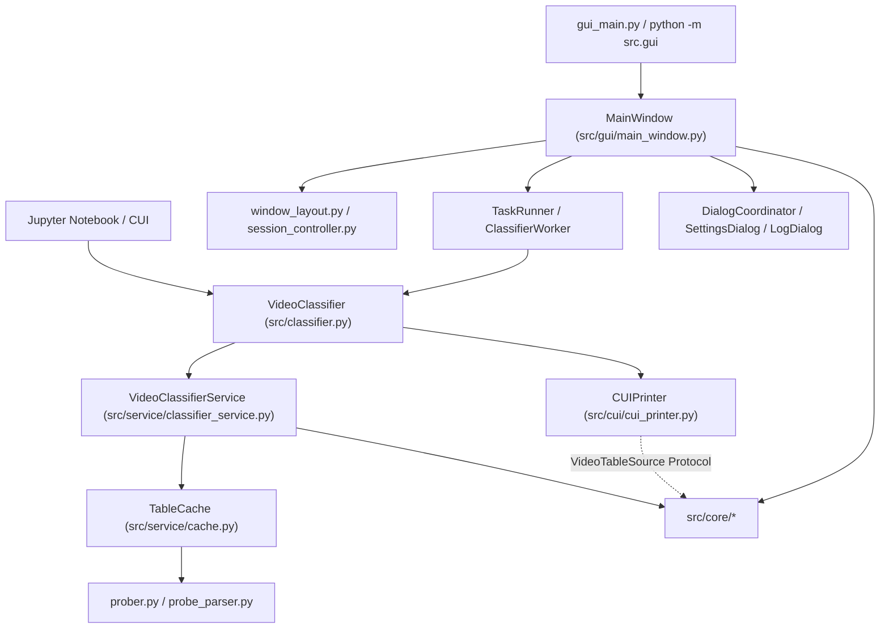
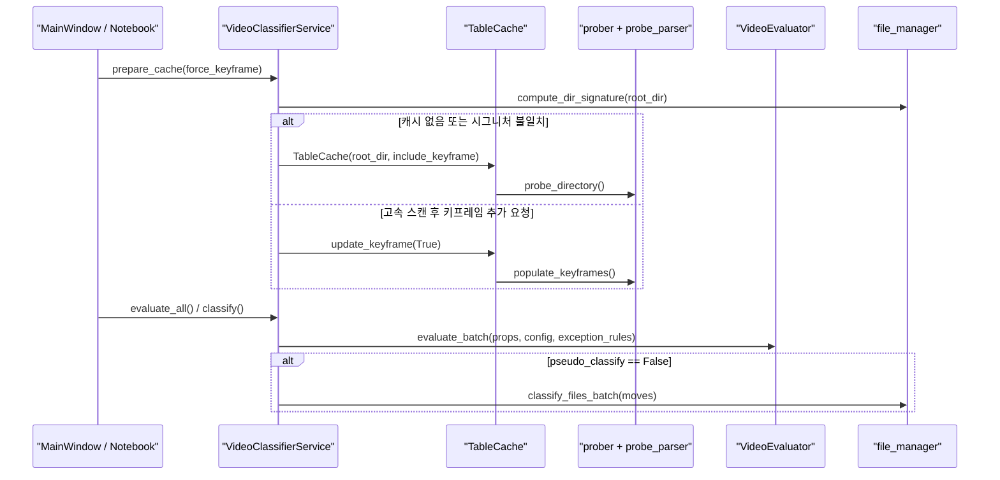

# 프로젝트 구조 및 아키텍처 가이드 (`ARCHITECTURE.md`)

이 문서는 `video_scripts`의 **계층 경계**, **모듈별 책임**, **주요 실행 흐름**, **외부 설정 및 검증 체계**를 설명합니다.

---

## 1. 핵심 설계 원칙

1. **엄격한 3계층 단방향 의존성 (`core` ← `service` ← `cui` / `gui`)**
   - `src/core`: 도메인 모델, 설정 로드/저장, `ffprobe` 실행 및 JSON 파싱, 화질·소형 영상 평가, 예외 조건식 AST 해석, 파일 탐색·일괄 이동/롤백, 자연 정렬을 담당합니다. 상위 계층(`service`, `cui`, `gui`)을 임포트하지 않습니다.
   - `src/service`: 작업 루트 경로별 인메모리 캐시(`TableCache`)와 디렉터리 시그니처 동기화, 평가 오케스트레이션, 실제 분류/원복 트랜잭션을 조율합니다.
   - `src/cui` · `src/gui`: 콘솔(Jupyter) 출력과 PyQt6 데스크톱 UI를 담당합니다. `CUIPrinter`는 `VideoTableSource` `Protocol`로 결합하며 `Service` 계층을 직접 임포트하지 않습니다.
   - [src/classifier.py](src/classifier.py) (`VideoClassifier`): `CUI`와 `GUI`가 동일한 비즈니스 엔진을 사용하도록 감싸는 통합 파사드입니다.

2. **평탄한 디렉터리와 수평 모듈 분리**
   - 다층 하위 패키지를 깊게 파지 않고 기존 계층(`src/core`, `src/service`, `src/cui`, `src/gui/{dialogs,styles,widgets}`) 안에서 단일 책임 단위의 `.py` 모듈을 수평 분리합니다.

3. **비파괴 파일 분류 및 중단 제어**
   - `pseudo_classify_mode`에서는 디스크 파일을 이동하지 않고 메모리 상태(`moved_dirname`)만 갱신합니다.
   - 실제 이동(`classify_files_batch`)은 기존 대상 파일과 충돌 시 덮어쓰지 않고 건너뛰며, 중간 `OSError` 발생 시 앞서 이동한 파일을 루트로 롤백합니다.
   - GUI 비동기 워커(`ClassifierWorker`) 취소 시 `InterruptedError`와 워커 프로세스 강제 종료(`_terminate_and_reap`)를 통해 실행 중인 `ffprobe` 자식 프로세스를 즉시 회수합니다.

---

## 2. 계층 및 의존성 구조

---

## 3. 디렉터리 및 모듈 맵

### 3.1. 최상위 진입점

| 경로 | 역할 | 비고 |
| --- | --- | --- |
| [gui_main.py](gui_main.py) | 데스크톱 GUI 실행 스크립트 (`run_gui()`) | `python gui_main.py` 진입점 |
| [src/__init__.py](src/__init__.py) | 공개 API 통합 export | `from src import VideoClassifier` 등 노트북 편의 export |
| [src/classifier.py](src/classifier.py) | `VideoClassifier` 통합 파사드 | 경로 전환, 임계값 튜닝, 캐시 무효화, `classify`/`print`/`unclassify_files`/`gui` 제공 |

### 3.2. `src/core/` — 도메인·프로빙·평가·파일 IO

| 모듈 | 주요 심볼 | 책임 |
| --- | --- | --- |
| [models.py](src/core/models.py) | `QualityZone`, `SmartAction`, `FootageStrategy`, `SmallFootageDistribution`, `VideoProps`, `VideoEvaluation`, `SummaryReport` | 불변·가변 도메인 데이터 모델 및 판별 열거형 |
| [config.py](src/core/config.py) | `ClassifierConfig`, `DEFAULT_CONFIGS`, `CODEC_WEIGHT_GROUPS`, `load_env`, `get_root_dir`, `set_root_dir`, `save_entire_config` | `.env` / `.rootdir` 파싱·저장 및 코덱별 가중치 맵 관리 |
| [prober.py](src/core/prober.py) | `run_ffprobe`, `extract_video_props`, `extract_keyframe_interval`, `probe_directory`, `populate_keyframes` | `ProcessPoolExecutor` 병렬 프로빙, 타임아웃 및 중단 이벤트 감시·자식 프로세스 회수 |
| [probe_parser.py](src/core/probe_parser.py) | `build_video_props`, `parse_fps`, `get_rotate_type`, `parse_mean_keyframe_interval`, `estimate_video_bps` | ffprobe JSON 스트림·프레임 응답의 순수 파싱 및 메타데이터 산출 |
| [evaluator.py](src/core/evaluator.py) | `VideoEvaluator` | 비선형 픽셀 면적·FPS·코덱 가중치 기반 최적 비트레이트(`B_opt`), 화질 3구간, 소형 영상 분포 전략, 종합 리포트 산출 |
| [exception_rules.py](src/core/exception_rules.py) | `validate_exception_token`, `parse_exception_token`, `split_exception_tokens`, `merge_exception_tokens`, `exclude_exception_tokens` | GUI·서비스 공용 예외 키워드 및 AST 화이트리스트 기반 Python 조건식(`v.*`) 검증·컴파일 |
| [file_manager.py](src/core/file_manager.py) | `get_video_filenames`, `resolve_video_filepath`, `compute_dir_signature`, `move_file`, `classify_files_batch`, `unclassify_all_files` | 작업 폴더·분류 하위 폴더 스캔, 디렉터리 시그니처 계산, 배치 이동 트랜잭션·롤백 및 작업 폴더 복원 |
| [sorting.py](src/core/sorting.py) | `WindowsNameOrder`, `compare_natural_tokens` | CUI/GUI 공용 윈도우 탐색기 방식 자연 정렬 토큰 생성·비교 |
| [messages.py](src/core/messages.py) | `LOG_TAG_*`, `MSG_*_CANCELLED`, `LABEL_*`, `format_log`, `format_warning_log`, `format_quality_zone_tooltip` | CUI/GUI 공용 로그 포맷·상태 레이블·동적 임계치 안내 문구 단일 원천 |

### 3.3. `src/service/` — 오케스트레이션 및 캐시

| 모듈 | 주요 심볼 | 책임 |
| --- | --- | --- |
| [cache.py](src/service/cache.py) | `TableCache` | 작업 폴더의 `VideoProps` 목록을 인메모리에 보관하고 키프레임 미측정 항목만 증분 보완(`update_keyframe`) |
| [classifier_service.py](src/service/classifier_service.py) | `VideoClassifierService` | 정규화된 `root_dir` 키별 공유 캐시(`_shared_caches`)·시그니처(`_shared_signatures`) 관리, 일괄 평가, 모의 분류·실제 분류·분류 복원 실행 |

### 3.4. `src/cui/` — 콘솔 및 Jupyter 출력

| 모듈 | 주요 심볼 | 책임 |
| --- | --- | --- |
| [cui_printer.py](src/cui/cui_printer.py) | `VideoTableSource`, `CUIPrinter`, `TablePrinter`, `sanitize_text`, `truncate_text` | `tabulate` 기반 그룹별 결과 테이블 및 3단 용량 시뮬레이션 요약 출력 |
| [sorting.py](src/cui/sorting.py) | `col`, `desc`, `t`, `WindowsNameOrder` | 다중 정렬 키 래퍼·한글 헤더 축약 매핑 및 코어 `WindowsNameOrder` 재노출 |

### 3.5. `src/gui/` — PyQt6 데스크톱 GUI

| 분류 | 모듈 | 책임 |
| --- | --- | --- |
| **진입·창 조합** | [__main__.py](src/gui/__main__.py), [__init__.py](src/gui/__init__.py) | `python -m src.gui` 실행 및 `QApplication` 부트스트랩(`run_gui`) |
| **메인 윈도우 코디네이터** | [main_window.py](src/gui/main_window.py) | `MainWindow` 이벤트 배선, 드래그 앤 드롭 폴더 전환, 단축키 및 외부 제어 인터페이스 |
| **수평 보조 컨트롤러** | [window_layout.py](src/gui/window_layout.py), [session_controller.py](src/gui/session_controller.py), [task_runner.py](src/gui/task_runner.py), [dialog_coordinator.py](src/gui/dialog_coordinator.py), [worker.py](src/gui/worker.py) | 레이아웃·상태 복원/저장, 초기 디렉터리·설정 바인딩, 비동기 `QThread` 실행 관리, 로그·설정·CSV 대화상자 조율 |
| **테이블·모델·내보내기** | [table_model.py](src/gui/table_model.py), [proxy_model.py](src/gui/proxy_model.py), [delegates.py](src/gui/delegates.py), [exporters.py](src/gui/exporters.py), [constants.py](src/gui/constants.py) | 15개 열 테이블 모델, 검색·상태/대상 필터·자연 정렬 프록시, Pill 뱃지 델리게이트, CSV 내보내기, UI 공용 상수 |
| **위젯 (`widgets/`)** | [header_bar.py](src/gui/widgets/header_bar.py), [bento_dashboard.py](src/gui/widgets/bento_dashboard.py), [filter_bar.py](src/gui/widgets/filter_bar.py), [video_table_view.py](src/gui/widgets/video_table_view.py), [footer_bar.py](src/gui/widgets/footer_bar.py), [custom_spinbox.py](src/gui/widgets/custom_spinbox.py), [collapsible_section.py](src/gui/widgets/collapsible_section.py), [settings_group_card.py](src/gui/widgets/settings_group_card.py) | 경로·스캔 분할 버튼, KPI 벤토 카드, 임계치·예외 식 실시간 튜닝 바, 컨텍스트 메뉴 테이블 뷰, 분류/복원 푸터 바, 설정 그룹 카드 |
| **대화상자 (`dialogs/`)** | [settings_dialog.py](src/gui/dialogs/settings_dialog.py), [settings_sections.py](src/gui/dialogs/settings_sections.py), [setting_row.py](src/gui/dialogs/setting_row.py), [log_dialog.py](src/gui/dialogs/log_dialog.py) | `.env` 설정 검증·저장 다이얼로그, 섹션 빌더, 개별 설정 행, 작업 로그 뷰어 |
| **테마·스타일 (`styles/`)** | [theme.py](src/gui/theme.py), [palettes.py](src/gui/styles/palettes.py), [stylesheet.py](src/gui/styles/stylesheet.py), [icons.py](src/gui/styles/icons.py), `assets/icons/` | 다크/라이트 테마 감지 및 구독(`ThemeAwareMixin`), 팔레트, QSS 생성, SVG 아이콘 동적 색칠 및 사용자 캐시 지연 생성 |

---

## 4. 주요 실행 흐름

- **인메모리 실시간 튜닝**: GUI의 필터·임계값 스핀박스 또는 예외 조건식을 조정하면 `ffprobe`를 재실행하지 않고 캐시된 `VideoProps`에 `VideoEvaluator.evaluate_batch()`만 다시 적용하여 대시보드와 테이블을 갱신합니다.
- **캐시 격리 및 일관성**: `VideoClassifierService`는 `root_dir`별 독립 캐시/시그니처를 유지하며, 실제 분류(`classify()`)와 분류 복원(`unclassify_files()`) 후 디렉터리 시그니처를 즉시 갱신해 후속 스캔과의 정합성을 유지합니다.

---

## 5. 외부 설정 · 의존성 · 검증 체계

| 파일 / 디렉터리 | 용도 |
| --- | --- |
| [.env_example](.env_example) / `.env` | 화질 배수, 코덱 가중치, 소형 영상 전략, 분류 폴더명, 테이블 너비 등 22개 런타임 환경변수 템플릿 |
| [.rootdir_example](.rootdir_example) / `.rootdir` | 기본 작업 비디오 폴더 경로 지정 템플릿 |
| [shana_presets/](shana_presets/) | 분류 폴더(`_1_표준인코딩_CQ22`, `_2_저화질_키프레임교정`)와 1:1 매핑되는 ShanaEncoder NVENC / CPU x265 XML 프리셋 |
| [requirements.txt](requirements.txt) | 앱(GUI·CUI) 실행용 직접 의존성 (`PyQt6`, `python-dotenv`, `tabulate`) |
| [requirements-notebook.txt](requirements-notebook.txt) | 노트북 실행 지원 추가 (`-r requirements.txt` + `ipykernel`) |
| [requirements-dev.txt](requirements-dev.txt) | 정적 분석·개발 도구 (`-r requirements.txt` + `ruff`, `basedpyright`, `coverage`) |
| [pyproject.toml](pyproject.toml) | Ruff 린트 규칙 및 BasedPyright `strict` 타입 검사 설정 |
| [scripts/check.ps1](scripts/check.ps1) | **Ruff → BasedPyright(`strict`) → 위생 검사(`verify_hygiene.py`) → 전체 `unittest`** 일괄 실행 게이트 |
| [scripts/verify_hygiene.py](scripts/verify_hygiene.py) | `.env`/`.rootdir`/캐시 커밋 방지 및 로컬 절대 경로·사설 IP·`max_workers=` 하드코딩 탐지 |
| [AGENTS.md](AGENTS.md) | 아키텍처, 정적 분석, 테스트 격리, 주석·위생 작업 규칙 |
