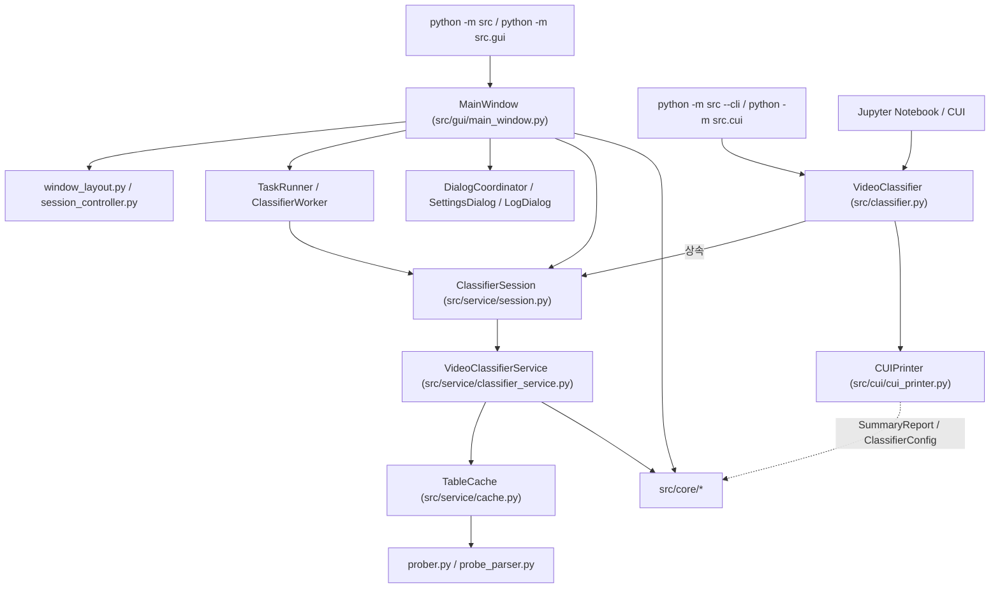
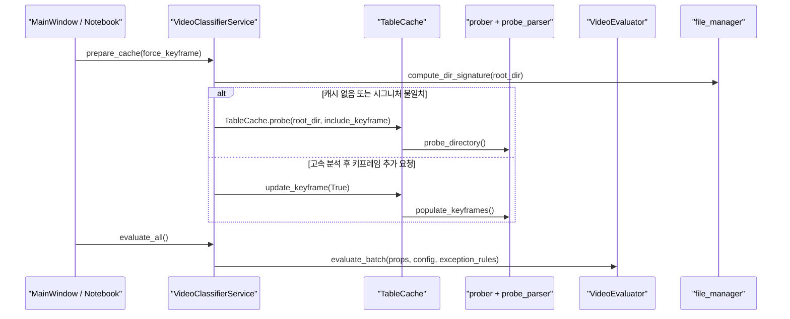

# 프로젝트 구조 및 아키텍처 (`ARCHITECTURE.md`)

`video_scripts`의 **계층 경계**, **모듈 책임**, **실행 흐름**, **설정, 검증 체계**를 정리한 아키텍처 기준 문서입니다.

콘솔(CUI), Jupyter 노트북 출력과 PyQt6 데스크톱 GUI가 동일한 분류 세션(`ClassifierSession`)을 공유하도록 구성되어 있습니다. 순수 도메인, 프로빙, 평가, 파일 IO를 담당하는 `src/core/`, 작업 폴더별 캐시와 분류 트랜잭션을 조율하고 UI 무관 세션을 제공하는 `src/service/`, 콘솔 테이블 출력(`src/cui/`)과 대시보드, 필터 테이블 UI(`src/gui/`)로 책임을 분리하고, `scripts/` 정적 검증 게이트와 `tests/` 단위 테스트 스위트로 계약 일관성을 유지합니다.

## 1. 핵심 설계 원칙

1. **3계층 단방향 의존성 (`cui`/`gui` -> `service` -> `core`)**
   - `src/core`: 도메인 모델, 설정, `ffprobe` 프로빙/파싱, 평가, 예외 조건식 AST, 파일 IO, 정렬(상위 계층 임포트 금지)
   - `src/service`: `root_dir`별 `TableCache`, 시그니처 동기화, 평가 오케스트레이션, UI 무관 분류 세션(`ClassifierSession`)
   - `src/cui`: 콘솔(Jupyter) 출력(`CUIPrinter`는 `SummaryReport`, `ClassifierConfig`로 결합, `Service` 직접 임포트 금지)
   - `src/gui`: PyQt6 UI, 세션은 `service`의 `ClassifierSession`과 `core` 모델, 설정 타입에 의존
   - [src/classifier.py](src/classifier.py) (`VideoClassifier`): 노트북/CUI 파사드(`ClassifierSession` 상속 + 출력, GUI 실행)
2. **영역별 패키지, 수평 모듈 분리**: `src/<계층>/` 아래는 기능 영역별 하위 패키지 한 단계까지만 둠. 모듈은 책임을 가진 영역 패키지에 두고 다른 영역이 import해도 됨. 영역 패키지 사이에 순환이 생기거나 계층 바로 아래의 기반 모듈이 쓰는 경우에만 계층 바로 아래(GUI 범용 위젯은 `gui/widgets/`)에 둠. 단일 책임 `.py`는 수평으로 분리
   - 영역 패키지: `core/encode`, `core/analysis`, `core/evaluation`, `core/settings`, `service/encode`, `gui/table`, `gui/menus`, `gui/preview`, `gui/controllers`, `gui/settings`, `gui/help`. 영역이 아닌 공용 패키지는 `gui/widgets`(범용 위젯), `gui/dialogs`(여러 화면이 여는 대화상자), `gui/styles`(테마 자원). 패키지 목록, 한 단계 깊이, core 영역 사이 import 금지, gui 영역 사이 순환 금지는 `tests/tools/test_architecture.py`가 검증
   - 테스트는 대응하는 `src` 패키지를 따른 `tests/` 하위 폴더에 두고, 공용 도우미(`_sandbox.py`, `_factories.py`, `_gui_helpers.py` 등)는 `tests/` 바로 아래에 둠
3. **비파괴 분석, 중단 제어**
   - 분석과 판정 단계는 디스크의 영상 파일을 이동하거나 변경하지 않음
   - `ClassifierWorker`: 취소 시 `InterruptedError` 및 `_terminate_and_reap`로 실행 중인 `ffprobe` 자식 프로세스 즉시 회수

## 2. 계층 및 의존성 구조

## 3. 디렉터리 및 모듈 맵

### 3.1. 최상위 진입점

| 경로 | 역할 | 비고 |
| --- | --- | --- |
| [src/__init__.py](src/__init__.py) | 공개 API 통합 export | `from src import VideoClassifier` 등 노트북 편의 제공 |
| [src/__main__.py](src/__main__.py) | `dispatch_main` 통합 실행 분기 | `python -m src` 무인자/`--gui`는 GUI, 인자/`--cli`는 스탠드얼론 CLI 분기 |
| [src/classifier.py](src/classifier.py) | `VideoClassifier` 노트북/CUI 파사드 | `ClassifierSession` 상속 + 상태 파일 로드, 임계값 튜닝, 콘솔 출력(`print`/`print_tables`/`print_summary`), `gui` 실행 |

### 3.2. `src/core/`: 도메인, 프로빙, 평가, 파일 IO

- core 영역 패키지끼리는 서로 import하지 않고 직속 모듈만 씀(`tests/tools/test_architecture.py`가 검증). 그래서 둘 이상의 core 영역이 쓰는 어휘(`encode_tag`, `encoder_specs`, `probe_parser`, `quality_target`, `quality_probe`, `sample_points`, `smart_action`, `resolution_tiers`)와 `config`는 직속에 둠

#### `src/core/` 직속: 기반 모듈과 영역 공용 어휘

| 모듈 | 주요 심볼 | 책임 |
| --- | --- | --- |
| [models.py](src/core/models.py) | `QualityZone`, `QUALITY_ZONE_SORT_RANK`, `DownscaleSkipReason`, `ActiveFrame`, `SavingsSummary`, `VideoProps`, `VideoEvaluation`, `SummaryReport` | 도메인 데이터 모델 및 판별, 정렬 열거형 |
| [smart_action.py](src/core/smart_action.py) | `SmartAction`, `ActionBadgeTone`, `DownscaleReason`, `SMART_ACTION_LABELS`, `SMART_ACTION_REASONS`, `render_cq_template`, `DEFAULT_PROTECT_CQ` | 판정 어휘: 권장 처리 종류, 판정 사유, 배지 범주, 품질값 표기 템플릿. models가 import하며 역방향 import 없음 |
| [config.py](src/core/config.py) | `ClassifierConfig`, `PathsConfig`, `AnalysisConfig`, `ThresholdsConfig`, `SavingsConfig`, `EncodeConfig`, `CodecWeightsConfig`, `BitrateModelConfig`, `DisplayConfig`, `CuiConfig`, `CORE_SETTING_COUNT`, `collect_setting_bounds`, `merge_tuner_criteria` | 메타데이터 기반 계층 분석 설정 데이터클래스(`comment`/`bounds` 기준 정의), 분류기 설정 직렬화 |
| [codec_groups.py](src/core/codec_groups.py) | `DEFAULT_CODEC_WEIGHT_FALLBACK`, `CODEC_WEIGHT_GROUPS`, `find_codec_group`, `get_static_codec_weight` | 코덱 그룹 별칭 매핑과 정적 상대 비트레이트 가중치 기준 정의 |
| [paths.py](src/core/paths.py) | `DATA_DIR_NAME`, `ROOTDIR_FILENAME`, `DEFAULT_ROOT_DIR`, `get_app_base_dir`, `get_data_dir`, `get_rootdir_path`, `write_utf8_file`, `ensure_utf8_file`, `ensure_default_rootdir_file`, `set_root_dir`, `set_root_dirs`, `get_root_dir`, `get_root_dirs` | 실행 기준 경로, `data/*` 공통 파일 입출력, `data/rootdir.txt` 자동 생성 및 다중 작업 폴더 조회와 저장 |
| [workspace_paths.py](src/core/workspace_paths.py) | `PATH_SPEC_SEP`, `parse_root_dirs`, `format_root_dirs`, `primary_root_dir`, `are_all_valid_dirs`, `build_root_label_map`, `compose_logical_filename`, `split_logical_filename`, `resolve_source_filepath`, `count_cross_drive_moves`, `normalize_path_separators` | 세미콜론 구분 다중 작업 폴더 문자열의 파싱과 직렬화, 표시 라벨, 논리 파일명과 원본 경로 변환, 원화 기호 정규화 |
| [file_sharing.py](src/core/file_sharing.py) | `create_shared_read_handle`, `close_shared_handle`, `open_shared_binary`, `IS_WINDOWS` | 읽기 전용이면서 읽기, 쓰기, 삭제를 모두 공유하는 Windows 파일 핸들과 이진 파일 객체. GUI 재생기와 서비스 프레임 디코더가 같은 규칙을 재사용하고, Windows가 아니거나 실패하면 일반 열기로 대체 |
| [formatting.py](src/core/formatting.py) | `format_float_precision`, `format_fps`, `format_duration_hms`, `format_duration_seconds`, `format_duration_ko`, `format_ratio`, `format_keyframe_interval`, `format_size_mb`, `format_size_header` | CUI, GUI 공용 열별 수치 정밀도, 정수 생략, 미측정, 용량 단위, 헤더 포맷터 기준 정의 |
| [eta.py](src/core/eta.py) | `ProgressEstimator`, `ProgressEstimate`, `format_approx_duration`, `format_rate`, `format_remaining`, `format_estimate_label` | 분석 진행 콜백의 완료 수로 분석 속도와 남은 시간 추정(첫 관측 이후 기준). 시작 전 예상 문구와 CUI, GUI 공용 시간, 속도 표기 |
| [probe_parser.py](src/core/probe_parser.py) | `PROBE_VERSION`, `build_video_props`, `parse_fps`, `get_rotate_type`, `measure_keyframe_interval`, `resolve_keyframe_interval`, `parse_stream_bps`, `parse_audio_stream_bps`, `estimate_video_bps`, `is_10bit_stream`, `is_hdr_stream` | `ffprobe` JSON 스트림, 프레임 순수 파싱 및 메타데이터(10-bit, PCM 오디오 역산 포함, 처리 표식 태그 여부) 산출, 키프레임 단계 창 적용. 측정 로직을 바꾸면 `PROBE_VERSION`을 올려야 함(`tests/core/test_probe_measurement_digest.py`가 검증) |
| [encoder_specs.py](src/core/encoder_specs.py) | `EncoderSpec`, `ENCODER_SPECS`, `ENCODE_CODEC_FAMILY`, `ENCODE_REFERENCE_FAMILY`, `ENCODE_FAMILY_LABELS`, `get_encoder_spec`, `get_encode_codec_label`, `get_encode_codec_family`, `resolve_level_cap_kbps` | 인코더 정의 단일 기준(이름, 계열, 선택지 라벨, 품질 옵션, 기본 인자, 활성 여부), 코덱 라벨/계열 조회, NVENC 자동 레벨의 최대 비트레이트 상한 계산 |
| [encode_tag.py](src/core/encode_tag.py) | `ENCODE_TAG_KEY`, `DEFAULT_ENCODE_TAG_NAME`, `ENCODE_TAG_MODE_VISIBLE`, `VALID_ENCODE_TAG_MODES`, `build_encode_tag`, `parse_encode_tag`, `EncodeTag`, `normalize_tag_name`, `has_tag_name_keyword` | 재인코딩 태그(처리 표식)의 상세 값 생성(프로그램 버전 포함)과 대소문자 무관 읽기, 모르는 필드 무시, 태그 이름 검증(세미콜론, 제어 문자, 64자)과 키워드 비교 |
| [app_version.py](src/core/app_version.py) | `APP_VERSION` | 프로그램 버전 상수(`pyproject.toml`의 version과 일치를 테스트가 검사) |
| [mp4_boxes.py](src/core/mp4_boxes.py) | `BoxHeader`, `read_box_header`, `iter_boxes`, `find_box`, `file_size_bytes` | MP4 계열 상자 머리말만 따라가는 탐색(크기 0, 64비트 크기, 범위와 잘림 검사) |
| [mp4_xtra.py](src/core/mp4_xtra.py) | `XtraItem`, `XtraValue`, `XtraWriteOutcome`, `Mp4ProbeInfo`, `text_item`, `uint64_item`, `merge_xtra_items`, `parse_xtra_items`, `build_xtra_payload`, `read_mp4_xtra_items`, `read_mp4_probe_info`, `write_mp4_xtra` | MP4 계열 Windows 속성 저장 영역(moov/udta/Xtra) 읽기와 쓰기, 한 번 열기 프로빙. 키워드(`WM/Category`), 별점(`WM/SharedUserRating`), 재인코딩 상세 값을 Windows 속성 시스템과 같은 바이트로 다룸. moov가 파일 끝인 파일에만 쓰고, 모르는 항목은 보존 |
| [encode_fingerprint.py](src/core/encode_fingerprint.py) | `EncodeFingerprint`, `compute_encode_fingerprint` | 재인코딩 이력의 결과 지문(MP4 계열은 mdat 크기와 앞뒤 1MiB 해시, 그 밖은 파일 크기와 앞뒤 1MiB 해시). 이동, 이름 변경, 탐색기 태그 편집에도 같은 값 |
| [quality_target.py](src/core/quality_target.py) | `BASELINE_CQ_DEFAULT`, `ENCODER_QUALITY_BITRATE_K`, `ENCODER_SIZE_FACTORS`, `quality_bitrate_k`, `encoder_size_factor`, `calc_base_bitrate_kbps`, `quality_size_factor`, `protect_cq_value`, `to_encoder_quality`, `format_cq_value` | 화질 기준값과 저화질 보호 오프셋, 인코더별 비트레이트 지수 `K`, 매핑 뒤 인코더 크기 보정 계수, 품질값 차이 용량 계수 `2^(-delta/K)`, 기준 비트레이트 `B_base(Q)`, 같은 VMAF 인코더 척도 매핑, 소수 첫째 자리 품질값 표기 |
| [resolution_tiers.py](src/core/resolution_tiers.py) | `ResolutionTier`, `RESOLUTION_TIERS`, `TIER_BOUNDARIES`, `TierBoundary`, `Orientation`, `MIN_DOWNSCALE_AREA_RATIO`, `KEEP_RESOLUTION_KEY`, `is_valid_manual_target`, `copy_manual_targets`, `orientation_of`, `calc_scaled_dimensions`, `is_meaningful_downscale`, `find_source_tier`, `build_scale_expression` | 해상도 규격 경계 박스와 최대 비트레이트 기준 정의, 4의 배수 내림, 직접 지정 값 검증과 맵 복사, 출력 크기 계산, 95% 화소 기준 축소 판정, 원본 규격 판정, FFmpeg scale 식 생성 |
| [sample_points.py](src/core/sample_points.py) | `sample_segments`, `SegmentQuality`, `is_invalid_segment`, `median_valid_metric`, `DEFAULT_SEGMENT_COUNT`, `SAMPLE_SEGMENT_COUNT`, `BLACK_RATIO_INVALID_THRESHOLD`, `FLAT_ROUNDTRIP_SSIM_DB` | 결정 19/33 공통 구간 배치(10%~90% 균등, 20초 미만 1구간), 무효 구간 판정(검은 화면 비율, 최저 규격 왕복 SSIM), 유효 구간 중앙값 집계. 임계값은 초기값이며 4단계 보정 대상 |
| [quality_probe.py](src/core/quality_probe.py) | `CommandRunner`, `ProcessCommandRunner`, `encode_sample_segments`, `measure_metric`, `fit_quality_slope_k`, `median_size_ratio`, `vmaf_model_for`, `resolve_metric_name`, `build_metric_filter`, `parse_vmaf_log`, `parse_ssim_stats` | 샘플 구간 인코딩(`build_sample_ffmpeg_args` 재사용), VMAF/SSIM 지표 명령 구성과 로그 파싱(4K 모델 선택, SSIM 대체), 크기 곡선 기울기와 예측 대 실제 비율 집계, 취소 가능한 프로세스 실행기 |
| [sorting.py](src/core/sorting.py) | `WindowsNameOrder`, `compare_natural_tokens` | CUI/GUI 공용 윈도우 탐색기 자연 정렬 토큰 생성, 비교 |
| [messages.py](src/core/messages.py) | `LOG_TAG_*`, `MSG_*_CANCELLED`, `LABEL_*`, `format_analysis_summary`, `format_export_done`, `format_quality_zone_tooltip` | CUI/GUI 공용 로그 태그(DEBUG, INFO, WARN, ERROR 4종)와 로그 문장 생성, 상태 레이블, 동적 안내 문구 기준 정의 |
| [exceptions.py](src/core/exceptions.py) | `ErrorCode`, `VideoScriptsError`, `Domain*Error`, `format_user_error` | 표준 예외 호환 도메인 예외 계층 및 해결 힌트 포맷터 |
| [logging_setup.py](src/core/logging_setup.py) | `APP_LOGGER_NAME`, `UserLogFormatter`, `get_app_logger`, `ensure_console_logging`, `ensure_file_logging`, `default_log_file_path` | 패키지 루트(`src`) `logging` 포맷터, 동적 `sys.stdout` 핸들러, 데이터 폴더 아래 순환 파일 로그(`logs/app.log`, DEBUG 이상) |

#### `src/core/encode/`: 재인코딩 계획, 명령, 프로세스, 사후 게이트

| 모듈 | 주요 심볼 | 책임 |
| --- | --- | --- |
| [stream_layout.py](src/core/encode/stream_layout.py) | `StreamInfo`, `StreamLayout`, `parse_stream_layout` | ffprobe 스트림 목록을 구조로 변환, 주 영상, 인터레이스 판정, 회전, 색 정보, VR 부가 정보 판정 |
| [encode_plan.py](src/core/encode/encode_plan.py) | `EncodePlan`, `StreamAction`, `DecodeMode`, `choose_container`, `plan_stream_actions`, `build_encode_plan` | 재인코딩 계획 데이터, 컨테이너 선택, 스트림별 복사, 변환, 제외 규칙, 디코딩 구성 임시 기본값, 잘라내기(`crop_filter`)와 축소(`scale_filter`) 필터 보관 |
| [encode_impact.py](src/core/encode/encode_impact.py) | `ImpactBucket`, `EncodeImpactSummary`, `parse_stream_summary_layout`, `summarize_encode_impact` | 저장된 스트림 요약에 실제 인코딩 계획 함수를 적용해 내부 요소별 영향 개수와 파일 목록 집계 |
| [encode_tag_plan.py](src/core/encode/encode_tag_plan.py) | `EncodeTagPlan`, `plan_encode_tags`, `parse_keyword_list`, `format_mkv_keywords` | 기록 방식(visible, hidden, off)별 결과 키워드 병합, 제거, 중복 제거와 상세 값 계산 |
| [ffmpeg_command.py](src/core/encode/ffmpeg_command.py) | `build_ffmpeg_args`, `build_sample_ffmpeg_args` | 계획을 FFmpeg 인자 목록으로 변환(품질, 키프레임, 태그, 색 정보, 스트림 지정자, 임시 파일 출력, 샘플 구간 추출, `crop` 후 `scale` 순서의 필터 체인) |
| [quality_tuning.py](src/core/encode/quality_tuning.py) | `sample_segments`, `solve_final_sample_quality`, `compute_retry_quality` | 키프레임 재인코딩 영상의 품질값 자동 조정 상수와 순수 계산(결정 33). 구간 배치는 `sample_points.py` 규칙을 결정 33 기본값(5지점 x 2초)으로 호출 |
| [ffmpeg_capability.py](src/core/encode/ffmpeg_capability.py) | `FfmpegCapability`, `probe_ffmpeg_capability`, `parse_ffmpeg_version`, `MIN_FFMPEG_VERSION` | FFmpeg 버전, 인코더, libvmaf 필터 확인과 사용 불가 사유(최소 5.1) |
| [encoder_trial.py](src/core/encode/encoder_trial.py) | `EncoderTrialCache`, `check_encoder`, `build_trial_command`, `judge_trial`, `SHARED_ENCODER_TRIAL_CACHE` | 인코더를 합성 입력 1프레임으로 시험 인코딩해 이 PC에서 쓸 수 있는지 판정하고 결과를 캐시(백그라운드 실행, 실행 파일과 버전과 인코더 조합별) |
| [encode_start_state.py](src/core/encode/encode_start_state.py) | `StartState`, `evaluate_start_state`, 시작 항목 사유 문구 | 재인코딩 시작 항목의 활성 여부와 비활성 사유(분석 중, 진행 중, 대상 없음, FFmpeg, 인코더 순서)를 계산하는 순수 함수, Qt 비의존 |
| [encode_progress.py](src/core/encode/encode_progress.py) | `ProgressParser`, `ProgressSample`, `InstantBitrateTracker`, `progress_ratio`, `projected_output_bytes`, `EarlyStopJudge`, `EarlyStopHit`, `PausableClock`, `needs_long_run_notice`, `should_emit_progress` | FFmpeg 진행 출력 파싱, 진행 비율(out_time 기준, 없으면 판정 안 함), 1초 창 순간 비트레이트, 예상 최종 크기, 절약 목적 조기 중단 판정, 일시중지를 제외한 경과 시간, 10분 초과 안내와 0.5초 전달 주기 |
| [encode_state.py](src/core/encode/encode_state.py) | `EncodeState`, `BATCH_STATE_OPEN`, `BATCH_STATE_CLOSED`, `UNFINISHED_STATES` | 재인코딩 항목 상태 코드(저장 값)와 재개 대상 상태 집합 |
| [encode_batch_book.py](src/core/encode/encode_batch_book.py) | `EncodeBatchBook`, `status_label`, `status_tooltip` | 배치 한 번의 경로별 항목 상태, 일시중지 표기, 툴팁 문장, 처리 수와 하단 요약 문구를 만드는 순수 저장소, Qt 비의존 |
| [encode_close.py](src/core/encode/encode_close.py) | `CloseAction`, `CloseChoice`, `close_action` | 재인코딩 중 메인 창 닫기 요청의 처리 판정(바로 닫기, 확인 창, 종료 예약 뒤 기다림), Qt 비의존 |
| [encode_progress_view.py](src/core/encode/encode_progress_view.py) | `BitrateSeries`, `SeriesPoint`, `progress_fraction`, `remaining_sec`, `overall_remaining_sec`, `point_label` | 진행 창의 진행 비율과 남은 시간 추정, 표기 문자열, 순간 비트레이트 기록(일시중지 지점과 잴 수 없는 점 포함), Qt 비의존 |
| [encode_progress_run.py](src/core/encode/encode_progress_run.py) | `RunScope`, `RUN_START_STATES` | 재인코딩 진행 창의 이번 실행 범위: 시작 때 대기나 진행 중인 항목만 대상으로 세고, 이전 실행에서 끝난 항목과 건너뜀은 전체 남은 시간과 평균 속도에서 뺌 |
| [encode_progress_values.py](src/core/encode/encode_progress_values.py) | `ResultRow`, `ResultLine`, `display_fraction`, `average_speed`, `size_change`, `discard_change`, `saved_totals`, `result_lines`, `batch_speed_text` | 진행 창의 수치 칸 표기(값이 없으면 정보 없음), 표시용 프레임 기준 진행 비율, 전체 속도와 완료분 절약 계산, 결과 줄과 크기 변화 표기, Qt 비의존 |
| [encode_paths.py](src/core/encode/encode_paths.py) | `excluded_folder_names`, `in_place_output_path`, `archive_path_of`, `separate_output_path`, `choose_free_path`, `part_path_of` | 결과, 보관, 별도 출력 경로 계산, 같은 이름 처리(건너뜀, 번호), 임시 파일 경로, 스캔 제외 폴더 이름 |
| [encode_gate.py](src/core/encode/encode_gate.py) | `GatePurpose`, `GateVerdict`, `OutputSummary`, `summarize_probe`, `purpose_for_action`, `judge_result` | 사후 게이트 순수 판정: 무결성(스트림 수, 길이 차), 처리 표식 확인, 절약 목적 크기 기준 |
| [encode_previous_discard.py](src/core/encode/encode_previous_discard.py) | `DiscardFact`, `is_previously_discarded`, `PREVIOUS_DISCARD_LABEL`, `PREVIOUS_DISCARD_TIP` | 이전 결과 폐기 기록 판정: 원본 크기, 수정 시각, 인코더, 화질 기준값이 폐기 때와 같으면 재인코딩 대상에서 뺌(직접 지정이나 키프레임 초과면 대상) |
| [encode_concurrency.py](src/core/encode/encode_concurrency.py) | `AUTO_JOBS_HARDWARE`, `AUTO_JOBS_CPU`, `resolve_concurrency` | 동시 재인코딩 수 계산, 설정 값 우선, 자동 값은 인코더 종류와 코어 수로 제한(초기값, 4단계 보정) |
| [power_state.py](src/core/encode/power_state.py) | `prevent_sleep`, `system_action_command`, `CompletionCountdown`, `execute_after_complete`, `run_command`, `PowerCapabilities`, `read_power_capabilities`, `sleep_falls_back_to_hibernate` | 재인코딩 중 절전 방지(SetThreadExecutionState), 완료 후 동작(절전, 시스템 종료, 앱 종료)의 카운트다운 상태와 실행 분기, 최대 절전 판별용 전원 능력 읽기(조회만 함). 명령과 종료 함수는 주입받음 |
| [encode_leftovers.py](src/core/encode/encode_leftovers.py) | `LeftoverGroup`, `BlockReason`, `LeftoverFacts`, `LeftoverVerdict`, `classify_leftover`, `is_result_part_name`, `source_candidates`, `RECENT_WRITE_SEC` | 재인코딩 임시 파일 정리의 판정 규칙(순수 함수): 고를 수 없는 조건 우선순위, 묶음 분류, 결과 파일 모양과 원본 후보 경로 |
| [encode_process.py](src/core/encode/encode_process.py) | `EncodeProcess`, `ProcessOutcome`, `resolve_priority_value` | 인코딩 자식 프로세스 실행, 진행 줄 콜백 전달, psutil 일시중지와 재개, 우선순위, 취소 kill과 종료 결과 |

#### `src/core/analysis/`: 프로빙, 파일 탐색, 저장 장치

| 모듈 | 주요 심볼 | 책임 |
| --- | --- | --- |
| [prober.py](src/core/analysis/prober.py) | `run_ffprobe`, `extract_video_props`, `extract_keyframe_interval`, `probe_directory`, `probe_files`, `populate_keyframes` | `ThreadPoolExecutor` 병렬 프로빙, 타임아웃, 중단 감시, 자식 프로세스 회수. 키프레임 실측은 메타데이터와 같은 ffprobe 호출에서 패킷을 함께 읽음 |
| [system_probe.py](src/core/analysis/system_probe.py) | `SystemSpeedRecommendation`, `recommend_encode_speed_for_profile`, `detect_recommended_encode_speed` | CPU 스레드, GPU, FFmpeg 하드웨어 인코더 감지 기반 1080p 예상 인코딩 배속 추천 |
| [probe_version_rules.py](src/core/analysis/probe_version_rules.py) | `row_reuse_action`, `ROW_CURRENT`, `ROW_UPGRADED`, `ROW_REREAD`, `ROW_LEGACY`, `REUSABLE_ROW_ACTIONS` | 분석 캐시 행의 측정 버전별 재사용 판정(번호만 올림, 다시 읽기, 이전 형식). 3에서 4는 표식 없음으로 올림, 4에서 5는 MKV와 WebM만 다시 읽음 |
| [storage_probe.py](src/core/analysis/storage_probe.py) | `StorageKind`, `StorageInfo`, `probe_storage`, `classify_storage`, `concurrency_limit`, `plan_lanes`, `clear_storage_cache` | Windows 볼륨 속성(접근 권한 0 핸들, 탐색 지연, 버스, 물리 디스크 번호)으로 SSD, HDD, 네트워크 판별, 볼륨 단위 캐시. 장치별 동시 실행 상한 정책과 대기열 묶음 계산. 쓰기 계열 제어 코드는 쓰지 않음 |
| [file_manager.py](src/core/analysis/file_manager.py) | `get_video_filenames`, `scan_video_stats`, `resolve_video_filepath`, `compute_dir_signature` | 작업 폴더 비디오 탐색(숨김 폴더와 제외 폴더 이름 지정), 크기와 수정 시각 조회, 작업 폴더 시그니처 계산 |
| [file_fingerprint.py](src/core/analysis/file_fingerprint.py) | `FINGERPRINT_CHUNK_BYTES`, `FINGERPRINT_DIGEST_BYTES`, `compute_fingerprint` | 파일 앞, 뒤 청크와 크기로 내용 지문 산출(분석 캐시에서 이름이 바뀐 같은 내용의 파일 재사용) |
| [reanalysis_notice.py](src/core/analysis/reanalysis_notice.py) | `ReanalysisNoticePlan`, `count_keyframe_missing`, `build_reanalysis_notice_plan` | 분석 방식(빠른, 정밀)별 하단 재분석 안내 개수, 예상 시간, 문구와 툴팁 계산 |
| [frame_analysis.py](src/core/analysis/frame_analysis.py) | `ACTIVE_AREA_NO_BARS_RATIO`, `EDGE_SNAP_RATIO`, `EDGE_SNAP_MIN_PX`, `VR_ASPECT_RATIO_MIN`, `VR_ASPECT_RATIO_MAX`, `VR_MIN_LONG_SIDE`, `ROUNDTRIP_VMAF_THRESHOLD`, `ROUNDTRIP_SSIM_THRESHOLD`, `SSIM_CONFIRMED_PASS_SCORE`, `SSIM_CONFIRMED_FAIL_SCORE`, `VMAF_CONFIRMED_PASS_SCORE`, `VMAF_CONFIRMED_FAIL_SCORE`, `VMAF_SUBSAMPLE`, `ROUND_POINT_INDICES`, `FRAME_ANALYSIS_VERSION`, `CROP_SCAN_VERSION`, `METRIC_CROP_ONLY`, `AnalysisVersioned`, `FrameAnalysisParams`, `CropBox`, `ActiveRegion`, `TierScore`, `frame_analysis_params`, `analysis_version_for_mode`, `is_crop_only_result`, `is_usable_analysis_version`, `is_vr_protected`, `parse_cropdetect_boxes`, `merge_crop_union`, `resolve_crop_frame`, `candidate_tiers_for`, `build_roundtrip_command`, `score_passes`, `select_candidate_tier`, `choose_round_points`, `ssim_stage_confirmed`, `next_round_tier_keys`, `tier_scores_to_json`, `tier_scores_from_json` | 화질 분석 순수 규칙: 방식별 구간 길이와 키프레임 시크, 캐시 버전과 검은 여백 감지 전용 버전의 유효성, 감지 전용 결과 판별, 4면 독립 외곽 합집합과 면별 2%(또는 8px) 스냅, 짝수 정렬, 90% 경계, VR 보호 판정, 잘라내기 확정 조건, 활성 화면 기준 축소 후보 규격, 왕복 VMAF 명령, 적응형 라운드 지점 선택과 조기 확정 판정, 통과 규격 선택, 캐시 JSON 변환 |
| [frame_scan.py](src/core/analysis/frame_scan.py) | `BLACK_LUMA_THRESHOLD`, `BLACK_FRAME_PIXEL_RATIO`, `BLACK_EDGE_MEAN_THRESHOLD`, `ScanDecodeError`, `KeyframeScanResult`, `build_scan_command`, `parse_blackframe_pixel_ratio`, `luma_frame_stats`, `transpose_crop_box`, `scan_with_cli`, `scan_keyframe_points` | 9지점 키프레임 휘도 스캔: PyAV 1회 오픈으로 Y 평면을 직접 읽어 `numpy` 없이 검은 화면과 검은 여백 계산, 표시 회전 좌표 전치, PyAV 실패나 실행기 주입 시 FFmpeg CLI 9지점 스캔 폴백 |
| [frame_fast_metrics.py](src/core/analysis/frame_fast_metrics.py) | `ssim_log_name`, `vmaf_log_name`, `clear_metric_logs`, `build_split_ssim_command`, `parse_ssim_logs` | 1패스 다중 규격 `split` SSIM: 한 번의 디코딩으로 모든 대상 규격의 축소 왕복 SSIM 로그를 만들고, 지점과 규격별 로그 이름으로 병렬 측정 충돌을 막고, 로그를 점수로 모음 |
| [frame_analysis_runner.py](src/core/analysis/frame_analysis_runner.py) | `STAGE_SCAN`, `STAGE_SSIM`, `STAGE_VMAF`, `StageCallback`, `StderrCommandRunner`, `ProcessStderrRunner`, `FrameAnalysisResult`, `analyze_frames` | 화질 분석 실행 흐름: 9지점 스캔, 적응형 SSIM 라운드와 단색 구간 제외, 최저 통과 후보 VMAF와 역상승, 라운드 병렬 측정, `threading.Event` 취소 시 FFmpeg 프로세스 kill, `crop_only`일 때 1단계 스캔만 수행하는 검은 여백 감지 전용 경로. 표준 오류를 임시 파일로 받는 기본 실행기 포함 |
| [frame_compare.py](src/core/analysis/frame_compare.py) | `FrameSource`, `ComparePlan`, `ViewTransform`, `resolve_compare_plan`, `resolve_result_paths`, `resolve_pending_paths`, `build_downscale_targets`, `build_frame_extract_command`, `build_downscale_pair_command`, `is_same_file_path`, `representative_times`, `format_timecode`, `fit_transform`, `zoom_around`, `step_zoom`, `split_ratio_for_x`, `wheel_zoom_factor` | 화질 비교 순수 규칙: 완료(원본 보관 포함), 교체 대기 비교 쌍 해석, 활성 화면 크롭 기준 하위 규격 축소 비교 대상, 동일 시점 1프레임 무압축 BMP 추출 인자, 축소 왕복 필터(crop 후 scale), 한 번의 디코딩으로 원본과 왕복 프레임을 함께 쓰는 `split` 인자, 10%~90% 대표 시점, 1프레임과 구간 이동, 맞춤, 배율, 커서 기준 확대와 팬 제한, 분할선 비율 |

#### `src/core/evaluation/`: 판정, 용량 예측, 예외 규칙

| 모듈 | 주요 심볼 | 책임 |
| --- | --- | --- |
| [classification_policy.py](src/core/evaluation/classification_policy.py) | `EvaluationContext`, `ClassificationDecision`, `LEGACY_COMPAT_CODECS`, `DEFAULT_CLASSIFICATION_POLICIES`, `should_use_low_quality_preset` | 판정 문맥과 결정 타입, 예외, 이미 재인코딩(직접 지정 시 제외), HDR, 구형 코덱 호환 대상 집합, 인트라 전용 코덱, 과화질, 적정(코덱 전환), 저화질 구간 정책 함수와 정책 순서, 절약 선별 필터, 저화질 보호 라우팅 조건 |
| [evaluator.py](src/core/evaluation/evaluator.py) | `VideoEvaluator` | 정책 체인 적용 평가 파이프라인, 키프레임 판정, 활성 화면(잘라낸 크기) 기준 비트레이트, 레벨 상한과 예상 시간 산출, 예상 용량 산출, 리포트 집계, 잘라내기 확정 활성 화면을 평가 결과에 보존. 직접 지정 맵을 입력으로 받음 |
| [quality_metrics.py](src/core/evaluation/quality_metrics.py) | `calc_optimal_bitrate`, `calc_optimal_pair`, `resolve_quality_zone`, `classify_quality_zone`, `estimate_encode_duration_sec` | 원본, 출력 코덱 기준 `B_opt`, 고성능 코덱/10-bit SDR 여유치 기반 화질 등급, 인코딩 작업량 지표 순수 함수 |
| [downscale_resolver.py](src/core/evaluation/downscale_resolver.py) | `select_output_candidate`, `resolve_downscale` | 직접 지정, 최대 해상도, 비트레이트 맞춤 순으로 출력 규격 후보를 고르고 출력 기준 축소 추정 또는 축소하지 않은 이유 산출 |
| [size_estimator.py](src/core/evaluation/size_estimator.py) | `estimate_video_stream_mb`, `calc_keyframe_increase_ratio`, `estimate_after_size_mb` | 인코딩 후 예상 용량 산출, 코덱 전환 압축 성능 및 코덱 역전 용량 증가 반영, 인코더 크기 보정 계수(코덱 비율이 보정을 깎지 않게 적용), FPS/정적 화면 보정 1초 키프레임 증가율 |
| [exception_rules.py](src/core/evaluation/exception_rules.py) | `validate_exception_token`, `split_exception_tokens`, `merge_exception_tokens`, `exclude_exception_tokens`, `get_exception_syntax_reference` | 예외 규칙(키워드 및 AST 화이트리스트 조건식)(`v.*`) 검증, 컴파일, 참조 목록 제공 |
| [reanalysis_display.py](src/core/evaluation/reanalysis_display.py) | `is_reanalysis_blurred` | 이전 형식 또는 키프레임 미측정 행의 파생 열 블러 대상 판별 |

#### `src/core/settings/`: 상태 파일, UI 상태, 단축키, 되돌리기

| 모듈 | 주요 심볼 | 책임 |
| --- | --- | --- |
| [ui_state.py](src/core/settings/ui_state.py) | `UiState`, `UiPreviewInfoState`, `UiLayoutState`, `UiFilterState`, `DEFAULT_ANALYZE_MODE`, `VALID_ANALYZE_MODES`, `DEFAULT_THEME_MODE`, `VALID_THEME_MODES`, `DEFAULT_FILTER_SEARCH`, `DEFAULT_PREVIEW_ALWAYS_ON_TOP`, `PREVIEW_LARGE_SEEK_MULTIPLIER` | GUI 테마, 분석 모드, 정보 표시 설정, 검색 필터, 창 레이아웃 표현 상태 스키마와 미리 보기, 화질 비교 공용 구간 이동 배수 |
| [preview_info.py](src/core/settings/preview_info.py) | `INFO_MODE_OFF`, `INFO_MODE_SUMMARY`, `INFO_MODE_DETAIL`, `VALID_INFO_MODES`, `VALID_INFO_LAYOUTS`, `ALL_INFO_KEYS`, `normalize_info_keys` | 미리 보기 정보 표시의 단계, 배치, 위치 비율 범위, 항목 키와 그룹, 기본 요약, 상세 항목 기준 정의(표 열과 같은 항목 키는 열 식별자와 같음) |
| [shortcuts.py](src/core/settings/shortcuts.py) | `SHORTCUT_GROUPS`, `SHORTCUT_SPECS`, `SHORTCUT_SPEC_BY_ID`, `DEFAULT_SHORTCUTS`, `REDO_SECONDARY_SHORTCUT`, `normalize_shortcut`, `sanitize_shortcut_overrides`, `resolve_shortcuts`, `diff_shortcut_overrides`, `find_conflict_action`, `format_tooltip_with_shortcut` | 84종 명령 카탈로그와 9개 기능 그룹(검은 여백 감지 단독 실행 포함), 기본 단축키 기준 정의, 사용자 지정값 정규화와 검증, 유효 단축키 계산, 중복 탐지, 툴팁 문자열 포맷 |
| [undo_history.py](src/core/settings/undo_history.py) | `MAX_UNDO_STEPS`, `UNDO_COALESCE_WINDOW_MS`, `UndoableSnapshot`, `HistoryEntry`, `UndoHistory` | 설정, 판별 기준, 예외 규칙, 출력 해상도 직접 지정, 단축키, 테마, 분석 모드, 검색어, 열 상태 스냅샷 기반 다단계 되돌리기와 다시 실행 스택, 연속 변경 병합 창, 최대 단계 제한 |
| [app_state.py](src/core/settings/app_state.py) | `AppState`, `build_default_notebook_payload`, `ensure_default_config_files`, `ensure_default_notebook_file`, `get_data_dir`, `get_notebook_path`, `get_state_path`, `load_app_state`, `save_app_state`, `reset_app_state`, `resolve_effective_root_dir`, `record_recent_dir` | 기본 파일 생성은 `ensure_default_config_files` 명시 호출, `load_app_state`는 읽기 전용, 영속화, 기본 작업 경로 조회 및 기본값 복원 |
| [state_codec.py](src/core/settings/state_codec.py) | `strip_jsonc_comments`, `parse_state_mapping`, `render_state_jsonc` | JSONC 주석 파싱, 제거, 데이터클래스 메타데이터 기반 계층 스키마 매핑 및 주석 포함 직렬화 |

### 3.3. `src/service/`: 오케스트레이션 및 캐시

#### `src/service/` 직속: 분석 캐시, 세션

| 모듈 | 주요 심볼 | 책임 |
| --- | --- | --- |
| [cache.py](src/service/cache.py) | `TableCache`, `CacheRegistry`, `DEFAULT_CACHE_REGISTRY` | 작업 폴더 `VideoProps` 인메모리 보관 및 키프레임 증분 보완(`update_keyframe`), 디스크 프로빙은 `TableCache.probe` 팩토리에서만 수행하며 분석 캐시 저장소가 주어지면 재사용, 정규화된 `root_dir`별 캐시와 디렉터리 시그니처를 레지스트리 인스턴스에 보관 |
| [analysis_store.py](src/service/analysis_store.py) | `AnalysisStore`, `open_default_store`, `compute_fingerprint`, `load_manual_target_store`, `save_manual_target_store` | 영구 분석 캐시(`data/video_cache.sqlite3`) 저장소. 스키마는 `VideoProps` 필드에서 생성하고 버전 또는 열 구성이 다르면 분석 테이블만 다시 만듦. 같은 파일의 `manual_target` 테이블에 출력 해상도 직접 지정을 보관하며, 분석 캐시 스키마나 비우기와 무관하게 유지되고 설정 파일의 옛 맵은 테이블 최초 생성 때 한 번 옮김. DB 오류는 경고 후 캐시 없이 진행 |
| [analysis_probe.py](src/service/analysis_probe.py) | `probe_directory_with_store`, `count_pending_files`, `persist_keyframes` | 파일명, 크기, 수정 시각 일치 조회, 같은 크기 후보의 내용 지문으로 이름 변경 재사용, 나머지만 ffprobe 프로빙 후 저장. 시작 전 프로빙 대상 수 집계(지문 대조 생략) |
| [analysis_timing.py](src/service/analysis_timing.py) | `AnalysisEstimate`, `record_seconds_per_item`, `average_seconds_per_item`, `expected_analysis_seconds` | 분석 모드별 항목당 소요 시간 이력(`data/analysis_timing.json`, 최근 10회 평균)과 시작 전 예상 분석 시간 산출 |
| [analyzed_dirs.py](src/service/analyzed_dirs.py) | `ANALYZED_DIRS_FILENAME`, `is_analyzed_dir`, `mark_analyzed_dir` | 분석 결과가 나온 작업 폴더 기록(`data/analyzed_dirs.json`), 시작과 폴더 전환 시 자동 복원 대상 판정 |
| [classifier_service.py](src/service/classifier_service.py) | `VideoClassifierService` | `CacheRegistry` 주입으로 캐시 저장소 선택(생략 시 `DEFAULT_CACHE_REGISTRY` 공유), 캐시 동기화, 화질 분석 캐시의 활성 화면 조회와 판정 전달, 일괄 평가 리포트 생성, 작업 폴더 비디오 파일명 집합 |
| [session.py](src/service/session.py) | `ClassifierSession`, `normalize_root_key` | UI 무관 분류 세션, 예외 규칙과 출력 해상도 직접 지정 상태 보관(작업 폴더 키 정규화), 평가 위임, 상태 파일과 콘솔에 의존하지 않음 |
| [frame_analysis_record.py](src/service/frame_analysis_record.py) | `RECORD_COLUMNS`, `FrameAnalysisRecord`, `FrameAnalysisRequest`, `row_to_record`, `record_to_row`, `record_from_result`, `result_from_record` | 화질 분석 캐시 행과 분석 요청 표현, SQLite 행/분석 결과 사이 왕복 변환. 열 순서 정의를 한 곳에 두어 스키마와 행 변환이 어긋나지 않게 함 |
| [frame_analysis_service.py](src/service/frame_analysis_service.py) | `FRAME_ANALYSIS_VR_TABLE`, `FRAME_ANALYSIS_CROP_TABLE`, `VIDEO_ANALYSIS_WORKERS`, `FrameAnalysisStore`, `FrameAnalysisRecord`, `FrameAnalysisService`, `FrameAnalysisRequest`, `StageProgressCallback`, `record_from_result`, `result_from_record` | 화질 분석 배치 실행과 결과 캐시(`video_cache.sqlite3`의 독립 테이블 `frame_analysis_cache`). 방식별 측정 버전의 캐시만 재사용해 모드 전환 시 즉시 다시 재고, 검은 여백 감지 전용 행은 방식과 무관하게 유효하게 두며 전체 분석 행과 공존, 영상 단위 워커 풀과 영상 내부 라운드 병렬화, 영상 1개 완료 때마다 즉시 저장(취소 시 완료분 보존), 진행과 세부 단계 콜백, `threading.Event` 취소, 잘라내기 확정 영상만 판정에 넘길 활성 화면 조회, 표시용 캐시 결과 일괄 조회, 수동 VR 보호 전용 테이블(`frame_analysis_vr_override`), 영상별 잘라내기 제외 테이블(`frame_analysis_crop_exclude`), 보호 변경 시 캐시 무효화. 분석 캐시 비우기, 스키마 재생성과 무관하게 보존 |
| [frame_compare_service.py](src/service/frame_compare_service.py) | `FrameCompareService`, `FrameSourceInfo`, `ExtractedFrames`, `FrameCompareFileMissing`, `FrameCompareExecutionError`, `resolve_comparable_result`, `probe_source`, `run_ffmpeg_frame` | 화질 비교 프레임 추출 실행과 비교 대상 프로빙, 최근 완료, 교체 대기 결과 조회. 메모리 상주 디코더를 먼저 쓰고 지원하지 않는 코덱, 회전 영상, 실행기 주입 시 무압축 BMP FFmpeg 경로로 대체, 경로별 디코더 재사용과 `close()` 정리, 파일 부재와 실행 오류를 구분한 예외, 같은 파일 축소 비교는 한 번의 디코딩으로, 서로 다른 두 파일은 병렬 추출과 공유 취소로 두 프로세스를 함께 종료, 실행기 주입으로 FFmpeg 없이 단위 테스트 |
| [frame_compare_decoder.py](src/service/frame_compare_decoder.py) | `PersistentFrameDecoder`, `DecodedFrame`, `ContainerFactory`, `FrameDecodeError`, `RotationUnsupportedError`, `to_decoded_frame`, `crop_decoded_frame`, `decoded_frame_to_video` | PyAV 컨테이너와 비디오 스트림을 메모리에 열어 두고 같은 파일의 시점 프레임을 재사용. 직전 프레임 뒤 1초 이내 요청은 시크 없이 이어 읽고 나머지는 직전 키프레임에서 목표까지 디코딩하며 매 프레임 취소를 확인, 잘라내기 확정 영상은 활성 화면 바이트만 남겨 swscale bicubic 메모리 왕복으로 축소 비교 프레임 생성, 표시 회전 영상은 예외로 FFmpeg 경로 대체, 공유 모드 핸들로 창이 열린 동안 파일 이동 허용 |

#### `src/service/encode/`: 재인코딩 실행

| 모듈 | 주요 심볼 | 책임 |
| --- | --- | --- |
| [encode_history.py](src/service/encode/encode_history.py) | `EncodeHistory`, `NewItem`, `BatchRow`, `ItemRow` | 재인코딩 작업 배치와 항목 기록(분석 캐시와 같은 SQLite 파일의 별도 테이블), 스레드별 연결, 잠금 오류 재시도, 이전 폐기 기록 조회와 비우기 |
| [encode_job.py](src/service/encode/encode_job.py) | `EncodeSettings`, `EncodeJob`, `job_to_json`, `job_from_json`, `jobs_from_evaluations`, `create_batch` | 배치 시작 시점의 설정 사본, 영상별 계획 입력(판정 결과, 원본 식별 값, 잘라내기 필터), 작업 기록용 JSON 직렬화, 판정 결과에서 대상 입력 생성과 배치 기록 |
| [encode_previous_discard.py](src/service/encode/encode_previous_discard.py) | `find_previous_discards` | 이전 결과 폐기 기록을 재인코딩 대상에 적용: 원본 파일 상태와 이번 인코더를 대조해 뺄 경로 집합을 만듦 |
| [encode_output_history.py](src/service/encode/encode_output_history.py) | `EncodeOutputHistory`, `EncodeOutputRecord`, `record_done_output`, `query_known_tag_names` | 재인코딩 완료 결과 지문과 사용한 태그 이름 이력 저장, 크기 기반 후보 조회와 해시 대조 |
| [encode_early_stop.py](src/service/encode/encode_early_stop.py) | `EarlyStopWatch` | 절약 목적 항목의 진행 이벤트를 전달하면서 조기 중단 조건을 확인하고, 수락되면 해당 항목만 중지 요청 |
| [encode_outcome.py](src/service/encode/encode_outcome.py) | `ItemOutcome`, `EncodeAttempt` | 인코딩 한 번의 결과와 항목 한 건의 최종 상태, 사유, 실패 로그, 조기 중단 기록 값 |
| [encode_path_claims.py](src/service/encode/encode_path_claims.py) | `ResultPathClaims` | 결과 경로 예약 표: 같은 결과 경로를 여러 항목이 동시에 쓰지 않도록 예약과 해제 |
| [encode_events.py](src/service/encode/encode_events.py) | `EncodeEvent`, `EventSink`, `ProgressRelay`, `EVENT_STATE`, `EVENT_PROGRESS`, `EVENT_LONG_PAUSE` | 상태와 진행, 장시간 안내 이벤트 타입, FFmpeg 진행 줄을 샘플과 0.5초 주기 이벤트로 바꾸는 중계 |
| [encode_ports.py](src/service/encode/encode_ports.py) | `EncodeProcessLike`, `ProcessFactory`, `ProbeFn`, `default_probe`, `default_process_factory` | 실행부의 외부 인터페이스와 기본 구현(FFmpeg 프로세스, ffprobe 호출). 단위 테스트는 같은 시그니처의 가짜 구현을 주입 |
| [encode_pause.py](src/service/encode/encode_pause.py) | `PauseControl`, `ActiveItem` | 실행 중 프로세스 목록, 전체와 개별 일시중지와 재개, 중지 요청 거절 조건, 장시간 일시중지 안내 타이머(하나만 유지), 이미 멈춘 프로세스를 다시 멈추지 않음 |
| [encode_placement.py](src/service/encode/encode_placement.py) | `move_without_overwrite`, `place_result` | 결과 배치: 대상이 있으면 덮어쓰지 않고 실패, 원본 보관 후 배치 실패 시 원본 되돌림, 원본 교체, 수정 시각 복원 |
| [encode_reasons.py](src/service/encode/encode_reasons.py) | `EARLY_STOP_REASON`, `gate_failure`, `processing_error`, `tag_write_failed`, `encode_failed`, `encode_retry_failed`, `replace_pending` 등 사유 문구 상수 | 결과 사유 문구 모음(TERMINOLOGY 6.5절)과 게이트 판정의 상태, 사유 짝. 세부 원인은 로그에 남기고 문구에는 드러내지 않음 |
| [encode_resume.py](src/service/encode/encode_resume.py) | `ResumeReport`, `ResumeCount`, `count_resume`, `prepare_resume`, `find_unrecorded_parts` | 이어서 재인코딩 준비: 진행 중 항목 되돌림, 원본 변경 항목 제외, 기록된 임시 파일만 삭제, 보관 후 중단 항목은 교체 대기로 보존, 기록 밖 임시 파일 목록 |
| [encode_leftovers.py](src/service/encode/encode_leftovers.py) | `LeftoverItem`, `CleanupOutcome`, `scan_leftovers`, `trash_leftovers`, `trash_path`, `discard_batch_parts` | 재인코딩 임시 파일 정리 실행: 작업 폴더 검사와 기록 대조, 휴지통 옮기기(함수 주입), 목록 뒤에 바뀐 파일 건너뜀, 이어 하지 않음의 임시 파일 옮기기 |
| [encode_tag_io.py](src/service/encode/encode_tag_io.py) | `read_source_tag_inputs`, `write_result_tags`, `merge_mp4_output_tags`, `build_tagged_plan` | 원본 키워드와 별점 읽기, MP4/MOV 임시 파일 Xtra 쓰기와 moov 위치 미적용 면제, 사후 게이트용 출력 태그 조회 |
| [encode_service.py](src/service/encode/encode_service.py) | `EncodeRunner` | 재인코딩 배치 실행: 사전 검사, 동시 인코딩, 결과 경로 예약, 사후 게이트, 결과 배치 위임, 교체 대기 재시도, 실행 목록 위임(일시중지와 취소는 `encode_pause.py`), 즉시 중지 시 재시도 생략 |
| [encode_quality_tuner.py](src/service/encode/encode_quality_tuner.py) | `tune_and_encode`, `RetryWatch` | 키프레임 재인코딩 영상의 1~2차 샘플 확인, 목표 품질값 선택과 본 인코딩 1회 재시도 감시(결정 33). 구간 실행은 공용 샘플 엔진에 맡김 |
| [encode_sample_engine.py](src/service/encode/encode_sample_engine.py) | `SamplePassOutcome`, `SampleGroupProcess`, `run_sample_pass` | 대표 구간 병렬 시험 인코딩 실행 엔진. 결정 29 B와 결정 33이 함께 쓰며, 샘플 프로세스 묶음을 `PauseControl` 항목 하나로 중지와 일시중지에 연결하고 성공 구간과 바이트 합계를 돌려줌 |
| [encode_sample_predict.py](src/service/encode/encode_sample_predict.py) | `SAMPLE_SAVING_DISCARD_FACTOR`, `SampleSizePrediction`, `predict_saving_size` | 결정 29 B 절약 목적 영상의 샘플 크기 예측: 전체 크기가 원본의 여유 배수를 넘으면 본 인코딩 전에 폐기하고 예측 크기를 기록. 샘플 실패, 유효 구간 0개, 취소는 보수적으로 처리 |

### 3.4. `src/cui/`: 콘솔 및 Jupyter 출력

| 모듈 | 주요 심볼 | 책임 |
| --- | --- | --- |
| [cli.py](src/cui/cli.py) | `build_cli_parser`, `run_cli`, `main` | `python -m src.cui` 스탠드얼론 CLI 옵션 파싱, 실행, 종료 코드 매핑 |
| [__main__.py](src/cui/__main__.py) | `main` | `python -m src.cui` 직접 실행 진입점 |
| [cui_printer.py](src/cui/cui_printer.py) | `CUIPrinter`, `TablePrinter`, `sanitize_text`, `truncate_text`, `ConsoleProgressReporter` | `tabulate` 기반 그룹별 테이블 및 3단 용량 시뮬레이션 출력, 콘솔 한 줄 진행률(남은 시간 포함)과 완료 요약 출력 |
| [sorting.py](src/cui/sorting.py) | `col`, `desc`, `t`, `SortBy`, `SortTarget`, `t`, `build_sort_key`, `WindowsNameOrder` | 다중 정렬 키 래퍼, 프리셋 정렬, 열 풀네임, 짧은 이름 헤더 매핑, 코어 `WindowsNameOrder` 재노출 |

### 3.5. `src/gui/`: PyQt6 데스크톱 GUI

| 패키지 | 모듈 | 책임 |
| --- | --- | --- |
| **`gui/` 직속: 앱 틀** | [__main__.py](src/gui/__main__.py), [__init__.py](src/gui/__init__.py), [main_window.py](src/gui/main_window.py), [window_layout.py](src/gui/window_layout.py), [footer_summary.py](src/gui/footer_summary.py), [constants.py](src/gui/constants.py), [theme.py](src/gui/theme.py), [logging_bridge.py](src/gui/logging_bridge.py), [log_file.py](src/gui/log_file.py), [shared_file_handle.py](src/gui/shared_file_handle.py) | `python -m src.gui` 실행과 `QApplication` 부트스트랩(`run_gui`), `MainWindow` 이벤트 배선, 드래그 앤 드롭 전환, 단축키, 외부 제어, 메인 창 레이아웃 조립, 푸터 구간 합계 집계와 포맷, 공용 상수와 소유 객체 수명을 따르는 지연 호출, 다크/라이트 감지와 구독(`ThemeAwareMixin`), Qt 로그 브리지, 로그 파일 열기 |
| **`gui/table/`: 표** | [table_model.py](src/gui/table/table_model.py), [table_columns.py](src/gui/table/table_columns.py), [table_column_formats.py](src/gui/table/table_column_formats.py), [table_column_styles.py](src/gui/table/table_column_styles.py), [table_tooltips.py](src/gui/table/table_tooltips.py), [table_display_values.py](src/gui/table/table_display_values.py), [table_value_collection.py](src/gui/table/table_value_collection.py), [frame_analysis_columns.py](src/gui/table/frame_analysis_columns.py), [proxy_model.py](src/gui/table/proxy_model.py), [delegates.py](src/gui/table/delegates.py), [reanalysis_blur_delegate.py](src/gui/table/reanalysis_blur_delegate.py), [column_filters.py](src/gui/table/column_filters.py), [numeric_buckets.py](src/gui/table/numeric_buckets.py), [column_sizing.py](src/gui/table/column_sizing.py), [table_column_resize.py](src/gui/table/table_column_resize.py), [column_layout_state.py](src/gui/table/column_layout_state.py), [column_history.py](src/gui/table/column_history.py), [table_state_sync.py](src/gui/table/table_state_sync.py), [video_table_view.py](src/gui/table/video_table_view.py), [filter_header_view.py](src/gui/table/filter_header_view.py), [column_filter_popover.py](src/gui/table/column_filter_popover.py), [filter_checklist_widget.py](src/gui/table/filter_checklist_widget.py), [table_context_menu.py](src/gui/table/table_context_menu.py), [table_actions.py](src/gui/table/table_actions.py), [table_drag.py](src/gui/table/table_drag.py), [table_empty_overlay.py](src/gui/table/table_empty_overlay.py), [table_overlay_layout.py](src/gui/table/table_overlay_layout.py) | 26열 테이블 스키마(재인코딩 상태 열과 화질 분석 세 열 포함, 배치 상태 표기와 배지), 셀 포맷과 배지 표(`table_column_formats.py`), 셀 표시 값과 정렬 비교 키, 열 필터 팝오버의 고유 값, 수치 범위, 구간 집계, 화질 분석 세 열의 셀 문구와 정렬, 필터, 상세 툴팁(검은 여백 감지 전용 행은 축소 후보와 측정 지표를 빈칸과 안내 툴팁으로 표시), 셀 전경색과 굵기 규칙, 행 툴팁과 출력 해상도 셀 툴팁(직접 지정 규격 기준), 뷰모델, 검색, 자연 정렬 프록시, 동적 열 필터 모델과 헤더, 팝오버, 체크리스트, 수치 열 구간 버킷 생성(너비, 높이는 해상도 규격 경계 공유), 표 헤더 열을 끌어서 바꾸는 공용 설정, Pill, 아이콘 델리게이트, 열 필터와 정렬 우선순위의 저장 형식 변환, 열 상태 JSON 저장과 복원, 헤더 조작과 열 메뉴 명령을 한 단계의 되돌리기 기록으로 묶기, 표 뷰 위젯(우클릭 메뉴, 외부 파일 드래그), 빈 상태 안내 오버레이 |
| **`gui/menus/`: 메뉴** | [menu_bar.py](src/gui/menus/menu_bar.py), [menu_base.py](src/gui/menus/menu_base.py), [menu_callbacks.py](src/gui/menus/menu_callbacks.py), [menu_file.py](src/gui/menus/menu_file.py), [menu_edit.py](src/gui/menus/menu_edit.py), [menu_encode.py](src/gui/menus/menu_encode.py), [menu_view.py](src/gui/menus/menu_view.py), [menu_analysis.py](src/gui/menus/menu_analysis.py), [menu_selection.py](src/gui/menus/menu_selection.py), [dynamic_menus.py](src/gui/menus/dynamic_menus.py), [manual_target_menu.py](src/gui/menus/manual_target_menu.py) | 전체 기능 메뉴바(재인코딩 메뉴의 시작, 진행 창 열기, 설정 항목과 상태 적용 포함), 메뉴별 액션 빌더(생성한 액션과 서브메뉴를 데이터클래스로 반환), 액션 생성, 아이콘 등록, 명령 ID 레지스트리를 공유하는 컨텍스트, 메인 창 콜백 계약(`MenuBarCallbacks`), 편집 메뉴에 붙는 선택 영상 조작과 예외 규칙, 출력 해상도 지정 항목과 그 체크, 활성, 비활성 규칙, 검은 여백 감지 단독 실행 항목과 실행 중 사유, 최근 작업 폴더와 표시할 열 서브메뉴의 동적 구성 |
| **`gui/preview/`: 미리 보기** | [preview_controller.py](src/gui/preview/preview_controller.py), [video_preview_window.py](src/gui/preview/video_preview_window.py), [video_preview_controls.py](src/gui/preview/video_preview_controls.py), [video_preview_overlay.py](src/gui/preview/video_preview_overlay.py), [preview_info_presenter.py](src/gui/preview/preview_info_presenter.py), [preview_info_items.py](src/gui/preview/preview_info_items.py), [preview_settings_panel.py](src/gui/preview/preview_settings_panel.py), [preview_keys.py](src/gui/preview/preview_keys.py), [preview_modes.py](src/gui/preview/preview_modes.py), [preview_playback.py](src/gui/preview/preview_playback.py) | `Space` 미리 보기 요청을 내장 창(영상 재생, 공용 하단 재생 바(프레임 이동, 전체화면, 핀), 좌우 방향키 구간 이동, `,`/`.` 1프레임 이동, 위아래 방향키 영상 전환, `Space`, `Esc` 닫기, 현재 재생 시점 화질 비교 버튼)로 전달하고 내장 창 수명 관리, 일반 모드 재생 세션(재생기, 오디오, 공유 모드 파일 핸들, 읽은 뒤 시점 적용), 일반 모드와 화질 비교 모드 전환(같은 창 안에서 페이지, 공용 재생 바, 정보 표시, 위치, 재생/일시중지, 배속, 음량, 음소거 승계), 키 입력 차단 판정과 FPS 기반 한 프레임 이동 계산, 미리 보기 설정(구간 이동 간격, 정보 표시)을 한 패널에서 변경, 영상 위 정보 표시(표 열 정의와 같은 이름과 값, 재생기 상태, 끌어서 위치 이동)와 단축키, 되돌리기 실행 결과 안내, 단축키 실행 결과 알림, 두 모드가 함께 쓰는 하단 재생 바와 단일 토스트, 키와 재생 동작 라우터 |
| **`gui/controllers/`: 조율** | [session_controller.py](src/gui/controllers/session_controller.py), [encode_coordinator.py](src/gui/controllers/encode_coordinator.py), [encode_cleanup.py](src/gui/controllers/encode_cleanup.py), [encode_trash.py](src/gui/controllers/encode_trash.py), [encode_item_actions.py](src/gui/controllers/encode_item_actions.py), [encode_result_feed.py](src/gui/controllers/encode_result_feed.py), [frame_analysis_controller.py](src/gui/controllers/frame_analysis_controller.py), [frame_compare_controller.py](src/gui/controllers/frame_compare_controller.py), [external_resync.py](src/gui/controllers/external_resync.py), [task_runner.py](src/gui/controllers/task_runner.py), [worker.py](src/gui/controllers/worker.py), [encode_controller.py](src/gui/controllers/encode_controller.py), [encode_completion.py](src/gui/controllers/encode_completion.py), [encode_worker.py](src/gui/controllers/encode_worker.py), [dialog_coordinator.py](src/gui/controllers/dialog_coordinator.py), [manual_target_controller.py](src/gui/controllers/manual_target_controller.py), [report_evaluator.py](src/gui/controllers/report_evaluator.py), [restore_resolver.py](src/gui/controllers/restore_resolver.py), [restore_flow.py](src/gui/controllers/restore_flow.py), [shortcuts_controller.py](src/gui/controllers/shortcuts_controller.py) | 재인코딩 소유자(이력 DB와 실행 컨트롤러, 시작 확인 흐름, 종료 정리), 상태 저장/복원, 경로, 설정 바인딩, 외부 변경 재동기화(재인코딩 중에는 점검하지 않고, 배치 종료 뒤 한 번 점검), `QThread` 실행 관리, 작업 기록 창, 설정, 도움말 대화상자 조율, 화질 분석과 검은 여백 감지 단독 실행, 진행, 취소, 캐시 결과 표 반영, 수동 VR 보호, 영상별 검은 여백 잘라내기 제외와 후보 적용 연결, 출력 해상도 직접 지정과 모두 해제(확인 포함) 처리와 재평가, 저장, 되돌리기 연결, 비교 창의 이 규격으로 지정 연결, 메모리 캐시 재평가를 백그라운드 스레드에서 실행하고 최신 요청의 결과만 적용, 시작 시 이전 분석 결과 복원 모드(키프레임 포함 여부)를 백그라운드에서 판정, 유효 단축키 바인딩과 재지정, 명령별 단일 QAction 등록, 툴팁과 메뉴 표시 동기화, 되돌리기와 다시 실행 세션 연결(스냅샷 차이 항목만 복원), 출력 해상도 지정 단축키 처리, 재인코딩 배치 시작과 전용 워커 실행(워커는 큐에만 쓰고 화면 스레드 타이머가 배출, 일시중지와 중지 제어 전달), 진행 창 항목 조작(열기, 미리 보기, 교체 대기 재시도와 포기, 임시 파일 위치 열기와 옮기기), 결과 목록 값 기록(완료 크기, 폐기 예상과 측정 크기), 화질 비교 세션 구성과 프레임 추출, 표 우클릭, 미리 보기, 진행 창 진입점을 미리 보기 창의 비교 모드로 라우팅, 단축키 설정 변경을 등록된 미리 보기와 화질 비교 창 리스너로 전달 |
| **`gui/settings/`: 설정 대화상자** | [settings_dialog.py](src/gui/settings/settings_dialog.py), [settings_sections.py](src/gui/settings/settings_sections.py), [settings_advanced_cards.py](src/gui/settings/settings_advanced_cards.py), [settings_form_fields.py](src/gui/settings/settings_form_fields.py), [settings_field_bindings.py](src/gui/settings/settings_field_bindings.py), [setting_row.py](src/gui/settings/setting_row.py), [setting_controls.py](src/gui/settings/setting_controls.py), [criteria_tuner_panel.py](src/gui/settings/criteria_tuner_panel.py), [tuner_slider_row.py](src/gui/settings/tuner_slider_row.py), [shortcuts_panel.py](src/gui/settings/shortcuts_panel.py), [shortcut_row.py](src/gui/settings/shortcut_row.py), [settings_group_card.py](src/gui/settings/settings_group_card.py), [collapsible_section.py](src/gui/settings/collapsible_section.py), [execution_sections.py](src/gui/settings/execution_sections.py), [execution_texts.py](src/gui/settings/execution_texts.py), [execution_status.py](src/gui/settings/execution_status.py) | 4탭 통합 설정, 판별 기준 창(`data/config.json` 검증, 저장), 비모달 판별 기준 실시간 조정 탭 패널, 튜너 슬라이더 행, 설정 필드 바인딩 명세, 섹션 빌더, 고급 설정 카드 빌더, 개별 설정 행, 설정형 대화상자 공용 휠 안전 컨트롤, 탭 셸 빌더, 단축키 탭 패널(기능 그룹 카드, 검색, 중복 확인, 전체 기본값 복원), 단축키 개별 명령 행과 키 입력 캡처 버튼, 설정 카드와 접는 구역, 재인코딩 탭 패널(FFmpeg 상태, 인코딩 행과 추천 배속, 결과 파일, 실행, 재인코딩 태그 행과 ExecutionConfig, 인코딩 설정 읽기, 쓰기), 재인코딩 탭 툴팁, 선택 항목 이름, 출력 형식 설명 문구, FFmpeg와 목표 인코딩 방식 상태 문구 계산(시험 인코딩 결과 대기 포함) |
| **`gui/help/`: 사용 가이드** | [help_dialog.py](src/gui/help/help_dialog.py), [help_blocks.py](src/gui/help/help_blocks.py), [help_guide_pages.py](src/gui/help/help_guide_pages.py), [help_concepts_page.py](src/gui/help/help_concepts_page.py), [glossary_view.py](src/gui/help/glossary_view.py), [glossary_data.py](src/gui/help/glossary_data.py) | 4탭 사용 가이드(용어 사전 탭 포함), 공통 스타일, 강조 상자, 카드, 가운데 정렬 수식 패널, 분수, 줄무늬 표 HTML, 프로그램 안내와 고급 활용 탭 본문, 판정 원리 탭 본문과 설정값 기반 계산 예시, 용어 사전 검색과 현재 판별 기준 반영 HTML, 용어 사전 표준 데이터 |
| **`gui/dialogs/`: 공용 대화상자** | [log_dialog.py](src/gui/dialogs/log_dialog.py), [export_panel.py](src/gui/dialogs/export_panel.py), [exporters.py](src/gui/dialogs/exporters.py), [exception_rules_dialog.py](src/gui/dialogs/exception_rules_dialog.py), [encode_start_dialog.py](src/gui/dialogs/encode_start_dialog.py), [encode_progress_window.py](src/gui/dialogs/encode_progress_window.py), [encode_progress_card.py](src/gui/dialogs/encode_progress_card.py), [encode_confirm_dialogs.py](src/gui/dialogs/encode_confirm_dialogs.py), [encode_resume_dialogs.py](src/gui/dialogs/encode_resume_dialogs.py), [encode_cleanup_window.py](src/gui/dialogs/encode_cleanup_window.py), [encode_countdown_dialog.py](src/gui/dialogs/encode_countdown_dialog.py), [encode_progress_panels.py](src/gui/dialogs/encode_progress_panels.py), [encode_progress_banner.py](src/gui/dialogs/encode_progress_banner.py), [encode_progress_chips.py](src/gui/dialogs/encode_progress_chips.py), [encode_flow_layout.py](src/gui/dialogs/encode_flow_layout.py), [encode_graph_legend.py](src/gui/dialogs/encode_graph_legend.py), [encode_progress_layout.py](src/gui/dialogs/encode_progress_layout.py), [frame_compare_canvas.py](src/gui/dialogs/frame_compare_canvas.py), [frame_compare_layout.py](src/gui/dialogs/frame_compare_layout.py), [frame_compare_meta.py](src/gui/dialogs/frame_compare_meta.py), [frame_compare_playback_rules.py](src/gui/dialogs/frame_compare_playback_rules.py), [frame_compare_player.py](src/gui/dialogs/frame_compare_player.py), [frame_compare_shortcuts.py](src/gui/dialogs/frame_compare_shortcuts.py), [frame_compare_status.py](src/gui/dialogs/frame_compare_status.py), [frame_compare_styles.py](src/gui/dialogs/frame_compare_styles.py), [frame_compare_top_bar.py](src/gui/dialogs/frame_compare_top_bar.py), [frame_compare_view.py](src/gui/dialogs/frame_compare_view.py), [frame_compare_worker.py](src/gui/dialogs/frame_compare_worker.py) | 작업 기록 창(로그 탭, 내보내기 탭), CSV 미리 보기 패널, CSV 행 생성과 미리 보기 행 제한, 파일 저장, 여러 줄 예외 규칙 편집기, 재인코딩 시작 확인 창(태그 안내, 내부 요소 집계, 원본 교체 경고), 재인코딩 진행 창(전체 조작, 중지 확인, 닫기는 숨김, 종료 예약 배너, 동시 실행 1개면 탭 없는 단일 패널), 재인코딩 진행 창 하단 패널(전체 속도와 완료분 절약 칸, 결과 목록의 결과 경로와 크기 변화), 재인코딩 종료 확인 창(즉시 중지 후 종료, 현재 영상 후 중지하고 종료, 계속)과 중지 확인 창, 진행 창의 영상별 카드(일시중지와 중지 버튼, 진행 막대, 수치 13칸과 사유 툴팁, 그래프, 탭 제목 줄임) 재인코딩 임시 파일 정리 창(묶음별 목록, 고를 수 있는 파일만 체크, 위치 열기, 휴지통 이동 확인 한 번)과 영구 삭제 확인, 재인코딩 진행 창의 위젯 배치(머리글 버튼과 종료 배너, 진행과 결과 전환), 진행 칩(창 폭에 맞춘 칸 배치, 이름 줄임, 영상별 진행률, 카드 전환), 결과 상태 필터 칩, 화질 비교 뷰(미리 보기 창의 한 페이지, 부모 창의 공용 하단 재생 바와 단일 토스트, 비교 대상 드롭다운과 화질 분석 축소 후보 표기, 출력 해상도 드롭다운과 이 규격으로 지정 1클릭 버튼(표와 같은 직접 지정, 되돌리기 기록), 분할선, 즉시 전환, 좌우 비교, 1:1~400% 동기화 확대, 대표 시점, 다크 시네마 상단 2줄 바의 도킹과 접기, 접힘 시 상단 가장자리 핫존 반투명 오버레이와 안전장치, 전체화면 요청, 사용자 지정 단축키 해석과 동적 툴팁, 공용 단축키 안내, PyAV 메모리 디코더의 즉시 프레임과 FFmpeg 대체, 재생 엔진의 축소 왕복과 두 파일 위치 보정, 30fps 화면 갱신 제한, 타임라인 재생/배속/음소거, 프레임이 있으면 가리지 않는 로딩 알약, 메타와 점수 칩 표시, 일반 모드에서 재생 옵션 승계, 단일 창의 앱 키 이벤트 위임과 비교 뷰가 쓰지 않는 키의 메인 창 전달, 단축키 실행 결과 알림) |
| **`gui/widgets/`: 범용 위젯** | [header_bar.py](src/gui/widgets/header_bar.py), [folder_path_button.py](src/gui/widgets/folder_path_button.py), [bento_dashboard.py](src/gui/widgets/bento_dashboard.py), [filter_bar.py](src/gui/widgets/filter_bar.py), [analyze_mode_popup.py](src/gui/widgets/analyze_mode_popup.py), [collapsible_top_area.py](src/gui/widgets/collapsible_top_area.py), [floating_popup.py](src/gui/widgets/floating_popup.py), [edge_fade_overlay.py](src/gui/widgets/edge_fade_overlay.py), [footer_bar.py](src/gui/widgets/footer_bar.py), [bitrate_graph.py](src/gui/widgets/bitrate_graph.py), [progress_fill_bar.py](src/gui/widgets/progress_fill_bar.py), [custom_spinbox.py](src/gui/widgets/custom_spinbox.py), [track_slider.py](src/gui/widgets/track_slider.py), [shortcut_guide_popover.py](src/gui/widgets/shortcut_guide_popover.py) | 작업 폴더 경로 입력과 선택, 경로 버튼의 폭별 생략 표시, 분석 분할 버튼, 분석 모드 팝업, 상단 영역 접기와 펼치기, 4카드 핵심 지표 벤토 대시보드, 1줄 검색, 예외 규칙 컨트롤 바, 팝업 공통 기반, 가장자리 흐림 오버레이, 푸터 바(구간 요약, 진행률, 재인코딩 요약 칸 클릭, 검은 여백 감지 진행 문구와 중단 버튼), 실시간 비트레이트 그래프(격자, 최대 비트레이트 기준선, 일시중지 구간, 마우스 툴팁), 스핀 박스, 미리 보기와 화질 비교 창이 함께 쓰는 트랙 클릭 이동 슬라이더와 호버 단축키 안내 버튼과 다크 반투명 HUD 2열 키캡 팝오버(호버로 열림, 버튼과 팝오버 밖으로 나가면 닫힘, 클릭은 고정하지 않음) |
| **`gui/styles/`: 테마 자원** | [palettes.py](src/gui/styles/palettes.py), [stylesheet.py](src/gui/styles/stylesheet.py), [qss_widgets.py](src/gui/styles/qss_widgets.py), [qss_table.py](src/gui/styles/qss_table.py), [qss_preview.py](src/gui/styles/qss_preview.py), [qss_dialogs.py](src/gui/styles/qss_dialogs.py), [icons.py](src/gui/styles/icons.py) | 팔레트, 공통 QSS 조립과 동적 상태 속성, 영역별 QSS 조각(범용 위젯, 테이블, 미리 보기, 설정/도움말/대화상자), 동적 SVG 아이콘 색칠 및 캐시 지연 생성(아이콘 원본 `src/gui/assets/icons/`) |

## 4. 주요 실행 흐름

- **인메모리 실시간 튜닝**: 임계값, 예외 식 변경 시 `ffprobe` 재실행 없이 캐시된 `VideoProps`에 `VideoEvaluator.evaluate_batch()`만 재적용, GUI 실시간 재평가는 `evaluate_cached()`로 디스크 시그니처 조회 없이 캐시만 사용
- **캐시 격리, 일관성**: `root_dir`별 독립 캐시/시그니처 유지, 분석 후 디렉터리 시그니처 갱신, 변경 감지 시 캐시 무효화

## 5. 외부 설정, 의존성, 검증 체계

| 파일 / 디렉터리 | 용도 |
| --- | --- |
| `data/config.json` | 화질 배수, 코덱 가중치, 분당 절약 기준, 목표 인코딩 방식, 화질 분석 방식, 검은 여백 잘라내기, 구형 코덱 호환 옵션, 기준 배속, 공통 표 서식, 열 너비 등 61개 세부 설정과 UI 상태(예외, 필터, 스캔 모드, 테마, 창/헤더 배치, 최근 폴더) 통합 포터블 저장 파일(`.gitignore` 제외 대상) |
| `data/rootdir.txt` | CUI/노트북, GUI 공유 작업 비디오 폴더 목록 저장 파일(한 줄에 한 폴더, 세미콜론 구분 허용, CUI 안내 주석 포함) |
| `data/analyzed_dirs.json` | 분석이 끝난 작업 폴더 목록(하위 폴더 포함 여부별). 시작과 폴더 전환 시 이전 분석 결과 자동 복원 대상 판정 |
| `classify.ipynb` | 첫 실행 시 자동 생성되는 CUI/Jupyter 작업 노트북 템플릿(`.gitignore` 제외 대상) |
| [requirements.txt](requirements.txt) | 앱(GUI, CUI) 의존성 (`PyQt6`, `tabulate`) |
| [requirements-notebook.txt](requirements-notebook.txt) | 노트북 추가 의존성 (`-r requirements.txt` + `ipykernel`) |
| [requirements-dev.txt](requirements-dev.txt) | 정적 검증, 개발 도구 (`-r requirements.txt` + `ruff`, `basedpyright`, `coverage`) |
| [pyproject.toml](pyproject.toml) | Ruff, BasedPyright `strict` 설정 |
| [scripts/check.ps1](scripts/check.ps1) | 검사 진입점. 실행은 [check_runner.py](scripts/check_runner.py)에 위임 |
| [scripts/check_runner.py](scripts/check_runner.py) | Ruff 안전 자동 수정(고친 파일 목록 출력) -> Ruff -> BasedPyright(`strict`) -> [verify_hygiene.py](scripts/verify_hygiene.py) -> 병렬 `unittest` 샤드 게이트(`tests/` 하위 모든 폴더의 테스트 모듈을 점 경로로 찾음, 샤드 수는 논리 코어 수 기준, 배분은 이전 실행의 모듈별 시간을 `timings.json`에 남겨 사용, 샤드마다 `src` 줄 실행을 커버리지로 기록) -> 모든 샤드가 통과하면 커버리지를 `video-scripts-check/coverage/.coverage`로 합쳐 [verify_test_coverage.py](scripts/verify_test_coverage.py) 실행("이미 검증됨" 경로에서도 진행률 줄을 출력). 샤드별 제한 시간(faulthandler 스택 기록)과 실패 원인 요약, 전체 로그는 Git 공용 디렉터리 아래 `video-scripts-check/last.log`에 매 실행 덮어써 저장. 실패 시 `failure-<시각>.log`를 따로 남기고 최근 것만 보존. 자동 수정 뒤 작업 트리 지문(임시 인덱스의 트리 해시)과 환경 지문(Python 버전, `.venv` 패키지 이름과 버전)이 같은 검증 기록(`verified/`, 최근 몇 개 보존)이 있으면 "이미 검증됨"만 출력하고 끝냄. 전체 검사가 스킵 없이 통과했을 때만 기록. `--force`(`check.ps1 -Force`)는 기록을 무시하고 전체 검사 |
| [scripts/verify_hygiene.py](scripts/verify_hygiene.py) | `data/`, `.rootdir`, 캐시 커밋 차단 및 로컬 경로, 사설 IP, `max_workers=` 하드코딩 탐지 |
| [scripts/verify_module_size.py](scripts/verify_module_size.py) | 모듈 줄 수 소프트(500), 하드(1000) 상한 검사. 동결(`frozen`)과 화이트리스트(`exempt`) 예외는 `module_size_exceptions.json`에서 관리(`tests/tools/test_module_size.py`가 게이트로 실행) |
| [scripts/verify_test_coverage.py](scripts/verify_test_coverage.py) | `src` 모듈마다 대응 테스트(`tests/<경로>/test_<모듈>.py`)가 있는지와 모든 함수가 전체 테스트에서 한 번 이상 실행되는지 검사. 기존 미충족 항목(대응 테스트 없는 모듈, 미실행 함수, 실행 여부가 불안정한 함수의 임시 보관소)은 `test_coverage_exceptions.json`에서 관리하고 새 항목은 실패, 해소된 항목도 남아 있으면 실패(`--write`는 해소 항목만 제거). 기준선 대비 남은 항목 수와 해소 비율을 매 실행 출력(`--progress`는 예외 파일만 읽어 그 줄만 출력) |
| [scripts/sync_skills.py](scripts/sync_skills.py) | `.agents/skills` 원본과 `.claude/skills` 사본의 불일치 검사 및 `--write` 재생성 |
| [scripts/hooks/pre-commit](scripts/hooks/pre-commit) | 공유 Git `pre-commit` 훅 (`git config core.hooksPath scripts/hooks`로 활성화) |
| [AGENTS.md](AGENTS.md) | 아키텍처, 정적 검증, 테스트 격리, 주석, 위생 작업 규칙 |
| [TERMINOLOGY.md](TERMINOLOGY.md) | 사용자 노출 용어 표준어, 폭별 표기 규칙, 표 열과 값 명세, 폐기 용어 목록 |
| [.claude/skills/](.claude/skills/) | Claude Code용 스킬 사본 (`.agents/skills`에서 파생, [sync_skills.py](scripts/sync_skills.py)로 동기화) |
| [.agents/skills/](.agents/skills/) | 작업별 에이전트 스킬 정의 원본 (`setting`, `test`, `sync`, `perf`, `refactor`, `gui-design`, `review`, `adhd-mode`, `commit`) |
