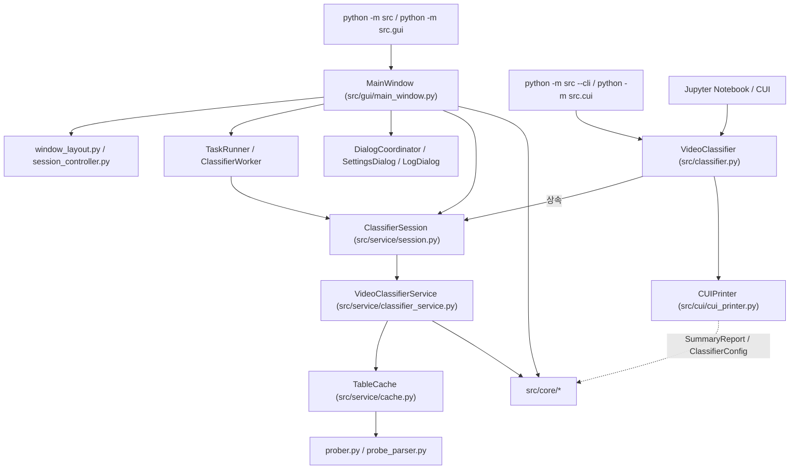
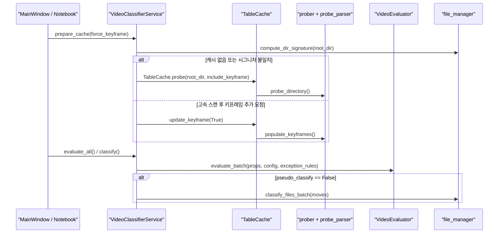

# 프로젝트 구조 및 아키텍처 (`ARCHITECTURE.md`)

`video_scripts`의 **계층 경계**, **모듈 책임**, **실행 흐름**, **설정, 검증 체계**를 정리한 아키텍처 기준 문서입니다.

콘솔(CUI), Jupyter 노트북 출력과 PyQt6 데스크톱 GUI가 동일한 분류 세션(`ClassifierSession`)을 공유하도록 구성되어 있습니다. 순수 도메인, 프로빙, 평가, 파일 IO를 담당하는 `src/core/`, 작업 폴더별 캐시와 분류 트랜잭션을 조율하고 UI 무관 세션을 제공하는 `src/service/`, 콘솔 테이블 출력(`src/cui/`)과 대시보드, 필터 테이블 UI(`src/gui/`)로 책임을 분리하고, `scripts/` 정적 검증 게이트와 `tests/` 단위 테스트 스위트로 계약 일관성을 유지합니다.

## 1. 핵심 설계 원칙

1. **3계층 단방향 의존성 (`cui`/`gui` -> `service` -> `core`)**
   - `src/core`: 도메인 모델, 설정, `ffprobe` 프로빙/파싱, 평가, 예외 조건식 AST, 파일 IO, 정렬(상위 계층 임포트 금지)
   - `src/service`: `root_dir`별 `TableCache`, 시그니처 동기화, 평가 오케스트레이션, 분류/복원 트랜잭션 조율, UI 무관 분류 세션(`ClassifierSession`)
   - `src/cui`: 콘솔(Jupyter) 출력(`CUIPrinter`는 `SummaryReport`, `ClassifierConfig`로 결합, `Service` 직접 임포트 금지)
   - `src/gui`: PyQt6 UI, 세션은 `service`의 `ClassifierSession`과 `core` 모델, 설정 타입에 의존
   - [src/classifier.py](src/classifier.py) (`VideoClassifier`): 노트북/CUI 파사드(`ClassifierSession` 상속 + 출력, GUI 실행)
2. **평탄한 디렉터리, 수평 모듈 분리**: 기존 깊이(`src/core`, `src/service`, `src/cui`, `src/gui/{dialogs,styles,widgets}`) 유지, 단일 책임 `.py` 수평 분리
3. **비파괴 분류, 중단 제어**
   - `pseudo_classify_mode`: 디스크 이동 및 `VideoProps.moved_dirname` 변경 없이 `VideoEvaluation.target_dirname` 기반 미리보기만 반환
   - `classify_files_batch`: 대상 파일 충돌 시 덮어쓰기 생략, 중간 `OSError` 시 기이동 파일 루트 롤백
   - `ClassifierWorker`: 취소 시 `InterruptedError` 및 `_terminate_and_reap`로 실행 중인 `ffprobe` 자식 프로세스 즉시 회수

## 2. 계층 및 의존성 구조

## 3. 디렉터리 및 모듈 맵

### 3.1. 최상위 진입점

| 경로 | 역할 | 비고 |
| --- | --- | --- |
| [src/__init__.py](src/__init__.py) | 공개 API 통합 export | `from src import VideoClassifier` 등 노트북 편의 제공 |
| [src/__main__.py](src/__main__.py) | `dispatch_main` 통합 실행 분기 | `python -m src` 무인자/`--gui`는 GUI, 인자/`--cli`는 스탠드얼론 CLI 분기 |
| [src/classifier.py](src/classifier.py) | `VideoClassifier` 노트북/CUI 파사드 | `ClassifierSession` 상속 + 상태 파일 로드, 임계값 튜닝, 콘솔 출력(`print`/`print_tables`/`print_summary`), `gui` 실행 |

### 3.2. `src/core/`: 도메인, 프로빙, 평가, 파일 IO

| 모듈 | 주요 심볼 | 책임 |
| --- | --- | --- |
| [models.py](src/core/models.py) | `QualityZone`, `QUALITY_ZONE_SORT_RANK`, `SmartAction`, `EfficiencySummary`, `VideoProps`, `VideoEvaluation`, `SummaryReport` | 도메인 데이터 모델 및 판별, 정렬 열거형 |
| [config.py](src/core/config.py) | `ClassifierConfig`, `PathsConfig`, `AnalysisConfig`, `ThresholdsConfig`, `EfficiencyConfig`, `CodecWeightsConfig`, `BitrateModelConfig`, `DisplayConfig`, `CuiConfig`, `UiState`, `CORE_SETTING_COUNT`, `CODEC_WEIGHT_GROUPS`, `collect_setting_bounds`, `get_app_base_dir`, `get_data_dir`, `write_utf8_file`, `ensure_utf8_file`, `ensure_default_rootdir_file`, `get_root_dir`, `set_root_dir` | 실행 기준 경로, `data/*` 공통 파일 입출력, `data/rootdir.txt` 자동 생성, 메타데이터 기반 계층 설정 데이터클래스(`comment`/`bounds` 단일 원천) 및 코덱 가중치 관리 |
| [formatting.py](src/core/formatting.py) | `format_float_precision`, `format_fps`, `format_duration_hms`, `format_duration_seconds`, `format_duration_ko`, `format_ratio`, `format_keyframe_interval`, `format_size_mb`, `format_size_header` | CUI, GUI 공용 열별 수치 정밀도, 정수 생략, 미측정, 용량 단위, 헤더 포맷터 SSOT |
| [app_state.py](src/core/app_state.py) | `AppState`, `build_default_notebook_payload`, `ensure_default_config_files`, `ensure_default_notebook_file`, `get_data_dir`, `get_notebook_path`, `get_state_path`, `load_app_state`, `save_app_state`, `reset_app_state`, `resolve_effective_root_dir`, `record_recent_dir` | 기본 파일 생성은 `ensure_default_config_files` 명시 호출, `load_app_state`는 읽기 전용, 영속화, 기본 작업 경로 조회 및 기본값 복원 |
| [state_codec.py](src/core/state_codec.py) | `strip_jsonc_comments`, `parse_state_mapping`, `render_state_jsonc` | JSONC 주석 파싱, 제거, 데이터클래스 메타데이터 기반 계층 스키마 매핑 및 주석 포함 직렬화 |
| [prober.py](src/core/prober.py) | `run_ffprobe`, `extract_video_props`, `extract_keyframe_interval`, `probe_directory`, `populate_keyframes` | `ProcessPoolExecutor` 병렬 프로빙, 타임아웃, 중단 감시, 자식 프로세스 회수 |
| [system_probe.py](src/core/system_probe.py) | `SystemSpeedRecommendation`, `recommend_encode_speed_for_profile`, `detect_recommended_encode_speed` | CPU 스레드, GPU, FFmpeg 하드웨어 인코더 감지 기반 1080p 예상 인코딩 배속 추천 |
| [probe_parser.py](src/core/probe_parser.py) | `build_video_props`, `parse_fps`, `get_rotate_type`, `parse_mean_keyframe_interval`, `estimate_video_bps` | `ffprobe` JSON 스트림, 프레임 순수 파싱 및 메타데이터 산출 |
| [evaluator.py](src/core/evaluator.py) | `VideoEvaluator` | 픽셀 면적, FPS, 코덱 기반 `B_opt`, 예상 인코딩 소요 시간, 화질 3구간, 절감 효율 선별, 리포트 산출 |
| [exception_rules.py](src/core/exception_rules.py) | `validate_exception_token`, `parse_exception_token`, `split_exception_tokens`, `merge_exception_tokens`, `exclude_exception_tokens`, `get_exception_syntax_reference` | 예외 키워드 및 AST 화이트리스트 조건식(`v.*`) 검증, 컴파일, 참조 목록 제공 |
| [file_manager.py](src/core/file_manager.py) | `get_video_filenames`, `resolve_video_filepath`, `compute_dir_signature`, `move_file`, `classify_files_batch`, `unclassify_all_files`, `MoveIssue`, `MoveIssueKind` | 폴더 스캔, 시그니처 계산, 배치 이동 트랜잭션, 롤백, 복원, 이동 이슈 구조체 |
| [sorting.py](src/core/sorting.py) | `WindowsNameOrder`, `compare_natural_tokens` | CUI/GUI 공용 윈도우 탐색기 자연 정렬 토큰 생성, 비교 |
| [messages.py](src/core/messages.py) | `LOG_TAG_*`, `MSG_*_CANCELLED`, `LABEL_*`, `format_log`, `format_move_issue`, `format_quality_zone_tooltip` | CUI/GUI 공용 로그 포맷, 상태 레이블, 동적 안내 문구 SSOT |
| [exceptions.py](src/core/exceptions.py) | `ErrorCode`, `VideoScriptsError`, `Domain*Error`, `format_user_error` | 표준 예외 호환 도메인 예외 계층 및 해결 힌트 포맷터 |
| [logging_setup.py](src/core/logging_setup.py) | `APP_LOGGER_NAME`, `UserLogFormatter`, `get_app_logger`, `ensure_console_logging` | 패키지 루트(`src`) `logging` 포맷터 및 동적 `sys.stdout` 핸들러 |

### 3.3. `src/service/`: 오케스트레이션 및 캐시

| 모듈 | 주요 심볼 | 책임 |
| --- | --- | --- |
| [cache.py](src/service/cache.py) | `TableCache`, `CacheRegistry`, `DEFAULT_CACHE_REGISTRY` | 작업 폴더 `VideoProps` 인메모리 보관 및 키프레임 증분 보완(`update_keyframe`), 디스크 프로빙은 `TableCache.probe` 팩토리에서만 수행, 정규화된 `root_dir`별 캐시와 디렉터리 시그니처를 레지스트리 인스턴스에 보관 |
| [classifier_service.py](src/service/classifier_service.py) | `VideoClassifierService` | `CacheRegistry` 주입으로 캐시 저장소 선택(생략 시 `DEFAULT_CACHE_REGISTRY` 공유), 일괄 평가, 분류(`dry_run` 인자 우선), 복원 |
| [session.py](src/service/session.py) | `ClassifierSession` | UI 무관 분류 세션, 예외 규칙 상태 보관, 평가, 분류, 복원 위임, 상태 파일과 콘솔에 의존하지 않음 |

### 3.4. `src/cui/`: 콘솔 및 Jupyter 출력

| 모듈 | 주요 심볼 | 책임 |
| --- | --- | --- |
| [cli.py](src/cui/cli.py) | `build_cli_parser`, `run_cli`, `main` | `python -m src.cui` 스탠드얼론 CLI 옵션 파싱, 실행, 종료 코드 매핑 |
| [__main__.py](src/cui/__main__.py) | `main` | `python -m src.cui` 직접 실행 진입점 |
| [cui_printer.py](src/cui/cui_printer.py) | `CUIPrinter`, `TablePrinter`, `sanitize_text`, `truncate_text`, `print_console_progress` | `tabulate` 기반 그룹별 테이블 및 3단 용량 시뮬레이션 출력, 콘솔 한 줄 진행률 출력 |
| [sorting.py](src/cui/sorting.py) | `col`, `desc`, `t`, `SortBy`, `SortTarget`, `CuiColumnKeyMap`, `build_sort_key`, `WindowsNameOrder` | 다중 정렬 키 래퍼, 프리셋 정렬, 타입 안전 한글 헤더 매핑, 코어 `WindowsNameOrder` 재노출 |

### 3.5. `src/gui/`: PyQt6 데스크톱 GUI

| 분류 | 모듈 | 책임 |
| --- | --- | --- |
| **진입, 부트스트랩** | [__main__.py](src/gui/__main__.py), [__init__.py](src/gui/__init__.py) | `python -m src.gui` 실행 및 `QApplication` 부트스트랩(`run_gui`) |
| **메인 코디네이터** | [main_window.py](src/gui/main_window.py) | `MainWindow` 이벤트 배선, 드래그 앤 드롭 전환, 단축키, 외부 제어 |
| **수평 컨트롤러** | [menu_bar.py](src/gui/menu_bar.py), [window_layout.py](src/gui/window_layout.py), [session_controller.py](src/gui/session_controller.py), [footer_summary.py](src/gui/footer_summary.py), [task_runner.py](src/gui/task_runner.py), [dialog_coordinator.py](src/gui/dialog_coordinator.py), [worker.py](src/gui/worker.py), [logging_bridge.py](src/gui/logging_bridge.py) | 전체 기능 메뉴바, 단축키, 레이아웃, 상태 저장/복원, 경로, 설정 바인딩, 푸터 구간 합계 집계, 포맷, `QThread` 실행 관리, 로그, 설정, 도움말, CSV 대화상자 조율, Qt 로그 브리지 |
| **모델, 내보내기** | [table_columns.py](src/gui/table_columns.py), [table_model.py](src/gui/table_model.py), [proxy_model.py](src/gui/proxy_model.py), [column_filters.py](src/gui/column_filters.py), [delegates.py](src/gui/delegates.py), [exporters.py](src/gui/exporters.py), [constants.py](src/gui/constants.py) | 20열 테이블 스키마, 행 툴팁, 뷰모델, 검색, 동적 열 필터, 자연 정렬 프록시, 열 필터 모델, Pill, 아이콘 델리게이트, CSV 내보내기, 공용 상수 |
| **위젯 (`widgets/`)** | [header_bar.py](src/gui/widgets/header_bar.py), [bento_dashboard.py](src/gui/widgets/bento_dashboard.py), [edge_fade_overlay.py](src/gui/widgets/edge_fade_overlay.py), [filter_bar.py](src/gui/widgets/filter_bar.py), [filter_header_view.py](src/gui/widgets/filter_header_view.py), [column_filter_popover.py](src/gui/widgets/column_filter_popover.py), [filter_checklist_widget.py](src/gui/widgets/filter_checklist_widget.py), [video_table_view.py](src/gui/widgets/video_table_view.py), [table_context_menu.py](src/gui/widgets/table_context_menu.py), [footer_bar.py](src/gui/widgets/footer_bar.py), [custom_spinbox.py](src/gui/widgets/custom_spinbox.py), [collapsible_section.py](src/gui/widgets/collapsible_section.py), [settings_group_card.py](src/gui/widgets/settings_group_card.py) | 경로, 스캔 분할 버튼, 4카드 KPI 벤토 대시보드, 1줄 검색, 예외 목록 컨트롤 바, 동적 열 필터 헤더, 팝오버, 체크리스트, 컨텍스트 메뉴 테이블, 분류/복원 푸터 바, 설정 카드 |
| **대화상자 (`dialogs/`)** | [settings_dialog.py](src/gui/dialogs/settings_dialog.py), [criteria_tuner_panel.py](src/gui/dialogs/criteria_tuner_panel.py), [settings_sections.py](src/gui/dialogs/settings_sections.py), [setting_row.py](src/gui/dialogs/setting_row.py), [setting_controls.py](src/gui/dialogs/setting_controls.py), [exception_rules_dialog.py](src/gui/dialogs/exception_rules_dialog.py), [help_dialog.py](src/gui/dialogs/help_dialog.py), [log_dialog.py](src/gui/dialogs/log_dialog.py) | 2탭 통합 설정, 판별 기준 창(`data/config.json` 검증, 저장), 비모달 판별 기준 실시간 조정 탭 패널, 섹션 빌더, 개별 설정 행, 설정형 대화상자 공용 휠 안전 컨트롤, 탭 셸 빌더, 여러 줄 예외 규칙 편집기, 3탭 사용 가이드, 핵심 개념 대화상자, 작업 로그 뷰어 |
| **테마, 스타일 (`styles/`)** | [theme.py](src/gui/theme.py), [palettes.py](src/gui/styles/palettes.py), [stylesheet.py](src/gui/styles/stylesheet.py), [icons.py](src/gui/styles/icons.py), `assets/icons/` | 다크/라이트 감지, 구독(`ThemeAwareMixin`), 팔레트, QSS, 동적 SVG 아이콘 색칠 및 캐시 지연 생성 |

## 4. 주요 실행 흐름

- **인메모리 실시간 튜닝**: 임계값, 예외 식 변경 시 `ffprobe` 재실행 없이 캐시된 `VideoProps`에 `VideoEvaluator.evaluate_batch()`만 재적용, GUI 실시간 재평가는 `evaluate_cached()`로 디스크 시그니처 조회 없이 캐시만 사용
- **캐시 격리, 일관성**: `root_dir`별 독립 캐시/시그니처 유지, `classify()`/`unclassify_files()` 후 시그니처 즉시 갱신

## 5. 외부 설정, 의존성, 검증 체계

| 파일 / 디렉터리 | 용도 |
| --- | --- |
| `data/config.json` | 화질 배수, 코덱 가중치, 절감 효율, 목표 인코딩 방식, 기준 배속, 분류 폴더명, 공통 표 서식, 열 너비 등 31개 세부 설정과 UI 상태(예외, 필터, 스캔 모드, 테마, 창/헤더 배치, 최근 폴더) 통합 포터블 저장 파일(`.gitignore` 제외 대상) |
| `data/rootdir.txt` | CUI/노트북, GUI 공유 기본 작업 비디오 폴더 경로 단일 저장 파일(CUI 안내 주석 포함) |
| `classify.ipynb` | 첫 실행 시 자동 생성되는 CUI/Jupyter 작업 노트북 템플릿(`.gitignore` 제외 대상) |
| [shana_presets/](shana_presets/) | `_1_표준인코딩_CQ22`, `_2_저화질_키프레임교정`과 1:1 매핑되는 NVENC / CPU x265 XML 프리셋 |
| [requirements.txt](requirements.txt) | 앱(GUI, CUI) 의존성 (`PyQt6`, `tabulate`) |
| [requirements-notebook.txt](requirements-notebook.txt) | 노트북 추가 의존성 (`-r requirements.txt` + `ipykernel`) |
| [requirements-dev.txt](requirements-dev.txt) | 정적 검증, 개발 도구 (`-r requirements.txt` + `ruff`, `basedpyright`, `coverage`) |
| [pyproject.toml](pyproject.toml) | Ruff, BasedPyright `strict` 설정 |
| [scripts/check.ps1](scripts/check.ps1) | Ruff -> BasedPyright(`strict`) -> [verify_hygiene.py](scripts/verify_hygiene.py) -> 전체 `unittest` 통합 게이트 |
| [scripts/verify_hygiene.py](scripts/verify_hygiene.py) | `data/`, `.rootdir`, 캐시 커밋 차단 및 로컬 경로, 사설 IP, `max_workers=` 하드코딩 탐지 |
| [scripts/verify_module_size.py](scripts/verify_module_size.py) | 모듈 줄 수 소프트(500), 하드(800) 상한 검사, 기존 초과 파일은 `module_size_baseline.json` 기준선에 동결(`tests/test_module_size.py`가 게이트로 실행) |
| [scripts/sync_skills.py](scripts/sync_skills.py) | `.agents/skills` 원본과 `.claude/skills` 사본의 불일치 검사 및 `--write` 재생성 |
| [scripts/hooks/pre-commit](scripts/hooks/pre-commit) | 공유 Git `pre-commit` 훅 (`git config core.hooksPath scripts/hooks`로 활성화) |
| [AGENTS.md](AGENTS.md) | 아키텍처, 정적 검증, 테스트 격리, 주석, 위생 작업 규칙 |
| [.claude/skills/](.claude/skills/) | Claude Code용 스킬 사본 (`.agents/skills`에서 파생, [sync_skills.py](scripts/sync_skills.py)로 동기화) |
| [.agents/skills/](.agents/skills/) | 작업별 에이전트 스킬 정의 원본 (`setting`, `test`, `sync`, `perf`, `refactor`, `review`, `commit`) |
