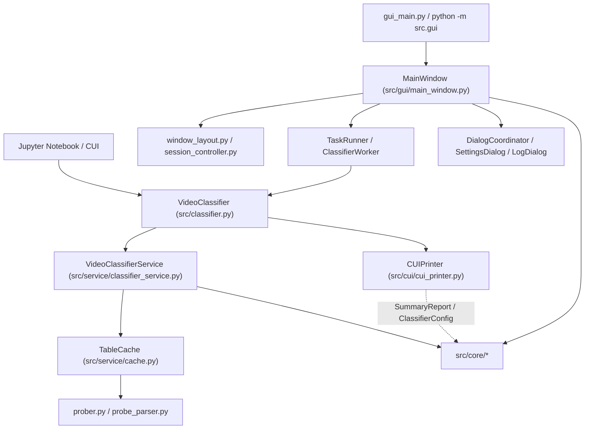
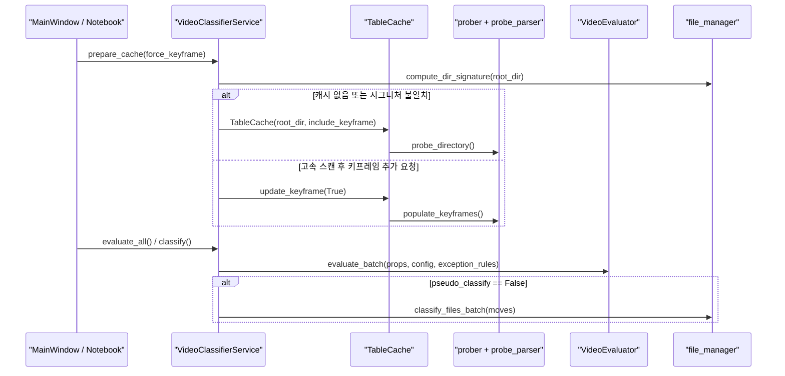

# 프로젝트 구조 및 아키텍처 (`ARCHITECTURE.md`)

`video_scripts`의 **계층 경계**, **모듈 책임**, **실행 흐름**, **설정·검증 체계**를 정리한 아키텍처 기준 문서입니다.

콘솔(CUI)·Jupyter 노트북 출력과 PyQt6 데스크톱 GUI가 동일한 비즈니스 엔진(`VideoClassifier`)을 공유하도록 구성되어 있습니다. 순수 도메인·프로빙·평가·파일 IO를 담당하는 `src/core/`, 작업 폴더별 캐시와 분류 트랜잭션을 조율하는 `src/service/`, 콘솔 테이블 출력(`src/cui/`)과 대시보드·필터 테이블 UI(`src/gui/`)로 책임을 분리하고, `scripts/` 정적 검증 게이트와 `tests/` 단위 테스트 스위트로 계약 일관성을 유지합니다.

## 1. 핵심 설계 원칙

1. **3계층 단방향 의존성 (`core` ← `service` ← `cui` / `gui`)**
   - `src/core`: 도메인 모델·설정·`ffprobe` 프로빙/파싱·평가·예외 조건식 AST·파일 IO·정렬(상위 계층 임포트 금지)
   - `src/service`: `root_dir`별 `TableCache`·시그니처 동기화·평가 오케스트레이션·분류/복원 트랜잭션 조율
   - `src/cui` · `src/gui`: 콘솔(Jupyter) 출력 및 PyQt6 UI(`CUIPrinter`는 `SummaryReport`·`ClassifierConfig`로 결합, `Service` 직접 임포트 금지)
   - [src/classifier.py](src/classifier.py) (`VideoClassifier`): `CUI`·`GUI` 공용 비즈니스 엔진 통합 파사드
2. **평탄한 디렉터리 · 수평 모듈 분리**: 기존 깊이(`src/core`, `src/service`, `src/cui`, `src/gui/{dialogs,styles,widgets}`) 유지, 단일 책임 `.py` 수평 분리
3. **비파괴 분류 · 중단 제어**
   - `pseudo_classify_mode`: 디스크 이동 및 `VideoProps.moved_dirname` 변경 없이 `VideoEvaluation.target_dirname` 기반 미리보기만 반환
   - `classify_files_batch`: 대상 파일 충돌 시 덮어쓰기 생략, 중간 `OSError` 시 기이동 파일 루트 롤백
   - `ClassifierWorker`: 취소 시 `InterruptedError` 및 `_terminate_and_reap`로 실행 중인 `ffprobe` 자식 프로세스 즉시 회수

## 2. 계층 및 의존성 구조

## 3. 디렉터리 및 모듈 맵

### 3.1. 최상위 진입점

| 경로 | 역할 | 비고 |
| --- | --- | --- |
| [gui_main.py](gui_main.py) | 데스크톱 GUI 실행(`run_gui()`) | `python gui_main.py` 진입점 |
| [src/__init__.py](src/__init__.py) | 공개 API 통합 export | `from src import VideoClassifier` 등 노트북 편의 제공 |
| [src/classifier.py](src/classifier.py) | `VideoClassifier` 통합 파사드 | 경로 전환, 임계값 튜닝, 캐시 무효화, `classify`/`print`/`unclassify_files`/`gui` |

### 3.2. `src/core/` — 도메인·프로빙·평가·파일 IO

| 모듈 | 주요 심볼 | 책임 |
| --- | --- | --- |
| [models.py](src/core/models.py) | `QualityZone`, `SmartAction`, `FootageStrategy`, `SmallFootageDistribution`, `VideoProps`, `VideoEvaluation`, `SummaryReport` | 도메인 데이터 모델 및 판별 열거형 |
| [config.py](src/core/config.py) | `ClassifierConfig`, `PathsConfig`, `AnalysisConfig`, `ThresholdsConfig`, `SmallFootageConfig`, `CodecWeightsConfig`, `BitrateModelConfig`, `CuiConfig`, `UiState`, `CORE_SETTING_COUNT`, `CODEC_WEIGHT_GROUPS`, `collect_setting_bounds`, `get_app_base_dir`, `ensure_default_rootdir_file`, `get_root_dir`, `set_root_dir` | 실행 기준 경로, `.rootdir` 자동 생성·입출력, 메타데이터 기반 계층 설정 데이터클래스(`comment`/`bounds` 단일 원천) 및 코덱 가중치 관리 |
| [app_state.py](src/core/app_state.py) | `AppState`, `ensure_default_config_files`, `get_data_dir`, `get_state_path`, `load_app_state`, `save_app_state`, `reset_app_state`, `resolve_effective_root_dir`, `record_recent_dir` | 통합 설정·상태 JSONC(`data/config.json`) 자동 생성·영속화, `.rootdir` 우선순위 및 기본값 복원 |
| [state_codec.py](src/core/state_codec.py) | `strip_jsonc_comments`, `parse_state_mapping`, `render_state_jsonc` | JSONC 주석 파싱·제거, 데이터클래스 메타데이터 기반 계층 스키마 매핑 및 주석 포함 직렬화 |
| [prober.py](src/core/prober.py) | `run_ffprobe`, `extract_video_props`, `extract_keyframe_interval`, `probe_directory`, `populate_keyframes` | `ProcessPoolExecutor` 병렬 프로빙, 타임아웃·중단 감시·자식 프로세스 회수 |
| [probe_parser.py](src/core/probe_parser.py) | `build_video_props`, `parse_fps`, `get_rotate_type`, `parse_mean_keyframe_interval`, `estimate_video_bps` | `ffprobe` JSON 스트림·프레임 순수 파싱 및 메타데이터 산출 |
| [evaluator.py](src/core/evaluator.py) | `VideoEvaluator` | 픽셀 면적·FPS·코덱 기반 `B_opt`, 화질 3구간, 소형 영상 전략, 리포트 산출 |
| [exception_rules.py](src/core/exception_rules.py) | `validate_exception_token`, `parse_exception_token`, `split_exception_tokens`, `merge_exception_tokens`, `exclude_exception_tokens` | 예외 키워드 및 AST 화이트리스트 조건식(`v.*`) 검증·컴파일 |
| [file_manager.py](src/core/file_manager.py) | `get_video_filenames`, `resolve_video_filepath`, `compute_dir_signature`, `move_file`, `classify_files_batch`, `unclassify_all_files` | 폴더 스캔, 시그니처 계산, 배치 이동 트랜잭션·롤백·복원 |
| [sorting.py](src/core/sorting.py) | `WindowsNameOrder`, `compare_natural_tokens` | CUI/GUI 공용 윈도우 탐색기 자연 정렬 토큰 생성·비교 |
| [messages.py](src/core/messages.py) | `LOG_TAG_*`, `MSG_*_CANCELLED`, `LABEL_*`, `format_log`, `format_warning_log`, `format_quality_zone_tooltip` | CUI/GUI 공용 로그 포맷·상태 레이블·동적 안내 문구 SSOT |
| [exceptions.py](src/core/exceptions.py) | `ErrorCode`, `VideoScriptsError`, `Domain*Error`, `format_user_error` | 표준 예외 호환 도메인 예외 계층 및 해결 힌트 포맷터 |
| [logging_setup.py](src/core/logging_setup.py) | `APP_LOGGER_NAME`, `UserLogFormatter`, `get_app_logger`, `ensure_console_logging` | 패키지 루트(`src`) `logging` 포맷터 및 동적 `sys.stdout` 핸들러 |

### 3.3. `src/service/` — 오케스트레이션 및 캐시

| 모듈 | 주요 심볼 | 책임 |
| --- | --- | --- |
| [cache.py](src/service/cache.py) | `TableCache` | 작업 폴더 `VideoProps` 인메모리 보관 및 키프레임 증분 보완(`update_keyframe`) |
| [classifier_service.py](src/service/classifier_service.py) | `VideoClassifierService` | 정규화된 `root_dir`별 `_shared_caches`·`_shared_signatures` 격리 관리, 일괄 평가·분류·복원 |

### 3.4. `src/cui/` — 콘솔 및 Jupyter 출력

| 모듈 | 주요 심볼 | 책임 |
| --- | --- | --- |
| [cui_printer.py](src/cui/cui_printer.py) | `CUIPrinter`, `TablePrinter`, `sanitize_text`, `truncate_text` | `tabulate` 기반 그룹별 테이블 및 3단 용량 시뮬레이션 출력 |
| [sorting.py](src/cui/sorting.py) | `col`, `desc`, `t`, `WindowsNameOrder` | 다중 정렬 키 래퍼·한글 헤더 축약 매핑·코어 `WindowsNameOrder` 재노출 |

### 3.5. `src/gui/` — PyQt6 데스크톱 GUI

| 분류 | 모듈 | 책임 |
| --- | --- | --- |
| **진입·부트스트랩** | [__main__.py](src/gui/__main__.py), [__init__.py](src/gui/__init__.py) | `python -m src.gui` 실행 및 `QApplication` 부트스트랩(`run_gui`) |
| **메인 코디네이터** | [main_window.py](src/gui/main_window.py) | `MainWindow` 이벤트 배선, 드래그 앤 드롭 전환, 단축키·외부 제어 |
| **수평 컨트롤러** | [menu_bar.py](src/gui/menu_bar.py), [window_layout.py](src/gui/window_layout.py), [session_controller.py](src/gui/session_controller.py), [task_runner.py](src/gui/task_runner.py), [dialog_coordinator.py](src/gui/dialog_coordinator.py), [worker.py](src/gui/worker.py), [logging_bridge.py](src/gui/logging_bridge.py) | 전체 기능 메뉴바·단축키, 레이아웃·상태 저장/복원, 경로·설정 바인딩, `QThread` 실행 관리, 로그·설정·CSV 대화상자 조율, Qt 로그 브리지 |
| **모델·내보내기** | [table_model.py](src/gui/table_model.py), [proxy_model.py](src/gui/proxy_model.py), [column_filters.py](src/gui/column_filters.py), [delegates.py](src/gui/delegates.py), [exporters.py](src/gui/exporters.py), [constants.py](src/gui/constants.py) | 15열 테이블 모델·열 스키마, 검색·동적 열 필터·자연 정렬 프록시, 열 필터 모델, Pill 델리게이트, CSV 내보내기, 공용 상수 |
| **위젯 (`widgets/`)** | [header_bar.py](src/gui/widgets/header_bar.py), [bento_dashboard.py](src/gui/widgets/bento_dashboard.py), [filter_bar.py](src/gui/widgets/filter_bar.py), [filter_header_view.py](src/gui/widgets/filter_header_view.py), [column_filter_popover.py](src/gui/widgets/column_filter_popover.py), [video_table_view.py](src/gui/widgets/video_table_view.py), [footer_bar.py](src/gui/widgets/footer_bar.py), [custom_spinbox.py](src/gui/widgets/custom_spinbox.py), [collapsible_section.py](src/gui/widgets/collapsible_section.py), [settings_group_card.py](src/gui/widgets/settings_group_card.py) | 경로·스캔 분할 버튼, KPI 벤토 카드, 실시간 튜닝 바, 동적 열 필터 헤더·팝오버, 컨텍스트 메뉴 테이블, 분류/복원 푸터 바, 설정 카드 |
| **대화상자 (`dialogs/`)** | [settings_dialog.py](src/gui/dialogs/settings_dialog.py), [settings_sections.py](src/gui/dialogs/settings_sections.py), [setting_row.py](src/gui/dialogs/setting_row.py), [exception_rules_dialog.py](src/gui/dialogs/exception_rules_dialog.py), [log_dialog.py](src/gui/dialogs/log_dialog.py) | `data/config.json` 설정 검증·저장, 섹션 빌더, 개별 설정 행, 여러 줄 예외 규칙 편집기, 작업 로그 뷰어 |
| **테마·스타일 (`styles/`)** | [theme.py](src/gui/theme.py), [palettes.py](src/gui/styles/palettes.py), [stylesheet.py](src/gui/styles/stylesheet.py), [icons.py](src/gui/styles/icons.py), `assets/icons/` | 다크/라이트 감지·구독(`ThemeAwareMixin`), 팔레트, QSS, 동적 SVG 아이콘 색칠 및 캐시 지연 생성 |

## 4. 주요 실행 흐름

- **인메모리 실시간 튜닝**: 임계값·예외 식 변경 시 `ffprobe` 재실행 없이 캐시된 `VideoProps`에 `VideoEvaluator.evaluate_batch()`만 재적용
- **캐시 격리 · 일관성**: `root_dir`별 독립 캐시/시그니처 유지, `classify()`/`unclassify_files()` 후 시그니처 즉시 갱신

## 5. 외부 설정 · 의존성 · 검증 체계

| 파일 / 디렉터리 | 용도 |
| --- | --- |
| `data/config.json` | 화질 배수·코덱 가중치·소형 영상 전략·분류 폴더명·열 너비 등 22개 세부 설정과 UI 상태(예외·필터·스캔 모드·테마·창/헤더 배치·최근 폴더) 통합 포터블 저장 파일(`.gitignore` 제외 대상) |
| [.rootdir_example](.rootdir_example) / `.rootdir` | 기본 작업 비디오 폴더 경로 템플릿(통합 설정·상태 파일보다 항상 우선 적용) |
| [shana_presets/](shana_presets/) | `_1_표준인코딩_CQ22` · `_2_저화질_키프레임교정`과 1:1 매핑되는 NVENC / CPU x265 XML 프리셋 |
| [requirements.txt](requirements.txt) | 앱(GUI·CUI) 의존성 (`PyQt6`, `tabulate`) |
| [requirements-notebook.txt](requirements-notebook.txt) | 노트북 추가 의존성 (`-r requirements.txt` + `ipykernel`) |
| [requirements-dev.txt](requirements-dev.txt) | 정적 검증·개발 도구 (`-r requirements.txt` + `ruff`, `basedpyright`, `coverage`) |
| [pyproject.toml](pyproject.toml) | Ruff · BasedPyright `strict` 설정 |
| [scripts/check.ps1](scripts/check.ps1) | Ruff → BasedPyright(`strict`) → [verify_hygiene.py](scripts/verify_hygiene.py) → 전체 `unittest` 통합 게이트 |
| [scripts/verify_hygiene.py](scripts/verify_hygiene.py) | `data/`·`.rootdir`·캐시 커밋 차단 및 로컬 경로·사설 IP·`max_workers=` 하드코딩 탐지 |
| [scripts/hooks/pre-commit](scripts/hooks/pre-commit) | 공유 Git `pre-commit` 훅 (`git config core.hooksPath scripts/hooks`로 활성화) |
| [AGENTS.md](AGENTS.md) | 아키텍처·정적 검증·테스트 격리·주석·위생 작업 규칙 |
| [.agents/skills/](.agents/skills/) | 작업별 에이전트 스킬 정의 (`add-setting` · `gui-theme-check` · `perf-benchmark` · `refactor` · `self-review` · `smart-commit`) |
