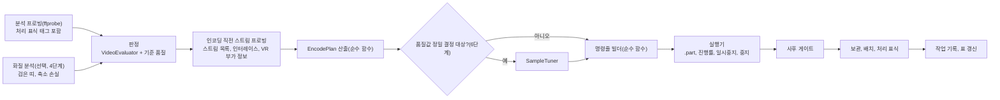
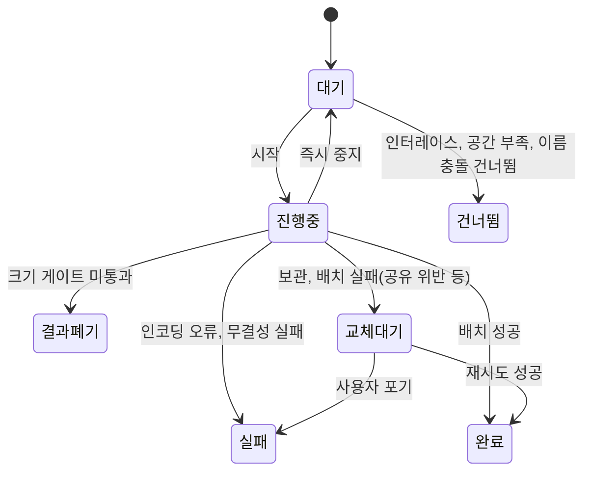

# 영상별 맞춤 직접 인코딩: 최종 설계서 및 구현 계획

> 상태: 확정(2026-11-18). 결정 1~27 전부 승인, AGENTS.md 변경 문구 승인. 0단계(기준선, 역추적) 완료, 1단계부터 구현 대기
>
> 대상 독자: 이 저장소에서 1~6단계를 구현하는 에이전트. 이 문서만으로 단계별 작업, 파일, 데이터 형식, 검증 기준을 정할 수 있도록 작성
>
> 우선순위: `AGENTS.md`, `CLAUDE.md`의 저장소 규칙이 항상 우선. 이 문서와 저장소 규칙, 또는 이 문서와 실제 코드가 어긋나면 구현을 멈추고 사용자에게 보고
>
> 표기: "초기값"은 실측 전 근거가 약한 수치로, 명명 상수로 두고 독스트링에 "초기값, 4단계 보정 대상"을 적음

---

## 0. 구현 에이전트 실행 규칙

### 0.1 공통 규칙
1. 단계는 1 -> 2 -> 3 -> 4 -> 5 -> 6 순서로만 진행. 단계를 건너뛰거나 합치지 않음
2. 각 단계 시작 전에 사용자에게 "작업 목록, 수정, 신규, 삭제 파일, 검증 방법"을 제시하고 승인받은 뒤 착수(`AGENTS.md` 7절). 대량 제거, 개명은 범위를 먼저 합의
3. 각 단계는 독립 커밋 묶음으로 끝내고, 커밋 전 `scripts/check.ps1`를 오류, 경고, 스킵 없이 통과
4. 저장소 규칙 요약(상세는 `AGENTS.md`)
   - 계층: `src/gui`, `src/cui` -> `src/service` -> `src/core` 단방향
   - 모듈 500줄 초과 시 책임 분리 검토, 1000줄 초과 불가. [`main_window.py`](src/gui/main_window.py)는 999줄이므로 줄을 늘리지 않음
   - Ruff + BasedPyright `strict` 0 오류, 0 경고
   - 메타 문서, 주석, 커밋 메시지에는 한글 외 비ASCII 문자 금지
   - 버튼은 아이콘만, 이름은 접근성 이름과 툴팁. 색은 팔레트 토큰만
   - 설정 키 추가, 변경은 `setting` 스킬, 모듈 추가, 개명은 `sync` 스킬, 테스트는 `test` 스킬 절차
5. 사용자 노출 새 용어는 후보 2~3개와 추천안을 제시해 승인받은 뒤 `TERMINOLOGY.md`에 추가하고 사용(11절의 승인 용어는 바로 사용 가능)
6. 실측 결과로 수치를 바꾸면 이 문서의 해당 결정과 12절 기준선 결과를 함께 갱신
7. 이 문서에 없는 판단이 필요하면 추측하지 말고 선택지와 추천안을 들고 사용자에게 질문

### 0.2 GUI 구현 전 레퍼런스 요청 절차(결정 26)
GUI 화면(새 화면, 기존 화면 개편, 대화상자, 설정 항목 포함)의 UI 코드를 작성하기 **직전에** 반드시 아래 순서를 실행

1. 사용자에게 다음 세 가지를 먼저 보고
   - (1) 이 GUI가 우리 프로그램의 어느 화면, 위치에서 쓰이는지(예: 메인 창 하단 막대, 재인코딩 메뉴, 환경 설정 대화상자의 어느 영역)
   - (2) 요청하는 레퍼런스 GUI가 원본 프로그램(주로 샤나인코더 7.4)에서 어떤 상황, 조건일 때 나타나는 화면인지(예: "샤나에서 파일 2개 이상을 동시 인코딩하는 도중의 인코딩 창")
   - (3) 받고 싶은 상태 목록(예: 진행 중, 일시중지, 오류, 완료)
2. 레퍼런스 이미지를 요청하고 받을 때까지 해당 화면 UI 코드를 작성하지 않음. 원본 프로그램에 대응 화면이 없으면 그 사실을 보고하고 "기존 화면 스타일로 진행"할지 사용자 결정을 받음
3. 레퍼런스를 받은 뒤 `gui-design` 스킬 절차로 배치안을 제시하고 구현
4. 이전 세션에서 받은 이미지(샤나 인코딩 창, 환경 설정 메뉴, 디코더 설정, 멀티 스레드 설정)는 세션 임시 파일이라 구현 에이전트가 볼 수 없음. 내용은 결정 23, 24와 12.1절에 텍스트로 남겼으며, 화면을 구현할 때는 다시 요청
5. 대상 화면과 요청 시점은 5.0절 표를 따름

### 0.3 로컬 자료와 도구
- `_ref/`(Git 제외, `.git/info/exclude`): 사용자 표본과 샤나 결과. 읽기 전용. 단위 테스트에서 사용 금지(테스트는 합성 입력만 사용)

| 경로 | 내용 |
| :--- | :--- |
| `_ref/video1.mp4` ~ `_ref/video19_*.{mp4,mkv,avi,wmv,ts}` | 표본 19개(12.1절 표본 목록) |
| `_ref/clips/` | 샤나 비교용 클립 18개(HDR 제외, 긴 영상은 가운데 60초) |
| `_ref/shana/<라벨>/` | 클립을 샤나 7.4로 인코딩한 기준 결과(라벨: `nvenc_cq22`, `nvenc_cq26`, `nvenc_1080p`, `x265_cq22`, `x265_cq26`, `x265_1080p`) |
| `_ref/re/src/`, `_ref/re/shana/` | 역추적용 초경량 원본 2개와 샤나 결과 |
| `_ref/tools/shana_reverse.py` | 역추적 도구(`make`, `analyze`, `match`) |
| `_ref/tools/capture_ffmpeg.ps1` | FFmpeg 프로세스 명령줄 기록 도구(샤나 7.4에는 효과 없음, 12.1절) |

- 저장소에 넣는 비교, 통합 스크립트(`scripts/`)는 로컬 경로를 하드코딩하지 않고 인자로 받음(`AGENTS.md` 6절)
- 개발 PC 확인 사항: PATH의 FFmpeg 2024-12 빌드에서 `hevc_nvenc`, `libx265` 동작. 코드와 문서에 장치명, 로컬 경로, 사양값을 기록하지 않음

---

## 1. 배경 요약

### 1.1 현재 구조
- 영상을 분석해 재인코딩 여부를 판정하고, 샤나인코더 프리셋 XML과 1:1 대응하는 분류 폴더(10개)로 파일을 옮김. 실제 인코딩은 사용자가 샤나에서 수행
- 판정 모델: [`BitrateModelConfig`](src/core/config.py#L279-L306)의 `base_target_kbps = 1500`(720p 30fps H.264)에서 면적 지수 0.82, FPS 지수 0.60으로 적정 비트레이트 `B_opt`를 계산하고, 원본 비율 `r`로 과화질(`r > 1.2`), 적정, 저화질(`r < 0.8`)을 구분
- 프리셋 핵심(NVENC): 표준 `-cq:v 22`, 저화질 `-cq:v 26`, 축소 규격 8개는 `-b:v 0 -maxrate <고정값> -bufsize <2배>` + 16:9 박스 내접 `scale`. 모두 `-f mp4 -c:a copy -shanakeyframe 1 -profile:v main`

### 1.2 해결할 문제

| 기호 | 문제 | 근거 |
| :--- | :--- | :--- |
| A | 22/26이 판정, 프리셋, UI에 분산 결합 | `SmartAction.ENCODE_CQ22_*`, 폴더명, `TERMINOLOGY.md` 6.3절 |
| B | 예상 용량이 출력 품질값을 반영하지 않음 | [`evaluator.py`](src/core/evaluator.py#L118-L133)가 CQ26 경로에도 같은 추정식 사용 |
| C | 고정 규격 축소의 계단 손실 | 2160p->1440p 화소 55.6% 손실, `2560x1080`이 1080p 상한에서 `1920x808` |
| D | 프리셋이 영상 특성을 못 따라감 | 10-bit -> 8-bit, MP4 비호환 트랙 손실, 프리셋은 NVENC/x265만 |
| E | 해상도 대비 세부 묘사가 적은 영상을 놓침 | 4K 표본 3개가 1080p 왕복 SSIM 0.996 이상, 그중 2개는 4K 기준 "적정"이지만 1080p 기준 r 3.16/3.27 |
| F | 검은 띠가 판정을 왜곡 | 세로 화면 + 좌우 검은 띠 4K 표본: 전체 면적 r 0.32, 실제 화면 r 0.82 |
| G | 샤나 결과의 실제 손실 | 12.3절: WMV 실패, 다중 트랙/자막/글꼴/커버 소실, 인터레이스 미처리, 4K 60fps 품질값 미반영 |

### 1.3 방향
- 샤나는 FFmpeg 프런트엔드이며 화질은 같은 FFmpeg 인코더가 결정. 같은 인자로 샤나와 **영상 데이터가 바이트 단위로 같은 결과**를 낼 수 있음을 확인(12.5절)
- 분류 폴더 이동을 없애고 프로그램 안에서 영상별 계획(`EncodePlan`)으로 직접 인코딩
- 먼저 샤나와 같은 결과를 재현(3단계)한 뒤, 개선 항목을 하나씩 켜서 검증(5단계)

---

## 2. 목표, 비목표, 전제, 원칙

### 2.1 목표
1. 판정 결과를 영상별 `EncodePlan`으로 바꿔 직접 인코딩
2. 판정, 예상 용량, 실제 인코딩이 같은 기준 정의를 공유
3. 연속 배율 축소, 10-bit 유지, 영상별 최대 비트레이트, 기준 품질 변경
4. 샘플 인코딩 + VMAF/SSIM으로 영상별 품질값 결정
5. 샤나 대비 화질, 트랙 보존, 속도, 원본 안전에서 열위 없음
6. 화면 내용 측정(축소 손실, 검은 띠)으로 비트레이트 모델의 사각 보완
7. VR 기기 재생과 AI 2D->3D 변환 도구 입력으로 쓰기 좋은 출력(결정 27)

### 2.2 비목표
- HDR(PQ, HLG, Dolby Vision) 재인코딩: 판정 `PASS_HDR` 유지
- 자막 입히기, 로고, 자르기 편집, HDR 톤매핑, 파일별 수동 인자 조정
- FFmpeg 번들링. 외부 독립 프로그램은 FFmpeg/ffprobe만 사용(MediaInfo 등 금지). Python 라이브러리는 필요 시 도입(`pyproject.toml` 명시)
- 원본 자동 삭제를 기본값으로 두는 것
- 분류 폴더 이동, 샤나 프리셋 연동의 유지와 이전 도구

### 2.3 전제
- 모든 기존 커밋은 프로토타입이고 실사용자 0명. 중간 단계 사용자도 없음
- 하위 호환, 설정 이전, 캐시 이전, 병행 기간을 고려하지 않음. 제거 대상은 이전 코드 없이 제거

### 2.4 설계 원칙
- **한 번에 한 가지 변화**: 3단계는 샤나 동치, 5단계 개선 항목은 하나씩 켜고 비교
- **확신 없는 입력은 건너뜀**: HDR, 인터레이스는 건너뛰고 사유 기록
- **원본 우선**: 게이트 통과 전 원본 무변경, 어떤 실패에서도 원본과 결과 중 하나 이상 보존

---

## 3. 확정 결정 명세

각 결정의 형식: 규칙 / 초기값 / 적용 단계. 결정 번호는 다른 문서, 커밋에서 참조하므로 바꾸지 않음

### 결정 1. 실행 구조
- 규칙: 직접 인코딩 단일 경로. 1단계에서 제거: 실제 분류, 분류 되돌리기, `pseudo_classify_mode`, [`classify_manifest.py`](src/core/classify_manifest.py), [`file_manager.py`](src/core/file_manager.py)의 이동/복원, `shana_presets/`, 분류 폴더명 설정, 관련 메뉴, 단축키, 작업 유형, 표시 열
- 유지: 분석, 판정, 권장 처리, 예상 용량, 예외 규칙, 영상별 출력 해상도 지정, 미리 보기
- 코드 식별자의 "분류" 계열(`ClassifierConfig`, `classification_policy.py`)은 판정 의미로 남으므로 개명하지 않음
- 샤나는 제품 의존성이 아니며 개발 비교 기준(`_ref/shana/`)으로만 사용. 프리셋 XML은 Git 이력에 남음
- 적용: 1단계

### 결정 2. 기준 품질과 판정 모델
- 기준 품질 `baseline_cq`: 기본 인코더(`hevc_nvenc -cq`) 척도, 기본 22.0
- 기준 비트레이트(저장하지 않는 파생값): $B_{\text{base}}(Q) = B_{\text{ref}} \times 2^{(22.0 - Q)/K}$
  - `base_target_kbps`의 의미는 "척도 22.0에서의 720p 30fps H.264 적정 비트레이트"로 고정
  - `K`: 초기값 6.0, 4단계에서 인코더별 실측
- 인코더별 척도 매핑: 같은 화질을 내는 인코더별 품질값. 초기값은 항등(정수 인코더는 반올림). 12.3절에서 같은 "22"의 NVENC/x265 출력 비트레이트가 내용에 따라 1.0~2.6배 차이이므로 4단계 VMAF 보정 필수
- 코덱 효율 차이는 기존 `codec_weights`, 척도 차이는 매핑이 담당(이중 보정 금지)
- VMAF는 판정 기준이 아니라 6단계 품질값 정밀 결정의 종료 조건
- 적용: 2단계(상수, 설정), 4단계(보정)

### 결정 3. 목표 품질값 반영 용량 추정
- 영상 스트림 예상 용량 x $2^{-\Delta/K}$, $\Delta$ = 출력 품질값 - 기준 품질값
- 보호 경로, 기준 변경, 정밀 결정 결과 모두 같은 식
- NVENC 레벨 상한(결정 25)을 예상 출력 비트레이트 상한으로 반영(3단계)
- 반영 후 보호 경로 영상의 예상 절약 증가로 일부 판정이 바뀌는 것은 의도된 변화이며 테스트에 고정
- 적용: 2단계, 3단계(레벨 상한)

### 결정 4. 저화질 보호 품질값
- 3단계: 기준 + 4.0 고정(샤나 동치)
- 5단계: $Q_{\text{protect}} = \text{clamp}(Q_{\text{base}} + K \log_2 (1/r_{\text{target}}),\ Q_{\text{base}},\ Q_{\text{base}} + \Delta_{\max})$, $\Delta_{\max}$ 초기값 6.0
- 보호 판정 조건은 [`should_use_low_quality_preset`](src/core/classification_policy.py#L111-L128) 재사용
- **승인 조건: 품질값은 인코더가 소수를 받는 한 반올림하지 않고 소수 그대로 계산, 적용**
  - 소수 가능: `hevc_nvenc`, `h264_nvenc`, `av1_nvenc`(`-cq`), `libx265`, `libx264`(`-crf`)
  - 정수만: `libsvtav1`(`-crf` 0~63), `hevc_amf`, `hevc_qsv`. 인코더 척도로 매핑한 뒤 마지막에만 반올림
  - 소수가 인코더 내부에서 실제로 반영되는지는 4단계 실측
  - 표시는 소수 첫째 자리(`CQ23.9 재인코딩`)
- 적용: 2단계(상수), 3단계(+4), 5단계(연속 식)

### 결정 5. 해상도 축소
- 3단계: 현행 8규격 + 16:9 박스 + 규격 고정 `-maxrate`(샤나 동치)
- 5단계 연속 배율: $s = (r_{\text{src}}/r_{\text{low}})^{1/(2\alpha)}$, $\alpha$ = `area_scaling_exponent`. 크기는 `OUTPUT_DIM_ALIGN`(4) 배수 내림
- 미세 축소 가드: [`MIN_DOWNSCALE_AREA_RATIO`](src/core/resolution_tiers.py#L9)(95%) 유지, 4단계 실측 후 변경 여부 결정
- 최대 해상도 기준: 기본 `short_side`, 선택 `pixel_area`, `box`(`2560x1080`에 1080p 상한: 축소 안 함 / 약 2216x932 / 1920x808)
- 스케일러: 3단계 FFmpeg 기본, 5단계 `lanczos` 계열 표본 비교 후 채택
- **승인 조건: 축소 기준이 겹칠 때**
  1. 영상별 직접 지정이 있으면 그것만 사용
  2. 없으면 적용 가능한 후보 중 **가장 작은 출력 크기** 채택: 최대 해상도 상한, 연속 배율 결과, 축소 손실 후보(결정 19가 자동 사유로 편입된 경우)
  3. 채택 결과에 미세 축소 가드 적용
  - 같은 크기면 판정 사유 표시 순서: 최대 해상도 > 축소 손실 > 비트레이트 맞춤
- 축소, 해상도 판정은 검은 띠를 뺀 활성 화면 크기 기준(결정 20)
- 적용: 3단계(규격), 5단계(연속, 기준, 스케일러, 겹침 규칙)

### 결정 6. 최대 비트레이트(`-maxrate`)
- 적용 범위: 축소 경로만
- 5단계 일반화: $\text{maxrate} = \lceil B_{\text{target}}(w_{\text{out}}, h_{\text{out}}, \max(\text{fps}, 60)) \times 1.5 \rceil_{100\text{k}}$, `bufsize` = 2 x maxrate. 규격 크기에서는 현행 고정값과 같음
- 기각: 실제 fps 기준 `B_opt x 1.8`(30fps 이하 상한 약 22% 감소)
- 적용: 3단계(고정값), 5단계(일반화)

### 결정 7. 키프레임과 프레임 타이밍
- 목표 키프레임 간격 1초 고정
- 인자: `-g <round(r_frame_rate)>`와 `-force_key_frames expr:gte(t,n_forced*1)`를 함께 적용(샤나 `-shanakeyframe 1` = `-g <round(fps)>` 확인, 둘을 함께 써도 고정/가변 프레임 표본에서 샤나와 바이트 일치, 12.5절)
- `-fps_mode passthrough` 명시. 3단계에서 이 인자를 넣은 상태로도 샤나 바이트 일치가 유지되는지 확인하고, 깨지면 사용자에게 보고
- VFR 판정은 하지 않음. `-forced-idr`는 사용하지 않음
- 적용: 3단계

### 결정 8. 출력 컨테이너와 스트림 보존
- 컨테이너: 원본 유지 우선(`.mp4`, `.mkv`, `.mov`). `.avi`, `.wmv`, `.flv`, `.webm`, `.ts`는 `.mp4`, 비호환 트랙이 있으면 `.mkv`. 설정 "항상 MP4" 제공
- 스트림 매핑: 인코딩 직전 프로빙한 스트림 목록으로 `-map 0:<index>` 명시

| 스트림 | 처리 |
| :--- | :--- |
| 주 영상 | 인코딩 |
| 커버(`attached_pic`) | `copy`, 출력에 `-disposition attached_pic` |
| 오디오 | `copy`. 대상 컨테이너 비호환 코덱만 `aac` 변환(예: WMA -> AAC, 12.3절 WMV 실패 원인) |
| 자막 | `copy`. MP4 출력의 텍스트 자막은 `mov_text`, 비트맵 자막이 있으면 `.mkv` |
| 첨부 파일(글꼴) | MKV 출력이면 `copy`. MP4로 바뀌면 소실 사유 기록 |
| 데이터 스트림 | 제외하고 기록 |
| 메타데이터, 챕터 | `-map_metadata 0`, `-map_chapters 0` |

- 색 정보: `color_primaries`, `color_trc`, `colorspace`, `color_range`를 출력에 명시 전달(bt709, bt2020 SDR 포함)
- 회전: FFmpeg 자동 회전, 출력 크기는 표시 기준. 샤나와 같이 화면을 돌려 저장하고 회전 정보는 남기지 않음(12.3절)
- MP4/MOV의 HEVC는 `-tag:v hvc1`(결정 27)
- 적용: 3단계

### 결정 9. 결과 파일 처리와 재처리 방지
- 결과 파일 처리 정책
  - `archive_original`(기본): 게이트 통과 시 원본을 같은 폴더 하위 `_원본보관/`으로 이동하고 결과를 원본 위치에 배치. 같은 볼륨 이동이라 추가 복사 없음
  - `separate_output`: 결과를 별도 출력 폴더(기본 `_재인코딩결과/`)에 저장. **승인 조건: 작업 폴더 기준 상대 경로(하위 폴더 계층)를 출력 폴더에 그대로 재현**
  - `replace_original`: 검증 후 원본 교체. 되돌릴 수 없음을 확인 대화상자로 안내
- 확장자가 바뀌면 결과 목록에 원본 -> 결과 경로 표시
- 보관 폴더에 같은 이름이 있으면 덮어쓰지 않고 실패 처리. 그 밖의 이름 충돌은 결정 24
- 임시 파일: 같은 폴더 `<이름>.<확장자>.part`, `-f`로 형식 명시. `.part`는 [`VIDEO_EXTENSIONS`](src/core/file_manager.py#L34) 밖이라 스캔 제외
- 스캔 제외 목록: 보관 폴더, 별도 출력 폴더(분류 폴더 제외 목록을 대체)
- 타임스탬프: 결과 파일 수정 시각을 원본 값으로(`os.utime`). 생성 시각 보존은 범위 밖
- 사전 검사: 대상 볼륨 여유 공간 < 원본 크기 x 1.1(초기값)이면 건너뜀
- **승인 조건: 처리 표식 태그 명세(확정)**
  - 키: `video_scripts_encode`(컨테이너 전역 태그)
  - 값: ASCII, 세미콜론 구분 `v=1;enc=<인코더>;q=<품질값>;at=<UTC ISO 8601>`. `v`는 명세 버전, 읽을 때 모르는 필드 무시
  - 기록: MP4/MOV는 `-movflags +use_metadata_tags`(필요 시 `+faststart`와 결합) 필수, MKV는 `-metadata`만
  - 읽기: 키 대소문자 무시(MKV는 `VIDEO_SCRIPTS_ENCODE`로 저장)
  - 확인 결과: MP4에 플래그 없이 쓰면 사라짐, 플래그 사용 시 MP4/MOV 유지, MKV 유지, MP4 -> MKV 재다중화 후 유지, ffprobe 조회 대소문자 무관
  - 표준 `comment` 키 사용 금지. 원본에 같은 키가 있으면 새 값으로 교체
  - 분석 프로빙이 이 태그를 읽고, 표식이 있는 영상은 판정 사유 "이미 재인코딩"으로 대상에서 제외. 다시 인코딩은 영상별 직접 지정으로만
- 적용: 3단계

### 결정 10. 사후 게이트
- 무결성: 출력 `ffprobe` 성공, 계획한 스트림 수 일치, 길이 차 <= max(0.5초, 원본의 0.5%)(초기값)
- 크기: 절약 목적(과화질, 코덱 전환, 축소)인데 결과 >= 원본이면 결과를 버리고 원본 보존, 상태 "결과 폐기"
- KF 교정, 코덱 호환 목적은 무결성만 검사
- 실패 시 FFmpeg stderr 마지막 부분을 작업 기록에 보존
- **추가 승인(2026-11-18, 사용자 지시)**: 무결성 검사에 출력 처리 표식 확인 추가. 출력 `ffprobe`에서 `video_scripts_encode` 태그가 없으면 배치하지 않고 상태 "실패", 사유 "처리 표식 누락"으로 처리. 원본은 무변경, `.part`는 삭제
  - 근거: FFmpeg는 MP4에 `+use_metadata_tags` 없이 쓰면 표식을 조용히 버림. 표식이 빠진 결과를 배치하면 다음 분석에서 재인코딩 대상이 되어 화질이 두 번 깎이므로 AGENTS 5절 재처리 방지 불변식 위반
- 적용: 3단계

### 결정 11. FFmpeg 확보와 능력 확인
- 설정 `ffmpeg_path`, `ffprobe_path`(비우면 PATH). 시작 시 1회 버전, 인코더 목록, 필터(`libvmaf`, `scale_cuda` 등), HW 디코더 프로빙 후 캐시([`system_probe.py`](src/core/system_probe.py) 확장)
- 최소 버전 FFmpeg 5.1(초기값, `-fps_mode` 기준). 미달이면 인코딩 비활성
- **승인 조건: 상태와 사유를 화면에 명확히 표시**
  - 설정 대화상자 "FFmpeg 상태" 영역: 경로, 버전, 사용 가능 인코더, `libvmaf` 지원, 비활성 사유
  - FFmpeg 없음, 버전 미달: "재인코딩 시작" 비활성 + 툴팁에 사유와 해결 방법
  - 선택 인코더 미지원: 인코더 선택지에 사용 불가 표시와 사유
  - `libvmaf` 부재로 SSIM 대체: 화질 분석 결과의 측정 지표 열, 작업 완료 알림에 대체 사실 표시
  - HW 디코딩 실패 후 CPU 재시도: 결과 목록 해당 파일에 표시
- 적용: 3단계(4단계에서 지표 표시 추가)

### 결정 12. 테스트 정책
- `check.ps1` 단위 테스트는 FFmpeg 없이 실행(인자 목록 비교, 순수 함수, 가짜 프로세스). 스킵 금지
- 실제 인코딩 통합 테스트는 `scripts/` 아래 별도 스크립트(합성 `lavfi` 입력, 수동 실행). NVENC, AMF, QSV는 장치가 있을 때 수동 확인
- 샤나 동치 비교도 별도 스크립트(입력 경로는 인자)
- 모든 테스트는 `TemporaryDirectory`와 `_sandbox.py` 격리
- 적용: 전 단계

### 결정 13. 용어
- 권장 처리 명칭 `CQ{값} 재인코딩`(실제 적용 값, 소수 첫째 자리). 축소는 기존 "축소 재인코딩" 유지
- `TERMINOLOGY.md` 6.1절 "분류 상태"를 재인코딩 상태로 대체, 폐기 용어는 8절로 이동
- `TERMINOLOGY.md`에는 해당 기능을 구현하는 단계에서 추가
- 승인 용어와 보류 용어는 11절
- 적용: 1~6단계

### 결정 14. 디코딩 구성
- 후보: CPU 디코딩 + CPU 필터 / GPU 디코딩 + CPU 필터 / GPU 디코딩 + GPU 스케일 / 샤나 기본 구성(코덱별: H.264, MPEG2, VC1, VP9는 SW, HEVC, AV1은 HW 자동, 디코딩 스레드 `-threads 0 -thread_type frame`)
- **3단계에서 처리 시간을 실측해 속도 수용 기준을 만족하는 가장 호환성 높은 구성을 기본으로 확정**. 코덱별 디코더 선택을 설정으로 둘지도 실측 결과로 결정(사용자에게 보고 후)
- HW 디코딩 실패 시 같은 파일을 CPU 디코딩으로 1회 재시도하고 기록
- 적용: 3단계

### 결정 15. 인터레이스 원본
- 인코딩 직전 스트림 프로빙에서 `field_order`가 `tt`, `bb`, `tb`, `bt`이면 상태 "건너뜀", 사유 인터레이스
- `progressive`, `unknown`, 값 없음은 진행. 인터레이스 판정 때문에는 분석 프로빙을 바꾸지 않음. 분석 프로빙의 `PROBE_VERSION`은 1단계에서 3으로, 3a단계(처리 표식 태그 읽기, 결정 9)에서 4로 올림(2026-11-18 승인)
- 샤나는 디인터레이스 없이 인코딩하고 필드 순서 표시를 `tt` -> `tb`로 바꿈(12.3절). 건너뜀이 더 안전
- 디인터레이스, `idet` 정밀 감지는 범위 밖(후속)
- 적용: 3단계

### 결정 16. 중지, 일시중지, 이어 하기
- 작업 기록: 배치 대상과 파일별 상태를 분석 캐시와 같은 SQLite 파일의 별도 테이블에 기록(4.4절)
- 현재 영상 후 중지: 진행 중 파일을 끝낸 뒤 정지
- 즉시 중지: 프로세스 종료, `.part` 삭제, 해당 파일 `대기`로 복귀
- **일시중지, 재개: 파일별, 전체. `psutil`의 `suspend`/`resume`**
  - 멈춘 동안 HW 인코더 세션은 계속 점유. 경과 시간, 속도 계산에서 멈춘 시간 제외
  - **승인 조건: 장시간 점유 안내**
    - 일시중지 버튼 툴팁과 진행 창 안내 문구: 멈춘 동안 GPU 인코더 세션을 계속 사용해 그래픽 드라이버나 다른 작업에 영향을 줄 수 있으며, 오래 멈출 때는 현재 영상 후 중지를 권장
    - 일시중지가 10분(초기값)을 넘으면 진행 창과 작업 기록에 같은 안내를 다시 표시하고 "현재 영상 후 중지로 전환" 동작 제공. 자동 중지는 하지 않음
  - 일시중지 상태에서 앱 종료 시 종료 확인에 포함, `.part` 정리
- 이어서 재인코딩: 앱 시작, 작업 폴더 열기 시 미완료 배치가 있으면 확인 대화상자. `대기`, `진행 중` 상태만 재투입. 원본 크기, 수정 시각이 기록과 다르면 재개 제외
- 잔여 `.part`: 작업 기록에 경로가 있는 것만 삭제, 나머지는 목록 안내
- 기각: 진행 위치부터 이어 인코딩(구간 결합)
- 적용: 3단계

### 결정 17. 인코딩 중 다른 작업과 미리 보기
- 재인코딩 전용 작업 스레드를 분석 작업 스레드와 분리(현재 단일 슬롯: [`task_runner.py`](src/gui/task_runner.py#L193-L194))
- 인코딩 중 허용: 분석, 다른 작업 폴더 열람, 설정 확인. 인코딩 설정 변경은 다음 배치부터(배치 시작 시 설정 사본 고정)
- 결과 배치 시점에 해당 행의 분석 결과 갱신
- SQLite는 스레드별 연결, 쓰기 충돌 재시도 정책은 3단계 단위 테스트로 고정
- 앱 종료 시 인코딩 중이면 확인 대화상자(즉시 중지 후 종료 / 현재 영상 후 중지하고 종료 / 계속)
- **승인 조건: 인코딩 중 스페이스바 미리 보기 보장**(현재 인코딩 중인 원본과 표의 모든 영상)
  - 미리 보기 방식: 내장 창(`QMediaPlayer`, [`video_preview_window.py`](src/gui/widgets/video_preview_window.py#L126)), QuickLook(외부 프로그램). 둘 다 재생 중 파일을 열어 둠([`preview_controller.py`](src/gui/preview_controller.py#L78-L96))
  - 재생 중인 원본의 보관 이동, 교체는 Windows 공유 위반으로 실패할 수 있음(3단계에서 두 방식 모두 실측)
  - 내장 창은 배치 직전 해당 파일 재생 해제를 검토. QuickLook은 제어 불가
  - 배치 실패 시: 결과와 원본 모두 유지, 상태 "교체 대기". 미리 보기 종료, 배치 종료 시 재시도, 이후 결과 목록에서 수동 재시도. 어떤 경우에도 둘 중 하나를 잃지 않음
  - 속도 수용 기준은 미리 보기를 쓰지 않은 상태에서 측정
- 적용: 3단계

### 결정 18. 품질값 정밀 결정(가칭) 적용 범위
- 기본: 선택 적용(과화질, `r`이 `low`/`over` 경계 +-0.15, 축소 후보). 설정으로 모든 대상, 적용 안 함
- 샘플: 결정 19 공통 구간 규칙의 유효 구간 일부, 3~4회 이진 탐색
- 지표: VMAF 우선, 없으면 SSIM(표시)
- 축소 후보는 `[원본 해상도 + 보호 품질값]` vs `[축소 해상도 + 기준 품질값]`을 원본 크기로 업스케일해 비교
- 비용: 대상당 1~3분(미측정 추정)
- 적용: 6단계

### 결정 19. 축소 손실 측정
- 정의: 각 규격으로 줄였다 되돌린 영상과 원본의 왕복 점수로 "N p로 줄이면 얼마나 잃는가"를 측정. 인코딩 없이 디코딩, 스케일, 지표만
- 지표: VMAF 우선(4K급 `vmaf_4k_v0.6.1`, 그 외 `vmaf_v0.6.1`, 기준값은 모델별), 없으면 SSIM(dB)
- 원래 해상도 판별이 아님: 선명한 원본에서만 업스케일을 가릴 수 있음(12.6절 대조 실험)
- 공통 구간 규칙(결정 18과 공유)
  - 길이 10~90% 사이 9지점 x 2초, 20초 미만은 전체 1구간
  - 구간의 50% 이상이 검은 화면(`blackdetect`)이면 제외, 가장 낮은 규격 왕복이 40dB 이상(세부 묘사 없음)이면 제외(초기값)
  - 유효 구간의 규격별 중앙값, 유효 구간이 없으면 "측정 불가"
- 판정 반영
  - 기준 이상인 가장 낮은 규격을 "축소 후보 해상도"로 표시, 필터 가능. 기준 초기 후보: VMAF 4K 모델 98, SSIM 0.996(약 24dB)
  - 4단계: 후보 표시만(자동 축소 없음). 5단계: 4단계 보정 결과로 자동 축소 사유 편입 여부 결정(편입 시 결정 5 겹침 규칙)
- 사용 가이드 확인 항목: 링잉, 할로 / 뭉개짐과 계단 현상 / 화면 대비 과도하게 큰 블록. 미리 보기 원본 화소 1:1 확대 지원 여부 4단계 확인
- 오차 방향: 원본 해상도 자막, UI, 샤프닝, 그레인은 축소를 덜 하는 쪽(안전)
- 실행: 분석과 분리된 "화질 분석" 작업, 결과 캐시. 키프레임만 디코딩(`-skip_frame nokey`) 방식의 정확도, 비용을 4단계에서 측정
- 4단계 실험: numpy 2D FFT 방사형 스펙트럼으로 고주파 차단 위치 추정. 왕복 점수만 쓸 때보다 오판이 줄 때만 보조 지표로 채택, 아니면 제거
- 채택하지 않음: BPP 임계값 판별, 인코더 설정 정보(`crf`) 확인
- 적용: 4단계(측정, 표시), 5단계(자동 사유 여부)

### 결정 20. 검은 띠 감지
- 화질 분석 작업에서 유효 구간마다 `cropdetect`, 모든 결과를 포함하는 가장 큰 영역(합집합)을 활성 화면으로 채택(어두운 장면 오인 방지)
- 활성 화면 면적 > 전체의 90%(초기값)이면 검은 띠 없음
- 판정: 활성 화면 크기로 `B_opt`, 축소 손실 계산(측정 전에는 전체 프레임)
- 출력(5단계): 활성 화면으로 잘라내기 기본 켬, 설정으로 끔. 세로 화면이 가로 프레임에 든 영상은 세로 출력
- VR 영상(결정 27)에는 잘라내기 미적용
- 적용: 4단계(감지, 판정), 5단계(출력)

### 결정 21. 다른 계획과의 순서
- 이 계획 1단계(분류 경로 제거)를 확정된 성능 개선 계획(GUI 스레드 I/O 제거 등)보다 먼저 진행. 제거로 GUI 코드가 줄어 성능 작업 범위도 줄어듦
- 적용: 1단계 착수 전

### 결정 22. 인코더와 장치 조합
- 구조: 출력 코덱(H.264, HEVC, AV1) x 장치(CPU, NVIDIA, AMD, Intel)를 하나의 인코더 정의 표(4.3절)로 정의하고, 명령줄 빌더는 이 표만 참조
- 활성화 순서
  - 3단계: H.264/HEVC 계열 6개 중 활성 4개(`libx264`, `libx265`, `h264_nvenc`, `hevc_nvenc`). `hevc_amf`, `hevc_qsv`는 인자 미확정과 테스트 PC 장치 부재로 보류(2026-11-18 승인, 13절). 샤나 기준이 있는 것은 `hevc_nvenc`, `libx265`. 나머지는 인자 단위 테스트 + 장치가 있을 때 수동 확인, 4단계 보정 전 항등 매핑
  - 4단계 보정 후: AV1 계열(`av1_nvenc`, `libsvtav1`)
- `h264_amf`, `h264_qsv`, `av1_amf`, `av1_qsv` 등은 표에 행만 추가하면 되도록 구조를 두되 이번 범위에서는 추가하지 않음
- 적용: 3단계, 5단계(AV1)

### 결정 23. 재인코딩 진행 화면
- 형태: 비모달 "재인코딩 진행" 창(작업 기록 창 방식). 닫아도 인코딩 계속, 메뉴, 단축키로 다시 엶. 메인 창 하단에는 전체 진행 막대와 남은 시간만 요약. 동시 실행 2개 이상이면 파일별 탭, 1개면 단일 패널
- 파일별 패널

| 항목 | 샤나 | 이 프로그램 |
| :--- | :--- | :--- |
| 파일 이름, 프레임 수, 현재 품질값(q), 현재 비트레이트 | 있음 | 유지 |
| 진행 위치 / 전체 길이, 변환 속도(배속, fps), 경과, 남은 시간 | 있음 | 유지(일시중지 시간 제외) |
| 현재 출력 크기 | 있음 | 유지 + 진행률로 환산한 예상 최종 크기와 판정 단계 예상 용량을 나란히 |
| 실시간 비트레이트 그래프 + 관측 최고값 | 있음 | 유지 + 원본 비트레이트 기준선, `-maxrate` 상한선 |
| 목표 품질값, 출력 해상도, 인코더, 디코딩 방식 | 없음 | 추가 |
| 일시중지, 강제 중지, 중지 | 있음 | 일시중지/재개, 즉시 중지(해당 파일만 `대기`로) |

- 전체 패널

| 항목 | 샤나 | 이 프로그램 |
| :--- | :--- | :--- |
| 완료 수 / 전체 수, 전체 진행률, 진행 막대, 현재/평균 속도, 전체 경과/남은 시간 | 있음 | 유지 |
| 완료분 실제 절약 합계 vs 예상 절약 | 없음 | 추가 |
| 결과 목록(재인코딩 상태, 원본 -> 결과 경로, 크기 변화, 결과 폐기/실패/건너뜀/교체 대기 사유) | 없음 | 추가 |
| 전체 일시중지, 현재 영상 후 중지, 즉시 중지 | 있음 | 유지(승인 용어) |

- 도입하지 않음: 샤나 창 가운데의 게시판 글 목록 같은 작업 무관 영역
- 데이터: FFmpeg `-progress pipe:1`(`frame`, `fps`, `stream_0_0_q`, `bitrate`, `total_size`, `out_time_us`, `speed`, `progress`). 순간 비트레이트는 1초 구간 차이, 그래프 점은 초 단위로 줄여 메모리 일정. 작업 스레드에서 묶어 0.5초(초기값) 주기로 GUI 전달
- 원칙: 아이콘 버튼 + 접근성 이름, 툴팁, 팔레트 토큰(그래프 포함), 다크/라이트 대비 확인, `gui-design` 스킬, 결정 26 레퍼런스 절차
- 용어: 샤나 "최대 비트레이트"(관측 최고값)는 이 프로그램의 "최대 비트레이트"(`-maxrate`)와 달라 다른 이름 필요(11.2절 보류)
- 적용: 3단계

### 결정 24. 샤나 환경 설정 대응 기능
- 절전 방지(필수): 인코딩 중 시스템 절전 진입 방지(Windows `SetThreadExecutionState`, `ctypes`). 화면 끄기는 허용. 기본 켬
- 인코딩 완료 후 동작: 없음(기본), 절전, 시스템 종료, 앱 종료. 절전과 시스템 종료는 취소 가능한 카운트다운 확인 대화상자
- 프로세스 우선순위: 5단계(높음, 높은 우선순위, 보통, 낮은 우선순위, 낮음), 기본 보통, 인코딩 프로세스에만(`psutil`)
- 같은 이름 파일이 이미 있을 때(별도 폴더 저장, 확장자 변경 시): 건너뜀(기본) 또는 번호 붙여 저장(`a (1).mp4`). 덮어쓰기 없음
- 범위 밖: 파일 목록 아이콘, 트레이, 32/64비트, 스킨, 언어, 영상 출력 장치, 키프레임 탐색
- 샤나 하위 메뉴 세부 선택지는 확인하지 않았으므로 화면 구현 전 결정 26 절차로 레퍼런스 요청
- 적용: 3단계

### 결정 25. NVENC 레벨 상한과 품질값
- 사실: `-level:v auto`는 해상도, fps에 맞는 레벨(4K 60fps는 5.1)을 고르고, 명시한 최대 비트레이트가 없으면 그 레벨 최대 비트레이트를 상한으로 적용. 고비트레이트 4K 60fps에서 CQ22, CQ26이 모두 약 36Mbps로 같아짐. `-b:v 0`, `-tier high`로는 안 풀리고 `-level:v 6.2` 또는 큰 `-maxrate`로 풀림(CQ22 약 84Mbps, CQ26 약 50Mbps). 상한이 풀리면 이 표본의 CQ22 결과가 원본(약 72Mbps)보다 커짐(12.5절)
- 3단계: 샤나와 같이 상한 유지. 예상 용량 계산에 레벨 상한 반영(결정 3)
- 4단계: "상한 유지"와 "상한 해제 + 더 높은 품질값"을 같은 크기 기준 VMAF로 비교해 기본 정책 결정. 레벨 호환성을 설정(호환성 기준)으로 고르는 방안 검토. 호환성 기준 후보에 VR 기기(결정 27) 포함
- 적용: 3단계, 4단계

### 결정 26. GUI 구현 전 레퍼런스 요청과 사전 보고
- 0.2절 절차를 모든 GUI 작업(결정 23, 24, 메인 화면 개편, 설정 항목, 대화상자, 화질 분석 열 등)에 적용
- 대상과 시점은 5.0절 표
- 적용: 2~6단계의 GUI 작업 직전

### 결정 27. VR 재생 호환성과 AI 2D->3D 변환 호환성
- **HEVC 코덱 태그**: MP4/MOV 출력의 HEVC는 모든 인코더에서 `-tag:v hvc1`. 샤나 NVENC 결과는 `hev1`, x265 결과는 `hvc1`이었음(확인). 태그는 컨테이너 정보만 바꾸므로 영상 데이터 바이트 일치 기준(6.1절)에 영향 없음. 3단계부터 적용
- **색 정보 보존**: 결정 8의 색 정보 전달(bt709, bt2020 SDR 등)을 손실 없이 유지. HDR 원본은 계속 보존 판정
- **10-bit 파이프라인**: 5단계 10-bit SDR 유지 시 디코딩 -> 필터 -> 인코딩 전 구간에서 8-bit 중간 변환 금지(`yuv420p10le`/`p010le`, HEVC `main10`). 3단계는 샤나 동치로 8-bit
- **VR 영상 보호**
  - 스트림 부가 정보에 구면 투영(Spherical Mapping) 또는 입체(Stereo 3D) 정보가 있으면 VR 영상으로 판단
  - VR 영상은 검은 띠 잘라내기 미적용(어안 180도 영상의 원 밖 검은 영역이 잘리면 투영이 깨짐), 해당 부가 정보를 출력에 보존(MP4 구면 정보 기록에 필요한 FFmpeg 옵션 확인 포함)
  - 감지 방법과 보존 가능 여부는 4단계에서 표본(사용자 제공)으로 확인. 표본이 없으면 사용자에게 요청
- **VR 기기 호환성 기준**: 결정 25의 4단계 레벨, 호환성 검토에서 Meta Quest 3, Apple Vision Pro의 하드웨어 디코딩 규격(최대 해상도, 프레임레이트, 프로파일, 레벨)을 호환성 기준 후보에 포함. 수치는 공식 문서로 확인해 12절에 출처와 함께 기록하고 추정값을 쓰지 않음
- **AI 2D->3D 변환 도구 입력 품질 기준**(깊이맵 예측, 시차 생성에서 깊이 왜곡과 프레임 밀림 방지)
  - 유효 화면 정규화: 검은 띠 제거(결정 20, VR 제외)
  - 피사체 경계 보존: 품질값, 해상도 결정이 경계를 뭉개지 않도록 결정 4, 5, 19의 기준값을 보수적으로 보정하고, 5단계 개선 항목 비교에 경계 선명도 확인(VMAF와 함께 육안 확인 표본) 포함
  - 프레임 타이밍 일관성: 결정 7(`-g` + 시간 기반 강제, `-fps_mode passthrough`)로 프레임 복제, 누락 없이 타임스탬프 유지
- 적용: 3단계(태그, 색 정보, 타이밍), 4단계(VR 감지, 호환성 기준), 5단계(10-bit, 잘라내기 예외)

---

## 4. 아키텍처

### 4.1 데이터 흐름

### 4.2 모듈 배치
- 모듈명은 구현 시 `TERMINOLOGY.md` 13절 명명 규칙에 맞춰 확정해도 됨(바꾸면 이 표 갱신)
- 순수 함수(입력 -> 출력, 부작용 없음)와 프로세스 실행을 같은 모듈에 섞지 않음

| 계층 | 파일(신규) | 책임 | 단계 |
| :--- | :--- | :--- | :--- |
| core | `src/core/quality_target.py` | 기준 품질, 보호 오프셋, `K` 상수, `B_base(Q)`, 품질값 차이 용량 계수, 보호 품질값, 인코더 척도 매핑 | 2 |
| core | `src/core/encoder_specs.py` | 인코더 정의 표(4.3절) | 3 |
| core | `src/core/stream_layout.py` | 인코딩 직전 ffprobe JSON -> 스트림 목록(종류, 코덱, disposition, 색 정보, `field_order`, 회전, VR 부가 정보) 파싱 | 3 |
| core | `src/core/encode_plan.py` | `EncodePlan` 데이터클래스, 판정 결과 + 스트림 목록 + 설정 사본 -> 계획 산출 | 3 |
| core | `src/core/ffmpeg_command.py` | `EncodePlan` -> 인자 목록. 규격 `scale` 식은 [`build_scale_expression`](src/core/resolution_tiers.py#L141) 재사용 | 3 |
| core | `src/core/encode_tag.py` | 처리 표식 태그 값 생성, 파싱(대소문자 무시, 모르는 필드 무시) | 3 |
| core | `src/core/encode_progress.py` | `-progress` 파싱, 순간 비트레이트, 예상 최종 크기, 일시중지 제외 경과 시간 | 3 |
| core | `src/core/encode_process.py` | FFmpeg 프로세스 실행, 일시중지/재개, 우선순위, 취소 kill(`threading.Event`) | 3 |
| core | `src/core/power_state.py` | 절전 방지 설정, 해제, 완료 후 동작 실행 | 3 |
| core | `src/core/sample_points.py` | 공통 구간 선택, 무효 구간 판정, 중앙값 집계 | 4 |
| core | `src/core/frame_analysis.py` | `cropdetect`, 왕복 VMAF/SSIM 명령 구성과 출력 파싱(순수) | 4 |
| core | `src/core/frame_analysis_runner.py` | 화질 분석 FFmpeg 실행(취소 지원) | 4 |
| core | `src/core/spectrum_analysis.py` | FFT 실험(채택 조건 미충족 시 삭제) | 4 |
| core | `src/core/quality_probe.py` | 샘플 인코딩 + 지표 측정 | 4 |
| core | `src/core/sample_tuner.py` | 품질값 이진 탐색, 축소 비교 | 6 |
| service | `src/service/encode_service.py` | 배치 진행, 동시성, 사전 검사, 사후 게이트, 보관, 배치, HW 디코딩 재시도, 교체 대기 재시도 | 3 |
| service | `src/service/encode_history.py` | 작업 기록 테이블 읽기, 쓰기, 재개 대상, 잔여 `.part` | 3 |
| service | `src/service/frame_analysis_service.py` | 화질 분석 배치, 결과 캐시 테이블 | 4 |
| gui | `src/gui/encode_controller.py` | 재인코딩 시작, 중지, 재개, 종료 확인 연결(메인 창 줄 수 증가 금지) | 3 |
| gui | `src/gui/encode_worker.py` | 재인코딩 전용 `QThread`(`InterruptedError` 취소, 종료 대기, `offscreen` 호환) | 3 |
| gui | `src/gui/widgets/encode_progress_window.py` | 결정 23 창 | 3 |
| gui | `src/gui/widgets/bitrate_graph.py` | 비트레이트 그래프 위젯 | 3 |

- 수정 대상(주요): [`config.py`](src/core/config.py), [`evaluator.py`](src/core/evaluator.py), [`size_estimator.py`](src/core/size_estimator.py), [`downscale_resolver.py`](src/core/downscale_resolver.py), [`resolution_tiers.py`](src/core/resolution_tiers.py), [`models.py`](src/core/models.py), [`prober.py`](src/core/prober.py)/[`probe_parser.py`](src/core/probe_parser.py)(처리 표식 태그 읽기), [`system_probe.py`](src/core/system_probe.py), [`analysis_store.py`](src/service/analysis_store.py)(스키마), 설정 대화상자, 메뉴, 표 모델, `TERMINOLOGY.md`, `glossary_data.py`, `ARCHITECTURE.md`, `README.md`
- 신규 Python 의존성: `psutil`(3단계), `numpy`(4단계 실험, 미채택 시 제거)

### 4.3 인코더 정의 표(`encoder_specs.py`)
각 행 필드: 인코더 이름, 코덱 계열, 장치, 품질 옵션, 척도 범위, 소수 허용, 기본 인자, 10-bit 인자, 최대 비트레이트 지원, 활성 단계

| 인코더 | 계열/장치 | 품질 옵션(척도, 소수) | 3단계 기본 인자(샤나 동치 근거) | 활성 |
| :--- | :--- | :--- | :--- | :--- |
| `hevc_nvenc` | HEVC/NVIDIA | `-cq:v`(0~51, 소수) | `-preset:v p4 -tune:v hq -rc vbr -cq:v Q -profile:v main -level:v auto`(12.5절 바이트 일치) | 3 |
| `libx265` | HEVC/CPU | `-crf:v`(0~51, 소수) | `-preset:v medium -crf:v Q`(12.5절 바이트 일치) | 3 |
| `h264_nvenc` | H.264/NVIDIA | `-cq:v`(0~51, 소수) | `hevc_nvenc`와 같은 구성, `-profile:v high`(샤나 기준 없음) | 3 |
| `libx264` | H.264/CPU | `-crf:v`(0~51, 소수) | `-preset:v medium -crf:v Q`(샤나 기준 없음) | 3 |
| `hevc_amf` | HEVC/AMD | 정수 | 품질 모드 인자는 3단계에서 FFmpeg 문서와 장치로 확정 후 사용자 보고 | 3 (보류, 13절) |
| `hevc_qsv` | HEVC/Intel | `-global_quality`(1~51, 정수) | 같음 | 3 (보류, 13절) |
| `av1_nvenc` | AV1/NVIDIA | `-cq:v`(0~63, 소수) | 4단계 매핑 후 확정 | 5 |
| `libsvtav1` | AV1/CPU | `-crf`(0~63, 정수) | 4단계 매핑 후 확정 | 5 |

- 모든 인코더 공통 추가 인자(3단계): 결정 7 키프레임 인자, `-fps_mode passthrough`, 결정 8 매핑, 색 정보, HEVC는 `-tag:v hvc1`(MP4/MOV), MP4/MOV는 `-movflags +use_metadata_tags`, 처리 표식 태그
- 축소 경로: `-vf <scale 식>`(NVENC는 샤나 동치로 `-b:v 0 -maxrate <규격값> -bufsize <2배>`, x265는 같은 값을 `-maxrate`/`-bufsize`로)

### 4.4 데이터 형식

**`EncodePlan`(불변 데이터클래스)**

| 필드 | 형식 | 설명 |
| :--- | :--- | :--- |
| `source_path`, `part_path`, `output_path` | `str` | 원본, 임시, 최종 경로 |
| `container` | `str` | `mp4`, `mkv`, `mov` |
| `encoder` | `str` | 4.3절 이름 |
| `quality` | `float` | 인코더 척도 품질값(정수 인코더는 반올림 후 값) |
| `purpose` | `Enum` | 절약, KF 교정, 호환(게이트 종류 결정) |
| `output_size` | `tuple[int, int] \| None` | 축소 없으면 `None` |
| `scale_filter`, `maxrate_kbps`, `bufsize_kbps` | `str \| None`, `int \| None` | 축소 경로만 |
| `crop` | `tuple[int, int, int, int] \| None` | 5단계 검은 띠 잘라내기 |
| `decode_mode` | `Enum` | 결정 14 확정 구성 |
| `pixel_format`, `profile` | `str` | 3단계 `yuv420p`/`main`, 5단계 10-bit 유지 시 10-bit 값 |
| `color` | 데이터클래스 | primaries, trc, space, range |
| `gop_frames`, `keyframe_sec` | `int`, `float` | `round(fps)`, 1.0 |
| `streams` | `tuple[StreamAction, ...]` | 원본 인덱스, 처리(`encode`/`copy`/`transcode:<codec>`/`drop`), 사유 |
| `tag_value` | `str` | 처리 표식 값 |
| `is_vr` | `bool` | 결정 27 |

**재인코딩 상태 전이**

- 화면 표기는 승인 용어(대기, 진행 중, 완료, 결과 폐기, 실패, 건너뜀, 교체 대기, 대상 아님). 일시중지는 `진행 중`의 부가 표시

**작업 기록 테이블(분석 캐시 SQLite의 별도 테이블)**
- `encode_batch`: `batch_id`, `created_at`, `settings_json`(설정 사본), `state`
- `encode_item`: `batch_id`, `source_path`, `source_size`, `source_mtime_ns`, `plan_json`, `state`, `reason`, `part_path`, `output_path`, `archive_path`, `started_at`, `ended_at`, `output_size`, `decode_retry`(bool), `stderr_tail`

**화질 분석 캐시 테이블(4단계)**
- 키: 분석 캐시와 같은 파일 식별(파일명, 크기, 수정 시각)
- 값: 활성 화면(w, h, x, y), 측정 지표와 VMAF 모델, 규격별 중앙값 JSON, 유효 구간 수/전체, 측정 시각, 측정 규칙 버전

**설정 키(이름은 `setting` 스킬 적용 시 확정, 기본값과 범위는 이 표가 기준)**

| 단계 | 섹션(제안) | 키(제안) | 형식, 기본, 범위 | 화면 용어(11절) |
| :--- | :--- | :--- | :--- | :--- |
| 1 | `paths` | `dir_standard_cq22`, `dir_low_quality_keyframe`, `dir_downscale_prefix` | 제거 | - |
| 2 | `analysis.encode` | `baseline_cq` | float, 22.0, 16.0~30.0 | 화질 기준값 |
| 3 | `execution`(신규) | `ffmpeg_path`, `ffprobe_path` | str, 빈 값(PATH) | 보류 |
| 3 | `execution` | `result_policy` | `archive_original`/`separate_output`/`replace_original`, 기본 `archive_original` | 결과 파일 처리 |
| 3 | `execution` | `archive_dirname`, `output_dirname` | str, `_원본보관`, `_재인코딩결과` | - |
| 3 | `execution` | `container_policy` | `keep`/`mp4`, 기본 `keep` | 출력 형식 |
| 3 | `execution` | `concurrent_jobs` | int, 0(자동), 0~UI 상한 | 동시 재인코딩 수 |
| 3 | `execution` | `prevent_sleep` | bool, true | 보류 |
| 3 | `execution` | `after_complete` | `none`/`sleep`/`shutdown`/`exit`, 기본 `none` | 보류 |
| 3 | `execution` | `process_priority` | 5단계, 기본 보통 | 보류 |
| 3 | `execution` | `name_conflict` | `skip`/`number`, 기본 `skip` | 보류 |
| 3 | `execution` | `decode_mode` 등 | 결정 14 실측 결과로 필요 시 추가 | 보류 |
| 5 | `analysis.encode` | `max_resolution_basis` | `short_side`/`pixel_area`/`box`, 기본 `short_side` | 보류 |
| 5 | `execution` | `crop_black_bars` | bool, true | 보류 |
| 6 | `execution` | `quality_decision_scope` | `selective`/`all`/`off`, 기본 `selective` | 보류 |

### 4.5 동시성
- `concurrent_jobs` 0은 자동, 1 이상은 고정(샤나 "멀티 인코딩 작업의 수(0: 자동)" 대응. 샤나 자동에서 NVENC 3개, x265 2개 동시 실행 확인)
- 자동 규칙: 인코더 종류(HW/CPU)별 정책 상수 + 실행 시점 확인값(HW 인코더 종류, 논리 코어 수)으로 계산. 3단계에서 동시 1/2/3개 총 처리 시간을 실측해 정책 상수 확정. PC 사양 유추 정수를 코드에 박지 않음

---

## 5. 단계별 실행 명세

### 5.0 GUI 작업과 레퍼런스 요청 시점(결정 26)

| ID | 단계 | 우리 프로그램 위치 | 요청할 레퍼런스(원본 프로그램의 상황, 조건) |
| :--- | :--- | :--- | :--- |
| G1 | 1 | 메인 창 메뉴, 하단 막대, 표에서 분류 관련 요소 제거 | 제거만 하면 레퍼런스 불필요. 대체 요소가 들어가면 G3에서 처리. 제거 범위는 사용자에게 보고 |
| G2 | 2 | 환경 설정 대화상자의 판별 기준 영역에 "화질 기준값" 입력 | 샤나에는 대응 없음(프리셋 XML 편집). 기존 화면 스타일 진행 여부 확인 |
| G3 | 3 | 메인 창: "재인코딩" 메뉴, 재인코딩 시작 버튼, 재인코딩 상태 열, 하단 요약 진행 막대 | 샤나 메인 창에서 파일 목록에 여러 파일을 넣은 상태, 인코딩 중인 상태 |
| G4 | 3 | 재인코딩 진행 창(결정 23) | 샤나 인코딩 창: 동시 인코딩 중, 일시 정지 중, 오류 발생 시, 완료 직후 |
| G5 | 3 | 환경 설정: FFmpeg 상태, 결과 파일 처리, 출력 형식, 동시 재인코딩 수 | 샤나 "멀티 스레드 및 멀티 프로세스 설정"(F3), "디코더 설정"(F2) |
| G6 | 3 | 환경 설정 또는 재인코딩 메뉴: 절전 방지, 완료 후 동작, 우선순위, 같은 이름 처리(결정 24) | 샤나 환경 설정 메뉴의 "인코딩 완료 후", "같은 이름의 파일이 이미 존재하는 경우", "화면 및 절전", "프로세스 우선순위" 하위 메뉴를 펼친 상태 |
| G7 | 3 | 이어서 재인코딩 확인, 종료 확인, 원본 교체 확인 대화상자 | 샤나 인코딩 중 창을 닫을 때의 확인 대화상자(있으면) |
| G8 | 4 | 표의 화질 분석 열, 필터, 화질 분석 실행 메뉴, 사용 가이드 확인 항목 | 대응 없음. 기존 표, 필터 스타일 진행 여부 확인 |
| G9 | 5 | 환경 설정: 최대 해상도 기준, 검은 띠 잘라내기 | 대응 없음. 기존 스타일 진행 여부 확인 |
| G10 | 6 | 품질값 정밀 결정 설정과 결과 표시 | 대응 없음. 기존 스타일 진행 여부 확인 |

### 5.1 1단계: 분류 실행 경로 제거
- **선행**: 결정 21 확인, 제거 범위 목록을 사용자에게 제시하고 합의
- **입력**: 현재 코드
- **작업**
  1. 제거 대상 심볼 참조 목록 작성: `pseudo_classify_mode`, `shana`, `moved_dirname`, `dir_standard_cq22`, `dir_low_quality_keyframe`, `dir_downscale_prefix`, `target_dirname`, `class_dirnames`, `TASK_CLASSIFY_REAL`, `TASK_UNCLASSIFY_ALL`, `classify_manifest`(사전 조사 시 앞 5개만으로 `src/` 27개 파일 101회)
  2. 결정 1의 제거 대상 삭제. 스캔 제외 목록은 결정 9 보관, 출력 폴더용으로 일반화한 인터페이스로 남김
  3. 설정 키, `AppState`, 분석 캐시의 관련 필드를 이전 없이 제거
  4. `tests/test_presets_and_notebooks.py`를 노트북 템플릿 테스트로 축소, 파일명 정리. 제거 기능의 테스트 삭제
  5. `shana_presets/` 삭제
  6. 문서: README 4절, `ARCHITECTURE.md`, `TERMINOLOGY.md`(6.1절, 8절 폐기 용어), 기본 노트북 템플릿, `glossary_data.py`, 사용 가이드
  7. `AGENTS.md` 변경(10절 문구). 커밋 전 diff를 사용자에게 보여 확인
- **출력**: 분석, 판정만 동작하는 프로그램(실행 기능 없음)
- **수용 기준**: 1의 심볼 잔여 참조 0(의도적으로 남긴 판정 의미 식별자 제외 목록 첨부), 분석, 판정, 예외 규칙, 영상별 출력 해상도 지정, 미리 보기 기존 테스트 통과, `tests.test_metadata_sync` 통과, `check.ps1` 통과, `main_window.py` 줄 수 감소
- **완료 보고**: 삭제 파일, 줄 수 변화, 남긴 식별자와 이유

### 5.2 2단계: 판정 모델 정비
- **입력**: 1단계 결과
- **작업**
  1. `quality_target.py`: 상수(기준 22.0, 보호 오프셋 4.0, `K` 6.0, $\Delta_{\max}$ 6.0, 모두 초기값 표시), `B_base(Q)`, 품질값 차이 용량 계수, 인코더 척도 매핑(항등 + 정수 반올림)
  2. 결정 3을 [`size_estimator.py`](src/core/size_estimator.py), [`evaluator.py`](src/core/evaluator.py), [`downscale_resolver.py`](src/core/downscale_resolver.py)에 반영
  3. 숫자가 박힌 식별자(`ENCODE_CQ22_OVER`, `ENCODE_CQ22_OPT_KF` 등)를 역할 기반으로 개명, 권장 처리 명칭 `CQ{값} 재인코딩`(소수 첫째 자리)
  4. `baseline_cq` 설정 추가(`setting` 스킬, G2 레퍼런스 절차)
  5. 판정 입력에 활성 화면 크기(기본 전체 프레임) 추가
- **출력**: 기준 품질 설정이 판정, 예상 용량, 권장 처리 문구에 반영되는 프로그램
- **수용 기준**: 기준 22.0에서 결정 3 외 판정 불변(기존 테스트 유지 + 변경된 판정 사례 목록을 테스트에 고정), `B_base(Q)`와 용량 계수 경계값 테스트, `CQ23.9` 표기 테스트, `check.ps1` 통과
- **완료 보고**: 판정이 바뀐 사례 목록과 이유

### 5.3 3단계: 직접 인코딩, 샤나 동치 재현
- **상태(2026-11-18)**: 진행 중. 완료 커밋은 13절 참조. 남은 순서는 3a -> 3b -> 4(실측, PC 유휴 안내 후 중지) -> 5(GUI와 설정 UI)
- **입력**: 2단계 결과, `_ref/clips/`, `_ref/shana/`
- **고정 파라미터(샤나 동치)**: 기준 22/보호 +4, 8규격 + 16:9 박스, 규격 고정 `maxrate`, 4.3절 기본 인자, 결정 7 키프레임 인자, 8-bit `main`, 레벨 상한 유지(결정 25)
- **합의 조건(2026-11-18)**
  - `PROBE_VERSION` 4 상향: 분석 프로빙에서 처리 표식 태그를 읽고 측정 해시에 기록(3a)
  - `psutil==7.1.3`: `requirements.txt`에 고정(완료, `a0a67fc`)
  - 결정 14 실측 조건: 출력은 임시 폴더에만 쓰고 `_ref/`는 읽기 전용. 동시 실행은 NVENC 3, x265 2. 미리 보기 미사용. 실측 전에 사용자에게 PC 사용을 멈추도록 미리 알림(커밋 4 착수 직전 멈춤)
  - 설정 키 선반영: `execution` 키는 커밋 1에서 추가하고, 설정 UI는 커밋 5에서 구현해 닫음. 화면이 없는 키 목록은 13절에 기록
  - 작업 기록 테이블 보호: 캐시 비우기와 스키마 재생성이 `encode_batch`, `encode_item`을 건드리지 않음을 단위 테스트로 검증(3b)
  - 인코더 정의 단일 기준: `encoder_specs.py`에서 설정 선택지, 계열 매핑, 인자, 레벨 상한을 파생(완료)
  - 디코딩 구성: `DecodeMode.SHANA_DEFAULT`(HEVC와 AV1만 하드웨어 자동, 나머지 소프트웨어, `-threads 0 -thread_type frame`)를 결정 14 확정 전까지 임시 기본값으로 사용. 바이트 일치 비교는 반드시 이 구성으로 함
- **커밋 분할(5개, 합의)**
  - **커밋 1 (완료 `593a8c9`)**: 실행 기반
    - 신규: `encoder_specs.py`, `stream_layout.py`, `encode_plan.py`, `ffmpeg_command.py`, `encode_tag.py`, `ffmpeg_capability.py`
    - 수정: `config.py`(`execution` 섹션 11개 키, 선택지 파생, `CONCURRENT_JOBS_MAX`), `size_estimator.py`와 `evaluator.py`, `downscale_resolver.py`(NVENC 레벨 상한), `prober.py`와 분석 서비스 계층(`ffprobe_path` 적용), `state_codec.py`
    - 이 커밋의 검증 항목은 인자 일치, 스트림 규칙, 태그, 레벨 관측 14건, VR 파싱, 설정 보정, `ffprobe` 경로 전달
  - **커밋 2 (완료 `f222349`)**: 진행과 프로세스
    - 신규: `encode_progress.py`(진행 파싱, 순간 비트레이트, 예상 크기, 일시중지 제외 경과 시간, 안내 기준, 0.5초 주기), `encode_process.py`(실행, 줄 콜백, psutil 일시중지와 재개, 우선순위, 취소 kill)
    - 알려진 결함: 장시간 안내를 일시중지 제외 경과 시간으로 판정함. 3b에서 수정(아래 필수 항목)
  - **커밋 3a (완료 `fbc08a0`): 분석과 판정**
    - 선행 완료 `5e30b23`: `models.py`에서 판정 어휘(`SmartAction`, `ActionBadgeTone`, `DownscaleReason`, 메타, 표기 템플릿)를 `smart_action.py`로 순수 이동, 재수출 없음
    - 추출 명세: ffprobe `-show_entries`에 `format_tags=video_scripts_encode`를 추가(format 태그, 대소문자 무관). 표식 여부는 키 존재로 판단하며 값이 비어 있어도 표식으로 인정
    - 직접 지정 범위: 출력 해상도 규격을 직접 지정한 경우에만 재판정. "축소 안 함"과 미지정은 `이미 재인코딩`으로 보존
    - 후속 후보(이번 범위 밖): 표식 영상을 다시 재인코딩하는 별도 명령(새 용어 승인 필요)
    - `VideoProps`에 처리 표식 필드 추가, `probe_parser.py`에서 `video_scripts_encode` 태그 읽기(키 대소문자 무관, `encode_tag.parse_encode_tag` 사용)
    - `PROBE_VERSION` 3에서 4로 상향, `tests/test_probe_measurement_digest.py` 이력 갱신
    - `SmartAction`에 "이미 재인코딩" 사유 추가(인코딩 대상 아님, 권장 처리 `보존`), 판정 정책 체인에 표식 검사를 예외 규칙 다음 순위로 배치, 표 열과 툴팁과 필터 목록 반영. 용어는 11.1절 승인 용어("이미 재인코딩")만 사용
    - 분석 캐시 스키마는 DDL 해시로 자동 갱신되는지 확인
    - 검증: 표식 영상 판정 제외, 표식 없는 영상 불변, 태그 읽기 대소문자, 모르는 필드 무시, 기존 판정 테스트 불변
    - **표식 영상과 직접 지정 케이스**: 표식이 있는 영상은 자동 판정에서 `이미 재인코딩`(보존)으로 남고 대상에 들지 않음. 같은 영상에 영상별 직접 지정이 있으면 그 지정에 따라 재판정해 대상에 넣을 수 있음(결정 9, AGENTS 5절). 두 경우를 각각 테스트로 고정하고, 직접 지정이 없을 때 표식 영상이 대상에 들지 않는 것을 함께 확인
  - **커밋 3b: 실행 서비스(구현 완료, 13.6절 편차)**
    - 신규: `encode_service.py`(사전 검사, 동시성, 사후 게이트, 보관과 배치, HW 디코딩 재시도 1회, 교체 대기 재시도), `encode_history.py`(4.4절 `encode_batch`, `encode_item`), `power_state.py`(결정 24: 절전 방지, 완료 후 동작, 카운트다운 확인)
    - 수정: `file_manager.py`(스캔 제외 목록에 보관 폴더와 출력 폴더 연결), 결과 처리(사전 검사 여유 공간 1.1배, `os.utime`으로 수정 시각 복원, 확장자가 바뀌면 원본 -> 결과 경로 표시), 배치 시작 시 설정 사본 고정(`settings_json`), SQLite 쓰기 충돌 재시도
    - **필수 항목(결정 16 정정)**
      - `PausableClock`에 일시중지 지속 시간 접근자 추가(현재 일시중지 구간이면 그 구간 길이, 아니면 0)
      - 장시간 안내 판정을 "일시중지 지속 시간이 `LONG_RUN_NOTICE_SEC`(10분)을 넘는지"로 변경. 일시중지를 제외한 경과 시간 기준 판정은 제거
      - 테스트 재작성: 일시중지 10분 초과에서 안내, 10분 이하에서 안내 없음, 재개 후 지속 시간 0, 일시중지 중 경과 시간 기준은 안내 판정에 쓰지 않음
    - 검증: 취소 시 `.part` 삭제, 게이트 미통과 시 원본 무변경, 보관 이름 충돌 실패, `separate_output` 상대 경로, 이름 충돌 건너뜀과 번호, 교체 대기와 원본, 결과 보존, 인터레이스 건너뜀, HW 재시도 1회, 재개 시 `대기`와 `진행 중`만, 원본 변경 시 재개 제외, 기록에 없는 `.part` 미삭제, 표식 영상 제외, 여유 공간 경계, `utime`, 설정 사본 고정, SQLite 충돌 재시도, 캐시 비우기와 스키마 재생성이 작업 기록을 건드리지 않음
  - **커밋 4: 실측과 정책 상수 확정(PC 유휴 안내 후 중지)**
    - 신규: `scripts/` 비교 스크립트(경로는 인자로 받음, 영상 패킷 바이트 비교, 처리 시간 비교), `lavfi` 통합 시나리오 스크립트
    - 실측: 결정 14 디코딩 구성 3종과 샤나 기본 구성의 처리 시간, 동시 1, 2, 3개 처리 시간(NVENC 3, x265 2 기준), 바이트 일치 표(클립 x 프리셋, `-fps_mode passthrough` 포함), 미리 보기 재생 중 원본 보관과 교체(내장 창, QuickLook 설치 여부 확인), 동시성 자동 규칙 정책 상수 확정(4.5절)
    - 수정: 12절과 4.5절에 측정 조건과 결과 기록(0.1절 6항), 확정 상수 반영
    - 검증: `_ref/shana/` 대비 바이트 일치, 처리 시간 120% 이내(6.1절)
  - **커밋 5: GUI와 설정 UI(G3~G7 레퍼런스 이후에만)**
    - 신규: `encode_controller.py`, `encode_worker.py`, `widgets/encode_progress_window.py`, `widgets/bitrate_graph.py`
    - 수정: 편집 메뉴에 임시 배치한 항목을 재인코딩 메뉴로 재배치, 메인 창 버튼과 재인코딩 상태 열(`main_window.py` 줄 수 증가 금지), 환경 설정의 `execution` 11개 행(화면 없는 키 0개가 목표), 종료와 원본 교체 확인
    - 검증: FFmpeg 없음이나 버전 미달 시 버튼 비활성과 툴팁, 진행 창 `offscreen` 생성, 종료 확인 분기, 설정 행 왕복
    - 11.2절 보류 용어는 해당 화면 직전에 후보 2~3개와 추천안을 제시
- **완료 보고**: 바이트 일치 표, 처리 시간 표, 결정 14 확정 결과, 4.5절 확정값, 미리 보기 실측 결과, 판정 변화 사례 목록(커밋 1은 0건)

### 5.4 4단계: 측정 엔진, 화질 분석, 모델 보정
- **입력**: 3단계 결과, `_ref/` 표본
- **작업**
  1. `sample_points.py`, `frame_analysis.py`, `frame_analysis_runner.py`, `frame_analysis_service.py`, 화질 분석 작업과 캐시
  2. 표 열, 필터, 사용 가이드 확인 항목(G8 절차), 판정에 활성 화면 반영(결정 20)
  3. `quality_probe.py`로 보정: 인코더별 `K`, 척도 매핑(AV1 포함), `keyframe_1s_increase_rate`, 미세 축소 가드, `maxrate` 여유 배수, 축소 손실 기준값(모델별), 무효 구간 기준값, 키프레임만 디코딩 정확도/비용, VMAF 비용(기본 지표 확정), 소수 품질값 실제 반영 여부
  4. 결정 25: 레벨 상한 유지 vs 해제 VMAF 비교, 호환성 기준 설계(VR 기기 규격 공식 출처 조사 포함, 결정 27)
  5. 결정 27 VR 감지, 부가 정보 보존 확인(표본 필요 시 사용자 요청)
  6. FFT 실험과 채택/제거
- **출력**: 화질 분석 기능, 보정된 상수(이 문서 12절에 측정 조건 기록)
- **수용 기준**: 구간 선택, 무효 구간, 측정 불가, `cropdetect` 합집합, 90% 경계, VMAF/SSIM 파싱, VMAF 부재 대체, 모델 선택 단위 테스트, 합성 영상(검은 화면, 단색, 패턴, 좌우 검은 띠) 통합 확인, 보정 결과 보고와 사용자 승인
- **완료 보고**: 보정 전후 상수 표, 결정 25 정책안, VR 기기 규격 표(출처 포함)

### 5.5 5단계: 화질 개선
- **원칙**: 아래 항목을 하나씩 켜고 3단계 결과 대비 표본 비교로 채택. 결정 27의 2D->3D 기준(경계 선명도, 타이밍) 확인 포함
- **항목**
  1. 연속 배율 축소, 최대 해상도 기준, 겹침 규칙(결정 5)
  2. 일반화 `maxrate`(결정 6)
  3. 10-bit SDR 유지(결정 27 10-bit 파이프라인)
  4. 스케일러 `lanczos` 계열
  5. 연속 보호 품질값(결정 4, 소수 적용)
  6. 검은 띠 잘라내기 출력(결정 20, VR 제외)
  7. 축소 손실 자동 사유 편입 여부(결정 19)
  8. AV1 계열 활성화(결정 22)
  9. 결정 25 정책 적용
- **수용 기준**: 6.1절 5단계 기준, 항목별 단위 테스트(규격 크기에서 일반화 `maxrate` = 현행 고정값, 21:9 단변 기준 미축소, 연속 배율 경계, 겹침 규칙 최소 크기 채택, 잘라낸 크기 기준 규격 판정, VR 잘라내기 미적용, 10-bit 인자)
- **완료 보고**: 항목별 채택/미채택과 비교 수치

### 5.6 6단계: 품질값 정밀 결정(가칭)
- **작업**: `sample_tuner.py` 이진 탐색, 축소 비교, 결정 18 대상 선택, 결과 표시(G10 절차), 결과 캐시, 용어 승인
- **수용 기준**: 합성 패턴 수렴(복잡 패턴은 낮은 품질값, 정적 패턴은 높은 품질값), 탐색 시간 상한, VMAF 부재 대체, `check.ps1`

### 5.7 범위 밖(후속)
- 디인터레이스, `idet` 감지 / Windows 생성 시각 보존 / HDR 재인코딩 / 구면, 입체 영상의 투영 변환

---

## 6. 수용 기준

### 6.1 단계별

| 단계 | 기준 |
| :--- | :--- |
| 1 | 5.1절 수용 기준 |
| 2 | 5.2절 수용 기준 |
| 3 | (1) 같은 인자에서 `hevc_nvenc`, `libx265` 출력의 **영상 스트림 패킷 바이트가 샤나 결과(`_ref/shana/`)와 일치**. 판정상 해당 프리셋 대상이 아닌 조합도 인자가 같으면 비교. WMV처럼 샤나가 실패한 조합은 우리 출력의 무결성만 확인 (2) 같은 동시 실행 수(NVENC 3, x265 2)에서 배치 경과 시간이 샤나의 120% 이내(12.2절 기준값, 미리 보기 미사용) (3) 트랙 보존 100% 또는 사유 기록 (4) 취소, 실패, 게이트 미통과 시 원본 무변경 100% |
| 4 | 5.4절 수용 기준 |
| 5 | 3단계 결과 대비 같은 크기에서 VMAF 같거나 높음, 같은 VMAF에서 크기 같거나 작음. 인자가 달라지므로 크기 +-3%, VMAF 차 0.5 이하 비교는 이 단계부터 적용 |
| 6 | 5.6절 수용 기준 |

### 6.2 전 단계 공통
- `check.ps1` 오류, 경고, 스킵 0
- 원본 손실 0건, 원본과 결과 동시 소실 0건
- 새 사용자 용어는 승인 후 사용

---

## 7. 리스크와 대응

| 리스크 | 대응 |
| :--- | :--- |
| 반복 재인코딩(세대 손실) | 처리 표식 태그 필수(결정 9), 통합 테스트로 태그 유지 확인 |
| 원본 손실 | `.part`, 게이트 통과 전 무변경, 보관 기본, 이름 충돌 실패, 같은 볼륨 이동, 교체 대기 |
| 샤나 대비 열위 | 바이트 일치 기준, 처리 시간 기준, 12절 기준선 |
| 실측 없는 상수 | 초기값 표시, 4단계 보정 |
| FFmpeg 빌드 편차 | 능력 프로빙, 최소 버전, 대체 표시 |
| HW 인코더 세션, 드라이버 | 동시성 설정, 디코딩 재시도, 일시중지 장시간 안내 |
| 레벨 상한으로 품질값 미반영 | 결정 25 |
| 미리 보기와 배치 충돌 | 교체 대기, 재시도 |
| 인터레이스, HDR, VR 오처리 | 건너뜀, 보존, VR 잘라내기 예외 |
| 1단계 제거 누락 | 심볼 목록, 잔여 참조 0 확인 |
| SQLite 동시 쓰기 | 스레드별 연결, 재시도 정책 테스트 |
| 어두운 장면 오인 잘라내기 | 합집합, 90% 경계, 끄기 설정 |
| 축소 손실의 한계 | 손실 측정으로 정의, 후보 표시 먼저 |
| 화질 분석 비용 | 선택 작업, 캐시, 키프레임 디코딩 검토 |
| 새 의존성 | `pyproject.toml` 명시, `strict` 유지, numpy는 미채택 시 제거 |
| GUI가 기대와 다름 | 결정 26 레퍼런스 절차 |

---

## 8. 결정 목록(전부 승인)

| 번호 | 항목 | 확정 요지 | 승인 조건 |
| :--- | :--- | :--- | :--- |
| 1 | 실행 구조 | 직접 인코딩 단일, 1단계 분류 경로 제거 | - |
| 2 | 기준 품질 | NVENC CQ 척도, 매핑, `B_base(Q)` | - |
| 3 | 용량 추정 | $2^{-\Delta/K}$, 레벨 상한 반영 | - |
| 4 | 보호 품질값 | 3단계 +4, 5단계 연속 식 | 소수 품질값 적용 |
| 5 | 축소 | 3단계 규격, 5단계 연속 배율, 기본 `short_side` | 겹치면 가장 작은 크기 |
| 6 | `maxrate` | 현행 산식 일반화 | - |
| 7 | 키프레임 | 1초, `-g` + 시간 기반 강제, passthrough | - |
| 8 | 컨테이너, 스트림 | 원본 형식 유지, 명시 매핑, 비호환만 변환 | - |
| 9 | 결과 처리 | 원본 보관 후 교체, 처리 표식 | 별도 출력 폴더 계층 유지, 태그 명세 |
| 10 | 사후 게이트 | 무결성 공통, 절약 목적 크기 게이트, 출력 처리 표식 확인 | 처리 표식 확인 추가(2026-11-18 사용자 지시) |
| 11 | FFmpeg | 경로 설정, 능력 프로빙, 최소 5.1 | 비활성, 대체 상태와 사유 표시 |
| 12 | 테스트 | 단위는 FFmpeg 없이, 통합은 별도 스크립트 | - |
| 13 | 용어 | 11절 | - |
| 14 | 디코딩 | 3단계 실측으로 확정, 실패 시 CPU 재시도 | 샤나 F2/F3 기준선 기록 |
| 15 | 인터레이스 | 건너뜀 | - |
| 16 | 중지, 일시중지, 재개 | 작업 기록, `psutil` 일시중지 | 장시간 점유 안내 |
| 17 | 동시 작업 | 전용 스레드, 설정 사본 | 인코딩 중 미리 보기 보장 |
| 18 | 정밀 결정 범위 | 선택 적용 | - |
| 19 | 축소 손실 | 왕복 비교, 후보 표시 먼저 | 결정 5 겹침 규칙 |
| 20 | 검은 띠 | 합집합, 판정 보정, 5단계 잘라내기 | - |
| 21 | 계획 순서 | 이 계획 1단계 먼저 | - |
| 22 | 인코더, 장치 | 표 기반, H.264/HEVC 3단계, AV1 5단계 | - |
| 23 | 진행 화면 | 비모달 창, 샤나 정보 + 추가 정보 | - |
| 24 | 환경 설정 대응 | 절전 방지, 완료 후 동작, 우선순위, 이름 충돌 | - |
| 25 | 레벨 상한 | 3단계 유지, 4단계 비교 | - |
| 26 | GUI 레퍼런스 | 0.2절 절차 | - |
| 27 | VR, 2D->3D | `hvc1`, 색, 10-bit, VR 보호, 호환성 기준, 2D->3D 품질 기준 | - |
| 4.5절 | 동시 재인코딩 수 | 설정(0 자동), 3단계 실측으로 자동 규칙 | - |
| 6.1절 | 동치 기준 | 3단계 영상 바이트 일치 | - |

---

## 9. 범위 밖 정리
- 2.2절 비목표, 5.7절 후속 과제

---

## 10. AGENTS.md 변경 문구(승인, 1단계에서 적용)

| 위치 | 현행 | 변경 |
| :--- | :--- | :--- |
| 5절 첫 항목 | 비파괴 분류: 실이동 시 기존 대상 파일 덮어쓰기 금지, `pseudo_classify_mode`는 디스크 이동 없이 메모리 상태만 갱신 | 비파괴 인코딩: 원본은 사후 게이트 통과 전까지 변경하지 않고, 결과는 `.part` 임시 파일을 거쳐 배치하며, 보관, 배치 시 기존 파일 덮어쓰기 금지. 배치에 실패하면 원본과 결과를 모두 보존 |
| 5절 신규 | 없음 | 재처리 방지: 직접 인코딩 결과에는 처리 표식 태그(`video_scripts_encode`)를 기록하고, 표식이 있는 영상은 영상별 직접 지정 없이 인코딩 대상에 넣지 않음 |
| 5절 계약 유지 | 분류 폴더명, `shana_presets/` 매핑, 기본 노트북 템플릿은 `tests/test_presets_and_notebooks.py` 기준 | 계약 유지: 기본 노트북 템플릿(`from src import *`)은 노트북 템플릿 테스트 기준 |
| 5절 단일 프리셋 불변식 2개 | 폴더 1개 = 프리셋 1개 불변식과 검증 안내 | 삭제 |
| 3절 테스트 | 실제 `data/*`, `shana_presets/`, 레지스트리, 사용자 미디어 폴더는 수정 금지 | 실제 `data/*`, 레지스트리, 사용자 미디어 폴더(로컬 표본 포함)는 수정 금지 |

---

## 11. 용어

### 11.1 승인 용어(바로 사용)

| 대상 | 용어 |
| :--- | :--- |
| 메뉴("분류" 메뉴 대체) | 재인코딩 |
| 배치 시작 | 재인코딩 시작 |
| 현재 파일 완료 후 정지 | 현재 영상 후 중지 |
| 즉시 정지 | 즉시 중지 |
| 일시중지, 재개 | 일시중지(기존 표준어), 재개 동작 이름은 3단계 후보 제시 |
| 미완료 배치 재개 | 이어서 재인코딩 |
| 상태 열 | 재인코딩 상태(좁은 곳 "상태") |
| 상태 값 | 대기, 진행 중, 완료, 결과 폐기, 실패, 건너뜀, 교체 대기, 대상 아님 |
| 판정 사유(처리 표식 영상) | 이미 재인코딩 |
| 결과 처리 설정 | 결과 파일 처리: 원본 보관 후 교체(기본), 별도 폴더에 저장, 원본 교체(되돌릴 수 없음) |
| 보관, 별도 출력 폴더 기본 이름 | `_원본보관`, `_재인코딩결과` |
| 기준 품질 설정 | 화질 기준값 |
| 출력 컨테이너 정책 | 출력 형식: 원본 형식 유지, 항상 MP4 |
| 동시 작업 수 설정 | 동시 재인코딩 수(값 0은 "자동" 표기) |
| 설정의 FFmpeg 정보 영역 | FFmpeg 상태 |
| 4단계 측정 기능(결정 19, 20) | 화질 분석. 기존 "정밀 분석"(KF 간격 측정 포함 분석)과 다른 기능 |
| 남은 시간 | 기존 표준어 재사용 |

### 11.2 보류 용어(해당 단계 착수 시 후보 제시)
- 3단계: 재인코딩 진행 창 이름, 경과 시간, 진행 위치, 변환 속도, 현재 품질값, 관측 최고 비트레이트(기존 "최대 비트레이트"와 구분), 재개 동작, FFmpeg 경로 설정, 절전 방지, 완료 후 동작과 값, 프로세스 우선순위와 값, 같은 이름 처리와 값, 결정 14 결과로 생기는 디코딩 설정
- 4단계: 화질 분석 열(축소 가능 해상도, 검은 띠를 뺀 영상 영역, 측정 지표), 축소 손실 판정 사유, 호환성 기준 설정
- 5단계: 최대 해상도 기준과 값, 검은 띠 잘라내기
- 6단계: 품질값 정밀 결정 기능과 설정("탐색"은 "탐색기" 전용이라 사용 금지)

---

## 12. 0단계 기준선과 실측 결과(2026-11-18)

### 12.1 환경과 표본
- 샤나 7.4: 설치 폴더에 `ffmpeg.exe`, FFmpeg DLL이 없고 인코딩을 자체 프로세스에서 수행(명령줄 기록 불가). 출력 태그 `Lavc61.31.101`. 동봉 재생기는 2025-02 FFmpeg(NVENC, AMF, QSV, x264, x265, SVT-AV1 지원)
- 이 PC FFmpeg는 2024-12 빌드지만 같은 인자에서 샤나와 바이트 일치(12.5절)
- 샤나 환경 설정(기본값)

| 위치 | 항목 | 값 |
| :--- | :--- | :--- |
| 디코더 설정(F2) | 기본, MPEG2, VC1, VP9, H264 | SW(FFmpeg) |
| 디코더 설정(F2) | HEVC, AV1 | HW(AUTO) |
| 멀티 스레드 및 멀티 프로세스 설정(F3) | 디코딩 입력 / 인코딩 입력 | `-threads 0 -thread_type frame` / `-threads 0` |
| 멀티 스레드 및 멀티 프로세스 설정(F3) | 파일 추가 시 프로세스 수 / 멀티 인코딩 작업의 수 | 0(자동) / 0(자동) |
| 환경 설정 메뉴 | 프로세스 우선순위 | 보통(5단계 중) |
| 환경 설정 메뉴 | 내장 자막을 파일에 포함된 글꼴로 렌더링 | 켬 |
| 환경 설정 메뉴 | 그 밖의 항목 | 같은 이름의 파일이 이미 존재하는 경우, 인코딩 완료 후, 화면 및 절전(하위 선택지 미확인) |
| 프리셋 XML | 입력 인자, 영상/음성 필터 | 비어 있음 |

- 샤나 인코딩 창(진행 중 화면 확인): 파일별 탭, 프레임, 큐, 비트레이트, 진행 위치, 파일 크기, 변환 속도(배속, fps), 경과/남은 시간, 비트레이트 그래프와 최대 비트레이트, 파일별 일시 정지/강제 중지/중지, 전체 진행(완료 수, %, 현재/평균 속도, 경과/남은 시간), 전체 일시 정지/강제 중지/중지/닫기, 가운데 게시판 글 목록
- 표본 19개(`_ref/`): 4K 실사 다수(세부 묘사 많음 2, 1080p 수준 3), 2:1 4K 60fps, 세로 화면 + 검은 띠 4K, 1080p 실사, 화면 녹화, 게임 60fps, 휴대폰 H.264/HEVC 4K 60fps VFR 회전, 휴대폰 HDR10+(PQ, 10-bit), 애니메이션, 다중 트랙 MKV(AAC/FLAC/AC3, ASS 2개, 글꼴 첨부, 챕터), 커버+챕터 MP4, HEVC 10-bit SDR, Xvid AVI, WMV2/WMA, 인터레이스 1080i TS. 그레인 영화, 비트맵 자막 MKV는 없음

### 12.2 샤나 처리 시간(18개 클립, 출력 파일 시각 기준 배치 경과)

| 프리셋 | 파일 수 | 동시 실행 | 배치 경과 |
| :--- | :--- | :--- | :--- |
| NVENC 표준(CQ22) | 18 | 3 | 194초 |
| NVENC 저화질(CQ26) | 18 | 3 | 196초 |
| NVENC 1080p 축소 | 18 | 3 | 82초 |
| x265 표준(CRF22) | 2 | 2 | 54초 |
| x265 저화질(CRF26) | 2 | 2 | 48초 |
| x265 1080p 축소 | 2 | 2 | 43초 |

### 12.3 샤나 동작 확인

| 항목 | 샤나 결과 | 이 설계의 처리 |
| :--- | :--- | :--- |
| 키프레임 | 최대 간격 약 1.0초 | 결정 7 |
| 회전 | 화면을 돌려 저장, 회전 정보 제거, 이중 회전 없음 | 결정 8(동일) |
| 10-bit SDR | 8-bit Main | 3단계 동일, 5단계 10-bit 유지 |
| 출력 형식 | MKV, AVI, TS 모두 MP4 | 원본 형식 유지 |
| WMV(WMA 오디오) | 3프리셋 모두 0바이트 실패(WMA를 MP4로 복사 불가, 재현 확인) | 비호환 오디오만 AAC 변환 |
| 다중 트랙 MKV | 첫 오디오만 남고 FLAC, AC3, ASS 2개, 글꼴 소실, 챕터 유지 | 전부 보존 |
| 커버 MP4 | 커버 소실 | 보존 |
| 인터레이스 TS | 디인터레이스 없이 인코딩, 필드 순서 `tt` -> `tb`, MP2 -> MP3 | 건너뜀 |
| AVI | 30fps가 평균 29.93fps로 | `-fps_mode passthrough`로 확인 |
| HEVC 태그 | NVENC `hev1`, x265 `hvc1` | 모두 `hvc1` |
| 4K 60fps 휴대폰 | CQ22, CQ26 결과 크기 같음 | 결정 25 |
| NVENC vs x265 | 같은 "22"에서 1080p 표본 6103 vs 2377kbps(2.6배), 4K 표본 19124 vs 18320kbps | 4단계 매핑 보정 |
| 저비트레이트 원본의 CQ22 | 결과가 원본보다 큰 경우 다수(4K 24fps 5.2 -> 11.4Mbps) | 판정이 걸러야 하는 대상 |

### 12.4 판정 모델 관련 측정
- 축소 손실(1080p 왕복 SSIM, dB): 4K 세부 묘사 영상 14.9~17.0, 1080p 수준 4K 영상 24.7~27.3, 1080p 영상의 720p 왕복 25.2
- 1080p 왕복 VMAF: 4K 세부 묘사 영상 85.3(기본 모델)/90.0(4K 모델), 1080p 수준 영상 96.6/98.9
- 검은 띠 표본: 활성 화면 1216x2160(전체의 약 32%), 전체 기준 r 0.32 vs 활성 화면 기준 r 0.82
- 현재 모델 r(4K 기준): 1080p 수준 4K 표본 0.57/1.01/1.05, 1080p 기준으로 1.79/3.16/3.27

### 12.5 역추적 결과
- 도구: `_ref/tools/shana_reverse.py`, 원본 `re_720p60.mp4`(2.5초, 1.9MB), `re_4k60_phone.mp4`(2초 컷)

| 인코더 | 확인 방법 | 샤나 실제 인자 |
| :--- | :--- | :--- |
| NVENC | 후보 반복 인코딩 대조, 6개 결과 바이트 일치 | XML 인자에서 `-shanakeyframe 1` -> `-g <round(fps)>`. 추가 옵션 없음 |
| x265 | SEI 설정 문자열 + 재인코딩 바이트 일치(1,844,742바이트) | `-preset:v medium -crf:v <값> -g <round(fps)>`. 내부값 keyint=60, min-keyint=6, scenecut=40, open-gop, bframes=4, rc-lookahead=20, aq-mode=2, 축소는 vbv-maxrate=5400, vbv-bufsize=10800 |

- NVENC는 `-g` 간격 정확(`IBBBP`), x265는 장면 전환 키프레임 추가(GOP 11~60프레임). 둘 다 최대 1초
- NVENC에서 `-b:v 0` 유무, `-bf`, `-b_ref_mode`, `-multipass`는 결과 동일(구분 불가). `-g`만 쓴 것과 `-g` + 시간 기반 강제는 결과 동일
- x265 버전(4.1+54 vs 4.1+89)이 달라도 결과 동일
- 4K 60fps 품질값 미반영 원인

| 가설 | CQ22 | CQ26 | 결과 |
| :--- | :--- | :--- | :--- |
| 샤나 동치 인자 | 36031kbps | 35803kbps | 같음 |
| `-b:v 0` | 36031kbps | 35803kbps | 같음 |
| `-tier high` | 36031kbps | 35803kbps | 같음 |
| `-level:v 6.2` | 83987kbps | 49616kbps | 다름 |
| `-maxrate 300M -bufsize 600M` | 83782kbps | 49902kbps | 다름 |

- 720p 원본은 모든 가설에서 CQ22, CQ26이 다름

### 12.6 축소 손실 대조 실험(결정 19 근거)
- 4K 대조군(실제 표본을 1080p/480p로 줄였다 키워 같은 비트레이트로 재압축): 업스케일 영상은 원래 해상도 단계에서 +8.0~9.6dB 급등, 그 위 단계 평탄(-0.3~+0.2dB). 원본 4K는 최대 상승 5.7dB, 1080p->1440p +3.1dB
- 1080p 대조군(세부 묘사 적은 표본): 원본, 720p 업스케일, 480p 업스케일의 단계별 증가 차이 1dB 안팎으로 구분 불가
- 합성 영상(검은 화면, 단색, 패턴 각 10초): 9지점 중 검은 화면 3, 단색 3 제외, 패턴 3 유효

### 12.7 NVENC 자동 레벨과 레벨 상한 측정(3단계 커밋 1, 2026-11-18)
- 방법: 이 PC의 FFmpeg 2024-12 빌드로 1초 합성 클립(testsrc2)을 `-level:v auto`로 인코딩하고 ffprobe로 레벨을 읽음(출력은 임시 폴더)
- 관측(ffprobe 레벨 표기 -> 레벨)
  - HEVC Main: 720p30 3.1, 1080p30 4.0, 1080p60 4.1, 1440p60 5.0, 4K30 5.0, 4K60 5.1, 8K30 6.0
  - H.264 High: 720p30 3.1, 1080p30 4.0, 1080p60 4.2, 1440p60 5.1, 4K30 5.1, 4K60 5.2
- 상한 값: 레벨 최대 비트레이트(HEVC Main, H.264 High). `encoder_specs.py`의 레벨 테이블이 위 관측 14건을 재현하고, `tests/test_encoder_specs.py`가 고정
- 판정 영향(격자 13,824건, 기본 설정): 판정 변화 0건, 예상 용량 변화 0건. 기준 비트레이트 8000 설정에서는 판정 변화 0건, 예상 용량 변화 1240건. 상한은 기본 기준값에서 목표 비트레이트보다 항상 커서 걸리지 않음
- libx265는 레벨 상한을 적용하지 않음(판정과 용량 모두 불변)

---

## 13. 진행 기록(2026-11-18 갱신)

### 13.1 완료 단계와 커밋
| 단계 | 커밋 | 내용 | 실제 편차 |
| :--- | :--- | :--- | :--- |
| 0 | - | 기준선, 역추적 | - |
| 1 | `40c90bf` | 분류 실행 경로 제거 | `PROBE_VERSION` 2에서 3으로 상향(측정 해시 가드, 결정 15 정정). "편집" 메뉴 끝에 선택, 예외, 해상도 항목 임시 배치(승인). `excluded_dirnames` 인터페이스는 호출자 없이 유지(3b에서 연결) |
| 2 | `6a919dc` | 2단계 착수 전 계획서 정정, 분류 작업 관련 낡은 주석 정리 | 계획서 260행 정정(승인) |
| 2 | `e81a01d` | 판정 모델: `quality_target.py`, 저화질 보호 용량 계수, 활성 화면 입력, 식별자 개명(`ENCODE_OVER`, `ENCODE_OPT_KF`), 권장 처리 명칭 `CQ{값} 재인코딩` | 판정 변화는 보호 경로 인트라 코덱 64건뿐(격자 6,912건, 테스트 고정). 보존 행의 가상 절약 미리보기가 의도대로 바뀜 |
| 2 | `8df13e7` | 환경 설정에 화질 기준값 입력 행(G2) | '판별 기준' 탭(슬라이더 6종)이 아니라 고급 설정 '비트레이트 기준점 및 스케일링' 카드에 배치(승인) |
| 2 | `9e57d54` | 화질 기준값 로드 시 16~30 범위 제한, NaN과 무한대는 기본값 | - |
| 3 | `a0a67fc` | `psutil==7.1.3` 고정 | - |
| 3 | `593a8c9` | 3단계 커밋 1: 실행 기반 | 아래 13.2 |
| 3 | `f222349` | 3단계 커밋 2: 진행 파싱과 프로세스 제어 | 장시간 안내 판정 결함(13.3, 3b에서 수정) |
| 3 | `5e30b23` | 선행: 판정 어휘를 `smart_action.py`로 순수 이동 | `DownscaleReason`도 이동(`SMART_ACTION_REASONS` 참조, 순환 방지). `_DEFAULT_PROTECT_CQ`를 `DEFAULT_PROTECT_CQ`로 공개. 재수출 없음, import 21개 파일 갱신 |
| 3 | `fbc08a0` | 3a: 분석과 판정. `PASS_ALREADY_ENCODED`(이미 재인코딩), `has_encode_tag`, `PROBE_VERSION` 4, 해시 이력 4 | 판정 체인에 예외 다음 순서로 배치. 규격 직접 지정 시에만 재판정. 합성 MP4, MKV 실제 프로빙 확인 |
| 3 | `3cf29f7` | 3b: 실행 서비스. 사전 검사, 동시 인코딩, 사후 게이트(표식 확인 추가 승인), 결과 배치, 교체 대기 재시도, 일시중지와 취소, 이어서 재인코딩, 절전 방지, 일시중지 10분 안내 결함 수정 | 13.6절 편차 목록. 13.6절 편차 목록 |
| 3 | `bf6fec9` | 3c: 3b 검토 반영. 덮어쓰기 금지와 결과 경로 예약, 즉시 중지 시 교체 대기 재시도 생략, 서비스 분리, 손상본 보존 | 13.7절 |

### 13.2 커밋 1(`593a8c9`) 편차와 승인 사항
- 인코더 단일 기준(`encoder_specs.py`)에서 설정 선택지를 파생. "샤나 기본" 문구 제거. 3단계 활성 6종 중 `hevc_amf`, `hevc_qsv`는 인자 미확정과 테스트 PC에 장치가 없어 보류(`available=False`), 승인됨
- AV1(`av1_nvenc`, `libsvtav1`)은 5단계 활성이므로 선택지에서 제외. 저장된 AV1 값은 기본 인코더로 대체
- FFmpeg 능력 확인은 `system_probe.py` 확장 대신 `ffmpeg_capability.py` 신규 모듈로 둠(500줄 규칙)
- `execution` 설정은 `ClassifierConfig`와 `AppState`의 최상위 섹션으로 둠(4.4절 `execution`)
- 디코딩 구성 `DecodeMode.SHANA_DEFAULT`는 결정 14 확정 전까지 임시 기본값
- NVENC 레벨 상한은 12.7절 측정 결과대로 기본 설정에서 판정과 용량을 바꾸지 않음
- 화면이 없는 설정 키 11개(커밋 5에서 UI 구현): `execution.ffmpeg_path`, `execution.ffprobe_path`, `execution.result_policy`, `execution.archive_dirname`, `execution.output_dirname`, `execution.container_policy`, `execution.concurrent_jobs`, `execution.prevent_sleep`, `execution.after_complete`, `execution.process_priority`, `execution.name_conflict`

### 13.3 커밋 2(`f222349`) 알려진 결함
- `needs_long_run_notice`가 일시중지를 제외한 경과 시간으로 판정함. 결정 16은 일시중지 지속 시간이 10분을 넘을 때 안내하도록 정함. 3b의 필수 항목으로 수정(5.3절 커밋 3b)

### 13.4 승인 기록(2026-11-18)
- `psutil==7.1.3` 추가 승인
- `PROBE_VERSION` 4 상향 확정(3a)
- 결정 14 실측 조건 승인(임시 폴더 출력, 동시 실행 NVENC 3 / x265 2, 미리 보기 미사용, 실측 전 PC 사용 중지 안내)
- 설정 키 선반영과 커밋 5 UI 마감 허용
- 5개 커밋 분할 승인
- `hevc_amf`, `hevc_qsv` 보류 편차 승인(13.2)
- 사후 게이트 출력 처리 표식 확인 추가 승인(결정 10 추가 승인 항목, 2026-11-18 사용자 지시)

### 13.6 커밋 3b(실행 서비스) 편차와 승인 사항
- 승인(2026-11-18 사용자 지시): 사후 게이트에 출력 처리 표식 확인 추가. 없으면 배치하지 않고 실패(결정 10 추가 승인 항목)
- 추가 모듈(5.3절 목록 외, 순수 계산과 프로세스 실행 분리와 500줄 규칙 때문): `encode_state.py`(상태 코드), `encode_paths.py`(결과, 보관, 같은 이름 경로), `encode_gate.py`(사후 게이트 순수 판정), `encode_concurrency.py`(동시 실행 수)
- `config.py`: `NAME_CONFLICT_SKIP`, `NAME_CONFLICT_NUMBER` 상수 추가(기존 리터럴 대체)
- `DecodeMode.CPU_ONLY` 추가(결정 14 재시도 구성, 하드웨어 디코딩 옵션 없음). `ffmpeg_command`에 `resolve_ffmpeg_executable` 추가
- `EncodeProcess.wait`는 타임아웃을 선택 값으로 바꿈(기본 무기한, 읽기 스레드 종료만 짧게 대기)
- `encode_batch`에 `root_dir` 열 추가(별도 출력 폴더의 상대 경로 계산에 필요). `encode_item.plan_json`은 계획 입력 사본(`EncodeJob` JSON)을 저장. 확정 계획(`EncodePlan`)은 프로빙 시점에 만들므로 저장하지 않음
- 교체 대기 재시도: 배치 끝에 자동으로 한 번 시도하고, 공개 메서드 `retry_replace_pending`으로 수동 재시도 가능(수동 버튼은 커밋 5)
- 추가 보호(승인 범위의 해석): 원본을 보관 폴더로 옮긴 뒤 결과 배치 전에 끊긴 항목은 재개 시 결과를 지우지 않고 교체 대기로 둠
- 재개 규칙: 진행 중은 대기로 되돌리고, 원본 크기나 수정 시각이 다르면 건너뜀(원본이 바뀌어 재개 제외). 기록에 있는 `.part`만 삭제하고 기록 밖 `.part`는 목록으로만 반환
- 자동 동시 실행 수는 초기값 NVENC 3, CPU 2(샤나 자동 관측값, 4단계 실측 보정)
- 완료 후 동작의 카운트다운 기본값 30초(초기값). 취소 가능한 실행 함수만 만들고, 확인 대화상자는 커밋 5
- 장시간 일시중지 안내는 현재 일시중지 지속 시간 기준(`PausableClock.current_pause_sec`). 실행기가 10분 타이머로 다시 확인
- 결과 배치 시 분석 캐시의 원본 행을 지움(`store` 인자를 줄 때). 원본 크기와 수정 시각이 키이므로 다음 분석에서 결과 파일을 새로 읽음
- `ClassifierService`가 분석, 캐시 시그니처, 파일 목록 조회에 보관, 출력 폴더 이름을 제외 목록으로 넘김(재처리 방지)
- 미구현(커밋 5로 이월): 이어서 재인코딩 확인 대화상자, 교체 대기 수동 재시도 버튼, 종료 확인, 원본 교체 확인, 완료 후 앱 종료, 화면 설정
- **알려진 한계(후속 과제)**: 분석 캐시 DB가 손상되면 `AnalysisStore._open_with_recovery`가 DB 파일 전체를 지우므로 작업 기록 테이블도 함께 사라짐. 원본은 보관 폴더와 원래 위치에 그대로 남지만 재개 정보는 잃음. 작업 기록을 손상 복구에서 분리하는 작업을 후속으로 기록

### 13.7 커밋 3c(3b 검토 반영, 커밋 4 전 소형 커밋) 기록
- 승인(검토 에이전트 권고 수용, 사용자 승인): 보관 후 중단 보호(중단 항목은 결과를 지우지 않고 교체 대기), 자동 동시 실행 수 NVENC 3과 CPU 2, 카운트다운 30초는 초기값(동시 실행 수는 커밋 4에서 보정)
- 덮어쓰기 금지(AGENTS.md 5절): 결과와 보관 이동은 `move_without_overwrite`(대상이 있으면 실패)로 수행. 실패하면 이미 바꾼 파일을 원래 자리로 되돌리고 교체 대기로 둠. 원본 교체 정책의 같은 경로 덮어쓰기만 예외(설계상 의도)
- 결과 경로 예약: 항목이 계획을 세울 때 결과 경로와 임시 파일 경로를 예약하고, 끝나면 해제. 같은 경로를 노리는 다른 항목은 "같은 결과 경로를 다른 항목이 사용 중"으로 건너뜀(예: `a.avi`와 `a.mkv`가 함께 `a.mp4`로 가는 경우)
- 즉시 중지 뒤에는 교체 대기 재시도로 파일을 옮기지 않음
- 손상 복구: 분석 캐시 DB 손상 시 파일을 삭제하지 않고 `.corrupt-<나노초>` 이름으로 보존(작업 기록 테이블 보존, 13.6절 후속 과제 해소)
- 서비스 분리: `encode_job.py`(설정 사본, 계획 입력, 직렬화, 배치 생성), `encode_events.py`(이벤트와 진행 중계), `encode_placement.py`(결과 배치), `encode_resume.py`(재개 준비), `encode_ports.py`(FFmpeg와 ffprobe 인터페이스와 기본 구현). `encode_service.py`는 876줄에서 약 530줄(실행 조율만 남김)
- 검증: 서비스 테스트 29개(같은 이름 파일 생성, 보관 이름 생성, 같은 결과 경로 두 항목, 즉시 중지 뒤 재시도 생략 포함), 분석 캐시 테스트 21개, `check.ps1` 전체 통과(테스트 1195개)

### 13.5 다음 작업
- 3c 구현 완료(13.7절). 커밋 4 착수 직전 멈춰 PC 유휴 안내를 받아야 함(7절)
- 커밋 5 전: G3~G7 레퍼런스 이미지와 보류 용어 승인(0.2절, 11.2절)
