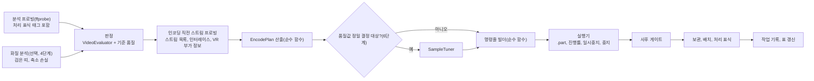
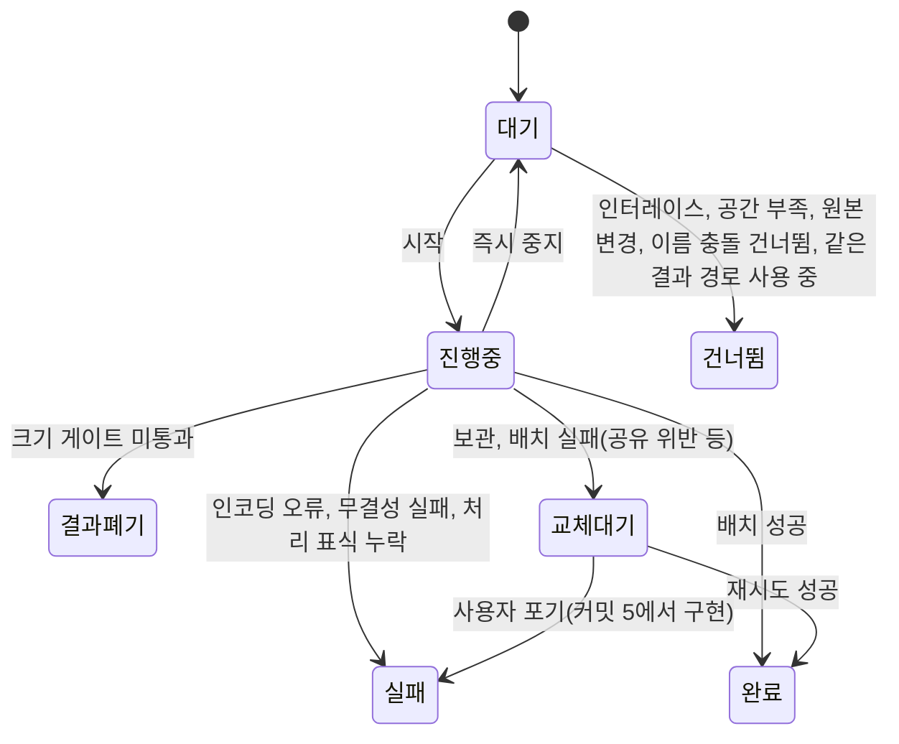

# 영상별 맞춤 직접 인코딩: 최종 설계서 및 구현 계획

> 상태(2026-11-26, `main` `2cfe55c` 기준): 결정 1~34 승인. 1~4단계 전체 완료. 5단계는 `5a`~`5c`, `5c-6d`~`5c-6l`, `5d-2`, `5e`, `5f` 완료, 6단계는 `6a`와 `6b`의 `F1` 도움말 갱신 완료. 남은 것은 `5d` 잔여(연속 배율과 최대 해상도 기준, 10-bit SDR 유지, AV1 활성화, `5d-1` 사전 실측)와 검토 지적 수정, 6단계 최종 점검(0.4절). 실행 중인 워커 작업은 브리지 `tasks.md`가 기준. 현재 상태와 코드 지도는 0.4절, 유효한 구현 규칙과 열린 항목은 13절
>
> 용어: 2026-11-25 용어 전환(`0d563f1`) 뒤 화면 용어는 작업을 `인코딩`, 이 앱이 이미 처리한 영상의 재처리만 `재인코딩`으로 부름. 이 문서 본문, 8절, 11절의 `재인코딩` 표기는 전환 전 기록이며 화면 문구의 기준은 `TERMINOLOGY.md`
>
> 문서 구성(2026-11-26 분할): 완료 단계 명세(5.3절, 5.4절, 5.5절 완료분)와 완료 기록(13.1절, 13.3절)은 `IMPLEMENTATION_HISTORY.md`, 실측 기록(12절)은 `IMPLEMENTATION_MEASUREMENTS.md`. 4.2절 모듈 표와 0.4절, 13.5절의 완료 이력도 같은 문서에 있음. 옮긴 절은 번호를 그대로 유지하고, 이 문서에는 제목과 위치만 남김
>
> 대상 독자: 이 저장소에서 1~6단계를 구현하는 에이전트. 이 문서만으로 단계별 작업, 파일, 데이터 형식, 검증 기준을 정할 수 있도록 작성
>
> 우선순위: `AGENTS.md`, `CLAUDE.md`의 저장소 규칙이 항상 우선. 이 문서와 저장소 규칙, 또는 이 문서와 실제 코드가 어긋나면 구현을 멈추고 사용자에게 보고
>
> 표기: "초기값"은 실측 전 근거가 약한 수치로, 명명 상수로 두고 독스트링에 "초기값, 4단계 보정 대상"을 적음

---

## 0. 구현 에이전트 실행 규칙

### 0.1 공통 규칙
1. 단계는 1 -> 2 -> 3 -> 4 -> 5 -> 6 순서로만 진행. 단계를 건너뛰거나 합치지 않음
2. 각 단계 시작 전에 사용자에게 "작업 목록, 수정, 신규, 삭제 파일, 검증 방법"을 제시하고 승인받은 뒤 착수(`AGENTS.md` 7절). 대량 제거, 개명은 범위를 먼저 합의
3. 각 단계는 독립 커밋 묶음으로 끝내고, 커밋 전 `scripts/check.ps1`를 오류, 경고, 스킵 없이 통과
4. 저장소 규칙 요약(상세는 `AGENTS.md`)
   - 계층: `src/gui`, `src/cui` -> `src/service` -> `src/core` 단방향
   - 모듈 500줄 초과 시 책임 분리 검토, 1000줄 초과 불가. 동결 파일과 예외 목록은 `scripts/module_size_exceptions.json` 기준(줄 수는 이 문서에 적지 않음)
   - Ruff + BasedPyright `strict` 0 오류, 0 경고
   - 메타 문서, 주석, 커밋 메시지에는 한글 외 비ASCII 문자 금지
   - 버튼은 아이콘만, 이름은 접근성 이름과 툴팁. 색은 팔레트 토큰만
   - 설정 키 추가, 변경은 `setting` 스킬, 모듈 추가, 개명은 `sync` 스킬, 테스트는 `test` 스킬 절차
5. 사용자 노출 새 용어는 후보 2~3개와 추천안을 제시해 승인받은 뒤 `TERMINOLOGY.md`에 추가하고 사용(11절의 승인 용어는 바로 사용 가능)
6. 실측 결과로 수치를 바꾸면 이 문서의 해당 결정과 `IMPLEMENTATION_MEASUREMENTS.md` 12절 기준선 결과를 함께 갱신
7. 이 문서에 없는 판단이 필요하면 추측하지 말고 선택지와 추천안을 들고 사용자에게 질문

### 0.2 GUI 구현 전 레퍼런스 요청 절차(결정 26)
GUI 화면(새 화면, 기존 화면 개편, 대화상자, 설정 항목 포함)의 UI 코드를 작성하기 **직전에** 반드시 아래 순서를 실행

1. 사용자에게 다음 세 가지를 먼저 보고
   - (1) 이 GUI가 우리 프로그램의 어느 화면, 위치에서 쓰이는지(예: 메인 창 하단 막대, 재인코딩 메뉴, 환경 설정 대화상자의 어느 영역)
   - (2) 요청하는 레퍼런스 GUI가 원본 프로그램(주로 샤나인코더 7.4)에서 어떤 상황, 조건일 때 나타나는 화면인지(예: "샤나에서 파일 2개 이상을 동시 인코딩하는 도중의 인코딩 창")
   - (3) 받고 싶은 상태 목록(예: 진행 중, 일시중지, 오류, 완료)
2. 레퍼런스 이미지를 요청하고 받을 때까지 해당 화면 UI 코드를 작성하지 않음. 원본 프로그램에 대응 화면이 없으면 그 사실을 보고하고 "기존 화면 스타일로 진행"할지 사용자 결정을 받음
3. 레퍼런스를 받은 뒤 `gui-design` 스킬 절차로 배치안을 제시하고 구현
4. 샤나 레퍼런스 이미지는 `_ref/gui/`(Git 제외, 읽기 전용)에 상황을 설명하는 파일 이름으로 보관(2026-11-20 사용자 배치: 대기 목록, 인코딩 중, 일시정지 일부/전체, 완료(오류 포함), 인코딩 중 닫기와 닫은 뒤 메인 창, 파일 메뉴, 설정과 프리셋 메뉴, 환경 설정 하위 메뉴, F2, F3, F6~F9, 출력 파일 재생과 정보). 구현 에이전트는 먼저 이 폴더에서 찾고, 필요한 상태가 없을 때만 1항 절차로 요청
5. 대상 화면과 요청 시점은 5.0절 표를 따름
6. 요청 시점과 전달 방식(2026-11-19 사용자 지시): 이미지가 필요한 하위 커밋을 착수하기 직전에 그 화면만 요청(여러 화면을 미리 몰아서 요청하지 않음). 1항의 맥락(쓰이는 위치, 원본 화면이 나타나는 상황)을 함께 보고하며, 사용자는 이미지를 구현 에이전트에게 직접 붙여넣음
7. HTML 프로토타입 확인(2026-11-20 사용자 지시): 배치안이 승인된 뒤에도 UI 코드를 쓰기 전에 그 화면의 HTML 프로토타입을 만들어 사용자가 직접 확인하게 함. 실제 승인 문구, 팔레트의 다크/라이트 색, 상태별 모습(예: 대기, 진행 중, 일시중지, 실패, 말줄임)을 담고, 저장소 밖(에이전트 임시 폴더)에 두거나 아티팩트 기능이 있으면 아티팩트로 게시함. 보고에 파일 경로나 링크를 적고, 사용자가 확인한 뒤에 코드를 씀. 프로토타입은 배치와 문구 확인용이며 Qt 화면과 픽셀 단위로 같을 필요는 없음

### 0.3 로컬 자료와 도구
- `_ref/`(Git 제외, `.git/info/exclude`): 사용자 표본과 샤나 결과. 읽기 전용. 단위 테스트에서 사용 금지(테스트는 합성 입력만 사용)

| 경로 | 내용 |
| :--- | :--- |
| `_ref/video1.mp4` ~ `_ref/video19_*.{mp4,mkv,avi,wmv,ts}` | 표본 19개(12.1절 표본 목록) |
| `_ref/clips/` | 샤나 비교용 클립 18개(HDR 제외, 긴 영상은 가운데 60초) |
| `_ref/shana/<라벨>/` | 클립을 샤나 7.4로 인코딩한 기준 결과(라벨: `nvenc_cq22`, `nvenc_cq26`, `nvenc_1080p`, `x265_cq22`, `x265_cq26`, `x265_1080p`) |
| `_ref/re/src/`, `_ref/re/shana/` | 역추적용 초경량 원본 2개와 샤나 결과 |
| `_ref/tools/shana_reverse.py` | 역추적 도구(`make`, `analyze`, `match`) |
| `_ref/tools/capture_ffmpeg.ps1` | FFmpeg 프로세스 명령줄 기록 도구(샤나 7.4에는 효과 없음, 12.1절) |

- 저장소에 넣는 비교, 통합 스크립트(`scripts/`)는 로컬 경로를 하드코딩하지 않고 인자로 받음(`AGENTS.md` 6절)

### 0.4 현재 상태 요약과 코드 지도(2026-11-26 갱신, 다음 작업 착수 전 먼저 읽기)
- 완료: 1~4단계 전체, 5단계 `5a`~`5c`(`5c-6a`~`5c-6l` 포함), `5d-2`, `5e`, `5f`, 6단계 `6a`와 `6b`의 `F1` 갱신. 하위 단계별 커밋과 경위는 `IMPLEMENTATION_HISTORY.md` 13.1절, 13.5절
- 테스트 수와 검증 트리는 `check.ps1` 출력이 기준이며 이 문서에 적지 않음

- 남은 것(2026-11-26 코드 확인):
  - `5d` 잔여(5.5절): 연속 배율 축소와 `최대 해상도 기준`(결정 5, `resolution_tiers.py`는 고정 규격), 10-bit SDR 유지(결정 27, 출력 기본 `yuv420p`), AV1 선택지 활성화(결정 22, `encoder_specs.py`의 AV1은 `available=False`), `5d-1` `_ref/` 사전 실측(실시 기록 없음, `크기 조절 방식` 기본값 `bicubic`의 근거 포함). 결정 25 레벨 정책 반영 여부는 미확인
  - 진행 중 워커 작업(브리지 `tasks.md`): 정밀 결정, 사용자 지정 활성 화면, 권장 처리 분리의 감사 수정, 내용 식별 기반 분석 캐시(계획서 밖 신규 작업), `main` `2d65f78` 기준 검토 지적 수정 대기열(검은 여백, 왕복 SSIM, 정밀 측정, 화질 분석 GUI, 화질 비교, 미리 보기와 진행 창, FFmpeg 명령, 표 복원, 실행 표식, 인코딩 예측, `F1` 도움말 4건)
  - 실화면 확인: 브리지 사람 확인 항목 기준
  - 6단계 최종 점검(5.6절 `6b`): 위 두 항목을 끝낸 뒤
- 문구 승인 범위(2026-11-20 사용자 결정): 행 이름, 값, 버튼, 메뉴, 상태 문구, 경고는 사전 승인. 툴팁과 설명 문장은 작성 후 보고에 전문을 적어 사후 확인
- GUI 진행 조건: 4단계 GUI(`4d`, `4e`)는 기존 화면 스타일로 진행 승인(2026-11-21)하되, 코드 작성 전 11.2절 용어 승인과 HTML 프로토타입 확인(0.2절 7항)이 필수
- 의도적으로 열려 있는 항목: `hevc_amf`와 `hevc_qsv`는 보류(`available=False`), AV1(`av1_nvenc`, `libsvtav1`)은 4단계 보정 후 5단계 활성화. 열린 항목은 13.4절
- 동결 파일(`frozen`): 2026-11-26 현재 `scripts/module_size_exceptions.json`의 `frozen`은 비어 있어 `main_window.py`, `video_table_view.py`도 1000줄 하드 상한만 적용. 줄 수는 그 파일과 `scripts/verify_module_size.py`가 기준

- 모듈 위치(재편 뒤): 영역 패키지 `core/{encode, analysis, evaluation, settings}`, `service/encode`, `gui/{table, menus, preview, controllers, settings, help}`, 모듈은 소유 영역에 두고 영역 사이 순환이 생기거나 기반 모듈이 쓰는 경우만 계층 바로 아래(`core/`에 기반 모듈과 `app_version`, `config`, `encode_fingerprint`, `encode_tag`, `encoder_specs`, `mp4_boxes`, `mp4_xtra`, `probe_parser`, `quality_probe`, `quality_target`, `sample_points`, `smart_action`, `resolution_tiers`, `gui/`에 앱 틀). 아래 표의 모듈 이름은 파일 이름이며 위치는 [ARCHITECTURE.md](ARCHITECTURE.md) 기준
- 테스트는 `tests/{core, service, gui, cui, tools}` 하위 폴더에 `src` 구조를 따라 둠. 공용 도우미는 `tests/` 바로 아래. 새 모듈은 영역 패키지에 추가(`AGENTS.md` 1절)

| 영역 | 모듈 | 진입점 |
| :--- | :--- | :--- |
| 판정 | `quality_target.py`, `evaluator.py`, `smart_action.py`, `classification_policy.py` | `VideoEvaluator.evaluate_video`, `evaluate_all`(`active_frame`, `active_frames`, `known_encode_tag_names`, `encoded_history_filenames` 입력), `SmartAction`, `DEFAULT_CLASSIFICATION_POLICIES` |
| 프로빙 | `stream_layout.py`, `ffmpeg_capability.py`, `mp4_boxes.py`, `mp4_xtra.py`, `encode_fingerprint.py` | `parse_stream_layout`(인코딩 직전 스트림 목록), `probe_ffmpeg_capability`(FFmpeg 상태, `has_vmaf`), `read_mp4_probe_info`, `read_mp4_xtra_items`, `write_mp4_xtra`, `compute_encode_fingerprint` |
| 계획과 명령 | `encoder_specs.py`, `encode_plan.py`, `encode_tag_plan.py`, `encode_impact.py`, `ffmpeg_command.py`, `encode_tag.py`, `app_version.py` | `ENCODER_SPECS`, `build_encode_plan`, `plan_encode_tags`, `summarize_encode_impact`, `build_ffmpeg_args`, `build_encode_tag`, `APP_VERSION` |
| 프로세스 | `encode_process.py`, `encode_progress.py`, `power_state.py` | `EncodeProcess`, `ProgressParser`, `PausableClock`, `prevent_sleep`, `run_after_complete` |
| 서비스 | `encode_job.py`, `encode_service.py`, `encode_tag_io.py`, `encode_output_history.py`, `encode_placement.py`, `encode_resume.py`, `encode_history.py`, `encode_events.py`, `encode_ports.py` | `jobs_from_evaluations`, `EncodeSettings.from_config`, `create_batch`, `EncodeRunner`(`run`, `pause_all`, `resume_all`, `cancel_all`, `request_stop_after_current`, `retry_replace_pending`), `EncodeOutputHistory`, `prepare_resume`, `find_unrecorded_parts`, `EncodeHistory` |
| 순수 규칙 | `encode_gate.py`, `encode_paths.py`, `encode_state.py`, `encode_concurrency.py` | `judge_result`, `choose_free_path`, `EncodeState`, `resolve_concurrency` |

- 주입 지점(단위 테스트, 실측 스크립트용): `EncodeRunner(history, settings, probe=, process_factory=, on_event=, store=, cpu_count=, clock=)`
- 화면은 `EncodeEvent`(`kind`: `state`, `progress`, `long_pause`)를 받아 갱신하고, 워커 스레드에서 Qt 객체에 접근하지 않음
- 개발 PC 확인 사항: PATH의 FFmpeg 2024-12 빌드에 `libvmaf`, `cropdetect`, `blackdetect` 필터와 `hevc_nvenc`, `libx265`, `h264_nvenc`, `libx264`, `av1_nvenc`, `libsvtav1` 인코더가 포함됨. 코드와 문서에 장치명, 로컬 경로, 사양값을 기록하지 않음

---

## 1. 배경 요약

### 1.1 현재 구조
- 영상을 분석해 재인코딩 여부를 판정하고, 샤나인코더 프리셋 XML과 1:1 대응하는 분류 폴더(10개)로 파일을 옮김. 실제 인코딩은 사용자가 샤나에서 수행
- 판정 모델: [`BitrateModelConfig`](src/core/config.py)의 `base_target_kbps = 1500`(720p 30fps H.264)에서 면적 지수 0.82, FPS 지수 0.60으로 적정 비트레이트 `B_opt`를 계산하고, 원본 비율 `r`로 과화질(`r > 1.2`), 적정, 저화질(`r < 0.8`)을 구분
- 프리셋 핵심(NVENC): 표준 `-cq:v 22`, 저화질 `-cq:v 26`, 축소 규격 8개는 `-b:v 0 -maxrate <고정값> -bufsize <2배>` + 16:9 박스 내접 `scale`. 모두 `-f mp4 -c:a copy -shanakeyframe 1 -profile:v main`

### 1.2 해결할 문제

| 기호 | 문제 | 근거 |
| :--- | :--- | :--- |
| A | 22/26이 판정, 프리셋, UI에 분산 결합 | `SmartAction.ENCODE_CQ22_*`, 폴더명, `TERMINOLOGY.md` 6.3절 |
| B | 예상 용량이 출력 품질값을 반영하지 않음 | [`evaluator.py`](src/core/evaluation/evaluator.py)가 CQ26 경로에도 같은 추정식 사용 |
| C | 고정 규격 축소의 계단 손실 | 2160p->1440p 화소 55.6% 손실, `2560x1080`이 1080p 상한에서 `1920x808` |
| D | 프리셋이 영상 특성을 못 따라감 | 10-bit -> 8-bit, MP4 비호환 트랙 손실, 프리셋은 NVENC/x265만 |
| E | 해상도 대비 세부 묘사가 적은 영상을 놓침 | 4K 표본 3개가 1080p 왕복 SSIM 0.996 이상, 그중 2개는 4K 기준 "적정"이지만 1080p 기준 r 3.16/3.27 |
| F | 검은 띠가 판정을 왜곡 | 세로 화면 + 좌우 검은 띠 4K 표본: 전체 면적 r 0.32, 실제 화면 r 0.82 |
| G | 샤나 결과의 실제 손실 | 12.3절: WMV 실패, 다중 트랙/자막/글꼴/커버 소실, 인터레이스 미처리, 4K 60fps 품질값 미반영 |

- 해결 현황(2026-11-18): A, B는 2단계(`baseline_cq`, 품질값 차이 용량 계수, 역할 기반 식별자)에서 반영. D의 트랙 보존과 G의 일부는 3단계 구현 완료(샤나 대비 검증은 커밋 4). C, E, F는 4~5단계. 위 표의 근거는 1단계 이전 코드 기준

### 1.3 방향
- 샤나는 FFmpeg 프런트엔드이며 화질은 같은 FFmpeg 인코더가 결정. 같은 인자로 샤나와 **영상 데이터가 바이트 단위로 같은 결과**를 낼 수 있음을 확인(12.5절)
- 분류 폴더 이동을 없애고 프로그램 안에서 영상별 계획(`EncodePlan`)으로 직접 인코딩
- 먼저 샤나와 같은 결과를 재현(3단계)한 뒤, 개선 항목을 하나씩 켜서 검증(5단계)

---

## 2. 목표, 비목표, 전제, 원칙

### 2.1 목표
1. 판정 결과를 영상별 `EncodePlan`으로 바꿔 직접 인코딩
2. 판정, 예상 용량, 실제 인코딩이 같은 기준 정의를 공유
3. 연속 배율 축소, 10-bit 유지, 영상별 최대 비트레이트, 기준 품질 변경
4. 샘플 인코딩 + VMAF/SSIM으로 영상별 품질값 결정
5. 샤나 대비 화질, 트랙 보존, 속도, 원본 안전에서 열위 없음
6. 화면 내용 측정(축소 손실, 검은 띠)으로 비트레이트 모델의 사각 보완
7. VR 기기 재생과 AI 2D->3D 변환 도구 입력으로 쓰기 좋은 출력(결정 27)

### 2.2 비목표
- HDR(PQ, HLG, Dolby Vision) 재인코딩: 판정 `PASS_HDR` 유지
- 자막 입히기, 로고, 자르기 편집, HDR 톤매핑, 파일별 수동 인자 조정
- FFmpeg 번들링. 외부 독립 프로그램은 FFmpeg/ffprobe만 사용(MediaInfo 등 금지). Python 라이브러리는 필요 시 도입(`pyproject.toml` 명시)
- 원본 자동 삭제를 기본값으로 두는 것
- 분류 폴더 이동, 샤나 프리셋 연동의 유지와 이전 도구

### 2.3 전제
- 모든 기존 커밋은 프로토타입이고 실사용자 0명. 중간 단계 사용자도 없음
- 하위 호환, 설정 이전, 캐시 이전, 병행 기간을 고려하지 않음. 제거 대상은 이전 코드 없이 제거

### 2.4 설계 원칙
- **한 번에 한 가지 변화**: 3단계는 샤나 동치, 5단계 개선 항목은 하나씩 켜고 비교
- **확신 없는 입력은 건너뜀**: HDR, 인터레이스는 건너뛰고 사유 기록
- **원본 우선**: 게이트 통과 전 원본 무변경, 어떤 실패에서도 원본과 결과 중 하나 이상 보존

---

## 3. 확정 결정 명세

각 결정의 형식: 규칙 / 초기값 / 적용 단계. 결정 번호는 다른 문서, 커밋에서 참조하므로 바꾸지 않음

### 결정 1. 실행 구조
- 규칙: 직접 인코딩 단일 경로. 1단계에서 제거: 실제 분류, 분류 되돌리기, `pseudo_classify_mode`, [`classify_manifest.py`](src/core/classify_manifest.py), [`file_manager.py`](src/core/analysis/file_manager.py)의 이동/복원, `shana_presets/`, 분류 폴더명 설정, 관련 메뉴, 단축키, 작업 유형, 표시 열
- 유지: 분석, 판정, 권장 처리, 예상 용량, 예외 규칙, 영상별 출력 해상도 지정, 미리 보기
- 코드 식별자의 "분류" 계열(`ClassifierConfig`, `classification_policy.py`)은 판정 의미로 남으므로 개명하지 않음
- 샤나는 제품 의존성이 아니며 개발 비교 기준(`_ref/shana/`)으로만 사용. 프리셋 XML은 Git 이력에 남음
- 적용: 1단계

### 결정 2. 기준 품질과 판정 모델
- 기준 품질 `baseline_cq`: 기본 인코더(`hevc_nvenc -cq`) 척도, 기본 22.0
- 기준 비트레이트(저장하지 않는 파생값): $B_{\text{base}}(Q) = B_{\text{ref}} \times 2^{(22.0 - Q)/K}$
  - `base_target_kbps`의 의미는 "척도 22.0에서의 720p 30fps H.264 적정 비트레이트"로 고정
  - `K`: 초기값 6.0, 4단계에서 인코더별 실측
- 인코더별 척도 매핑: 같은 화질을 내는 인코더별 품질값. 초기값은 항등(정수 인코더는 반올림). 12.3절에서 같은 "22"의 NVENC/x265 출력 비트레이트가 내용에 따라 1.0~2.6배 차이이므로 4단계 VMAF 보정 필수
- 코덱 효율 차이는 기존 `codec_weights`, 척도 차이는 매핑이 담당(이중 보정 금지)
- VMAF는 판정 기준이 아니라 6단계 품질값 정밀 결정의 종료 조건
- 적용: 2단계(상수, 설정), 4단계(보정)

### 결정 3. 목표 품질값 반영 용량 추정
- 영상 스트림 예상 용량 x $2^{-\Delta/K}$, $\Delta$ = 출력 품질값 - 기준 품질값
- 보호 경로, 기준 변경, 정밀 결정 결과 모두 같은 식
- NVENC 레벨 상한(결정 25)을 예상 출력 비트레이트 상한으로 반영(3단계)
- 반영 후 보호 경로 영상의 예상 절약 증가로 일부 판정이 바뀌는 것은 의도된 변화이며 테스트에 고정
- 적용: 2단계, 3단계(레벨 상한)

### 결정 4. 저화질 보호 품질값
- 3단계: 기준 + 4.0 고정(샤나 동치)
- 5단계: $Q_{\text{protect}} = \text{clamp}(Q_{\text{base}} + K \log_2 (1/r_{\text{target}}),\ Q_{\text{base}},\ Q_{\text{base}} + \Delta_{\max})$, $\Delta_{\max}$ 초기값 6.0
- 보호 판정 조건은 [`should_use_low_quality_preset`](src/core/evaluation/classification_policy.py) 재사용
- **승인 조건: 품질값은 인코더가 소수를 받는 한 반올림하지 않고 소수 그대로 계산, 적용**
  - 소수 가능: `hevc_nvenc`, `h264_nvenc`, `av1_nvenc`(`-cq`), `libx265`, `libx264`(`-crf`)
  - 정수만: `libsvtav1`(`-crf` 0~63), `hevc_amf`, `hevc_qsv`. 인코더 척도로 매핑한 뒤 마지막에만 반올림
  - 소수가 인코더 내부에서 실제로 반영되는지는 4단계 실측
  - 표시는 소수 첫째 자리(`CQ23.9 재인코딩`)
- 적용: 2단계(상수), 3단계(+4), 5단계(연속 식)

### 결정 5. 해상도 축소
- 3단계: 현행 8규격 + 16:9 박스 + 규격 고정 `-maxrate`(샤나 동치)
- 5단계 연속 배율: $s = (r_{\text{src}}/r_{\text{low}})^{1/(2\alpha)}$, $\alpha$ = `area_scaling_exponent`. 크기는 `OUTPUT_DIM_ALIGN`(4) 배수 내림
- 미세 축소 가드: [`MIN_DOWNSCALE_AREA_RATIO`](src/core/resolution_tiers.py)(95%) 유지, 4단계 실측 후 변경 여부 결정
- 최대 해상도 기준: 기본 `short_side`, 선택 `pixel_area`, `box`(`2560x1080`에 1080p 상한: 축소 안 함 / 약 2216x932 / 1920x808)
- 스케일러: 3단계 FFmpeg 기본, 5단계 `lanczos` 계열 표본 비교 후 채택
- **승인 조건: 축소 기준이 겹칠 때(2026-11-23 화질 분석 축소 후보 기본 자동 반영 확정)**
  1. 영상별 직접 지정(`축소 안 함` 포함)이 있으면 그것만 사용
  2. 없으면 화질 분석 `축소 후보`(결정 19, 자동 반영 설정 기본 켬)를 우선 반영하되, 최대 해상도 상한이나 비트레이트 맞춤(켜진 경우)이 더 작은 크기를 요구하면 적용 가능한 후보 중 **가장 작은 출력 크기**를 채택
  3. 채택 결과에 미세 축소 가드 적용
  - 같은 크기면 판정 사유 표시 순서: 최대 해상도 > 화질 분석 축소 후보 > 비트레이트 맞춤(화질 분석 축소 후보가 단독으로 적용된 행은 전용 판정 사유로 구분해 표 필터로 한눈에 검수 가능)
- 축소, 해상도 판정 및 하위 후보 규격 탐색은 검은 띠를 잘라낸 **크롭(활성 화면) 해상도 기준**으로 일원화(결정 20)
- 적용: 3단계(규격), 5단계(자동 반영, 연속, 기준, 스케일러, 겹침 규칙)

### 결정 6. 최대 비트레이트(`-maxrate`)와 축소 비트레이트 제어(방안 A+B 결합)
- 적용 범위: 축소 경로(및 결정 29 B 절약 목적 샘플 예측 경로)
- **방안 A(5단계 일반화 `maxrate`)**: 고정 규격 상한(예: 720p `2800k`)만 쓰면 사용자가 설정한 기준 비트레이트(`base_target_kbps = 1500`)보다 평균 비트레이트(예: 720p `2200kbps`)가 과투입될 수 있음. 출력 해상도와 프레임레이트 기준의 출력 적정 비트레이트(`target_optimal_kbps`)에 여유 배수(초기값 `1.4`~`1.5`, 100k 올림, 규격 고정 상한을 넘지 않도록 캡핑)를 곱해 `-maxrate`와 `-bufsize`(2배)를 설정값(`base_target_kbps`)에 연동하여 산출
- **방안 B(결정 29 B 샘플 5구간 예측 기반 추가 시간 0초 품질값 자동 상향)**: 본 인코딩 전 이미 실행하는 결정 29 B 샘플 5구간 시험 인코딩의 예측 영상 비트레이트가 목표 비트레이트(`target_optimal_kbps` x 허용 배수, 초기값 `1.15`)를 초과하면, **추가 샘플 인코딩 시간 0초**로 결정 33의 기울기 식($\Delta Q = K \log_2(\text{예측 비트레이트} / \text{목표 비트레이트})$)을 재사용해 목표 비트레이트에 맞는 품질값(CQ/CRF, 상한 `Q_base + 6.0`)으로 즉시 자동 상향한 뒤 본 인코딩을 실행
- 적용: 3단계(고정값), 5단계 `5d`(방안 A+B 결합)

### 결정 7. 키프레임과 프레임 타이밍
- 목표 키프레임 간격: 프레임 수 기준 `round(fps)`(샤나와 같음). 고정 프레임에서 약 1초(23.976fps는 약 1.001초), 가변 프레임은 프레임이 드문 구간에서 1초보다 길어질 수 있음
- 인자: `-g <round(r_frame_rate)>`만 사용(샤나 `-shanakeyframe 1` = `-g <round(fps)>`). `-force_key_frames expr:gte(t,n_forced*1)`는 쓰지 않음
  - 근거(커밋 4 실측, 2026-11-18 사용자 승인): 두 인자를 함께 쓰면 소수 fps(23.976 등) 클립에서 약 1000프레임 뒤부터 키프레임 위치가 한 프레임씩 앞당겨져 샤나와 바이트가 어긋남(NVENC 7/15 일치). 제거하면 15/15 일치(가변 프레임 표본 포함). 처음 기록한 "함께 써도 일치"는 정수 fps 표본에 한정된 확인이었음
  - 결과 키프레임 간격 약 1.001초는 허용 상한 `keyframe_interval_sec`(2.2초)보다 충분히 작아 재판정 대상이 되지 않음
  - 가변 프레임 영상의 시간 기반 키프레임은 5단계 후보(5.5절)
- `-fps_mode passthrough` 명시. 3단계에서 이 인자를 넣은 상태로도 샤나 바이트 일치가 유지되는지 확인하고, 깨지면 사용자에게 보고
- VFR 판정은 하지 않음. `-forced-idr`는 사용하지 않음
- 적용: 3단계

### 결정 8. 출력 컨테이너와 스트림 보존
- 컨테이너: 원본 유지 우선(`.mp4`, `.mkv`, `.mov`). `.avi`, `.wmv`, `.flv`, `.webm`, `.ts`는 `.mp4`, 비호환 트랙이 있으면 `.mkv`. 설정 "항상 MP4" 제공
- 원본 형식을 유지하는 조건(2026-11-20 명확화): (1) 재인코딩 태그를 기록할 수 있는 형식(MP4, MOV, MKV, 결정 28)이고 (2) 목표 인코딩 방식의 코덱 계열을 표준으로 담는 형식. H.264, HEVC는 세 형식 모두 담으므로 현재 결과는 위 목록과 같음. AVI, WMV(ASF), FLV, WebM은 HEVC를 표준으로 담지 못하고, TS와 FLV는 H.264를 담을 수 있어도 태그를 기록할 수 없어 MP4로 저장. AV1(5단계)의 허용 형식은 활성화 때 확인. 계열별 허용 형식은 인코더 정의 표 한 곳에 두고 `choose_container`와 설정 설명이 이 표를 씀(커밋 5a 보완)
- 스트림 매핑: 인코딩 직전 프로빙한 스트림 목록으로 `-map 0:<index>` 명시

| 스트림 | 처리 |
| :--- | :--- |
| 주 영상 | 인코딩 |
| 커버(`attached_pic`) | `copy`, 출력에 `-disposition attached_pic`. 커밋 4까지는 MP4/MOV 출력에서 커버를 제외하고 사유 기록(`+use_metadata_tags`가 커버를 버림, 12.8절). 커밋 4b부터 항상 유지(결정 28) |
| 오디오 | `copy`. 대상 컨테이너 비호환 코덱만 `aac` 변환(예: WMA -> AAC, 12.3절 WMV 실패 원인) |
| 자막 | `copy`. MP4 출력의 텍스트 자막은 `mov_text`, 비트맵 자막이 있으면 `.mkv` |
| 첨부 파일(글꼴) | MKV 출력이면 `copy`. MP4로 바뀌면 소실 사유 기록 |
| 데이터 스트림 | 제외하고 기록. MP4/MOV 출력은 `-write_tmcd 0`으로 MOV 타임코드 트랙이 다시 생기지 않게 함(커밋 4 실측, 2026-11-18 승인) |
| 메타데이터, 챕터 | `-map_metadata 0`, `-map_chapters 0` |

- 색 정보: `color_primaries`, `color_trc`, `colorspace`, `color_range`를 출력에 명시 전달(bt709, bt2020 SDR 포함)
- 회전: FFmpeg 자동 회전, 출력 크기는 표시 기준. 샤나와 같이 화면을 돌려 저장하고 회전 정보는 남기지 않음(12.3절)
- MP4/MOV의 HEVC는 `-tag:v hvc1`(결정 27)
- 적용: 3단계

### 결정 9. 결과 파일 처리와 재처리 방지
- 결과 파일 처리 정책
  - `archive_original`(기본): 게이트 통과 시 원본을 같은 폴더 하위 `_원본보관/`으로 이동하고 결과를 원본 위치에 배치. 같은 볼륨 이동이라 추가 복사 없음
  - `separate_output`: 결과를 별도 출력 폴더(기본 `_재인코딩결과/`)에 저장. **승인 조건: 작업 폴더 기준 상대 경로(하위 폴더 계층)를 출력 폴더에 그대로 재현**
  - `replace_original`: 검증 후 원본 교체. 되돌릴 수 없음을 확인 대화상자로 안내
- 확장자가 바뀌면 결과 목록에 원본 -> 결과 경로 표시
- 보관 폴더에 같은 이름이 있으면 덮어쓰지 않고 실패 처리. 그 밖의 이름 충돌은 결정 24
- 임시 파일: 같은 폴더 `<이름>.<확장자>.part`, `-f`로 형식 명시. `.part`는 [`VIDEO_EXTENSIONS`](src/core/analysis/file_manager.py) 밖이라 스캔 제외
- 스캔 제외 목록: 보관 폴더, 별도 출력 폴더(분류 폴더 제외 목록을 대체)
- 타임스탬프: 결과 파일 수정 시각을 원본 값으로(`os.utime`). 생성 시각 보존은 범위 밖
- 사전 검사: 대상 볼륨 여유 공간 < 원본 크기 x 1.1(초기값)이면 건너뜀
- **승인 조건: 처리 표식 태그 명세(확정)**
  - 키: `video_scripts_encode`(컨테이너 전역 태그)
  - 값: ASCII, 세미콜론 구분 `v=1;enc=<인코더>;q=<품질값>;at=<UTC ISO 8601>`. `v`는 명세 버전, 읽을 때 모르는 필드 무시
  - 기록: MP4/MOV는 `-movflags +use_metadata_tags`(필요 시 `+faststart`와 결합) 필수, MKV는 `-metadata`만
  - 읽기: 키 대소문자 무시(MKV는 `VIDEO_SCRIPTS_ENCODE`로 저장)
  - 확인 결과: MP4에 플래그 없이 쓰면 사라짐, 플래그 사용 시 MP4/MOV 유지, MKV 유지, MP4 -> MKV 재다중화 후 유지, ffprobe 조회 대소문자 무관
  - 표준 `comment` 키 사용 금지. 원본에 같은 키가 있으면 새 값으로 교체
  - 분석 프로빙이 이 태그를 읽고, 표식이 있는 영상은 판정 사유 "이미 재인코딩"으로 대상에서 제외. 다시 인코딩은 영상별 직접 지정으로만
- 커밋 4b부터 기록 위치, 기록 여부 설정, 판정 근거는 결정 28로 바뀜(MP4/MOV는 `+use_metadata_tags` 대신 탐색기 태그 칸의 `Xtra`, MKV는 `KEYWORDS` 추가). 키 이름과 명세 값 형식은 유지
- 적용: 3단계

### 결정 10. 사후 게이트
- 무결성: 출력 `ffprobe` 성공, 계획한 스트림 수 일치(결과의 데이터 스트림은 세지 않음: MP4 `-map_chapters 0`이 챕터 트랙을 데이터 스트림으로 기록하고, 계획에는 데이터 스트림이 없음. 커밋 4 실측, 2026-11-18 승인), 영상 길이 차 <= max(0.5초, 원본의 0.5%)(초기값)
  - 영상 길이는 원본(분석 프로빙)과 결과(게이트) 모두 같은 함수로 구함: 영상 스트림 `duration` -> 영상 스트림 태그 `DURATION`(MKV는 스트림 `duration`이 비어 있음) -> 컨테이너 `duration` 순(커밋 4 실측, 2026-11-18 사용자 승인). 컨테이너 길이를 먼저 쓰면 오디오가 영상보다 긴 원본에서 오탐(12.8절과 같은 날 확인: 영상 6초, 오디오 9초 MP4의 컨테이너 길이 9초, MKV는 영상 스트림 길이 `N/A`, 태그 6초, 컨테이너 9.02초)
  - 분석 프로빙 조회에 `stream_tags=DURATION`을 추가하고 `PROBE_VERSION`을 5로 올림(MKV 원본의 길이와 비트레이트 계산이 영상 기준으로 바뀜)
- 크기: 절약 목적(과화질, 코덱 전환, 축소)인데 결과 >= 원본이면 결과를 버리고 원본 보존, 상태 "결과 폐기"
- KF 교정, 코덱 호환 목적은 무결성만 검사
- **개정(2026-11-20 사용자 결정)**: 키프레임 간격 초과 영상은 판정 종류(과화질, 축소, 코덱 전환 포함)와 무관하게 게이트 목적을 KF 교정으로 둠. 결과 크기로 폐기하지 않고 조기 중단(결정 29 A) 대상도 아님. 인코딩 인자(품질값, 해상도)는 판정 종류대로
  - 근거: 키프레임 1초화가 다른 무엇보다 우선(사용자). 과화질이면서 키프레임 초과인 영상을 과화질 인코딩으로 묶은 것은 분류 폴더 시절 폴더 수를 줄이려던 정책이었음
  - 빠른 분석(키프레임 미측정) 영상은 초과 여부를 알 수 없어 판정 종류를 따름. 안내는 5e의 빠른 분석 뒤 재분석 안내(쟁점 K)와 함께
  - 결정 33(품질값 자동 탐색) 전까지는 키프레임 초과 영상의 결과가 원본보다 커도 배치함
- 실패 시 FFmpeg stderr 마지막 부분을 작업 기록에 보존
- **추가 승인(2026-11-18, 사용자 지시)**: 무결성 검사에 출력 처리 표식 확인 추가. 출력 `ffprobe`에서 `video_scripts_encode` 태그가 없으면 배치하지 않고 상태 "실패", 사유 "처리 표식 누락"으로 처리. 원본은 무변경, `.part`는 삭제
  - 근거: FFmpeg는 MP4에 `+use_metadata_tags` 없이 쓰면 표식을 조용히 버림. 표식이 빠진 결과를 배치하면 다음 분석에서 재인코딩 대상이 되어 화질이 두 번 깎이므로 AGENTS 5절 재처리 방지 불변식 위반
  - 커밋 4b부터 태그 확인 방법은 결정 28(MKV는 ffprobe, MP4/MOV는 `Xtra` 읽기). 기록 방식이 "상세 값만"이면 상세 값만 확인하고, "기록 안 함"이면 이 확인을 하지 않고 재처리 방지는 재인코딩 이력이 맡음
- 적용: 3단계

### 결정 11. FFmpeg 확보와 능력 확인
- 설정 `ffmpeg_path`, `ffprobe_path`(비우면 PATH). 시작 시 1회 버전, 인코더 목록, 필터(`libvmaf`, `scale_cuda` 등), HW 디코더 프로빙 후 캐시([`system_probe.py`](src/core/analysis/system_probe.py) 확장)
- 최소 버전 FFmpeg 5.1(초기값, `-fps_mode` 기준). 미달이면 인코딩 비활성
- **승인 조건: 상태와 사유를 화면에 명확히 표시**
  - 설정 대화상자 "FFmpeg 상태" 영역: 경로, 버전, 사용 가능 인코더, `libvmaf` 지원, 비활성 사유
  - FFmpeg 없음, 버전 미달: "재인코딩 시작" 비활성 + 툴팁에 사유와 해결 방법
  - 선택 인코더 미지원: 인코더 선택지에 사용 불가 표시와 사유
  - `libvmaf` 부재로 SSIM 대체: 화질 분석 결과의 측정 지표 열, 작업 완료 알림에 대체 사실 표시
  - HW 디코딩 실패 후 CPU 재시도: 결과 목록 해당 파일에 표시
- 적용: 3단계(4단계에서 지표 표시 추가)

### 결정 12. 테스트 정책
- `check.ps1` 단위 테스트는 FFmpeg 없이 실행(인자 목록 비교, 순수 함수, 가짜 프로세스). 스킵 금지
- 실제 인코딩 통합 테스트는 `scripts/` 아래 별도 스크립트(합성 `lavfi` 입력, 수동 실행). NVENC, AMF, QSV는 장치가 있을 때 수동 확인
- 샤나 동치 비교도 별도 스크립트(입력 경로는 인자)
- 모든 테스트는 `TemporaryDirectory`와 `_sandbox.py` 격리
- 적용: 전 단계

### 결정 13. 용어
- 권장 처리 명칭 `CQ{값} 재인코딩`(실제 적용 값, 소수 첫째 자리). 축소는 기존 "축소 재인코딩" 유지
- `TERMINOLOGY.md` 6.1절 "분류 상태"를 재인코딩 상태로 대체, 폐기 용어는 8절로 이동
- `TERMINOLOGY.md`에는 해당 기능을 구현하는 단계에서 추가
- 승인 용어와 보류 용어는 11절
- 적용: 1~6단계

### 결정 14. 디코딩 구성
- 후보: CPU 디코딩 + CPU 필터 / GPU 디코딩 + CPU 필터 / GPU 디코딩 + GPU 스케일 / 샤나 기본 구성(코덱별: H.264, MPEG2, VC1, VP9는 SW, HEVC, AV1은 HW 자동, 디코딩 스레드 `-threads 0 -thread_type frame`)
- **3단계에서 처리 시간을 실측해 속도 수용 기준을 만족하는 가장 호환성 높은 구성을 기본으로 확정**. 코덱별 디코더 선택을 설정으로 둘지도 실측 결과로 결정(사용자에게 보고 후)
- HW 디코딩 실패 시 같은 파일을 CPU 디코딩으로 1회 재시도하고 기록
- **확정(커밋 4, 2026-11-18, 사전 위임 범위)**: 기본은 샤나 기본 구성(`DecodeMode.SHANA_DEFAULT`) 유지. 근거(12.9절): CPU 디코딩은 속도가 같거나 비슷하지만 10-bit HEVC 원본(video16) 바이트가 샤나와 달라지고, GPU 디코딩은 1080p 축소에서 느리며 WMV와 커버 원본에서 실패. 속도 차이가 없어 코덱별 디코더 설정은 만들지 않음. `DecodeMode`에 구성 추가 없음
- 적용: 3단계

### 결정 15. 인터레이스 원본
- 인코딩 직전 스트림 프로빙에서 `field_order`가 `tt`, `bb`, `tb`, `bt`이면 상태 "건너뜀", 사유 인터레이스
- `progressive`, `unknown`, 값 없음은 진행. 인터레이스 판정 때문에는 분석 프로빙을 바꾸지 않음. 분석 프로빙의 `PROBE_VERSION`은 1단계에서 3으로, 3a단계(처리 표식 태그 읽기, 결정 9)에서 4로 올림(2026-11-18 승인). 커밋 4에서 5(영상 길이, 결정 10), 커밋 4b에서 6(결정 28)
- 샤나는 디인터레이스 없이 인코딩하고 필드 순서 표시를 `tt` -> `tb`로 바꿈(12.3절). 건너뜀이 더 안전
- 디인터레이스, `idet` 정밀 감지는 범위 밖(후속)
- 적용: 3단계

### 결정 16. 중지, 일시중지, 이어 하기
- 작업 기록: 배치 대상과 파일별 상태를 분석 캐시와 같은 SQLite 파일의 별도 테이블에 기록(4.4절)
- 현재 영상 후 중지: 진행 중 파일을 끝낸 뒤 정지
- 즉시 중지: 프로세스 종료, `.part` 삭제, 해당 파일 `대기`로 복귀
- **일시중지, 재개: 파일별, 전체. `psutil`의 `suspend`/`resume`**
  - 멈춘 동안 HW 인코더 세션은 계속 점유. 경과 시간, 속도 계산에서 멈춘 시간 제외
  - **승인 조건: 장시간 점유 안내**
    - 일시중지 버튼 툴팁과 진행 창 안내 문구: 멈춘 동안 GPU 인코더 세션을 계속 사용해 그래픽 드라이버나 다른 작업에 영향을 줄 수 있으며, 오래 멈출 때는 현재 영상 후 중지를 권장
    - 일시중지가 10분(초기값)을 넘으면 진행 창과 작업 기록에 같은 안내를 다시 표시하고 "현재 영상 후 중지로 전환" 동작 제공. 자동 중지는 하지 않음
  - 일시중지 상태에서 앱 종료 시 종료 확인에 포함, `.part` 정리
- 이어서 재인코딩: 앱 시작, 작업 폴더 열기 시 미완료 배치가 있으면 확인 대화상자. `대기`, `진행 중` 상태만 재투입. 원본 크기, 수정 시각이 기록과 다르면 재개 제외
- 잔여 `.part`: 작업 기록에 경로가 있는 것만 삭제, 나머지는 목록 안내
- 기각: 진행 위치부터 이어 인코딩(구간 결합)
- 샤나 대비(2026-11-20 사용자 확인): 샤나도 중단한 영상은 처음부터 다시 인코딩하지만, 중단된 출력을 남긴 채 `파일명_(1).mp4`를 새로 만듦. 이 프로그램은 미완성 출력을 `.part`로만 두고 기록된 `.part`를 지운 뒤 같은 결과 경로로 다시 시작하므로 번호 붙은 중복 파일이 생기지 않음
- 적용: 3단계

### 결정 17. 인코딩 중 다른 작업과 미리 보기
- 재인코딩 전용 작업 스레드를 분석 작업 스레드와 분리(현재 단일 슬롯: [`task_runner.py`](src/gui/controllers/task_runner.py))
- 인코딩 중 허용: 분석, 다른 작업 폴더 열람, 설정 확인. 인코딩 설정 변경은 다음 배치부터(배치 시작 시 설정 사본 고정)
- 결과 배치 시점에 해당 행의 분석 결과 갱신
- SQLite는 스레드별 연결, 쓰기 충돌 재시도 정책은 3단계 단위 테스트로 고정
- 앱 종료 시 인코딩 중이면 확인 대화상자(즉시 중지 후 종료 / 현재 영상 후 중지하고 종료 / 계속)
- **승인 조건: 인코딩 중 스페이스바 미리 보기 보장**(현재 인코딩 중인 원본과 표의 모든 영상)
  - 미리 보기 방식: 내장 창(`QMediaPlayer`, [`video_preview_window.py`](src/gui/preview/video_preview_window.py)), QuickLook(외부 프로그램). 둘 다 재생 중 파일을 열어 둠([`preview_controller.py`](src/gui/preview/preview_controller.py))
  - 재생 중인 원본의 보관 이동, 교체는 Windows 공유 위반으로 실패할 수 있음(3단계에서 두 방식 모두 실측)
  - 내장 창은 배치 직전 해당 파일 재생 해제를 검토. QuickLook은 제어 불가
  - 배치 실패 시: 결과와 원본 모두 유지, 상태 "교체 대기". 미리 보기 종료, 배치 종료 시 재시도, 이후 결과 목록에서 수동 재시도. 어떤 경우에도 둘 중 하나를 잃지 않음
  - 속도 수용 기준은 미리 보기를 쓰지 않은 상태에서 측정
  - 2026-11-19 실측(사용자 수행): 내장 미리 보기 창은 원본을 잠가 재생 중 배치가 `교체 대기`(WinError 32)로 남고, QuickLook은 잠그지 않아 재생 중에도 배치가 `완료`. 두 경우 모두 원본과 결과가 보존됨(12.9절). 내장 창 잠금 해제는 결정 31. 수정 후(2026-11-19 구현): 재생 중 원본 이름 바꾸기와 삭제가 성공하고 재생이 계속됨(단위 테스트, 12.10절)
- 적용: 3단계

### 결정 18. 품질값 정밀 결정(가칭) 적용 범위
- 기본: 선택 적용(과화질, `r`이 `low`/`over` 경계 +-0.15, 축소 후보). 설정으로 모든 대상, 적용 안 함
- 샘플: 결정 19 공통 구간 규칙의 유효 구간 일부, 3~4회 이진 탐색
- 지표: VMAF 우선, 없으면 SSIM(표시)
- 축소 후보는 `[원본 해상도 + 보호 품질값]` vs `[축소 해상도 + 기준 품질값]`을 원본 크기로 업스케일해 비교
- 비용: 대상당 1~3분(미측정 추정)
- 적용: 6단계

### 결정 19. 축소 손실 측정과 화질 분석 고속화
- 정의: 각 규격으로 줄였다 되돌린 영상과 원본의 왕복 점수로 "N p로 줄이면 얼마나 잃는가"를 측정. 인코딩 없이 디코딩, 스케일, 지표만
- 지표: VMAF 우선(4K급 `vmaf_4k_v0.6.1`, 그 외 `vmaf_v0.6.1`, 기준값은 모델별), 없으면 SSIM(dB)
- 원래 해상도 판별이 아님: 선명한 원본에서만 업스케일을 가릴 수 있음(12.6절 대조 실험)
- 공통 구간 규칙(결정 18과 공유)
  - 길이 10~90% 사이 9지점(20초 미만은 전체 1구간)
  - 구간의 50% 이상이 검은 화면(`blackdetect`)이면 제외, 가장 낮은 규격 왕복이 40dB 이상(세부 묘사 없음)이면 제외(초기값)
  - 유효 구간의 규격별 중앙값, 유효 구간이 없으면 "측정 불가"
- **5단계(`5a-1` 사전 실측 대조 후 `5a-2` 본 구현) 화질 분석 10~20배 고속화 아키텍처(2026-11-23 사용자 승인, 편당 60초 -> 평균 2~5초)**
  0. **사전 실측 대조 검증(`5a-1`, 본 코드 변경 전 무결성 증명)**: `_ref/clips` 18개 표본(및 합성 영상 5종)을 대상으로 기존 9구간 전체 측정과 고속화 알고리즘의 결과(활성 화면 `width, height, x, y` 및 최종 `축소 후보` 규격)를 1:1 대조해 **18/18 표본 100% 판정 일치**를 보장하는 적응형 조기 확정 경계값과 `n_subsample=2` 상수를 확정한 뒤 `5a-2` 본 코드에 반영
  1. **키프레임 1장 고속 검은 여백/검은 화면 통합 스캔(0.25~0.4초)**: 9개 시점마다 2초 연속 구간(60~120프레임)을 두 번(`blackdetect`, `cropdetect`) 디코딩하던 4단계 방식을 폐기하고, 컨테이너 인덱스 점프(`-ss <시점> -noaccurate_seek -skip_frame nokey`) + `-frames:v 1` + 단일 필터 체인(`-vf "blackdetect=...,cropdetect=24:2:0"`)으로 시점당 키프레임 1장(총 9장)만 디코딩해 전 구간 검은 여백(레터박스/필러박스) 일관성과 검은 화면 여부를 0.4초 이내에 확정
  2. **적응형 순차 구간 샘플링(1구간 -> 2구간 -> 경계만 3/5/9구간 확장)**: 처음부터 9구간을 모두 재지 않고 중앙(50%) 유효 1구간을 먼저 측정. 점수가 기준선에서 충분히 떨어져 있으면(예: 최고 하위 규격 `SSIM < 0.990`으로 명백한 원본 유지, 또는 `SSIM >= 0.9985` 및 `VMAF >= 99.0`인 명백한 통과) 양끝(25%, 75%) 1~2구간만 추가 확인해 2~3구간에서 즉시 조기 확정하고, 경계 구간(`0.994 <= SSIM < 0.998` 또는 `97.0 <= VMAF < 99.0`)이나 구간 간 편차가 클 때만 5구간 -> 최대 9구간까지 점진 확장
  3. **1패스 다중 규격 `split` SSIM 동시 스크리닝 + 최저 후보 단 1개 VMAF 검증**: 한 번의 디코딩에서 `-filter_complex` `split`으로 모든 후보 규격(예: 1440p, 1080p, 900p, 720p...)의 왕복 `SSIM`을 동시에 측정. 최고 하위 규격의 `SSIM < 0.992`이면 VMAF를 한 번도 실행하지 않고 0.7초 만에 `유지`로 확정. 통과한 규격이 있으면 `SSIM >= 0.996`을 만족한 **가장 낮은 후보 규격 단 1개**만 VMAF(`n_subsample=2`, `-hwaccel auto` 디코딩 가속)로 최종 검증(실패 시 바로 윗 규격 1개만 추가 확인)
  4. **2계층 병렬 실행**: 다중 영상 분석 시 워커 풀(3~4개 동시 실행)로 병렬화하고, 단일/소수 영상 분석 시에는 추가 샘플 구간들을 병렬 실행해 멀티코어 활용 극대화
  5. **진행 단계 및 상태 가시화**: 화질 분석 중 하단 푸터에 현재 파일의 세부 단계(`검은 여백 확인` -> `축소 후보 선별 (k/N)` -> `VMAF 정밀 확인 (k/N)`), 예상 남은 시간(`ProgressEstimator`), 임시 폴더 경로(`임시 작업 폴더: %TEMP%\video_scripts_frame_analysis`) 툴팁을 표시하고, 1개 선택 분석 등에서 캐시가 재사용된 경우 `화질 분석 완료: N개 (캐시 재사용 M개)`(는 4단계 실기 후속 수정에서 선행 반영)를 상태 표시줄에 명확히 안내
- **판정 반영 및 3단계 안전망(2026-11-23 사용자 승인, `5c`)**
  - 기준(`VMAF >= 98.0` 및 `SSIM >= 0.996`) 이상인 가장 낮은 규격을 `축소 후보`로 판정
  - **5단계 기본 자동 반영**: 화질 분석에서 `축소 후보`가 나오면 수동 적용을 기다리지 않고 기본으로 `출력 해상도`와 `권장 처리`(`축소 재인코딩`)에 자동 지정(우선순위: 사용자 수동 지정 > 화질 분석 축소 후보 > 최대 해상도 / 비트레이트 맞춤)
  - **사후 검수용 3단계 안전망**:
    1. **전용 판정 사유 분리**: 화질 분석 축소 후보로 인해 축소 대상이 된 영상은 `판정 사유` 열에 전용 사유(후보: `화질 분석 축소` / `실효 해상도 축소`)를 표시해 표 열 필터로 자동 축소된 영상만 모아 한눈에 검수
    2. **화질 비교 창 내 1클릭 판정 변경/고정**: `4e` 화질 비교 창 상단에 현재 선택된 규격을 바로 지정하거나 자동 축소를 해제하는 1클릭 버튼(`축소 안 함으로 고정`, `이 규격으로 지정`)을 두어 육안 확인 즉시 그 자리에서 판정 수정
    3. **자동 반영 설정 토글**: 설정 대화상자에 `화질 분석 축소 후보 자동 적용`(기본 켬) 옵션을 두어, 끄면 4단계처럼 후보만 표시하고 수동 적용할 수 있게 지원
- 사용 가이드 확인 항목: 링잉, 할로 / 뭉개짐과 계단 현상 / 화면 대비 과도하게 큰 블록. `4e` 화질 비교 창에서 원본 화소 1:1~400% 확대로 즉시 확인
- 오차 방향: 원본 해상도 자막, UI, 샤프닝, 그레인은 축소를 덜 하는 쪽(안전)
- 실행: 분석과 분리된 "화질 분석" 작업, 결과 캐시
- 4단계 실험: numpy 2D FFT 방사형 스펙트럼은 12.18절 공정 재실험 결과 미채택 확정(제거 완료)
- 채택하지 않음: BPP 임계값 판별, 인코더 설정 정보(`crf`) 확인
- 적용: 4단계(측정, 표시), 5단계(`5a` 고속화/단계 가시화, `5c` 기본 자동 반영과 3단계 안전망)

### 결정 20. 검은 띠 감지와 비대칭 포함 4면 자동 부분 크롭(`crop`) 파이프라인
- **4면 독립 외곽 합집합 + 면별 최소 두께 스냅(Snap)(2026-11-23 사용자 승인, `5b`)**
  - 화질 분석의 유효 키프레임/구간마다 `cropdetect`가 출력한 사각형 `(w_i, h_i, x_i, y_i)`에서 중앙 대칭을 가정하지 않고 **상/하/좌/우 4개 경계선을 독립 추적**하여 외곽 합집합(`left = min(x_i)`, `top = min(y_i)`, `right = max(x_i + w_i)`, `bottom = max(y_i + h_i)`)을 산출
  - **변동 레터박스/비대칭/4면 액자형 완전 대응**:
    1. 일관된 세로(또는 가로) 영상인데 일부 구간에서 레터박스가 살짝 줄어드는 영상(예: 대부분 `720x1280`이다가 일부 구간이 `800x1280`인 영상) -> 외곽 합집합이 가장 넓은 활성 영역인 **`800x1280`**을 채택하므로 본 화면이 단 한 구간도 잘리지 않으면서 공통 검은 띠만 안전하게 제거
    2. 상하좌우 4면에 모두 검은 띠가 둘러진 액자형(Windowbox) 영상 -> 4면이 독립 계산되므로 상하 레터박스와 좌우 필러박스를 한 번에 모두 제거
    3. 상하 비대칭, 좌우 비대칭, 한쪽 면에만 검은 띠가 있는 영상 -> 시작 오프셋 `(x = left, y = top)`을 그대로 보존해 비대칭 위치 그대로 정확히 크롭
    4. 세로 레터박스 구간과 가로 전체화면 구간이 섞인 혼합 영상 -> 가로 구간에서 `left=0, right=W`가 되어 합집합 면적이 원본의 90%(`ACTIVE_AREA_NO_BARS_RATIO`)를 넘으므로 **자동으로 크롭 보류(`전체`)**되어 가로 전체화면이 잘리는 사고를 원천 차단
  - **면별 노이즈 스냅(2% 또는 8px)과 짝수 정렬**: 각 면의 검은 띠 두께(`left`, `top`, `W - right`, `H - bottom`)가 해당 축 길이의 **2%(또는 8px) 미만**이면 어두운 가장자리 노이즈로 보고 해당 면을 `0`(원본 경계)으로 스냅한 뒤 `2px`(4:2:0 크로마 서브샘플링 안전 경계) 단위로 내림/올림 정렬(`1080 -> 1076` 같은 어중간한 해상도 변형 방지)
  - **오프셋 좌표 보존**: `ActiveFrame(width, height, x, y)` 및 화질 분석 캐시 테이블(`active_x`, `active_y` 열 `ALTER TABLE` 보강)에 시작 좌표 `x, y`를 함께 저장해 비대칭 크롭을 인코딩과 비교 뷰어까지 100% 일관되게 전달
- **크롭 해상도 기준 전체 파이프라인 일원화**:
  - 검은 띠 크롭이 확정된 영상은 원본 컨테이너 해상도(예: `3840x2160`)가 아니라 **크롭된 해상도(예: `1216x2160` 또는 `800x1280`)를 그 영상의 기준 해상도로 삼아** 이후 모든 파이프라인을 일원화:
    1. 적정 비트레이트(`B_opt`), `BR 비율`, `화질 등급` 산출
    2. 하위 축소 버킷 탐색(`candidate_tiers_for(crop_w, crop_h)`)과 왕복 SSIM/VMAF 측정, 최대 해상도/비트레이트 맞춤 축소 계산
    3. 예상 용량, 예상 절약, 예상 인코딩 시간 산출
    4. 실제 인코딩 FFmpeg 필터 체인(`-vf "crop=w:h:x:y"` 또는 축소 결합 시 `-vf "crop=w:h:x:y,scale=out_w:out_h:flags=..."`, 회전 메타데이터 없는 일반 영상 기준) 및 `EncodeJob.output_size`
    5. `4e` 화질 비교 창에서의 원본(크롭 영역 기준) 대 결과/축소 후보 비교
- **예외 및 수동 제어**: VR 영상(결정 27, 자동 감지 및 수동 `VR 영상으로 보호`)에는 잘라내기를 적용하지 않으며, 설정의 전체 자동 크롭 토글(기본 켬)과 표 우클릭 메뉴의 영상별 크롭 토글(원치 않는 영상의 자동 크롭 개별 해제/적용)을 함께 제공
- 적용: 4단계(감지, 판정 면적 보정), 5단계 `5b`(4면 비대칭 오프셋 보존, 면별 스냅, 실제 출력 크롭과 파이프라인 일원화, 개별 토글)

### 결정 21. 다른 계획과의 순서
- 이 계획 1단계(분류 경로 제거)를 확정된 성능 개선 계획(GUI 스레드 I/O 제거 등)보다 먼저 진행. 제거로 GUI 코드가 줄어 성능 작업 범위도 줄어듦
- 적용: 1단계 착수 전

### 결정 22. 인코더와 장치 조합
- 구조: 출력 코덱(H.264, HEVC, AV1) x 장치(CPU, NVIDIA, AMD, Intel)를 하나의 인코더 정의 표(4.3절)로 정의하고, 명령줄 빌더는 이 표만 참조
- 활성화 순서
  - 3단계: H.264/HEVC 계열 6개 중 활성 4개(`libx264`, `libx265`, `h264_nvenc`, `hevc_nvenc`). `hevc_amf`, `hevc_qsv`는 인자 미확정과 테스트 PC 장치 부재로 보류(2026-11-18 승인, 13절). 샤나 기준이 있는 것은 `hevc_nvenc`, `libx265`. 나머지는 인자 단위 테스트 + 장치가 있을 때 수동 확인, 4단계 보정 전 항등 매핑
  - 4단계 보정 후: AV1 계열(`av1_nvenc`, `libsvtav1`)
- `h264_amf`, `h264_qsv`, `av1_amf`, `av1_qsv` 등은 표에 행만 추가하면 되도록 구조를 두되 이번 범위에서는 추가하지 않음
- 적용: 3단계, 5단계(AV1)

### 결정 23. 재인코딩 진행 화면
- 형태: 비모달 "재인코딩 진행" 창(작업 기록 창 방식). 닫아도 인코딩 계속, 메뉴, 단축키로 다시 엶. 메인 창 하단에는 전체 진행 막대와 남은 시간만 요약. 동시 실행 2개 이상이면 파일별 탭, 1개면 단일 패널
- 파일별 패널

| 항목 | 샤나 | 이 프로그램 |
| :--- | :--- | :--- |
| 파일 이름, 프레임 수, 현재 품질값(q), 현재 비트레이트 | 있음 | 유지 |
| 진행 위치 / 전체 길이, 변환 속도(배속, fps), 경과, 남은 시간 | 있음 | 유지(일시중지 시간 제외) |
| 현재 출력 크기 | 있음 | 유지 + 진행률로 환산한 예상 최종 크기와 판정 단계 예상 용량을 나란히 |
| 실시간 비트레이트 그래프 + 관측 최고값 | 있음 | 유지 + 원본 비트레이트 기준선, `-maxrate` 상한선 |
| 목표 품질값, 출력 해상도, 인코더, 디코딩 방식 | 없음 | 추가 |
| 일시중지, 강제 중지, 중지 | 있음 | 일시중지/재개, 즉시 중지(해당 파일만 `대기`로) |

- 전체 패널

| 항목 | 샤나 | 이 프로그램 |
| :--- | :--- | :--- |
| 완료 수 / 전체 수, 전체 진행률, 진행 막대, 현재/평균 속도, 전체 경과/남은 시간 | 있음 | 유지 |
| 완료분 실제 절약 합계 vs 예상 절약 | 없음 | 추가 |
| 결과 목록(재인코딩 상태, 원본 -> 결과 경로, 크기 변화, 결과 폐기/실패/건너뜀/교체 대기 사유) | 없음 | 추가 |
| 전체 일시중지, 현재 영상 후 중지, 즉시 중지 | 있음 | 유지(승인 용어) |

- 도입하지 않음: 샤나 창 가운데의 게시판 글 목록 같은 작업 무관 영역
- 데이터: FFmpeg `-progress pipe:1`(`frame`, `fps`, `stream_0_0_q`, `bitrate`, `total_size`, `out_time_us`, `speed`, `progress`). 순간 비트레이트는 1초 구간 차이, 그래프 점은 초 단위로 줄여 메모리 일정. 작업 스레드에서 묶어 0.5초(초기값) 주기로 GUI 전달
- 원칙: 아이콘 버튼 + 접근성 이름, 툴팁, 팔레트 토큰(그래프 포함), 다크/라이트 대비 확인, `gui-design` 스킬, 결정 26 레퍼런스 절차
- 용어: 샤나 "최대 비트레이트"(관측 최고값)는 이 프로그램의 "최대 비트레이트"(`-maxrate`)와 달라 다른 이름 필요(11.2절 보류)
- 적용: 3단계

### 결정 24. 샤나 환경 설정 대응 기능
- 절전 방지(필수): 인코딩 중 시스템 절전 진입 방지(Windows `SetThreadExecutionState`, `ctypes`). 화면 끄기는 허용. 기본 켬
- 인코딩 완료 후 동작: 없음(기본), 절전, 시스템 종료, 앱 종료. 절전과 시스템 종료는 취소 가능한 카운트다운 확인 대화상자
- 프로세스 우선순위: 5단계(높음, 높은 우선순위, 보통, 낮은 우선순위, 낮음), 기본 보통, 인코딩 프로세스에만(`psutil`)
- 같은 이름 파일이 이미 있을 때(별도 폴더 저장, 확장자 변경 시): 건너뜀(기본) 또는 번호 붙여 저장(`a (1).mp4`). 덮어쓰기 없음
- 범위 밖: 파일 목록 아이콘, 트레이, 32/64비트, 스킨, 언어, 영상 출력 장치, 키프레임 탐색
- 샤나 하위 메뉴 세부 선택지는 확인하지 않았으므로 화면 구현 전 결정 26 절차로 레퍼런스 요청
- 적용: 3단계

### 결정 25. NVENC 레벨 상한과 품질값
- 사실: `-level:v auto`는 해상도, fps에 맞는 레벨(4K 60fps는 5.1)을 고르고, 명시한 최대 비트레이트가 없으면 그 레벨 최대 비트레이트를 상한으로 적용. 고비트레이트 4K 60fps에서 CQ22, CQ26이 모두 약 36Mbps로 같아짐. `-b:v 0`, `-tier high`로는 안 풀리고 `-level:v 6.2` 또는 큰 `-maxrate`로 풀림(CQ22 약 84Mbps, CQ26 약 50Mbps). 상한이 풀리면 이 표본의 CQ22 결과가 원본(약 72Mbps)보다 커짐(12.5절)
- 3단계: 샤나와 같이 상한 유지. 예상 용량 계산에 레벨 상한 반영(결정 3)
- 4단계: "상한 유지"와 "상한 해제 + 더 높은 품질값"을 같은 크기 기준 VMAF로 비교해 기본 정책 결정. 레벨 호환성을 설정(호환성 기준)으로 고르는 방안 검토. 호환성 기준 후보에 VR 기기(결정 27) 포함
- 적용: 3단계, 4단계

### 결정 26. GUI 구현 전 레퍼런스 요청과 사전 보고
- 0.2절 절차를 모든 GUI 작업(결정 23, 24, 메인 화면 개편, 설정 항목, 대화상자, 화질 분석 열 등)에 적용
- 대상과 시점은 5.0절 표
- 적용: 2~6단계의 GUI 작업 직전

### 결정 27. VR 재생 호환성과 AI 2D->3D 변환 호환성
- **HEVC 코덱 태그**: MP4/MOV 출력의 HEVC는 모든 인코더에서 `-tag:v hvc1`. 샤나 NVENC 결과는 `hev1`, x265 결과는 `hvc1`이었음(확인). 태그는 컨테이너 정보만 바꾸므로 영상 데이터 바이트 일치 기준(6.1절)에 영향 없음. 3단계부터 적용
- **색 정보 보존**: 결정 8의 색 정보 전달(bt709, bt2020 SDR 등)을 손실 없이 유지. HDR 원본은 계속 보존 판정
- **10-bit 파이프라인**: 5단계 10-bit SDR 유지 시 디코딩 -> 필터 -> 인코딩 전 구간에서 8-bit 중간 변환 금지(`yuv420p10le`/`p010le`, HEVC `main10`). 3단계는 샤나 동치로 8-bit
- **VR 영상 보호**
  - 스트림 부가 정보에 구면 투영(Spherical Mapping) 또는 입체(Stereo 3D) 정보가 있으면 VR 영상으로 판단
  - VR 영상은 검은 띠 잘라내기 미적용(어안 180도 영상의 원 밖 검은 영역이 잘리면 투영이 깨짐), 해당 부가 정보를 출력에 보존(MP4 구면 정보 기록에 필요한 FFmpeg 옵션 확인 포함)
  - 감지 방법과 보존 가능 여부는 4단계에서 표본(사용자 제공)으로 확인. 표본이 없으면 사용자에게 요청
- **VR 기기 호환성 기준**: 결정 25의 4단계 레벨, 호환성 검토에서 Meta Quest 3, Apple Vision Pro의 하드웨어 디코딩 규격(최대 해상도, 프레임레이트, 프로파일, 레벨)을 호환성 기준 후보에 포함. 수치는 공식 문서로 확인해 12절에 출처와 함께 기록하고 추정값을 쓰지 않음
- **AI 2D->3D 변환 도구 입력 품질 기준**(깊이맵 예측, 시차 생성에서 깊이 왜곡과 프레임 밀림 방지)
  - 유효 화면 정규화: 검은 띠 제거(결정 20, VR 제외)
  - 피사체 경계 보존: 품질값, 해상도 결정이 경계를 뭉개지 않도록 결정 4, 5, 19의 기준값을 보수적으로 보정하고, 5단계 개선 항목 비교에 경계 선명도 확인(VMAF와 함께 육안 확인 표본) 포함
  - 프레임 타이밍 일관성: 결정 7(`-g <round(fps)>`, `-fps_mode passthrough`)로 프레임 복제, 누락 없이 타임스탬프 유지
- 적용: 3단계(태그, 색 정보, 타이밍), 4단계(VR 감지, 호환성 기준), 5단계(10-bit, 잘라내기 예외)

### 결정 28. 재인코딩 태그와 재인코딩 이력(2026-11-18 사용자 결정)
- **사용자 결정(2026-11-18)**
  - 처리 표식을 Windows 탐색기 속성 창(Alt+Enter)의 태그 칸에 보이는 키워드로 기록하고, OS API에 의존하지 않는 방법으로 씀(12.8절 실측 근거)
  - 사용자 노출 용어는 "재인코딩 태그". 태그 이름은 사용자가 설정에서 바꿀 수 있음
  - 기록 방식은 3단계로 고름: 보이는 태그와 상세 값(기본), 상세 값만, 기록 안 함(2026-11-18 사용자 결정, 탐색기 편집 실험에서 상세 값이 보존됨을 확인한 뒤 추가)
  - 커버뿐 아니라 재인코딩으로 사라지거나 바뀌는 내부 요소를 항목별로 집계해 영향받는 영상의 수와 목록을 보여 줌
- **배경**: 기존 방식(MP4/MOV `+use_metadata_tags`)은 표식이 사용자에게 보이지 않고, MP4 커버를 버리며, MP4 제목과 주석이 탐색기에서 사라짐. FFmpeg는 탐색기 태그와 별점(`Xtra`, ASF `WM/*`)도 버림(12.8절). 새 방식은 이 네 문제를 함께 해결함
- **기록 위치(OS 비의존)**
  - MKV: FFmpeg `-metadata KEYWORDS=<원본 키워드;태그 이름>`(구분자 `;`), 상세 값은 `-metadata VIDEO_SCRIPTS_ENCODE=<명세 값>`(보이지 않음, 부작용 없음)
  - MP4/MOV: `+use_metadata_tags`를 쓰지 않음(커버 유지, 제목 표시 유지). FFmpeg가 끝난 `.part`에 Python으로 `moov/udta/Xtra`를 덧붙임. `WM/Category`에 원본 키워드와 태그 이름, 상세 항목 `VideoScripts/Encode`에 명세 값. 원본의 다른 `Xtra` 항목(별점 등)은 그대로 복사
  - FFmpeg 결과는 `+faststart`를 쓰지 않아 `moov`가 파일 끝이므로 `udta`, `moov` 크기만 고치면 됨. `moov`가 끝이 아니면 쓰지 않고 사유 기록(재인코딩 이력으로 방어)
  - 원본이 WMV/ASF면 ffprobe가 읽은 `WM/Category`(그리고 형식이 확인되면 별점)를 결과로 옮김
  - 원본에서 물려받은 옛 표식은 `-metadata video_scripts_encode=`로 지움(12.8절에서 MKV 잔존 확인)
  - `Xtra` 읽기, 쓰기는 core의 새 모듈(파일 상자 처리, 가칭 `mp4_xtra.py`)
- **명세 값**: `v=1;enc=<인코더>;q=<품질값>;at=<UTC ISO 8601>;app=<프로그램 버전>`. `app`은 새 필드이고 읽을 때 모르는 필드는 무시(결정 9 규칙). 프로그램 버전의 단일 출처는 `pyproject.toml`의 `version`(현재 0.1.0, 갱신 규칙 없음). 실행 중에는 core 직속 상수를 쓰고, 상수와 `pyproject.toml`의 값이 같은지 테스트로 검사(2026-11-19 사용자 결정. 개발 환경 Python 3.10에는 `tomllib`이 없고, 설치하지 않고 소스로 실행하므로 `importlib.metadata`도 쓸 수 없음)
- **보이는 태그에는 버전을 넣지 않음(2026-11-18 사용자 확정)**: 탐색기 태그 열에서 같은 이름으로 묶이고 검색되게 하기 위함. 버전은 상세 값과 재인코딩 이력에만 기록
- **태그 이름 설정**
  - 설정 키 후보 `execution.encode_tag_name: str`(고급 설정 영역). 기록 방식 키 후보 `execution.encode_tag_mode: str`(일반 영역, 값 후보 `visible`(기본), `hidden`, `off`). 이름은 `TERMINOLOGY.md` 13절, `setting` 스킬 절차
  - 기본값: `re_encoded`(2026-11-18 사용자 결정, 임시. 한글 대신 snake_case로 전문 도구 느낌, 상세 값 키 `video_scripts_encode`와 같은 표기 체계). 앱 이름이 확정되면 프로그램 고유 이름을 넣을지 다시 논의(`TODO.md` 2절). 바꿀 때 이전 기본값을 태그 이름 이력에 남김
  - 알려진 한계: 사용자가 같은 글자의 태그를 직접 붙인 파일은 "이미 재인코딩"으로 판정됨(영문 snake_case 기본값이라 우연히 겹칠 가능성은 낮음)(직접 지정으로 다시 인코딩 가능). 상세 항목은 판정 근거로 함께 쓰지만 이 오판은 막지 못함
  - 고급 설정에 두는 이유: 기본값으로 충분하고, 바꾸면 이미 처리한 파일과 이름이 달라지는 결과가 생김
  - 검증: 앞뒤 공백 제거, 빈 값 불가(태그를 보이지 않게 하려면 기록 방식 사용), `;` 불가(MKV와 Windows 태그 구분자), 제어 문자 불가, 최대 64자(문자 수 기준, 2026-11-19 확정)
  - 바꾼 이름은 이후 결과에만 적용하고 기존 파일은 다시 쓰지 않음. 사용한 적 있는 이름은 DB의 태그 이름 이력에 남겨 판정에 계속 씀
- **판정("이미 재인코딩")**: 아래 중 하나라도 맞으면 대상에서 제외(직접 지정 규칙은 결정 9 그대로)
  1. 상세 항목 존재(MKV `VIDEO_SCRIPTS_ENCODE`, MP4/MOV `Xtra`의 `VideoScripts/Encode`, 이전 방식 `video_scripts_encode` 태그)
  2. 태그 칸 키워드가 현재 또는 이전에 쓴 태그 이름과 일치(대소문자 무시, 2026-11-19 확정. 상세 값 읽기 규칙과 같음)
  3. 재인코딩 이력 지문 일치
  - 분석 프로빙에서 MKV는 ffprobe `KEYWORDS`, MP4/MOV는 상자 머리말만 따라가 `udta`만 읽음. 결과를 `VideoProps`에 저장(`PROBE_VERSION` 6, 5는 커밋 4의 영상 길이 변경). 이력 조회(DB)는 service, 판정 정책(core)은 조회 결과만 입력으로 받음
- **기록 방식 3단계**
  - 보이는 태그와 상세 값(기본, `visible`): 위 기록 위치대로 키워드와 상세 값을 모두 기록. 사후 게이트가 결과의 키워드와 상세 값을 확인(MKV는 ffprobe, MP4/MOV는 `Xtra` 읽기)하고 없으면 FAIL_TAG(결정 10)
  - 상세 값만(`hidden`): 탐색기 태그 칸은 원본 키워드만 두고 상세 값만 기록(MKV `VIDEO_SCRIPTS_ENCODE`, MP4/MOV `Xtra`의 `VideoScripts/Encode`). 원본에서 물려받은 우리 태그 이름(현재와 이전 이름)은 지움. 게이트는 상세 값만 확인. 상세 값은 탐색기 편집 뒤에도 남음(12.8절)
  - 기록 안 함(`off`): 키워드와 상세 값을 쓰지 않고, 원본에서 물려받은 우리 태그 이름과 상세 값, 옛 표식도 지움. 게이트의 태그 확인 생략. 재처리 방지는 재인코딩 이력만
  - 세 단계 모두 원본의 사용자 키워드와 별점은 그대로 옮기고, 재인코딩 이력은 항상 기록
- **재인코딩 이력(설정과 무관하게 항상 기록)**
  - 기록: 결과 배치가 끝나 "완료"가 될 때 지문, 결과 경로, 인코더, 품질값, 프로그램 버전, 시각을 새 테이블(가칭 `encode_output`, 지문 크기 열 색인)에 저장. 교체 대기, 결과 폐기, 실패는 기록하지 않음
  - 지문: MP4 계열은 `mdat` 크기와 `mdat` 앞뒤 1MiB의 `blake2b` 해시(탐색기에서 태그, 별점을 편집하면 `moov`만 바뀌고 `mdat`은 그대로, 12.8절). 그 밖의 형식은 파일 크기와 파일 앞뒤 1MiB 해시
  - 조회: 크기가 일치하는 영상만 해시를 계산하므로 일반 분석의 추가 I/O는 사실상 0. 조회 키의 크기는 MP4 계열이 `mdat` 상자 크기(탐색기 편집이 파일 크기를 바꾸므로), 그 밖의 형식이 파일 크기(4b-1 구현). `ftyp`이 있는데 `mdat`이 없는 MP4는 지문 함수가 예외를 내므로 4b-2의 호출부가 처리
  - 경로, 수정 시각, 전체 해시를 쓰지 않는 이유: 이동과 이름 변경에 따라가기 위함, 결과의 수정 시각은 원본 값으로 맞추고 일부 복사 도구가 바꿈, 15,000개 규모와 HDD의 읽기 비용
  - 보존: "분석 캐시 비우기", 배치 삭제, 분석 테이블 재생성이 이력과 태그 이름 이력을 지우지 않음. DB 손상 시 `.corrupt-<나노초>` 보존본에 남음(3c). 이력 비우기 메뉴는 만들지 않음
- **막지 못하는 경우(사용자 안내에 반영)**
  - 보이는 태그, 상세 값만: 다른 프로그램이 상세 값을 지우고 영상 데이터도 다시 쓴 경우(이력도 불일치)
  - 기록 안 함: 다른 PC로 옮김, 프로그램 데이터 삭제나 재설치, 다른 프로그램이 영상 데이터를 다시 씀, DB 손상
  - 이때도 사후 게이트 크기 기준과 판정 모델이 반복 재인코딩을 상당 부분 막지만 보장하지 않음
- **보이는 곳**: Windows 탐색기(속성 창, 태그 열). 다른 OS 파일 관리자는 파일 안 키워드를 표시하지 않으므로 MediaInfo 등 도구가 필요(MKV는 ffprobe로도 보임)
- **내부 요소 집계(사용자 요구)**
  - 대상 항목: 커버(새 방식에서 유지되므로 집계만), 탐색기 태그와 별점(보존), 텍스트 자막의 `mov_text` 변환(서식 손실, 현재 사유 기록 없음, 추가), 비트맵 자막으로 인한 MKV 출력, 첨부 파일 제외(MP4 출력), 추가 영상 스트림 제외, 데이터 스트림 제외, 비호환 오디오 AAC 변환, 출력 형식 변경, 10-bit -> 8-bit(3단계), VR 부가 정보(보존 미확인, 4단계)
  - 집계는 실제 인코딩과 같은 함수(`choose_container`, `plan_stream_actions`)를 분석 결과에 적용(기준 정의 하나). 분석 단계에 스트림 요약(종류, 코덱, 커버 여부)을 저장(`PROBE_VERSION` 6)
  - 표시: 재인코딩 시작 확인 창에 항목별 개수와 펼치는 목록(파일 이름, 작업 폴더 기준 상대 경로), 0개 항목은 숨김. 결과 사유에도 같은 항목 이름. 화면 형태는 결정 26 절차
- **기각한 대안**: `+use_metadata_tags` 숨은 표식(보이지 않음, 커버와 탐색기 제목 손실), Windows 속성 API(OS 의존, 확장자 없는 `.part`에 쓰기 미확인), 사이드카 파일, NTFS 대체 데이터 스트림, 파일 이름 접미사, 보관 폴더 존재 여부, 경로 키 이력, 커버 있는 MP4를 MKV로 출력, 보이는 태그에 버전 포함(태그 열 분산)
- **위험**: `Xtra`는 공개 문서가 없는 Microsoft 형식(Windows가 쓴 파일로 구조 확인, 합성 파일로 시험). 탐색기 편집 후에도 상세 항목, 키워드, 커버, 영상 데이터가 보존됨을 사용자 실험으로 확인(12.8절)
- **사용자 인지(커밋 5 화면)**: 설정 설명(기록 위치, 기록 값, 탐색기에서 보이는 모습, 끔의 한계), 재인코딩 시작 확인 창의 태그 기록 여부 한 줄, README 단락. 끔이어도 FFmpeg가 `encoder` 태그를 쓰므로 "아무것도 추가하지 않음"으로 안내하지 않음
- **AGENTS.md 5절 재처리 방지 문구 변경(10절, 2026-11-18 승인, 커밋 4b에서 적용)**
- 적용: 3단계 커밋 4b(코어, 서비스), 커밋 5(설정 화면, 확인 창). 커밋 4는 기존 방식(`+use_metadata_tags`, 커버 있는 MP4는 커버 제외와 사유 기록)으로 마무리하고 4b에서 교체

### 결정 29. 결과 폐기 낭비 줄이기(2026-11-19 사용자 결정)
- **배경**: 커밋 4 실측에서 CQ22 17개 중 11개가 원본보다 커져 결과 폐기(12.9절). 판정 모델이 내용 복잡도를 반영하지 못해 중간 비트레이트 원본에서 예측(0.8 이하)과 실제(0.35~1.76)가 크게 어긋남. 원본은 게이트가 지키지만 인코딩 시간이 낭비됨
- **채택 조합**: 3단계 직후 A(진행 중 조기 중단), 4단계에서 C(모델 상수 보정)와 B(샘플 인코딩 예측). D(과화질 판별 배수 상향)는 임시방편이라 기본값을 바꾸지 않음(사용자가 기존 설정으로 조정 가능). E(실제 결과 학습)는 4단계 이후 후보(5.7절)
- **A. 진행 중 조기 중단(3단계 커밋 4c)**
  - 대상: 사후 게이트 목적이 절약(`GatePurpose.SAVING`)인 항목만. KF 교정, 코덱 호환은 크기 기준이 없으므로 제외
  - 추정: 최종 크기 = 현재 결과 크기 / 진행 비율(FFmpeg 진행 정보의 결과 크기와 진행 위치, 영상 길이는 결정 10의 영상 길이)
  - 판정: 진행 비율이 최소값 이상이고 추정 크기 >= 원본 크기 x 여유 배수이면 중단. 최소 진행 비율, 여유 배수, 재확인 간격은 명명 상수. 초반 구간이 대표성이 없을 수 있어 보수적으로 시작
  - 상수 확정(2026-11-19 사용자 승인, 1부 실측 근거): 최소 진행 비율 0.10, 여유 배수 1.20(같으면 중단), 재확인 간격 1.0초. 근거와 한계는 12.13절
  - 진행 비율이 없는 항목(MKV, 커버 MP4는 인코딩 중 `out_time`이 `N/A`)은 판정하지 않음(조기 중단 제외, 2026-11-19 사용자 결정 A). `frame` 기반 진행 비율을 대신 쓰는 안은 진행 비율은 정확했지만 MKV에서 예상 크기가 최종의 약 2배로 부풀어 오중단 2건이 나와 철회(12.14절). 이 항목들의 진행 위치 표시는 커밋 5의 이월 항목(13.3절)
  - 동작: FFmpeg 종료, `.part` 삭제, 상태 "결과 폐기"(기존 상태 재사용), 사유는 문구만 기록(숫자 없음, 문구는 아래). 원본 무변경. 중단 시점 진행 비율과 추정 크기는 `encode_item`의 열 2개(`early_stop_progress REAL`, `early_stop_estimate_bytes INTEGER`, NULL 허용, `ITEM_UPDATABLE_COLUMNS`에 추가)에 남겨 4단계 보정 자료로 씀. 기존 DB에는 열이 없으므로 DB를 열 때 빠진 열만 `ALTER TABLE ... ADD COLUMN`으로 추가(기존 행과 다른 테이블 보존)
  - 해당 항목만 멈춤: `_abort`는 설정하지 않고, 사용자 즉시 중지(`cancel_all`)와 겹치면 사용자 중지가 우선(대기로 되돌림). 조기 중단 뒤에는 CPU 디코딩 재시도를 하지 않음. 일시중지 중에는 판정하지 않음. 조기 중단 항목은 재개 경로에서 다시 돌지 않음(`DISCARDED`는 재개 대상이 아님, 코드 확인)
  - 검증: 커밋 4 결과(12.9절)로 재현 실험. 실제 폐기 11개 중 조기 중단으로 잡히는 수, 절약된 시간, 끝까지 돌렸으면 원본보다 작았을 항목을 중단한 오중단 0건(`_ref/clips` 기준)
  - 사유 문구(2026-11-19 승인): "진행 중 중단, 예상 크기가 원본보다 큼"
- **C. 모델 상수 보정(4단계, 5.4절 3항 확장)**: 12.9절 예측 대 실제 비율로 인코더별 기준 비트레이트와 `K`를 다시 맞춤
- **B. 샘플 인코딩 예측 및 목표 비트레이트 초과 시 품질값 자동 상향(4단계 `4c`, 5단계 `5d` 방안 B 확장)**:
  - 4단계 `4c`: 대상 영상의 5구간(각 2초)만 실제 인자로 시험 인코딩해 크기 비율을 재고, 원본 이상이 예상되면 대상에서 제외(`샘플 예측, 예상 크기가 원본보다 큼`)하고 예상 크기를 표시. 결정 33 샘플 엔진(`encode_sample_engine.py`)을 공유
  - 5단계 `5d`(방안 A+B 결합, 2026-11-23 사용자 승인): 축소 인코딩 등에서 고정 품질값(예: `22.0`)으로 샘플 5구간을 찍었을 때 예측 비트레이트가 사용자가 설정한 기준 비트레이트(`base_target_kbps = 1500` 연동)에서 산출된 출력 적정 비트레이트(`target_optimal_kbps` x 허용 배수, 초기값 `1.15`)를 초과하면(예: 720p 축소에서 평균 `2200kbps`가 나오는 경우), **추가 샘플 인코딩 시간 0초**로 결정 33의 기울기 식($\Delta Q = K \log_2(\text{예측 비트레이트} / \text{목표 비트레이트})$)을 재사용해 목표 비트레이트에 맞는 품질값(예: `22.0 -> 24.8`, 상한 `Q_base + 6.0`)으로 자동 상향한 뒤 본 인코딩을 실행. 상향한 품질값 기준 예측 크기가 여전히 원본 이상일 때만 사전 폐기
- 적용: 3단계 커밋 4c(A), 4단계(C, B), 5단계 `5d`(방안 B 자동 품질값 상향 결합)

### 결정 30. 분석 캐시 보존과 복원 표시(2026-11-19 사용자 결정, 커밋 4a 구현 완료)
- **배경**: 3a에서 `VideoProps` 필드가 늘자 스키마 불일치로 분석 캐시 테이블을 `DROP`해 15,000여 개 분석 결과를 잃었고, 판정이 끝난 뒤에도 "복원 진행 중" 문구가 남았음. 앞으로 `PROBE_VERSION`을 올리거나 스키마를 바꿔도 이전 결과를 버리지 않게 하는 규칙
- **스키마 변경 시 보존**: 테이블을 `DROP`하지 않음. 열 추가는 `ALTER TABLE ... ADD COLUMN`으로 기존 행 보존, 호환되지 않는 변경(열 삭제, 형식 변경)은 새 테이블로 공통 열을 복사한 뒤 교체. 실패 시에만 손상본 보존 규칙(`.corrupt-<나노초>`)으로 다시 만듦
- **A. 버전별 영향 범위**: `PROBE_VERSION`을 올릴 때마다 이전 번호의 행 중 다시 읽어야 하는 행을 고르는 규칙을 `probe_version_rules.py`(core 순수 함수)에 함께 정의. 해당하지 않는 행은 번호만 올려 그대로 씀. 규칙이 없는 번호는 D의 재분석 필요로 처리
  - 기존 규칙: 3 -> 4는 처리 표식 값이 없는 행을 "표식 없음"으로 올림. 4 -> 5는 파일 확장자가 MKV, WebM인 행만 다시 읽음(영상 스트림 길이가 비는 컨테이너)
  - **4b의 5 -> 6 규칙도 같은 방식으로 정함**(작업 목록에 포함)
- **B. 키프레임 측정 분리**: 키프레임 간격은 별도 측정 번호(`keyframe_version`)를 두고, 메타데이터만 다시 읽을 때 키프레임 측정 번호가 같으면 값을 이어 받아 패킷 스캔을 생략함
- **C. ffprobe 원본 응답 저장**: 분석 응답(키프레임 패킷 목록 제외)을 압축해 행에 저장하고, 새 계산 규칙은 저장 응답에서 다시 만듦. 응답에 필요한 필드가 없을 때만 다시 읽음. 조회 항목은 넓히지 않음(12.11절)
- **D. 이전 결과 표시**
  - 무효가 된 행도 버리지 않고 "재분석 필요" 결과로 표에 표시(11.1절 용어). 재분석 필요 행은 재인코딩 대상에 넣지 않음(판정 근거가 낡았을 수 있음)
  - 하단 안내: "이 폴더의 영상 중 N개를 다시 분석해야 합니다. (예상 약 M분)". N과 예상 시간은 정밀 분석 기준(재분석 필요 행과 키프레임 간격이 없는 행), 사유별 개수와 설명은 툴팁(제목 "왜 다시 분석하나요?"). 분석 이력이 없으면 "(예상 약 M분)"을 뺌
  - 재분석 필요 행이 있는 폴더는 자동 분석 없이 저장 결과만 표시하고, 다시 분석은 사용자가 시작(몰래 대량 재분석하지 않음). 분석하면 재분석 필요 행만 다시 읽고 끝난 행부터 교체. 복원 중 새로 생긴 파일은 분석 전까지 표에 없음
  - 복원 판정 단계는 DB에 쓰지 않음(재분석은 행 단위 저장)
- **표시**: 판정이 끝나면 결과에 맞는 문구로 바꾸고 빈 문구가 이전 문구를 남기지 않음. 판정 단계에 움직이는 막대와 "파일 목록 확인 중(N개)", 취소 지원
- 적용: 3단계 커밋 4a(완료)

### 결정 31. 내장 미리 보기의 원본 잠금 해제(2026-11-19 사용자 결정, 커밋 4a-2 구현 완료)
- **배경**: 내장 창은 파일 경로를 재생기에 직접 넘겨 삭제 공유를 허용하지 않는 핸들을 열었고, 재생 중 배치가 `교체 대기`(WinError 32)로 남았음(12.9절)
- **방식(Windows)**: `CreateFileW`로 읽기, 쓰기, 삭제 공유를 허용하는 읽기 전용 핸들을 열고 `msvcrt.open_osfhandle`과 `QFile.open`(핸들 자동 닫기)으로 감싸 `QMediaPlayer.setSourceDevice`에 넘김. 재생기 소스를 비울 때 `QFile`을 닫아 핸들 해제. 구현은 위젯 밖 도우미 [shared_file_handle.py](src/gui/preview/shared_file_handle.py)
- **대체**: 다른 OS이거나 열기에 실패하면 기존 `setSource`로 대체하고 경고 로그
- **결과**: 재생 중 원본 이름 바꾸기, 삭제, 배치가 성공하고 재생은 계속됨. 탐색 지연은 기존 방식과 같음(12.10절). QuickLook은 원래 잠그지 않음

### 결정 32. 외부 변경 뒤 표 갱신과 없는 파일 안내(2026-11-19 사용자 지시, 커밋 4a-2b 구현 완료)
- **배경**: 앱은 파일 감시를 하지 않아, 탐색기에서 지운 영상의 행이 표에 남았고 미리 보기, 더블클릭 실행, 탐색기에서 열기가 "선택 없음"으로 잘못 안내하거나 무반응이었음
- **없는 파일 안내**: 행의 파일 경로를 쓰는 동작에서 파일이 없으면 "선택한 영상 파일을 찾을 수 없어 목록을 다시 확인합니다."를 띄우고 간격 제한 없이 즉시 다시 확인. 경로 복사와 드래그는 누락 행을 빼고 "찾을 수 없는 영상 파일 {count}개를 제외했습니다." 내장 창은 파일이 사라져도 재생을 유지하고 닫아도 오류가 없음
- **창 활성화 시 점검**: 창이 다시 활성화되면 백그라운드 스레드에서 폴더 시그니처를 확인하고(화면 스레드 정지 없음, 워커에서 Qt 객체 접근 금지), 바뀌었으면 기존 외부 변경 동기화를 실행. 최소 간격 2초(초기값), 분석 중에는 쉬고, 다시 확인과 활성화 점검은 한 번에 하나만 돔
  - 삭제만 있을 때는 행을 뺀 뒤 저장된 폴더 시그니처를 점검 워커가 만든 현재 값으로 바꿈(바꾸지 않으면 활성화마다 "변경됨"이 반복됨)
  - 갱신 뒤 대시보드 요약도 갱신하고, 이름이 바뀐 파일은 기존 지문 대조로 행을 이어 받음. 선택 상태와 맨 위 파일 위치는 유지
- **재인코딩과의 관계**: 재인코딩 실행 중에는 점검을 쉬고 배치 종료 뒤 한 번 실행. `is_encoding` 훅은 코드에 없음(4a-2b 당시 "기본값 거짓만 있음"으로 적은 것은 기록 오류, 2026-11-19 확인). 커밋 5b-3에서 추가하고 연결. 원본이 사라진 재인코딩 항목은 실행 때 "원본 변경 또는 없음"으로 건너뜀
- 새 용어 없음("갱신"은 새 용어로 취급해 화면 문구에 쓰지 않음)

---

### 결정 33. 키프레임 교정 영상의 품질값 자동 탐색(2026-11-20 사용자 결정)
- **배경**: 키프레임 1초화가 최우선(결정 10 개정). 판정의 출력 품질값으로 인코딩하면 키프레임 초과 영상의 결과가 원본보다 커질 수 있음. 2026-11-20 기록: video14(MKV, 키프레임 8.5초) 78.7 MB -> 85.3 MB, video15(커버 MP4, 8.5초) 53.7 MB -> 53.8 MB. 두 영상은 배치 1~16 중 13개 배치에서 매번 다시 인코딩되고 폐기됨. 영상마다 품질값을 찾아 목표 크기에 맞춤
- **대상**: 키프레임 간격 초과 영상(게이트 목적 KF 교정)만
  - 절약 목적(키프레임 정상) 영상은 품질값을 바꾸지 않음. 원본과 비슷한 크기의 결과는 의미가 없으므로 품질값을 올려 맞추지 않고, 판정의 절약 선별(절약 미달)로 미리 거름. 선별을 통과했는데 실제 인코딩이 예측보다 크면 지금처럼 조기 중단과 결과 폐기(결정 29 A, 결정 10)
- **목표 크기**: 원본 크기 + 키프레임 1초화로 늘어나는 몫. 늘어나는 몫은 기존 추정식을 그대로 씀(`calc_keyframe_increase_ratio`, 설정 `keyframe_1s_increase_rate`). 비영상 스트림 크기(`S_other = S_orig - V_orig`)는 분리하여 MKV 첨부 글꼴이나 다중 오디오에 의한 왜곡을 막음(인코딩 직전 `StreamLayout`에서 주 영상 스트림 크기를 얻을 수 있으면 우선 사용하고, 없으면 `estimate_video_stream_mb` 사용). 목표 영상 스트림 크기는 `V_target = V_orig x (1 + r_kf)`
- **품질값 범위**: 하한은 판정의 출력 품질값(화질 기준값 또는 저화질 보호값, 이보다 고화질로 내리지 않음). 상한은 하한 + `PROTECT_CQ_DELTA_MAX`(6.0). 소수 첫째 자리(정수 척도 인코더는 정수)
- **방식(샘플 인코딩과 조기 중단 피드백 조합, 상수 초기값과 실측은 12.15절)**
  1. 샘플 단계: 본 인코딩 전에 결정 19 공통 구간 규칙(10%~90% 균등, 20초 미만은 전체 1구간)으로 `SAMPLE_SEGMENT_COUNT = 5`, `SAMPLE_SEGMENT_DURATION_SEC = 2.0` 구간을 주 영상 스트림만(`-an -sn -dn`) 하한 품질값(`Q1 = Q_low`)으로 인코딩해 전체 영상 스트림 크기(`V1_est`)를 예측. `V1_est <= V_target`(통과 배수 `1.00`)이면 하한 그대로 본 인코딩. 넘고 `Q1 < Q_max`이면 `Q2 = clamp(Q1 + 6.0 x log2(V1_est / (0.95 x V_target)), Q1 + 1.5, Q_max)`로 한 번 더 인코딩해 영상별 실측 기울기(`SAMPLE_K_MIN = 4.0`~`SAMPLE_K_MAX = 12.0` 클램핑, 못 구하면 `QUALITY_BITRATE_K = 6.0`)로 `0.95 x V_target`이 되는 품질값을 고름
  2. 본 인코딩 감시: `out_time`이 있는 항목은 진행 비율이 `TUNE_RETRY_MIN_PROGRESS = 0.25` 이상일 때 추정 전체 크기가 전체 목표 크기(`S_target = S_other + V_target`) x `TUNE_RETRY_OVERRUN_FACTOR = 1.10`을 넘고 보정 상향폭이 `TUNE_RETRY_MIN_DELTA_Q = 0.4` 이상이면 멈추고 보정 품질값으로 처음부터 다시 인코딩(`TUNE_MAX_RETRIES = 1`). `out_time`이 없는 MKV, 커버 MP4는 감시하지 않고 샘플 단계 결과만 씀(결정 29 A와 같음)
  3. 끝: 상한 품질값에서도 목표를 넘거나 재시도를 다 써도 결과를 배치(키프레임 우선). 고른 품질값, 샘플 예측, 재시도 횟수를 작업 기록과 이력 행에 남김
- **실측 완료(12.15절)**: 1-A(소수 품질값 효과, 영상별 기울기)와 1-B(구간 수/길이, 병렬 추출, 비영상 분리, 감시 재시도 궤적) 실측 뒤 위 상수 초기값 승인(2026-11-21)
- **기반 공유**: 샘플 인코딩은 `build_encode_plan`, `build_ffmpeg_args`를 재사용(별도 명령줄 빌더 없음). 결정 29 B(4단계, 절약 목적 영상의 샘플 예측)와 6단계 품질값 정밀 결정(결정 18)이 같은 샘플 엔진을 씀
- **화면**: 진행 창에 샘플 단계 표시와 고른 품질값(목표 품질값 칸). 새 문구는 코드 전에 프로토타입으로 승인
- 적용: 3단계 후속(커밋 5의 5e 뒤, 4단계 전, 완료 `04def6a`)

### 결정 34. 프레임 정밀 화질 비교 뷰어와 내장 미리 보기 유기적 일체화(2026-11-21 사용자 결정, 2026-11-23 5단계 `5f` 확장 승인)
- **배경**: 4단계 화질 분석(결정 19 축소 후보 육안 검증)과 재인코딩 결과 및 5단계 화질 개선(결정 27 경계 선명도) 확인에서 일반 창 맞춤 미리 보기(`QVideoWidget`, 기본 960x540)는 4K 영상을 1/4 이하로 축소해 표시하므로 링잉, 뭉개짐, 디테일 차이를 구분하기 어려움
- **방식(4단계 `4e` 정지 프레임 정밀 비교 -> 5단계 `5f` 즉시 로딩 + 재생/배속 + 미리 보기 단일 창 경험 일체화)**
  - 동기화된 1:1 원본 화소 확대(100%/200%/400% 및 우측 상단 `n%` 직접 수치 입력 `10%~800%`)와 드래그 이동(한쪽을 옮기면 비교 쪽 픽셀 좌표도 동일하게 이동)
  - 3가지 비교 모드: 분할선(세로선 드래그로 좌우 영역 비교), 즉시 전환(`C` 키 또는 마우스 누르기로 같은 자리에서 원본/비교 대상 즉시 교체), 좌우 비교(두 화면 동시 배치)
  - **5단계(`5f`) 유기적 전환 및 즉시 로딩/재생 개편(2026-11-23 사용자 승인)**:
    1. **미리 보기 창과 화질 비교 창의 유기적 단일 창 전환(`Shift+Space` 통일)**: 내장 미리 보기에서 화질 비교로 넘어갈 때 기존 미리 보기 창이 뒤에 남지 않고, 현재 재생 시점과 창 위치/크기를 그대로 이어받아 하나의 창처럼 전환(화질 비교에서 다시 `Shift+Space`를 누르면 일반 미리 보기로 복귀). 메인 표(QuickLook 외부 미리 보기 사용 중일 때도 포함)와 인코딩 진행 창 어디서나 **`Shift+Space`**로 화질 비교 화면에 즉시 진입
    2. **프레임 로딩 지연 제거(즉시 표시) 및 비교 창 내 재생/배속 지원**: 4K PNG 디스크 압축 쓰기/읽기로 인해 1~2초씩 걸리던 `"프레임을 불러오는 중..."` 지연을 비압축 메모리 파이프(`rawvideo`/`bmp` 스트림 또는 `QMediaPlayer` + `QVideoSink` 프레임 버퍼 공유)로 대체해 즉각 표시하고, 화질 비교 창에서도 내장 미리 보기 창과 동일한 **재생/일시정지, 배속 조절(0.25~8배, `[`/`]`/`\`), 음소거(`M`), 구간 이동**을 지원
    3. **독립 창 미리 보기 호출 시 Win32 Z-order 버그 수정**: 인코딩 진행 창(`parent=None`) 등 모달/비모달 서브 창에서 스페이스바로 미리 보기를 띄울 때 `VideoPreviewWindow`(`parent=MainWindow`)가 `MainWindow`를 함께 끌어올려 진행 창이 메인 창 뒤로 숨어버리는 문제를 해결. 어떤 화면에서 미리 보기나 화질 비교를 띄우든 기존 메인 창과 서브 창들의 Z-order와 위치는 그대로 보존하고 미리 보기/비교 창만 최상단으로 출력
    4. **화질 비교 창 테마/색 배합 및 UI 결함 6건 수정**:
       - 독립 창 스타일시트에 팔레트 기반 `QMenu`, `QToolTip` QSS 규칙을 포함해 비교 대상 드롭다운 메뉴가 밝은 회색 바탕에 흰색 글씨로 나와 읽을 수 없던 테마 누락 버그 해결
       - 비교 대상 드롭다운 버튼(`CompareTargetButton`)의 Qt 기본 `::menu-indicator`를 숨겨 `v 결과 v`처럼 양쪽에 화살표가 2개 중복 표시되던 문제 해결
       - 비디오 스테이지 바깥 래퍼(`CompareStageWrap`)가 상단 툴바와 같은 `bg_card`(라이트 테마에서 흰색)로 칠해져 비디오 검은 여백과 충돌하던 문제를 고쳐, 스테이지 배경을 비디오 배경(`media_bg`/`bg_base`)으로 분리하고 세그먼트 선택 버튼(`분할선`, `맞춤`)과 대표 시점 선택 칩에 `action_primary_border` 강조 적용
       - Qt QSS에서 위젯 높이 절반을 넘는 `border-radius: 999px`를 주면 반경이 무시되어 각진 직사각형으로 깨지던 문제를 위젯 높이에 맞는 반경(`6px`~`10px`)으로 수정
       - 하단 대표 시점 `90%` 오른쪽에 아이콘 없이 알파벳 `"i"`만 찍혀 나오던 `QLabel("i")` 누락 결함 제거
       - 우측 상단 `{배율}%` 배지를 직접 숫자를 입력해 배율을 바꿀 수 있는 입력 위젯(`10%~800%`)으로 전환하고, 상단 메타 줄의 `원본`/`결과` 라벨에 실제 읽고 있는 두 파일의 전체 경로 툴팁 표시
- **입력 쌍 2종**
  - 인코딩 후 비교: 원본(`_원본보관` 또는 별도 폴더 저장 시 원본 경로) vs 결과(`output_path`, `_재인코딩결과` 또는 원래 자리). `replace_original` 정책 완료 후처럼 원본 파일이 없는 경우만 비활성 + 사유 안내
  - 인코딩 전 확인(4단계 화질 분석 및 축소 비교): 원본 1개만 있어도(크롭 확정 시 크롭 영역 기준으로) 선택 시점의 프레임을 축소 후보 해상도로 왕복 변환한 프레임과 즉석 비교
- **절차**: 4단계 `4e` 기본 구현 완료, 5단계 `5f`에서 미리 보기 일체화/즉시 로딩/재생/테마 및 UI 결함 6건 해결
- 적용: 4단계 `4e`, 5단계 `5f`

## 4. 아키텍처

### 4.1 데이터 흐름

### 4.2 모듈 배치(2026-11-19 구조 재편 뒤 경로, 예정 모듈은 배치 예정 패키지)
- 모듈명은 `TERMINOLOGY.md` 13절 명명 규칙을 따르며, 바꾸면 `ARCHITECTURE.md` 갱신(`AGENTS.md` 5절)
- 순수 함수(입력 -> 출력, 부작용 없음)와 프로세스 실행을 같은 모듈에 섞지 않음

- 모듈별 위치와 책임의 기준은 [ARCHITECTURE.md](ARCHITECTURE.md) 모듈 맵(`tests/tools/test_metadata_sync.py`가 실제 소스와 대조). 단계별 모듈 표는 `IMPLEMENTATION_HISTORY.md` 4.2절(2026-11-26 이동, 이후 갱신하지 않음)

- 수정 대상(주요, 이후 단계): [`config.py`](src/core/config.py), [`evaluator.py`](src/core/evaluation/evaluator.py), [`size_estimator.py`](src/core/evaluation/size_estimator.py), [`downscale_resolver.py`](src/core/evaluation/downscale_resolver.py), [`resolution_tiers.py`](src/core/resolution_tiers.py), [`models.py`](src/core/models.py), [`analysis_store.py`](src/service/analysis_store.py)(4단계 화질 분석 캐시), 설정 대화상자, 메뉴, 표 모델, `TERMINOLOGY.md`, `glossary_data.py`, `ARCHITECTURE.md`, `README.md`
- Python 의존성: `psutil==7.1.3`(추가 완료, `requirements.txt`), `numpy`(4단계 실험, 미채택 시 제거)

### 4.3 인코더 정의 표(`encoder_specs.py`)
각 행 필드: 인코더 이름, 코덱 계열, 장치, 품질 옵션, 척도 범위, 소수 허용, 기본 인자, 10-bit 인자, 최대 비트레이트 지원, 활성 단계

| 인코더 | 계열/장치 | 품질 옵션(척도, 소수) | 3단계 기본 인자(샤나 동치 근거) | 활성 |
| :--- | :--- | :--- | :--- | :--- |
| `hevc_nvenc` | HEVC/NVIDIA | `-cq:v`(0~51, 소수) | `-preset:v p4 -tune:v hq -rc vbr -cq:v Q -profile:v main -level:v auto`(12.5절 바이트 일치) | 3 |
| `libx265` | HEVC/CPU | `-crf:v`(0~51, 소수) | `-preset:v medium -crf:v Q`(12.5절 바이트 일치) | 3 |
| `h264_nvenc` | H.264/NVIDIA | `-cq:v`(0~51, 소수) | `hevc_nvenc`와 같은 구성, `-profile:v high`(샤나 기준 없음) | 3 |
| `libx264` | H.264/CPU | `-crf:v`(0~51, 소수) | `-preset:v medium -crf:v Q`(샤나 기준 없음) | 3 |
| `hevc_amf` | HEVC/AMD | 정수 | 품질 모드 인자는 3단계에서 FFmpeg 문서와 장치로 확정 후 사용자 보고 | 3 (보류, 13절) |
| `hevc_qsv` | HEVC/Intel | `-global_quality`(1~51, 정수) | 같음 | 3 (보류, 13절) |
| `av1_nvenc` | AV1/NVIDIA | `-cq:v`(0~63, 소수) | 4단계 매핑 후 확정 | 5 |
| `libsvtav1` | AV1/CPU | `-crf`(0~63, 정수) | 4단계 매핑 후 확정 | 5 |

- 모든 인코더 공통 추가 인자(3단계): 결정 7 키프레임 인자, `-fps_mode passthrough`, 결정 8 매핑, 색 정보, HEVC는 `-tag:v hvc1`(MP4/MOV), 처리 표식(커밋 4까지 MP4/MOV `-movflags +use_metadata_tags`와 태그, 커밋 4b부터 결정 28)
- 축소 경로: `-vf <scale 식>`(NVENC는 샤나 동치로 `-b:v 0 -maxrate <규격값> -bufsize <2배>`, x265는 같은 값을 `-maxrate`/`-bufsize`로)

### 4.4 데이터 형식

**`EncodePlan`(불변 데이터클래스, `encode_plan.py` 구현 기준)**

| 필드 | 형식 | 설명 |
| :--- | :--- | :--- |
| `source_path`, `part_path`, `output_path` | `str` | 원본, 임시, 최종 경로 |
| `container` | `str` | `mp4`, `mkv`, `mov` |
| `encoder` | `str` | 4.3절 이름 |
| `quality` | `float` | 판정 척도(기본 인코더 척도) 품질값. 명령줄 생성 때 `to_encoder_quality`로 인코더 척도로 바꿈(정수 인코더는 이때 반올림) |
| `source_codec`, `fps` | `str`, `float` | 하드웨어 디코딩 대상 판단, `-g round(fps)` 계산 |
| `decode_mode` | `DecodeMode` | `SHANA_DEFAULT`(기본, 결정 14 확정), `CPU_ONLY`(재시도). 결정 14 실측으로 추가 구성은 없음(12.9절) |
| `streams` | `tuple[StreamAction, ...]` | 원본 인덱스, 종류, 처리(`encode`, `copy`, `transcode:aac`, `transcode:mov_text`, `drop`), 사유, 커버 여부 |
| `tag_value` | `str` | 처리 표식 값 |
| `color` | `ColorInfo` | primaries, transfer, space, range |
| `is_vr` | `bool` | 결정 27 |
| `output_size`, `scale_filter`, `maxrate_kbps` | `tuple[int, int] \| None`, `str \| None`, `int \| None` | 축소 경로만. `-bufsize`는 `maxrate_kbps`의 2배로 명령줄 생성 때 계산 |
| `pixel_format` | `str` | 3단계 `yuv420p`. 5단계 10-bit 유지 시 10-bit 값 |
| `gop_frames` | 속성 | `max(1, round(fps))` |

- 인코더별 프로필, 기본 인자, 품질 옵션은 `EncoderSpec`에서 가져오며 계획에 복사하지 않음
- 게이트 목적(절약, KF 교정, 호환)은 `EncodeJob.purpose`(`GatePurpose`)에 있음
- 5단계 추가 예정: `crop`(검은 띠 잘라내기), 10-bit 프로필 값

**재인코딩 상태 전이(`EncodeState` 코드: `pending`, `running`, `done`, `discarded`, `failed`, `skipped`, `replace_pending`, `not_target`)**

- 화면 표기는 승인 용어(대기, 진행 중, 완료, 결과 폐기, 실패, 건너뜀, 교체 대기). 일시중지는 `진행 중`의 부가 표시("진행 중 (일시중지)"). `not_target`(대상 아님)은 기록하는 곳이 없어 5b-2b에서 제거(2026-11-20). 상태 코드와 표기의 매핑은 GUI가 담당(커밋 5)

**작업 기록 테이블(분석 캐시와 같은 SQLite 파일 `video_cache.sqlite3`의 별도 테이블, `encode_history.py`)**
- `encode_batch`: `batch_id`, `root_dir`, `created_at`, `settings_json`(`EncodeSettings` 사본), `state`(`open`, `closed`)
- `encode_item`: 기본 키 `(batch_id, source_path)`, `source_size`, `source_mtime_ns`, `plan_json`(계획 입력 `EncodeJob`의 JSON. 확정 `EncodePlan`은 프로빙 시점에 만들므로 저장하지 않음), `state`, `reason`, `part_path`, `output_path`, `archive_path`, `started_at`, `ended_at`, `output_size`, `decode_retry`, `stderr_tail`
- 분석 캐시 비우기와 스키마 재생성은 이 테이블을 건드리지 않고, 캐시 DB 손상 시 파일을 지우지 않고 `.corrupt-<나노초>`로 보존(테스트로 고정)

**화질 분석 캐시 테이블(4단계)**
- 키: 분석 캐시와 같은 파일 식별(파일명, 크기, 수정 시각)
- 값: 활성 화면(w, h, x, y), 측정 지표와 VMAF 모델, 규격별 중앙값 JSON, 유효 구간 수/전체, 측정 시각, 측정 규칙 버전

**설정 키(이름은 `setting` 스킬 적용 시 확정, 기본값과 범위는 이 표가 기준)**

| 단계 | 섹션(제안) | 키(제안) | 형식, 기본, 범위 | 화면 용어(11절) |
| :--- | :--- | :--- | :--- | :--- |
| 1 | `paths` | `dir_standard_cq22`, `dir_low_quality_keyframe`, `dir_downscale_prefix` | 제거 | - |
| 2 | `analysis.encode` | `baseline_cq` | float, 22.0, 16.0~30.0 | 화질 기준값 |
| 3 | `execution`(신규) | `ffmpeg_path`, `ffprobe_path` | str, 빈 값(PATH) | 보류 |
| 3 | `execution` | `result_policy` | `archive_original`/`separate_output`/`replace_original`, 기본 `archive_original` | 결과 파일 처리 |
| 3 | `execution` | `archive_dirname`, `output_dirname` | str, `_원본보관`, `_재인코딩결과` | - |
| 3 | `execution` | `container_policy` | `keep`/`mp4`, 기본 `keep` | 출력 형식 |
| 3 | `execution` | `concurrent_jobs` | int, 0(자동), 0~UI 상한 | 동시 재인코딩 수 |
| 3 | `execution` | `prevent_sleep` | bool, true | 보류 |
| 3 | `execution` | `after_complete` | `none`/`sleep`/`shutdown`/`exit`, 기본 `none` | 보류 |
| 3 | `execution` | `process_priority` | 5단계, 기본 보통 | 보류 |
| 3 | `execution` | `name_conflict` | `skip`/`number`, 기본 `skip` | 보류 |
| 3 | `execution` | `decode_mode` 등 | 결정 14 실측 결과로 필요 시 추가 | 보류 |
| 5 | `analysis.encode` | `max_resolution_basis` | `short_side`/`pixel_area`/`box`, 기본 `short_side` | 보류 |
| 5 | `execution` | `crop_black_bars` | bool, true | 보류 |
| 6 | `execution` | `quality_decision_scope` | `selective`/`all`/`off`, 기본 `selective` | 보류 |

- 단계 3 행은 모두 `ExecutionConfig`(`config.py`)로 구현되어 있고 기본값이 위 표와 같음. 화면 행은 커밋 5. `process_priority` 값은 `high`, `above_normal`, `normal`, `below_normal`, `low`(`encode_process.PRIORITY_CONSTANT_NAMES`). `concurrent_jobs` 상한은 `CONCURRENT_JOBS_MAX`(화면 입력 범위용 상수, PC 사양에서 유추하지 않음)

### 4.5 동시성
- `concurrent_jobs` 0은 자동, 1 이상은 고정(샤나 "멀티 인코딩 작업의 수(0: 자동)" 대응. 샤나 자동에서 NVENC 3개, x265 2개 동시 실행 확인)
- 자동 규칙: 인코더 종류(HW/CPU)별 정책 상수 + 실행 시점 확인값(HW 인코더 종류, 논리 코어 수)으로 계산. 3단계에서 동시 1/2/3개 총 처리 시간을 실측해 정책 상수 확정. PC 사양 유추 정수를 코드에 박지 않음
- 확정(커밋 4, 2026-11-18): `AUTO_JOBS_HARDWARE = 3`, `AUTO_JOBS_CPU = 2`를 유지(`encode_concurrency.py`). 근거는 12.9절의 동시 실행 표. NVENC는 동시 수에 따른 차이가 측정 편차 안이고, x265는 3이 5% 빨랐으나 메모리 여유를 위해 2 유지

---

## 5. 단계별 실행 명세

### 5.0 GUI 작업과 레퍼런스 요청 시점(결정 26)

| ID | 단계 | 우리 프로그램 위치 | 요청할 레퍼런스(원본 프로그램의 상황, 조건) |
| :--- | :--- | :--- | :--- |
| G1(완료) | 1 | 메인 창 메뉴, 하단 막대, 표에서 분류 관련 요소 제거 | 제거만 하면 레퍼런스 불필요. 대체 요소가 들어가면 G3에서 처리. 제거 범위는 사용자에게 보고 |
| G2(완료) | 2 | 환경 설정 대화상자의 판별 기준 영역에 "화질 기준값" 입력 | 샤나에는 대응 없음. 기존 화면 스타일로 진행 승인, 고급 설정 '비트레이트 기준점 및 스케일링' 카드에 배치(`8df13e7`) |
| G3(완료) | 3 | 메인 창: "재인코딩" 메뉴, 재인코딩 시작 버튼, 재인코딩 상태 열, 하단 요약 진행 막대 | 샤나 메인 창에서 파일 목록에 여러 파일을 넣은 상태, 인코딩 중인 상태 |
| G4(완료) | 3 | 재인코딩 진행 창(결정 23) | 샤나 인코딩 창: 동시 인코딩 중, 일시 정지 중, 오류 발생 시, 완료 직후 |
| G5(완료) | 3 | 환경 설정: FFmpeg 상태, 결과 파일 처리, 출력 형식, 동시 재인코딩 수 | 샤나 "멀티 스레드 및 멀티 프로세스 설정"(F3), "디코더 설정"(F2) |
| G6(완료) | 3 | 환경 설정 또는 재인코딩 메뉴: 절전 방지, 완료 후 동작, 우선순위, 같은 이름 처리(결정 24) | 샤나 환경 설정 메뉴의 "인코딩 완료 후", "같은 이름의 파일이 이미 존재하는 경우", "화면 및 절전", "프로세스 우선순위" 하위 메뉴를 펼친 상태 |
| G7(완료) | 3 | 이어서 재인코딩 확인, 종료 확인, 원본 교체 확인 대화상자 | 샤나 인코딩 중 창을 닫을 때의 확인 대화상자(있으면) |
| G8 | 4d | 표의 화질 분석 열, 필터, 화질 분석 실행 메뉴, 사용 가이드 확인 항목 | 대응 없음. 기존 표, 필터 스타일 진행 승인(2026-11-21), 구현 전 HTML 프로토타입 확인 필수 |
| G8b | 4e | 프레임 정밀 화질 비교 뷰어(결정 34: 분할선, 즉시 전환, 좌우 비교, 1:1 동기화 확대) | 대응 없음. 기존 화면 스타일 진행, 구현 전 용어 승인과 HTML 프로토타입 확인 필수 |
| G9 | 5 | 환경 설정: 최대 해상도 기준, 검은 띠 잘라내기 | 대응 없음. 기존 스타일 진행 여부 확인 |
| G10 | 6 | 품질값 정밀 결정 설정과 결과 표시 | 대응 없음. 기존 스타일 진행 여부 확인 |

### 5.1 1단계: 분류 실행 경로 제거(완료 `40c90bf`)
- 결과: 분류 이동과 복원, 모의 분류, `classify_manifest`, `shana_presets/`, 분류 폴더명 설정 3종을 이전 없이 제거. 캐시 지문 함수는 `file_fingerprint.py`로 분리. 스캔 제외 인터페이스(`excluded_dirnames`)는 출력 폴더용으로 남겨 3b에서 연결. `AGENTS.md`는 10절 문구대로 변경
- **수용 기준(충족)**: 제거 대상 심볼 잔여 참조 0(의도적으로 남긴 판정 의미 식별자 제외: `ClassifierConfig`, `ClassifierSession`, `VideoClassifier`, `classification_policy.py` 등), 분석, 판정, 예외 규칙, 영상별 출력 해상도 지정, 미리 보기 기존 테스트 통과, `tests.test_metadata_sync` 통과, `check.ps1` 통과, `main_window.py` 줄 수 감소(999에서 948)
- 편차와 완료 보고: 13.1절

### 5.2 2단계: 판정 모델 정비(완료 `e81a01d`, `8df13e7`, `9e57d54`)
- 결과: `quality_target.py`(기준 22.0, 보호 +4.0, `K` 6.0, $\Delta_{\max}$ 6.0은 초기값), 결정 3 용량 계수, `ENCODE_OVER`와 `ENCODE_OPT_KF` 개명, 권장 처리 명칭 `CQ{값} 재인코딩`, `baseline_cq` 설정과 화면 행, 활성 화면 입력(`active_frame`, 기본 전체 프레임)
- **수용 기준(충족)**: 기준 22.0에서 결정 3 외 판정 불변(변경 사례는 테스트에 고정), `B_base(Q)`와 용량 계수 경계값 테스트, `CQ23.9` 표기 테스트, `check.ps1` 통과
- 판정이 바뀐 사례와 이유: 13.1절

### 5.3 3단계: 직접 인코딩, 샤나 동치 재현(완료 2026-11-21)
- 완료. 구현 명세와 경위는 `IMPLEMENTATION_HISTORY.md` 5.3절(2026-11-26 이동)

### 5.4 4단계: 측정 엔진, 화질 분석, 모델 보정, 화질 비교 뷰어(2026-11-21 계획 확립)
- 완료. 구현 명세와 경위는 `IMPLEMENTATION_HISTORY.md` 5.4절(2026-11-26 이동)

### 5.5 5단계: 비교 뷰어 즉시 로딩/재생 통합, 화질 분석 고속화, 검은 여백 잘라내기, 축소 자동 반영, 비트레이트 제어, FFmpeg 명령 조회 및 화질 개선(2026-11-23 개정)
- **원칙**: `4단계 실기 후속 수정`으로 기존 버그를 모두 정리한 뒤, 사용자 지정 우선순위에 따라 **`5f` -> `5a-1`(사전 실측 대조) -> `5a-2` -> `5b` -> `5c` -> `5d` -> `5e`** 순서로 구현하고 검증함. 각 하위 단계는 `check.ps1`을 오류, 경고, 스킵 없이 통과하고 독립 커밋으로 마감하며, `main_window.py`(905줄), `video_table_view.py`(981줄), `table_model.py`(588줄)는 줄 수를 늘리지 않고 도우미/컨트롤러 모듈로 분리함
- **하위 단계별 명세(`5f` -> `5a-1` -> `5a-2` -> `5b` -> `5c` -> `5d` -> `5e`)**
  - 완료한 하위 단계(`5f`, `5a-1`, `5a-2`, `5b`, `5b-2`, `5c`, `5c-6a`~`5c-6d`)의 명세는 `IMPLEMENTATION_HISTORY.md` 5.5절
  - **`5d` 축소 비트레이트 과투입 제어(방안 A+B 결합) 및 5단계 인코딩 품질 고도화(결정 4, 5, 6, 22, 25, 27, 29 B)**
    - 진행(2026-11-26): 아래 1, 2번은 `5d-2`로 완료(`4889fb4`, `4280c06`, `e2f10d9`). 3번은 스케일러만 `크기 조절 방식` 설정(`035ee8d`, 기본 `bicubic`)으로 들어갔고 연속 배율, 최대 해상도 기준, 10-bit SDR 유지, AV1 활성화는 남음(0.4절)
    - 코어/서비스(`src/core/resolution_tiers.py`, `src/core/quality_target.py`, `src/core/encode/encode_plan.py`, `ffmpeg_command.py`, `src/service/encode/encode_sample_predict.py`, `src/core/encoder_specs.py`):
      1. **방안 A(일반화 `maxrate` + 연속 보호 품질값)**: 고정 규격 `-maxrate`(예: 720p `2800k`) 대신 사용자가 설정한 `base_target_kbps`(기본 `1500kbps`)에 연동된 영상별 출력 적정 비트레이트(`target_optimal_kbps`) x 여유 배수(초기값 `1.4`~`1.5`, 100k 올림, 규격 상한 이내 캡핑)로 일반화 `maxrate`와 `bufsize`(2배)를 산출하고, 결정 4의 연속 저화질 보호 품질값 수식을 반영
      2. **방안 B(결정 29 B 샘플 5구간 예측 기반 추가 시간 0초 품질값 자동 상향)**: 절약 목적 영상의 본 인코딩 전 샘플 5구간 예측 비트레이트가 목표(`target_optimal_kbps` x 허용 배수, 초기값 `1.15`)를 초과하면 추가 샘플 측정 없이 결정 33 기울기 식을 재사용해 목표 비트레이트에 맞는 품질값(CQ/CRF)으로 자동 상향 후 본 인코딩 실행(진행 창과 결과 사유에 품질값 자동 조정 내역 표시)
      3. **5단계 화질 개선 항목 통합**: 연속 배율 축소 및 최대 해상도 기준(`short_side` 기본, 결정 5), `lanczos` 스케일러, 10-bit SDR 유지 파이프라인(`yuv420p10le`/`p010le`, `main10`, 결정 27), AV1 인코더(`av1_nvenc`, `libsvtav1`) 선택지 활성화(결정 22), 결정 25 레벨 정책 반영
  - `5e`: 완료, 명세는 `IMPLEMENTATION_HISTORY.md` 5.5절
- **수용 기준**: 6.1절 5단계 기준, 하위 단계별 단위 및 `GuiTestCase` offscreen 테스트 통과, `5a-1` 사전 실측 18/18 판정 일치 및 편당 평균 시간 2~5초 이내 확인, 비대칭/변동 검은 여백 잘라내기 및 활성 화면 기준 판정/인코딩/비교 일관성 확인, 방안 A+B 비트레이트 제어 확인, `check.ps1` 0 오류/경고/스킵
- **완료 보고**: 하위 단계별 변경/신규 모듈, 테스트 결과, 실제 화면 확인 항목

### 5.6 6단계: 품질값 정밀 결정(가칭) 및 프로젝트 최종 점검(`F1` 도움말 전체 최신화)
- **작업**
  1. **`6a` 품질값 정밀 결정 코어 및 캐시(결정 18, 완료 `aedd4a3`, `c3e4c9a`, `897268b`)**: `sample_tuner.py` 이진 탐색, 축소 비교(`[원본(크롭) 해상도 + 보호 품질값]` vs `[축소 해상도 + 기준 품질값]`), 결정 18 대상 선택, 결과 표시(G10 절차), 결과 캐시, 용어 승인
  2. **`6b` 프로젝트 최종 점검 및 `F1` 도움말 전체 최신화(2026-11-23 사용자 지시: 모든 단계 마무리 후 최종 반영. `F1` 갱신은 `5db49e8`로 완료, 남은 불일치 4건은 검토 지적 수정 대기열, 최종 점검은 `5d` 잔여 뒤)**:
     - `프로그램 안내` 탭([`help_guide_pages.py`](src/gui/help/help_guide_pages.py)):
       - `기본 작업 흐름 (4단계)`의 1~2단계 시절 낡은 문구(`"이 프로그램은 판정까지만 맡으며 파일을 이동하거나 바꾸지 않습니다."`, 번호 목록 3개 누락)를 실제 4단계 흐름(폴더 열기/분석 -> 화질 분석 및 화질 비교 확인 -> 기준 조정/직접 지정 -> 재인코딩 시작 및 결과 파일 배치/임시 파일 정리)으로 전면 갱신
       - `판정 한눈에 보기` 표에 `4c` 인코더별 동일 VMAF 척도 매핑, 결정 33 키프레임 교정 샘플 품질값 탐색, 결정 29 B/5d 절약 목적 샘플 크기 예측 및 목표 비트레이트 기반 품질값 자동 조정, `5b` 자동 부분 크롭, `5c` 화질 분석 축소 후보 자동 반영을 반영
     - `판정 원리` 탭([`help_concepts_page.py`](src/gui/help/help_concepts_page.py)):
       - `1. 최적 비트레이트(최적 BR)` 계산식과 예시에 `encoder=cfg.encode.encode_codec` 인자를 전달해 인코더별 실측 `K`/`scale` 기울기와 `ActiveFrame`(크롭된 활성 화면 면적 기준 `K_면적`)을 실제 코드와 일치시킴
       - `3. 예상 용량, 예상 절약` 수식과 계산 예시에 `ENCODER_SIZE_FACTORS`, `quality_size_factor`, 키프레임 초과 영상의 결정 33 목표 상한 캡핑을 반영해 메인 표의 `예상 용량` 숫자와 `F1` 계산 예시 공식이 100% 일치하게 수정
       - `6. 한 영상이 판정되는 순서` 및 `7. 최대 해상도 축소 재인코딩 판정` 절에 `5b` 자동 부분 크롭, `5c` 화질 분석 축소 후보 자동 반영 우선순위, `5d` 일반화 `maxrate`/샘플 품질값 상향, `6a` 품질값 정밀 결정을 반영
     - `용어 사전` 탭([`glossary_data.py`](src/gui/help/glossary_data.py)) 및 `고급 활용` 탭:
       - 5~6단계 신규 승인 용어(자동 부분 크롭, 화질 분석 축소, FFmpeg 명령 기록 등)와 `Shift+Space` 공통 전환 단축키 및 화질 비교 창 전용 단축키 표를 누락 없이 반영하고, 도움말 계산 예시와 실제 `VideoEvaluator`/`estimate_after_size_mb` 출력이 일치함을 검증하는 자동 동기화 단위 테스트 추가
- **수용 기준**: 합성 패턴 수렴(복잡 패턴은 낮은 품질값, 정적 패턴은 높은 품질값), 탐색 시간 상한, VMAF 부재 대체, `F1` 도움말 수식/예시와 실제 평가 엔진 결과 100% 일치 테스트, `check.ps1`

### 5.7 범위 밖(후속) 및 `PyAV` vs `ffmpeg.exe` 역할 분담 원칙(2026-11-23 정리)
- **후속 과제**:
  - 디인터레이스, `idet` 감지 / Windows 생성 시각 보존 / HDR 재인코딩 / 구면, 입체 영상의 투영 변환 / 재인코딩 이력의 예측 대 실제 비율 학습(결정 29 E)
  - **대량 폴더 `PyAV` 고속 프로빙 (`prober.py`, 후속 성능 최적화 트랙)**: 파일 1개마다 `ffprobe.exe` 프로세스를 띄우는 대신 `av.open()` 메타데이터 조회(빠른 분석 `1~3ms`/파일, 10~20배 가속)와 디코딩 없는 `container.demux(video_stream)` 패킷 헤더 키프레임 간격 실측(정밀 분석 3~5배 가속). 단, 결정 30 C의 `raw_probe_json` 캐시 구조와 HDR10+/Dolby Vision/VR `side_data` 100% 동치 검증 및 `ffprobe` 폴백이 필요하므로 5~6단계 이후 별도 성능 트랙으로 추진
- **`PyAV` vs 외부 `ffmpeg.exe` CLI 역할 분담 원칙**:
  - **`PyAV`(`av`) 적용 대상**: (1) 화질 비교 창 정지 시크 및 1프레임 이동(`5f`, 메모리 상주 `30~80ms` / 1프레임 `5~15ms`), (2) 화질 분석 1단계 9~16지점 키프레임 검은 여백/검은 화면 스캔(`5a-1`에서 CLI와 속도/정확도 비교 후 `5a-2` 채택 검토), (3) 대량 폴더 초기 프로빙(후속 성능 트랙)
  - **외부 `ffmpeg.exe` CLI 유지 대상(대체 금지)**: (1) 본 재인코딩(`encode_service.py`: NVENC/AV1 옵션 호환성, 자막/커버/챕터/색정보 보존, `psutil` 일시중지/즉시 `kill`, 프로세스 크래시 격리, `5e` 표준 명령줄 복사), (2) 샘플 인코딩 예측/탐색(`encode_sample_engine.py`, 결정 29 B/33, 6단계 `sample_tuner.py`: 본 인코딩과 동일한 바이너리/인자 일치 필수), (3) `VMAF` 측정(`libvmaf` 필터는 `PyAV` 배포 휠에 미포함) 및 FFmpeg/인코더 능력 시험(`ffmpeg_capability.py`, `encoder_trial.py`)
  - **현행 유지**: 화질 비교 창 실시간 재생은 오디오/배속 동기화 복잡도 때문에 `QMediaPlayer` + `QVideoSink`(쓰로틀링 + 배속 비례 드리프트 보정)를 유지하고 정지 시크/일시중지 안착만 `PyAV`를 쓰는 하이브리드 구조 유지

---

## 6. 수용 기준

### 6.1 단계별

| 단계 | 기준 |
| :--- | :--- |
| 1 | 5.1절 수용 기준 |
| 2 | 5.2절 수용 기준 |
| 3 | (1) 같은 인자에서 `hevc_nvenc`, `libx265` 출력의 **영상 스트림 패킷 바이트가 샤나 결과(`_ref/shana/`)와 일치**. 판정상 해당 프리셋 대상이 아닌 조합도 인자가 같으면 비교. WMV처럼 샤나가 실패한 조합은 우리 출력의 무결성만 확인 (2) 같은 동시 실행 수(NVENC 3, x265 2)에서 배치 경과 시간이 샤나의 120% 이내(12.2절 기준값, 미리 보기 미사용) (3) 트랙 보존 100% 또는 사유 기록 (4) 취소, 실패, 게이트 미통과 시 원본 무변경 100% | 예외: `libx265`에 VBV(`-maxrate`, `-bufsize`)를 쓰는 라벨(`x265_1080p`)은 x265 자체가 VBV에서 비결정적이라(공식 문서 Threading 절 "VBV introduces non-determinism in the encoder ... regardless of the amount of frame parallelism", 커밋 4에서 같은 인자 3회 실행 MD5 3종 확인) 바이트 일치 대신 무결성으로 판정(2026-11-18 사용자 수용)
| 4 | 5.4절 수용 기준 |
| 5 | 3단계 결과 대비 같은 크기에서 VMAF 같거나 높음, 같은 VMAF에서 크기 같거나 작음. 인자가 달라지므로 크기 +-3%, VMAF 차 0.5 이하 비교는 이 단계부터 적용 |
| 6 | 5.6절 수용 기준 |

### 6.2 전 단계 공통
- `check.ps1` 오류, 경고, 스킵 0
- 원본 손실 0건, 원본과 결과 동시 소실 0건
- 새 사용자 용어는 승인 후 사용

---

## 7. 리스크와 대응

| 리스크 | 대응 |
| :--- | :--- |
| 반복 재인코딩(세대 손실) | 재인코딩 태그(결정 9, 28, 기본 켬)와 재인코딩 이력(결정 28, 항상), 통합 테스트로 태그 유지와 이동 후 이력 일치 확인. 끔의 한계는 사용자에게 안내 |
| 원본 손실 | `.part`, 게이트 통과 전 무변경, 보관 기본, 이름 충돌 실패, 같은 볼륨 이동, 교체 대기 |
| 샤나 대비 열위 | 바이트 일치 기준, 처리 시간 기준, 12절 기준선 |
| 실측 없는 상수 | 초기값 표시, 4단계 보정 |
| FFmpeg 빌드 편차 | 능력 프로빙, 최소 버전, 대체 표시 |
| HW 인코더 세션, 드라이버 | 동시성 설정, 디코딩 재시도, 일시중지 장시간 안내 |
| 레벨 상한으로 품질값 미반영 | 결정 25 |
| 미리 보기와 배치 충돌 | 교체 대기, 재시도 |
| 인터레이스, HDR, VR 오처리 | 건너뜀, 보존, VR 잘라내기 예외 |
| 1단계 제거 누락 | 심볼 목록, 잔여 참조 0 확인 |
| SQLite 동시 쓰기 | 스레드별 연결, 재시도 정책 테스트 |
| 어두운 장면 오인 잘라내기 | 합집합, 90% 경계, 끄기 설정 |
| 축소 손실의 한계 | 손실 측정으로 정의, 후보 표시 먼저 |
| 화질 분석 비용 | 선택 작업, 캐시, 키프레임 디코딩 검토 |
| 새 의존성 | `pyproject.toml` 명시, `strict` 유지, numpy는 미채택 시 제거 |
| GUI가 기대와 다름 | 결정 26 레퍼런스 절차 |

---

## 8. 결정 목록(전부 승인, 결정 28의 화면 용어는 2026-11-19 승인)

| 번호 | 항목 | 확정 요지 | 승인 조건 |
| :--- | :--- | :--- | :--- |
| 1 | 실행 구조 | 직접 인코딩 단일, 1단계 분류 경로 제거 | - |
| 2 | 기준 품질 | NVENC CQ 척도, 매핑, `B_base(Q)` | - |
| 3 | 용량 추정 | $2^{-\Delta/K}$, 레벨 상한 반영 | - |
| 4 | 보호 품질값 | 3단계 +4, 5단계 연속 식 | 소수 품질값 적용 |
| 5 | 축소 | 3단계 규격, 5단계 연속 배율, 기본 `short_side` | 겹치면 가장 작은 크기 |
| 6 | `maxrate` | 현행 산식 일반화 | - |
| 7 | 키프레임 | `-g <round(fps)>`(시간 기반 강제 제거, 커밋 4 실측), passthrough | - |
| 8 | 컨테이너, 스트림 | 원본 형식 유지, 명시 매핑, 비호환만 변환 | - |
| 9 | 결과 처리 | 원본 보관 후 교체, 처리 표식 | 별도 출력 폴더 계층 유지, 태그 명세 |
| 10 | 사후 게이트 | 무결성 공통, 절약 목적 크기 게이트, 출력 처리 표식 확인 | 처리 표식 확인 추가(2026-11-18 사용자 지시) |
| 11 | FFmpeg | 경로 설정, 능력 프로빙, 최소 5.1 | 비활성, 대체 상태와 사유 표시 |
| 12 | 테스트 | 단위는 FFmpeg 없이, 통합은 별도 스크립트 | - |
| 13 | 용어 | 11절 | - |
| 14 | 디코딩 | 3단계 실측으로 확정, 실패 시 CPU 재시도 | 샤나 F2/F3 기준선 기록 |
| 15 | 인터레이스 | 건너뜀 | - |
| 16 | 중지, 일시중지, 재개 | 작업 기록, `psutil` 일시중지 | 장시간 점유 안내 |
| 17 | 동시 작업 | 전용 스레드, 설정 사본 | 인코딩 중 미리 보기 보장 |
| 18 | 정밀 결정 범위 | 선택 적용 | - |
| 19 | 축소 손실 | 왕복 비교, 후보 표시 먼저 | 결정 5 겹침 규칙 |
| 20 | 검은 띠 | 합집합, 판정 보정, 5단계 잘라내기 | - |
| 21 | 계획 순서 | 이 계획 1단계 먼저 | - |
| 22 | 인코더, 장치 | 표 기반, H.264/HEVC 3단계, AV1 5단계 | - |
| 23 | 진행 화면 | 비모달 창, 샤나 정보 + 추가 정보 | - |
| 24 | 환경 설정 대응 | 절전 방지, 완료 후 동작, 우선순위, 이름 충돌 | - |
| 25 | 레벨 상한 | 3단계 유지, 4단계 비교 | - |
| 26 | GUI 레퍼런스 | 0.2절 절차 | - |
| 27 | VR, 2D->3D | `hvc1`, 색, 10-bit, VR 보호, 호환성 기준, 2D->3D 품질 기준 | - |
| 34 | 프레임 정밀 화질 비교 뷰어 | FFmpeg 동일 시점 프레임 추출 + `QGraphicsView` 1:1~400% 동기화 확대/드래그, 분할선/즉시 전환/좌우 3모드(인코딩 후 원본-결과, 인코딩 전 축소 후보 왕복 비교) | `4e` 배치, 구현 전 용어 승인과 HTML 프로토타입 확인(2026-11-21) |
| 33 | 키프레임 교정 품질값 탐색 | 키프레임 초과 영상만, 목표는 원본 + 키프레임 증가분, 샘플 인코딩으로 품질값을 고르고 조기 중단 추정으로 1회 보정, 상한(+6.0)에서도 배치. 절약 목적 영상은 품질값 고정과 기존 폐기 | 상수 초기값은 실측 보고 뒤 승인 |
| 32 | 외부 변경 뒤 표 갱신 | 없는 파일 안내(선택 없음과 구분), 창 활성화 시 백그라운드 점검, 갱신 결과 반영 | 새 용어 없음 |
| 31 | 미리 보기 잠금 해제 | Windows 삭제 허용 공유 모드로 열기 | - |
| 30 | 분석 캐시 보존 | 복원 문구 결함 수정, 판정 진행 표시, 버전별 영향 범위(A), 키프레임 분리(B), 원본 응답 저장(C), 재분석 필요 표시(D), 스키마 변경 시 보존 | 화면과 용어는 결정 26, 11.2절 절차 |
| 29 | 결과 폐기 낭비 | 3단계 조기 중단(A), 4단계 상수 보정(C)과 샘플 인코딩 예측(B) | 상수 초기값은 작업 목록에서 승인 |
| 28 | 재인코딩 태그, 이력 | 탐색기 태그 칸 기록(MKV `KEYWORDS`, MP4/MOV `Xtra`, OS 비의존), 기록 방식 3단계와 태그 이름 설정, 원본 탐색기 태그와 별점 보존, 재인코딩 이력 항상 기록, 내부 요소 집계 | 전부 사용자 결정(2026-11-18). 설정 값 표기 등 화면 용어는 커밋 5 전 승인 |
| 4.5절 | 동시 재인코딩 수 | 설정(0 자동), 3단계 실측으로 자동 규칙 | - |
| 6.1절 | 동치 기준 | 3단계 영상 바이트 일치 | - |

---

## 9. 범위 밖 정리
- 2.2절 비목표, 5.7절 후속 과제

---

## 10. AGENTS.md 변경 문구(승인, 1단계에서 적용)

| 위치 | 현행 | 변경 |
| :--- | :--- | :--- |
| 5절 첫 항목 | 비파괴 분류: 실이동 시 기존 대상 파일 덮어쓰기 금지, `pseudo_classify_mode`는 디스크 이동 없이 메모리 상태만 갱신 | 비파괴 인코딩: 원본은 사후 게이트 통과 전까지 변경하지 않고, 결과는 `.part` 임시 파일을 거쳐 배치하며, 보관, 배치 시 기존 파일 덮어쓰기 금지. 배치에 실패하면 원본과 결과를 모두 보존 |
| 5절 신규 | 없음 | 재처리 방지: 직접 인코딩 결과에는 처리 표식 태그(`video_scripts_encode`)를 기록하고, 표식이 있는 영상은 영상별 직접 지정 없이 인코딩 대상에 넣지 않음 |
| 5절 재처리 방지(결정 28, 2026-11-18 승인, 커밋 4b에서 적용) | 재처리 방지: 직접 인코딩 결과에는 처리 표식 태그(`video_scripts_encode`)를 기록하고, 표식이 있는 영상은 영상별 직접 지정 없이 인코딩 대상에 넣지 않음 | 재처리 방지: 직접 인코딩 결과는 재인코딩 이력에 항상 기록하고, 설정에 따라(기본: 보이는 태그와 상세 값) 결과에 재인코딩 태그(탐색기 태그 칸 키워드, 상세 값 `video_scripts_encode`)를 기록함. 태그, 상세 값, 이력 중 하나라도 일치하는 영상은 영상별 직접 지정 없이 인코딩 대상에 넣지 않음 |
| 5절 계약 유지 | 분류 폴더명, `shana_presets/` 매핑, 기본 노트북 템플릿은 `tests/tools/test_presets_and_notebooks.py` 기준 | 계약 유지: 기본 노트북 템플릿(`from src import *`)은 노트북 템플릿 테스트 기준 |
| 5절 단일 프리셋 불변식 2개 | 폴더 1개 = 프리셋 1개 불변식과 검증 안내 | 삭제 |
| 3절 테스트 | 실제 `data/*`, `shana_presets/`, 레지스트리, 사용자 미디어 폴더는 수정 금지 | 실제 `data/*`, 레지스트리, 사용자 미디어 폴더(로컬 표본 포함)는 수정 금지 |

---

## 11. 용어

### 11.1 승인 용어(바로 사용)

| 대상 | 용어 |
| :--- | :--- |
| 메뉴("분류" 메뉴 대체) | 재인코딩 |
| 배치 시작 | 재인코딩 시작 |
| 현재 파일 완료 후 정지 | 현재 영상 후 중지 |
| 즉시 정지 | 즉시 중지 |
| 일시중지, 재개 | 일시중지(기존 표준어), 재개(2026-11-19) |
| 미완료 배치 재개 | 이어서 재인코딩 |
| 상태 열 | 재인코딩 상태(좁은 곳 "상태") |
| 상태 값 | 대기, 진행 중, 완료, 결과 폐기, 실패, 건너뜀, 교체 대기("대상 아님"은 2026-11-20 제거). 일시중지는 "진행 중 (일시중지)" |
| 재인코딩 상태 열과 요약(2026-11-20, 5b-2b) | 하단 요약 "재인코딩 (N/M 처리)", 툴팁 제목 "상태별 개수"와 줄 "대기 N개", 머리글 툴팁 "재인코딩 배치에서 이 영상의 상태입니다. 배치 대상이 아니면 비어 있습니다.", 기록 없는 행은 빈칸 |
| 재인코딩 상태 툴팁(2026-11-20 사용자 결정, "재인코딩 상태는 {상태}입니다" 형식은 어색해 폐기) | 대기 "재인코딩 순서를 기다리는 중입니다.", 진행 중 "재인코딩하는 중입니다.", 진행 중 (일시중지) "재인코딩이 일시중지되어 있습니다.", 완료 "재인코딩을 마쳤습니다.", 결과 폐기 "재인코딩 결과를 쓰지 않고 지웠습니다. 원본은 그대로입니다.", 실패 "재인코딩하지 못했습니다. 원본은 그대로입니다.", 건너뜀 "재인코딩하지 않고 건너뛰었습니다. 원본은 그대로입니다.", 교체 대기 "결과 파일을 원본 자리에 아직 옮기지 못했습니다. 원본과 결과 파일이 모두 남아 있습니다.". 사유가 있으면 둘째 줄 "사유: {결과 사유}" |
| 판정 사유 LEGACY_FORMAT(2026-11-20) | 분석 형식 변경(이전 "분석 형식이 바뀌어 다시 분석해야 합니다"는 설명과 툴팁으로) |
| 재인코딩 진행 창(2026-11-20, 5c) | 창 제목 "재인코딩 진행". 머리글: 진행 중 "전체 {처리}/{전체} 처리", 완료 "재인코딩을 마쳤습니다. 완료 N개", 중지 "재인코딩을 중지했습니다. 완료 N개". 시간 "경과 {시간}", "남은 시간 {시간}". 개별 중지 확인 "이 영상을 중지할까요? 처음부터 다시 시작해야 하며, 원본 파일은 바뀌지 않습니다.", 전체 중지 확인 "재인코딩을 중지할까요? 진행 중인 영상은 처음부터 다시 시작해야 합니다. 원본 파일은 바뀌지 않습니다.", 버튼 "취소"/"중지". 버튼 툴팁: 전체 일시중지 "진행 중인 모든 영상을 일시중지합니다.", 전체 재개 "일시중지한 영상을 다시 재인코딩합니다.", 현재 영상 후 중지 "진행 중인 영상을 끝낸 뒤 멈춥니다.", 전체 중지 "진행 중인 영상을 즉시 멈추고 대기로 되돌립니다. 확인 창을 한 번 거칩니다.", 영상 일시중지 "이 영상을 일시중지합니다. 멈춘 동안 GPU 인코더 세션을 계속 사용합니다.", 영상 재개 "멈춘 영상을 이어서 재인코딩합니다.", 영상 중지 "이 영상을 중지합니다. 대기로 돌아가며 확인 창을 한 번 거칩니다.", 하단 버튼 "재인코딩 진행 창을 엽니다.". 카드 칸 진행 위치, 재인코딩 속도, 경과 시간, 남은 시간, 순간 비트레이트(값 없음 "정보 없음"). 그래프 제목 "순간 비트레이트", 기준선 라벨 "최대 Nkbps", "최고 Nkbps", "평균 Nkbps", 범례 툴팁 "실선: 순간 비트레이트 / 점선: 최대 비트레이트 / 빗금: 일시중지 구간"(줄바꿈 구분), 마우스 툴팁 "{시각}, Nkbps", "{시각}, 일시중지 구간", 잴 수 없는 점 "{시각}, 정보 없음"(2026-11-20 승인). 탭 제목 "{순서}. {파일 이름}"(긴 이름은 가운데 줄임, 탭 툴팁은 전체 이름). 결과 목록 제목 "결과", 머리글 파일, 상태, 사유 |
| 재인코딩 종료 확인(2026-11-20, 프로토타입 승인) | 창 제목 "재인코딩 진행 중". 본문 "재인코딩이 진행 중입니다. 지금 종료하면 진행 중인 영상은 처음부터 다시 시작해야 합니다. 원본 파일은 바뀌지 않습니다.", 일시중지 영상이 있을 때 "일시중지한 영상이 있습니다. 종료하면 일시중지한 영상도 처음부터 다시 시작해야 합니다. 원본 파일은 바뀌지 않습니다.". 버튼 "즉시 중지 후 종료", "현재 영상 후 중지하고 종료", "계속"(기본, Esc). 진행 창 예약 배너 "진행 중인 영상이 끝나면 종료합니다. 남은 영상은 시작하지 않습니다.", 버튼(아이콘) 즉시 중지로 바꾸기 "진행 중인 영상을 바로 멈추고 대기로 되돌린 뒤 종료합니다. 확인 창을 한 번 거칩니다.", 종료 예약 취소 "종료 예약을 취소하고 배치를 계속합니다." |
| 재인코딩 진행 창 열기(2026-11-20) | 재인코딩 메뉴 항목 "재인코딩 진행 창 열기", 단축키 Ctrl+Shift+G. 메뉴 툴팁과 단축키 설명은 하단 버튼과 같은 "재인코딩 진행 창을 엽니다.", 비활성 툴팁 "재인코딩을 시작한 뒤 열 수 있습니다."(프로토타입) |
| 판정 사유(처리 표식 영상) | 이미 재인코딩 |
| 새 분석 형식으로 바뀌어 쓸 수 없는 이전 분석 결과(결정 30) | 재분석 필요(옵션 이름 "재분석 필요 제외", 2026-11-19 "이전 형식"에서 변경) |
| 다시 분석 안내(결정 30, 2026-11-19 변경) | 이 폴더의 영상 중 N개를 다시 분석해야 합니다. (예상 약 M분). 툴팁 제목: 왜 다시 분석하나요?, 사유별 영상 수(분석 형식이 바뀐 영상 X개, 키프레임 간격이 없는 영상 Y개)와 설명 |
| 복원 판정 단계 진행(결정 30) | 파일 목록 확인 중(N개) |
| 처리 표식(결정 28) | 재인코딩 태그(2026-11-18 사용자 결정. 로그 태그와 맥락이 달라 수용) |
| 재인코딩 결과 지문 기록(결정 28) | 재인코딩 이력(2026-11-18 사용자 결정) |
| 결과 처리 설정 | 결과 파일 처리: 원본 보관 후 교체(기본), 별도 폴더에 저장, 원본 교체(되돌릴 수 없음) |
| 보관, 별도 출력 폴더 기본 이름 | `_원본보관`, `_재인코딩결과` |
| 기준 품질 설정 | 화질 기준값 |
| 출력 컨테이너 정책 | 출력 형식: 원본 형식 유지, 항상 MP4 |
| 동시 작업 수 설정 | 동시 재인코딩 수(값 0은 "자동" 표기) |
| 설정의 FFmpeg 정보 영역 | FFmpeg 상태 |
| 4단계 측정 기능(결정 19, 20) | 화질 분석. 기존 "정밀 분석"(KF 간격 측정 포함 분석)과 다른 기능 |
| 남은 시간 | 기존 표준어 재사용 |
| 진행 창과 실행 항목(2026-11-19) | 재인코딩 진행(창 이름), 경과 시간, 진행 위치, 재인코딩 속도(값 "1.25배"), 순간 최고 비트레이트(좁은 곳 "순간 최고 BR", `-maxrate`의 최대 비트레이트와 구분), 디코딩 방식(하드웨어, 소프트웨어, 진행 창 읽기 전용) |
| 품질값 표기(2026-11-19, CQ 대체, 커밋 5-T) | 설정 "화질 기준값"(좁은 곳 "기준값"), 영상별 목표 "적용 품질값"(표 값 "품질 23.9 재인코딩"), 인코딩 중 실시간 값 "순간 품질값"(좁은 곳 "순간 품질"). 인코더마다 이름이 달라(NVENC CQ, x264/x265 CRF) 인코더 중립 표기로 통일. CQ, CRF는 툴팁과 가이드 풀이에만("다른 프로그램의 CQ(NVENC), CRF(x264, x265)에 해당합니다. 낮을수록 고화질이며, 같은 값이어도 인코더에 따라 결과 크기와 화질이 다릅니다.") |
| 실행 설정(결정 24, 2026-11-19) | FFmpeg 경로, 절전 방지, 완료 후 동작(없음, 절전, 시스템 종료, 앱 종료), 인코딩 우선순위(높음, 보통 초과, 보통, 보통 미만, 낮음, Windows 작업 관리자 표기), 같은 이름이 있을 때(건너뜀, 번호 붙여 저장) |
| 재인코딩 태그 설정(결정 28, 2026-11-19) | 재인코딩 태그 기록(태그와 숨은 기록, 숨은 기록만, 기록 안 함), 재인코딩 태그 이름. 상세 값(탐색기에 보이지 않는 명세 값)의 사용자 노출 이름은 "숨은 기록" |
| 재인코딩 시작 확인 창(결정 28, 2026-11-19) | 태그 안내 "결과에 재인코딩 태그를 기록합니다. 설정에서 바꿀 수 있습니다."(기록 안 함이면 그에 맞게 바꿈), 집계 목록 제목 "재인코딩으로 바뀌는 항목", 항목 "텍스트 자막 서식 손실", "10비트를 8비트로 변환", "비트맵 자막 때문에 MKV로 출력", "오디오 AAC로 변환", "탐색기 태그와 별점 보존"(집계 범위에 따라 "... 보존 대상"), 나머지(커버 유지, 첨부 파일 제외, 추가 영상 스트림 제외, 데이터 스트림 제외, 출력 형식 변경)는 현재 값 |
| 결과 사유(2026-11-19, 커밋 5-0) | `TERMINOLOGY.md` 6.5절 결과 사유 표 신설. 열 값은 명사구, 안내는 존댓말. "처리 표식 누락" -> "재인코딩 태그 누락", "재인코딩 태그 미기록(...)" -> "재인코딩 태그를 기록하지 못함(지원하지 않는 파일 구조)"(세부 원인은 작업 기록), "진행 중 중단, 예상 크기가 원본보다 큼" 유지 |
| 교체 대기(2026-11-19) | 안내 "파일을 사용 중인 프로그램(미리 보기 창 포함)을 닫은 뒤 다시 시도해 주세요.", 버튼 접근성 이름 "재시도" |
| 이어서 재인코딩 확인(2026-11-19) | 이어서 재인코딩, 나중에, 이어 하지 않음 |
| 인코더 시험 상태(2026-11-20, 5a 정리 보완) | 목록에 없음 "FFmpeg에 이 인코더가 없습니다", 시험 실패 "시험 인코딩에 실패했습니다. 그래픽 드라이버와 장치를 확인하세요", 확인 중 "확인 중". 시스템 추천은 아이콘 전용(돋보기) |
| 재인코딩 메뉴(2026-11-20, 5b-2a) | 메뉴 "재인코딩", 항목 "재인코딩 시작..."(Ctrl+G), "재인코딩 설정...". 비활성 사유: "분석이 끝난 뒤 시작할 수 있습니다.", "재인코딩이 진행 중입니다.", "재인코딩할 영상이 없습니다.", "FFmpeg를 쓸 수 없어 시작할 수 없습니다: {FFmpeg 사유}", 인코더 사유는 위 인코더 시험 상태 문구. 인코더 시험 중 사유는 설정 행에서 "확인 중", 메뉴 툴팁과 상태 표시줄에서 "인코더를 확인하는 중입니다."(2026-11-20 사용자 결정) |
| 재인코딩 탭 카드와 인코더 상태(2026-11-20, 5a 보완 사후 승인) | 카드 제목 "인코딩", 고급 설정 부제 "(인코딩 우선순위, 같은 이름이 있을 때, 재인코딩 태그 이름)", 고급 설정 안 카드 제목은 기본 카드 이름(실행, 결과 파일, 재인코딩 태그), 인코더 상태 "이 PC에서 사용 가능"/"이 PC에서 사용할 수 없음: 사유", 출력 형식 설명 전문은 `TERMINOLOGY.md` 6.7절 |
| 재인코딩 탭 행과 값(2026-11-20, 5a) | FFprobe 경로, 절전 방지 값 "사용 (기본)"/"사용 안 함", FFmpeg 상태 "사용 가능: FFmpeg N"/"사용할 수 없음: 사유", 원본 보관 폴더 이름, 별도 출력 폴더 이름. 전체 초기화 확인 문구에 "재인코딩 설정" 추가 |
| 빠른 분석 뒤 재분석 안내(2026-11-19, 커밋 5e) | 정밀 분석이 필요한 영상 N개 |
| 재인코딩 시작 확인 창 문구(2026-11-19, 5b-1) | 원본 교체 경고 "원본 N개가 결과 파일로 바뀝니다. 원본은 보관되지 않아 되돌릴 수 없습니다.", 시작 버튼 툴팁 "재인코딩을 시작합니다.", 취소 버튼 툴팁 "재인코딩을 시작하지 않고 닫습니다.", 집계 "정보 없음 (N개)"(툴팁 "분석 정보가 없어 집계하지 못했습니다."), 결과 사유 `MOV_TEXT_REASON`은 "텍스트 자막 서식 손실". 비트맵 자막 툴팁 "MKV로 출력하면 탐색기 태그는 옮기지만 별점은 옮기지 않습니다.", 태그 안내 3종은 `TERMINOLOGY.md` 6.6절 |
| 원본 교체 재확인(2026-11-19, 5b-1 보완) | "원본 N개를 결과 파일로 바꿉니다. 원본은 보관되지 않으며 되돌릴 수 없습니다. 그래도 시작하시겠습니까?"(기본 포커스는 취소) |
| 태그 안내 풀이 툴팁(2026-11-19, 5b-1 보완) | 재인코딩 태그: 이 프로그램이 재인코딩한 결과임을 알리는 표시로, 같은 영상을 다시 재인코딩하지 않도록 막는 데 씀. 탐색기 태그: 파일 속성 창(Alt+Enter)의 태그 칸에 보이는 키워드(현재 이름은 설정의 재인코딩 태그 이름)로, 탐색기에서 검색하고 묶어 볼 수 있음. 숨은 기록: 파일 안에 남기는 보이지 않는 기록으로 인코더, 품질값, 시각, 프로그램 버전이 들어 있고 탐색기에서 태그를 고쳐도 남음. 재인코딩 이력: 이 PC의 프로그램 데이터에 항상 남는 기록. 도움말 용어 사전에 같은 세 용어 항목 추가. 최종 문장은 구현 보고에서 확인 |
| 화질 분석 GUI와 샘플 예측(2026-11-22, 4d 프로토타입 승인) | 표 열(`출력 해상도`와 `권장 처리` 사이): `활성 화면`(값 `{너비}x{높이}`/`전체`/`VR 보호`), `축소 후보`(넉넉한 곳 `축소 후보 해상도`, 값 `720p`/`유지`/`측정 불가`, 점수 줄 `- 1080p: VMAF 98.7, SSIM 0.9983`), `측정 지표`(값 `VMAF`/`SSIM (대체)`). `활성 화면`과 `축소 후보`는 기본 숨김 -> 결과 1건 이상 시 자동 표시, `측정 지표`는 기본 숨김(`보기 -> 표시할 열` 메뉴로 전환, 상세 점수와 SSIM 대체 안내는 `축소 후보` 툴팁에 항상 표시). 메뉴: `선택 영상 화질 분석`, `전체 영상 화질 분석`(비활성 사유 `화질 분석이 진행 중입니다.`), 하단 상태 `화질 분석 진행 중... ({완료}/{전체}) {파일 이름}`, 중단 버튼 `화질 분석 중단`, 우클릭 `화질 분석 후보 적용`, `VR 영상으로 보호`(검은 띠 감지와 잘라내기만 제외, 축소 후보는 측정). 진행 창 결정 29 B(절약 목적) 샘플 단계는 칩 `샘플`, 카드 `샘플 확인 중 (구간 {번호}/5)`, 목표 품질값 고정 유지(결정 33 `샘플 1/2`/`계산 중`과 구분), 폐기 사유 `샘플 예측, 예상 크기가 원본보다 큼`, 폐기 행 `판정 예상 N, 샘플 예측 N (원본보다 N 큼)`. 시작 확인 창 VR 경고 `VR 입체 정보 소실`. 사용 가이드 `화질 분석과 육안 확인`(`TERMINOLOGY.md` 6.15절) |
| 화질 비교 뷰어(2026-11-22, 4e 프로토타입, 용어, 단축키 승인) | 별도 창 `화질 비교`(안 C: 기존 미리 보기 조작 바에 현재 시점 `화질 비교` 아이콘 버튼 연결, 진행 창 완료/교체 대기 행 아이콘 버튼과 메인 표 우클릭 `선택 영상 재생` 바로 아래 `화질 비교...` 제공, 다중 선택 시 우클릭한 영상 1개). 비교 모드 `분할선`, `즉시 전환`, `좌우 비교`. 배율 `맞춤`, `1:1`, `200%`, `400%`. 비교 라벨 `원본`/`결과`, 인코딩 전 `원본`/`{규격} 축소 비교`(화질 분석 축소 후보 기본 선택 + 창 안에서 다른 하위 규격 및 최근 완료 결과 전환 가능). 시점 `이전 프레임`, `다음 프레임`, `대표 시점`(10%~90%). 로딩 `프레임을 불러오는 중...`, 오류 `프레임을 불러오지 못했습니다.`, 비활성 사유 `원본 파일이 없어 비교할 수 없습니다.`. 단축키(미리 보기 통일): `좌/우` 구간 이동, `Shift+좌/우` 크게 이동, `,`/`.` 1프레임, `Space`/`Esc` 닫기, `1`/`2`/`3` 모드, `C` 또는 마우스 누르기 즉시 전환, `0` 맞춤, `+`(`=`)/`-`와 휠 확대/축소, 드래그 동기화 이동(`TERMINOLOGY.md` 6.16절) |

### 11.2 보류 용어 및 5단계 신규 용어 후보(해당 하위 단계 착수 시 확정 후 `TERMINOLOGY.md` 등록)
- 3단계, 4단계(`4d`, `4e`): 승인 및 `TERMINOLOGY.md` 등록 완료(11.1절)
- **5단계(`5a`~`5f`) 신규 사용자 노출 용어 후보와 추천안(2026-11-23 정리)**

| 구분 | 대상 | 확정 용어(2026-11-23 승인) | 후보 2 | 후보 3 | 승인 근거 |
| :--- | :--- | :--- | :--- | :--- | :--- |
| `4단계 후속` / `5a` | 화질 분석 완료(캐시 재사용 포함) 상태 줄 | `화질 분석 완료: {N}개 (캐시 재사용 {M}개)` | `화질 분석 완료: {N}개 (이전 결과 {M}개)` | `화질 분석 완료 ({N}개 중 {M}개 캐시)` | 1개 선택 분석 시 0.01초 만에 끝나는 이유를 기존 표준어 `캐시`로 명확히 설명 |
| `4단계 후속` / `5f` | 미리 보기 <-> 화질 비교 양방향 전환 단축키 이름 | `화질 비교 전환` (`Shift+Space`) | `화질 비교 열기/전환` | `미리 보기/화질 비교 전환` | 메인 표, 진행 창, 내장 미리 보기, 화질 비교 창 어디서나 `Shift+Space`로 비교 화면을 열거나 미리 보기로 돌아오는 단일 동작 이름 |
| `5a` | 하단 화질 분석 세부 단계 표기 | `검은 여백 확인` / `축소 후보 선별 (k/N)` / `VMAF 정밀 확인 (k/N)` | `검은 띠 확인` / `SSIM 측정` / `VMAF 검증` | `1단계 영역 감지` / `2단계 빠른 비교` / `3단계 정밀 비교` | 사용자 결정(`여백`) 반영, 전문 용어를 늘리지 않고 현재 단계와 구간 진행률을 직관적으로 전달 |
| `5b` | 검은 여백 자동 제거 기능/설정 이름 | `검은 여백 잘라내기` | `레터박스 자동 제거` | `검은 띠 잘라내기` | 사용자 결정(`여백`) 반영, 상하(레터박스), 좌우(필러박스), 4면을 모두 아우르는 비디오 도구 표준어(툴팁에서 레터박스/필러박스 풀이) |
| `5b` | 표 우클릭 개별 잘라내기 제외 토글 | `검은 여백 잘라내기 제외` | `검은 여백 유지` | `자동 잘라내기 끄기` | 기본값이 자동 잘라내기(켬)이므로 특정 영상만 원본 여백을 남길 때 `VR 영상으로 보호`와 짝을 이루는 명확한 체크 항목 |
| `5c` | 화질 분석 축소 후보가 자동 반영된 행의 `판정 사유` | `화질 분석 축소` | `축소 후보 적용` | `실효 해상도 축소` | 기존 `최대 해상도 초과`, `비트레이트 맞춤`과 나란히 놓일 때 6글자 명사구로 폭이 간결하고 표 필터에서 자동 축소 행만 즉시 골라낼 수 있음 |
| `5c` | 화질 비교 창 내 1클릭 해상도 결정 버튼 | `축소 안 함으로 고정` / `이 규격으로 지정` | `원본 해상도 유지` / `현재 규격 적용` | `축소 취소` / `해상도 확정` | 기존 표 우클릭 표준어(`축소 안 함`, `출력 해상도 지정`)와 어휘가 100% 일치함 |
| `5c` | 설정 대화상자 축소 후보 자동 반영 토글 | `화질 분석 축소 후보 자동 적용` | `축소 후보 자동 반영` | `화질 분석 결과로 자동 축소` | 기존 우클릭 메뉴 `화질 분석 후보 적용`과 이름이 호응하여 설명 없이도 동작을 바로 알 수 있음 |
| `5c` UX 일원화 | 환경설정 분리 카드 제목 | `해상도와 화질 분석` | `해상도와 검은 여백` | `화질 분석과 축소` | 카드에 담긴 5개 설정(최대 해상도 상한, 비트레이트 기준 축소, 화질 분석 방식, 화질 분석 축소 후보 자동 적용, 검은 여백 잘라내기)의 범위를 가장 정확히 포괄함 |
| `5c` UX 일원화 | 시작 브리핑 영상 변환 집계 항목 2종 | `검은 여백 잘라내기` / `해상도 축소` | `검은 여백 제거` / `출력 해상도 축소` | `활성 화면 잘라내기` / `축소 재인코딩 대상` | 기존 승인 표준어(`검은 여백 잘라내기`, `해상도`)를 그대로 재사용해 새 어휘 부담 없이 변환 내용을 직관적으로 전달함 |
| `5c` UX 일원화 | 표 `활성 화면` 열 잘라내기 제외 표기 | `{너비}x{높이} (제외)` | `{너비}x{높이} (유지)` | `전체 ({너비}x{높이} 제외)` | 감지된 활성 화면 크기를 보존하면서도 우클릭 `검은 여백 잘라내기 제외`(또는 설정 끔)로 잘라내지 않음을 가장 짧고 명확하게 표시함 |
| `5c` UX 일원화 | 표 `출력 해상도` 열 여백 잘라내기 표기 | `{너비}x{높이} (여백 제거)` / `{규격} (여백 제거)` | `{너비}x{높이}` / `{규격}` | `여백 제거 ({너비}x{높이})` | 여백만 잘라내는 영상에서 `"축소 안 함"`으로만 보여 출력 크기가 안 바뀌는 것처럼 오해되던 단절을 해소하고 축소 동시 적용 여부까지 한눈에 구분함 |
| `5e` | 표 선택 표시 열 이름(기본 숨김) | `FFmpeg 인자` (좁은 곳 `인자`) | `인코딩 명령` | `적용 옵션` | 전체 명령줄 중 핵심 비디오 필터와 품질/상한 인자를 보여 주는 열의 역할을 가장 정확히 나타냄 |
| `5e` | 표 우클릭 명령 확인/복사 메뉴 | `FFmpeg 명령 복사` | `FFmpeg 명령 보기...` | `인코딩 명령줄 확인` | 클릭 한 번으로 클립보드에 복사하고 상태 줄에 안내(또는 작업 기록 창의 명령 탭으로 열기) |
| `5e` | 작업 기록 창(`Ctrl+L`)의 신규 탭 이름 | `FFmpeg 명령 기록` | `명령 실행 이력` | `FFmpeg 로그` | 창 이름 `작업 기록`과 짝을 이루며 화질 분석, 샘플, 본 인코딩, 화질 비교의 모든 FFmpeg/FFprobe 명령 이력임을 명시 |

- 6단계: 품질값 정밀 결정 기능과 설정("탐색"은 "탐색기" 전용이라 사용 금지), 최종 점검 시 `F1` 도움말 전체 최신화

---

## 12. 0단계 기준선과 실측 결과(2026-11-18)
- 12.1~12.19절 전체를 `IMPLEMENTATION_MEASUREMENTS.md`로 옮김(2026-11-26, 절 번호 유지). 코드 주석과 이 문서의 `12.N절` 참조는 그 문서를 가리킴

## 13. 진행 기록(2026-11-19 정리)
- 구현 중 발견해 해결한 잔가지 문제(검사 스크립트 성능과 간헐 실패, 테스트 격리, 하단 바 레이아웃 등)의 경위는 커밋 메시지에 있으며 이 절에 남기지 않음. 이 절은 완료 커밋, 지금도 유효한 구현 규칙, 커밋 5 이월 항목, 열린 항목, 다음 작업만 둠

### 13.1 완료 커밋
- `IMPLEMENTATION_HISTORY.md` 13.1절로 옮김(2026-11-26)

### 13.2 유효한 구현 규칙과 승인된 편차
- 인코더: 선택지는 `encoder_specs.py`에서 파생. 3단계 활성은 `libx264`, `libx265`, `h264_nvenc`, `hevc_nvenc`. `hevc_amf`, `hevc_qsv`는 인자 미확정과 장치 부재로 보류(`available=False`). AV1은 5단계라 선택지에서 빼고 저장된 AV1 값은 기본 인코더로 대체
- FFmpeg 능력 확인은 `ffmpeg_capability.py`(별도 모듈). `execution` 설정은 `ClassifierConfig`, `AppState`의 최상위 섹션
- 3단계 `execution` 설정 키 13개(`ffmpeg_path`, `ffprobe_path`, `result_policy`, `archive_dirname`, `output_dirname`, `container_policy`, `concurrent_jobs`, `prevent_sleep`, `after_complete`, `process_priority`, `name_conflict`, `encode_tag_mode`, `encode_tag_name`)는 커밋 5a에서 설정 대화상자 재인코딩 탭 UI 연결 완료
- 사후 게이트: 출력 처리 표식이 없으면 배치하지 않고 실패(결정 10 추가 승인). 결과 스트림 수에서 데이터 스트림 제외(결정 10)
- 결과 배치: `move_without_overwrite`로 이동(대상이 있으면 실패)하고, 실패하면 이미 바꾼 파일을 되돌리고 교체 대기. 원본 교체 정책의 같은 경로 덮어쓰기만 예외. 항목은 결과와 임시 경로를 예약하고, 같은 경로를 노리는 다른 항목은 "같은 결과 경로를 다른 항목이 사용 중"으로 건너뜀
- 보관 후 중단 보호: 원본을 보관 폴더로 옮긴 뒤 배치 전에 끊긴 항목은 재개 시 결과를 지우지 않고 교체 대기로 둠
- 재개: 진행 중은 대기로 되돌리고 원본 크기나 수정 시각이 다르면 건너뜀. 기록에 있는 `.part`만 삭제하고 기록 밖 `.part`는 목록만 반환. 즉시 중지 뒤에는 교체 대기 재시도를 하지 않음
- 교체 대기 재시도: 배치 끝에 자동 1회, `retry_replace_pending`으로 수동 가능(버튼은 커밋 5)
- 결과 배치 시 분석 캐시의 원본 행을 지움(다음 분석에서 결과 파일을 새로 읽음). 분석, 캐시 시그니처, 파일 목록 조회는 보관, 출력 폴더를 제외
- `encode_batch`에 `root_dir`(별도 출력 폴더 상대 경로 계산용). `encode_item.plan_json`은 계획 입력(`EncodeJob`) 사본이고 확정 `EncodePlan`은 저장하지 않음
- 장시간 일시중지 안내는 현재 일시중지 지속 시간(`PausableClock.current_pause_sec`) 기준, 실행기가 10분 타이머로 재확인
- 초기값: 자동 동시 실행 수 NVENC 3, CPU 2(커밋 4 실측으로 유지 확정, 4.5절), 완료 후 동작 카운트다운 30초
- 분석 캐시 DB가 손상되면 파일을 지우지 않고 `.corrupt-<나노초>`로 보존(작업 기록 테이블 보존)
- GUI 지연 호출: 대상 객체 없이 `QTimer.singleShot`을 쓰지 않고 `src/gui/constants.py`의 `call_later(owner, delay_ms, callback)`로 예약한 객체의 수명에 묶음. 창이 삭제된 뒤 호출되면 PyQt6가 처리되지 않은 예외로 프로세스를 끝내기 때문(커밋 5의 새 화면에도 적용)
- 검증 보고: 커밋하지 않은 계획 문서가 작업 트리에 있으면 `check.ps1`의 검증 트리가 커밋 트리와 달라지므로, 구현 보고에는 커밋 트리와 검증 트리를 나란히 적음
- GUI 테스트: `tests/_gui_helpers.py`의 `GuiTestCase`를 기반으로 씀. 테스트가 만든 최상위 창을 정리하고, 테스트 뒤 수식키가 눌린 상태로 남으면 그 테스트를 실패로 기록함. 키 떼기는 `QTest.keyRelease`로 보냄(`sendEvent`로 보낸 떼기는 전역 수식키 상태를 내리지 않음)
- 4d 화질 분석 승인 편차(2026-11-22): 캐시 히트는 `is_vr_protected(...)` 결과와 비교(2:1 VR 추정 보호 재분석 방지). 수동 VR 보호 토글 시 해당 영상 캐시 삭제 후 재분석. `summarize_streams_from_probe`는 `VR_SIDE_DATA_TYPES`(`Spherical Mapping`, `Stereo 3D`)만 저장해 `PROBE_VERSION` 유지. `활성 화면`/`축소 후보` 자동 표시는 화질 분석 실행 결과 시에만 수행(캐시 복원 시 열 숨김 설정 보존), 화질 분석 세 열은 표 전용 값으로 미리 보기 정보 표시에서 제외
- 4e 화질 비교 승인 편차(2026-11-22): 4K PNG 파이프 교착 방지를 위해 프레임 추출은 임시 PNG 파일 방식 사용. `video_table_view.py`(981줄) 순증 방지를 위해 `table_context_menu.py`의 `set_row_compare_opener` 등록 방식 사용. `encode_coordinator.py` 539줄 현행 유지
- 5f 화질 비교 즉시 로딩 승인 편차(2026-11-23): 프레임 추출은 무압축 BMP(`-c:v bmp`) 임시 파일로 바꿔 4K 압축과 해제 지연을 없애고, 같은 파일의 축소 비교는 `split` 필터 한 번의 디코딩으로 두 프레임을 만듦. 서로 다른 두 파일은 병렬 추출하고, 취소 신호를 공유해 한쪽 실패와 취소에서 두 FFmpeg를 함께 종료. 저장소 위생 규칙이 `max_workers=` 하드코딩을 막으므로 작업자 수는 `PAIR_EXTRACT_WORKERS` 상수를 위치 인자로 넘김. 재생 엔진과 조작 바 저장은 `frame_compare_player.py`의 `ComparePlaybackEngine`, `ComparePlaybackControls`로 분리하고, 창은 `5f` 전후 500줄 이하 유지(현재 485줄). QSS는 `frame_compare_styles.py`, 세션과 메타 표시는 `frame_compare_meta.py`로 옮겨 `frame_compare_layout.py` 500줄을 유지
- 5f 실기 보완 승인 편차(2026-11-23): 시점 프레임은 PyAV `PersistentFrameDecoder`(`src/service/frame_compare_decoder.py`, `av==17.1.0`)가 파일별 컨테이너를 열어 둔 채 읽고, 실패와 표시 회전 영상은 기존 FFmpeg BMP 경로로 대체. 메모리 디코더 경로는 RGB24 프레임을 `ExtractedFrames`에 실어 BMP 인코딩과 디스크 쓰기를 없애고, 창이 `QImage(bytes, ...)`로 바로 그림. Windows 공유 핸들 생성은 `src/core/file_sharing.py`로 모아 재생기와 디코더가 함께 쓰고, 파일이 바뀌면 디코더를 닫고 다시 엶. 500줄 상한 때문에 재생 순수 규칙(`PlaybackSettings`, 드리프트, 왕복, 30fps 간격 상수)은 `frame_compare_playback_rules.py`, 로딩 알약과 오버레이는 `frame_compare_status.py`, 아이콘 갱신은 `frame_compare_styles.py`로 분리. 실측(`_ref/clips/video1.mp4`, 4K HEVC 24fps, 60.2초): 임의 시점 79ms, 256ms, 276ms(중앙값 256ms), 같은 시점 FFmpeg BMP 285ms, 437ms, 405ms(중앙값 405ms), 순차 1프레임 9.4~15.0ms(중앙값 11.3ms). 키프레임 간격이 긴 클립이라 먼 점프는 30~80ms까지 줄지 않았고, 1프레임 이동과 고정 화면 재방문에서 효과가 큼
- 5f 후속 2b 승인 편차(2026-11-23): 단일 OS 창 통합으로 미리 보기 창이 비교 뷰까지 품게 되어 500줄 상한을 넘기므로, 모드 전환과 핀/전체화면을 `src/gui/preview/preview_modes.py`, 일반 재생 세션(재생기, 오디오, 공유 핸들, 읽은 뒤 시점 적용)을 `src/gui/preview/preview_playback.py`로 분리하고 창은 499줄을 유지. 두 모듈은 기존 기능을 복제한 래퍼가 아니라 각각 전환 조율과 재생 세션이라는 단일 책임을 가짐. `dialogs`와 `preview`가 서로 임포트하던 공유 파일 핸들은 `src/gui/shared_file_handle.py`, 공용 재생 알림 문구는 `src/gui/constants.py`로 옮겨 패키지 순환을 없앰
- 5f 후속 3단계 승인 편차(2026-11-23): 세션 위치 기억의 저장 시점 판정과 경계 처리가 창 수명과 함께 있어 `video_preview_window.py`가 596줄이 됨(편의성 보완과 최소화 수명 처리 포함 633줄). 500줄은 책임 혼재 검토용 소프트 경고이고 하드 상한은 1000줄이므로 단일 용도 헬퍼 모듈로 쪼개지 않고 창에 둠(사용자 지시)

### 13.3 커밋 5로 넘긴 항목(2026-11-21 전부 완료)
- `IMPLEMENTATION_HISTORY.md` 13.3절로 옮김(2026-11-26)

### 13.4 열린 항목
- x265 VBV 경로(`x265_1080p`)의 실행 간 재현성: 바이트 일치 대신 무결성으로 판정(6.1절 예외, 사용자 수용). 원인 조사는 열려 있음
- 폐기 예측 정확도(12.9절 폐기 비율 분석): 결정 29 A(4c)와 4단계 C, B에서 다룸
- 키프레임 측정 번호(`keyframe_version`)를 올리는 시점: 4b 이후 정책에서 정함(결정 30 B)
- 12.8절 미확인: 한국어판 Windows의 태그 칸 이름, `moov`가 앞에 있는 MP4를 Windows가 편집할 때의 동작
- 태그 이름 기본값 `re_encoded`는 임시. 앱 이름 확정 뒤 재논의(`TODO.md` 2절)
- video19(인터레이스) 단독 인코딩 시간은 측정하지 않음
- 조기 중단 여유 배수 1.20은 표본 53개 기준(12.14절, 최소 여유 4%). 표본 밖 영상의 오중단 여부는 실사용에서 확인하고, 조기 중단 시점 진행 비율과 추정 크기는 `encode_item` 열에 남음(4단계 보정 자료)
- 조기 중단 경쟁 처리(요청 수락 뒤 종료 코드 0)는 가짜 프로세스 테스트로만 고정, 실제 FFmpeg 타이밍은 미재현
- 테스트 대응, 함수 실행 예외(기준선 234건)를 0으로 줄이는 과제와 실행 여부가 불안정한 함수 2개의 정리는 `TODO.md` 7절. 진행률은 `check.ps1`이 매번 출력
- 사용자 실기 확인 대기(2026-11-21, 구현 에이전트는 오프스크린과 가짜 대역으로만 검증): 휴지통 이동과 네트워크, 이동식 드라이브 판정(`QFile.moveToTrash`가 휴지통 없는 드라이브에서 영구 삭제하는지 미확인), 탐색기 다중 선택, 실제 절전, 시스템 종료, 앱 종료 카운트다운, 실제 인코딩 중 메인 창 닫기 흐름, 진행 창과 결과 탭의 레이아웃(라이트와 다크, 글꼴 배율 100%와 150% 이상), 전체 남은 시간 추정의 안정성(`TODO.md` 1.1절), 평가 예상 절약의 오차(`TODO.md` 2절)

### 13.5 다음 작업
- **정기 리뷰 기록(`REVIEW.md` 8절)**: 검토 담당이 직접 읽은 구간만 적음. 기록에 없는 구간은 미리뷰. 첫 기준 구간은 4단계 시작(`eccf941`)부터 `HEAD`까지이며 최신 구간부터 거슬러 올라가 리뷰함(1구간 `5c-6` `bbd52c4`~`bdabc29`, 이후 `5c-1`~`5c-5`, `5b`, `5a`, `5f`와 4단계 후속, `4a`~`4e` 순). 리뷰 완료 구간: 없음. 1구간 `5c-6`은 일부만 읽음(2026-11-25, 읽음: `data_cleanup_service`와 저장소 범위 정리, `data_cleanup_controller` 흐름, `table_grouping` 프록시, 미리 보기 소유 창 변경, 모듈 줄 수. 못 읽음: `data_cleanup_dialog` 본문, 진행 창과 요약 뷰 레이아웃, `delegates`, 설정 사이드바, 분석 팝업, 푸터와 헤더 바, `window_layout`, `filter_bar`, 테스트 본문)
- **다음 순서(2026-11-26)**: 0.4절 "남은 것" 순서대로 진행. `5d` 잔여 착수 전에 `5d-1` `_ref/` 사전 실측을 하되, 워커의 테스트 실행이 속도 측정을 흔들므로 워커가 돌지 않는 시간에 실행(2026-11-25 사용자 승인 순서 (2)항)
- 지난 진행 순서와 단계별 완료 기록은 `IMPLEMENTATION_HISTORY.md` 13.5절
- 각 하위 단계 착수 전 작업 목록 승인(0.1절 2항). 그 밖의 과제는 `TODO.md`(남은 시간 추정 1.1절, 평가 로직 2절, 저장 장치 성능 3절, 구조 개편 6절)
