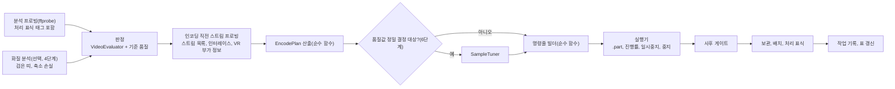
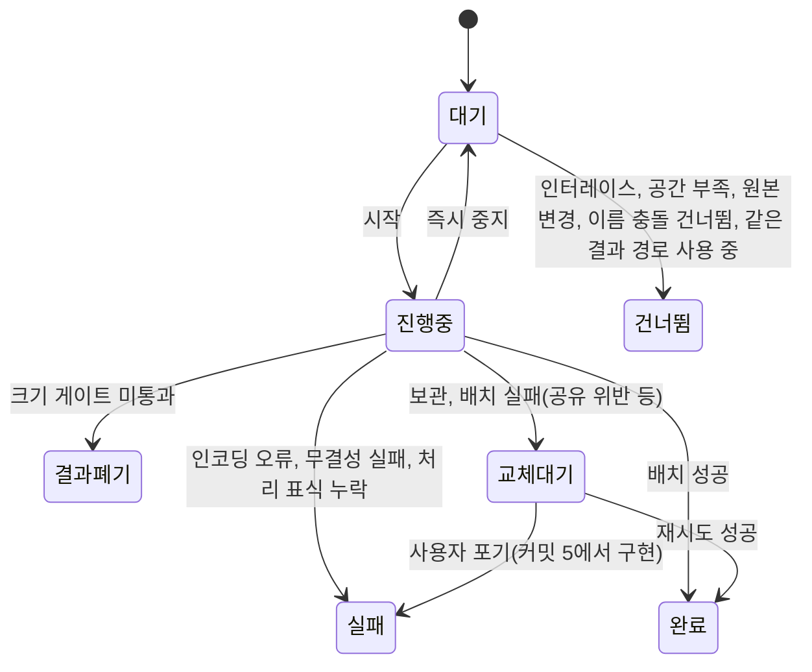

# 영상별 맞춤 직접 인코딩: 최종 설계서 및 구현 계획

> 상태(2026-11-26, `main` `2cfe55c` 기준): 결정 1~34 승인. 1~4단계 전체 완료. 5단계는 `5a`~`5c`, `5c-6d`~`5c-6l`, `5d-2`, `5e`, `5f` 완료, 6단계는 `6a`와 `6b`의 `F1` 도움말 갱신 완료. 남은 것은 `5d` 잔여(연속 배율과 최대 해상도 기준, 10-bit SDR 유지, AV1 활성화, `5d-1` 사전 실측)와 검토 지적 수정, 6단계 최종 점검(0.4절). 실행 중인 워커 작업은 브리지 `tasks.md`가 기준. 현재 상태와 코드 지도는 0.4절, 유효한 구현 규칙과 열린 항목은 13절
>
> 용어: 2026-11-25 용어 전환(`0d563f1`) 뒤 화면 용어는 작업을 `인코딩`, 이 앱이 이미 처리한 영상의 재처리만 `재인코딩`으로 부름. 이 문서 본문, 8절, 11절의 `재인코딩` 표기는 전환 전 기록이며 화면 문구의 기준은 `TERMINOLOGY.md`
>
> 문서 구성(2026-11-26 분할): 완료 단계 명세(5.3절, 5.4절, 5.5절 완료분)와 완료 기록(13.1절, 13.3절)은 `IMPLEMENTATION_HISTORY.md`, 실측 기록(12절)은 `IMPLEMENTATION_MEASUREMENTS.md`. 3절 구현 완료 결정의 원문, 4.2절 모듈 표, 0.4절과 13.5절의 완료 이력, 11절 용어 승인 기록도 같은 문서에 있음. 옮긴 절은 번호를 그대로 유지하고, 이 문서에는 제목과 위치만 남김
>
> 대상 독자: 이 저장소에서 1~6단계를 구현하는 에이전트. 이 문서만으로 단계별 작업, 파일, 데이터 형식, 검증 기준을 정할 수 있도록 작성
>
> 우선순위: `AGENTS.md`, `CLAUDE.md`의 저장소 규칙이 항상 우선. 이 문서와 저장소 규칙, 또는 이 문서와 실제 코드가 어긋나면 구현을 멈추고 사용자에게 보고
>
> 표기: "초기값"은 실측 전 근거가 약한 수치로, 명명 상수로 두고 독스트링에 "초기값, 4단계 보정 대상"을 적음

---

## 0. 구현 에이전트 실행 규칙

### 0.1 공통 규칙
1. 단계는 1 -> 2 -> 3 -> 4 -> 5 -> 6 순서로만 진행. 단계를 건너뛰거나 합치지 않음
2. 각 단계 시작 전에 사용자에게 "작업 목록, 수정, 신규, 삭제 파일, 검증 방법"을 제시하고 승인받은 뒤 착수(`AGENTS.md` 7절). 대량 제거, 개명은 범위를 먼저 합의
3. 각 단계는 독립 커밋 묶음으로 끝내고, 커밋 전 `scripts/check.ps1`를 오류, 경고, 스킵 없이 통과
4. 저장소 규칙 요약(상세는 `AGENTS.md`)
   - 계층: `src/gui`, `src/cui` -> `src/service` -> `src/core` 단방향
   - 모듈 500줄 초과 시 책임 분리 검토, 1000줄 초과 불가. 동결 파일과 예외 목록은 `scripts/module_size_exceptions.json` 기준(줄 수는 이 문서에 적지 않음)
   - Ruff + BasedPyright `strict` 0 오류, 0 경고
   - 메타 문서, 주석, 커밋 메시지에는 한글 외 비ASCII 문자 금지
   - 버튼은 아이콘만, 이름은 접근성 이름과 툴팁. 색은 팔레트 토큰만
   - 설정 키 추가, 변경은 `setting` 스킬, 모듈 추가, 개명은 `sync` 스킬, 테스트는 `test` 스킬 절차
5. 사용자 노출 새 용어는 후보 2~3개와 추천안을 제시해 승인받은 뒤 `TERMINOLOGY.md`에 추가하고 사용(`TERMINOLOGY.md`에 등록된 용어는 바로 사용)
6. 실측 결과로 수치를 바꾸면 이 문서의 해당 결정과 `IMPLEMENTATION_MEASUREMENTS.md` 12절 기준선 결과를 함께 갱신
7. 이 문서에 없는 판단이 필요하면 추측하지 말고 선택지와 추천안을 들고 사용자에게 질문

### 0.2 GUI 구현 전 레퍼런스 요청 절차(결정 26)
GUI 화면(새 화면, 기존 화면 개편, 대화상자, 설정 항목 포함)의 UI 코드를 작성하기 **직전에** 반드시 아래 순서를 실행

1. 사용자에게 다음 세 가지를 먼저 보고
   - (1) 이 GUI가 우리 프로그램의 어느 화면, 위치에서 쓰이는지(예: 메인 창 하단 막대, 재인코딩 메뉴, 환경 설정 대화상자의 어느 영역)
   - (2) 요청하는 레퍼런스 GUI가 원본 프로그램(주로 샤나인코더 7.4)에서 어떤 상황, 조건일 때 나타나는 화면인지(예: "샤나에서 파일 2개 이상을 동시 인코딩하는 도중의 인코딩 창")
   - (3) 받고 싶은 상태 목록(예: 진행 중, 일시중지, 오류, 완료)
2. 레퍼런스 이미지를 요청하고 받을 때까지 해당 화면 UI 코드를 작성하지 않음. 원본 프로그램에 대응 화면이 없으면 그 사실을 보고하고 "기존 화면 스타일로 진행"할지 사용자 결정을 받음
3. 레퍼런스를 받은 뒤 `gui-design` 스킬 절차로 배치안을 제시하고 구현
4. 샤나 레퍼런스 이미지는 `_ref/gui/`(Git 제외, 읽기 전용)에 상황을 설명하는 파일 이름으로 보관(2026-11-20 사용자 배치: 대기 목록, 인코딩 중, 일시정지 일부/전체, 완료(오류 포함), 인코딩 중 닫기와 닫은 뒤 메인 창, 파일 메뉴, 설정과 프리셋 메뉴, 환경 설정 하위 메뉴, F2, F3, F6~F9, 출력 파일 재생과 정보). 구현 에이전트는 먼저 이 폴더에서 찾고, 필요한 상태가 없을 때만 1항 절차로 요청
5. 대상 화면과 요청 시점은 5.0절 표를 따름
6. 요청 시점과 전달 방식(2026-11-19 사용자 지시): 이미지가 필요한 하위 커밋을 착수하기 직전에 그 화면만 요청(여러 화면을 미리 몰아서 요청하지 않음). 1항의 맥락(쓰이는 위치, 원본 화면이 나타나는 상황)을 함께 보고하며, 사용자는 이미지를 구현 에이전트에게 직접 붙여넣음
7. HTML 프로토타입 확인(2026-11-20 사용자 지시): 배치안이 승인된 뒤에도 UI 코드를 쓰기 전에 그 화면의 HTML 프로토타입을 만들어 사용자가 직접 확인하게 함. 실제 승인 문구, 팔레트의 다크/라이트 색, 상태별 모습(예: 대기, 진행 중, 일시중지, 실패, 말줄임)을 담고, 저장소 밖(에이전트 임시 폴더)에 두거나 아티팩트 기능이 있으면 아티팩트로 게시함. 보고에 파일 경로나 링크를 적고, 사용자가 확인한 뒤에 코드를 씀. 프로토타입은 배치와 문구 확인용이며 Qt 화면과 픽셀 단위로 같을 필요는 없음

### 0.3 로컬 자료와 도구
- `_ref/`(Git 제외, `.git/info/exclude`): 사용자 표본과 샤나 결과. 읽기 전용. 단위 테스트에서 사용 금지(테스트는 합성 입력만 사용)

| 경로 | 내용 |
| :--- | :--- |
| `_ref/video1.mp4` ~ `_ref/video19_*.{mp4,mkv,avi,wmv,ts}` | 표본 19개(12.1절 표본 목록) |
| `_ref/clips/` | 샤나 비교용 클립 18개(HDR 제외, 긴 영상은 가운데 60초) |
| `_ref/shana/<라벨>/` | 클립을 샤나 7.4로 인코딩한 기준 결과(라벨: `nvenc_cq22`, `nvenc_cq26`, `nvenc_1080p`, `x265_cq22`, `x265_cq26`, `x265_1080p`) |
| `_ref/re/src/`, `_ref/re/shana/` | 역추적용 초경량 원본 2개와 샤나 결과 |
| `_ref/tools/shana_reverse.py` | 역추적 도구(`make`, `analyze`, `match`) |
| `_ref/tools/capture_ffmpeg.ps1` | FFmpeg 프로세스 명령줄 기록 도구(샤나 7.4에는 효과 없음, 12.1절) |

- 저장소에 넣는 비교, 통합 스크립트(`scripts/`)는 로컬 경로를 하드코딩하지 않고 인자로 받음(`AGENTS.md` 6절)

### 0.4 현재 상태 요약과 코드 지도(2026-11-26 갱신, 다음 작업 착수 전 먼저 읽기)
- 완료: 1~4단계 전체, 5단계 `5a`~`5c`(`5c-6a`~`5c-6l` 포함), `5d-2`, `5e`, `5f`, 6단계 `6a`와 `6b`의 `F1` 갱신. 하위 단계별 커밋과 경위는 `IMPLEMENTATION_HISTORY.md` 13.1절, 13.5절
- 테스트 수와 검증 트리는 `check.ps1` 출력이 기준이며 이 문서에 적지 않음

- 남은 것(2026-11-28 재수립, 순서와 범위는 5.5절 "`5d` 잔여 재수립"):
  - `5d-1` `_ref/` 사전 실측(측정 워커가 다른 워커 없이 단독 실행) -> `5d-3` 연속 배율 축소와 `최대 해상도 기준`(결정 5) -> `5d-4` 10-bit SDR 유지(결정 27) -> `5d-5` AV1 활성화(결정 22) -> `5d-6` 호환성 기준(결정 25, 27)
  - 2026-11-28 코드 확인: `resolution_tiers.py`는 고정 8규격, 출력 기본 `yuv420p`(`encode_plan.py` `DEFAULT_PIXEL_FORMAT`), `encoder_specs.py`의 AV1 2종은 `available=False`, NVENC는 `-level:v auto` 고정, 스케일러는 `크기 조절 방식` 설정(기본 `bicubic`, 실측 근거 없음)
  - 진행 중 워커 작업(브리지 `tasks.md`): 정밀 결정, 사용자 지정 활성 화면, 권장 처리 분리의 감사 수정, 내용 식별 기반 분석 캐시(계획서 밖 신규 작업), `main` `2d65f78` 기준 검토 지적 수정 대기열(검은 여백, 왕복 SSIM, 정밀 측정, 화질 분석 GUI, 화질 비교, 미리 보기와 진행 창, FFmpeg 명령, 표 복원, 실행 표식, 인코딩 예측, `F1` 도움말 4건)
  - 실화면 확인: 브리지 사람 확인 항목 기준
  - 6단계 최종 점검(5.6절 `6b`): 위 두 항목을 끝낸 뒤
- 문구 승인 범위(2026-11-20 사용자 결정): 행 이름, 값, 버튼, 메뉴, 상태 문구, 경고는 사전 승인. 툴팁과 설명 문장은 작성 후 보고에 전문을 적어 사후 확인
- GUI 진행 조건: 4단계 GUI(`4d`, `4e`)는 기존 화면 스타일로 진행 승인(2026-11-21)하되, 코드 작성 전 11.2절 용어 승인과 HTML 프로토타입 확인(0.2절 7항)이 필수
- 의도적으로 열려 있는 항목: `hevc_amf`와 `hevc_qsv`는 보류(`available=False`), AV1(`av1_nvenc`, `libsvtav1`)은 4단계 보정 후 5단계 활성화. 열린 항목은 13.4절
- 동결 파일(`frozen`): 2026-11-26 현재 `scripts/module_size_exceptions.json`의 `frozen`은 비어 있어 `main_window.py`, `video_table_view.py`도 1000줄 하드 상한만 적용. 줄 수는 그 파일과 `scripts/verify_module_size.py`가 기준

- 모듈 위치(재편 뒤): 영역 패키지 `core/{encode, analysis, evaluation, settings}`, `service/encode`, `gui/{table, menus, preview, controllers, settings, help}`, 모듈은 소유 영역에 두고 영역 사이 순환이 생기거나 기반 모듈이 쓰는 경우만 계층 바로 아래(`core/`에 기반 모듈과 `app_version`, `config`, `encode_fingerprint`, `encode_tag`, `encoder_specs`, `mp4_boxes`, `mp4_xtra`, `probe_parser`, `quality_probe`, `quality_target`, `sample_points`, `smart_action`, `resolution_tiers`, `gui/`에 앱 틀). 아래 표의 모듈 이름은 파일 이름이며 위치는 [ARCHITECTURE.md](ARCHITECTURE.md) 기준
- 테스트는 `tests/{core, service, gui, cui, tools}` 하위 폴더에 `src` 구조를 따라 둠. 공용 도우미는 `tests/` 바로 아래. 새 모듈은 영역 패키지에 추가(`AGENTS.md` 1절)

| 영역 | 모듈 | 진입점 |
| :--- | :--- | :--- |
| 판정 | `quality_target.py`, `evaluator.py`, `smart_action.py`, `classification_policy.py` | `VideoEvaluator.evaluate_video`, `evaluate_all`(`active_frame`, `active_frames`, `known_encode_tag_names`, `encoded_history_filenames` 입력), `SmartAction`, `DEFAULT_CLASSIFICATION_POLICIES` |
| 프로빙 | `stream_layout.py`, `ffmpeg_capability.py`, `mp4_boxes.py`, `mp4_xtra.py`, `encode_fingerprint.py` | `parse_stream_layout`(인코딩 직전 스트림 목록), `probe_ffmpeg_capability`(FFmpeg 상태, `has_vmaf`), `read_mp4_probe_info`, `read_mp4_xtra_items`, `write_mp4_xtra`, `compute_encode_fingerprint` |
| 계획과 명령 | `encoder_specs.py`, `encode_plan.py`, `encode_tag_plan.py`, `encode_impact.py`, `ffmpeg_command.py`, `encode_tag.py`, `app_version.py` | `ENCODER_SPECS`, `build_encode_plan`, `plan_encode_tags`, `summarize_encode_impact`, `build_ffmpeg_args`, `build_encode_tag`, `APP_VERSION` |
| 프로세스 | `encode_process.py`, `encode_progress.py`, `power_state.py` | `EncodeProcess`, `ProgressParser`, `PausableClock`, `prevent_sleep`, `run_after_complete` |
| 서비스 | `encode_job.py`, `encode_service.py`, `encode_tag_io.py`, `encode_output_history.py`, `encode_placement.py`, `encode_resume.py`, `encode_history.py`, `encode_events.py`, `encode_ports.py` | `jobs_from_evaluations`, `EncodeSettings.from_config`, `create_batch`, `EncodeRunner`(`run`, `pause_all`, `resume_all`, `cancel_all`, `request_stop_after_current`, `retry_replace_pending`), `EncodeOutputHistory`, `prepare_resume`, `find_unrecorded_parts`, `EncodeHistory` |
| 순수 규칙 | `encode_gate.py`, `encode_paths.py`, `encode_state.py`, `encode_concurrency.py` | `judge_result`, `choose_free_path`, `EncodeState`, `resolve_concurrency` |

- 주입 지점(단위 테스트, 실측 스크립트용): `EncodeRunner(history, settings, probe=, process_factory=, on_event=, store=, cpu_count=, clock=)`
- 화면은 `EncodeEvent`(`kind`: `state`, `progress`, `long_pause`)를 받아 갱신하고, 워커 스레드에서 Qt 객체에 접근하지 않음
- 개발 PC 확인 사항: PATH의 FFmpeg 2024-12 빌드에 `libvmaf`, `cropdetect`, `blackdetect` 필터와 `hevc_nvenc`, `libx265`, `h264_nvenc`, `libx264`, `av1_nvenc`, `libsvtav1` 인코더가 포함됨. 코드와 문서에 장치명, 로컬 경로, 사양값을 기록하지 않음

---

## 1. 배경 요약

### 1.1 현재 구조
- 영상을 분석해 재인코딩 여부를 판정하고, 샤나인코더 프리셋 XML과 1:1 대응하는 분류 폴더(10개)로 파일을 옮김. 실제 인코딩은 사용자가 샤나에서 수행
- 판정 모델: [`BitrateModelConfig`](src/core/config.py)의 `base_target_kbps = 1500`(720p 30fps H.264)에서 면적 지수 0.82, FPS 지수 0.60으로 적정 비트레이트 `B_opt`를 계산하고, 원본 비율 `r`로 과화질(`r > 1.2`), 적정, 저화질(`r < 0.8`)을 구분
- 프리셋 핵심(NVENC): 표준 `-cq:v 22`, 저화질 `-cq:v 26`, 축소 규격 8개는 `-b:v 0 -maxrate <고정값> -bufsize <2배>` + 16:9 박스 내접 `scale`. 모두 `-f mp4 -c:a copy -shanakeyframe 1 -profile:v main`

### 1.2 해결할 문제

| 기호 | 문제 | 근거 |
| :--- | :--- | :--- |
| A | 22/26이 판정, 프리셋, UI에 분산 결합 | `SmartAction.ENCODE_CQ22_*`, 폴더명, `TERMINOLOGY.md` 6.3절 |
| B | 예상 용량이 출력 품질값을 반영하지 않음 | [`evaluator.py`](src/core/evaluation/evaluator.py)가 CQ26 경로에도 같은 추정식 사용 |
| C | 고정 규격 축소의 계단 손실 | 2160p->1440p 화소 55.6% 손실, `2560x1080`이 1080p 상한에서 `1920x808` |
| D | 프리셋이 영상 특성을 못 따라감 | 10-bit -> 8-bit, MP4 비호환 트랙 손실, 프리셋은 NVENC/x265만 |
| E | 해상도 대비 세부 묘사가 적은 영상을 놓침 | 4K 표본 3개가 1080p 왕복 SSIM 0.996 이상, 그중 2개는 4K 기준 "적정"이지만 1080p 기준 r 3.16/3.27 |
| F | 검은 띠가 판정을 왜곡 | 세로 화면 + 좌우 검은 띠 4K 표본: 전체 면적 r 0.32, 실제 화면 r 0.82 |
| G | 샤나 결과의 실제 손실 | 12.3절: WMV 실패, 다중 트랙/자막/글꼴/커버 소실, 인터레이스 미처리, 4K 60fps 품질값 미반영 |

- 해결 현황(2026-11-18): A, B는 2단계(`baseline_cq`, 품질값 차이 용량 계수, 역할 기반 식별자)에서 반영. D의 트랙 보존과 G의 일부는 3단계 구현 완료(샤나 대비 검증은 커밋 4). C, E, F는 4~5단계. 위 표의 근거는 1단계 이전 코드 기준

### 1.3 방향
- 샤나는 FFmpeg 프런트엔드이며 화질은 같은 FFmpeg 인코더가 결정. 같은 인자로 샤나와 **영상 데이터가 바이트 단위로 같은 결과**를 낼 수 있음을 확인(12.5절)
- 분류 폴더 이동을 없애고 프로그램 안에서 영상별 계획(`EncodePlan`)으로 직접 인코딩
- 먼저 샤나와 같은 결과를 재현(3단계)한 뒤, 개선 항목을 하나씩 켜서 검증(5단계)

---

## 2. 목표, 비목표, 전제, 원칙

### 2.1 목표
1. 판정 결과를 영상별 `EncodePlan`으로 바꿔 직접 인코딩
2. 판정, 예상 용량, 실제 인코딩이 같은 기준 정의를 공유
3. 연속 배율 축소, 10-bit 유지, 영상별 최대 비트레이트, 기준 품질 변경
4. 샘플 인코딩 + VMAF/SSIM으로 영상별 품질값 결정
5. 샤나 대비 화질, 트랙 보존, 속도, 원본 안전에서 열위 없음
6. 화면 내용 측정(축소 손실, 검은 띠)으로 비트레이트 모델의 사각 보완
7. VR 기기 재생과 AI 2D->3D 변환 도구 입력으로 쓰기 좋은 출력(결정 27)

### 2.2 비목표
- HDR(PQ, HLG, Dolby Vision) 재인코딩: 판정 `PASS_HDR` 유지
- 자막 입히기, 로고, 자르기 편집, HDR 톤매핑, 파일별 수동 인자 조정
- FFmpeg 번들링. 외부 독립 프로그램은 FFmpeg/ffprobe만 사용(MediaInfo 등 금지). Python 라이브러리는 필요 시 도입(`pyproject.toml` 명시)
- 원본 자동 삭제를 기본값으로 두는 것
- 분류 폴더 이동, 샤나 프리셋 연동의 유지와 이전 도구

### 2.3 전제
- 모든 기존 커밋은 프로토타입이고 실사용자 0명. 중간 단계 사용자도 없음
- 하위 호환, 설정 이전, 캐시 이전, 병행 기간을 고려하지 않음. 제거 대상은 이전 코드 없이 제거

### 2.4 설계 원칙
- **한 번에 한 가지 변화**: 3단계는 샤나 동치, 5단계 개선 항목은 하나씩 켜고 비교
- **확신 없는 입력은 건너뜀**: HDR, 인터레이스는 건너뛰고 사유 기록
- **원본 우선**: 게이트 통과 전 원본 무변경, 어떤 실패에서도 원본과 결과 중 하나 이상 보존

---

## 3. 확정 결정 명세

각 결정의 형식: 규칙 / 초기값 / 적용 단계. 결정 번호는 다른 문서, 커밋에서 참조하므로 바꾸지 않음
- 2026-11-26: 남은 `5d`와 이어진 결정 4, 5, 6, 8, 22, 25, 27은 원문 그대로 두고, 구현을 마친 나머지 결정의 원문은 `IMPLEMENTATION_HISTORY.md` 3절로 옮김(결정 번호와 제목 유지, 요지는 8절 표)

### 결정 1. 실행 구조
- 구현 완료. 요지는 8절 표, 원문은 `IMPLEMENTATION_HISTORY.md` 3절 결정 1

### 결정 2. 기준 품질과 판정 모델
- 구현 완료. 요지는 8절 표, 원문은 `IMPLEMENTATION_HISTORY.md` 3절 결정 2

### 결정 3. 목표 품질값 반영 용량 추정
- 구현 완료. 요지는 8절 표, 원문은 `IMPLEMENTATION_HISTORY.md` 3절 결정 3

### 결정 4. 저화질 보호 품질값
- 3단계: 기준 + 4.0 고정(샤나 동치)
- 5단계: $Q_{\text{protect}} = \text{clamp}(Q_{\text{base}} + K \log_2 (1/r_{\text{target}}),\ Q_{\text{base}},\ Q_{\text{base}} + \Delta_{\max})$, $\Delta_{\max}$ 초기값 6.0
- 보호 판정 조건은 [`should_use_low_quality_preset`](src/core/evaluation/classification_policy.py) 재사용
- **승인 조건: 품질값은 인코더가 소수를 받는 한 반올림하지 않고 소수 그대로 계산, 적용**
  - 소수 가능: `hevc_nvenc`, `h264_nvenc`, `av1_nvenc`(`-cq`), `libx265`, `libx264`(`-crf`)
  - 정수만: `libsvtav1`(`-crf` 0~63), `hevc_amf`, `hevc_qsv`. 인코더 척도로 매핑한 뒤 마지막에만 반올림
  - 소수가 인코더 내부에서 실제로 반영되는지는 4단계 실측
  - 표시는 소수 첫째 자리(`CQ23.9 재인코딩`)
- 적용: 2단계(상수), 3단계(+4), 5단계(연속 식)

### 결정 5. 해상도 축소
- 3단계: 현행 8규격 + 16:9 박스 + 규격 고정 `-maxrate`(샤나 동치)
- 5단계 연속 배율: $s = (r_{\text{src}}/r_{\text{low}})^{1/(2\alpha)}$, $\alpha$ = `area_scaling_exponent`. 크기는 `OUTPUT_DIM_ALIGN`(4) 배수 내림
- 미세 축소 가드: [`MIN_DOWNSCALE_AREA_RATIO`](src/core/resolution_tiers.py)(95%) 유지, 4단계 실측 후 변경 여부 결정
- 최대 해상도 기준: 기본 `short_side`, 선택 `pixel_area`, `box`(`2560x1080`에 1080p 상한: 축소 안 함 / 약 2216x932 / 1920x808)
- 스케일러: 3단계 FFmpeg 기본, 5단계 `lanczos` 계열 표본 비교 후 채택
- **승인 조건: 축소 기준이 겹칠 때(2026-11-23 화질 분석 축소 후보 기본 자동 반영 확정)**
  1. 영상별 직접 지정(`축소 안 함` 포함)이 있으면 그것만 사용
  2. 없으면 화질 분석 `축소 후보`(결정 19, 자동 반영 설정 기본 켬)를 우선 반영하되, 최대 해상도 상한이나 비트레이트 맞춤(켜진 경우)이 더 작은 크기를 요구하면 적용 가능한 후보 중 **가장 작은 출력 크기**를 채택
  3. 채택 결과에 미세 축소 가드 적용
  - 같은 크기면 판정 사유 표시 순서: 최대 해상도 > 화질 분석 축소 후보 > 비트레이트 맞춤(화질 분석 축소 후보가 단독으로 적용된 행은 전용 판정 사유로 구분해 표 필터로 한눈에 검수 가능)
- 축소, 해상도 판정 및 하위 후보 규격 탐색은 검은 띠를 잘라낸 **크롭(활성 화면) 해상도 기준**으로 일원화(결정 20)
- 적용: 3단계(규격), 5단계(자동 반영, 연속, 기준, 스케일러, 겹침 규칙)

### 결정 6. 최대 비트레이트(`-maxrate`)와 축소 비트레이트 제어(방안 A+B 결합)
- 적용 범위: 축소 경로(및 결정 29 B 절약 목적 샘플 예측 경로)
- **방안 A(5단계 일반화 `maxrate`)**: 고정 규격 상한(예: 720p `2800k`)만 쓰면 사용자가 설정한 기준 비트레이트(`base_target_kbps = 1500`)보다 평균 비트레이트(예: 720p `2200kbps`)가 과투입될 수 있음. 출력 해상도와 프레임레이트 기준의 출력 적정 비트레이트(`target_optimal_kbps`)에 여유 배수(초기값 `1.4`~`1.5`, 100k 올림, 규격 고정 상한을 넘지 않도록 캡핑)를 곱해 `-maxrate`와 `-bufsize`(2배)를 설정값(`base_target_kbps`)에 연동하여 산출
- **방안 B(결정 29 B 샘플 5구간 예측 기반 추가 시간 0초 품질값 자동 상향)**: 본 인코딩 전 이미 실행하는 결정 29 B 샘플 5구간 시험 인코딩의 예측 영상 비트레이트가 목표 비트레이트(`target_optimal_kbps` x 허용 배수, 초기값 `1.15`)를 초과하면, **추가 샘플 인코딩 시간 0초**로 결정 33의 기울기 식($\Delta Q = K \log_2(\text{예측 비트레이트} / \text{목표 비트레이트})$)을 재사용해 목표 비트레이트에 맞는 품질값(CQ/CRF, 상한 `Q_base + 6.0`)으로 즉시 자동 상향한 뒤 본 인코딩을 실행
- 적용: 3단계(고정값), 5단계 `5d`(방안 A+B 결합)

### 결정 7. 키프레임과 프레임 타이밍
- 구현 완료. 요지는 8절 표, 원문은 `IMPLEMENTATION_HISTORY.md` 3절 결정 7

### 결정 8. 출력 컨테이너와 스트림 보존
- 컨테이너: 원본 유지 우선(`.mp4`, `.mkv`, `.mov`). `.avi`, `.wmv`, `.flv`, `.webm`, `.ts`는 `.mp4`, 비호환 트랙이 있으면 `.mkv`. 설정 "항상 MP4" 제공
- 원본 형식을 유지하는 조건(2026-11-20 명확화): (1) 재인코딩 태그를 기록할 수 있는 형식(MP4, MOV, MKV, 결정 28)이고 (2) 목표 인코딩 방식의 코덱 계열을 표준으로 담는 형식. H.264, HEVC는 세 형식 모두 담으므로 현재 결과는 위 목록과 같음. AVI, WMV(ASF), FLV, WebM은 HEVC를 표준으로 담지 못하고, TS와 FLV는 H.264를 담을 수 있어도 태그를 기록할 수 없어 MP4로 저장. AV1(5단계)의 허용 형식은 활성화 때 확인. 계열별 허용 형식은 인코더 정의 표 한 곳에 두고 `choose_container`와 설정 설명이 이 표를 씀(커밋 5a 보완)
- 스트림 매핑: 인코딩 직전 프로빙한 스트림 목록으로 `-map 0:<index>` 명시

| 스트림 | 처리 |
| :--- | :--- |
| 주 영상 | 인코딩 |
| 커버(`attached_pic`) | `copy`, 출력에 `-disposition attached_pic`. 커밋 4까지는 MP4/MOV 출력에서 커버를 제외하고 사유 기록(`+use_metadata_tags`가 커버를 버림, 12.8절). 커밋 4b부터 항상 유지(결정 28) |
| 오디오 | `copy`. 대상 컨테이너 비호환 코덱만 `aac` 변환(예: WMA -> AAC, 12.3절 WMV 실패 원인) |
| 자막 | `copy`. MP4 출력의 텍스트 자막은 `mov_text`, 비트맵 자막이 있으면 `.mkv` |
| 첨부 파일(글꼴) | MKV 출력이면 `copy`. MP4로 바뀌면 소실 사유 기록 |
| 데이터 스트림 | 제외하고 기록. MP4/MOV 출력은 `-write_tmcd 0`으로 MOV 타임코드 트랙이 다시 생기지 않게 함(커밋 4 실측, 2026-11-18 승인) |
| 메타데이터, 챕터 | `-map_metadata 0`, `-map_chapters 0` |

- 색 정보: `color_primaries`, `color_trc`, `colorspace`, `color_range`를 출력에 명시 전달(bt709, bt2020 SDR 포함)
- 회전: FFmpeg 자동 회전, 출력 크기는 표시 기준. 샤나와 같이 화면을 돌려 저장하고 회전 정보는 남기지 않음(12.3절)
- MP4/MOV의 HEVC는 `-tag:v hvc1`(결정 27)
- 적용: 3단계

### 결정 9. 결과 파일 처리와 재처리 방지
- 구현 완료. 요지는 8절 표, 원문은 `IMPLEMENTATION_HISTORY.md` 3절 결정 9

### 결정 10. 사후 게이트
- 구현 완료. 요지는 8절 표, 원문은 `IMPLEMENTATION_HISTORY.md` 3절 결정 10

### 결정 11. FFmpeg 확보와 능력 확인
- 구현 완료. 요지는 8절 표, 원문은 `IMPLEMENTATION_HISTORY.md` 3절 결정 11

### 결정 12. 테스트 정책
- 구현 완료. 요지는 8절 표, 원문은 `IMPLEMENTATION_HISTORY.md` 3절 결정 12

### 결정 13. 용어
- 구현 완료. 요지는 8절 표, 원문은 `IMPLEMENTATION_HISTORY.md` 3절 결정 13

### 결정 14. 디코딩 구성
- 구현 완료. 요지는 8절 표, 원문은 `IMPLEMENTATION_HISTORY.md` 3절 결정 14

### 결정 15. 인터레이스 원본
- 구현 완료. 요지는 8절 표, 원문은 `IMPLEMENTATION_HISTORY.md` 3절 결정 15

### 결정 16. 중지, 일시중지, 이어 하기
- 구현 완료. 요지는 8절 표, 원문은 `IMPLEMENTATION_HISTORY.md` 3절 결정 16

### 결정 17. 인코딩 중 다른 작업과 미리 보기
- 구현 완료. 요지는 8절 표, 원문은 `IMPLEMENTATION_HISTORY.md` 3절 결정 17

### 결정 18. 품질값 정밀 결정(가칭) 적용 범위
- 구현 완료. 요지는 8절 표, 원문은 `IMPLEMENTATION_HISTORY.md` 3절 결정 18

### 결정 19. 축소 손실 측정과 화질 분석 고속화
- 구현 완료. 요지는 8절 표, 원문은 `IMPLEMENTATION_HISTORY.md` 3절 결정 19

### 결정 20. 검은 띠 감지와 비대칭 포함 4면 자동 부분 크롭(`crop`) 파이프라인
- 구현 완료. 요지는 8절 표, 원문은 `IMPLEMENTATION_HISTORY.md` 3절 결정 20

### 결정 21. 다른 계획과의 순서
- 구현 완료. 요지는 8절 표, 원문은 `IMPLEMENTATION_HISTORY.md` 3절 결정 21

### 결정 22. 인코더와 장치 조합
- 구조: 출력 코덱(H.264, HEVC, AV1) x 장치(CPU, NVIDIA, AMD, Intel)를 하나의 인코더 정의 표(4.3절)로 정의하고, 명령줄 빌더는 이 표만 참조
- 활성화 순서
  - 3단계: H.264/HEVC 계열 6개 중 활성 4개(`libx264`, `libx265`, `h264_nvenc`, `hevc_nvenc`). `hevc_amf`, `hevc_qsv`는 인자 미확정과 테스트 PC 장치 부재로 보류(2026-11-18 승인, 13절). 샤나 기준이 있는 것은 `hevc_nvenc`, `libx265`. 나머지는 인자 단위 테스트 + 장치가 있을 때 수동 확인, 4단계 보정 전 항등 매핑
  - 4단계 보정 후: AV1 계열(`av1_nvenc`, `libsvtav1`)
- `h264_amf`, `h264_qsv`, `av1_amf`, `av1_qsv` 등은 표에 행만 추가하면 되도록 구조를 두되 이번 범위에서는 추가하지 않음
- 적용: 3단계, 5단계(AV1)

### 결정 23. 재인코딩 진행 화면
- 구현 완료. 요지는 8절 표, 원문은 `IMPLEMENTATION_HISTORY.md` 3절 결정 23

### 결정 24. 샤나 환경 설정 대응 기능
- 구현 완료. 요지는 8절 표, 원문은 `IMPLEMENTATION_HISTORY.md` 3절 결정 24

### 결정 25. NVENC 레벨 상한과 품질값
- 사실: `-level:v auto`는 해상도, fps에 맞는 레벨(4K 60fps는 5.1)을 고르고, 명시한 최대 비트레이트가 없으면 그 레벨 최대 비트레이트를 상한으로 적용. 고비트레이트 4K 60fps에서 CQ22, CQ26이 모두 약 36Mbps로 같아짐. `-b:v 0`, `-tier high`로는 안 풀리고 `-level:v 6.2` 또는 큰 `-maxrate`로 풀림(CQ22 약 84Mbps, CQ26 약 50Mbps). 상한이 풀리면 이 표본의 CQ22 결과가 원본(약 72Mbps)보다 커짐(12.5절)
- 3단계: 샤나와 같이 상한 유지. 예상 용량 계산에 레벨 상한 반영(결정 3)
- 4단계: "상한 유지"와 "상한 해제 + 더 높은 품질값"을 같은 크기 기준 VMAF로 비교해 기본 정책 결정. 레벨 호환성을 설정(호환성 기준)으로 고르는 방안 검토. 호환성 기준 후보에 VR 기기(결정 27) 포함
- 적용: 3단계, 4단계

### 결정 26. GUI 구현 전 레퍼런스 요청과 사전 보고
- 구현 완료. 요지는 8절 표, 원문은 `IMPLEMENTATION_HISTORY.md` 3절 결정 26

### 결정 27. VR 재생 호환성과 AI 2D->3D 변환 호환성
- **HEVC 코덱 태그**: MP4/MOV 출력의 HEVC는 모든 인코더에서 `-tag:v hvc1`. 샤나 NVENC 결과는 `hev1`, x265 결과는 `hvc1`이었음(확인). 태그는 컨테이너 정보만 바꾸므로 영상 데이터 바이트 일치 기준(6.1절)에 영향 없음. 3단계부터 적용
- **색 정보 보존**: 결정 8의 색 정보 전달(bt709, bt2020 SDR 등)을 손실 없이 유지. HDR 원본은 계속 보존 판정
- **10-bit 파이프라인**: 5단계 10-bit SDR 유지 시 디코딩 -> 필터 -> 인코딩 전 구간에서 8-bit 중간 변환 금지(`yuv420p10le`/`p010le`, HEVC `main10`). 3단계는 샤나 동치로 8-bit
- **VR 영상 보호**
  - 스트림 부가 정보에 구면 투영(Spherical Mapping) 또는 입체(Stereo 3D) 정보가 있으면 VR 영상으로 판단
  - VR 영상은 검은 띠 잘라내기 미적용(어안 180도 영상의 원 밖 검은 영역이 잘리면 투영이 깨짐), 해당 부가 정보를 출력에 보존(MP4 구면 정보 기록에 필요한 FFmpeg 옵션 확인 포함)
  - 감지 방법과 보존 가능 여부는 4단계에서 표본(사용자 제공)으로 확인. 표본이 없으면 사용자에게 요청
- **VR 기기 호환성 기준**: 결정 25의 4단계 레벨, 호환성 검토에서 Meta Quest 3, Apple Vision Pro의 하드웨어 디코딩 규격(최대 해상도, 프레임레이트, 프로파일, 레벨)을 호환성 기준 후보에 포함. 수치는 공식 문서로 확인해 12절에 출처와 함께 기록하고 추정값을 쓰지 않음
- **AI 2D->3D 변환 도구 입력 품질 기준**(깊이맵 예측, 시차 생성에서 깊이 왜곡과 프레임 밀림 방지)
  - 유효 화면 정규화: 검은 띠 제거(결정 20, VR 제외)
  - 피사체 경계 보존: 품질값, 해상도 결정이 경계를 뭉개지 않도록 결정 4, 5, 19의 기준값을 보수적으로 보정하고, 5단계 개선 항목 비교에 경계 선명도 확인(VMAF와 함께 육안 확인 표본) 포함
  - 프레임 타이밍 일관성: 결정 7(`-g <round(fps)>`, `-fps_mode passthrough`)로 프레임 복제, 누락 없이 타임스탬프 유지
- 적용: 3단계(태그, 색 정보, 타이밍), 4단계(VR 감지, 호환성 기준), 5단계(10-bit, 잘라내기 예외)

### 결정 28. 재인코딩 태그와 재인코딩 이력(2026-11-18 사용자 결정)
- 구현 완료. 요지는 8절 표, 원문은 `IMPLEMENTATION_HISTORY.md` 3절 결정 28

### 결정 29. 결과 폐기 낭비 줄이기(2026-11-19 사용자 결정)
- 구현 완료. 요지는 8절 표, 원문은 `IMPLEMENTATION_HISTORY.md` 3절 결정 29

### 결정 30. 분석 캐시 보존과 복원 표시(2026-11-19 사용자 결정, 커밋 4a 구현 완료)
- 구현 완료. 요지는 8절 표, 원문은 `IMPLEMENTATION_HISTORY.md` 3절 결정 30

### 결정 31. 내장 미리 보기의 원본 잠금 해제(2026-11-19 사용자 결정, 커밋 4a-2 구현 완료)
- 구현 완료. 요지는 8절 표, 원문은 `IMPLEMENTATION_HISTORY.md` 3절 결정 31

### 결정 32. 외부 변경 뒤 표 갱신과 없는 파일 안내(2026-11-19 사용자 지시, 커밋 4a-2b 구현 완료)
- 구현 완료. 요지는 8절 표, 원문은 `IMPLEMENTATION_HISTORY.md` 3절 결정 32

### 결정 33. 키프레임 교정 영상의 품질값 자동 탐색(2026-11-20 사용자 결정)
- 구현 완료. 요지는 8절 표, 원문은 `IMPLEMENTATION_HISTORY.md` 3절 결정 33

### 결정 34. 프레임 정밀 화질 비교 뷰어와 내장 미리 보기 유기적 일체화(2026-11-21 사용자 결정, 2026-11-23 5단계 `5f` 확장 승인)
- 구현 완료. 요지는 8절 표, 원문은 `IMPLEMENTATION_HISTORY.md` 3절 결정 34

## 4. 아키텍처

### 4.1 데이터 흐름

### 4.2 모듈 배치(2026-11-19 구조 재편 뒤 경로, 예정 모듈은 배치 예정 패키지)
- 모듈명은 `TERMINOLOGY.md` 13절 명명 규칙을 따르며, 바꾸면 `ARCHITECTURE.md` 갱신(`AGENTS.md` 5절)
- 순수 함수(입력 -> 출력, 부작용 없음)와 프로세스 실행을 같은 모듈에 섞지 않음

- 모듈별 위치와 책임의 기준은 [ARCHITECTURE.md](ARCHITECTURE.md) 모듈 맵(`tests/tools/test_metadata_sync.py`가 실제 소스와 대조). 단계별 모듈 표는 `IMPLEMENTATION_HISTORY.md` 4.2절(2026-11-26 이동, 이후 갱신하지 않음)

- 수정 대상(주요, 이후 단계): [`config.py`](src/core/config.py), [`evaluator.py`](src/core/evaluation/evaluator.py), [`size_estimator.py`](src/core/evaluation/size_estimator.py), [`downscale_resolver.py`](src/core/evaluation/downscale_resolver.py), [`resolution_tiers.py`](src/core/resolution_tiers.py), [`models.py`](src/core/models.py), [`analysis_store.py`](src/service/analysis_store.py)(4단계 화질 분석 캐시), 설정 대화상자, 메뉴, 표 모델, `TERMINOLOGY.md`, `glossary_data.py`, `ARCHITECTURE.md`, `README.md`
- Python 의존성: `psutil==7.1.3`(추가 완료, `requirements.txt`), `numpy`(4단계 실험, 미채택 시 제거)

### 4.3 인코더 정의 표(`encoder_specs.py`)
각 행 필드: 인코더 이름, 코덱 계열, 장치, 품질 옵션, 척도 범위, 소수 허용, 기본 인자, 10-bit 인자, 최대 비트레이트 지원, 활성 단계

| 인코더 | 계열/장치 | 품질 옵션(척도, 소수) | 3단계 기본 인자(샤나 동치 근거) | 활성 |
| :--- | :--- | :--- | :--- | :--- |
| `hevc_nvenc` | HEVC/NVIDIA | `-cq:v`(0~51, 소수) | `-preset:v p4 -tune:v hq -rc vbr -cq:v Q -profile:v main -level:v auto`(12.5절 바이트 일치) | 3 |
| `libx265` | HEVC/CPU | `-crf:v`(0~51, 소수) | `-preset:v medium -crf:v Q`(12.5절 바이트 일치) | 3 |
| `h264_nvenc` | H.264/NVIDIA | `-cq:v`(0~51, 소수) | `hevc_nvenc`와 같은 구성, `-profile:v high`(샤나 기준 없음) | 3 |
| `libx264` | H.264/CPU | `-crf:v`(0~51, 소수) | `-preset:v medium -crf:v Q`(샤나 기준 없음) | 3 |
| `hevc_amf` | HEVC/AMD | 정수 | 품질 모드 인자는 3단계에서 FFmpeg 문서와 장치로 확정 후 사용자 보고 | 3 (보류, 13절) |
| `hevc_qsv` | HEVC/Intel | `-global_quality`(1~51, 정수) | 같음 | 3 (보류, 13절) |
| `av1_nvenc` | AV1/NVIDIA | `-cq:v`(0~63, 소수) | 4단계 매핑 후 확정 | 5 |
| `libsvtav1` | AV1/CPU | `-crf`(0~63, 정수) | 4단계 매핑 후 확정 | 5 |

- 모든 인코더 공통 추가 인자(3단계): 결정 7 키프레임 인자, `-fps_mode passthrough`, 결정 8 매핑, 색 정보, HEVC는 `-tag:v hvc1`(MP4/MOV), 처리 표식(커밋 4까지 MP4/MOV `-movflags +use_metadata_tags`와 태그, 커밋 4b부터 결정 28)
- 축소 경로: `-vf <scale 식>`(NVENC는 샤나 동치로 `-b:v 0 -maxrate <규격값> -bufsize <2배>`, x265는 같은 값을 `-maxrate`/`-bufsize`로)

### 4.4 데이터 형식

**`EncodePlan`(불변 데이터클래스, `encode_plan.py` 구현 기준)**

| 필드 | 형식 | 설명 |
| :--- | :--- | :--- |
| `source_path`, `part_path`, `output_path` | `str` | 원본, 임시, 최종 경로 |
| `container` | `str` | `mp4`, `mkv`, `mov` |
| `encoder` | `str` | 4.3절 이름 |
| `quality` | `float` | 판정 척도(기본 인코더 척도) 품질값. 명령줄 생성 때 `to_encoder_quality`로 인코더 척도로 바꿈(정수 인코더는 이때 반올림) |
| `source_codec`, `fps` | `str`, `float` | 하드웨어 디코딩 대상 판단, `-g round(fps)` 계산 |
| `decode_mode` | `DecodeMode` | `SHANA_DEFAULT`(기본, 결정 14 확정), `CPU_ONLY`(재시도). 결정 14 실측으로 추가 구성은 없음(12.9절) |
| `streams` | `tuple[StreamAction, ...]` | 원본 인덱스, 종류, 처리(`encode`, `copy`, `transcode:aac`, `transcode:mov_text`, `drop`), 사유, 커버 여부 |
| `tag_value` | `str` | 처리 표식 값 |
| `color` | `ColorInfo` | primaries, transfer, space, range |
| `is_vr` | `bool` | 결정 27 |
| `output_size`, `scale_filter`, `maxrate_kbps` | `tuple[int, int] \| None`, `str \| None`, `int \| None` | 축소 경로만. `-bufsize`는 `maxrate_kbps`의 2배로 명령줄 생성 때 계산 |
| `pixel_format` | `str` | 3단계 `yuv420p`. 5단계 10-bit 유지 시 10-bit 값 |
| `gop_frames` | 속성 | `max(1, round(fps))` |

- 인코더별 프로필, 기본 인자, 품질 옵션은 `EncoderSpec`에서 가져오며 계획에 복사하지 않음
- 게이트 목적(절약, KF 교정, 호환)은 `EncodeJob.purpose`(`GatePurpose`)에 있음
- 5단계 추가 예정: `crop`(검은 띠 잘라내기), 10-bit 프로필 값

**재인코딩 상태 전이(`EncodeState` 코드: `pending`, `running`, `done`, `discarded`, `failed`, `skipped`, `replace_pending`, `not_target`)**

- 화면 표기는 승인 용어(대기, 진행 중, 완료, 결과 폐기, 실패, 건너뜀, 교체 대기). 일시중지는 `진행 중`의 부가 표시("진행 중 (일시중지)"). `not_target`(대상 아님)은 기록하는 곳이 없어 5b-2b에서 제거(2026-11-20). 상태 코드와 표기의 매핑은 GUI가 담당(커밋 5)

**작업 기록 테이블(분석 캐시와 같은 SQLite 파일 `video_cache.sqlite3`의 별도 테이블, `encode_history.py`)**
- `encode_batch`: `batch_id`, `root_dir`, `created_at`, `settings_json`(`EncodeSettings` 사본), `state`(`open`, `closed`)
- `encode_item`: 기본 키 `(batch_id, source_path)`, `source_size`, `source_mtime_ns`, `plan_json`(계획 입력 `EncodeJob`의 JSON. 확정 `EncodePlan`은 프로빙 시점에 만들므로 저장하지 않음), `state`, `reason`, `part_path`, `output_path`, `archive_path`, `started_at`, `ended_at`, `output_size`, `decode_retry`, `stderr_tail`
- 분석 캐시 비우기와 스키마 재생성은 이 테이블을 건드리지 않고, 캐시 DB 손상 시 파일을 지우지 않고 `.corrupt-<나노초>`로 보존(테스트로 고정)

**화질 분석 캐시 테이블(4단계)**
- 키: 분석 캐시와 같은 파일 식별(파일명, 크기, 수정 시각)
- 값: 활성 화면(w, h, x, y), 측정 지표와 VMAF 모델, 규격별 중앙값 JSON, 유효 구간 수/전체, 측정 시각, 측정 규칙 버전

**설정 키(이름은 `setting` 스킬 적용 시 확정, 기본값과 범위는 이 표가 기준)**

| 단계 | 섹션(제안) | 키(제안) | 형식, 기본, 범위 | 화면 용어(11절) |
| :--- | :--- | :--- | :--- | :--- |
| 1 | `paths` | `dir_standard_cq22`, `dir_low_quality_keyframe`, `dir_downscale_prefix` | 제거 | - |
| 2 | `analysis.encode` | `baseline_cq` | float, 22.0, 16.0~30.0 | 화질 기준값 |
| 3 | `execution`(신규) | `ffmpeg_path`, `ffprobe_path` | str, 빈 값(PATH) | 보류 |
| 3 | `execution` | `result_policy` | `archive_original`/`separate_output`/`replace_original`, 기본 `archive_original` | 결과 파일 처리 |
| 3 | `execution` | `archive_dirname`, `output_dirname` | str, `_원본보관`, `_재인코딩결과` | - |
| 3 | `execution` | `container_policy` | `keep`/`mp4`, 기본 `keep` | 출력 형식 |
| 3 | `execution` | `concurrent_jobs` | int, 0(자동), 0~UI 상한 | 동시 재인코딩 수 |
| 3 | `execution` | `prevent_sleep` | bool, true | 보류 |
| 3 | `execution` | `after_complete` | `none`/`sleep`/`shutdown`/`exit`, 기본 `none` | 보류 |
| 3 | `execution` | `process_priority` | 5단계, 기본 보통 | 보류 |
| 3 | `execution` | `name_conflict` | `skip`/`number`, 기본 `skip` | 보류 |
| 3 | `execution` | `decode_mode` 등 | 결정 14 실측 결과로 필요 시 추가 | 보류 |
| 5 | `analysis.encode` | `max_resolution_basis` | `short_side`/`pixel_area`/`box`, 기본 `short_side` | 보류 |
| 5 | `execution` | `crop_black_bars` | bool, true | 보류 |
| 6 | `execution` | `quality_decision_scope` | `selective`/`all`/`off`, 기본 `selective` | 보류 |

- 단계 3 행은 모두 `ExecutionConfig`(`config.py`)로 구현되어 있고 기본값이 위 표와 같음. 화면 행은 커밋 5. `process_priority` 값은 `high`, `above_normal`, `normal`, `below_normal`, `low`(`encode_process.PRIORITY_CONSTANT_NAMES`). `concurrent_jobs` 상한은 `CONCURRENT_JOBS_MAX`(화면 입력 범위용 상수, PC 사양에서 유추하지 않음)

### 4.5 동시성
- `concurrent_jobs` 0은 자동, 1 이상은 고정(샤나 "멀티 인코딩 작업의 수(0: 자동)" 대응. 샤나 자동에서 NVENC 3개, x265 2개 동시 실행 확인)
- 자동 규칙: 인코더 종류(HW/CPU)별 정책 상수 + 실행 시점 확인값(HW 인코더 종류, 논리 코어 수)으로 계산. 3단계에서 동시 1/2/3개 총 처리 시간을 실측해 정책 상수 확정. PC 사양 유추 정수를 코드에 박지 않음
- 확정(커밋 4, 2026-11-18): `AUTO_JOBS_HARDWARE = 3`, `AUTO_JOBS_CPU = 2`를 유지(`encode_concurrency.py`). 근거는 12.9절의 동시 실행 표. NVENC는 동시 수에 따른 차이가 측정 편차 안이고, x265는 3이 5% 빨랐으나 메모리 여유를 위해 2 유지

---

## 5. 단계별 실행 명세

### 5.0 GUI 작업과 레퍼런스 요청 시점(결정 26)

| ID | 단계 | 우리 프로그램 위치 | 요청할 레퍼런스(원본 프로그램의 상황, 조건) |
| :--- | :--- | :--- | :--- |
| G1(완료) | 1 | 메인 창 메뉴, 하단 막대, 표에서 분류 관련 요소 제거 | 제거만 하면 레퍼런스 불필요. 대체 요소가 들어가면 G3에서 처리. 제거 범위는 사용자에게 보고 |
| G2(완료) | 2 | 환경 설정 대화상자의 판별 기준 영역에 "화질 기준값" 입력 | 샤나에는 대응 없음. 기존 화면 스타일로 진행 승인, 고급 설정 '비트레이트 기준점 및 스케일링' 카드에 배치(`8df13e7`) |
| G3(완료) | 3 | 메인 창: "재인코딩" 메뉴, 재인코딩 시작 버튼, 재인코딩 상태 열, 하단 요약 진행 막대 | 샤나 메인 창에서 파일 목록에 여러 파일을 넣은 상태, 인코딩 중인 상태 |
| G4(완료) | 3 | 재인코딩 진행 창(결정 23) | 샤나 인코딩 창: 동시 인코딩 중, 일시 정지 중, 오류 발생 시, 완료 직후 |
| G5(완료) | 3 | 환경 설정: FFmpeg 상태, 결과 파일 처리, 출력 형식, 동시 재인코딩 수 | 샤나 "멀티 스레드 및 멀티 프로세스 설정"(F3), "디코더 설정"(F2) |
| G6(완료) | 3 | 환경 설정 또는 재인코딩 메뉴: 절전 방지, 완료 후 동작, 우선순위, 같은 이름 처리(결정 24) | 샤나 환경 설정 메뉴의 "인코딩 완료 후", "같은 이름의 파일이 이미 존재하는 경우", "화면 및 절전", "프로세스 우선순위" 하위 메뉴를 펼친 상태 |
| G7(완료) | 3 | 이어서 재인코딩 확인, 종료 확인, 원본 교체 확인 대화상자 | 샤나 인코딩 중 창을 닫을 때의 확인 대화상자(있으면) |
| G8 | 4d | 표의 화질 분석 열, 필터, 화질 분석 실행 메뉴, 사용 가이드 확인 항목 | 대응 없음. 기존 표, 필터 스타일 진행 승인(2026-11-21), 구현 전 HTML 프로토타입 확인 필수 |
| G8b | 4e | 프레임 정밀 화질 비교 뷰어(결정 34: 분할선, 즉시 전환, 좌우 비교, 1:1 동기화 확대) | 대응 없음. 기존 화면 스타일 진행, 구현 전 용어 승인과 HTML 프로토타입 확인 필수 |
| G9 | 5 | 환경 설정: 최대 해상도 기준, 검은 띠 잘라내기 | 대응 없음. 기존 스타일 진행 여부 확인 |
| G10 | 6 | 품질값 정밀 결정 설정과 결과 표시 | 대응 없음. 기존 스타일 진행 여부 확인 |

### 5.1 1단계: 분류 실행 경로 제거(완료 `40c90bf`)
- 결과: 분류 이동과 복원, 모의 분류, `classify_manifest`, `shana_presets/`, 분류 폴더명 설정 3종을 이전 없이 제거. 캐시 지문 함수는 `file_fingerprint.py`로 분리. 스캔 제외 인터페이스(`excluded_dirnames`)는 출력 폴더용으로 남겨 3b에서 연결. `AGENTS.md`는 10절 문구대로 변경
- **수용 기준(충족)**: 제거 대상 심볼 잔여 참조 0(의도적으로 남긴 판정 의미 식별자 제외: `ClassifierConfig`, `ClassifierSession`, `VideoClassifier`, `classification_policy.py` 등), 분석, 판정, 예외 규칙, 영상별 출력 해상도 지정, 미리 보기 기존 테스트 통과, `tests.test_metadata_sync` 통과, `check.ps1` 통과, `main_window.py` 줄 수 감소(999에서 948)
- 편차와 완료 보고: 13.1절

### 5.2 2단계: 판정 모델 정비(완료 `e81a01d`, `8df13e7`, `9e57d54`)
- 결과: `quality_target.py`(기준 22.0, 보호 +4.0, `K` 6.0, $\Delta_{\max}$ 6.0은 초기값), 결정 3 용량 계수, `ENCODE_OVER`와 `ENCODE_OPT_KF` 개명, 권장 처리 명칭 `CQ{값} 재인코딩`, `baseline_cq` 설정과 화면 행, 활성 화면 입력(`active_frame`, 기본 전체 프레임)
- **수용 기준(충족)**: 기준 22.0에서 결정 3 외 판정 불변(변경 사례는 테스트에 고정), `B_base(Q)`와 용량 계수 경계값 테스트, `CQ23.9` 표기 테스트, `check.ps1` 통과
- 판정이 바뀐 사례와 이유: 13.1절

### 5.3 3단계: 직접 인코딩, 샤나 동치 재현(완료 2026-11-21)
- 완료. 구현 명세와 경위는 `IMPLEMENTATION_HISTORY.md` 5.3절(2026-11-26 이동)

### 5.4 4단계: 측정 엔진, 화질 분석, 모델 보정, 화질 비교 뷰어(2026-11-21 계획 확립)
- 완료. 구현 명세와 경위는 `IMPLEMENTATION_HISTORY.md` 5.4절(2026-11-26 이동)

### 5.5 5단계: 비교 뷰어 즉시 로딩/재생 통합, 화질 분석 고속화, 검은 여백 잘라내기, 축소 자동 반영, 비트레이트 제어, FFmpeg 명령 조회 및 화질 개선(2026-11-23 개정)
- **원칙**: `4단계 실기 후속 수정`으로 기존 버그를 모두 정리한 뒤, 사용자 지정 우선순위에 따라 **`5f` -> `5a-1`(사전 실측 대조) -> `5a-2` -> `5b` -> `5c` -> `5d` -> `5e`** 순서로 구현하고 검증함. 각 하위 단계는 `check.ps1`을 오류, 경고, 스킵 없이 통과하고 독립 커밋으로 마감하며, `main_window.py`(905줄), `video_table_view.py`(981줄), `table_model.py`(588줄)는 줄 수를 늘리지 않고 도우미/컨트롤러 모듈로 분리함
- **하위 단계별 명세(`5f` -> `5a-1` -> `5a-2` -> `5b` -> `5c` -> `5d` -> `5e`)**
  - 완료한 하위 단계(`5f`, `5a-1`, `5a-2`, `5b`, `5b-2`, `5c`, `5c-6a`~`5c-6d`)의 명세는 `IMPLEMENTATION_HISTORY.md` 5.5절
  - **`5d` 축소 비트레이트 과투입 제어(방안 A+B 결합) 및 5단계 인코딩 품질 고도화(결정 4, 5, 6, 22, 25, 27, 29 B)**
    - 진행(2026-11-26): 아래 1, 2번은 `5d-2`로 완료(`4889fb4`, `4280c06`, `e2f10d9`). 3번은 스케일러만 `크기 조절 방식` 설정(`035ee8d`, 기본 `bicubic`)으로 들어갔고 연속 배율, 최대 해상도 기준, 10-bit SDR 유지, AV1 활성화는 남음(0.4절)
    - 코어/서비스(`src/core/resolution_tiers.py`, `src/core/quality_target.py`, `src/core/encode/encode_plan.py`, `ffmpeg_command.py`, `src/service/encode/encode_sample_predict.py`, `src/core/encoder_specs.py`):
      1. **방안 A(일반화 `maxrate` + 연속 보호 품질값)**: 고정 규격 `-maxrate`(예: 720p `2800k`) 대신 사용자가 설정한 `base_target_kbps`(기본 `1500kbps`)에 연동된 영상별 출력 적정 비트레이트(`target_optimal_kbps`) x 여유 배수(초기값 `1.4`~`1.5`, 100k 올림, 규격 상한 이내 캡핑)로 일반화 `maxrate`와 `bufsize`(2배)를 산출하고, 결정 4의 연속 저화질 보호 품질값 수식을 반영
      2. **방안 B(결정 29 B 샘플 5구간 예측 기반 추가 시간 0초 품질값 자동 상향)**: 절약 목적 영상의 본 인코딩 전 샘플 5구간 예측 비트레이트가 목표(`target_optimal_kbps` x 허용 배수, 초기값 `1.15`)를 초과하면 추가 샘플 측정 없이 결정 33 기울기 식을 재사용해 목표 비트레이트에 맞는 품질값(CQ/CRF)으로 자동 상향 후 본 인코딩 실행(진행 창과 결과 사유에 품질값 자동 조정 내역 표시)
      3. **5단계 화질 개선 항목 통합**: 연속 배율 축소 및 최대 해상도 기준(`short_side` 기본, 결정 5), `lanczos` 스케일러, 10-bit SDR 유지 파이프라인(`yuv420p10le`/`p010le`, `main10`, 결정 27), AV1 인코더(`av1_nvenc`, `libsvtav1`) 선택지 활성화(결정 22), 결정 25 레벨 정책 반영
  - `5e`: 완료, 명세는 `IMPLEMENTATION_HISTORY.md` 5.5절
  - **`5d` 잔여 재수립(2026-11-28, 검토 담당 초안, 사용자 확인 전)**
    - 순서: `5d-1` -> `5d-3` -> `5d-4` -> `5d-5` -> `5d-6` -> 6단계 `6b`. 앞 단계가 병합되고 실화면 확인 항목을 남긴 뒤 다음 단계를 시작하며, 브리지 큐 초안은 `after:`로 이 순서를 묶음
    - 설정 UI 범위는 2026-11-25 사용자 합의를 따름: `목표 인코딩 방식`에 AV1 추가, `해상도 및 분석 -> 고급 설정`에 `최대 해상도 기준` 노출, 10-bit SDR 유지, 연속 축소, 일반화 `maxrate`, 샘플 예측 배수는 내부 고정 정책. 스케일러 노출 여부는 `5d-1` 결과로 정함
    - **`5d-1` `_ref/` 사전 실측**: 측정 워커가 다른 워커 없이 단독으로 실행하고(다른 워커의 테스트가 속도 측정을 흔듦) 측정 중에는 테스트와 `check.ps1`을 돌리지 않음. 제한 시간(40분) 안에 끝나도록 세 항목(스케일러와 연속 배율, 10-bit와 AV1, 레벨과 확정 제안 표)으로 나누고 같은 스크립트(`scripts/measure_5d_quality.py`)를 캐시로 이어 씀. `_ref/clips`는 읽기만 하고 출력은 시스템 임시 폴더, 제품 인자(`build_encode_plan`, `build_ffmpeg_args`, `build_sample_ffmpeg_args`) 사용, 기록은 `IMPLEMENTATION_MEASUREMENTS.md` 12.21절
      1. 스케일러: `bicubic`, `lanczos`, `spline` x 축소 표본(1080p -> 720p, 4K -> 1080p 각 2개 이상), 같은 품질값 `hevc_nvenc`에서 크기, VMAF와 SSIM(결정 19 왕복 방식), 인코딩 시간. 기본값 유지 또는 변경과 설정 노출 여부의 근거
      2. 연속 배율: 결정 5 식의 출력 크기와 고정 규격 대비 크기, VMAF. 미세 축소 가드(95%)에 걸리는 표본 수
      3. 10-bit SDR: 10-bit SDR 원본에서 `p010le` + `main10` 출력과 8-bit 출력의 같은 품질값 크기, VMAF, 속도, 밴딩 육안 표본. `_ref/clips`에 10-bit SDR 표본이 없으면 합성하거나 사용자에게 요청. 8-bit 원본을 10-bit로 올리는 경우는 범위 밖
      4. AV1: 이 PC의 `av1_nvenc` 능력 시험 결과, `libsvtav1` 프리셋별 속도, 12.17 같은 VMAF 매핑과 12.16 `K`, 인코더 크기 보정 계수의 제품 인자 재확인(오차 표)
      5. 결정 25: 4K 60fps 표본에서 `레벨 6.2 + 품질값 보정`의 같은 크기 품질값 오프셋 재확인
      - 산출물: 상수 확정 표와 승인 필요 항목 목록. 승인 전에는 `5d-3` 이후를 시작하지 않음(자동 모드에서는 가장 자연스러운 안으로 진행하고 사람 확인 항목으로 남김)
    - **`5d-3` 연속 배율 축소와 `최대 해상도 기준`(결정 5)**: `resolution_tiers.py`, `downscale_resolver.py`, `encode_plan.py`, `config.py` 새 키 `max_resolution_basis`(`short_side` 기본, `pixel_area`, `box`, `setting` 스킬 절차), 고급 설정 노출과 새 용어 승인, 결정 5 승인 조건 1~3(직접 지정 > 화질 분석 축소 후보 > 가장 작은 출력 크기, 미세 축소 가드)과 판정 사유 순서 유지, 표의 출력 해상도 값이 연속 크기를 보이는 방식. 스케일러 기본값은 `5d-1` 결과를 여기서 반영. GUI 변경은 프로토타입 확인 뒤(결정 26)
    - **`5d-4` 10-bit SDR 유지(결정 27)**: 10-bit SDR 원본(`is_10bit`이고 HDR 아님)의 출력 픽셀 형식을 `yuv420p10le`(CPU)/`p010le`(NVENC), HEVC `main10`으로 두고 디코딩 -> 필터(`crop`, `scale`) -> 인코딩 구간에 8-bit 중간 변환이 없음을 인자 테스트로 고정. H.264 10-bit는 장치 지원이 좁으므로 8-bit 유지와 사유 표시 중 하나를 `5d-1` 결과와 함께 정함. 예상 용량 모델의 10-bit 계수(`quality_metrics.py`) 확인. 샤나 동치 바이트 비교는 8-bit 경로만 해당
    - **`5d-5` AV1 활성화(결정 22)**: `encoder_specs.py`의 `av1_nvenc`, `libsvtav1`을 사용 가능으로 바꾸되 능력 시험(`encoder_trial.py`)에 실패하면 선택지에서 숨김 유지, MP4(`av01`)와 MKV 컨테이너, 오디오 호환, 샘플 예측과 품질값 탐색과 정밀 결정 경로, 재인코딩 태그, 예상 용량 계수를 `5d-1` 결과로 확정, `목표 인코딩 방식` 선택지와 `F1` 도움말 반영
    - **`5d-6` 호환성 기준(결정 25, 27)**: 설정 `호환성 기준` 선택지 `자동`(기본, `-level:v auto`, 샤나 동치)과 `레벨 6.2 + 품질값 보정`(VR 기기와 최신 재생기 전용으로 표시), 예상 용량의 레벨 상한 모델 분기, VR 영상 기본은 `자동`. 새 용어 승인. Meta Quest 3 규격 수치는 공식 문서로 확인하지 못했으므로(12.17절) 사용자 확인 항목으로 둠
- **수용 기준**: 6.1절 5단계 기준, 하위 단계별 단위 및 `GuiTestCase` offscreen 테스트 통과, `5a-1` 사전 실측 18/18 판정 일치 및 편당 평균 시간 2~5초 이내 확인, 비대칭/변동 검은 여백 잘라내기 및 활성 화면 기준 판정/인코딩/비교 일관성 확인, 방안 A+B 비트레이트 제어 확인, `check.ps1` 0 오류/경고/스킵
- **완료 보고**: 하위 단계별 변경/신규 모듈, 테스트 결과, 실제 화면 확인 항목

### 5.6 6단계: 품질값 정밀 결정(가칭) 및 프로젝트 최종 점검(`F1` 도움말 전체 최신화)
- **작업**
  1. **`6a` 품질값 정밀 결정 코어 및 캐시(결정 18, 완료 `aedd4a3`, `c3e4c9a`, `897268b`)**: `sample_tuner.py` 이진 탐색, 축소 비교(`[원본(크롭) 해상도 + 보호 품질값]` vs `[축소 해상도 + 기준 품질값]`), 결정 18 대상 선택, 결과 표시(G10 절차), 결과 캐시, 용어 승인
  2. **`6b` 프로젝트 최종 점검 및 `F1` 도움말 전체 최신화(2026-11-23 사용자 지시: 모든 단계 마무리 후 최종 반영. `F1` 갱신은 `5db49e8`로 완료, 남은 불일치 4건은 검토 지적 수정 대기열, 최종 점검은 `5d` 잔여 뒤)**:
     - `프로그램 안내` 탭([`help_guide_pages.py`](src/gui/help/help_guide_pages.py)):
       - `기본 작업 흐름 (4단계)`의 1~2단계 시절 낡은 문구(`"이 프로그램은 판정까지만 맡으며 파일을 이동하거나 바꾸지 않습니다."`, 번호 목록 3개 누락)를 실제 4단계 흐름(폴더 열기/분석 -> 화질 분석 및 화질 비교 확인 -> 기준 조정/직접 지정 -> 재인코딩 시작 및 결과 파일 배치/임시 파일 정리)으로 전면 갱신
       - `판정 한눈에 보기` 표에 `4c` 인코더별 동일 VMAF 척도 매핑, 결정 33 키프레임 교정 샘플 품질값 탐색, 결정 29 B/5d 절약 목적 샘플 크기 예측 및 목표 비트레이트 기반 품질값 자동 조정, `5b` 자동 부분 크롭, `5c` 화질 분석 축소 후보 자동 반영을 반영
     - `판정 원리` 탭([`help_concepts_page.py`](src/gui/help/help_concepts_page.py)):
       - `1. 최적 비트레이트(최적 BR)` 계산식과 예시에 `encoder=cfg.encode.encode_codec` 인자를 전달해 인코더별 실측 `K`/`scale` 기울기와 `ActiveFrame`(크롭된 활성 화면 면적 기준 `K_면적`)을 실제 코드와 일치시킴
       - `3. 예상 용량, 예상 절약` 수식과 계산 예시에 `ENCODER_SIZE_FACTORS`, `quality_size_factor`, 키프레임 초과 영상의 결정 33 목표 상한 캡핑을 반영해 메인 표의 `예상 용량` 숫자와 `F1` 계산 예시 공식이 100% 일치하게 수정
       - `6. 한 영상이 판정되는 순서` 및 `7. 최대 해상도 축소 재인코딩 판정` 절에 `5b` 자동 부분 크롭, `5c` 화질 분석 축소 후보 자동 반영 우선순위, `5d` 일반화 `maxrate`/샘플 품질값 상향, `6a` 품질값 정밀 결정을 반영
     - `용어 사전` 탭([`glossary_data.py`](src/gui/help/glossary_data.py)) 및 `고급 활용` 탭:
       - 5~6단계 신규 승인 용어(자동 부분 크롭, 화질 분석 축소, FFmpeg 명령 기록 등)와 `Shift+Space` 공통 전환 단축키 및 화질 비교 창 전용 단축키 표를 누락 없이 반영하고, 도움말 계산 예시와 실제 `VideoEvaluator`/`estimate_after_size_mb` 출력이 일치함을 검증하는 자동 동기화 단위 테스트 추가
- **수용 기준**: 합성 패턴 수렴(복잡 패턴은 낮은 품질값, 정적 패턴은 높은 품질값), 탐색 시간 상한, VMAF 부재 대체, `F1` 도움말 수식/예시와 실제 평가 엔진 결과 100% 일치 테스트, `check.ps1`

### 5.7 범위 밖(후속) 및 `PyAV` vs `ffmpeg.exe` 역할 분담 원칙(2026-11-23 정리)
- **후속 과제**:
  - 디인터레이스, `idet` 감지 / Windows 생성 시각 보존 / HDR 재인코딩 / 구면, 입체 영상의 투영 변환 / 재인코딩 이력의 예측 대 실제 비율 학습(결정 29 E)
  - **대량 폴더 `PyAV` 고속 프로빙 (`prober.py`, 후속 성능 최적화 트랙)**: 파일 1개마다 `ffprobe.exe` 프로세스를 띄우는 대신 `av.open()` 메타데이터 조회(빠른 분석 `1~3ms`/파일, 10~20배 가속)와 디코딩 없는 `container.demux(video_stream)` 패킷 헤더 키프레임 간격 실측(정밀 분석 3~5배 가속). 단, 결정 30 C의 `raw_probe_json` 캐시 구조와 HDR10+/Dolby Vision/VR `side_data` 100% 동치 검증 및 `ffprobe` 폴백이 필요하므로 5~6단계 이후 별도 성능 트랙으로 추진
- **`PyAV` vs 외부 `ffmpeg.exe` CLI 역할 분담 원칙**:
  - **`PyAV`(`av`) 적용 대상**: (1) 화질 비교 창 정지 시크 및 1프레임 이동(`5f`, 메모리 상주 `30~80ms` / 1프레임 `5~15ms`), (2) 화질 분석 1단계 9~16지점 키프레임 검은 여백/검은 화면 스캔(`5a-1`에서 CLI와 속도/정확도 비교 후 `5a-2` 채택 검토), (3) 대량 폴더 초기 프로빙(후속 성능 트랙)
  - **외부 `ffmpeg.exe` CLI 유지 대상(대체 금지)**: (1) 본 재인코딩(`encode_service.py`: NVENC/AV1 옵션 호환성, 자막/커버/챕터/색정보 보존, `psutil` 일시중지/즉시 `kill`, 프로세스 크래시 격리, `5e` 표준 명령줄 복사), (2) 샘플 인코딩 예측/탐색(`encode_sample_engine.py`, 결정 29 B/33, 6단계 `sample_tuner.py`: 본 인코딩과 동일한 바이너리/인자 일치 필수), (3) `VMAF` 측정(`libvmaf` 필터는 `PyAV` 배포 휠에 미포함) 및 FFmpeg/인코더 능력 시험(`ffmpeg_capability.py`, `encoder_trial.py`)
  - **현행 유지**: 화질 비교 창 실시간 재생은 오디오/배속 동기화 복잡도 때문에 `QMediaPlayer` + `QVideoSink`(쓰로틀링 + 배속 비례 드리프트 보정)를 유지하고 정지 시크/일시중지 안착만 `PyAV`를 쓰는 하이브리드 구조 유지

---

## 6. 수용 기준

### 6.1 단계별

| 단계 | 기준 |
| :--- | :--- |
| 1 | 5.1절 수용 기준 |
| 2 | 5.2절 수용 기준 |
| 3 | (1) 같은 인자에서 `hevc_nvenc`, `libx265` 출력의 **영상 스트림 패킷 바이트가 샤나 결과(`_ref/shana/`)와 일치**. 판정상 해당 프리셋 대상이 아닌 조합도 인자가 같으면 비교. WMV처럼 샤나가 실패한 조합은 우리 출력의 무결성만 확인 (2) 같은 동시 실행 수(NVENC 3, x265 2)에서 배치 경과 시간이 샤나의 120% 이내(12.2절 기준값, 미리 보기 미사용) (3) 트랙 보존 100% 또는 사유 기록 (4) 취소, 실패, 게이트 미통과 시 원본 무변경 100% | 예외: `libx265`에 VBV(`-maxrate`, `-bufsize`)를 쓰는 라벨(`x265_1080p`)은 x265 자체가 VBV에서 비결정적이라(공식 문서 Threading 절 "VBV introduces non-determinism in the encoder ... regardless of the amount of frame parallelism", 커밋 4에서 같은 인자 3회 실행 MD5 3종 확인) 바이트 일치 대신 무결성으로 판정(2026-11-18 사용자 수용)
| 4 | 5.4절 수용 기준 |
| 5 | 3단계 결과 대비 같은 크기에서 VMAF 같거나 높음, 같은 VMAF에서 크기 같거나 작음. 인자가 달라지므로 크기 +-3%, VMAF 차 0.5 이하 비교는 이 단계부터 적용 |
| 6 | 5.6절 수용 기준 |

### 6.2 전 단계 공통
- `check.ps1` 오류, 경고, 스킵 0
- 원본 손실 0건, 원본과 결과 동시 소실 0건
- 새 사용자 용어는 승인 후 사용

---

## 7. 리스크와 대응

| 리스크 | 대응 |
| :--- | :--- |
| 반복 재인코딩(세대 손실) | 재인코딩 태그(결정 9, 28, 기본 켬)와 재인코딩 이력(결정 28, 항상), 통합 테스트로 태그 유지와 이동 후 이력 일치 확인. 끔의 한계는 사용자에게 안내 |
| 원본 손실 | `.part`, 게이트 통과 전 무변경, 보관 기본, 이름 충돌 실패, 같은 볼륨 이동, 교체 대기 |
| 샤나 대비 열위 | 바이트 일치 기준, 처리 시간 기준, 12절 기준선 |
| 실측 없는 상수 | 초기값 표시, 4단계 보정 |
| FFmpeg 빌드 편차 | 능력 프로빙, 최소 버전, 대체 표시 |
| HW 인코더 세션, 드라이버 | 동시성 설정, 디코딩 재시도, 일시중지 장시간 안내 |
| 레벨 상한으로 품질값 미반영 | 결정 25 |
| 미리 보기와 배치 충돌 | 교체 대기, 재시도 |
| 인터레이스, HDR, VR 오처리 | 건너뜀, 보존, VR 잘라내기 예외 |
| 1단계 제거 누락 | 심볼 목록, 잔여 참조 0 확인 |
| SQLite 동시 쓰기 | 스레드별 연결, 재시도 정책 테스트 |
| 어두운 장면 오인 잘라내기 | 합집합, 90% 경계, 끄기 설정 |
| 축소 손실의 한계 | 손실 측정으로 정의, 후보 표시 먼저 |
| 화질 분석 비용 | 선택 작업, 캐시, 키프레임 디코딩 검토 |
| 새 의존성 | `pyproject.toml` 명시, `strict` 유지, numpy는 미채택 시 제거 |
| GUI가 기대와 다름 | 결정 26 레퍼런스 절차 |

---

## 8. 결정 목록(전부 승인, 결정 28의 화면 용어는 2026-11-19 승인)

| 번호 | 항목 | 확정 요지 | 승인 조건 |
| :--- | :--- | :--- | :--- |
| 1 | 실행 구조 | 직접 인코딩 단일, 1단계 분류 경로 제거 | - |
| 2 | 기준 품질 | NVENC CQ 척도, 매핑, `B_base(Q)` | - |
| 3 | 용량 추정 | $2^{-\Delta/K}$, 레벨 상한 반영 | - |
| 4 | 보호 품질값 | 3단계 +4, 5단계 연속 식 | 소수 품질값 적용 |
| 5 | 축소 | 3단계 규격, 5단계 연속 배율, 기본 `short_side` | 겹치면 가장 작은 크기 |
| 6 | `maxrate` | 현행 산식 일반화 | - |
| 7 | 키프레임 | `-g <round(fps)>`(시간 기반 강제 제거, 커밋 4 실측), passthrough | - |
| 8 | 컨테이너, 스트림 | 원본 형식 유지, 명시 매핑, 비호환만 변환 | - |
| 9 | 결과 처리 | 원본 보관 후 교체, 처리 표식 | 별도 출력 폴더 계층 유지, 태그 명세 |
| 10 | 사후 게이트 | 무결성 공통, 절약 목적 크기 게이트, 출력 처리 표식 확인 | 처리 표식 확인 추가(2026-11-18 사용자 지시) |
| 11 | FFmpeg | 경로 설정, 능력 프로빙, 최소 5.1 | 비활성, 대체 상태와 사유 표시 |
| 12 | 테스트 | 단위는 FFmpeg 없이, 통합은 별도 스크립트 | - |
| 13 | 용어 | 11절 | - |
| 14 | 디코딩 | 3단계 실측으로 확정, 실패 시 CPU 재시도 | 샤나 F2/F3 기준선 기록 |
| 15 | 인터레이스 | 건너뜀 | - |
| 16 | 중지, 일시중지, 재개 | 작업 기록, `psutil` 일시중지 | 장시간 점유 안내 |
| 17 | 동시 작업 | 전용 스레드, 설정 사본 | 인코딩 중 미리 보기 보장 |
| 18 | 정밀 결정 범위 | 선택 적용 | - |
| 19 | 축소 손실 | 왕복 비교, 후보 표시 먼저 | 결정 5 겹침 규칙 |
| 20 | 검은 띠 | 합집합, 판정 보정, 5단계 잘라내기 | - |
| 21 | 계획 순서 | 이 계획 1단계 먼저 | - |
| 22 | 인코더, 장치 | 표 기반, H.264/HEVC 3단계, AV1 5단계 | - |
| 23 | 진행 화면 | 비모달 창, 샤나 정보 + 추가 정보 | - |
| 24 | 환경 설정 대응 | 절전 방지, 완료 후 동작, 우선순위, 이름 충돌 | - |
| 25 | 레벨 상한 | 3단계 유지, 4단계 비교 | - |
| 26 | GUI 레퍼런스 | 0.2절 절차 | - |
| 27 | VR, 2D->3D | `hvc1`, 색, 10-bit, VR 보호, 호환성 기준, 2D->3D 품질 기준 | - |
| 34 | 프레임 정밀 화질 비교 뷰어 | FFmpeg 동일 시점 프레임 추출 + `QGraphicsView` 1:1~400% 동기화 확대/드래그, 분할선/즉시 전환/좌우 3모드(인코딩 후 원본-결과, 인코딩 전 축소 후보 왕복 비교) | `4e` 배치, 구현 전 용어 승인과 HTML 프로토타입 확인(2026-11-21) |
| 33 | 키프레임 교정 품질값 탐색 | 키프레임 초과 영상만, 목표는 원본 + 키프레임 증가분, 샘플 인코딩으로 품질값을 고르고 조기 중단 추정으로 1회 보정, 상한(+6.0)에서도 배치. 절약 목적 영상은 품질값 고정과 기존 폐기 | 상수 초기값은 실측 보고 뒤 승인 |
| 32 | 외부 변경 뒤 표 갱신 | 없는 파일 안내(선택 없음과 구분), 창 활성화 시 백그라운드 점검, 갱신 결과 반영 | 새 용어 없음 |
| 31 | 미리 보기 잠금 해제 | Windows 삭제 허용 공유 모드로 열기 | - |
| 30 | 분석 캐시 보존 | 복원 문구 결함 수정, 판정 진행 표시, 버전별 영향 범위(A), 키프레임 분리(B), 원본 응답 저장(C), 재분석 필요 표시(D), 스키마 변경 시 보존 | 화면과 용어는 결정 26, 11.2절 절차 |
| 29 | 결과 폐기 낭비 | 3단계 조기 중단(A), 4단계 상수 보정(C)과 샘플 인코딩 예측(B) | 상수 초기값은 작업 목록에서 승인 |
| 28 | 재인코딩 태그, 이력 | 탐색기 태그 칸 기록(MKV `KEYWORDS`, MP4/MOV `Xtra`, OS 비의존), 기록 방식 3단계와 태그 이름 설정, 원본 탐색기 태그와 별점 보존, 재인코딩 이력 항상 기록, 내부 요소 집계 | 전부 사용자 결정(2026-11-18). 설정 값 표기 등 화면 용어는 커밋 5 전 승인 |
| 4.5절 | 동시 재인코딩 수 | 설정(0 자동), 3단계 실측으로 자동 규칙 | - |
| 6.1절 | 동치 기준 | 3단계 영상 바이트 일치 | - |

---

## 9. 범위 밖 정리
- 2.2절 비목표, 5.7절 후속 과제

---

## 10. AGENTS.md 변경 문구(승인, 1단계에서 적용)

| 위치 | 현행 | 변경 |
| :--- | :--- | :--- |
| 5절 첫 항목 | 비파괴 분류: 실이동 시 기존 대상 파일 덮어쓰기 금지, `pseudo_classify_mode`는 디스크 이동 없이 메모리 상태만 갱신 | 비파괴 인코딩: 원본은 사후 게이트 통과 전까지 변경하지 않고, 결과는 `.part` 임시 파일을 거쳐 배치하며, 보관, 배치 시 기존 파일 덮어쓰기 금지. 배치에 실패하면 원본과 결과를 모두 보존 |
| 5절 신규 | 없음 | 재처리 방지: 직접 인코딩 결과에는 처리 표식 태그(`video_scripts_encode`)를 기록하고, 표식이 있는 영상은 영상별 직접 지정 없이 인코딩 대상에 넣지 않음 |
| 5절 재처리 방지(결정 28, 2026-11-18 승인, 커밋 4b에서 적용) | 재처리 방지: 직접 인코딩 결과에는 처리 표식 태그(`video_scripts_encode`)를 기록하고, 표식이 있는 영상은 영상별 직접 지정 없이 인코딩 대상에 넣지 않음 | 재처리 방지: 직접 인코딩 결과는 재인코딩 이력에 항상 기록하고, 설정에 따라(기본: 보이는 태그와 상세 값) 결과에 재인코딩 태그(탐색기 태그 칸 키워드, 상세 값 `video_scripts_encode`)를 기록함. 태그, 상세 값, 이력 중 하나라도 일치하는 영상은 영상별 직접 지정 없이 인코딩 대상에 넣지 않음 |
| 5절 계약 유지 | 분류 폴더명, `shana_presets/` 매핑, 기본 노트북 템플릿은 `tests/tools/test_presets_and_notebooks.py` 기준 | 계약 유지: 기본 노트북 템플릿(`from src import *`)은 노트북 템플릿 테스트 기준 |
| 5절 단일 프리셋 불변식 2개 | 폴더 1개 = 프리셋 1개 불변식과 검증 안내 | 삭제 |
| 3절 테스트 | 실제 `data/*`, `shana_presets/`, 레지스트리, 사용자 미디어 폴더는 수정 금지 | 실제 `data/*`, 레지스트리, 사용자 미디어 폴더(로컬 표본 포함)는 수정 금지 |

---

## 11. 용어

- 화면 용어와 문구의 기준은 `TERMINOLOGY.md`와 코드. 11.1절, 11.2절의 날짜별 승인 기록(당시 문구와 기각 후보 포함)은 원문 그대로 `IMPLEMENTATION_HISTORY.md` 11절로 옮김(2026-11-26). 그 기록의 문구 일부는 이후 단계와 2026-11-25 용어 전환으로 바뀜(예: `재인코딩 진행 창 열기`는 `5c-6a`에서 `재인코딩 창 열기`로 통합)
- 새 용어 절차는 `AGENTS.md` 3절

### 11.1 승인 용어
- `IMPLEMENTATION_HISTORY.md` 11.1절로 옮김(2026-11-26)

### 11.2 보류 용어 및 5단계 신규 용어 후보
- `IMPLEMENTATION_HISTORY.md` 11.2절로 옮김(2026-11-26)

---

## 12. 0단계 기준선과 실측 결과(2026-11-18)
- 12.1~12.19절 전체를 `IMPLEMENTATION_MEASUREMENTS.md`로 옮김(2026-11-26, 절 번호 유지). 코드 주석과 이 문서의 `12.N절` 참조는 그 문서를 가리킴

## 13. 진행 기록(2026-11-19 정리)
- 구현 중 발견해 해결한 잔가지 문제(검사 스크립트 성능과 간헐 실패, 테스트 격리, 하단 바 레이아웃 등)의 경위는 커밋 메시지에 있으며 이 절에 남기지 않음. 이 절은 완료 커밋, 지금도 유효한 구현 규칙, 커밋 5 이월 항목, 열린 항목, 다음 작업만 둠

### 13.1 완료 커밋
- `IMPLEMENTATION_HISTORY.md` 13.1절로 옮김(2026-11-26)

### 13.2 유효한 구현 규칙과 승인된 편차
- 인코더: 선택지는 `encoder_specs.py`에서 파생. 3단계 활성은 `libx264`, `libx265`, `h264_nvenc`, `hevc_nvenc`. `hevc_amf`, `hevc_qsv`는 인자 미확정과 장치 부재로 보류(`available=False`). AV1은 5단계라 선택지에서 빼고 저장된 AV1 값은 기본 인코더로 대체
- FFmpeg 능력 확인은 `ffmpeg_capability.py`(별도 모듈). `execution` 설정은 `ClassifierConfig`, `AppState`의 최상위 섹션
- 3단계 `execution` 설정 키 13개(`ffmpeg_path`, `ffprobe_path`, `result_policy`, `archive_dirname`, `output_dirname`, `container_policy`, `concurrent_jobs`, `prevent_sleep`, `after_complete`, `process_priority`, `name_conflict`, `encode_tag_mode`, `encode_tag_name`)는 커밋 5a에서 설정 대화상자 재인코딩 탭 UI 연결 완료
- 사후 게이트: 출력 처리 표식이 없으면 배치하지 않고 실패(결정 10 추가 승인). 결과 스트림 수에서 데이터 스트림 제외(결정 10)
- 결과 배치: `move_without_overwrite`로 이동(대상이 있으면 실패)하고, 실패하면 이미 바꾼 파일을 되돌리고 교체 대기. 원본 교체 정책의 같은 경로 덮어쓰기만 예외. 항목은 결과와 임시 경로를 예약하고, 같은 경로를 노리는 다른 항목은 "같은 결과 경로를 다른 항목이 사용 중"으로 건너뜀
- 보관 후 중단 보호: 원본을 보관 폴더로 옮긴 뒤 배치 전에 끊긴 항목은 재개 시 결과를 지우지 않고 교체 대기로 둠
- 재개: 진행 중은 대기로 되돌리고 원본 크기나 수정 시각이 다르면 건너뜀. 기록에 있는 `.part`만 삭제하고 기록 밖 `.part`는 목록만 반환. 즉시 중지 뒤에는 교체 대기 재시도를 하지 않음
- 교체 대기 재시도: 배치 끝에 자동 1회, `retry_replace_pending`으로 수동 가능(버튼은 커밋 5)
- 결과 배치 시 분석 캐시의 원본 행을 지움(다음 분석에서 결과 파일을 새로 읽음). 분석, 캐시 시그니처, 파일 목록 조회는 보관, 출력 폴더를 제외
- `encode_batch`에 `root_dir`(별도 출력 폴더 상대 경로 계산용). `encode_item.plan_json`은 계획 입력(`EncodeJob`) 사본이고 확정 `EncodePlan`은 저장하지 않음
- 장시간 일시중지 안내는 현재 일시중지 지속 시간(`PausableClock.current_pause_sec`) 기준, 실행기가 10분 타이머로 재확인
- 초기값: 자동 동시 실행 수 NVENC 3, CPU 2(커밋 4 실측으로 유지 확정, 4.5절), 완료 후 동작 카운트다운 30초
- 분석 캐시 DB가 손상되면 파일을 지우지 않고 `.corrupt-<나노초>`로 보존(작업 기록 테이블 보존)
- GUI 지연 호출: 대상 객체 없이 `QTimer.singleShot`을 쓰지 않고 `src/gui/constants.py`의 `call_later(owner, delay_ms, callback)`로 예약한 객체의 수명에 묶음. 창이 삭제된 뒤 호출되면 PyQt6가 처리되지 않은 예외로 프로세스를 끝내기 때문(커밋 5의 새 화면에도 적용)
- 검증 보고: 커밋하지 않은 계획 문서가 작업 트리에 있으면 `check.ps1`의 검증 트리가 커밋 트리와 달라지므로, 구현 보고에는 커밋 트리와 검증 트리를 나란히 적음
- GUI 테스트: `tests/_gui_helpers.py`의 `GuiTestCase`를 기반으로 씀. 테스트가 만든 최상위 창을 정리하고, 테스트 뒤 수식키가 눌린 상태로 남으면 그 테스트를 실패로 기록함. 키 떼기는 `QTest.keyRelease`로 보냄(`sendEvent`로 보낸 떼기는 전역 수식키 상태를 내리지 않음)
- 4d 화질 분석 승인 편차(2026-11-22): 캐시 히트는 `is_vr_protected(...)` 결과와 비교(2:1 VR 추정 보호 재분석 방지). 수동 VR 보호 토글 시 해당 영상 캐시 삭제 후 재분석. `summarize_streams_from_probe`는 `VR_SIDE_DATA_TYPES`(`Spherical Mapping`, `Stereo 3D`)만 저장해 `PROBE_VERSION` 유지. `활성 화면`/`축소 후보` 자동 표시는 화질 분석 실행 결과 시에만 수행(캐시 복원 시 열 숨김 설정 보존), 화질 분석 세 열은 표 전용 값으로 미리 보기 정보 표시에서 제외
- 4e 화질 비교 승인 편차(2026-11-22): 4K PNG 파이프 교착 방지를 위해 프레임 추출은 임시 PNG 파일 방식 사용. `video_table_view.py`(981줄) 순증 방지를 위해 `table_context_menu.py`의 `set_row_compare_opener` 등록 방식 사용. `encode_coordinator.py` 539줄 현행 유지
- 5f 화질 비교 즉시 로딩 승인 편차(2026-11-23): 프레임 추출은 무압축 BMP(`-c:v bmp`) 임시 파일로 바꿔 4K 압축과 해제 지연을 없애고, 같은 파일의 축소 비교는 `split` 필터 한 번의 디코딩으로 두 프레임을 만듦. 서로 다른 두 파일은 병렬 추출하고, 취소 신호를 공유해 한쪽 실패와 취소에서 두 FFmpeg를 함께 종료. 저장소 위생 규칙이 `max_workers=` 하드코딩을 막으므로 작업자 수는 `PAIR_EXTRACT_WORKERS` 상수를 위치 인자로 넘김. 재생 엔진과 조작 바 저장은 `frame_compare_player.py`의 `ComparePlaybackEngine`, `ComparePlaybackControls`로 분리하고, 창은 `5f` 전후 500줄 이하 유지(현재 485줄). QSS는 `frame_compare_styles.py`, 세션과 메타 표시는 `frame_compare_meta.py`로 옮겨 `frame_compare_layout.py` 500줄을 유지
- 5f 실기 보완 승인 편차(2026-11-23): 시점 프레임은 PyAV `PersistentFrameDecoder`(`src/service/frame_compare_decoder.py`, `av==17.1.0`)가 파일별 컨테이너를 열어 둔 채 읽고, 실패와 표시 회전 영상은 기존 FFmpeg BMP 경로로 대체. 메모리 디코더 경로는 RGB24 프레임을 `ExtractedFrames`에 실어 BMP 인코딩과 디스크 쓰기를 없애고, 창이 `QImage(bytes, ...)`로 바로 그림. Windows 공유 핸들 생성은 `src/core/file_sharing.py`로 모아 재생기와 디코더가 함께 쓰고, 파일이 바뀌면 디코더를 닫고 다시 엶. 500줄 상한 때문에 재생 순수 규칙(`PlaybackSettings`, 드리프트, 왕복, 30fps 간격 상수)은 `frame_compare_playback_rules.py`, 로딩 알약과 오버레이는 `frame_compare_status.py`, 아이콘 갱신은 `frame_compare_styles.py`로 분리. 실측(`_ref/clips/video1.mp4`, 4K HEVC 24fps, 60.2초): 임의 시점 79ms, 256ms, 276ms(중앙값 256ms), 같은 시점 FFmpeg BMP 285ms, 437ms, 405ms(중앙값 405ms), 순차 1프레임 9.4~15.0ms(중앙값 11.3ms). 키프레임 간격이 긴 클립이라 먼 점프는 30~80ms까지 줄지 않았고, 1프레임 이동과 고정 화면 재방문에서 효과가 큼
- 5f 후속 2b 승인 편차(2026-11-23): 단일 OS 창 통합으로 미리 보기 창이 비교 뷰까지 품게 되어 500줄 상한을 넘기므로, 모드 전환과 핀/전체화면을 `src/gui/preview/preview_modes.py`, 일반 재생 세션(재생기, 오디오, 공유 핸들, 읽은 뒤 시점 적용)을 `src/gui/preview/preview_playback.py`로 분리하고 창은 499줄을 유지. 두 모듈은 기존 기능을 복제한 래퍼가 아니라 각각 전환 조율과 재생 세션이라는 단일 책임을 가짐. `dialogs`와 `preview`가 서로 임포트하던 공유 파일 핸들은 `src/gui/shared_file_handle.py`, 공용 재생 알림 문구는 `src/gui/constants.py`로 옮겨 패키지 순환을 없앰
- 5f 후속 3단계 승인 편차(2026-11-23): 세션 위치 기억의 저장 시점 판정과 경계 처리가 창 수명과 함께 있어 `video_preview_window.py`가 596줄이 됨(편의성 보완과 최소화 수명 처리 포함 633줄). 500줄은 책임 혼재 검토용 소프트 경고이고 하드 상한은 1000줄이므로 단일 용도 헬퍼 모듈로 쪼개지 않고 창에 둠(사용자 지시)

### 13.3 커밋 5로 넘긴 항목(2026-11-21 전부 완료)
- `IMPLEMENTATION_HISTORY.md` 13.3절로 옮김(2026-11-26)

### 13.4 열린 항목
- x265 VBV 경로(`x265_1080p`)의 실행 간 재현성: 바이트 일치 대신 무결성으로 판정(6.1절 예외, 사용자 수용). 원인 조사는 열려 있음
- 폐기 예측 정확도(12.9절 폐기 비율 분석): 결정 29 A(4c)와 4단계 C, B에서 다룸
- 키프레임 측정 번호(`keyframe_version`)를 올리는 시점: 4b 이후 정책에서 정함(결정 30 B)
- 12.8절 미확인: 한국어판 Windows의 태그 칸 이름, `moov`가 앞에 있는 MP4를 Windows가 편집할 때의 동작
- 태그 이름 기본값 `re_encoded`는 임시. 앱 이름 확정 뒤 재논의(`TODO.md` 2절)
- video19(인터레이스) 단독 인코딩 시간은 측정하지 않음
- 조기 중단 여유 배수 1.20은 표본 53개 기준(12.14절, 최소 여유 4%). 표본 밖 영상의 오중단 여부는 실사용에서 확인하고, 조기 중단 시점 진행 비율과 추정 크기는 `encode_item` 열에 남음(4단계 보정 자료)
- 조기 중단 경쟁 처리(요청 수락 뒤 종료 코드 0)는 가짜 프로세스 테스트로만 고정, 실제 FFmpeg 타이밍은 미재현
- 테스트 대응, 함수 실행 예외(기준선 234건)를 0으로 줄이는 과제와 실행 여부가 불안정한 함수 2개의 정리는 `TODO.md` 7절. 진행률은 `check.ps1`이 매번 출력
- 사용자 실기 확인 대기(2026-11-21, 구현 에이전트는 오프스크린과 가짜 대역으로만 검증): 휴지통 이동과 네트워크, 이동식 드라이브 판정(`QFile.moveToTrash`가 휴지통 없는 드라이브에서 영구 삭제하는지 미확인), 탐색기 다중 선택, 실제 절전, 시스템 종료, 앱 종료 카운트다운, 실제 인코딩 중 메인 창 닫기 흐름, 진행 창과 결과 탭의 레이아웃(라이트와 다크, 글꼴 배율 100%와 150% 이상), 전체 남은 시간 추정의 안정성(`TODO.md` 1.1절), 평가 예상 절약의 오차(`TODO.md` 2절)

### 13.5 다음 작업
- **정기 리뷰 기록(`REVIEW.md` 8절)**: 검토 담당이 직접 읽은 구간만 적음. 기록에 없는 구간은 미리뷰. 첫 기준 구간은 4단계 시작(`eccf941`)부터 `HEAD`까지이며 최신 구간부터 거슬러 올라가 리뷰함(1구간 `5c-6` `bbd52c4`~`bdabc29`, 이후 `5c-1`~`5c-5`, `5b`, `5a`, `5f`와 4단계 후속, `4a`~`4e` 순). 리뷰 완료 구간: 없음. 1구간 `5c-6`은 일부만 읽음(2026-11-25, 읽음: `data_cleanup_service`와 저장소 범위 정리, `data_cleanup_controller` 흐름, `table_grouping` 프록시, 미리 보기 소유 창 변경, 모듈 줄 수. 못 읽음: `data_cleanup_dialog` 본문, 진행 창과 요약 뷰 레이아웃, `delegates`, 설정 사이드바, 분석 팝업, 푸터와 헤더 바, `window_layout`, `filter_bar`, 테스트 본문)
- **다음 순서(2026-11-28 재수립)**: 5.5절 "`5d` 잔여 재수립"의 `5d-1` -> `5d-3` -> `5d-4` -> `5d-5` -> `5d-6` 뒤 5.6절 `6b`. `5d-1`은 워커의 테스트 실행이 속도 측정을 흔들므로 워커가 돌지 않는 시간에 실행(2026-11-25 사용자 승인 순서 (2)항). `6b`에는 5.6절 항목에 더해 정기 리뷰 미리뷰 구간(위 기록), 누적된 브리지 사람 확인 항목 정리, `TODO.md` 갱신을 포함
- 지난 진행 순서와 단계별 완료 기록은 `IMPLEMENTATION_HISTORY.md` 13.5절
- 각 하위 단계 착수 전 작업 목록 승인(0.1절 2항). 그 밖의 과제는 `TODO.md`(남은 시간 추정 1.1절, 평가 로직 2절, 저장 장치 성능 3절, 구조 개편 6절)
