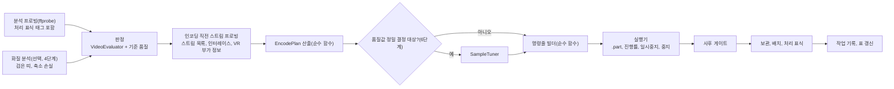
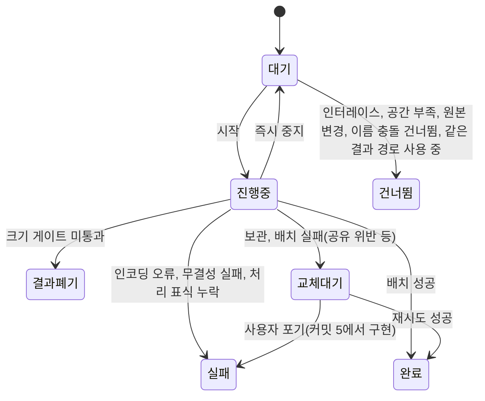

# 영상별 맞춤 직접 인코딩: 최종 설계서 및 구현 계획

> 상태(2026-11-19): 결정 1~32 승인. 1단계, 2단계, 3단계 커밋 1~4c 완료(해시는 13.1절). 다음은 3단계 커밋 5(GUI). 현재 상태와 코드 지도는 0.4절, 유효한 구현 규칙과 열린 항목은 13절
>
> 대상 독자: 이 저장소에서 1~6단계를 구현하는 에이전트. 이 문서만으로 단계별 작업, 파일, 데이터 형식, 검증 기준을 정할 수 있도록 작성
>
> 우선순위: `AGENTS.md`, `CLAUDE.md`의 저장소 규칙이 항상 우선. 이 문서와 저장소 규칙, 또는 이 문서와 실제 코드가 어긋나면 구현을 멈추고 사용자에게 보고
>
> 표기: "초기값"은 실측 전 근거가 약한 수치로, 명명 상수로 두고 독스트링에 "초기값, 4단계 보정 대상"을 적음

---

## 0. 구현 에이전트 실행 규칙

### 0.1 공통 규칙
1. 단계는 1 -> 2 -> 3 -> 4 -> 5 -> 6 순서로만 진행. 단계를 건너뛰거나 합치지 않음
2. 각 단계 시작 전에 사용자에게 "작업 목록, 수정, 신규, 삭제 파일, 검증 방법"을 제시하고 승인받은 뒤 착수(`AGENTS.md` 7절). 대량 제거, 개명은 범위를 먼저 합의
3. 각 단계는 독립 커밋 묶음으로 끝내고, 커밋 전 `scripts/check.ps1`를 오류, 경고, 스킵 없이 통과
4. 저장소 규칙 요약(상세는 `AGENTS.md`)
   - 계층: `src/gui`, `src/cui` -> `src/service` -> `src/core` 단방향
   - 모듈 500줄 초과 시 책임 분리 검토, 1000줄 초과 불가. [`main_window.py`](src/gui/main_window.py)는 현재 907줄이므로 줄을 늘리지 않음(재인코딩 연결은 `encode_controller.py`로 분리)
   - Ruff + BasedPyright `strict` 0 오류, 0 경고
   - 메타 문서, 주석, 커밋 메시지에는 한글 외 비ASCII 문자 금지
   - 버튼은 아이콘만, 이름은 접근성 이름과 툴팁. 색은 팔레트 토큰만
   - 설정 키 추가, 변경은 `setting` 스킬, 모듈 추가, 개명은 `sync` 스킬, 테스트는 `test` 스킬 절차
5. 사용자 노출 새 용어는 후보 2~3개와 추천안을 제시해 승인받은 뒤 `TERMINOLOGY.md`에 추가하고 사용(11절의 승인 용어는 바로 사용 가능)
6. 실측 결과로 수치를 바꾸면 이 문서의 해당 결정과 12절 기준선 결과를 함께 갱신
7. 이 문서에 없는 판단이 필요하면 추측하지 말고 선택지와 추천안을 들고 사용자에게 질문

### 0.2 GUI 구현 전 레퍼런스 요청 절차(결정 26)
GUI 화면(새 화면, 기존 화면 개편, 대화상자, 설정 항목 포함)의 UI 코드를 작성하기 **직전에** 반드시 아래 순서를 실행

1. 사용자에게 다음 세 가지를 먼저 보고
   - (1) 이 GUI가 우리 프로그램의 어느 화면, 위치에서 쓰이는지(예: 메인 창 하단 막대, 재인코딩 메뉴, 환경 설정 대화상자의 어느 영역)
   - (2) 요청하는 레퍼런스 GUI가 원본 프로그램(주로 샤나인코더 7.4)에서 어떤 상황, 조건일 때 나타나는 화면인지(예: "샤나에서 파일 2개 이상을 동시 인코딩하는 도중의 인코딩 창")
   - (3) 받고 싶은 상태 목록(예: 진행 중, 일시중지, 오류, 완료)
2. 레퍼런스 이미지를 요청하고 받을 때까지 해당 화면 UI 코드를 작성하지 않음. 원본 프로그램에 대응 화면이 없으면 그 사실을 보고하고 "기존 화면 스타일로 진행"할지 사용자 결정을 받음
3. 레퍼런스를 받은 뒤 `gui-design` 스킬 절차로 배치안을 제시하고 구현
4. 이전 세션에서 받은 이미지(샤나 인코딩 창, 환경 설정 메뉴, 디코더 설정, 멀티 스레드 설정)는 세션 임시 파일이라 구현 에이전트가 볼 수 없음. 내용은 결정 23, 24와 12.1절에 텍스트로 남겼으며, 화면을 구현할 때는 다시 요청
5. 대상 화면과 요청 시점은 5.0절 표를 따름

### 0.3 로컬 자료와 도구
- `_ref/`(Git 제외, `.git/info/exclude`): 사용자 표본과 샤나 결과. 읽기 전용. 단위 테스트에서 사용 금지(테스트는 합성 입력만 사용)

| 경로 | 내용 |
| :--- | :--- |
| `_ref/video1.mp4` ~ `_ref/video19_*.{mp4,mkv,avi,wmv,ts}` | 표본 19개(12.1절 표본 목록) |
| `_ref/clips/` | 샤나 비교용 클립 18개(HDR 제외, 긴 영상은 가운데 60초) |
| `_ref/shana/<라벨>/` | 클립을 샤나 7.4로 인코딩한 기준 결과(라벨: `nvenc_cq22`, `nvenc_cq26`, `nvenc_1080p`, `x265_cq22`, `x265_cq26`, `x265_1080p`) |
| `_ref/re/src/`, `_ref/re/shana/` | 역추적용 초경량 원본 2개와 샤나 결과 |
| `_ref/tools/shana_reverse.py` | 역추적 도구(`make`, `analyze`, `match`) |
| `_ref/tools/capture_ffmpeg.ps1` | FFmpeg 프로세스 명령줄 기록 도구(샤나 7.4에는 효과 없음, 12.1절) |

- 저장소에 넣는 비교, 통합 스크립트(`scripts/`)는 로컬 경로를 하드코딩하지 않고 인자로 받음(`AGENTS.md` 6절)

### 0.4 현재 상태 요약과 코드 지도(2026-11-19, 다음 작업 착수 전 먼저 읽기)
- 완료: 1단계, 2단계, 3단계 커밋 1~4c(해시는 13.1절). `check.ps1` 전체 통과(테스트 1496개, 커버리지 예외 남은 219/234건). 2026-11-19 소스, 테스트 구조 재편과 결정 28(4b-1, 4b-2) 완료
- 남은 것: 3단계 커밋 5(GUI), 4~6단계
- 시작 조건: 커밋 5는 G3~G7 레퍼런스 이미지와 11.2절 용어 승인 후
- 의도적으로 열려 있는 항목: `execution` 설정 키 13개는 화면 없음(커밋 5에서 닫음, 목록은 13.2절), `hevc_amf`와 `hevc_qsv`는 보류(`available=False`), "편집" 메뉴 끝의 선택 영상 조작 항목은 임시 배치. 커밋 5로 넘긴 항목은 13.3절, 열린 항목은 13.4절
- 줄 수 주의: `main_window.py` 907줄(늘리지 않음), `video_table_view.py` 990줄(순증 금지, 늘어야 하면 먼저 도우미 분리), `session_controller.py` 861줄(새 책임은 별도 모듈), `encode_service.py` 525줄(더 키우지 않음), `table_columns.py` 509줄(열 추가 시 분리 검토)

- 모듈 위치(재편 뒤): 영역 패키지 `core/{encode, analysis, evaluation, settings}`, `service/encode`, `gui/{table, menus, preview, controllers, settings, help}`, 모듈은 소유 영역에 두고 영역 사이 순환이 생기거나 기반 모듈이 쓰는 경우만 계층 바로 아래(`core/`에 기반 모듈과 `app_version`, `config`, `encode_fingerprint`, `encode_tag`, `encoder_specs`, `mp4_boxes`, `mp4_xtra`, `probe_parser`, `quality_target`, `smart_action`, `resolution_tiers`, `gui/`에 앱 틀). 아래 표의 모듈 이름은 파일 이름이며 위치는 4.2절 경로와 [ARCHITECTURE.md](ARCHITECTURE.md) 기준
- 테스트는 `tests/{core, service, gui, cui, tools}` 하위 폴더에 `src` 구조를 따라 둠. 공용 도우미는 `tests/` 바로 아래. 새 모듈은 영역 패키지에 추가(`AGENTS.md` 1절)

| 영역 | 모듈 | 진입점 |
| :--- | :--- | :--- |
| 판정 | `quality_target.py`, `evaluator.py`, `smart_action.py`, `classification_policy.py` | `VideoEvaluator.evaluate_video`, `evaluate_all`(`active_frame`, `active_frames`, `known_encode_tag_names`, `encoded_history_filenames` 입력), `SmartAction`, `DEFAULT_CLASSIFICATION_POLICIES` |
| 프로빙 | `stream_layout.py`, `ffmpeg_capability.py`, `mp4_boxes.py`, `mp4_xtra.py`, `encode_fingerprint.py` | `parse_stream_layout`(인코딩 직전 스트림 목록), `probe_ffmpeg_capability`(FFmpeg 상태, `has_vmaf`), `read_mp4_probe_info`, `read_mp4_xtra_items`, `write_mp4_xtra`, `compute_encode_fingerprint` |
| 계획과 명령 | `encoder_specs.py`, `encode_plan.py`, `encode_tag_plan.py`, `encode_impact.py`, `ffmpeg_command.py`, `encode_tag.py`, `app_version.py` | `ENCODER_SPECS`, `build_encode_plan`, `plan_encode_tags`, `summarize_encode_impact`, `build_ffmpeg_args`, `build_encode_tag`, `APP_VERSION` |
| 프로세스 | `encode_process.py`, `encode_progress.py`, `power_state.py` | `EncodeProcess`, `ProgressParser`, `PausableClock`, `prevent_sleep`, `run_after_complete` |
| 서비스 | `encode_job.py`, `encode_service.py`, `encode_tag_io.py`, `encode_output_history.py`, `encode_placement.py`, `encode_resume.py`, `encode_history.py`, `encode_events.py`, `encode_ports.py` | `jobs_from_evaluations`, `EncodeSettings.from_config`, `create_batch`, `EncodeRunner`(`run`, `pause_all`, `resume_all`, `cancel_all`, `request_stop_after_current`, `retry_replace_pending`), `EncodeOutputHistory`, `prepare_resume`, `find_unrecorded_parts`, `EncodeHistory` |
| 순수 규칙 | `encode_gate.py`, `encode_paths.py`, `encode_state.py`, `encode_concurrency.py` | `judge_result`, `choose_free_path`, `EncodeState`, `resolve_concurrency` |

- 주입 지점(단위 테스트, 실측 스크립트용): `EncodeRunner(history, settings, probe=, process_factory=, on_event=, store=, cpu_count=, clock=)`
- 화면은 `EncodeEvent`(`kind`: `state`, `progress`, `long_pause`)를 받아 갱신하고, 워커 스레드에서 Qt 객체에 접근하지 않음
- 개발 PC 확인 사항: PATH의 FFmpeg 2024-12 빌드에서 `hevc_nvenc`, `libx265` 동작. 코드와 문서에 장치명, 로컬 경로, 사양값을 기록하지 않음

---

## 1. 배경 요약

### 1.1 현재 구조
- 영상을 분석해 재인코딩 여부를 판정하고, 샤나인코더 프리셋 XML과 1:1 대응하는 분류 폴더(10개)로 파일을 옮김. 실제 인코딩은 사용자가 샤나에서 수행
- 판정 모델: [`BitrateModelConfig`](src/core/config.py)의 `base_target_kbps = 1500`(720p 30fps H.264)에서 면적 지수 0.82, FPS 지수 0.60으로 적정 비트레이트 `B_opt`를 계산하고, 원본 비율 `r`로 과화질(`r > 1.2`), 적정, 저화질(`r < 0.8`)을 구분
- 프리셋 핵심(NVENC): 표준 `-cq:v 22`, 저화질 `-cq:v 26`, 축소 규격 8개는 `-b:v 0 -maxrate <고정값> -bufsize <2배>` + 16:9 박스 내접 `scale`. 모두 `-f mp4 -c:a copy -shanakeyframe 1 -profile:v main`

### 1.2 해결할 문제

| 기호 | 문제 | 근거 |
| :--- | :--- | :--- |
| A | 22/26이 판정, 프리셋, UI에 분산 결합 | `SmartAction.ENCODE_CQ22_*`, 폴더명, `TERMINOLOGY.md` 6.3절 |
| B | 예상 용량이 출력 품질값을 반영하지 않음 | [`evaluator.py`](src/core/evaluation/evaluator.py)가 CQ26 경로에도 같은 추정식 사용 |
| C | 고정 규격 축소의 계단 손실 | 2160p->1440p 화소 55.6% 손실, `2560x1080`이 1080p 상한에서 `1920x808` |
| D | 프리셋이 영상 특성을 못 따라감 | 10-bit -> 8-bit, MP4 비호환 트랙 손실, 프리셋은 NVENC/x265만 |
| E | 해상도 대비 세부 묘사가 적은 영상을 놓침 | 4K 표본 3개가 1080p 왕복 SSIM 0.996 이상, 그중 2개는 4K 기준 "적정"이지만 1080p 기준 r 3.16/3.27 |
| F | 검은 띠가 판정을 왜곡 | 세로 화면 + 좌우 검은 띠 4K 표본: 전체 면적 r 0.32, 실제 화면 r 0.82 |
| G | 샤나 결과의 실제 손실 | 12.3절: WMV 실패, 다중 트랙/자막/글꼴/커버 소실, 인터레이스 미처리, 4K 60fps 품질값 미반영 |

- 해결 현황(2026-11-18): A, B는 2단계(`baseline_cq`, 품질값 차이 용량 계수, 역할 기반 식별자)에서 반영. D의 트랙 보존과 G의 일부는 3단계 구현 완료(샤나 대비 검증은 커밋 4). C, E, F는 4~5단계. 위 표의 근거는 1단계 이전 코드 기준

### 1.3 방향
- 샤나는 FFmpeg 프런트엔드이며 화질은 같은 FFmpeg 인코더가 결정. 같은 인자로 샤나와 **영상 데이터가 바이트 단위로 같은 결과**를 낼 수 있음을 확인(12.5절)
- 분류 폴더 이동을 없애고 프로그램 안에서 영상별 계획(`EncodePlan`)으로 직접 인코딩
- 먼저 샤나와 같은 결과를 재현(3단계)한 뒤, 개선 항목을 하나씩 켜서 검증(5단계)

---

## 2. 목표, 비목표, 전제, 원칙

### 2.1 목표
1. 판정 결과를 영상별 `EncodePlan`으로 바꿔 직접 인코딩
2. 판정, 예상 용량, 실제 인코딩이 같은 기준 정의를 공유
3. 연속 배율 축소, 10-bit 유지, 영상별 최대 비트레이트, 기준 품질 변경
4. 샘플 인코딩 + VMAF/SSIM으로 영상별 품질값 결정
5. 샤나 대비 화질, 트랙 보존, 속도, 원본 안전에서 열위 없음
6. 화면 내용 측정(축소 손실, 검은 띠)으로 비트레이트 모델의 사각 보완
7. VR 기기 재생과 AI 2D->3D 변환 도구 입력으로 쓰기 좋은 출력(결정 27)

### 2.2 비목표
- HDR(PQ, HLG, Dolby Vision) 재인코딩: 판정 `PASS_HDR` 유지
- 자막 입히기, 로고, 자르기 편집, HDR 톤매핑, 파일별 수동 인자 조정
- FFmpeg 번들링. 외부 독립 프로그램은 FFmpeg/ffprobe만 사용(MediaInfo 등 금지). Python 라이브러리는 필요 시 도입(`pyproject.toml` 명시)
- 원본 자동 삭제를 기본값으로 두는 것
- 분류 폴더 이동, 샤나 프리셋 연동의 유지와 이전 도구

### 2.3 전제
- 모든 기존 커밋은 프로토타입이고 실사용자 0명. 중간 단계 사용자도 없음
- 하위 호환, 설정 이전, 캐시 이전, 병행 기간을 고려하지 않음. 제거 대상은 이전 코드 없이 제거

### 2.4 설계 원칙
- **한 번에 한 가지 변화**: 3단계는 샤나 동치, 5단계 개선 항목은 하나씩 켜고 비교
- **확신 없는 입력은 건너뜀**: HDR, 인터레이스는 건너뛰고 사유 기록
- **원본 우선**: 게이트 통과 전 원본 무변경, 어떤 실패에서도 원본과 결과 중 하나 이상 보존

---

## 3. 확정 결정 명세

각 결정의 형식: 규칙 / 초기값 / 적용 단계. 결정 번호는 다른 문서, 커밋에서 참조하므로 바꾸지 않음

### 결정 1. 실행 구조
- 규칙: 직접 인코딩 단일 경로. 1단계에서 제거: 실제 분류, 분류 되돌리기, `pseudo_classify_mode`, [`classify_manifest.py`](src/core/classify_manifest.py), [`file_manager.py`](src/core/analysis/file_manager.py)의 이동/복원, `shana_presets/`, 분류 폴더명 설정, 관련 메뉴, 단축키, 작업 유형, 표시 열
- 유지: 분석, 판정, 권장 처리, 예상 용량, 예외 규칙, 영상별 출력 해상도 지정, 미리 보기
- 코드 식별자의 "분류" 계열(`ClassifierConfig`, `classification_policy.py`)은 판정 의미로 남으므로 개명하지 않음
- 샤나는 제품 의존성이 아니며 개발 비교 기준(`_ref/shana/`)으로만 사용. 프리셋 XML은 Git 이력에 남음
- 적용: 1단계

### 결정 2. 기준 품질과 판정 모델
- 기준 품질 `baseline_cq`: 기본 인코더(`hevc_nvenc -cq`) 척도, 기본 22.0
- 기준 비트레이트(저장하지 않는 파생값): $B_{\text{base}}(Q) = B_{\text{ref}} \times 2^{(22.0 - Q)/K}$
  - `base_target_kbps`의 의미는 "척도 22.0에서의 720p 30fps H.264 적정 비트레이트"로 고정
  - `K`: 초기값 6.0, 4단계에서 인코더별 실측
- 인코더별 척도 매핑: 같은 화질을 내는 인코더별 품질값. 초기값은 항등(정수 인코더는 반올림). 12.3절에서 같은 "22"의 NVENC/x265 출력 비트레이트가 내용에 따라 1.0~2.6배 차이이므로 4단계 VMAF 보정 필수
- 코덱 효율 차이는 기존 `codec_weights`, 척도 차이는 매핑이 담당(이중 보정 금지)
- VMAF는 판정 기준이 아니라 6단계 품질값 정밀 결정의 종료 조건
- 적용: 2단계(상수, 설정), 4단계(보정)

### 결정 3. 목표 품질값 반영 용량 추정
- 영상 스트림 예상 용량 x $2^{-\Delta/K}$, $\Delta$ = 출력 품질값 - 기준 품질값
- 보호 경로, 기준 변경, 정밀 결정 결과 모두 같은 식
- NVENC 레벨 상한(결정 25)을 예상 출력 비트레이트 상한으로 반영(3단계)
- 반영 후 보호 경로 영상의 예상 절약 증가로 일부 판정이 바뀌는 것은 의도된 변화이며 테스트에 고정
- 적용: 2단계, 3단계(레벨 상한)

### 결정 4. 저화질 보호 품질값
- 3단계: 기준 + 4.0 고정(샤나 동치)
- 5단계: $Q_{\text{protect}} = \text{clamp}(Q_{\text{base}} + K \log_2 (1/r_{\text{target}}),\ Q_{\text{base}},\ Q_{\text{base}} + \Delta_{\max})$, $\Delta_{\max}$ 초기값 6.0
- 보호 판정 조건은 [`should_use_low_quality_preset`](src/core/evaluation/classification_policy.py) 재사용
- **승인 조건: 품질값은 인코더가 소수를 받는 한 반올림하지 않고 소수 그대로 계산, 적용**
  - 소수 가능: `hevc_nvenc`, `h264_nvenc`, `av1_nvenc`(`-cq`), `libx265`, `libx264`(`-crf`)
  - 정수만: `libsvtav1`(`-crf` 0~63), `hevc_amf`, `hevc_qsv`. 인코더 척도로 매핑한 뒤 마지막에만 반올림
  - 소수가 인코더 내부에서 실제로 반영되는지는 4단계 실측
  - 표시는 소수 첫째 자리(`CQ23.9 재인코딩`)
- 적용: 2단계(상수), 3단계(+4), 5단계(연속 식)

### 결정 5. 해상도 축소
- 3단계: 현행 8규격 + 16:9 박스 + 규격 고정 `-maxrate`(샤나 동치)
- 5단계 연속 배율: $s = (r_{\text{src}}/r_{\text{low}})^{1/(2\alpha)}$, $\alpha$ = `area_scaling_exponent`. 크기는 `OUTPUT_DIM_ALIGN`(4) 배수 내림
- 미세 축소 가드: [`MIN_DOWNSCALE_AREA_RATIO`](src/core/resolution_tiers.py)(95%) 유지, 4단계 실측 후 변경 여부 결정
- 최대 해상도 기준: 기본 `short_side`, 선택 `pixel_area`, `box`(`2560x1080`에 1080p 상한: 축소 안 함 / 약 2216x932 / 1920x808)
- 스케일러: 3단계 FFmpeg 기본, 5단계 `lanczos` 계열 표본 비교 후 채택
- **승인 조건: 축소 기준이 겹칠 때**
  1. 영상별 직접 지정이 있으면 그것만 사용
  2. 없으면 적용 가능한 후보 중 **가장 작은 출력 크기** 채택: 최대 해상도 상한, 연속 배율 결과, 축소 손실 후보(결정 19가 자동 사유로 편입된 경우)
  3. 채택 결과에 미세 축소 가드 적용
  - 같은 크기면 판정 사유 표시 순서: 최대 해상도 > 축소 손실 > 비트레이트 맞춤
- 축소, 해상도 판정은 검은 띠를 뺀 활성 화면 크기 기준(결정 20)
- 적용: 3단계(규격), 5단계(연속, 기준, 스케일러, 겹침 규칙)

### 결정 6. 최대 비트레이트(`-maxrate`)
- 적용 범위: 축소 경로만
- 5단계 일반화: $\text{maxrate} = \lceil B_{\text{target}}(w_{\text{out}}, h_{\text{out}}, \max(\text{fps}, 60)) \times 1.5 \rceil_{100\text{k}}$, `bufsize` = 2 x maxrate. 규격 크기에서는 현행 고정값과 같음
- 기각: 실제 fps 기준 `B_opt x 1.8`(30fps 이하 상한 약 22% 감소)
- 적용: 3단계(고정값), 5단계(일반화)

### 결정 7. 키프레임과 프레임 타이밍
- 목표 키프레임 간격: 프레임 수 기준 `round(fps)`(샤나와 같음). 고정 프레임에서 약 1초(23.976fps는 약 1.001초), 가변 프레임은 프레임이 드문 구간에서 1초보다 길어질 수 있음
- 인자: `-g <round(r_frame_rate)>`만 사용(샤나 `-shanakeyframe 1` = `-g <round(fps)>`). `-force_key_frames expr:gte(t,n_forced*1)`는 쓰지 않음
  - 근거(커밋 4 실측, 2026-11-18 사용자 승인): 두 인자를 함께 쓰면 소수 fps(23.976 등) 클립에서 약 1000프레임 뒤부터 키프레임 위치가 한 프레임씩 앞당겨져 샤나와 바이트가 어긋남(NVENC 7/15 일치). 제거하면 15/15 일치(가변 프레임 표본 포함). 처음 기록한 "함께 써도 일치"는 정수 fps 표본에 한정된 확인이었음
  - 결과 키프레임 간격 약 1.001초는 허용 상한 `keyframe_interval_sec`(2.2초)보다 충분히 작아 재판정 대상이 되지 않음
  - 가변 프레임 영상의 시간 기반 키프레임은 5단계 후보(5.5절)
- `-fps_mode passthrough` 명시. 3단계에서 이 인자를 넣은 상태로도 샤나 바이트 일치가 유지되는지 확인하고, 깨지면 사용자에게 보고
- VFR 판정은 하지 않음. `-forced-idr`는 사용하지 않음
- 적용: 3단계

### 결정 8. 출력 컨테이너와 스트림 보존
- 컨테이너: 원본 유지 우선(`.mp4`, `.mkv`, `.mov`). `.avi`, `.wmv`, `.flv`, `.webm`, `.ts`는 `.mp4`, 비호환 트랙이 있으면 `.mkv`. 설정 "항상 MP4" 제공
- 스트림 매핑: 인코딩 직전 프로빙한 스트림 목록으로 `-map 0:<index>` 명시

| 스트림 | 처리 |
| :--- | :--- |
| 주 영상 | 인코딩 |
| 커버(`attached_pic`) | `copy`, 출력에 `-disposition attached_pic`. 커밋 4까지는 MP4/MOV 출력에서 커버를 제외하고 사유 기록(`+use_metadata_tags`가 커버를 버림, 12.8절). 커밋 4b부터 항상 유지(결정 28) |
| 오디오 | `copy`. 대상 컨테이너 비호환 코덱만 `aac` 변환(예: WMA -> AAC, 12.3절 WMV 실패 원인) |
| 자막 | `copy`. MP4 출력의 텍스트 자막은 `mov_text`, 비트맵 자막이 있으면 `.mkv` |
| 첨부 파일(글꼴) | MKV 출력이면 `copy`. MP4로 바뀌면 소실 사유 기록 |
| 데이터 스트림 | 제외하고 기록. MP4/MOV 출력은 `-write_tmcd 0`으로 MOV 타임코드 트랙이 다시 생기지 않게 함(커밋 4 실측, 2026-11-18 승인) |
| 메타데이터, 챕터 | `-map_metadata 0`, `-map_chapters 0` |

- 색 정보: `color_primaries`, `color_trc`, `colorspace`, `color_range`를 출력에 명시 전달(bt709, bt2020 SDR 포함)
- 회전: FFmpeg 자동 회전, 출력 크기는 표시 기준. 샤나와 같이 화면을 돌려 저장하고 회전 정보는 남기지 않음(12.3절)
- MP4/MOV의 HEVC는 `-tag:v hvc1`(결정 27)
- 적용: 3단계

### 결정 9. 결과 파일 처리와 재처리 방지
- 결과 파일 처리 정책
  - `archive_original`(기본): 게이트 통과 시 원본을 같은 폴더 하위 `_원본보관/`으로 이동하고 결과를 원본 위치에 배치. 같은 볼륨 이동이라 추가 복사 없음
  - `separate_output`: 결과를 별도 출력 폴더(기본 `_재인코딩결과/`)에 저장. **승인 조건: 작업 폴더 기준 상대 경로(하위 폴더 계층)를 출력 폴더에 그대로 재현**
  - `replace_original`: 검증 후 원본 교체. 되돌릴 수 없음을 확인 대화상자로 안내
- 확장자가 바뀌면 결과 목록에 원본 -> 결과 경로 표시
- 보관 폴더에 같은 이름이 있으면 덮어쓰지 않고 실패 처리. 그 밖의 이름 충돌은 결정 24
- 임시 파일: 같은 폴더 `<이름>.<확장자>.part`, `-f`로 형식 명시. `.part`는 [`VIDEO_EXTENSIONS`](src/core/analysis/file_manager.py) 밖이라 스캔 제외
- 스캔 제외 목록: 보관 폴더, 별도 출력 폴더(분류 폴더 제외 목록을 대체)
- 타임스탬프: 결과 파일 수정 시각을 원본 값으로(`os.utime`). 생성 시각 보존은 범위 밖
- 사전 검사: 대상 볼륨 여유 공간 < 원본 크기 x 1.1(초기값)이면 건너뜀
- **승인 조건: 처리 표식 태그 명세(확정)**
  - 키: `video_scripts_encode`(컨테이너 전역 태그)
  - 값: ASCII, 세미콜론 구분 `v=1;enc=<인코더>;q=<품질값>;at=<UTC ISO 8601>`. `v`는 명세 버전, 읽을 때 모르는 필드 무시
  - 기록: MP4/MOV는 `-movflags +use_metadata_tags`(필요 시 `+faststart`와 결합) 필수, MKV는 `-metadata`만
  - 읽기: 키 대소문자 무시(MKV는 `VIDEO_SCRIPTS_ENCODE`로 저장)
  - 확인 결과: MP4에 플래그 없이 쓰면 사라짐, 플래그 사용 시 MP4/MOV 유지, MKV 유지, MP4 -> MKV 재다중화 후 유지, ffprobe 조회 대소문자 무관
  - 표준 `comment` 키 사용 금지. 원본에 같은 키가 있으면 새 값으로 교체
  - 분석 프로빙이 이 태그를 읽고, 표식이 있는 영상은 판정 사유 "이미 재인코딩"으로 대상에서 제외. 다시 인코딩은 영상별 직접 지정으로만
- 커밋 4b부터 기록 위치, 기록 여부 설정, 판정 근거는 결정 28로 바뀜(MP4/MOV는 `+use_metadata_tags` 대신 탐색기 태그 칸의 `Xtra`, MKV는 `KEYWORDS` 추가). 키 이름과 명세 값 형식은 유지
- 적용: 3단계

### 결정 10. 사후 게이트
- 무결성: 출력 `ffprobe` 성공, 계획한 스트림 수 일치(결과의 데이터 스트림은 세지 않음: MP4 `-map_chapters 0`이 챕터 트랙을 데이터 스트림으로 기록하고, 계획에는 데이터 스트림이 없음. 커밋 4 실측, 2026-11-18 승인), 영상 길이 차 <= max(0.5초, 원본의 0.5%)(초기값)
  - 영상 길이는 원본(분석 프로빙)과 결과(게이트) 모두 같은 함수로 구함: 영상 스트림 `duration` -> 영상 스트림 태그 `DURATION`(MKV는 스트림 `duration`이 비어 있음) -> 컨테이너 `duration` 순(커밋 4 실측, 2026-11-18 사용자 승인). 컨테이너 길이를 먼저 쓰면 오디오가 영상보다 긴 원본에서 오탐(12.8절과 같은 날 확인: 영상 6초, 오디오 9초 MP4의 컨테이너 길이 9초, MKV는 영상 스트림 길이 `N/A`, 태그 6초, 컨테이너 9.02초)
  - 분석 프로빙 조회에 `stream_tags=DURATION`을 추가하고 `PROBE_VERSION`을 5로 올림(MKV 원본의 길이와 비트레이트 계산이 영상 기준으로 바뀜)
- 크기: 절약 목적(과화질, 코덱 전환, 축소)인데 결과 >= 원본이면 결과를 버리고 원본 보존, 상태 "결과 폐기"
- KF 교정, 코덱 호환 목적은 무결성만 검사
- 실패 시 FFmpeg stderr 마지막 부분을 작업 기록에 보존
- **추가 승인(2026-11-18, 사용자 지시)**: 무결성 검사에 출력 처리 표식 확인 추가. 출력 `ffprobe`에서 `video_scripts_encode` 태그가 없으면 배치하지 않고 상태 "실패", 사유 "처리 표식 누락"으로 처리. 원본은 무변경, `.part`는 삭제
  - 근거: FFmpeg는 MP4에 `+use_metadata_tags` 없이 쓰면 표식을 조용히 버림. 표식이 빠진 결과를 배치하면 다음 분석에서 재인코딩 대상이 되어 화질이 두 번 깎이므로 AGENTS 5절 재처리 방지 불변식 위반
  - 커밋 4b부터 태그 확인 방법은 결정 28(MKV는 ffprobe, MP4/MOV는 `Xtra` 읽기). 기록 방식이 "상세 값만"이면 상세 값만 확인하고, "기록 안 함"이면 이 확인을 하지 않고 재처리 방지는 재인코딩 이력이 맡음
- 적용: 3단계

### 결정 11. FFmpeg 확보와 능력 확인
- 설정 `ffmpeg_path`, `ffprobe_path`(비우면 PATH). 시작 시 1회 버전, 인코더 목록, 필터(`libvmaf`, `scale_cuda` 등), HW 디코더 프로빙 후 캐시([`system_probe.py`](src/core/analysis/system_probe.py) 확장)
- 최소 버전 FFmpeg 5.1(초기값, `-fps_mode` 기준). 미달이면 인코딩 비활성
- **승인 조건: 상태와 사유를 화면에 명확히 표시**
  - 설정 대화상자 "FFmpeg 상태" 영역: 경로, 버전, 사용 가능 인코더, `libvmaf` 지원, 비활성 사유
  - FFmpeg 없음, 버전 미달: "재인코딩 시작" 비활성 + 툴팁에 사유와 해결 방법
  - 선택 인코더 미지원: 인코더 선택지에 사용 불가 표시와 사유
  - `libvmaf` 부재로 SSIM 대체: 화질 분석 결과의 측정 지표 열, 작업 완료 알림에 대체 사실 표시
  - HW 디코딩 실패 후 CPU 재시도: 결과 목록 해당 파일에 표시
- 적용: 3단계(4단계에서 지표 표시 추가)

### 결정 12. 테스트 정책
- `check.ps1` 단위 테스트는 FFmpeg 없이 실행(인자 목록 비교, 순수 함수, 가짜 프로세스). 스킵 금지
- 실제 인코딩 통합 테스트는 `scripts/` 아래 별도 스크립트(합성 `lavfi` 입력, 수동 실행). NVENC, AMF, QSV는 장치가 있을 때 수동 확인
- 샤나 동치 비교도 별도 스크립트(입력 경로는 인자)
- 모든 테스트는 `TemporaryDirectory`와 `_sandbox.py` 격리
- 적용: 전 단계

### 결정 13. 용어
- 권장 처리 명칭 `CQ{값} 재인코딩`(실제 적용 값, 소수 첫째 자리). 축소는 기존 "축소 재인코딩" 유지
- `TERMINOLOGY.md` 6.1절 "분류 상태"를 재인코딩 상태로 대체, 폐기 용어는 8절로 이동
- `TERMINOLOGY.md`에는 해당 기능을 구현하는 단계에서 추가
- 승인 용어와 보류 용어는 11절
- 적용: 1~6단계

### 결정 14. 디코딩 구성
- 후보: CPU 디코딩 + CPU 필터 / GPU 디코딩 + CPU 필터 / GPU 디코딩 + GPU 스케일 / 샤나 기본 구성(코덱별: H.264, MPEG2, VC1, VP9는 SW, HEVC, AV1은 HW 자동, 디코딩 스레드 `-threads 0 -thread_type frame`)
- **3단계에서 처리 시간을 실측해 속도 수용 기준을 만족하는 가장 호환성 높은 구성을 기본으로 확정**. 코덱별 디코더 선택을 설정으로 둘지도 실측 결과로 결정(사용자에게 보고 후)
- HW 디코딩 실패 시 같은 파일을 CPU 디코딩으로 1회 재시도하고 기록
- **확정(커밋 4, 2026-11-18, 사전 위임 범위)**: 기본은 샤나 기본 구성(`DecodeMode.SHANA_DEFAULT`) 유지. 근거(12.9절): CPU 디코딩은 속도가 같거나 비슷하지만 10-bit HEVC 원본(video16) 바이트가 샤나와 달라지고, GPU 디코딩은 1080p 축소에서 느리며 WMV와 커버 원본에서 실패. 속도 차이가 없어 코덱별 디코더 설정은 만들지 않음. `DecodeMode`에 구성 추가 없음
- 적용: 3단계

### 결정 15. 인터레이스 원본
- 인코딩 직전 스트림 프로빙에서 `field_order`가 `tt`, `bb`, `tb`, `bt`이면 상태 "건너뜀", 사유 인터레이스
- `progressive`, `unknown`, 값 없음은 진행. 인터레이스 판정 때문에는 분석 프로빙을 바꾸지 않음. 분석 프로빙의 `PROBE_VERSION`은 1단계에서 3으로, 3a단계(처리 표식 태그 읽기, 결정 9)에서 4로 올림(2026-11-18 승인). 커밋 4에서 5(영상 길이, 결정 10), 커밋 4b에서 6(결정 28)
- 샤나는 디인터레이스 없이 인코딩하고 필드 순서 표시를 `tt` -> `tb`로 바꿈(12.3절). 건너뜀이 더 안전
- 디인터레이스, `idet` 정밀 감지는 범위 밖(후속)
- 적용: 3단계

### 결정 16. 중지, 일시중지, 이어 하기
- 작업 기록: 배치 대상과 파일별 상태를 분석 캐시와 같은 SQLite 파일의 별도 테이블에 기록(4.4절)
- 현재 영상 후 중지: 진행 중 파일을 끝낸 뒤 정지
- 즉시 중지: 프로세스 종료, `.part` 삭제, 해당 파일 `대기`로 복귀
- **일시중지, 재개: 파일별, 전체. `psutil`의 `suspend`/`resume`**
  - 멈춘 동안 HW 인코더 세션은 계속 점유. 경과 시간, 속도 계산에서 멈춘 시간 제외
  - **승인 조건: 장시간 점유 안내**
    - 일시중지 버튼 툴팁과 진행 창 안내 문구: 멈춘 동안 GPU 인코더 세션을 계속 사용해 그래픽 드라이버나 다른 작업에 영향을 줄 수 있으며, 오래 멈출 때는 현재 영상 후 중지를 권장
    - 일시중지가 10분(초기값)을 넘으면 진행 창과 작업 기록에 같은 안내를 다시 표시하고 "현재 영상 후 중지로 전환" 동작 제공. 자동 중지는 하지 않음
  - 일시중지 상태에서 앱 종료 시 종료 확인에 포함, `.part` 정리
- 이어서 재인코딩: 앱 시작, 작업 폴더 열기 시 미완료 배치가 있으면 확인 대화상자. `대기`, `진행 중` 상태만 재투입. 원본 크기, 수정 시각이 기록과 다르면 재개 제외
- 잔여 `.part`: 작업 기록에 경로가 있는 것만 삭제, 나머지는 목록 안내
- 기각: 진행 위치부터 이어 인코딩(구간 결합)
- 적용: 3단계

### 결정 17. 인코딩 중 다른 작업과 미리 보기
- 재인코딩 전용 작업 스레드를 분석 작업 스레드와 분리(현재 단일 슬롯: [`task_runner.py`](src/gui/controllers/task_runner.py))
- 인코딩 중 허용: 분석, 다른 작업 폴더 열람, 설정 확인. 인코딩 설정 변경은 다음 배치부터(배치 시작 시 설정 사본 고정)
- 결과 배치 시점에 해당 행의 분석 결과 갱신
- SQLite는 스레드별 연결, 쓰기 충돌 재시도 정책은 3단계 단위 테스트로 고정
- 앱 종료 시 인코딩 중이면 확인 대화상자(즉시 중지 후 종료 / 현재 영상 후 중지하고 종료 / 계속)
- **승인 조건: 인코딩 중 스페이스바 미리 보기 보장**(현재 인코딩 중인 원본과 표의 모든 영상)
  - 미리 보기 방식: 내장 창(`QMediaPlayer`, [`video_preview_window.py`](src/gui/preview/video_preview_window.py)), QuickLook(외부 프로그램). 둘 다 재생 중 파일을 열어 둠([`preview_controller.py`](src/gui/preview/preview_controller.py))
  - 재생 중인 원본의 보관 이동, 교체는 Windows 공유 위반으로 실패할 수 있음(3단계에서 두 방식 모두 실측)
  - 내장 창은 배치 직전 해당 파일 재생 해제를 검토. QuickLook은 제어 불가
  - 배치 실패 시: 결과와 원본 모두 유지, 상태 "교체 대기". 미리 보기 종료, 배치 종료 시 재시도, 이후 결과 목록에서 수동 재시도. 어떤 경우에도 둘 중 하나를 잃지 않음
  - 속도 수용 기준은 미리 보기를 쓰지 않은 상태에서 측정
  - 2026-11-19 실측(사용자 수행): 내장 미리 보기 창은 원본을 잠가 재생 중 배치가 `교체 대기`(WinError 32)로 남고, QuickLook은 잠그지 않아 재생 중에도 배치가 `완료`. 두 경우 모두 원본과 결과가 보존됨(12.9절). 내장 창 잠금 해제는 결정 31. 수정 후(2026-11-19 구현): 재생 중 원본 이름 바꾸기와 삭제가 성공하고 재생이 계속됨(단위 테스트, 12.10절)
- 적용: 3단계

### 결정 18. 품질값 정밀 결정(가칭) 적용 범위
- 기본: 선택 적용(과화질, `r`이 `low`/`over` 경계 +-0.15, 축소 후보). 설정으로 모든 대상, 적용 안 함
- 샘플: 결정 19 공통 구간 규칙의 유효 구간 일부, 3~4회 이진 탐색
- 지표: VMAF 우선, 없으면 SSIM(표시)
- 축소 후보는 `[원본 해상도 + 보호 품질값]` vs `[축소 해상도 + 기준 품질값]`을 원본 크기로 업스케일해 비교
- 비용: 대상당 1~3분(미측정 추정)
- 적용: 6단계

### 결정 19. 축소 손실 측정
- 정의: 각 규격으로 줄였다 되돌린 영상과 원본의 왕복 점수로 "N p로 줄이면 얼마나 잃는가"를 측정. 인코딩 없이 디코딩, 스케일, 지표만
- 지표: VMAF 우선(4K급 `vmaf_4k_v0.6.1`, 그 외 `vmaf_v0.6.1`, 기준값은 모델별), 없으면 SSIM(dB)
- 원래 해상도 판별이 아님: 선명한 원본에서만 업스케일을 가릴 수 있음(12.6절 대조 실험)
- 공통 구간 규칙(결정 18과 공유)
  - 길이 10~90% 사이 9지점 x 2초, 20초 미만은 전체 1구간
  - 구간의 50% 이상이 검은 화면(`blackdetect`)이면 제외, 가장 낮은 규격 왕복이 40dB 이상(세부 묘사 없음)이면 제외(초기값)
  - 유효 구간의 규격별 중앙값, 유효 구간이 없으면 "측정 불가"
- 판정 반영
  - 기준 이상인 가장 낮은 규격을 "축소 후보 해상도"로 표시, 필터 가능. 기준 초기 후보: VMAF 4K 모델 98, SSIM 0.996(약 24dB)
  - 4단계: 후보 표시만(자동 축소 없음). 5단계: 4단계 보정 결과로 자동 축소 사유 편입 여부 결정(편입 시 결정 5 겹침 규칙)
- 사용 가이드 확인 항목: 링잉, 할로 / 뭉개짐과 계단 현상 / 화면 대비 과도하게 큰 블록. 미리 보기 원본 화소 1:1 확대 지원 여부 4단계 확인
- 오차 방향: 원본 해상도 자막, UI, 샤프닝, 그레인은 축소를 덜 하는 쪽(안전)
- 실행: 분석과 분리된 "화질 분석" 작업, 결과 캐시. 키프레임만 디코딩(`-skip_frame nokey`) 방식의 정확도, 비용을 4단계에서 측정
- 4단계 실험: numpy 2D FFT 방사형 스펙트럼으로 고주파 차단 위치 추정. 왕복 점수만 쓸 때보다 오판이 줄 때만 보조 지표로 채택, 아니면 제거
- 채택하지 않음: BPP 임계값 판별, 인코더 설정 정보(`crf`) 확인
- 적용: 4단계(측정, 표시), 5단계(자동 사유 여부)

### 결정 20. 검은 띠 감지
- 화질 분석 작업에서 유효 구간마다 `cropdetect`, 모든 결과를 포함하는 가장 큰 영역(합집합)을 활성 화면으로 채택(어두운 장면 오인 방지)
- 활성 화면 면적 > 전체의 90%(초기값)이면 검은 띠 없음
- 판정: 활성 화면 크기로 `B_opt`, 축소 손실 계산(측정 전에는 전체 프레임)
- 출력(5단계): 활성 화면으로 잘라내기 기본 켬, 설정으로 끔. 세로 화면이 가로 프레임에 든 영상은 세로 출력
- VR 영상(결정 27)에는 잘라내기 미적용
- 적용: 4단계(감지, 판정), 5단계(출력)

### 결정 21. 다른 계획과의 순서
- 이 계획 1단계(분류 경로 제거)를 확정된 성능 개선 계획(GUI 스레드 I/O 제거 등)보다 먼저 진행. 제거로 GUI 코드가 줄어 성능 작업 범위도 줄어듦
- 적용: 1단계 착수 전

### 결정 22. 인코더와 장치 조합
- 구조: 출력 코덱(H.264, HEVC, AV1) x 장치(CPU, NVIDIA, AMD, Intel)를 하나의 인코더 정의 표(4.3절)로 정의하고, 명령줄 빌더는 이 표만 참조
- 활성화 순서
  - 3단계: H.264/HEVC 계열 6개 중 활성 4개(`libx264`, `libx265`, `h264_nvenc`, `hevc_nvenc`). `hevc_amf`, `hevc_qsv`는 인자 미확정과 테스트 PC 장치 부재로 보류(2026-11-18 승인, 13절). 샤나 기준이 있는 것은 `hevc_nvenc`, `libx265`. 나머지는 인자 단위 테스트 + 장치가 있을 때 수동 확인, 4단계 보정 전 항등 매핑
  - 4단계 보정 후: AV1 계열(`av1_nvenc`, `libsvtav1`)
- `h264_amf`, `h264_qsv`, `av1_amf`, `av1_qsv` 등은 표에 행만 추가하면 되도록 구조를 두되 이번 범위에서는 추가하지 않음
- 적용: 3단계, 5단계(AV1)

### 결정 23. 재인코딩 진행 화면
- 형태: 비모달 "재인코딩 진행" 창(작업 기록 창 방식). 닫아도 인코딩 계속, 메뉴, 단축키로 다시 엶. 메인 창 하단에는 전체 진행 막대와 남은 시간만 요약. 동시 실행 2개 이상이면 파일별 탭, 1개면 단일 패널
- 파일별 패널

| 항목 | 샤나 | 이 프로그램 |
| :--- | :--- | :--- |
| 파일 이름, 프레임 수, 현재 품질값(q), 현재 비트레이트 | 있음 | 유지 |
| 진행 위치 / 전체 길이, 변환 속도(배속, fps), 경과, 남은 시간 | 있음 | 유지(일시중지 시간 제외) |
| 현재 출력 크기 | 있음 | 유지 + 진행률로 환산한 예상 최종 크기와 판정 단계 예상 용량을 나란히 |
| 실시간 비트레이트 그래프 + 관측 최고값 | 있음 | 유지 + 원본 비트레이트 기준선, `-maxrate` 상한선 |
| 목표 품질값, 출력 해상도, 인코더, 디코딩 방식 | 없음 | 추가 |
| 일시중지, 강제 중지, 중지 | 있음 | 일시중지/재개, 즉시 중지(해당 파일만 `대기`로) |

- 전체 패널

| 항목 | 샤나 | 이 프로그램 |
| :--- | :--- | :--- |
| 완료 수 / 전체 수, 전체 진행률, 진행 막대, 현재/평균 속도, 전체 경과/남은 시간 | 있음 | 유지 |
| 완료분 실제 절약 합계 vs 예상 절약 | 없음 | 추가 |
| 결과 목록(재인코딩 상태, 원본 -> 결과 경로, 크기 변화, 결과 폐기/실패/건너뜀/교체 대기 사유) | 없음 | 추가 |
| 전체 일시중지, 현재 영상 후 중지, 즉시 중지 | 있음 | 유지(승인 용어) |

- 도입하지 않음: 샤나 창 가운데의 게시판 글 목록 같은 작업 무관 영역
- 데이터: FFmpeg `-progress pipe:1`(`frame`, `fps`, `stream_0_0_q`, `bitrate`, `total_size`, `out_time_us`, `speed`, `progress`). 순간 비트레이트는 1초 구간 차이, 그래프 점은 초 단위로 줄여 메모리 일정. 작업 스레드에서 묶어 0.5초(초기값) 주기로 GUI 전달
- 원칙: 아이콘 버튼 + 접근성 이름, 툴팁, 팔레트 토큰(그래프 포함), 다크/라이트 대비 확인, `gui-design` 스킬, 결정 26 레퍼런스 절차
- 용어: 샤나 "최대 비트레이트"(관측 최고값)는 이 프로그램의 "최대 비트레이트"(`-maxrate`)와 달라 다른 이름 필요(11.2절 보류)
- 적용: 3단계

### 결정 24. 샤나 환경 설정 대응 기능
- 절전 방지(필수): 인코딩 중 시스템 절전 진입 방지(Windows `SetThreadExecutionState`, `ctypes`). 화면 끄기는 허용. 기본 켬
- 인코딩 완료 후 동작: 없음(기본), 절전, 시스템 종료, 앱 종료. 절전과 시스템 종료는 취소 가능한 카운트다운 확인 대화상자
- 프로세스 우선순위: 5단계(높음, 높은 우선순위, 보통, 낮은 우선순위, 낮음), 기본 보통, 인코딩 프로세스에만(`psutil`)
- 같은 이름 파일이 이미 있을 때(별도 폴더 저장, 확장자 변경 시): 건너뜀(기본) 또는 번호 붙여 저장(`a (1).mp4`). 덮어쓰기 없음
- 범위 밖: 파일 목록 아이콘, 트레이, 32/64비트, 스킨, 언어, 영상 출력 장치, 키프레임 탐색
- 샤나 하위 메뉴 세부 선택지는 확인하지 않았으므로 화면 구현 전 결정 26 절차로 레퍼런스 요청
- 적용: 3단계

### 결정 25. NVENC 레벨 상한과 품질값
- 사실: `-level:v auto`는 해상도, fps에 맞는 레벨(4K 60fps는 5.1)을 고르고, 명시한 최대 비트레이트가 없으면 그 레벨 최대 비트레이트를 상한으로 적용. 고비트레이트 4K 60fps에서 CQ22, CQ26이 모두 약 36Mbps로 같아짐. `-b:v 0`, `-tier high`로는 안 풀리고 `-level:v 6.2` 또는 큰 `-maxrate`로 풀림(CQ22 약 84Mbps, CQ26 약 50Mbps). 상한이 풀리면 이 표본의 CQ22 결과가 원본(약 72Mbps)보다 커짐(12.5절)
- 3단계: 샤나와 같이 상한 유지. 예상 용량 계산에 레벨 상한 반영(결정 3)
- 4단계: "상한 유지"와 "상한 해제 + 더 높은 품질값"을 같은 크기 기준 VMAF로 비교해 기본 정책 결정. 레벨 호환성을 설정(호환성 기준)으로 고르는 방안 검토. 호환성 기준 후보에 VR 기기(결정 27) 포함
- 적용: 3단계, 4단계

### 결정 26. GUI 구현 전 레퍼런스 요청과 사전 보고
- 0.2절 절차를 모든 GUI 작업(결정 23, 24, 메인 화면 개편, 설정 항목, 대화상자, 화질 분석 열 등)에 적용
- 대상과 시점은 5.0절 표
- 적용: 2~6단계의 GUI 작업 직전

### 결정 27. VR 재생 호환성과 AI 2D->3D 변환 호환성
- **HEVC 코덱 태그**: MP4/MOV 출력의 HEVC는 모든 인코더에서 `-tag:v hvc1`. 샤나 NVENC 결과는 `hev1`, x265 결과는 `hvc1`이었음(확인). 태그는 컨테이너 정보만 바꾸므로 영상 데이터 바이트 일치 기준(6.1절)에 영향 없음. 3단계부터 적용
- **색 정보 보존**: 결정 8의 색 정보 전달(bt709, bt2020 SDR 등)을 손실 없이 유지. HDR 원본은 계속 보존 판정
- **10-bit 파이프라인**: 5단계 10-bit SDR 유지 시 디코딩 -> 필터 -> 인코딩 전 구간에서 8-bit 중간 변환 금지(`yuv420p10le`/`p010le`, HEVC `main10`). 3단계는 샤나 동치로 8-bit
- **VR 영상 보호**
  - 스트림 부가 정보에 구면 투영(Spherical Mapping) 또는 입체(Stereo 3D) 정보가 있으면 VR 영상으로 판단
  - VR 영상은 검은 띠 잘라내기 미적용(어안 180도 영상의 원 밖 검은 영역이 잘리면 투영이 깨짐), 해당 부가 정보를 출력에 보존(MP4 구면 정보 기록에 필요한 FFmpeg 옵션 확인 포함)
  - 감지 방법과 보존 가능 여부는 4단계에서 표본(사용자 제공)으로 확인. 표본이 없으면 사용자에게 요청
- **VR 기기 호환성 기준**: 결정 25의 4단계 레벨, 호환성 검토에서 Meta Quest 3, Apple Vision Pro의 하드웨어 디코딩 규격(최대 해상도, 프레임레이트, 프로파일, 레벨)을 호환성 기준 후보에 포함. 수치는 공식 문서로 확인해 12절에 출처와 함께 기록하고 추정값을 쓰지 않음
- **AI 2D->3D 변환 도구 입력 품질 기준**(깊이맵 예측, 시차 생성에서 깊이 왜곡과 프레임 밀림 방지)
  - 유효 화면 정규화: 검은 띠 제거(결정 20, VR 제외)
  - 피사체 경계 보존: 품질값, 해상도 결정이 경계를 뭉개지 않도록 결정 4, 5, 19의 기준값을 보수적으로 보정하고, 5단계 개선 항목 비교에 경계 선명도 확인(VMAF와 함께 육안 확인 표본) 포함
  - 프레임 타이밍 일관성: 결정 7(`-g <round(fps)>`, `-fps_mode passthrough`)로 프레임 복제, 누락 없이 타임스탬프 유지
- 적용: 3단계(태그, 색 정보, 타이밍), 4단계(VR 감지, 호환성 기준), 5단계(10-bit, 잘라내기 예외)

### 결정 28. 재인코딩 태그와 재인코딩 이력(2026-11-18 사용자 결정)
- **사용자 결정(2026-11-18)**
  - 처리 표식을 Windows 탐색기 속성 창(Alt+Enter)의 태그 칸에 보이는 키워드로 기록하고, OS API에 의존하지 않는 방법으로 씀(12.8절 실측 근거)
  - 사용자 노출 용어는 "재인코딩 태그". 태그 이름은 사용자가 설정에서 바꿀 수 있음
  - 기록 방식은 3단계로 고름: 보이는 태그와 상세 값(기본), 상세 값만, 기록 안 함(2026-11-18 사용자 결정, 탐색기 편집 실험에서 상세 값이 보존됨을 확인한 뒤 추가)
  - 커버뿐 아니라 재인코딩으로 사라지거나 바뀌는 내부 요소를 항목별로 집계해 영향받는 영상의 수와 목록을 보여 줌
- **배경**: 기존 방식(MP4/MOV `+use_metadata_tags`)은 표식이 사용자에게 보이지 않고, MP4 커버를 버리며, MP4 제목과 주석이 탐색기에서 사라짐. FFmpeg는 탐색기 태그와 별점(`Xtra`, ASF `WM/*`)도 버림(12.8절). 새 방식은 이 네 문제를 함께 해결함
- **기록 위치(OS 비의존)**
  - MKV: FFmpeg `-metadata KEYWORDS=<원본 키워드;태그 이름>`(구분자 `;`), 상세 값은 `-metadata VIDEO_SCRIPTS_ENCODE=<명세 값>`(보이지 않음, 부작용 없음)
  - MP4/MOV: `+use_metadata_tags`를 쓰지 않음(커버 유지, 제목 표시 유지). FFmpeg가 끝난 `.part`에 Python으로 `moov/udta/Xtra`를 덧붙임. `WM/Category`에 원본 키워드와 태그 이름, 상세 항목 `VideoScripts/Encode`에 명세 값. 원본의 다른 `Xtra` 항목(별점 등)은 그대로 복사
  - FFmpeg 결과는 `+faststart`를 쓰지 않아 `moov`가 파일 끝이므로 `udta`, `moov` 크기만 고치면 됨. `moov`가 끝이 아니면 쓰지 않고 사유 기록(재인코딩 이력으로 방어)
  - 원본이 WMV/ASF면 ffprobe가 읽은 `WM/Category`(그리고 형식이 확인되면 별점)를 결과로 옮김
  - 원본에서 물려받은 옛 표식은 `-metadata video_scripts_encode=`로 지움(12.8절에서 MKV 잔존 확인)
  - `Xtra` 읽기, 쓰기는 core의 새 모듈(파일 상자 처리, 가칭 `mp4_xtra.py`)
- **명세 값**: `v=1;enc=<인코더>;q=<품질값>;at=<UTC ISO 8601>;app=<프로그램 버전>`. `app`은 새 필드이고 읽을 때 모르는 필드는 무시(결정 9 규칙). 프로그램 버전의 단일 출처는 `pyproject.toml`의 `version`(현재 0.1.0, 갱신 규칙 없음). 실행 중에는 core 직속 상수를 쓰고, 상수와 `pyproject.toml`의 값이 같은지 테스트로 검사(2026-11-19 사용자 결정. 개발 환경 Python 3.10에는 `tomllib`이 없고, 설치하지 않고 소스로 실행하므로 `importlib.metadata`도 쓸 수 없음)
- **보이는 태그에는 버전을 넣지 않음(2026-11-18 사용자 확정)**: 탐색기 태그 열에서 같은 이름으로 묶이고 검색되게 하기 위함. 버전은 상세 값과 재인코딩 이력에만 기록
- **태그 이름 설정**
  - 설정 키 후보 `execution.encode_tag_name: str`(고급 설정 영역). 기록 방식 키 후보 `execution.encode_tag_mode: str`(일반 영역, 값 후보 `visible`(기본), `hidden`, `off`). 이름은 `TERMINOLOGY.md` 13절, `setting` 스킬 절차
  - 기본값: `re_encoded`(2026-11-18 사용자 결정, 임시. 한글 대신 snake_case로 전문 도구 느낌, 상세 값 키 `video_scripts_encode`와 같은 표기 체계). 앱 이름이 확정되면 프로그램 고유 이름을 넣을지 다시 논의(`TODO.md` 2절). 바꿀 때 이전 기본값을 태그 이름 이력에 남김
  - 알려진 한계: 사용자가 같은 글자의 태그를 직접 붙인 파일은 "이미 재인코딩"으로 판정됨(영문 snake_case 기본값이라 우연히 겹칠 가능성은 낮음)(직접 지정으로 다시 인코딩 가능). 상세 항목은 판정 근거로 함께 쓰지만 이 오판은 막지 못함
  - 고급 설정에 두는 이유: 기본값으로 충분하고, 바꾸면 이미 처리한 파일과 이름이 달라지는 결과가 생김
  - 검증: 앞뒤 공백 제거, 빈 값 불가(태그를 보이지 않게 하려면 기록 방식 사용), `;` 불가(MKV와 Windows 태그 구분자), 제어 문자 불가, 최대 64자(문자 수 기준, 2026-11-19 확정)
  - 바꾼 이름은 이후 결과에만 적용하고 기존 파일은 다시 쓰지 않음. 사용한 적 있는 이름은 DB의 태그 이름 이력에 남겨 판정에 계속 씀
- **판정("이미 재인코딩")**: 아래 중 하나라도 맞으면 대상에서 제외(직접 지정 규칙은 결정 9 그대로)
  1. 상세 항목 존재(MKV `VIDEO_SCRIPTS_ENCODE`, MP4/MOV `Xtra`의 `VideoScripts/Encode`, 이전 방식 `video_scripts_encode` 태그)
  2. 태그 칸 키워드가 현재 또는 이전에 쓴 태그 이름과 일치(대소문자 무시, 2026-11-19 확정. 상세 값 읽기 규칙과 같음)
  3. 재인코딩 이력 지문 일치
  - 분석 프로빙에서 MKV는 ffprobe `KEYWORDS`, MP4/MOV는 상자 머리말만 따라가 `udta`만 읽음. 결과를 `VideoProps`에 저장(`PROBE_VERSION` 6, 5는 커밋 4의 영상 길이 변경). 이력 조회(DB)는 service, 판정 정책(core)은 조회 결과만 입력으로 받음
- **기록 방식 3단계**
  - 보이는 태그와 상세 값(기본, `visible`): 위 기록 위치대로 키워드와 상세 값을 모두 기록. 사후 게이트가 결과의 키워드와 상세 값을 확인(MKV는 ffprobe, MP4/MOV는 `Xtra` 읽기)하고 없으면 FAIL_TAG(결정 10)
  - 상세 값만(`hidden`): 탐색기 태그 칸은 원본 키워드만 두고 상세 값만 기록(MKV `VIDEO_SCRIPTS_ENCODE`, MP4/MOV `Xtra`의 `VideoScripts/Encode`). 원본에서 물려받은 우리 태그 이름(현재와 이전 이름)은 지움. 게이트는 상세 값만 확인. 상세 값은 탐색기 편집 뒤에도 남음(12.8절)
  - 기록 안 함(`off`): 키워드와 상세 값을 쓰지 않고, 원본에서 물려받은 우리 태그 이름과 상세 값, 옛 표식도 지움. 게이트의 태그 확인 생략. 재처리 방지는 재인코딩 이력만
  - 세 단계 모두 원본의 사용자 키워드와 별점은 그대로 옮기고, 재인코딩 이력은 항상 기록
- **재인코딩 이력(설정과 무관하게 항상 기록)**
  - 기록: 결과 배치가 끝나 "완료"가 될 때 지문, 결과 경로, 인코더, 품질값, 프로그램 버전, 시각을 새 테이블(가칭 `encode_output`, 지문 크기 열 색인)에 저장. 교체 대기, 결과 폐기, 실패는 기록하지 않음
  - 지문: MP4 계열은 `mdat` 크기와 `mdat` 앞뒤 1MiB의 `blake2b` 해시(탐색기에서 태그, 별점을 편집하면 `moov`만 바뀌고 `mdat`은 그대로, 12.8절). 그 밖의 형식은 파일 크기와 파일 앞뒤 1MiB 해시
  - 조회: 크기가 일치하는 영상만 해시를 계산하므로 일반 분석의 추가 I/O는 사실상 0. 조회 키의 크기는 MP4 계열이 `mdat` 상자 크기(탐색기 편집이 파일 크기를 바꾸므로), 그 밖의 형식이 파일 크기(4b-1 구현). `ftyp`이 있는데 `mdat`이 없는 MP4는 지문 함수가 예외를 내므로 4b-2의 호출부가 처리
  - 경로, 수정 시각, 전체 해시를 쓰지 않는 이유: 이동과 이름 변경에 따라가기 위함, 결과의 수정 시각은 원본 값으로 맞추고 일부 복사 도구가 바꿈, 15,000개 규모와 HDD의 읽기 비용
  - 보존: "분석 캐시 비우기", 배치 삭제, 분석 테이블 재생성이 이력과 태그 이름 이력을 지우지 않음. DB 손상 시 `.corrupt-<나노초>` 보존본에 남음(3c). 이력 비우기 메뉴는 만들지 않음
- **막지 못하는 경우(사용자 안내에 반영)**
  - 보이는 태그, 상세 값만: 다른 프로그램이 상세 값을 지우고 영상 데이터도 다시 쓴 경우(이력도 불일치)
  - 기록 안 함: 다른 PC로 옮김, 프로그램 데이터 삭제나 재설치, 다른 프로그램이 영상 데이터를 다시 씀, DB 손상
  - 이때도 사후 게이트 크기 기준과 판정 모델이 반복 재인코딩을 상당 부분 막지만 보장하지 않음
- **보이는 곳**: Windows 탐색기(속성 창, 태그 열). 다른 OS 파일 관리자는 파일 안 키워드를 표시하지 않으므로 MediaInfo 등 도구가 필요(MKV는 ffprobe로도 보임)
- **내부 요소 집계(사용자 요구)**
  - 대상 항목: 커버(새 방식에서 유지되므로 집계만), 탐색기 태그와 별점(보존), 텍스트 자막의 `mov_text` 변환(서식 손실, 현재 사유 기록 없음, 추가), 비트맵 자막으로 인한 MKV 출력, 첨부 파일 제외(MP4 출력), 추가 영상 스트림 제외, 데이터 스트림 제외, 비호환 오디오 AAC 변환, 출력 형식 변경, 10-bit -> 8-bit(3단계), VR 부가 정보(보존 미확인, 4단계)
  - 집계는 실제 인코딩과 같은 함수(`choose_container`, `plan_stream_actions`)를 분석 결과에 적용(기준 정의 하나). 분석 단계에 스트림 요약(종류, 코덱, 커버 여부)을 저장(`PROBE_VERSION` 6)
  - 표시: 재인코딩 시작 확인 창에 항목별 개수와 펼치는 목록(파일 이름, 작업 폴더 기준 상대 경로), 0개 항목은 숨김. 결과 사유에도 같은 항목 이름. 화면 형태는 결정 26 절차
- **기각한 대안**: `+use_metadata_tags` 숨은 표식(보이지 않음, 커버와 탐색기 제목 손실), Windows 속성 API(OS 의존, 확장자 없는 `.part`에 쓰기 미확인), 사이드카 파일, NTFS 대체 데이터 스트림, 파일 이름 접미사, 보관 폴더 존재 여부, 경로 키 이력, 커버 있는 MP4를 MKV로 출력, 보이는 태그에 버전 포함(태그 열 분산)
- **위험**: `Xtra`는 공개 문서가 없는 Microsoft 형식(Windows가 쓴 파일로 구조 확인, 합성 파일로 시험). 탐색기 편집 후에도 상세 항목, 키워드, 커버, 영상 데이터가 보존됨을 사용자 실험으로 확인(12.8절)
- **사용자 인지(커밋 5 화면)**: 설정 설명(기록 위치, 기록 값, 탐색기에서 보이는 모습, 끔의 한계), 재인코딩 시작 확인 창의 태그 기록 여부 한 줄, README 단락. 끔이어도 FFmpeg가 `encoder` 태그를 쓰므로 "아무것도 추가하지 않음"으로 안내하지 않음
- **AGENTS.md 5절 재처리 방지 문구 변경(10절, 2026-11-18 승인, 커밋 4b에서 적용)**
- 적용: 3단계 커밋 4b(코어, 서비스), 커밋 5(설정 화면, 확인 창). 커밋 4는 기존 방식(`+use_metadata_tags`, 커버 있는 MP4는 커버 제외와 사유 기록)으로 마무리하고 4b에서 교체

### 결정 29. 결과 폐기 낭비 줄이기(2026-11-19 사용자 결정)
- **배경**: 커밋 4 실측에서 CQ22 17개 중 11개가 원본보다 커져 결과 폐기(12.9절). 판정 모델이 내용 복잡도를 반영하지 못해 중간 비트레이트 원본에서 예측(0.8 이하)과 실제(0.35~1.76)가 크게 어긋남. 원본은 게이트가 지키지만 인코딩 시간이 낭비됨
- **채택 조합**: 3단계 직후 A(진행 중 조기 중단), 4단계에서 C(모델 상수 보정)와 B(샘플 인코딩 예측). D(과화질 판별 배수 상향)는 임시방편이라 기본값을 바꾸지 않음(사용자가 기존 설정으로 조정 가능). E(실제 결과 학습)는 4단계 이후 후보(5.7절)
- **A. 진행 중 조기 중단(3단계 커밋 4c)**
  - 대상: 사후 게이트 목적이 절약(`GatePurpose.SAVING`)인 항목만. KF 교정, 코덱 호환은 크기 기준이 없으므로 제외
  - 추정: 최종 크기 = 현재 결과 크기 / 진행 비율(FFmpeg 진행 정보의 결과 크기와 진행 위치, 영상 길이는 결정 10의 영상 길이)
  - 판정: 진행 비율이 최소값 이상이고 추정 크기 >= 원본 크기 x 여유 배수이면 중단. 최소 진행 비율, 여유 배수, 재확인 간격은 명명 상수. 초반 구간이 대표성이 없을 수 있어 보수적으로 시작
  - 상수 확정(2026-11-19 사용자 승인, 1부 실측 근거): 최소 진행 비율 0.10, 여유 배수 1.20(같으면 중단), 재확인 간격 1.0초. 근거와 한계는 12.13절
  - 진행 비율이 없는 항목(MKV, 커버 MP4는 인코딩 중 `out_time`이 `N/A`)은 판정하지 않음(조기 중단 제외, 2026-11-19 사용자 결정 A). `frame` 기반 진행 비율을 대신 쓰는 안은 진행 비율은 정확했지만 MKV에서 예상 크기가 최종의 약 2배로 부풀어 오중단 2건이 나와 철회(12.14절). 이 항목들의 진행 위치 표시는 커밋 5의 이월 항목(13.3절)
  - 동작: FFmpeg 종료, `.part` 삭제, 상태 "결과 폐기"(기존 상태 재사용), 사유는 문구만 기록(숫자 없음, 문구는 아래). 원본 무변경. 중단 시점 진행 비율과 추정 크기는 `encode_item`의 열 2개(`early_stop_progress REAL`, `early_stop_estimate_bytes INTEGER`, NULL 허용, `ITEM_UPDATABLE_COLUMNS`에 추가)에 남겨 4단계 보정 자료로 씀. 기존 DB에는 열이 없으므로 DB를 열 때 빠진 열만 `ALTER TABLE ... ADD COLUMN`으로 추가(기존 행과 다른 테이블 보존)
  - 해당 항목만 멈춤: `_abort`는 설정하지 않고, 사용자 즉시 중지(`cancel_all`)와 겹치면 사용자 중지가 우선(대기로 되돌림). 조기 중단 뒤에는 CPU 디코딩 재시도를 하지 않음. 일시중지 중에는 판정하지 않음. 조기 중단 항목은 재개 경로에서 다시 돌지 않음(`DISCARDED`는 재개 대상이 아님, 코드 확인)
  - 검증: 커밋 4 결과(12.9절)로 재현 실험. 실제 폐기 11개 중 조기 중단으로 잡히는 수, 절약된 시간, 끝까지 돌렸으면 원본보다 작았을 항목을 중단한 오중단 0건(`_ref/clips` 기준)
  - 사유 문구(2026-11-19 승인): "진행 중 중단, 예상 크기가 원본보다 큼"
- **C. 모델 상수 보정(4단계, 5.4절 3항 확장)**: 12.9절 예측 대 실제 비율로 인코더별 기준 비트레이트와 `K`를 다시 맞춤
- **B. 샘플 인코딩 예측(4단계)**: 대상 영상의 몇 구간만 실제 인자로 인코딩해 크기 비율을 재고, 원본 이상이 예상되면 대상에서 제외하고 예상 크기를 표시. 4단계 측정 엔진(결정 19 왕복 측정, `build_encode_plan` 재사용)과 기반 공유. 구간 수와 길이, 비용 상한은 4단계 작업 목록에서 제안. `TODO.md` 2절의 샘플 인코딩 구상을 이 결정으로 흡수
- 적용: 3단계 커밋 4c(A), 4단계(C, B)

### 결정 30. 분석 캐시 보존과 복원 표시(2026-11-19 사용자 결정, 커밋 4a 구현 완료)
- **배경**: 3a에서 `VideoProps` 필드가 늘자 스키마 불일치로 분석 캐시 테이블을 `DROP`해 15,000여 개 분석 결과를 잃었고, 판정이 끝난 뒤에도 "복원 진행 중" 문구가 남았음. 앞으로 `PROBE_VERSION`을 올리거나 스키마를 바꿔도 이전 결과를 버리지 않게 하는 규칙
- **스키마 변경 시 보존**: 테이블을 `DROP`하지 않음. 열 추가는 `ALTER TABLE ... ADD COLUMN`으로 기존 행 보존, 호환되지 않는 변경(열 삭제, 형식 변경)은 새 테이블로 공통 열을 복사한 뒤 교체. 실패 시에만 손상본 보존 규칙(`.corrupt-<나노초>`)으로 다시 만듦
- **A. 버전별 영향 범위**: `PROBE_VERSION`을 올릴 때마다 이전 번호의 행 중 다시 읽어야 하는 행을 고르는 규칙을 `probe_version_rules.py`(core 순수 함수)에 함께 정의. 해당하지 않는 행은 번호만 올려 그대로 씀. 규칙이 없는 번호는 D의 재분석 필요로 처리
  - 기존 규칙: 3 -> 4는 처리 표식 값이 없는 행을 "표식 없음"으로 올림. 4 -> 5는 파일 확장자가 MKV, WebM인 행만 다시 읽음(영상 스트림 길이가 비는 컨테이너)
  - **4b의 5 -> 6 규칙도 같은 방식으로 정함**(작업 목록에 포함)
- **B. 키프레임 측정 분리**: 키프레임 간격은 별도 측정 번호(`keyframe_version`)를 두고, 메타데이터만 다시 읽을 때 키프레임 측정 번호가 같으면 값을 이어 받아 패킷 스캔을 생략함
- **C. ffprobe 원본 응답 저장**: 분석 응답(키프레임 패킷 목록 제외)을 압축해 행에 저장하고, 새 계산 규칙은 저장 응답에서 다시 만듦. 응답에 필요한 필드가 없을 때만 다시 읽음. 조회 항목은 넓히지 않음(12.11절)
- **D. 이전 결과 표시**
  - 무효가 된 행도 버리지 않고 "재분석 필요" 결과로 표에 표시(11.1절 용어). 재분석 필요 행은 재인코딩 대상에 넣지 않음(판정 근거가 낡았을 수 있음)
  - 하단 안내: "이 폴더의 영상 중 N개를 다시 분석해야 합니다. (예상 약 M분)". N과 예상 시간은 정밀 분석 기준(재분석 필요 행과 키프레임 간격이 없는 행), 사유별 개수와 설명은 툴팁(제목 "왜 다시 분석하나요?"). 분석 이력이 없으면 "(예상 약 M분)"을 뺌
  - 재분석 필요 행이 있는 폴더는 자동 분석 없이 저장 결과만 표시하고, 다시 분석은 사용자가 시작(몰래 대량 재분석하지 않음). 분석하면 재분석 필요 행만 다시 읽고 끝난 행부터 교체. 복원 중 새로 생긴 파일은 분석 전까지 표에 없음
  - 복원 판정 단계는 DB에 쓰지 않음(재분석은 행 단위 저장)
- **표시**: 판정이 끝나면 결과에 맞는 문구로 바꾸고 빈 문구가 이전 문구를 남기지 않음. 판정 단계에 움직이는 막대와 "파일 목록 확인 중(N개)", 취소 지원
- 적용: 3단계 커밋 4a(완료)

### 결정 31. 내장 미리 보기의 원본 잠금 해제(2026-11-19 사용자 결정, 커밋 4a-2 구현 완료)
- **배경**: 내장 창은 파일 경로를 재생기에 직접 넘겨 삭제 공유를 허용하지 않는 핸들을 열었고, 재생 중 배치가 `교체 대기`(WinError 32)로 남았음(12.9절)
- **방식(Windows)**: `CreateFileW`로 읽기, 쓰기, 삭제 공유를 허용하는 읽기 전용 핸들을 열고 `msvcrt.open_osfhandle`과 `QFile.open`(핸들 자동 닫기)으로 감싸 `QMediaPlayer.setSourceDevice`에 넘김. 재생기 소스를 비울 때 `QFile`을 닫아 핸들 해제. 구현은 위젯 밖 도우미 [shared_file_handle.py](src/gui/preview/shared_file_handle.py)
- **대체**: 다른 OS이거나 열기에 실패하면 기존 `setSource`로 대체하고 경고 로그
- **결과**: 재생 중 원본 이름 바꾸기, 삭제, 배치가 성공하고 재생은 계속됨. 탐색 지연은 기존 방식과 같음(12.10절). QuickLook은 원래 잠그지 않음

### 결정 32. 외부 변경 뒤 표 갱신과 없는 파일 안내(2026-11-19 사용자 지시, 커밋 4a-2b 구현 완료)
- **배경**: 앱은 파일 감시를 하지 않아, 탐색기에서 지운 영상의 행이 표에 남았고 미리 보기, 더블클릭 실행, 탐색기에서 열기가 "선택 없음"으로 잘못 안내하거나 무반응이었음
- **없는 파일 안내**: 행의 파일 경로를 쓰는 동작에서 파일이 없으면 "선택한 영상 파일을 찾을 수 없어 목록을 다시 확인합니다."를 띄우고 간격 제한 없이 즉시 다시 확인. 경로 복사와 드래그는 누락 행을 빼고 "찾을 수 없는 영상 파일 {count}개를 제외했습니다." 내장 창은 파일이 사라져도 재생을 유지하고 닫아도 오류가 없음
- **창 활성화 시 점검**: 창이 다시 활성화되면 백그라운드 스레드에서 폴더 시그니처를 확인하고(화면 스레드 정지 없음, 워커에서 Qt 객체 접근 금지), 바뀌었으면 기존 외부 변경 동기화를 실행. 최소 간격 2초(초기값), 분석 중에는 쉬고, 다시 확인과 활성화 점검은 한 번에 하나만 돔
  - 삭제만 있을 때는 행을 뺀 뒤 저장된 폴더 시그니처를 점검 워커가 만든 현재 값으로 바꿈(바꾸지 않으면 활성화마다 "변경됨"이 반복됨)
  - 갱신 뒤 대시보드 요약도 갱신하고, 이름이 바뀐 파일은 기존 지문 대조로 행을 이어 받음. 선택 상태와 맨 위 파일 위치는 유지
- **재인코딩과의 관계**: 재인코딩 실행 중에는 점검을 쉬고 배치 종료 뒤 한 번 실행. `is_encoding` 훅은 기본값 거짓만 있고 연결은 커밋 5(13.3절). 원본이 사라진 재인코딩 항목은 실행 때 "원본 변경 또는 없음"으로 건너뜀
- 새 용어 없음("갱신"은 새 용어로 취급해 화면 문구에 쓰지 않음)

---

## 4. 아키텍처

### 4.1 데이터 흐름

### 4.2 모듈 배치(2026-11-19 구조 재편 뒤 경로, 예정 모듈은 배치 예정 패키지)
- 모듈명은 `TERMINOLOGY.md` 13절 명명 규칙을 따르며, 바꾸면 이 표 갱신
- 순수 함수(입력 -> 출력, 부작용 없음)와 프로세스 실행을 같은 모듈에 섞지 않음

| 계층 | 파일 | 책임 | 단계 | 상태 |
| :--- | :--- | :--- | :--- | :--- |
| core | `src/core/quality_target.py` | 기준 품질, 보호 오프셋, `K` 상수, `B_base(Q)`, 품질값 차이 용량 계수, 보호 품질값, 인코더 척도 매핑(`to_encoder_quality`) | 2 | 완료 |
| core | `src/core/smart_action.py` | 판정 어휘(`SmartAction`, `ActionBadgeTone`, `DownscaleReason`, 권장 처리 표기 템플릿). `models.py`에서 분리 | 3 선행 | 완료 |
| core | `src/core/encoder_specs.py` | 인코더 정의 표(4.3절), NVENC 레벨 상한(`resolve_level_cap_kbps`), 설정 선택지와 계열 매핑의 기준 | 3 | 완료 |
| core | `src/core/encode/stream_layout.py` | 인코딩 직전 ffprobe JSON -> 스트림 목록(종류, 코덱, disposition, 색 정보, `field_order`, 회전, VR 부가 정보) | 3 | 완료 |
| core | `src/core/encode/encode_plan.py` | `EncodePlan`, `DecodeMode`, 컨테이너 선택, 스트림 처리 규칙, 계획 산출 | 3 | 완료 |
| core | `src/core/encode/encode_tag_plan.py` | 기록 방식별 결과 키워드 병합, 제거, 중복 제거와 상세 값 계산 | 3 4b-2 | 완료 |
| core | `src/core/encode/encode_impact.py` | 저장된 스트림 요약 기반 내부 요소 영향 집계(실제 인코딩 함수 재사용) | 3 4b-2 | 완료 |
| core | `src/core/encode/ffmpeg_command.py` | `EncodePlan` -> 인자 목록(`build_ffmpeg_args`). 규격 `scale` 식은 [`build_scale_expression`](src/core/resolution_tiers.py) 재사용 | 3 | 완료 |
| core | `src/core/encode/ffmpeg_capability.py` | FFmpeg 버전, 인코더, 필터(`libvmaf` 등) 능력 확인. `system_probe.py` 확장 대신 신규 모듈(500줄 규칙) | 3 | 완료 |
| core | `src/core/encode_tag.py` | 처리 표식 태그 값 생성(`app=` 포함), 파싱(대소문자 무시, 모르는 필드 무시), 태그 이름 검증과 비교 | 3 | 완료 |
| core | `src/core/app_version.py` | 프로그램 버전 상수(`pyproject.toml`과 일치 테스트) | 3 4b-1 | 완료 |
| core | `src/core/mp4_boxes.py` | MP4 계열 상자 머리말 탐색 | 3 4b-1 | 완료 |
| core | `src/core/mp4_xtra.py` | MP4 계열 `moov/udta/Xtra` 읽기와 쓰기, 한 번 열기 프로빙(`read_mp4_probe_info`) | 3 4b-1/2 | 완료 |
| core | `src/core/encode_fingerprint.py` | 재인코딩 이력 지문(MP4 계열 `mdat` 크기와 앞뒤 1MiB, 그 밖은 파일 크기와 앞뒤 1MiB) | 3 4b-1 | 완료 |
| core | `src/core/encode/encode_progress.py` | `-progress` 파싱, 순간 비트레이트, 예상 최종 크기, 일시중지 제외 경과 시간, 일시중지 지속 시간 | 3 | 완료 |
| core | `src/core/encode/encode_process.py` | FFmpeg 프로세스 실행, 일시중지/재개, 우선순위, 취소 kill | 3 | 완료 |
| core | `src/core/encode/encode_state.py` | `EncodeState` 코드(작업 기록에 저장) | 3 | 완료 |
| core | `src/core/encode/encode_paths.py` | 결과, 보관, 같은 이름 경로 계산 | 3 | 완료 |
| core | `src/core/encode/encode_gate.py` | 사후 게이트 순수 판정(무결성, 처리 표식, 크기) | 3 | 완료 |
| core | `src/core/encode/encode_concurrency.py` | 동시 재인코딩 수 계산(초기 정책 상수) | 3 | 완료 |
| core | `src/core/encode/power_state.py` | 절전 방지, 완료 후 동작 실행(카운트다운) | 3 | 완료 |
| core | `src/core/analysis/sample_points.py` | 공통 구간 선택, 무효 구간 판정, 중앙값 집계 | 4 | 예정 |
| core | `src/core/analysis/frame_analysis.py` | `cropdetect`, 왕복 VMAF/SSIM 명령 구성과 출력 파싱(순수) | 4 | 예정 |
| core | `src/core/analysis/frame_analysis_runner.py` | 화질 분석 FFmpeg 실행(취소 지원) | 4 | 예정 |
| core | `src/core/analysis/spectrum_analysis.py` | FFT 실험(채택 조건 미충족 시 삭제) | 4 | 예정 |
| core | `src/core/analysis/quality_probe.py` | 샘플 인코딩 + 지표 측정 | 4 | 예정 |
| core | `src/core/evaluation/sample_tuner.py` | 품질값 이진 탐색, 축소 비교 | 6 | 예정 |
| service | `src/service/encode/encode_job.py` | 설정 사본(`EncodeSettings`), 계획 입력(`EncodeJob`), 직렬화, `jobs_from_evaluations`, `create_batch` | 3 | 완료 |
| service | `src/service/encode/encode_tag_io.py` | 원본 키워드/별점 읽기, MP4/MOV `.part` `Xtra` 쓰기와 게이트 면제, 출력 태그 조회 | 3 4b-2 | 완료 |
| service | `src/service/encode/encode_output_history.py` | 재인코딩 완료 결과 지문과 태그 이름 이력 SQLite 저장소, 청크 크기 후보 조회 | 3 4b-2 | 완료 |
| service | `src/service/encode/encode_service.py` | `EncodeRunner`: 배치 실행 조율, 동시성, 사전 검사, 사후 게이트 연결, HW 디코딩 재시도, 일시중지와 취소 | 3 | 완료 |
| service | `src/service/encode/encode_placement.py` | 결과 배치(덮어쓰기 없는 이동, 실패 시 되돌림) | 3 | 완료 |
| service | `src/service/encode/encode_resume.py` | 이어서 재인코딩 준비, 기록 밖 `.part` 목록 | 3 | 완료 |
| service | `src/service/encode/encode_history.py` | 작업 기록 테이블(`encode_batch`, `encode_item`) | 3 | 완료 |
| service | `src/service/encode/encode_events.py`, `encode_ports.py` | 화면 전달 이벤트와 진행 중계, FFmpeg와 ffprobe 주입 인터페이스 | 3 | 완료 |
| service | `src/service/frame_analysis_service.py` | 화질 분석 배치, 결과 캐시 테이블 | 4 | 예정 |
| gui | `src/gui/encode/encode_controller.py` | 재인코딩 시작, 중지, 재개, 종료 확인 연결(메인 창 줄 수 증가 금지) | 3 커밋 5 | 예정 |
| gui | `src/gui/encode/encode_worker.py` | 재인코딩 전용 `QThread`(`InterruptedError` 취소, 종료 대기, `offscreen` 호환) | 3 커밋 5 | 예정 |
| gui | `src/gui/encode/encode_progress_window.py` | 결정 23 창 | 3 커밋 5 | 예정 |
| gui | `src/gui/encode/bitrate_graph.py` | 비트레이트 그래프 위젯 | 3 커밋 5 | 예정 |

- 수정 대상(주요, 이후 단계): [`config.py`](src/core/config.py), [`evaluator.py`](src/core/evaluation/evaluator.py), [`size_estimator.py`](src/core/evaluation/size_estimator.py), [`downscale_resolver.py`](src/core/evaluation/downscale_resolver.py), [`resolution_tiers.py`](src/core/resolution_tiers.py), [`models.py`](src/core/models.py), [`analysis_store.py`](src/service/analysis_store.py)(4단계 화질 분석 캐시), 설정 대화상자, 메뉴, 표 모델, `TERMINOLOGY.md`, `glossary_data.py`, `ARCHITECTURE.md`, `README.md`
- Python 의존성: `psutil==7.1.3`(추가 완료, `requirements.txt`), `numpy`(4단계 실험, 미채택 시 제거)

### 4.3 인코더 정의 표(`encoder_specs.py`)
각 행 필드: 인코더 이름, 코덱 계열, 장치, 품질 옵션, 척도 범위, 소수 허용, 기본 인자, 10-bit 인자, 최대 비트레이트 지원, 활성 단계

| 인코더 | 계열/장치 | 품질 옵션(척도, 소수) | 3단계 기본 인자(샤나 동치 근거) | 활성 |
| :--- | :--- | :--- | :--- | :--- |
| `hevc_nvenc` | HEVC/NVIDIA | `-cq:v`(0~51, 소수) | `-preset:v p4 -tune:v hq -rc vbr -cq:v Q -profile:v main -level:v auto`(12.5절 바이트 일치) | 3 |
| `libx265` | HEVC/CPU | `-crf:v`(0~51, 소수) | `-preset:v medium -crf:v Q`(12.5절 바이트 일치) | 3 |
| `h264_nvenc` | H.264/NVIDIA | `-cq:v`(0~51, 소수) | `hevc_nvenc`와 같은 구성, `-profile:v high`(샤나 기준 없음) | 3 |
| `libx264` | H.264/CPU | `-crf:v`(0~51, 소수) | `-preset:v medium -crf:v Q`(샤나 기준 없음) | 3 |
| `hevc_amf` | HEVC/AMD | 정수 | 품질 모드 인자는 3단계에서 FFmpeg 문서와 장치로 확정 후 사용자 보고 | 3 (보류, 13절) |
| `hevc_qsv` | HEVC/Intel | `-global_quality`(1~51, 정수) | 같음 | 3 (보류, 13절) |
| `av1_nvenc` | AV1/NVIDIA | `-cq:v`(0~63, 소수) | 4단계 매핑 후 확정 | 5 |
| `libsvtav1` | AV1/CPU | `-crf`(0~63, 정수) | 4단계 매핑 후 확정 | 5 |

- 모든 인코더 공통 추가 인자(3단계): 결정 7 키프레임 인자, `-fps_mode passthrough`, 결정 8 매핑, 색 정보, HEVC는 `-tag:v hvc1`(MP4/MOV), 처리 표식(커밋 4까지 MP4/MOV `-movflags +use_metadata_tags`와 태그, 커밋 4b부터 결정 28)
- 축소 경로: `-vf <scale 식>`(NVENC는 샤나 동치로 `-b:v 0 -maxrate <규격값> -bufsize <2배>`, x265는 같은 값을 `-maxrate`/`-bufsize`로)

### 4.4 데이터 형식

**`EncodePlan`(불변 데이터클래스, `encode_plan.py` 구현 기준)**

| 필드 | 형식 | 설명 |
| :--- | :--- | :--- |
| `source_path`, `part_path`, `output_path` | `str` | 원본, 임시, 최종 경로 |
| `container` | `str` | `mp4`, `mkv`, `mov` |
| `encoder` | `str` | 4.3절 이름 |
| `quality` | `float` | 판정 척도(기본 인코더 척도) 품질값. 명령줄 생성 때 `to_encoder_quality`로 인코더 척도로 바꿈(정수 인코더는 이때 반올림) |
| `source_codec`, `fps` | `str`, `float` | 하드웨어 디코딩 대상 판단, `-g round(fps)` 계산 |
| `decode_mode` | `DecodeMode` | `SHANA_DEFAULT`(기본, 결정 14 확정), `CPU_ONLY`(재시도). 결정 14 실측으로 추가 구성은 없음(12.9절) |
| `streams` | `tuple[StreamAction, ...]` | 원본 인덱스, 종류, 처리(`encode`, `copy`, `transcode:aac`, `transcode:mov_text`, `drop`), 사유, 커버 여부 |
| `tag_value` | `str` | 처리 표식 값 |
| `color` | `ColorInfo` | primaries, transfer, space, range |
| `is_vr` | `bool` | 결정 27 |
| `output_size`, `scale_filter`, `maxrate_kbps` | `tuple[int, int] \| None`, `str \| None`, `int \| None` | 축소 경로만. `-bufsize`는 `maxrate_kbps`의 2배로 명령줄 생성 때 계산 |
| `pixel_format` | `str` | 3단계 `yuv420p`. 5단계 10-bit 유지 시 10-bit 값 |
| `gop_frames` | 속성 | `max(1, round(fps))` |

- 인코더별 프로필, 기본 인자, 품질 옵션은 `EncoderSpec`에서 가져오며 계획에 복사하지 않음
- 게이트 목적(절약, KF 교정, 호환)은 `EncodeJob.purpose`(`GatePurpose`)에 있음
- 5단계 추가 예정: `crop`(검은 띠 잘라내기), 10-bit 프로필 값

**재인코딩 상태 전이(`EncodeState` 코드: `pending`, `running`, `done`, `discarded`, `failed`, `skipped`, `replace_pending`, `not_target`)**

- 화면 표기는 승인 용어(대기, 진행 중, 완료, 결과 폐기, 실패, 건너뜀, 교체 대기, 대상 아님). 일시중지는 `진행 중`의 부가 표시. 상태 코드와 표기의 매핑은 GUI가 담당(커밋 5)

**작업 기록 테이블(분석 캐시와 같은 SQLite 파일 `video_cache.sqlite3`의 별도 테이블, `encode_history.py`)**
- `encode_batch`: `batch_id`, `root_dir`, `created_at`, `settings_json`(`EncodeSettings` 사본), `state`(`open`, `closed`)
- `encode_item`: 기본 키 `(batch_id, source_path)`, `source_size`, `source_mtime_ns`, `plan_json`(계획 입력 `EncodeJob`의 JSON. 확정 `EncodePlan`은 프로빙 시점에 만들므로 저장하지 않음), `state`, `reason`, `part_path`, `output_path`, `archive_path`, `started_at`, `ended_at`, `output_size`, `decode_retry`, `stderr_tail`
- 분석 캐시 비우기와 스키마 재생성은 이 테이블을 건드리지 않고, 캐시 DB 손상 시 파일을 지우지 않고 `.corrupt-<나노초>`로 보존(테스트로 고정)

**화질 분석 캐시 테이블(4단계)**
- 키: 분석 캐시와 같은 파일 식별(파일명, 크기, 수정 시각)
- 값: 활성 화면(w, h, x, y), 측정 지표와 VMAF 모델, 규격별 중앙값 JSON, 유효 구간 수/전체, 측정 시각, 측정 규칙 버전

**설정 키(이름은 `setting` 스킬 적용 시 확정, 기본값과 범위는 이 표가 기준)**

| 단계 | 섹션(제안) | 키(제안) | 형식, 기본, 범위 | 화면 용어(11절) |
| :--- | :--- | :--- | :--- | :--- |
| 1 | `paths` | `dir_standard_cq22`, `dir_low_quality_keyframe`, `dir_downscale_prefix` | 제거 | - |
| 2 | `analysis.encode` | `baseline_cq` | float, 22.0, 16.0~30.0 | 화질 기준값 |
| 3 | `execution`(신규) | `ffmpeg_path`, `ffprobe_path` | str, 빈 값(PATH) | 보류 |
| 3 | `execution` | `result_policy` | `archive_original`/`separate_output`/`replace_original`, 기본 `archive_original` | 결과 파일 처리 |
| 3 | `execution` | `archive_dirname`, `output_dirname` | str, `_원본보관`, `_재인코딩결과` | - |
| 3 | `execution` | `container_policy` | `keep`/`mp4`, 기본 `keep` | 출력 형식 |
| 3 | `execution` | `concurrent_jobs` | int, 0(자동), 0~UI 상한 | 동시 재인코딩 수 |
| 3 | `execution` | `prevent_sleep` | bool, true | 보류 |
| 3 | `execution` | `after_complete` | `none`/`sleep`/`shutdown`/`exit`, 기본 `none` | 보류 |
| 3 | `execution` | `process_priority` | 5단계, 기본 보통 | 보류 |
| 3 | `execution` | `name_conflict` | `skip`/`number`, 기본 `skip` | 보류 |
| 3 | `execution` | `decode_mode` 등 | 결정 14 실측 결과로 필요 시 추가 | 보류 |
| 5 | `analysis.encode` | `max_resolution_basis` | `short_side`/`pixel_area`/`box`, 기본 `short_side` | 보류 |
| 5 | `execution` | `crop_black_bars` | bool, true | 보류 |
| 6 | `execution` | `quality_decision_scope` | `selective`/`all`/`off`, 기본 `selective` | 보류 |

- 단계 3 행은 모두 `ExecutionConfig`(`config.py`)로 구현되어 있고 기본값이 위 표와 같음. 화면 행은 커밋 5. `process_priority` 값은 `high`, `above_normal`, `normal`, `below_normal`, `low`(`encode_process.PRIORITY_CONSTANT_NAMES`). `concurrent_jobs` 상한은 `CONCURRENT_JOBS_MAX`(화면 입력 범위용 상수, PC 사양에서 유추하지 않음)

### 4.5 동시성
- `concurrent_jobs` 0은 자동, 1 이상은 고정(샤나 "멀티 인코딩 작업의 수(0: 자동)" 대응. 샤나 자동에서 NVENC 3개, x265 2개 동시 실행 확인)
- 자동 규칙: 인코더 종류(HW/CPU)별 정책 상수 + 실행 시점 확인값(HW 인코더 종류, 논리 코어 수)으로 계산. 3단계에서 동시 1/2/3개 총 처리 시간을 실측해 정책 상수 확정. PC 사양 유추 정수를 코드에 박지 않음
- 확정(커밋 4, 2026-11-18): `AUTO_JOBS_HARDWARE = 3`, `AUTO_JOBS_CPU = 2`를 유지(`encode_concurrency.py`). 근거는 12.9절의 동시 실행 표. NVENC는 동시 수에 따른 차이가 측정 편차 안이고, x265는 3이 5% 빨랐으나 메모리 여유를 위해 2 유지

---

## 5. 단계별 실행 명세

### 5.0 GUI 작업과 레퍼런스 요청 시점(결정 26)

| ID | 단계 | 우리 프로그램 위치 | 요청할 레퍼런스(원본 프로그램의 상황, 조건) |
| :--- | :--- | :--- | :--- |
| G1(완료) | 1 | 메인 창 메뉴, 하단 막대, 표에서 분류 관련 요소 제거 | 제거만 하면 레퍼런스 불필요. 대체 요소가 들어가면 G3에서 처리. 제거 범위는 사용자에게 보고 |
| G2(완료) | 2 | 환경 설정 대화상자의 판별 기준 영역에 "화질 기준값" 입력 | 샤나에는 대응 없음. 기존 화면 스타일로 진행 승인, 고급 설정 '비트레이트 기준점 및 스케일링' 카드에 배치(`8df13e7`) |
| G3 | 3 | 메인 창: "재인코딩" 메뉴, 재인코딩 시작 버튼, 재인코딩 상태 열, 하단 요약 진행 막대 | 샤나 메인 창에서 파일 목록에 여러 파일을 넣은 상태, 인코딩 중인 상태 |
| G4 | 3 | 재인코딩 진행 창(결정 23) | 샤나 인코딩 창: 동시 인코딩 중, 일시 정지 중, 오류 발생 시, 완료 직후 |
| G5 | 3 | 환경 설정: FFmpeg 상태, 결과 파일 처리, 출력 형식, 동시 재인코딩 수 | 샤나 "멀티 스레드 및 멀티 프로세스 설정"(F3), "디코더 설정"(F2) |
| G6 | 3 | 환경 설정 또는 재인코딩 메뉴: 절전 방지, 완료 후 동작, 우선순위, 같은 이름 처리(결정 24) | 샤나 환경 설정 메뉴의 "인코딩 완료 후", "같은 이름의 파일이 이미 존재하는 경우", "화면 및 절전", "프로세스 우선순위" 하위 메뉴를 펼친 상태 |
| G7 | 3 | 이어서 재인코딩 확인, 종료 확인, 원본 교체 확인 대화상자 | 샤나 인코딩 중 창을 닫을 때의 확인 대화상자(있으면) |
| G8 | 4 | 표의 화질 분석 열, 필터, 화질 분석 실행 메뉴, 사용 가이드 확인 항목 | 대응 없음. 기존 표, 필터 스타일 진행 여부 확인 |
| G9 | 5 | 환경 설정: 최대 해상도 기준, 검은 띠 잘라내기 | 대응 없음. 기존 스타일 진행 여부 확인 |
| G10 | 6 | 품질값 정밀 결정 설정과 결과 표시 | 대응 없음. 기존 스타일 진행 여부 확인 |

### 5.1 1단계: 분류 실행 경로 제거(완료 `40c90bf`)
- 결과: 분류 이동과 복원, 모의 분류, `classify_manifest`, `shana_presets/`, 분류 폴더명 설정 3종을 이전 없이 제거. 캐시 지문 함수는 `file_fingerprint.py`로 분리. 스캔 제외 인터페이스(`excluded_dirnames`)는 출력 폴더용으로 남겨 3b에서 연결. `AGENTS.md`는 10절 문구대로 변경
- **수용 기준(충족)**: 제거 대상 심볼 잔여 참조 0(의도적으로 남긴 판정 의미 식별자 제외: `ClassifierConfig`, `ClassifierSession`, `VideoClassifier`, `classification_policy.py` 등), 분석, 판정, 예외 규칙, 영상별 출력 해상도 지정, 미리 보기 기존 테스트 통과, `tests.test_metadata_sync` 통과, `check.ps1` 통과, `main_window.py` 줄 수 감소(999에서 948)
- 편차와 완료 보고: 13.1절

### 5.2 2단계: 판정 모델 정비(완료 `e81a01d`, `8df13e7`, `9e57d54`)
- 결과: `quality_target.py`(기준 22.0, 보호 +4.0, `K` 6.0, $\Delta_{\max}$ 6.0은 초기값), 결정 3 용량 계수, `ENCODE_OVER`와 `ENCODE_OPT_KF` 개명, 권장 처리 명칭 `CQ{값} 재인코딩`, `baseline_cq` 설정과 화면 행, 활성 화면 입력(`active_frame`, 기본 전체 프레임)
- **수용 기준(충족)**: 기준 22.0에서 결정 3 외 판정 불변(변경 사례는 테스트에 고정), `B_base(Q)`와 용량 계수 경계값 테스트, `CQ23.9` 표기 테스트, `check.ps1` 통과
- 판정이 바뀐 사례와 이유: 13.1절

### 5.3 3단계: 직접 인코딩, 샤나 동치 재현
- **상태(2026-11-19)**: 커밋 1~4b 완료(해시는 13.1절). 남은 순서는 커밋 4c(결과 폐기 조기 중단, 결정 29) -> 5(GUI와 설정 UI)
- **입력**: 2단계 결과, `_ref/clips/`, `_ref/shana/`
- **고정 파라미터(샤나 동치)**: 기준 22/보호 +4, 8규격 + 16:9 박스, 규격 고정 `maxrate`, 4.3절 기본 인자, 결정 7 키프레임 인자, 8-bit `main`, 레벨 상한 유지(결정 25)
- **유효한 합의 조건**
  - 디코딩 구성: `DecodeMode.SHANA_DEFAULT`(HEVC와 AV1만 하드웨어 자동, 나머지 소프트웨어, `-threads 0 -thread_type frame`)가 기본값(결정 14 확정). 바이트 일치 비교는 이 구성으로 함
  - 실측: 출력은 임시 폴더나 작업 폴더 사본에만 쓰고 `_ref/`는 읽기만 함. 실측 전에 사용자에게 PC 사용 중지를 알림
  - 설정 키는 커밋 1에서 선반영했고, 커밋 5에서 화면 없는 키를 0개로 만듦(키 목록은 13.2절)
- **완료 커밋 요약(상세는 13.1절)**
  - 커밋 1 실행 기반, 커밋 2 진행 파싱과 프로세스 제어, 3a 분석과 판정(`이미 재인코딩`, `PROBE_VERSION` 4), 3b 실행 서비스, 3c 덮어쓰기 금지와 서비스 분리, 커밋 4 실측과 정책 상수 확정(12.9절), 4a 분석 캐시 보존과 미리 보기, 외부 변경 대응(결정 30, 31, 32)
  - 측정 스크립트: `scripts/measure_encode.py`(바이트 비교, 처리 시간, 디코딩 구성), `scripts/measure_encode_scenarios.py`(합성 입력 통합 시나리오, `manual`은 미리 보기 실물 확인). 경로는 인자, 4b와 4c 실측에 재사용
  - **커밋 4b: 재인코딩 태그와 재인코딩 이력(결정 28, 코어와 서비스만, 커밋 4a 뒤). 4b-1과 4b-2로 나눔(2026-11-19 사용자 결정)**
    - 선행: AGENTS.md 5절 문구 승인(10절, 4b-2에서 적용). 화면과 사용자 노출 문구는 만들지 않음(커밋 5)
    - **4b-1: 부품(동작 변화 없음, 2026-11-19 완료 `62601f4` `90512e8`)**. 모듈은 모두 core 직속: `app_version.py`, `mp4_boxes.py`(상자 탐색, 계획보다 분리), `mp4_xtra.py`, `encode_fingerprint.py`. 새 부품을 만들어 단위 테스트로 검증하고, 인코딩, 분석, 판정 경로에는 연결하지 않음. 출력 변화는 상세 값에 `app=` 필드가 붙는 것 하나(읽을 때 모르는 필드는 무시하므로 호환)
      1. 프로그램 버전: core 직속 상수(이름은 `TERMINOLOGY.md` 13절, 가칭 `app_version.py`의 `APP_VERSION`)와, 그 값이 `pyproject.toml`의 `version`과 같은지 검사하는 테스트(테스트는 정규식으로 읽음)
      2. 상세 값 형식: `encode_tag.py`의 생성 함수에 `app=<프로그램 버전>` 추가. 파싱은 모르는 필드 무시를 유지
      3. 태그 이름 검증과 비교: 앞뒤 공백 제거, 빈 값, `;`, 제어 문자, 64자(문자 수) 초과 거부. 키워드 목록과 태그 이름(현재와 이전 이름)의 비교는 대소문자 무시
      4. `Xtra` 읽기, 쓰기 모듈(가칭 `mp4_xtra.py`): 상자 머리말만 따라가 `moov/udta/Xtra`의 항목(`WM/Category` 키워드, 상세 항목 `VideoScripts/Encode`, 별점 `WM/SharedUserRating` 등)을 읽음. `moov`가 파일 끝인 파일에만 `Xtra`를 덧붙이거나 갱신하고 `udta`, `moov` 크기를 고침. 원본의 다른 항목은 보존. `moov`가 끝이 아니면 쓰지 않고 사유를 돌려줌. 항목 구조는 12.8절(바이트 단위 세부는 4b-1의 Windows 쓰기 실험으로 확정, 2026-11-19 승인). 배치는 `AGENTS.md` 1절 규칙으로 정하고 보고(분석과 서비스가 함께 쓰므로 core 직속 후보)
      5. 재인코딩 이력 지문 함수: MP4 계열은 `mdat` 크기와 `mdat` 앞뒤 1MiB의 `blake2b` 해시, 그 밖의 형식은 파일 크기와 파일 앞뒤 1MiB 해시. 상자 탐색은 4번 모듈을 재사용(기준 정의 하나)
      6. 설정 키 2개: `execution.encode_tag_mode`(`visible` 기본, `hidden`, `off`), `execution.encode_tag_name`(기본 `re_encoded`, 3번 검증에 실패하면 기본값). `setting` 스킬과 `AGENTS.md` 5절 절차를 따르되 설정 화면은 커밋 5(13.2절 화면 없는 키 목록에 추가)
      - 검증(단위, 합성 바이트): `Xtra` 쓰기와 읽기 왕복, 기존 `Xtra` 항목과 별점 보존, `moov`가 끝이 아닐 때 쓰지 않음, 태그 이름 검증 경계(64자와 65자, `;`, 제어 문자, 공백만), 대소문자 무시 비교, 지문이 `moov`만 바뀐 파일과 이동, 이름 변경 뒤에도 같음, 버전 상수 일치, 설정 키 왕복과 잘못된 값의 기본값 대체
    - **4b-2: 연결(동작 변화, 2026-11-19 완료, 해시는 13.1절)**. 4b-1 부품(`app_version`, `mp4_boxes`, `mp4_xtra`, `encode_fingerprint`, `encode_tag`의 검증과 비교 함수, 설정 키 2개)을 인코딩, 분석, 판정 경로에 연결
      - **공통 제약**
        - `encode_service.py`(531줄)는 더 키우지 않음: 새 책임(태그 계산, `Xtra` 쓰기, 이력 기록)은 `service/encode/` 안의 새 모듈에 두고, 이 파일은 호출만 추가. 줄 수가 늘어야 하면 먼저 분리하고 보고
        - 사용자 노출 문구(화면, 안내, 툴팁)는 바꾸지 않음(커밋 5, 11.2절 승인 대상). 결과 사유 문자열처럼 이미 있는 내부 기록 문구를 더하는 것은 가능
        - 판정 정책(core)은 DB와 파일을 모르고 입력만 받음. 조회는 service가 함
        - 원본은 어느 경우에도 바뀌지 않음(AGENTS.md 5절). 모든 커밋에서 `check.ps1` 통과와 테스트 대응 규칙 유지, 예외 목록 항목 추가 금지
      - **4b-2a: 결과에 기록하고 게이트로 확인(core, service)**
        1. 기록 값 계산(core 순수 함수, `core/encode/`): 입력은 기록 방식, 현재 태그 이름, 원본 키워드 목록, 알려진 이전 태그 이름(4b-2b 전에는 빈 목록), 상세 값. 출력은 결과 키워드 목록과 상세 값 또는 없음
           - `visible`: 원본 키워드에서 우리 태그 이름(현재, 이전, 대소문자 무시)을 뺀 뒤 현재 이름을 더하고 중복 제거, 상세 값 기록
           - `hidden`: 원본 키워드에서 우리 태그 이름만 빼고 상세 값 기록
           - `off`: 원본 키워드에서 우리 태그 이름만 빼고 상세 값은 없음(원본에서 물려받은 상세 값과 옛 표식도 지움)
        2. 원본 키워드 읽기: MP4/MOV는 `read_mp4_xtra_items`의 `WM/Category`, MKV는 분석 직전 스트림 목록 조회의 컨테이너 태그 `KEYWORDS`, WMV/ASF는 ffprobe가 읽은 `WM/Category`(별점은 ffprobe가 읽는지 먼저 실험으로 확인하고, 안 읽으면 키워드만 옮기고 보고). 원본 별점이 있는 MP4/MOV는 항목째 보존
        3. `ffmpeg_command`: `+use_metadata_tags` 제거. 옛 표식 `-metadata video_scripts_encode=`는 항상 지움. MKV는 `-metadata KEYWORDS=<결과 키워드를 세미콜론으로 연결>`을 항상 주고(우리 이름만 있던 경우 빈 값으로 지움), 상세 값이 있으면 `-metadata VIDEO_SCRIPTS_ENCODE=<값>`. MP4/MOV는 키워드와 상세 값을 FFmpeg 인자로 주지 않음. ffprobe가 키 대소문자를 어떻게 돌려주는지는 실험으로 확인(MKV는 대문자 저장)
        4. `plan_stream_actions`: MP4/MOV 출력에서도 커버를 항상 복사(`COVER_DROP_REASON`과 그에 기대는 테스트, 통합 시나리오 기대값 갱신). 결정 8의 다른 제외 규칙은 그대로
        5. service(새 모듈): FFmpeg가 성공하면 MP4/MOV `.part`에 `Xtra`를 씀. 원본 항목을 `read_mp4_xtra_items`로 읽어 `merge_xtra_items`로 합친 뒤 `write_mp4_xtra`(전체 교체이므로 합치기를 빠뜨리면 사용자 태그와 별점이 사라짐). `WM/Category`는 1번 결과 키워드, 상세 항목 `VideoScripts/Encode`는 상세 값, 기록 방식에 따라 항목 제거. 쓰기가 적용되지 않으면(`moov`가 파일 끝이 아님) 결정 28대로 쓰지 않고 항목 사유에 기록하며 그 항목의 게이트 태그 확인을 면제(재인코딩 이력으로 방어). 이 경우도 원본은 바뀌지 않음
        6. 사후 게이트: 결과의 키워드와 상세 값을 확인(MKV는 ffprobe 컨테이너 태그, MP4/MOV는 `read_mp4_xtra_items`). `visible`은 키워드에 태그 이름이 있고 상세 값이 있어야 함, `hidden`은 상세 값, `off`는 확인 없음. 없으면 기존처럼 `FAIL_TAG`(배치하지 않고 실패, 결정 10 추가 승인). `summarize_probe`는 순수 함수로 두고 `Xtra` 읽기는 service에서 합침
        7. `EncodeSettings`에 `encode_tag_mode`, `encode_tag_name` 사본을 더하고(`from_config`, `to_json`), 계획 입력과 재개 경로가 새 필드를 읽는지 확인
        - 검증(단위): 기록 방식 3종과 컨테이너 3종의 FFmpeg 인자, 키워드 병합과 제거와 중복 제거(한글, 대소문자, 앞뒤 공백 포함), 원본 별점과 사용자 키워드 보존, `moov`가 끝이 아닐 때 쓰지 않고 게이트 면제, 게이트 3모드, 설정 사본 왕복
        - 검증(통합 스크립트 `scripts/measure_encode_scenarios.py`의 `scenario_tags` 확장, 실제 FFmpeg와 실제 `EncodeRunner`, 합성 입력): MP4/MOV/MKV 결과의 태그 칸 표시, 커버 유지, 제목 표시 유지, 원본 탐색기 태그와 별점 보존, WMV 원본 키워드 이전, 기록 방식 3종, 옛 표식 제거, 원본 sha256 무변경. Windows에서는 PowerShell로 Windows 속성 시스템의 `System.Keywords`를 조회해 탐색기가 태그를 인식하는지 확인(새 의존성 없음, 단위 테스트에는 넣지 않고 Windows가 아니면 "미확인")
      - **4b-2b: 재인코딩 이력과 태그 이름 이력(service)**
        1. 테이블 2개(새 모듈, `encode_history.py`는 371줄이라 키우지 않음): 결과 지문(조회 키 크기, 해시, 결과 경로, 인코더, 품질값, 프로그램 버전, 시각)과 사용한 태그 이름 이력. 조회 키 크기 열에 색인
        2. 기록: 결과 배치가 끝나 `done`이 되는 모든 경로(`_place`와 `retry_replace_pending`)에서 `compute_encode_fingerprint(최종 경로)`로 지문을 기록. 교체 대기, 결과 폐기, 실패는 기록하지 않음. 지문 계산 실패(`ValueError`)는 경고 로그만 남기고 배치 결과는 성공 유지. `visible`로 쓴 태그 이름은 태그 이름 이력에 기록
        3. 조회: 크기 목록으로 후보를 찾고 일치하는 영상만 해시를 계산해 비교(일반 분석의 추가 I/O는 크기가 일치할 때만), 태그 이름 이력 전체 조회
        4. 4b-2a의 키워드 계산에 이전 태그 이름을 이력에서 가져와 넘김
        5. 보존: "분석 캐시 비우기", 분석 테이블 재생성, 배치 삭제가 이력과 태그 이름 이력을 지우지 않음(같은 DB 파일이면 `analysis_store`의 재생성과 손상 보존 경로까지 확인)
        - 검증(단위): 기록과 조회, 이동과 이름 변경 뒤 일치, `moov`만 바뀐 파일(탐색기 편집과 같음) 일치, 교체 대기 뒤 재시도 때 기록, 지문 계산 실패 시 배치 유지, 분석 캐시 비우기와 배치 삭제 뒤 유지, 손상 DB 보존
      - **4b-2c: 분석에서 읽고 판정에 쓰기(core, service)**
        1. 분석 프로빙 조회에 키워드와 상세 값 태그(`KEYWORDS`, `VIDEO_SCRIPTS_ENCODE`, 옛 `video_scripts_encode`)를 더함. MP4 계열은 상자 머리말만 따라가 `Xtra`(키워드, 상세 항목)와 지문 조회 크기(`mdat` 크기)를 읽음(같은 파일을 한 번만 열기)
        2. `VideoProps` 확장(이름은 `TERMINOLOGY.md` 13절): 키워드, 상세 항목 존재(기존 `has_encode_tag`의 의미를 상세 값 존재로 넓힘), 지문 조회 크기, 스트림 요약(종류, 코덱, 커버 여부, 저장된 ffprobe 응답에서 만들 수 있는 값). 열은 자동 생성되고 추가 열 기본값은 `ADDED_COLUMN_DEFAULTS`에 등록(결정 30의 열 추가 보존 규칙)
        3. `PROBE_VERSION` 6과 5 -> 6 규칙(`probe_version_rules.py`): **번호만 올림**(2026-11-19 추천). 4b 이전 행은 우리 새 태그가 있을 수 없는 파일이라(새 결과는 배치 뒤 새 행으로 분석됨) 다시 읽을 필요가 없고, 다시 읽으면 "재분석 필요" 안내가 대량으로 생김(결정 30 D). 스트림 요약은 저장된 응답이 있으면 그것으로 채우고 없으면 빈 값("정보 없음")으로 두며, 키프레임 측정 번호는 올리지 않음(결정 30 B)
        4. 판정 근거 3종: service가 영상별 입력(태그 이름 집합 = 현재 + 이력, 이력과 지문이 일치하는 파일 집합)을 만들어 `EvaluationContext`에 넘김. `_policy_already_encoded`는 상세 항목, 키워드와 태그 이름 일치(대소문자 무시), 이력 일치 중 하나면 "이미 재인코딩"이고 영상별 직접 지정 예외는 그대로
        5. `AGENTS.md` 5절 재처리 방지 문구를 10절 승인 문구로 교체하고 `ARCHITECTURE.md` 등 문서 갱신
        - 검증(단위): 판정 근거 3종 각각과 조합, 이름 변경 뒤 이전 이름 판정, 기록 방식 `hidden`과 `off`에서 이력만으로 판정, 5 -> 6 규칙(번호만 올림, 스트림 요약 채움), 새 열 기본값과 기존 행 보존
        - 검증(실측, 합성 표본, 사용자 HDD 미접촉, 12.11절 방식): 합성 1,000개 폴더에서 5 -> 6 적용 뒤 ffprobe 0회, 새 항목을 읽는 분석의 추가 시간, 크기 조회와 해시 계산 횟수
        - 검증(통합 스크립트): 결과를 다른 폴더로 옮기거나 이름을 바꾼 뒤 분석하면 "이미 재인코딩", 탐색기 편집을 흉내 낸 결과(`moov`만 바뀜)도 이력으로 판정, 전체 디코딩 정상
      - **4b-2d: 내부 요소 집계(core)**
        1. 저장된 스트림 요약에 실제 인코딩과 같은 함수(`choose_container`, `plan_stream_actions`)를 적용해 영향 항목별 개수와 파일 목록을 돌려주는 순수 함수. 항목은 결정 28의 내부 요소 집계 목록(커버 유지, 탐색기 태그와 별점 보존, `mov_text` 변환, 비트맵 자막으로 MKV 출력, 첨부 제외, 추가 영상 스트림 제외, 데이터 스트림 제외, AAC 변환, 출력 형식 변경, 10-bit -> 8-bit, VR 부가 정보는 4단계). 요약이 빈 행은 "정보 없음"으로 건너뜀
        2. 텍스트 자막 `mov_text` 변환의 결과 사유(서식 손실) 추가(결정 28)
        3. 화면은 만들지 않음(커밋 5). MP4/MOV 원본의 별점이 MKV 출력에서 사라지는 경우를 집계 항목으로 넣을지는 이 커밋 시작 때 보고(결정 28 목록에 없음)
        - 검증(단위): 합성 스트림 요약으로 항목별 개수, 요약이 빈 행 건너뜀, 실제 인코딩 계획과 같은 결과(기준 정의 하나)
  - **커밋 4c: 결과 폐기 조기 중단(결정 29 A, 서비스만, 2026-11-19 완료 `715499f` `80b5343` `5031487`)**
    - 1부: 진행 궤적 기록과 `simulate` 재현 명령, 상수 후보 격자(12.13절). 2부: 구현과 실측(12.14절)
    - 구현: core `encode_progress.py`의 `EarlyStopJudge`(`out_time` 기준 추정 크기, 최소 진행 0.10, 여유 배수 1.20, 재확인 1.0초, 일시중지 구간 제외), service `encode_early_stop.py`의 `EarlyStopWatch`(진행 이벤트 감시, 요청 수락 뒤에는 재판정 없음), `encode_item` 열 2개와 DB 열 보강, 해당 항목만 중지(`_abort` 미설정, 사용자 중지 우선, CPU 재시도 없음). 요청이 수락된 뒤 종료 코드가 0이면 일반 사후 게이트로 보냄. `encode_service.py`는 `encode_outcome.py`, `encode_path_claims.py` 분리로 525줄
    - 검증 결과: 4개 라벨 포착 8/7/3/1, 오중단 0, 패킷 MD5와 입력 사본 해시 일치, 단위 테스트와 `check.ps1` 통과
  - **커밋 5: GUI와 설정 UI(G3~G7 레퍼런스와 11.2절 용어 승인 이후에만)**
    - 신규: `encode_controller.py`, `encode_worker.py`, `widgets/encode_progress_window.py`, `widgets/bitrate_graph.py`
    - 연결 지점(서비스는 구현 완료, 화면만 붙임)
      - 시작: `jobs_from_evaluations(evaluations, root_spec)` -> `EncodeSettings.from_config(config)` -> `create_batch(history, settings, root_dir, jobs)` -> 전용 `QThread`에서 `EncodeRunner(history, settings, on_event=..., store=...).run(batch_id)`
      - 제어: `pause_all`, `resume_all`, `cancel_all`, `request_stop_after_current`, `retry_replace_pending`, 일시중지 10분 안내는 `EVENT_LONG_PAUSE`
      - 이어서: `history.list_open_batches()`, `prepare_resume`, `find_unrecorded_parts`
      - 완료 후 동작: `run_after_complete`(카운트다운 `AFTER_COMPLETE_COUNTDOWN_SEC` 30초, 취소 가능). 절전 명령은 최대 절전이 켜진 PC에서 최대 절전으로 동작할 수 있어 문구 확인
    - 결정 28 화면: 재인코딩 태그 기록 설정 행(일반)과 태그 이름 행(고급 설정), 설명 문구, 재인코딩 시작 확인 창의 태그 안내와 내부 요소 항목별 개수, 펼치는 목록, README 단락
    - 교체 대기 안내 메모(2026-11-19): 안내 문구는 "앱의 미리 보기 창을 닫은 뒤 재시도"처럼 구체적으로 쓰고, 문구는 용어 승인 대상
    - 이월 미구현: 이어서 재인코딩 확인 대화상자, 교체 대기 수동 재시도와 사용자 포기 동작, 종료 확인(즉시 중지 후 종료, 현재 영상 후 중지하고 종료, 계속), 원본 교체 확인, 완료 후 앱 종료, `execution` 13개 설정 행과 FFmpeg 상태 영역(결정 11, 결정 28), 재인코딩 상태 열과 하단 요약 막대, 편집 메뉴에 임시 배치한 항목의 "재인코딩" 메뉴 재배치
    - 제약: `main_window.py` 줄 수 증가 금지, 아이콘 버튼과 접근성 이름, 팔레트 토큰, 다크/라이트 대비 확인, `gui-design` 스킬
    - 검증: FFmpeg 없음이나 버전 미달 시 버튼 비활성과 툴팁, 진행 창 `offscreen` 생성, 종료 확인 분기, 설정 행 왕복
    - 11.2절 보류 용어는 해당 화면 직전에 후보 2~3개와 추천안을 제시
- **완료 보고**: 바이트 일치 표, 처리 시간 표, 결정 14 확정 결과, 4.5절 확정값, 미리 보기 실측 결과, 게이트 오탐 결과, 판정 변화 사례 목록

### 5.4 4단계: 측정 엔진, 화질 분석, 모델 보정
- **입력**: 3단계 결과, `_ref/` 표본
- **작업**
  1. `sample_points.py`, `frame_analysis.py`, `frame_analysis_runner.py`, `frame_analysis_service.py`, 화질 분석 작업과 캐시
  2. 표 열, 필터, 사용 가이드 확인 항목(G8 절차), 판정에 활성 화면 반영(결정 20)
  3. `quality_probe.py`로 보정: 인코더별 `K`, 척도 매핑(AV1 포함), `keyframe_1s_increase_rate`, 미세 축소 가드, `maxrate` 여유 배수, 축소 손실 기준값(모델별), 무효 구간 기준값, 키프레임만 디코딩 정확도/비용, VMAF 비용(기본 지표 확정), 소수 품질값 실제 반영 여부
  4. 결정 25: 레벨 상한 유지 vs 해제 VMAF 비교, 호환성 기준 설계(VR 기기 규격 공식 출처 조사 포함, 결정 27)
  5. 결정 27 VR 감지, 부가 정보 보존 확인(표본 필요 시 사용자 요청)
  6. FFT 실험과 채택/제거
  7. 결정 29 C(12.9절 예측 대 실제 비율로 모델 상수 보정)와 B(샘플 인코딩 예측, 대상 제외와 예상 크기 표시)
- **현재 코드 연결점**: 샘플 인코딩은 `build_encode_plan`과 `build_ffmpeg_args`를 재사용(별도 명령줄 빌더를 만들지 않음). `ffmpeg_capability.FfmpegCapability.has_vmaf`로 VMAF 가능 여부 확인. 활성 화면은 `VideoEvaluator.evaluate_video(active_frame=)`, `evaluate_all(active_frames=)`로 판정에 전달(`ActiveFrame`은 `models.py`). 보정 대상 상수는 `quality_target.py`의 `QUALITY_BITRATE_K`, `PROTECT_CQ_DELTA_MAX`, `to_encoder_quality`(현재 항등)와 `encode_concurrency.py`
- **출력**: 화질 분석 기능, 보정된 상수(이 문서 12절에 측정 조건 기록)
- **수용 기준**: 구간 선택, 무효 구간, 측정 불가, `cropdetect` 합집합, 90% 경계, VMAF/SSIM 파싱, VMAF 부재 대체, 모델 선택 단위 테스트, 합성 영상(검은 화면, 단색, 패턴, 좌우 검은 띠) 통합 확인, 보정 결과 보고와 사용자 승인
- **완료 보고**: 보정 전후 상수 표, 결정 25 정책안, VR 기기 규격 표(출처 포함)

### 5.5 5단계: 화질 개선
- **원칙**: 아래 항목을 하나씩 켜고 3단계 결과 대비 표본 비교로 채택. 결정 27의 2D->3D 기준(경계 선명도, 타이밍) 확인 포함
- **항목**
  1. 연속 배율 축소, 최대 해상도 기준, 겹침 규칙(결정 5)
  2. 일반화 `maxrate`(결정 6)
  3. 10-bit SDR 유지(결정 27 10-bit 파이프라인)
  4. 스케일러 `lanczos` 계열
  5. 연속 보호 품질값(결정 4, 소수 적용)
  6. 검은 띠 잘라내기 출력(결정 20, VR 제외)
  7. 축소 손실 자동 사유 편입 여부(결정 19)
  8. AV1 계열 활성화(결정 22)
  9. 결정 25 정책 적용
  10. 가변 프레임 영상의 시간 기반 키프레임(결정 7, 샤나 동치 범위 밖이라 3단계에서 제거한 `-force_key_frames` 재검토)
- **현재 코드 연결점**: `EncodePlan`의 `crop`, 10-bit `pixel_format` 필드와 `ffmpeg_command`의 영상 인자 구성이 추가 지점. 일반화 `maxrate`와 연속 배율은 `encode_job.jobs_from_evaluations`가 `EncodeJob`의 `output_size`, `scale_filter`, `maxrate_kbps`를 만드는 곳과 `downscale_resolver.py`, `resolution_tiers.py`를 함께 바꿈. 연속 보호 품질값은 `EncodeJob.quality`(= `VideoEvaluation.applied_cq`) 산출에 반영
- **수용 기준**: 6.1절 5단계 기준, 항목별 단위 테스트(규격 크기에서 일반화 `maxrate` = 현행 고정값, 21:9 단변 기준 미축소, 연속 배율 경계, 겹침 규칙 최소 크기 채택, 잘라낸 크기 기준 규격 판정, VR 잘라내기 미적용, 10-bit 인자)
- **완료 보고**: 항목별 채택/미채택과 비교 수치

### 5.6 6단계: 품질값 정밀 결정(가칭)
- **작업**: `sample_tuner.py` 이진 탐색, 축소 비교, 결정 18 대상 선택, 결과 표시(G10 절차), 결과 캐시, 용어 승인
- **수용 기준**: 합성 패턴 수렴(복잡 패턴은 낮은 품질값, 정적 패턴은 높은 품질값), 탐색 시간 상한, VMAF 부재 대체, `check.ps1`

### 5.7 범위 밖(후속)
- 디인터레이스, `idet` 감지 / Windows 생성 시각 보존 / HDR 재인코딩 / 구면, 입체 영상의 투영 변환 / 재인코딩 이력의 예측 대 실제 비율 학습(결정 29 E)

---

## 6. 수용 기준

### 6.1 단계별

| 단계 | 기준 |
| :--- | :--- |
| 1 | 5.1절 수용 기준 |
| 2 | 5.2절 수용 기준 |
| 3 | (1) 같은 인자에서 `hevc_nvenc`, `libx265` 출력의 **영상 스트림 패킷 바이트가 샤나 결과(`_ref/shana/`)와 일치**. 판정상 해당 프리셋 대상이 아닌 조합도 인자가 같으면 비교. WMV처럼 샤나가 실패한 조합은 우리 출력의 무결성만 확인 (2) 같은 동시 실행 수(NVENC 3, x265 2)에서 배치 경과 시간이 샤나의 120% 이내(12.2절 기준값, 미리 보기 미사용) (3) 트랙 보존 100% 또는 사유 기록 (4) 취소, 실패, 게이트 미통과 시 원본 무변경 100% | 예외: `libx265`에 VBV(`-maxrate`, `-bufsize`)를 쓰는 라벨(`x265_1080p`)은 x265 자체가 VBV에서 비결정적이라(공식 문서 Threading 절 "VBV introduces non-determinism in the encoder ... regardless of the amount of frame parallelism", 커밋 4에서 같은 인자 3회 실행 MD5 3종 확인) 바이트 일치 대신 무결성으로 판정(2026-11-18 사용자 수용)
| 4 | 5.4절 수용 기준 |
| 5 | 3단계 결과 대비 같은 크기에서 VMAF 같거나 높음, 같은 VMAF에서 크기 같거나 작음. 인자가 달라지므로 크기 +-3%, VMAF 차 0.5 이하 비교는 이 단계부터 적용 |
| 6 | 5.6절 수용 기준 |

### 6.2 전 단계 공통
- `check.ps1` 오류, 경고, 스킵 0
- 원본 손실 0건, 원본과 결과 동시 소실 0건
- 새 사용자 용어는 승인 후 사용

---

## 7. 리스크와 대응

| 리스크 | 대응 |
| :--- | :--- |
| 반복 재인코딩(세대 손실) | 재인코딩 태그(결정 9, 28, 기본 켬)와 재인코딩 이력(결정 28, 항상), 통합 테스트로 태그 유지와 이동 후 이력 일치 확인. 끔의 한계는 사용자에게 안내 |
| 원본 손실 | `.part`, 게이트 통과 전 무변경, 보관 기본, 이름 충돌 실패, 같은 볼륨 이동, 교체 대기 |
| 샤나 대비 열위 | 바이트 일치 기준, 처리 시간 기준, 12절 기준선 |
| 실측 없는 상수 | 초기값 표시, 4단계 보정 |
| FFmpeg 빌드 편차 | 능력 프로빙, 최소 버전, 대체 표시 |
| HW 인코더 세션, 드라이버 | 동시성 설정, 디코딩 재시도, 일시중지 장시간 안내 |
| 레벨 상한으로 품질값 미반영 | 결정 25 |
| 미리 보기와 배치 충돌 | 교체 대기, 재시도 |
| 인터레이스, HDR, VR 오처리 | 건너뜀, 보존, VR 잘라내기 예외 |
| 1단계 제거 누락 | 심볼 목록, 잔여 참조 0 확인 |
| SQLite 동시 쓰기 | 스레드별 연결, 재시도 정책 테스트 |
| 어두운 장면 오인 잘라내기 | 합집합, 90% 경계, 끄기 설정 |
| 축소 손실의 한계 | 손실 측정으로 정의, 후보 표시 먼저 |
| 화질 분석 비용 | 선택 작업, 캐시, 키프레임 디코딩 검토 |
| 새 의존성 | `pyproject.toml` 명시, `strict` 유지, numpy는 미채택 시 제거 |
| GUI가 기대와 다름 | 결정 26 레퍼런스 절차 |

---

## 8. 결정 목록(전부 승인, 결정 28의 화면 용어는 커밋 5 전 승인)

| 번호 | 항목 | 확정 요지 | 승인 조건 |
| :--- | :--- | :--- | :--- |
| 1 | 실행 구조 | 직접 인코딩 단일, 1단계 분류 경로 제거 | - |
| 2 | 기준 품질 | NVENC CQ 척도, 매핑, `B_base(Q)` | - |
| 3 | 용량 추정 | $2^{-\Delta/K}$, 레벨 상한 반영 | - |
| 4 | 보호 품질값 | 3단계 +4, 5단계 연속 식 | 소수 품질값 적용 |
| 5 | 축소 | 3단계 규격, 5단계 연속 배율, 기본 `short_side` | 겹치면 가장 작은 크기 |
| 6 | `maxrate` | 현행 산식 일반화 | - |
| 7 | 키프레임 | `-g <round(fps)>`(시간 기반 강제 제거, 커밋 4 실측), passthrough | - |
| 8 | 컨테이너, 스트림 | 원본 형식 유지, 명시 매핑, 비호환만 변환 | - |
| 9 | 결과 처리 | 원본 보관 후 교체, 처리 표식 | 별도 출력 폴더 계층 유지, 태그 명세 |
| 10 | 사후 게이트 | 무결성 공통, 절약 목적 크기 게이트, 출력 처리 표식 확인 | 처리 표식 확인 추가(2026-11-18 사용자 지시) |
| 11 | FFmpeg | 경로 설정, 능력 프로빙, 최소 5.1 | 비활성, 대체 상태와 사유 표시 |
| 12 | 테스트 | 단위는 FFmpeg 없이, 통합은 별도 스크립트 | - |
| 13 | 용어 | 11절 | - |
| 14 | 디코딩 | 3단계 실측으로 확정, 실패 시 CPU 재시도 | 샤나 F2/F3 기준선 기록 |
| 15 | 인터레이스 | 건너뜀 | - |
| 16 | 중지, 일시중지, 재개 | 작업 기록, `psutil` 일시중지 | 장시간 점유 안내 |
| 17 | 동시 작업 | 전용 스레드, 설정 사본 | 인코딩 중 미리 보기 보장 |
| 18 | 정밀 결정 범위 | 선택 적용 | - |
| 19 | 축소 손실 | 왕복 비교, 후보 표시 먼저 | 결정 5 겹침 규칙 |
| 20 | 검은 띠 | 합집합, 판정 보정, 5단계 잘라내기 | - |
| 21 | 계획 순서 | 이 계획 1단계 먼저 | - |
| 22 | 인코더, 장치 | 표 기반, H.264/HEVC 3단계, AV1 5단계 | - |
| 23 | 진행 화면 | 비모달 창, 샤나 정보 + 추가 정보 | - |
| 24 | 환경 설정 대응 | 절전 방지, 완료 후 동작, 우선순위, 이름 충돌 | - |
| 25 | 레벨 상한 | 3단계 유지, 4단계 비교 | - |
| 26 | GUI 레퍼런스 | 0.2절 절차 | - |
| 27 | VR, 2D->3D | `hvc1`, 색, 10-bit, VR 보호, 호환성 기준, 2D->3D 품질 기준 | - |
| 32 | 외부 변경 뒤 표 갱신 | 없는 파일 안내(선택 없음과 구분), 창 활성화 시 백그라운드 점검, 갱신 결과 반영 | 새 용어 없음 |
| 31 | 미리 보기 잠금 해제 | Windows 삭제 허용 공유 모드로 열기 | - |
| 30 | 분석 캐시 보존 | 복원 문구 결함 수정, 판정 진행 표시, 버전별 영향 범위(A), 키프레임 분리(B), 원본 응답 저장(C), 재분석 필요 표시(D), 스키마 변경 시 보존 | 화면과 용어는 결정 26, 11.2절 절차 |
| 29 | 결과 폐기 낭비 | 3단계 조기 중단(A), 4단계 상수 보정(C)과 샘플 인코딩 예측(B) | 상수 초기값은 작업 목록에서 승인 |
| 28 | 재인코딩 태그, 이력 | 탐색기 태그 칸 기록(MKV `KEYWORDS`, MP4/MOV `Xtra`, OS 비의존), 기록 방식 3단계와 태그 이름 설정, 원본 탐색기 태그와 별점 보존, 재인코딩 이력 항상 기록, 내부 요소 집계 | 전부 사용자 결정(2026-11-18). 설정 값 표기 등 화면 용어는 커밋 5 전 승인 |
| 4.5절 | 동시 재인코딩 수 | 설정(0 자동), 3단계 실측으로 자동 규칙 | - |
| 6.1절 | 동치 기준 | 3단계 영상 바이트 일치 | - |

---

## 9. 범위 밖 정리
- 2.2절 비목표, 5.7절 후속 과제

---

## 10. AGENTS.md 변경 문구(승인, 1단계에서 적용)

| 위치 | 현행 | 변경 |
| :--- | :--- | :--- |
| 5절 첫 항목 | 비파괴 분류: 실이동 시 기존 대상 파일 덮어쓰기 금지, `pseudo_classify_mode`는 디스크 이동 없이 메모리 상태만 갱신 | 비파괴 인코딩: 원본은 사후 게이트 통과 전까지 변경하지 않고, 결과는 `.part` 임시 파일을 거쳐 배치하며, 보관, 배치 시 기존 파일 덮어쓰기 금지. 배치에 실패하면 원본과 결과를 모두 보존 |
| 5절 신규 | 없음 | 재처리 방지: 직접 인코딩 결과에는 처리 표식 태그(`video_scripts_encode`)를 기록하고, 표식이 있는 영상은 영상별 직접 지정 없이 인코딩 대상에 넣지 않음 |
| 5절 재처리 방지(결정 28, 2026-11-18 승인, 커밋 4b에서 적용) | 재처리 방지: 직접 인코딩 결과에는 처리 표식 태그(`video_scripts_encode`)를 기록하고, 표식이 있는 영상은 영상별 직접 지정 없이 인코딩 대상에 넣지 않음 | 재처리 방지: 직접 인코딩 결과는 재인코딩 이력에 항상 기록하고, 설정에 따라(기본: 보이는 태그와 상세 값) 결과에 재인코딩 태그(탐색기 태그 칸 키워드, 상세 값 `video_scripts_encode`)를 기록함. 태그, 상세 값, 이력 중 하나라도 일치하는 영상은 영상별 직접 지정 없이 인코딩 대상에 넣지 않음 |
| 5절 계약 유지 | 분류 폴더명, `shana_presets/` 매핑, 기본 노트북 템플릿은 `tests/tools/test_presets_and_notebooks.py` 기준 | 계약 유지: 기본 노트북 템플릿(`from src import *`)은 노트북 템플릿 테스트 기준 |
| 5절 단일 프리셋 불변식 2개 | 폴더 1개 = 프리셋 1개 불변식과 검증 안내 | 삭제 |
| 3절 테스트 | 실제 `data/*`, `shana_presets/`, 레지스트리, 사용자 미디어 폴더는 수정 금지 | 실제 `data/*`, 레지스트리, 사용자 미디어 폴더(로컬 표본 포함)는 수정 금지 |

---

## 11. 용어

### 11.1 승인 용어(바로 사용)

| 대상 | 용어 |
| :--- | :--- |
| 메뉴("분류" 메뉴 대체) | 재인코딩 |
| 배치 시작 | 재인코딩 시작 |
| 현재 파일 완료 후 정지 | 현재 영상 후 중지 |
| 즉시 정지 | 즉시 중지 |
| 일시중지, 재개 | 일시중지(기존 표준어), 재개 동작 이름은 3단계 후보 제시 |
| 미완료 배치 재개 | 이어서 재인코딩 |
| 상태 열 | 재인코딩 상태(좁은 곳 "상태") |
| 상태 값 | 대기, 진행 중, 완료, 결과 폐기, 실패, 건너뜀, 교체 대기, 대상 아님 |
| 판정 사유(처리 표식 영상) | 이미 재인코딩 |
| 새 분석 형식으로 바뀌어 쓸 수 없는 이전 분석 결과(결정 30) | 재분석 필요(옵션 이름 "재분석 필요 제외", 2026-11-19 "이전 형식"에서 변경) |
| 다시 분석 안내(결정 30, 2026-11-19 변경) | 이 폴더의 영상 중 N개를 다시 분석해야 합니다. (예상 약 M분). 툴팁 제목: 왜 다시 분석하나요?, 사유별 영상 수(분석 형식이 바뀐 영상 X개, 키프레임 간격이 없는 영상 Y개)와 설명 |
| 복원 판정 단계 진행(결정 30) | 파일 목록 확인 중(N개) |
| 처리 표식(결정 28) | 재인코딩 태그(2026-11-18 사용자 결정. 로그 태그와 맥락이 달라 수용) |
| 재인코딩 결과 지문 기록(결정 28) | 재인코딩 이력(2026-11-18 사용자 결정) |
| 결과 처리 설정 | 결과 파일 처리: 원본 보관 후 교체(기본), 별도 폴더에 저장, 원본 교체(되돌릴 수 없음) |
| 보관, 별도 출력 폴더 기본 이름 | `_원본보관`, `_재인코딩결과` |
| 기준 품질 설정 | 화질 기준값 |
| 출력 컨테이너 정책 | 출력 형식: 원본 형식 유지, 항상 MP4 |
| 동시 작업 수 설정 | 동시 재인코딩 수(값 0은 "자동" 표기) |
| 설정의 FFmpeg 정보 영역 | FFmpeg 상태 |
| 4단계 측정 기능(결정 19, 20) | 화질 분석. 기존 "정밀 분석"(KF 간격 측정 포함 분석)과 다른 기능 |
| 남은 시간 | 기존 표준어 재사용 |

### 11.2 보류 용어(해당 단계 착수 시 후보 제시)
- 3단계: 재인코딩 진행 창 이름, 경과 시간, 진행 위치, 변환 속도, 현재 품질값, 관측 최고 비트레이트(기존 "최대 비트레이트"와 구분), 재개 동작, FFmpeg 경로 설정, 절전 방지, 완료 후 동작과 값, 프로세스 우선순위와 값, 같은 이름 처리와 값, 결정 14 결과로 생기는 디코딩 설정
- 3단계(결정 28): 설정 이름과 값(추천 "재인코딩 태그 기록": "태그와 상세 값", "상세 값만", "기록 안 함"과 "재인코딩 태그 이름"), "상세 값"의 사용자 노출 이름, 내부 요소 집계 항목 이름
- 4단계: 화질 분석 열(축소 가능 해상도, 검은 띠를 뺀 영상 영역, 측정 지표), 축소 손실 판정 사유, 호환성 기준 설정
- 5단계: 최대 해상도 기준과 값, 검은 띠 잘라내기
- 6단계: 품질값 정밀 결정 기능과 설정("탐색"은 "탐색기" 전용이라 사용 금지)

---

## 12. 0단계 기준선과 실측 결과(2026-11-18)

### 12.1 환경과 표본
- 샤나 7.4: 설치 폴더에 `ffmpeg.exe`, FFmpeg DLL이 없고 인코딩을 자체 프로세스에서 수행(명령줄 기록 불가). 출력 태그 `Lavc61.31.101`. 동봉 재생기는 2025-02 FFmpeg(NVENC, AMF, QSV, x264, x265, SVT-AV1 지원)
- 이 PC FFmpeg는 2024-12 빌드지만 같은 인자에서 샤나와 바이트 일치(12.5절)
- 샤나 환경 설정(기본값)

| 위치 | 항목 | 값 |
| :--- | :--- | :--- |
| 디코더 설정(F2) | 기본, MPEG2, VC1, VP9, H264 | SW(FFmpeg) |
| 디코더 설정(F2) | HEVC, AV1 | HW(AUTO) |
| 멀티 스레드 및 멀티 프로세스 설정(F3) | 디코딩 입력 / 인코딩 입력 | `-threads 0 -thread_type frame` / `-threads 0` |
| 멀티 스레드 및 멀티 프로세스 설정(F3) | 파일 추가 시 프로세스 수 / 멀티 인코딩 작업의 수 | 0(자동) / 0(자동) |
| 환경 설정 메뉴 | 프로세스 우선순위 | 보통(5단계 중) |
| 환경 설정 메뉴 | 내장 자막을 파일에 포함된 글꼴로 렌더링 | 켬 |
| 환경 설정 메뉴 | 그 밖의 항목 | 같은 이름의 파일이 이미 존재하는 경우, 인코딩 완료 후, 화면 및 절전(하위 선택지 미확인) |
| 프리셋 XML | 입력 인자, 영상/음성 필터 | 비어 있음 |

- 샤나 인코딩 창(진행 중 화면 확인): 파일별 탭, 프레임, 큐, 비트레이트, 진행 위치, 파일 크기, 변환 속도(배속, fps), 경과/남은 시간, 비트레이트 그래프와 최대 비트레이트, 파일별 일시 정지/강제 중지/중지, 전체 진행(완료 수, %, 현재/평균 속도, 경과/남은 시간), 전체 일시 정지/강제 중지/중지/닫기, 가운데 게시판 글 목록
- 표본 19개(`_ref/`): 4K 실사 다수(세부 묘사 많음 2, 1080p 수준 3), 2:1 4K 60fps, 세로 화면 + 검은 띠 4K, 1080p 실사, 화면 녹화, 게임 60fps, 휴대폰 H.264/HEVC 4K 60fps VFR 회전, 휴대폰 HDR10+(PQ, 10-bit), 애니메이션, 다중 트랙 MKV(AAC/FLAC/AC3, ASS 2개, 글꼴 첨부, 챕터), 커버+챕터 MP4, HEVC 10-bit SDR, Xvid AVI, WMV2/WMA, 인터레이스 1080i TS. 그레인 영화, 비트맵 자막 MKV는 없음

### 12.2 샤나 처리 시간(18개 클립, 출력 파일 시각 기준 배치 경과)

| 프리셋 | 파일 수 | 동시 실행 | 배치 경과 |
| :--- | :--- | :--- | :--- |
| NVENC 표준(CQ22) | 18 | 3 | 194초 |
| NVENC 저화질(CQ26) | 18 | 3 | 196초 |
| NVENC 1080p 축소 | 18 | 3 | 82초 |
| x265 표준(CRF22) | 2 | 2 | 54초 |
| x265 저화질(CRF26) | 2 | 2 | 48초 |
| x265 1080p 축소 | 2 | 2 | 43초 |

### 12.3 샤나 동작 확인

| 항목 | 샤나 결과 | 이 설계의 처리 |
| :--- | :--- | :--- |
| 키프레임 | 최대 간격 약 1.0초 | 결정 7 |
| 회전 | 화면을 돌려 저장, 회전 정보 제거, 이중 회전 없음 | 결정 8(동일) |
| 10-bit SDR | 8-bit Main | 3단계 동일, 5단계 10-bit 유지 |
| 출력 형식 | MKV, AVI, TS 모두 MP4 | 원본 형식 유지 |
| WMV(WMA 오디오) | 3프리셋 모두 0바이트 실패(WMA를 MP4로 복사 불가, 재현 확인) | 비호환 오디오만 AAC 변환 |
| 다중 트랙 MKV | 첫 오디오만 남고 FLAC, AC3, ASS 2개, 글꼴 소실, 챕터 유지 | 전부 보존 |
| 커버 MP4 | 커버 소실 | 보존 |
| 인터레이스 TS | 디인터레이스 없이 인코딩, 필드 순서 `tt` -> `tb`, MP2 -> MP3 | 건너뜀 |
| AVI | 30fps가 평균 29.93fps로 | `-fps_mode passthrough`로 확인 |
| HEVC 태그 | NVENC `hev1`, x265 `hvc1` | 모두 `hvc1` |
| 4K 60fps 휴대폰 | CQ22, CQ26 결과 크기 같음 | 결정 25 |
| NVENC vs x265 | 같은 "22"에서 1080p 표본 6103 vs 2377kbps(2.6배), 4K 표본 19124 vs 18320kbps | 4단계 매핑 보정 |
| 저비트레이트 원본의 CQ22 | 결과가 원본보다 큰 경우 다수(4K 24fps 5.2 -> 11.4Mbps) | 판정이 걸러야 하는 대상 |

### 12.4 판정 모델 관련 측정
- 축소 손실(1080p 왕복 SSIM, dB): 4K 세부 묘사 영상 14.9~17.0, 1080p 수준 4K 영상 24.7~27.3, 1080p 영상의 720p 왕복 25.2
- 1080p 왕복 VMAF: 4K 세부 묘사 영상 85.3(기본 모델)/90.0(4K 모델), 1080p 수준 영상 96.6/98.9
- 검은 띠 표본: 활성 화면 1216x2160(전체의 약 32%), 전체 기준 r 0.32 vs 활성 화면 기준 r 0.82
- 현재 모델 r(4K 기준): 1080p 수준 4K 표본 0.57/1.01/1.05, 1080p 기준으로 1.79/3.16/3.27

### 12.5 역추적 결과
- 도구: `_ref/tools/shana_reverse.py`, 원본 `re_720p60.mp4`(2.5초, 1.9MB), `re_4k60_phone.mp4`(2초 컷)

| 인코더 | 확인 방법 | 샤나 실제 인자 |
| :--- | :--- | :--- |
| NVENC | 후보 반복 인코딩 대조, 6개 결과 바이트 일치 | XML 인자에서 `-shanakeyframe 1` -> `-g <round(fps)>`. 추가 옵션 없음 |
| x265 | SEI 설정 문자열 + 재인코딩 바이트 일치(1,844,742바이트) | `-preset:v medium -crf:v <값> -g <round(fps)>`. 내부값 keyint=60, min-keyint=6, scenecut=40, open-gop, bframes=4, rc-lookahead=20, aq-mode=2, 축소는 vbv-maxrate=5400, vbv-bufsize=10800 |

- NVENC는 `-g` 간격 정확(`IBBBP`), x265는 장면 전환 키프레임 추가(GOP 11~60프레임). 둘 다 최대 1초
- NVENC에서 `-b:v 0` 유무, `-bf`, `-b_ref_mode`, `-multipass`는 결과 동일(구분 불가). `-g`만 쓴 것과 `-g` + 시간 기반 강제는 결과 동일(이 표본은 정수 fps. 소수 fps에서는 다름, 결정 7)
- x265 버전(4.1+54 vs 4.1+89)이 달라도 결과 동일
- 4K 60fps 품질값 미반영 원인

| 가설 | CQ22 | CQ26 | 결과 |
| :--- | :--- | :--- | :--- |
| 샤나 동치 인자 | 36031kbps | 35803kbps | 같음 |
| `-b:v 0` | 36031kbps | 35803kbps | 같음 |
| `-tier high` | 36031kbps | 35803kbps | 같음 |
| `-level:v 6.2` | 83987kbps | 49616kbps | 다름 |
| `-maxrate 300M -bufsize 600M` | 83782kbps | 49902kbps | 다름 |

- 720p 원본은 모든 가설에서 CQ22, CQ26이 다름

### 12.6 축소 손실 대조 실험(결정 19 근거)
- 4K 대조군(실제 표본을 1080p/480p로 줄였다 키워 같은 비트레이트로 재압축): 업스케일 영상은 원래 해상도 단계에서 +8.0~9.6dB 급등, 그 위 단계 평탄(-0.3~+0.2dB). 원본 4K는 최대 상승 5.7dB, 1080p->1440p +3.1dB
- 1080p 대조군(세부 묘사 적은 표본): 원본, 720p 업스케일, 480p 업스케일의 단계별 증가 차이 1dB 안팎으로 구분 불가
- 합성 영상(검은 화면, 단색, 패턴 각 10초): 9지점 중 검은 화면 3, 단색 3 제외, 패턴 3 유효

### 12.7 NVENC 자동 레벨과 레벨 상한 측정(3단계 커밋 1, 2026-11-18)
- 방법: 이 PC의 FFmpeg 2024-12 빌드로 1초 합성 클립(testsrc2)을 `-level:v auto`로 인코딩하고 ffprobe로 레벨을 읽음(출력은 임시 폴더)
- 관측(ffprobe 레벨 표기 -> 레벨)
  - HEVC Main: 720p30 3.1, 1080p30 4.0, 1080p60 4.1, 1440p60 5.0, 4K30 5.0, 4K60 5.1, 8K30 6.0
  - H.264 High: 720p30 3.1, 1080p30 4.0, 1080p60 4.2, 1440p60 5.1, 4K30 5.1, 4K60 5.2
- 상한 값: 레벨 최대 비트레이트(HEVC Main, H.264 High). `encoder_specs.py`의 레벨 테이블이 위 관측 14건을 재현하고, `tests/core/test_encoder_specs.py`가 고정
- 판정 영향(격자 13,824건, 기본 설정): 판정 변화 0건, 예상 용량 변화 0건. 기준 비트레이트 8000 설정에서는 판정 변화 0건, 예상 용량 변화 1240건. 상한은 기본 기준값에서 목표 비트레이트보다 항상 커서 걸리지 않음
- libx265는 레벨 상한을 적용하지 않음(판정과 용량 모두 불변)

### 12.8 MP4 커버와 처리 표식(검토 에이전트 확인, 2026-11-18, 12.1절 FFmpeg 빌드)
- 합성 MP4(영상, 오디오, `attached_pic` 커버)를 `-c copy`로 다시 쓴 결과

| MP4 쓰기 방식 | 커버 | 처리 표식 |
| :--- | :--- | :--- |
| 기본 | 유지 | 사라짐 |
| `+use_metadata_tags` | 사라짐 | 유지 |
| 기본 + 스트림 태그(`-metadata:s:v:0`) | 유지 | 사라짐 |
| `+use_metadata_tags` + 커버를 일반 영상 트랙으로(`-disposition 0`) | 일반 트랙으로 남음(표지 아님) | 유지 |

- 결론: 이 FFmpeg로는 MP4 한 파일에 커버와 처리 표식을 함께 담을 수 없음(결정 28의 근거)
- 옛 표식 제거: 표식이 있는 MKV를 `-map_metadata 0`으로 다시 쓰면 결과에 표식이 남음. `-metadata video_scripts_encode=`를 주면 MKV(대문자 저장 키 포함), MP4 모두 사라짐
- 끔 상태에서도 FFmpeg는 `encoder` 태그(`Lavf...`)를 기록함
- Windows 속성 창(Alt+Enter, Windows 속성 시스템 조회로 확인, 영문 Windows 11)

| 파일 | 제목, 주석 표시 | 처리 표식 표시 | 태그(`System.Keywords`) |
| :--- | :--- | :--- | :--- |
| MP4 기본 쓰기 | 표시 | 없음 | FFmpeg `keywords`로는 표시 안 됨 |
| MP4 `+use_metadata_tags` | **사라짐**(파일 안에는 남지만 Windows가 읽지 못함) | 없음 | 표시 안 됨 |
| MKV | 표시 | 없음 | FFmpeg `-metadata KEYWORDS=...`가 표시됨 |
| MOV(FFmpeg로 씀) | FFmpeg로 쓴 제목, 주석도 표시 안 됨 | 없음 | 표시 안 됨 |

- 처리 표식은 어느 형식에서도 Alt+Enter에 보이지 않음(ffprobe, MediaInfo 같은 도구로만 보임)
- Windows가 MP4/MOV의 태그와 별점을 쓰면 Microsoft 전용 `Xtra` 상자(`WM/Category`, `WM/SharedUserRating`)에 저장. Windows 속성 API로 MP4, MOV 모두 쓰기 성공, MKV는 쓰기 거부(`0x80030005`)
- FFmpeg는 `Xtra`를 ffprobe에 보여 주지 않고, `-c copy -map_metadata 0`으로 다시 쓰면 `+use_metadata_tags` 여부와 관계없이 `Xtra`를 버림. **현재 설계로 재인코딩하면 사용자가 탐색기에서 붙인 태그와 별점이 사라짐**
- 형식별 Windows 태그 쓰기(합성 파일, Windows 속성 API): MP4, M4V, 3GP, MOV, WMV, ASF는 쓰기 성공. AVI, DIVX, FLV, TS, M2TS, MTS, MPG, MPEG, VOB, WEBM, RMVB는 속성 저장소 열기 실패, OGV는 쓰기 실패. 즉 Windows 태그와 별점이 있을 수 있는 원본은 MP4 계열과 ASF 계열뿐
- FFmpeg는 WMV/ASF의 Windows 태그를 `WM/Category` 태그로 읽지만, MP4로 변환하면 버림
- `Xtra` 구조(Windows가 쓴 파일에서 확인): `moov/udta/Xtra` 안에 항목별 [크기][이름 길이][이름(`WM/Category` 등)][값 개수][값마다 크기, 형식 2바이트(8 = UTF-16LE 문자열, 끝 0 포함), 데이터]
- `Xtra` 바이트 구조(2026-11-19 4b-1 확정. 임시 폴더의 합성 MP4, MOV에 Windows 속성 시스템으로 키워드와 별점을 쓰고 덤프). 정수는 모두 빅엔디언

| 필드 | 크기 | 비고 |
| :--- | :--- | :--- |
| `Xtra` 상자 본문 | - | 상자 머리 바로 뒤에 항목이 이어짐. 버전, 항목 수 필드와 항목 사이 패딩 없음 |
| 항목 크기 | 4바이트 | 이 필드 자신을 포함한 항목 전체 크기 |
| 이름 길이 | 4바이트 | 바이트 단위 |
| 이름 | 이름 길이만큼 | 끝 NUL 없음. 확인한 이름은 모두 ASCII(구현은 latin-1로 바이트 보존) |
| 값 개수 | 4바이트 | 키워드 여러 개는 항목 하나에 값 여러 개 |
| 값 크기 | 4바이트 | 이 필드, 형식 2바이트, 데이터를 모두 포함 |
| 형식 | 2바이트 | 8 = 문자열(UTF-16LE, 끝 NUL 2바이트 포함), 19 = 별점(8바이트 리틀엔디언 정수, 별 3개 50, 별 5개 99) |

- 추가 관찰: MOV에 Windows가 쓰면 `udta`에 빈 `meta`(`hdlr` `mdir`, 빈 `ilst`)를 함께 만듦. 우리 쓰기는 만들지 않으며 Windows가 그 결과를 읽음을 확인. Windows가 다시 편집하면 항목 순서가 바뀔 수 있음(읽기에는 영향 없음)
- 검증(4b-1 `90512e8`): Windows가 쓴 본문 4종을 파싱해 다시 만들면 바이트가 같음, 같은 항목을 우리 코드로 쓴 MP4는 Windows 결과와 파일 전체 바이트가 같음, 우리 코드로 쓴 MP4, MOV를 Windows 속성 시스템이 키워드와 별점으로 읽음, 그 파일을 Windows에서 다시 편집해도 `VideoScripts/Encode`와 별점이 남음
- **OS 비의존 쓰기 확인**: FFmpeg 결과(`+faststart` 없음, `moov`가 파일 끝)에 Python으로 `moov/udta`에 `Xtra`(`WM/Category` 값 2개)를 덧붙이고 `udta`, `moov` 크기만 고침. MP4, MOV, M4V에서 Windows 태그 칸에 표시, 제목 유지, ffprobe와 전체 디코딩 정상. Windows API를 쓰지 않으므로 확장자와 무관(`.part`에도 가능)
- MKV: FFmpeg `-metadata KEYWORDS="a;b"`는 Windows에서 태그 2개로 표시(쉼표는 1개로 표시), FFmpeg 재다중화(`-map_metadata 0`) 후에도 유지
- 탐색기에서 태그나 별점을 편집하면 Windows가 파일 끝의 `moov`를 키워 파일 크기와 끝부분이 바뀜(`mdat`은 위치와 내용 불변). 결정 28의 "크기 + 앞뒤 1MiB" 지문은 탐색기 편집 후 맞지 않게 됨
- **탐색기 편집 실험(2026-11-18, 사용자가 영문 Windows 11 탐색기 속성 창에서 직접 편집)**: Python으로 `Xtra`(`WM/Category` 키워드, 상세 항목 `VideoScripts/Encode`)를 덧붙인 합성 파일

| 파일 | 사용자 편집 | 결과 |
| :--- | :--- | :--- |
| MP4 | 태그 추가, 별점 3개 | 키워드 유지와 추가, 상세 항목 유지, 별점은 `WM/SharedUserRating`(형식 19, 8바이트 리틀엔디언, 별 3개 = 50)으로 추가 |
| MP4 + 커버 | 태그 추가, 제목 수정 | 커버 유지, 상세 항목 유지, 제목은 `Xtra`가 아니라 표준 제목 항목에 기록(ffprobe `title`로 읽힘) |
| MOV | 태그 추가 | MP4와 같음 |
| M4V | 우리 키워드 삭제 | 키워드만 사라지고 상세 항목 유지 |
| MKV | 태그, 제목, 별점 편집 시도 | 탐색기에서 모든 항목 편집 불가, 파일 불변 |

- 모든 MP4 계열: 상자 순서 유지(`moov`가 끝), `mdat` 내용 불변, 파일 크기만 변화, 전체 디코딩 정상
- 결론: Windows는 `Xtra`의 모르는 이름 항목을 보존함. 상세 항목은 사용자가 보이는 태그를 지워도 남으므로 판정 근거로 쓸 수 있음. `mdat` 기준 지문은 탐색기 편집에 흔들리지 않음
- 미확인: 한국어판 Windows의 해당 칸 이름(`System.Keywords`의 한국어 표시 이름으로 "태그"일 것으로 예상), `moov`가 앞에 있는 MP4를 Windows가 편집할 때의 동작

### 12.9 커밋 4 실측 결과(2026-11-18, 제품 인자)
- 조건: 원본 클립은 작업 폴더 사본에만 쓰고 원본과 `_ref/`는 읽기만 함. 디코딩은 샤나 기본 구성, 동시 3(NVENC)과 2(x265), 미리 보기와 다른 부하 없음. NVENC 비교 가능 16개(video18 WMV는 샤나 실패라 무결성만, video19 인터레이스는 설계대로 건너뜀), x265는 샤나 결과가 있는 2개(video6, video7)
- **바이트 일치(패킷 데이터 MD5)**: NVENC CQ22, CQ26, 1080p 모두 16/16(메타데이터 포함 13/16, 차이 3건은 가변 프레임 원본과 MKV 입력의 타임스탬프 표기만 다름). x265 CQ22, CQ26 2/2. x265 1080p 1/2: VBV(`-maxrate`, `-bufsize`) 경로는 같은 인자 3회 실행에서도 MD5가 3종이라 재현성이 없음(6.1절 예외). 결정 7 키프레임 강제 인자를 넣으면 NVENC 7/15, 빼면 15/15
- **처리 시간(샤나 대비)**: NVENC CQ22 99%, CQ26 97%, 1080p 98%, x265 CQ22 98%(중앙값, 실행 편차 94~114%), CQ26 95%, 1080p 83%. 120% 기준 모두 충족. 샤나 NVENC 시간에는 video19가 포함되어 NVENC 비율은 다소 낙관적
- **동시 실행 수**: NVENC는 동시 1~3의 차이가 실행 편차(5~10%) 안이라 3 유지. x265는 3이 약 5% 빨랐으나 1회 측정이고 메모리 여유를 위해 2 유지(4.5절)
- **디코딩 구성**: CPU 디코딩은 속도가 같지만 10-bit HEVC 원본(video16) 바이트가 달라짐. GPU 디코딩은 1080p 축소에서 25~28% 느리고(67.8초 대 84.9~86.7초), GPU 스케일 구성은 WMV와 커버 원본에서 실패. 샤나 기본 구성 유지, 코덱별 디코더 설정은 만들지 않음(결정 14)
- **사후 게이트**: 모든 완료 결과에서 FAIL_INTEGRITY, FAIL_TAG 0건. 스트림 수는 데이터 스트림을 빼고 비교(MP4 `-map_chapters 0`이 챕터를 데이터 트랙으로 씀, 결정 10)
- **통합 시나리오(합성 입력, 실제 `EncodeRunner`)**: 10-bit, 다중 오디오, WMA, ASS 자막, 글꼴 첨부, 데이터 스트림, 회전, 처리 표식 읽기, 일시중지와 재개, 즉시 중지, 실패 3종(손상 입력, 표식 누락, 스트림 수 불일치), 결과 폐기, 영상 길이 기준이 모두 설계대로 동작하고 원본 무변경. 커버 MP4는 커밋 4b 전까지 사유와 함께 커버 제외
- **미리 보기 중 배치**: 내장 창은 원본을 잠가 `교체 대기`(WinError 32), 닫고 재시도하면 `완료`. QuickLook은 잠그지 않아 재생 중에도 `완료`. 두 경우 모두 원본과 결과 보존. 내장 창 잠금은 결정 31로 해결

**폐기 비율 분석(CQ22, 17개, 결정 29와 4단계 보정의 근거)**
- 예측 비율은 `VideoEvaluator`의 예상 인코딩 후 크기를 원본 크기로 나눈 값, 실제 비율은 결과 크기를 원본 크기로 나눈 값. PASS 판정 원본은 인코딩 대상이 아니라 예측이 1.0으로 고정됨

| 원본 | 크기(MB) | 판정 | 예측 비율 | 실제 비율 | 실제 폐기 |
| :--- | :--- | :--- | :--- | :--- | :--- |
| video1 | 39.2 | PASS_LOW | 1.000 | 2.114 | 예 |
| video2 | 155.2 | ENCODE_OVER | 0.552 | 1.390 | 예 |
| video3 | 71.0 | ENCODE_OVER | 0.792 | 1.760 | 예 |
| video4 | 70.5 | ENCODE_OVER | 0.799 | 2.041 | 예 |
| video5 | 15.6 | PASS_LOW | 1.000 | 2.517 | 예 |
| video6 | 38.9 | ENCODE_OVER | 0.594 | 1.476 | 예 |
| video7 | 48.6 | ENCODE_OVER | 0.410 | 0.920 | 아니오 |
| video8 | 47.5 | ENCODE_OVER | 0.615 | 0.748 | 아니오 |
| video9 | 315.2 | ENCODE_OVER | 0.130 | 0.347 | 아니오 |
| video10 | 220.0 | ENCODE_OVER | 0.163 | 0.449 | 아니오 |
| video11 | 126.3 | ENCODE_OVER | 0.279 | 0.767 | 아니오 |
| video13 | 14.3 | PASS_LOW | 1.000 | 2.129 | 예 |
| video14 | 75.1 | ENCODE_OVER | 0.255 | 1.084 | 예 |
| video15 | 51.3 | ENCODE_OVER | 0.443 | 1.000 | 예 |
| video16 | 11.5 | PASS_OPTIMAL | 1.000 | 1.961 | 예 |
| video17 | 4.5 | PASS_LOW_SAVED | 1.000 | 1.148 | 예 |
| video18 | 6.1 | PASS_LOW_SAVED | 1.000 | 0.826 | 아니오 |

- 요약: 실제 폐기 11개, 예측 폐기 6개, 판정 일치 10/17. 과화질 판정(ENCODE_OVER)은 예측이 모두 0.8 이하인데 실제 비율이 0.35~1.76으로 흩어짐. 특히 중간 비트레이트 원본(video2, video3, video4, video6, video14)에서 예측보다 크게 나옴
- 해석: 예측 모델은 코덱 전환 이득을 과대 평가하는 경향이 있음. 폐기 자체는 게이트가 막으므로 원본과 결과 무결성에는 영향이 없음. 절약 기준 폐기 수는 CQ22 11/17, CQ26 8/17, 1080p 4/17, x265 CQ22 1/2

### 12.10 내장 미리 보기 잠금 해제 실측(커밋 4a-2, 2026-11-19, 결정 31)
- 1GB급 합성 MP4, MKV(300초, 화면 없는 모드)에서 기존 경로 방식과 공유 핸들 방식의 탐색 지연이 같음: 절대 이동 중앙값 26~28ms(최대 73~79ms), 5초 이동 중앙값 49~50ms, 실패 0
- 재생 중 원본 삭제는 성공하고 재생은 계속됨. 같은 경로를 다시 열면 "이 영상은 재생할 수 없습니다" 안내
- 사용자 재확인(2026-11-19): 내장 창 재생 중 배치 `done`, 창을 닫은 뒤에도 `done`, 재생 중 탐색기 Shift+Delete 성공

### 12.11 커밋 4a 실측 결과(2026-11-19, 합성 표본, 사용자 HDD 미접촉)
- 활성화 점검(결정 32): 합성 1,000개 폴더 시그니처 2~3ms(15,000개 선형 추정 약 33ms), 화면 스레드 정지 1ms 미만, 삭제 후 행 반영 34ms, 맨 위 파일 유지, 삭제 뒤 두 번째 점검은 변경 없음
- 스키마 보존(결정 30): 15,000행에서 열 추가 16ms, 공통 열 복사 31ms, 행 모두 보존
- 버전 규칙(결정 30 A, B): MP4 1,000개는 규칙 적용 뒤 ffprobe 0회. MKV 1,000개는 메타데이터만 다시 읽어 키프레임 스캔 0회
- 저장 응답(결정 30 C): 행당 226B(MP4), 245B(MKV), 15,000개 약 3.2~3.5MiB. 넓은 조회는 크기가 약 3배인데 조회 시간 이득이 없어 채택하지 않음
- 재분석 필요 표시(결정 30 D): 1,000개 12ms, ffprobe 0회, 재인코딩 대상 0개, 취소 응답 6ms

### 12.12 커밋 4b-2 실측 및 통합 확인 결과(2026-11-19, 합성 표본, 사용자 HDD 미접촉)
- MKV ffprobe 키 대소문자: `-metadata video_scripts_encode=`로 옛 표식을 지운 뒤 `-metadata KEYWORDS=...`와 `-metadata VIDEO_SCRIPTS_ENCODE=...`를 주면 ffprobe `format.tags`에 대문자 `"KEYWORDS"`, `"VIDEO_SCRIPTS_ENCODE"`로 반환됨(`off` 모드에서는 `"VIDEO_SCRIPTS_ENCODE"` 완전 제거)
- WMV/ASF ffprobe 노출: Windows 속성 시스템으로 키워드와 별점(50)을 쓴 합성 WMV를 ffprobe로 조회하면 `"WM/SharedUserRating": "50"`과 `"WM/Category"`가 노출되어 MP4/MOV 출력의 `Xtra`로 함께 이전함(다중 키워드가 든 ASF는 ffprobe가 첫 `WM/Category`만 노출)
- 합성 1,000개 폴더 실측(임시 폴더):
  - 5 -> 6 업그레이드 1,000행: ffprobe 0회, 34.6ms
  - `read_mp4_probe_info` 1,000개 호출: 3781.7ms
  - `EncodeOutputHistory.match_fingerprints` 1,000개(1건 일치): 해시 계산 1회, 1건 일치, 0.8ms
- 통합 시나리오(`scripts/measure_encode_scenarios.py tags`, Windows `System.Keywords` 조회 포함):
  - `visible` MP4/MOV/MKV 모두 `windows_keywords: "re_encoded"`, 옛 표식 없음. 커버+제목+사용자 태그+별점 MP4에서 커버 유지, 제목 보존, 별점 50 보존, `windows_keywords: "사용자태그; re_encoded"` 확인
  - `+use_metadata_tags` 옛 표식 MP4 제거(`legacy_tag_removed_mp4`), WMV -> MP4 키워드 이전(`"wmv원본; re_encoded"`), `hidden`/`off` 모드(MP4/MKV) 동작 확인
  - `off` 모드 결과 MP4를 다른 폴더로 이동 + 이름 변경 + `moov`(`Xtra`) 편집 후 `VideoClassifierService.evaluate_all()` 결과 `pass_already_encoded` 및 전체 디코딩 정상 확인
  - 실제 MKV 출력에서 `extract_video_props()`의 `encode_keywords`(`"re_encoded"`, `"사용자"`) 수집 확인

### 12.13 커밋 4c 1부 실측 결과(2026-11-19, `_ref/clips` 작업 폴더 사본, 제품 인자)
- 방법: `scripts/measure_encode.py run`이 진행 궤적(경과, `out_time_sec`, `total_size_bytes`, 추정 크기)을 저장하고 `simulate`가 후보 상수 격자(96조합)를 다시 적용. 사후 게이트는 무결성 기준(KEYFRAME_FIX 목적)이라 폐기는 원본 대비 크기로 집계
- 라벨별(NVENC 17/18 완료, 미완료는 video19 인터레이스 건너뜀): nvenc_cq22 폐기 11, nvenc_cq26 8, nvenc_1080p 4, x265_cq22 1(12.9절과 일치). 추천 조합 포착 8/7/3/1, 절약 시간 275.9초(54.0%) / 145.5초(28.6%) / 22.2초(10.7%) / 43.9초(45.4%)
- 격자: 오중단 0건 조합 중 추천 0.10 / 1.20 / 1.0초는 폐기 24건 중 19건 포착(79%), 절약 487.5초(36.8%), 중단 시점 진행 중앙값 0.143. 0.05는 포착 같고 절약 +1.4%p, 재확인 2초는 포착 18건. 여유 배수 1.05 이하는 오중단 1건
- 한계: 놓친 5건은 모두 최종 비율 1.00~1.15. 진행 10% 시점 추정/최종 비율은 0.78~1.37(중앙값 1.00, 50개)로 오중단 0건은 53개 표본의 결과(보장 아님)
- 진행 비율이 없는 항목: MKV(video14, 3개 라벨)와 커버 MP4(video15)는 인코딩 중 `out_time`이 `N/A`(원인 확인은 12.14절)
- 정정(12.14절): 이 절의 초안에 있던 "마지막 `total_size` 대비 최종 크기 차이(MKV 12%, 커버 MP4 15%, AVI/WMV 22~37%)"는 0.5초 주기로 솎인 궤적의 마지막 점과 비교한 측정 착시였음. 실제 마지막 진행 블록 기준으로는 차이가 없음

### 12.14 커밋 4c 2부 실측 결과(2026-11-19, 작업 폴더 사본, `--purpose saving`, 승인 상수)
- 진행 출력 원본(video14 MKV, video15 커버 MP4): MKV는 블록 11개 중 10개에서 `out_time_us`, `out_time_ms`, `out_time`이 `N/A`이고 `frame`, `total_size`, `fps`는 모두 숫자, 커버 MP4는 11개 모두 `out_time` `N/A`이고 `frame`, `total_size`는 숫자. 마지막 진행 블록의 `total_size`는 최종 크기와 MKV 정확히 같음(85,275,524바이트), 커버 MP4 216바이트 차이, 소형 AVI/WMV 같음
- `frame` 기반 진행 비율(프레임 수 / 영상 길이 x 원본 프레임률)은 진행 비율 자체는 정확했으나(커버 MP4 끝 프레임 1800, 기대 1801) MKV의 예상 크기가 부풀어 오중단 2건(video14, cq26 추정 1.73배 대 실제 0.776배, 1080p 추정 1.70배 대 실제 0.888배). MKV는 첫 진행 블록의 `total_size`가 이미 약 13.4MB(원본의 약 17%)였으며, 앞부분 고정 크기가 진행 비율로 나뉘어 부풀었을 가능성이 있으나 확인하지 못함. 결정 A로 철회
- 최종 구성(`out_time` 기준만) 실측: 

| 라벨 | 기대 포착 | 실제 중단 | 오중단 | 패킷 MD5 | 배치 시간(1부 -> 실측) |
| :--- | :--- | :--- | :--- | :--- | :--- |
| nvenc_cq22 | 8 | 8 | 0 | 6/6 | 182.9초 -> 92.3초 |
| nvenc_cq26 | 7 | 7 | 0 | 9/9 | 182.7초 -> 137.8초 |
| nvenc_1080p | 3 | 3 | 0 | 13/13 | 76.4초 -> 71.4초 |
| x265_cq22 | 1 | 1 | 0 | 1/1 | 51.4초 -> 31.8초 |

- 입력 사본 18개 sha256은 실행 전후 같음. video14, video15는 조기 중단 대상에서 빠져 cq22에서 끝까지 인코딩된 뒤 사후 게이트로 폐기, cq26과 1080p에서는 완료
- 남은 여유(폐기되지 않은 항목, 진행 0.10 이후 추정 / 원본 크기 최댓값): nvenc_cq22 1.156(video8, 진행 0.519, 1부 최종 0.748), cq26 0.902(video8), nvenc_1080p 0.804(video7), x265_cq22 0.388(video7). cq22 video8은 여유 배수 1.20까지 4%만 남아 표본 밖 영상에서는 오중단 가능성이 있음(오중단의 비용은 그 파일의 절약분이고 원본은 무변경)

## 13. 진행 기록(2026-11-19 정리)
- 구현 중 발견해 해결한 잔가지 문제(검사 스크립트 성능과 간헐 실패, 테스트 격리, 하단 바 레이아웃 등)의 경위는 커밋 메시지에 있으며 이 절에 남기지 않음. 이 절은 완료 커밋, 지금도 유효한 구현 규칙, 커밋 5 이월 항목, 열린 항목, 다음 작업만 둠

### 13.1 완료 커밋

| 단계 | 커밋 | 내용 |
| :--- | :--- | :--- |
| 0 | - | 기준선, 역추적(12절) |
| 1 | `40c90bf` | 분류 실행 경로 제거. `PROBE_VERSION` 3, "편집" 메뉴 끝에 선택, 예외, 해상도 항목 임시 배치 |
| 2 | `6a919dc` `e81a01d` `8df13e7` `9e57d54` | 판정 모델(`quality_target.py`, 보호 경로 용량 계수, 활성 화면 입력, `ENCODE_OVER`와 `ENCODE_OPT_KF` 개명, `CQ{값} 재인코딩`), 화질 기준값 설정 행(G2, 고급 설정 카드). 판정 변화는 보호 경로 인트라 코덱 64건(격자 6,912건, 테스트 고정) |
| 3 커밋 1 | `a0a67fc` `593a8c9` | `psutil==7.1.3`, 실행 기반(인코더 표, 스트림 목록, 계획, 명령줄, 처리 표식, FFmpeg 능력, `execution` 설정 11개, 레벨 상한) |
| 3 커밋 2 | `f222349` | 진행 파싱과 프로세스 제어 |
| 3a | `5e30b23` `fbc08a0` | 판정 어휘를 `smart_action.py`로 분리, `이미 재인코딩` 판정(규격 직접 지정 시에만 재판정), `PROBE_VERSION` 4 |
| 3b, 3c | `3cf29f7` `bf6fec9` | 실행 서비스(사전 검사, 동시 인코딩, 사후 게이트, 배치, 교체 대기, 일시중지와 취소, 이어서 재인코딩, 절전 방지), 덮어쓰기 금지와 결과 경로 예약, 서비스 분리, 손상본 보존 |
| 4 | `ee26e52` `1a70450` `addc044` `c0fd4ea` `7db1077` | 실측과 정책 확정(12.9절): 결정 7 강제 키프레임 제거, 커버 MP4/MOV 임시 제외, 영상 길이 함수와 `PROBE_VERSION` 5, 게이트 데이터 스트림 제외, `-write_tmcd 0`, 측정 스크립트 |
| 4a | `f35f292` `1aadd45` `39653ec` `031efca` `71dfc00` `cfd8d21` `521bc8f` `ba1fd83` `0894d49` `b1a5050` `6ec014d` | 결정 30(분석 캐시 보존), 31(미리 보기 잠금 해제), 32(외부 변경 대응) |
| 4a 사용자 확인 뒤 | `5b05855` `c352c80` `26b1b97` `872b204` `32a0712` `151dc46` `97c0d8d` | 재분석 필요 행 재분석 결함, 하단 바 레이아웃 결함, 재분석 안내 문구 확정 |
| 커밋 5 전 정비 | `1673a48`부터 `f23af7c`까지 | `check.ps1` 개선(테스트 격리, 실패 로그, 실행 시간 84초에서 약 9초, Ruff 안전 자동 수정, 같은 상태 반복 검사 생략), 큰 GUI 테스트 분리. 그 과정에서 찾은 앱 결함 수정 `7a5176b`(창 삭제 뒤 지연 호출 실행) |
| 4b 앞 소형 | `ccfee26` `5945221` | 우클릭 메뉴와 열 필터 팝오버 누수 수정, 권장 처리 배지 "이전 형식"을 "재분석 필요"로 변경 |
| 구조 재편 | `77936b6`부터 `6ada043`까지 | 소스와 테스트를 영역 패키지로 이동(파일 이름과 동작 불변, 테스트 1337개). 배치 규칙은 `AGENTS.md` 1절과 `ARCHITECTURE.md` 원칙 2, 남은 구조 흠은 `TODO.md` 6절. 그 과정에서 찾은 검사 결함 수정 `51abb8a`(작업 트리 지문이 같은 크기 수정을 놓침) |
| 4b 앞 모듈 정리 | `7ebf3b1` `75ad49f` | `config.py`의 인코더 어휘, 구형 호환 목록, 코덱 가중치 그룹을 `encoder_specs.py`, `classification_policy.py`, 새 `codec_groups.py`로 분리(화이트리스트 기록 644줄), `stylesheet.py`를 `styles/` 안의 영역별 QSS 모듈 5개로 분리(화이트리스트 해제, 죽은 규칙 2개 삭제, 규칙 집합과 화면 픽셀 동일 확인) |
| 4b-1 | `62601f4` `90512e8` | 결정 28 부품(동작 변화는 상세 값의 `app=` 필드 하나): 프로그램 버전 상수, 태그 이름 검증과 대소문자 무시 비교, 설정 키 2개, MP4 상자 탐색, 재인코딩 이력 지문, `Xtra` 읽기와 쓰기(바이트 구조는 12.8절, Windows 결과와 바이트 일치) |
| 4b-2a | `21d70bd` `eedcc2e` `8c0e08b` | 재인코딩 태그 기록(`encode_tag_plan.py`, `encode_tag_io.py`, MP4/MOV `Xtra`와 MKV `KEYWORDS`/`VIDEO_SCRIPTS_ENCODE`), MP4/MOV 커버 유지, 사후 게이트 3모드 연결, 통합 시나리오 확장(Windows `System.Keywords`, 옛 표식 제거 MP4 분리), `Xtra` 쓰기 예외 시 `.part` 정리 |
| 4b-2b | `43399db` `aaf23fa` | 재인코딩 완료 지문과 태그 이름 이력 저장소(`encode_output_history.py`, 500건 청크 조회), `_place`와 `retry_replace_pending` 기록, 이전 태그 이름 제거 연동, 분석 캐시 비우기/재생성/배치 삭제/손상 DB 보존 검증, `encode_service.py` 530줄 복원 |
| 4b-2c | `04d97ac` `4027de9` | 분석 프로빙(`read_mp4_probe_info` 한 번 열기, `ffprobe` `KEYWORDS`/`WM/Category` 조회, `PROBE_VERSION` 6과 5 -> 6 번호만 올림), 판정 근거 3종 연결(`cached_report_job` 지연 조회 포함), `AGENTS.md` 5절 승인 문구 교체, 합성 1,000개 실측과 이동/`moov` 편집 통합 검증(12.12절) |
| 4b-2d | `ab8bdfb` | 저장 스트림 요약 기반 내부 요소 영향 집계(`encode_impact.py`, 실제 인코딩 함수 재사용)와 `mov_text` 변환 사유(`MOV_TEXT_REASON`) 추가 |
| 4c | `715499f` `80b5343` `5031487` | 결과 폐기 조기 중단(결정 29 A): 진행 궤적 기록과 재현 명령, `EarlyStopJudge`와 `EarlyStopWatch`, `encode_item` 열 2개와 열 보강, `encode_service.py` 분리(`encode_outcome.py`, `encode_path_claims.py`, 525줄), 실측(12.13절, 12.14절) |

### 13.2 유효한 구현 규칙과 승인된 편차
- 인코더: 선택지는 `encoder_specs.py`에서 파생. 3단계 활성은 `libx264`, `libx265`, `h264_nvenc`, `hevc_nvenc`. `hevc_amf`, `hevc_qsv`는 인자 미확정과 장치 부재로 보류(`available=False`). AV1은 5단계라 선택지에서 빼고 저장된 AV1 값은 기본 인코더로 대체
- FFmpeg 능력 확인은 `ffmpeg_capability.py`(별도 모듈). `execution` 설정은 `ClassifierConfig`, `AppState`의 최상위 섹션
- 화면이 없는 설정 키 13개(커밋 5에서 UI): `execution.ffmpeg_path`, `execution.ffprobe_path`, `execution.result_policy`, `execution.archive_dirname`, `execution.output_dirname`, `execution.container_policy`, `execution.concurrent_jobs`, `execution.prevent_sleep`, `execution.after_complete`, `execution.process_priority`, `execution.name_conflict`, `execution.encode_tag_mode`, `execution.encode_tag_name`(뒤의 2개는 4b-1 `62601f4`)
- 사후 게이트: 출력 처리 표식이 없으면 배치하지 않고 실패(결정 10 추가 승인). 결과 스트림 수에서 데이터 스트림 제외(결정 10)
- 결과 배치: `move_without_overwrite`로 이동(대상이 있으면 실패)하고, 실패하면 이미 바꾼 파일을 되돌리고 교체 대기. 원본 교체 정책의 같은 경로 덮어쓰기만 예외. 항목은 결과와 임시 경로를 예약하고, 같은 경로를 노리는 다른 항목은 "같은 결과 경로를 다른 항목이 사용 중"으로 건너뜀
- 보관 후 중단 보호: 원본을 보관 폴더로 옮긴 뒤 배치 전에 끊긴 항목은 재개 시 결과를 지우지 않고 교체 대기로 둠
- 재개: 진행 중은 대기로 되돌리고 원본 크기나 수정 시각이 다르면 건너뜀. 기록에 있는 `.part`만 삭제하고 기록 밖 `.part`는 목록만 반환. 즉시 중지 뒤에는 교체 대기 재시도를 하지 않음
- 교체 대기 재시도: 배치 끝에 자동 1회, `retry_replace_pending`으로 수동 가능(버튼은 커밋 5)
- 결과 배치 시 분석 캐시의 원본 행을 지움(다음 분석에서 결과 파일을 새로 읽음). 분석, 캐시 시그니처, 파일 목록 조회는 보관, 출력 폴더를 제외
- `encode_batch`에 `root_dir`(별도 출력 폴더 상대 경로 계산용). `encode_item.plan_json`은 계획 입력(`EncodeJob`) 사본이고 확정 `EncodePlan`은 저장하지 않음
- 장시간 일시중지 안내는 현재 일시중지 지속 시간(`PausableClock.current_pause_sec`) 기준, 실행기가 10분 타이머로 재확인
- 초기값: 자동 동시 실행 수 NVENC 3, CPU 2(커밋 4 실측으로 유지 확정, 4.5절), 완료 후 동작 카운트다운 30초
- 분석 캐시 DB가 손상되면 파일을 지우지 않고 `.corrupt-<나노초>`로 보존(작업 기록 테이블 보존)
- GUI 지연 호출: 대상 객체 없이 `QTimer.singleShot`을 쓰지 않고 `src/gui/constants.py`의 `call_later(owner, delay_ms, callback)`로 예약한 객체의 수명에 묶음. 창이 삭제된 뒤 호출되면 PyQt6가 처리되지 않은 예외로 프로세스를 끝내기 때문(커밋 5의 새 화면에도 적용)
- 검증 보고: 커밋하지 않은 계획 문서가 작업 트리에 있으면 `check.ps1`의 검증 트리가 커밋 트리와 달라지므로, 구현 보고에는 커밋 트리와 검증 트리를 나란히 적음
- GUI 테스트: `tests/_gui_helpers.py`의 `GuiTestCase`를 기반으로 씀. 테스트가 만든 최상위 창을 정리하고, 테스트 뒤 수식키가 눌린 상태로 남으면 그 테스트를 실패로 기록함. 키 떼기는 `QTest.keyRelease`로 보냄(`sendEvent`로 보낸 떼기는 전역 수식키 상태를 내리지 않음)

### 13.3 커밋 5로 넘긴 항목
- 화면: 이어서 재인코딩 확인 대화상자, 교체 대기 수동 재시도와 사용자 포기, 종료 확인(즉시 중지 후 종료, 현재 영상 후 중지하고 종료, 계속), 원본 교체 확인, 완료 후 동작 카운트다운 확인 창과 앱 종료, `execution` 13개 설정 행과 FFmpeg 상태 영역(결정 11, 결정 28)
- 메인 창: 재인코딩 상태 열과 하단 요약 막대, 편집 메뉴에 임시 배치한 선택 영상 조작 항목을 "재인코딩" 메뉴로 재배치
- `is_encoding` 훅 연결: 재인코딩 중 활성화 점검 중단, 배치 종료 뒤 한 번 점검(결정 32)
- 재분석 필요 행 표시(2026-11-19 사용자 승인): 파생 열(화질 등급, 예상 절약, 분당 절약, 예상 시간)을 글자색 흐림으로 표시하고 값은 남김. 흐림은 블러가 아니라 팔레트 토큰으로 글자색을 연하게 하는 것이며 호버 변화 없음. 화질 등급 배지의 중립 톤 여부는 구현 때 팔레트 토큰으로 정하고 다크와 라이트 대비를 확인. 이유: 등급과 절약은 저장된 측정값에 현재 기준을 적용해 표시 때 계산하므로, 낡은 측정값의 "과화질" 배지가 확정 판정처럼 읽힘
- 판정 사유 칸 잘림(상태 열 작업과 함께)
- 빠른 분석 선택 때 재분석 안내와 실제 대상 불일치: 안내 N과 예상 시간은 정밀 분석 기준이라, 빠른 분석이면 실제 대상이 적고 분석 뒤 키프레임 간격 없는 행 몫의 안내가 남을 수 있음. 결정할 것: (1) 빠른 분석 뒤 안내와 툴팁, (2) 분석 방식에 따라 N과 예상 시간을 바꿀지, (3) 이 경로의 자동 테스트
- 진행 위치 표시: MKV와 커버 MP4는 인코딩 중 `out_time`이 `N/A`라 진행 막대와 남은 시간이 비므로 커밋 5 진행 창에서 대체 근거가 필요. `frame` 기반 진행 비율은 정확해 보임(12.14절). 조기 중단과 예상 크기에는 쓰지 않음(MKV 예상 크기 부풀림). 진행 창에 쓸 때는 예상 크기를 표시하지 않거나 별도 검증
- 4b-2 이월 검토 항목: 임시 내부 사유 문구 `재인코딩 태그 미기록(...)` 용어 검토, 시작 확인 창 내부 요소 집계에서 `탐색기 태그와 별점 보존` 집계 범위(전체 MP4/MOV/WMV vs 실제 키워드 보유 영상) 확정, `비트맵 자막으로 인한 MKV 출력` 안내에 별점 비보존 병기(별도 집계 항목은 두지 않음)

### 13.4 열린 항목
- x265 VBV 경로(`x265_1080p`)의 실행 간 재현성: 바이트 일치 대신 무결성으로 판정(6.1절 예외, 사용자 수용). 원인 조사는 열려 있음
- 폐기 예측 정확도(12.9절 폐기 비율 분석): 결정 29 A(4c)와 4단계 C, B에서 다룸
- 키프레임 측정 번호(`keyframe_version`)를 올리는 시점: 4b 이후 정책에서 정함(결정 30 B)
- 12.8절 미확인: 한국어판 Windows의 태그 칸 이름, `moov`가 앞에 있는 MP4를 Windows가 편집할 때의 동작
- 태그 이름 기본값 `re_encoded`는 임시. 앱 이름 확정 뒤 재논의(`TODO.md` 2절)
- video19(인터레이스) 단독 인코딩 시간은 측정하지 않음
- 조기 중단 여유 배수 1.20은 표본 53개 기준(12.14절, 최소 여유 4%). 표본 밖 영상의 오중단 여부는 실사용에서 확인하고, 조기 중단 시점 진행 비율과 추정 크기는 `encode_item` 열에 남음(4단계 보정 자료)
- 조기 중단 경쟁 처리(요청 수락 뒤 종료 코드 0)는 가짜 프로세스 테스트로만 고정, 실제 FFmpeg 타이밍은 미재현
- 테스트 대응, 함수 실행 예외(기준선 234건)를 0으로 줄이는 과제와 실행 여부가 불안정한 함수 2개의 정리는 `TODO.md` 7절. 진행률은 `check.ps1`이 매번 출력

### 13.5 다음 작업
- 소스, 테스트 구조 재편, 커밋 4b-1, 4b-2(결정 28), 4c(결정 29 A)는 완료(13.1절, 12.12절, 12.14절).
- 다음은 **커밋 5(GUI와 설정 UI)**: 시작 전 G3~G7 레퍼런스 이미지와 11.2절 용어 승인 필요(0.2절 절차: 사용 위치와 원본 화면 상황 보고 후 이미지 요청). 먼저 작업 목록과 파일 배치를 제시해 승인받음.
- 3단계가 끝나면 4단계 착수 전 작업 목록 승인(0.1절 2항). VR 표본이 필요하면 그때 사용자에게 요청(결정 27)
