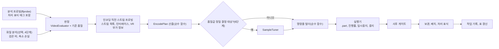
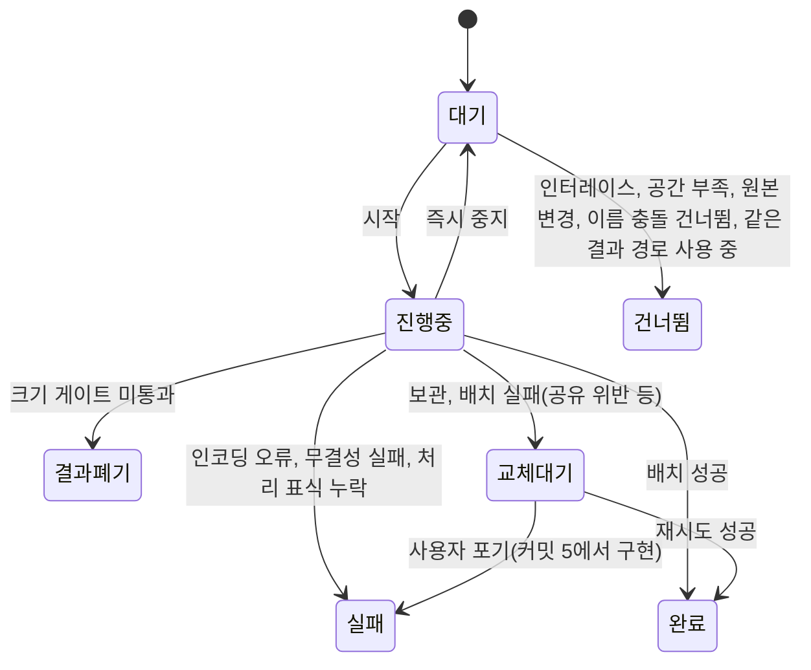

# 영상별 맞춤 직접 인코딩: 최종 설계서 및 구현 계획

> 상태(2026-11-19): 결정 1~32 승인, 커밋 4a(4a-1, 4a-2, 4a-2b, 4a-3~4a-7)와 4a 뒤 목록 갱신 수정과 사용자 확인 결함 2건 수정(`5b05855`, `c352c80`, 13.11절)까지 완료(13.10절). 사용자 재확인 통과(2026-11-19)로 커밋 4a 완료. 남은 결정: 안내 N과 정밀 분석 대상 수(13.11절)(결정 28의 화면 용어는 커밋 5 전 승인). 1단계, 2단계, 3단계 커밋 1~3c와 커밋 4(`ee26e52`, `1a70450`, `addc044`, `c0fd4ea`, 미리 보기 실물 확인 완료) 완료. 다음은 커밋 4a(결정 30 분석 캐시 보존, 4a-1 복원 문구 수정과 4a-2 내장 미리 보기 잠금 해제(결정 31)를 먼저 구현하고, 나머지는 작업 목록 승인 후), 커밋 4b(결정 28), 커밋 4c(결정 29 조기 중단), 커밋 5(GUI). 현재 상태와 코드 지도는 0.4절, 진행 기록은 13절
>
> 대상 독자: 이 저장소에서 1~6단계를 구현하는 에이전트. 이 문서만으로 단계별 작업, 파일, 데이터 형식, 검증 기준을 정할 수 있도록 작성
>
> 우선순위: `AGENTS.md`, `CLAUDE.md`의 저장소 규칙이 항상 우선. 이 문서와 저장소 규칙, 또는 이 문서와 실제 코드가 어긋나면 구현을 멈추고 사용자에게 보고
>
> 표기: "초기값"은 실측 전 근거가 약한 수치로, 명명 상수로 두고 독스트링에 "초기값, 4단계 보정 대상"을 적음

---

## 0. 구현 에이전트 실행 규칙

### 0.1 공통 규칙
1. 단계는 1 -> 2 -> 3 -> 4 -> 5 -> 6 순서로만 진행. 단계를 건너뛰거나 합치지 않음
2. 각 단계 시작 전에 사용자에게 "작업 목록, 수정, 신규, 삭제 파일, 검증 방법"을 제시하고 승인받은 뒤 착수(`AGENTS.md` 7절). 대량 제거, 개명은 범위를 먼저 합의
3. 각 단계는 독립 커밋 묶음으로 끝내고, 커밋 전 `scripts/check.ps1`를 오류, 경고, 스킵 없이 통과
4. 저장소 규칙 요약(상세는 `AGENTS.md`)
   - 계층: `src/gui`, `src/cui` -> `src/service` -> `src/core` 단방향
   - 모듈 500줄 초과 시 책임 분리 검토, 1000줄 초과 불가. [`main_window.py`](src/gui/main_window.py)는 현재 948줄이므로 줄을 늘리지 않음(재인코딩 연결은 `encode_controller.py`로 분리)
   - Ruff + BasedPyright `strict` 0 오류, 0 경고
   - 메타 문서, 주석, 커밋 메시지에는 한글 외 비ASCII 문자 금지
   - 버튼은 아이콘만, 이름은 접근성 이름과 툴팁. 색은 팔레트 토큰만
   - 설정 키 추가, 변경은 `setting` 스킬, 모듈 추가, 개명은 `sync` 스킬, 테스트는 `test` 스킬 절차
5. 사용자 노출 새 용어는 후보 2~3개와 추천안을 제시해 승인받은 뒤 `TERMINOLOGY.md`에 추가하고 사용(11절의 승인 용어는 바로 사용 가능)
6. 실측 결과로 수치를 바꾸면 이 문서의 해당 결정과 12절 기준선 결과를 함께 갱신
7. 이 문서에 없는 판단이 필요하면 추측하지 말고 선택지와 추천안을 들고 사용자에게 질문

### 0.2 GUI 구현 전 레퍼런스 요청 절차(결정 26)
GUI 화면(새 화면, 기존 화면 개편, 대화상자, 설정 항목 포함)의 UI 코드를 작성하기 **직전에** 반드시 아래 순서를 실행

1. 사용자에게 다음 세 가지를 먼저 보고
   - (1) 이 GUI가 우리 프로그램의 어느 화면, 위치에서 쓰이는지(예: 메인 창 하단 막대, 재인코딩 메뉴, 환경 설정 대화상자의 어느 영역)
   - (2) 요청하는 레퍼런스 GUI가 원본 프로그램(주로 샤나인코더 7.4)에서 어떤 상황, 조건일 때 나타나는 화면인지(예: "샤나에서 파일 2개 이상을 동시 인코딩하는 도중의 인코딩 창")
   - (3) 받고 싶은 상태 목록(예: 진행 중, 일시중지, 오류, 완료)
2. 레퍼런스 이미지를 요청하고 받을 때까지 해당 화면 UI 코드를 작성하지 않음. 원본 프로그램에 대응 화면이 없으면 그 사실을 보고하고 "기존 화면 스타일로 진행"할지 사용자 결정을 받음
3. 레퍼런스를 받은 뒤 `gui-design` 스킬 절차로 배치안을 제시하고 구현
4. 이전 세션에서 받은 이미지(샤나 인코딩 창, 환경 설정 메뉴, 디코더 설정, 멀티 스레드 설정)는 세션 임시 파일이라 구현 에이전트가 볼 수 없음. 내용은 결정 23, 24와 12.1절에 텍스트로 남겼으며, 화면을 구현할 때는 다시 요청
5. 대상 화면과 요청 시점은 5.0절 표를 따름

### 0.3 로컬 자료와 도구
- `_ref/`(Git 제외, `.git/info/exclude`): 사용자 표본과 샤나 결과. 읽기 전용. 단위 테스트에서 사용 금지(테스트는 합성 입력만 사용)

| 경로 | 내용 |
| :--- | :--- |
| `_ref/video1.mp4` ~ `_ref/video19_*.{mp4,mkv,avi,wmv,ts}` | 표본 19개(12.1절 표본 목록) |
| `_ref/clips/` | 샤나 비교용 클립 18개(HDR 제외, 긴 영상은 가운데 60초) |
| `_ref/shana/<라벨>/` | 클립을 샤나 7.4로 인코딩한 기준 결과(라벨: `nvenc_cq22`, `nvenc_cq26`, `nvenc_1080p`, `x265_cq22`, `x265_cq26`, `x265_1080p`) |
| `_ref/re/src/`, `_ref/re/shana/` | 역추적용 초경량 원본 2개와 샤나 결과 |
| `_ref/tools/shana_reverse.py` | 역추적 도구(`make`, `analyze`, `match`) |
| `_ref/tools/capture_ffmpeg.ps1` | FFmpeg 프로세스 명령줄 기록 도구(샤나 7.4에는 효과 없음, 12.1절) |

- 저장소에 넣는 비교, 통합 스크립트(`scripts/`)는 로컬 경로를 하드코딩하지 않고 인자로 받음(`AGENTS.md` 6절)

### 0.4 현재 상태 요약과 코드 지도(2026-11-18, 다음 작업 착수 전 먼저 읽기)
- 완료: 1단계, 2단계, 3단계 커밋 1~3c와 커밋 4(해시는 13.1절). `check.ps1` 전체 통과(테스트 1206개)
- 남은 것: 3단계 커밋 4b(결정 28), 커밋 5(GUI), 4~6단계
- 시작 조건: 커밋 4는 사용자의 PC 유휴 확인 후에만 시작(수십 분에서 수 시간). 커밋 5는 G3~G7 레퍼런스 이미지와 11.2절 용어 승인 후
- 의도적으로 열려 있는 항목: `execution` 설정 키 11개는 화면 없음(커밋 5에서 닫음), `hevc_amf`와 `hevc_qsv`는 보류(`available=False`), "편집" 메뉴 끝의 선택 영상 조작 항목은 임시 배치
- 줄 수 주의: `main_window.py` 948줄(늘리지 않음), `table_columns.py` 509줄(열 추가 시 분리 검토), `encode_service.py` 531줄(더 키우지 않음, 새 책임은 별도 모듈)

| 영역 | 모듈 | 진입점 |
| :--- | :--- | :--- |
| 판정 | `quality_target.py`, `evaluator.py`, `smart_action.py`, `classification_policy.py` | `VideoEvaluator.evaluate_video`, `evaluate_all`(`active_frame`, `active_frames` 입력), `SmartAction`, `DEFAULT_CLASSIFICATION_POLICIES` |
| 프로빙 | `stream_layout.py`, `ffmpeg_capability.py` | `parse_stream_layout`(인코딩 직전 스트림 목록), `probe_ffmpeg_capability`(FFmpeg 상태, `has_vmaf`) |
| 계획과 명령 | `encoder_specs.py`, `encode_plan.py`, `ffmpeg_command.py`, `encode_tag.py` | `ENCODER_SPECS`, `build_encode_plan`, `build_ffmpeg_args`, `build_encode_tag` |
| 프로세스 | `encode_process.py`, `encode_progress.py`, `power_state.py` | `EncodeProcess`, `ProgressParser`, `PausableClock`, `prevent_sleep`, `run_after_complete` |
| 서비스 | `encode_job.py`, `encode_service.py`, `encode_placement.py`, `encode_resume.py`, `encode_history.py`, `encode_events.py`, `encode_ports.py` | `jobs_from_evaluations`, `EncodeSettings.from_config`, `create_batch`, `EncodeRunner`(`run`, `pause_all`, `resume_all`, `cancel_all`, `request_stop_after_current`, `retry_replace_pending`), `prepare_resume`, `find_unrecorded_parts`, `EncodeHistory` |
| 순수 규칙 | `encode_gate.py`, `encode_paths.py`, `encode_state.py`, `encode_concurrency.py` | `judge_result`, `choose_free_path`, `EncodeState`, `resolve_concurrency` |

- 주입 지점(단위 테스트, 실측 스크립트용): `EncodeRunner(history, settings, probe=, process_factory=, on_event=, store=, cpu_count=, clock=)`
- 화면은 `EncodeEvent`(`kind`: `state`, `progress`, `long_pause`)를 받아 갱신하고, 워커 스레드에서 Qt 객체에 접근하지 않음
- 개발 PC 확인 사항: PATH의 FFmpeg 2024-12 빌드에서 `hevc_nvenc`, `libx265` 동작. 코드와 문서에 장치명, 로컬 경로, 사양값을 기록하지 않음

---

## 1. 배경 요약

### 1.1 현재 구조
- 영상을 분석해 재인코딩 여부를 판정하고, 샤나인코더 프리셋 XML과 1:1 대응하는 분류 폴더(10개)로 파일을 옮김. 실제 인코딩은 사용자가 샤나에서 수행
- 판정 모델: [`BitrateModelConfig`](src/core/config.py)의 `base_target_kbps = 1500`(720p 30fps H.264)에서 면적 지수 0.82, FPS 지수 0.60으로 적정 비트레이트 `B_opt`를 계산하고, 원본 비율 `r`로 과화질(`r > 1.2`), 적정, 저화질(`r < 0.8`)을 구분
- 프리셋 핵심(NVENC): 표준 `-cq:v 22`, 저화질 `-cq:v 26`, 축소 규격 8개는 `-b:v 0 -maxrate <고정값> -bufsize <2배>` + 16:9 박스 내접 `scale`. 모두 `-f mp4 -c:a copy -shanakeyframe 1 -profile:v main`

### 1.2 해결할 문제

| 기호 | 문제 | 근거 |
| :--- | :--- | :--- |
| A | 22/26이 판정, 프리셋, UI에 분산 결합 | `SmartAction.ENCODE_CQ22_*`, 폴더명, `TERMINOLOGY.md` 6.3절 |
| B | 예상 용량이 출력 품질값을 반영하지 않음 | [`evaluator.py`](src/core/evaluator.py)가 CQ26 경로에도 같은 추정식 사용 |
| C | 고정 규격 축소의 계단 손실 | 2160p->1440p 화소 55.6% 손실, `2560x1080`이 1080p 상한에서 `1920x808` |
| D | 프리셋이 영상 특성을 못 따라감 | 10-bit -> 8-bit, MP4 비호환 트랙 손실, 프리셋은 NVENC/x265만 |
| E | 해상도 대비 세부 묘사가 적은 영상을 놓침 | 4K 표본 3개가 1080p 왕복 SSIM 0.996 이상, 그중 2개는 4K 기준 "적정"이지만 1080p 기준 r 3.16/3.27 |
| F | 검은 띠가 판정을 왜곡 | 세로 화면 + 좌우 검은 띠 4K 표본: 전체 면적 r 0.32, 실제 화면 r 0.82 |
| G | 샤나 결과의 실제 손실 | 12.3절: WMV 실패, 다중 트랙/자막/글꼴/커버 소실, 인터레이스 미처리, 4K 60fps 품질값 미반영 |

- 해결 현황(2026-11-18): A, B는 2단계(`baseline_cq`, 품질값 차이 용량 계수, 역할 기반 식별자)에서 반영. D의 트랙 보존과 G의 일부는 3단계 구현 완료(샤나 대비 검증은 커밋 4). C, E, F는 4~5단계. 위 표의 근거는 1단계 이전 코드 기준

### 1.3 방향
- 샤나는 FFmpeg 프런트엔드이며 화질은 같은 FFmpeg 인코더가 결정. 같은 인자로 샤나와 **영상 데이터가 바이트 단위로 같은 결과**를 낼 수 있음을 확인(12.5절)
- 분류 폴더 이동을 없애고 프로그램 안에서 영상별 계획(`EncodePlan`)으로 직접 인코딩
- 먼저 샤나와 같은 결과를 재현(3단계)한 뒤, 개선 항목을 하나씩 켜서 검증(5단계)

---

## 2. 목표, 비목표, 전제, 원칙

### 2.1 목표
1. 판정 결과를 영상별 `EncodePlan`으로 바꿔 직접 인코딩
2. 판정, 예상 용량, 실제 인코딩이 같은 기준 정의를 공유
3. 연속 배율 축소, 10-bit 유지, 영상별 최대 비트레이트, 기준 품질 변경
4. 샘플 인코딩 + VMAF/SSIM으로 영상별 품질값 결정
5. 샤나 대비 화질, 트랙 보존, 속도, 원본 안전에서 열위 없음
6. 화면 내용 측정(축소 손실, 검은 띠)으로 비트레이트 모델의 사각 보완
7. VR 기기 재생과 AI 2D->3D 변환 도구 입력으로 쓰기 좋은 출력(결정 27)

### 2.2 비목표
- HDR(PQ, HLG, Dolby Vision) 재인코딩: 판정 `PASS_HDR` 유지
- 자막 입히기, 로고, 자르기 편집, HDR 톤매핑, 파일별 수동 인자 조정
- FFmpeg 번들링. 외부 독립 프로그램은 FFmpeg/ffprobe만 사용(MediaInfo 등 금지). Python 라이브러리는 필요 시 도입(`pyproject.toml` 명시)
- 원본 자동 삭제를 기본값으로 두는 것
- 분류 폴더 이동, 샤나 프리셋 연동의 유지와 이전 도구

### 2.3 전제
- 모든 기존 커밋은 프로토타입이고 실사용자 0명. 중간 단계 사용자도 없음
- 하위 호환, 설정 이전, 캐시 이전, 병행 기간을 고려하지 않음. 제거 대상은 이전 코드 없이 제거

### 2.4 설계 원칙
- **한 번에 한 가지 변화**: 3단계는 샤나 동치, 5단계 개선 항목은 하나씩 켜고 비교
- **확신 없는 입력은 건너뜀**: HDR, 인터레이스는 건너뛰고 사유 기록
- **원본 우선**: 게이트 통과 전 원본 무변경, 어떤 실패에서도 원본과 결과 중 하나 이상 보존

---

## 3. 확정 결정 명세

각 결정의 형식: 규칙 / 초기값 / 적용 단계. 결정 번호는 다른 문서, 커밋에서 참조하므로 바꾸지 않음

### 결정 1. 실행 구조
- 규칙: 직접 인코딩 단일 경로. 1단계에서 제거: 실제 분류, 분류 되돌리기, `pseudo_classify_mode`, [`classify_manifest.py`](src/core/classify_manifest.py), [`file_manager.py`](src/core/file_manager.py)의 이동/복원, `shana_presets/`, 분류 폴더명 설정, 관련 메뉴, 단축키, 작업 유형, 표시 열
- 유지: 분석, 판정, 권장 처리, 예상 용량, 예외 규칙, 영상별 출력 해상도 지정, 미리 보기
- 코드 식별자의 "분류" 계열(`ClassifierConfig`, `classification_policy.py`)은 판정 의미로 남으므로 개명하지 않음
- 샤나는 제품 의존성이 아니며 개발 비교 기준(`_ref/shana/`)으로만 사용. 프리셋 XML은 Git 이력에 남음
- 적용: 1단계

### 결정 2. 기준 품질과 판정 모델
- 기준 품질 `baseline_cq`: 기본 인코더(`hevc_nvenc -cq`) 척도, 기본 22.0
- 기준 비트레이트(저장하지 않는 파생값): $B_{\text{base}}(Q) = B_{\text{ref}} \times 2^{(22.0 - Q)/K}$
  - `base_target_kbps`의 의미는 "척도 22.0에서의 720p 30fps H.264 적정 비트레이트"로 고정
  - `K`: 초기값 6.0, 4단계에서 인코더별 실측
- 인코더별 척도 매핑: 같은 화질을 내는 인코더별 품질값. 초기값은 항등(정수 인코더는 반올림). 12.3절에서 같은 "22"의 NVENC/x265 출력 비트레이트가 내용에 따라 1.0~2.6배 차이이므로 4단계 VMAF 보정 필수
- 코덱 효율 차이는 기존 `codec_weights`, 척도 차이는 매핑이 담당(이중 보정 금지)
- VMAF는 판정 기준이 아니라 6단계 품질값 정밀 결정의 종료 조건
- 적용: 2단계(상수, 설정), 4단계(보정)

### 결정 3. 목표 품질값 반영 용량 추정
- 영상 스트림 예상 용량 x $2^{-\Delta/K}$, $\Delta$ = 출력 품질값 - 기준 품질값
- 보호 경로, 기준 변경, 정밀 결정 결과 모두 같은 식
- NVENC 레벨 상한(결정 25)을 예상 출력 비트레이트 상한으로 반영(3단계)
- 반영 후 보호 경로 영상의 예상 절약 증가로 일부 판정이 바뀌는 것은 의도된 변화이며 테스트에 고정
- 적용: 2단계, 3단계(레벨 상한)

### 결정 4. 저화질 보호 품질값
- 3단계: 기준 + 4.0 고정(샤나 동치)
- 5단계: $Q_{\text{protect}} = \text{clamp}(Q_{\text{base}} + K \log_2 (1/r_{\text{target}}),\ Q_{\text{base}},\ Q_{\text{base}} + \Delta_{\max})$, $\Delta_{\max}$ 초기값 6.0
- 보호 판정 조건은 [`should_use_low_quality_preset`](src/core/classification_policy.py) 재사용
- **승인 조건: 품질값은 인코더가 소수를 받는 한 반올림하지 않고 소수 그대로 계산, 적용**
  - 소수 가능: `hevc_nvenc`, `h264_nvenc`, `av1_nvenc`(`-cq`), `libx265`, `libx264`(`-crf`)
  - 정수만: `libsvtav1`(`-crf` 0~63), `hevc_amf`, `hevc_qsv`. 인코더 척도로 매핑한 뒤 마지막에만 반올림
  - 소수가 인코더 내부에서 실제로 반영되는지는 4단계 실측
  - 표시는 소수 첫째 자리(`CQ23.9 재인코딩`)
- 적용: 2단계(상수), 3단계(+4), 5단계(연속 식)

### 결정 5. 해상도 축소
- 3단계: 현행 8규격 + 16:9 박스 + 규격 고정 `-maxrate`(샤나 동치)
- 5단계 연속 배율: $s = (r_{\text{src}}/r_{\text{low}})^{1/(2\alpha)}$, $\alpha$ = `area_scaling_exponent`. 크기는 `OUTPUT_DIM_ALIGN`(4) 배수 내림
- 미세 축소 가드: [`MIN_DOWNSCALE_AREA_RATIO`](src/core/resolution_tiers.py)(95%) 유지, 4단계 실측 후 변경 여부 결정
- 최대 해상도 기준: 기본 `short_side`, 선택 `pixel_area`, `box`(`2560x1080`에 1080p 상한: 축소 안 함 / 약 2216x932 / 1920x808)
- 스케일러: 3단계 FFmpeg 기본, 5단계 `lanczos` 계열 표본 비교 후 채택
- **승인 조건: 축소 기준이 겹칠 때**
  1. 영상별 직접 지정이 있으면 그것만 사용
  2. 없으면 적용 가능한 후보 중 **가장 작은 출력 크기** 채택: 최대 해상도 상한, 연속 배율 결과, 축소 손실 후보(결정 19가 자동 사유로 편입된 경우)
  3. 채택 결과에 미세 축소 가드 적용
  - 같은 크기면 판정 사유 표시 순서: 최대 해상도 > 축소 손실 > 비트레이트 맞춤
- 축소, 해상도 판정은 검은 띠를 뺀 활성 화면 크기 기준(결정 20)
- 적용: 3단계(규격), 5단계(연속, 기준, 스케일러, 겹침 규칙)

### 결정 6. 최대 비트레이트(`-maxrate`)
- 적용 범위: 축소 경로만
- 5단계 일반화: $\text{maxrate} = \lceil B_{\text{target}}(w_{\text{out}}, h_{\text{out}}, \max(\text{fps}, 60)) \times 1.5 \rceil_{100\text{k}}$, `bufsize` = 2 x maxrate. 규격 크기에서는 현행 고정값과 같음
- 기각: 실제 fps 기준 `B_opt x 1.8`(30fps 이하 상한 약 22% 감소)
- 적용: 3단계(고정값), 5단계(일반화)

### 결정 7. 키프레임과 프레임 타이밍
- 목표 키프레임 간격: 프레임 수 기준 `round(fps)`(샤나와 같음). 고정 프레임에서 약 1초(23.976fps는 약 1.001초), 가변 프레임은 프레임이 드문 구간에서 1초보다 길어질 수 있음
- 인자: `-g <round(r_frame_rate)>`만 사용(샤나 `-shanakeyframe 1` = `-g <round(fps)>`). `-force_key_frames expr:gte(t,n_forced*1)`는 쓰지 않음
  - 근거(커밋 4 실측, 2026-11-18 사용자 승인): 두 인자를 함께 쓰면 소수 fps(23.976 등) 클립에서 약 1000프레임 뒤부터 키프레임 위치가 한 프레임씩 앞당겨져 샤나와 바이트가 어긋남(NVENC 7/15 일치). 제거하면 15/15 일치(가변 프레임 표본 포함). 처음 기록한 "함께 써도 일치"는 정수 fps 표본에 한정된 확인이었음
  - 결과 키프레임 간격 약 1.001초는 허용 상한 `keyframe_interval_sec`(2.2초)보다 충분히 작아 재판정 대상이 되지 않음
  - 가변 프레임 영상의 시간 기반 키프레임은 5단계 후보(5.5절)
- `-fps_mode passthrough` 명시. 3단계에서 이 인자를 넣은 상태로도 샤나 바이트 일치가 유지되는지 확인하고, 깨지면 사용자에게 보고
- VFR 판정은 하지 않음. `-forced-idr`는 사용하지 않음
- 적용: 3단계

### 결정 8. 출력 컨테이너와 스트림 보존
- 컨테이너: 원본 유지 우선(`.mp4`, `.mkv`, `.mov`). `.avi`, `.wmv`, `.flv`, `.webm`, `.ts`는 `.mp4`, 비호환 트랙이 있으면 `.mkv`. 설정 "항상 MP4" 제공
- 스트림 매핑: 인코딩 직전 프로빙한 스트림 목록으로 `-map 0:<index>` 명시

| 스트림 | 처리 |
| :--- | :--- |
| 주 영상 | 인코딩 |
| 커버(`attached_pic`) | `copy`, 출력에 `-disposition attached_pic`. 커밋 4까지는 MP4/MOV 출력에서 커버를 제외하고 사유 기록(`+use_metadata_tags`가 커버를 버림, 12.8절). 커밋 4b부터 항상 유지(결정 28) |
| 오디오 | `copy`. 대상 컨테이너 비호환 코덱만 `aac` 변환(예: WMA -> AAC, 12.3절 WMV 실패 원인) |
| 자막 | `copy`. MP4 출력의 텍스트 자막은 `mov_text`, 비트맵 자막이 있으면 `.mkv` |
| 첨부 파일(글꼴) | MKV 출력이면 `copy`. MP4로 바뀌면 소실 사유 기록 |
| 데이터 스트림 | 제외하고 기록. MP4/MOV 출력은 `-write_tmcd 0`으로 MOV 타임코드 트랙이 다시 생기지 않게 함(커밋 4 실측, 2026-11-18 승인) |
| 메타데이터, 챕터 | `-map_metadata 0`, `-map_chapters 0` |

- 색 정보: `color_primaries`, `color_trc`, `colorspace`, `color_range`를 출력에 명시 전달(bt709, bt2020 SDR 포함)
- 회전: FFmpeg 자동 회전, 출력 크기는 표시 기준. 샤나와 같이 화면을 돌려 저장하고 회전 정보는 남기지 않음(12.3절)
- MP4/MOV의 HEVC는 `-tag:v hvc1`(결정 27)
- 적용: 3단계

### 결정 9. 결과 파일 처리와 재처리 방지
- 결과 파일 처리 정책
  - `archive_original`(기본): 게이트 통과 시 원본을 같은 폴더 하위 `_원본보관/`으로 이동하고 결과를 원본 위치에 배치. 같은 볼륨 이동이라 추가 복사 없음
  - `separate_output`: 결과를 별도 출력 폴더(기본 `_재인코딩결과/`)에 저장. **승인 조건: 작업 폴더 기준 상대 경로(하위 폴더 계층)를 출력 폴더에 그대로 재현**
  - `replace_original`: 검증 후 원본 교체. 되돌릴 수 없음을 확인 대화상자로 안내
- 확장자가 바뀌면 결과 목록에 원본 -> 결과 경로 표시
- 보관 폴더에 같은 이름이 있으면 덮어쓰지 않고 실패 처리. 그 밖의 이름 충돌은 결정 24
- 임시 파일: 같은 폴더 `<이름>.<확장자>.part`, `-f`로 형식 명시. `.part`는 [`VIDEO_EXTENSIONS`](src/core/file_manager.py) 밖이라 스캔 제외
- 스캔 제외 목록: 보관 폴더, 별도 출력 폴더(분류 폴더 제외 목록을 대체)
- 타임스탬프: 결과 파일 수정 시각을 원본 값으로(`os.utime`). 생성 시각 보존은 범위 밖
- 사전 검사: 대상 볼륨 여유 공간 < 원본 크기 x 1.1(초기값)이면 건너뜀
- **승인 조건: 처리 표식 태그 명세(확정)**
  - 키: `video_scripts_encode`(컨테이너 전역 태그)
  - 값: ASCII, 세미콜론 구분 `v=1;enc=<인코더>;q=<품질값>;at=<UTC ISO 8601>`. `v`는 명세 버전, 읽을 때 모르는 필드 무시
  - 기록: MP4/MOV는 `-movflags +use_metadata_tags`(필요 시 `+faststart`와 결합) 필수, MKV는 `-metadata`만
  - 읽기: 키 대소문자 무시(MKV는 `VIDEO_SCRIPTS_ENCODE`로 저장)
  - 확인 결과: MP4에 플래그 없이 쓰면 사라짐, 플래그 사용 시 MP4/MOV 유지, MKV 유지, MP4 -> MKV 재다중화 후 유지, ffprobe 조회 대소문자 무관
  - 표준 `comment` 키 사용 금지. 원본에 같은 키가 있으면 새 값으로 교체
  - 분석 프로빙이 이 태그를 읽고, 표식이 있는 영상은 판정 사유 "이미 재인코딩"으로 대상에서 제외. 다시 인코딩은 영상별 직접 지정으로만
- 커밋 4b부터 기록 위치, 기록 여부 설정, 판정 근거는 결정 28로 바뀜(MP4/MOV는 `+use_metadata_tags` 대신 탐색기 태그 칸의 `Xtra`, MKV는 `KEYWORDS` 추가). 키 이름과 명세 값 형식은 유지
- 적용: 3단계

### 결정 10. 사후 게이트
- 무결성: 출력 `ffprobe` 성공, 계획한 스트림 수 일치(결과의 데이터 스트림은 세지 않음: MP4 `-map_chapters 0`이 챕터 트랙을 데이터 스트림으로 기록하고, 계획에는 데이터 스트림이 없음. 커밋 4 실측, 2026-11-18 승인), 영상 길이 차 <= max(0.5초, 원본의 0.5%)(초기값)
  - 영상 길이는 원본(분석 프로빙)과 결과(게이트) 모두 같은 함수로 구함: 영상 스트림 `duration` -> 영상 스트림 태그 `DURATION`(MKV는 스트림 `duration`이 비어 있음) -> 컨테이너 `duration` 순(커밋 4 실측, 2026-11-18 사용자 승인). 컨테이너 길이를 먼저 쓰면 오디오가 영상보다 긴 원본에서 오탐(12.8절과 같은 날 확인: 영상 6초, 오디오 9초 MP4의 컨테이너 길이 9초, MKV는 영상 스트림 길이 `N/A`, 태그 6초, 컨테이너 9.02초)
  - 분석 프로빙 조회에 `stream_tags=DURATION`을 추가하고 `PROBE_VERSION`을 5로 올림(MKV 원본의 길이와 비트레이트 계산이 영상 기준으로 바뀜)
- 크기: 절약 목적(과화질, 코덱 전환, 축소)인데 결과 >= 원본이면 결과를 버리고 원본 보존, 상태 "결과 폐기"
- KF 교정, 코덱 호환 목적은 무결성만 검사
- 실패 시 FFmpeg stderr 마지막 부분을 작업 기록에 보존
- **추가 승인(2026-11-18, 사용자 지시)**: 무결성 검사에 출력 처리 표식 확인 추가. 출력 `ffprobe`에서 `video_scripts_encode` 태그가 없으면 배치하지 않고 상태 "실패", 사유 "처리 표식 누락"으로 처리. 원본은 무변경, `.part`는 삭제
  - 근거: FFmpeg는 MP4에 `+use_metadata_tags` 없이 쓰면 표식을 조용히 버림. 표식이 빠진 결과를 배치하면 다음 분석에서 재인코딩 대상이 되어 화질이 두 번 깎이므로 AGENTS 5절 재처리 방지 불변식 위반
  - 커밋 4b부터 태그 확인 방법은 결정 28(MKV는 ffprobe, MP4/MOV는 `Xtra` 읽기). 기록 방식이 "상세 값만"이면 상세 값만 확인하고, "기록 안 함"이면 이 확인을 하지 않고 재처리 방지는 재인코딩 이력이 맡음
- 적용: 3단계

### 결정 11. FFmpeg 확보와 능력 확인
- 설정 `ffmpeg_path`, `ffprobe_path`(비우면 PATH). 시작 시 1회 버전, 인코더 목록, 필터(`libvmaf`, `scale_cuda` 등), HW 디코더 프로빙 후 캐시([`system_probe.py`](src/core/system_probe.py) 확장)
- 최소 버전 FFmpeg 5.1(초기값, `-fps_mode` 기준). 미달이면 인코딩 비활성
- **승인 조건: 상태와 사유를 화면에 명확히 표시**
  - 설정 대화상자 "FFmpeg 상태" 영역: 경로, 버전, 사용 가능 인코더, `libvmaf` 지원, 비활성 사유
  - FFmpeg 없음, 버전 미달: "재인코딩 시작" 비활성 + 툴팁에 사유와 해결 방법
  - 선택 인코더 미지원: 인코더 선택지에 사용 불가 표시와 사유
  - `libvmaf` 부재로 SSIM 대체: 화질 분석 결과의 측정 지표 열, 작업 완료 알림에 대체 사실 표시
  - HW 디코딩 실패 후 CPU 재시도: 결과 목록 해당 파일에 표시
- 적용: 3단계(4단계에서 지표 표시 추가)

### 결정 12. 테스트 정책
- `check.ps1` 단위 테스트는 FFmpeg 없이 실행(인자 목록 비교, 순수 함수, 가짜 프로세스). 스킵 금지
- 실제 인코딩 통합 테스트는 `scripts/` 아래 별도 스크립트(합성 `lavfi` 입력, 수동 실행). NVENC, AMF, QSV는 장치가 있을 때 수동 확인
- 샤나 동치 비교도 별도 스크립트(입력 경로는 인자)
- 모든 테스트는 `TemporaryDirectory`와 `_sandbox.py` 격리
- 적용: 전 단계

### 결정 13. 용어
- 권장 처리 명칭 `CQ{값} 재인코딩`(실제 적용 값, 소수 첫째 자리). 축소는 기존 "축소 재인코딩" 유지
- `TERMINOLOGY.md` 6.1절 "분류 상태"를 재인코딩 상태로 대체, 폐기 용어는 8절로 이동
- `TERMINOLOGY.md`에는 해당 기능을 구현하는 단계에서 추가
- 승인 용어와 보류 용어는 11절
- 적용: 1~6단계

### 결정 14. 디코딩 구성
- 후보: CPU 디코딩 + CPU 필터 / GPU 디코딩 + CPU 필터 / GPU 디코딩 + GPU 스케일 / 샤나 기본 구성(코덱별: H.264, MPEG2, VC1, VP9는 SW, HEVC, AV1은 HW 자동, 디코딩 스레드 `-threads 0 -thread_type frame`)
- **3단계에서 처리 시간을 실측해 속도 수용 기준을 만족하는 가장 호환성 높은 구성을 기본으로 확정**. 코덱별 디코더 선택을 설정으로 둘지도 실측 결과로 결정(사용자에게 보고 후)
- HW 디코딩 실패 시 같은 파일을 CPU 디코딩으로 1회 재시도하고 기록
- **확정(커밋 4, 2026-11-18, 사전 위임 범위)**: 기본은 샤나 기본 구성(`DecodeMode.SHANA_DEFAULT`) 유지. 근거(12.9절): CPU 디코딩은 속도가 같거나 비슷하지만 10-bit HEVC 원본(video16) 바이트가 샤나와 달라지고, GPU 디코딩은 1080p 축소에서 느리며 WMV와 커버 원본에서 실패. 속도 차이가 없어 코덱별 디코더 설정은 만들지 않음. `DecodeMode`에 구성 추가 없음
- 적용: 3단계

### 결정 15. 인터레이스 원본
- 인코딩 직전 스트림 프로빙에서 `field_order`가 `tt`, `bb`, `tb`, `bt`이면 상태 "건너뜀", 사유 인터레이스
- `progressive`, `unknown`, 값 없음은 진행. 인터레이스 판정 때문에는 분석 프로빙을 바꾸지 않음. 분석 프로빙의 `PROBE_VERSION`은 1단계에서 3으로, 3a단계(처리 표식 태그 읽기, 결정 9)에서 4로 올림(2026-11-18 승인). 커밋 4에서 5(영상 길이, 결정 10), 커밋 4b에서 6(결정 28)
- 샤나는 디인터레이스 없이 인코딩하고 필드 순서 표시를 `tt` -> `tb`로 바꿈(12.3절). 건너뜀이 더 안전
- 디인터레이스, `idet` 정밀 감지는 범위 밖(후속)
- 적용: 3단계

### 결정 16. 중지, 일시중지, 이어 하기
- 작업 기록: 배치 대상과 파일별 상태를 분석 캐시와 같은 SQLite 파일의 별도 테이블에 기록(4.4절)
- 현재 영상 후 중지: 진행 중 파일을 끝낸 뒤 정지
- 즉시 중지: 프로세스 종료, `.part` 삭제, 해당 파일 `대기`로 복귀
- **일시중지, 재개: 파일별, 전체. `psutil`의 `suspend`/`resume`**
  - 멈춘 동안 HW 인코더 세션은 계속 점유. 경과 시간, 속도 계산에서 멈춘 시간 제외
  - **승인 조건: 장시간 점유 안내**
    - 일시중지 버튼 툴팁과 진행 창 안내 문구: 멈춘 동안 GPU 인코더 세션을 계속 사용해 그래픽 드라이버나 다른 작업에 영향을 줄 수 있으며, 오래 멈출 때는 현재 영상 후 중지를 권장
    - 일시중지가 10분(초기값)을 넘으면 진행 창과 작업 기록에 같은 안내를 다시 표시하고 "현재 영상 후 중지로 전환" 동작 제공. 자동 중지는 하지 않음
  - 일시중지 상태에서 앱 종료 시 종료 확인에 포함, `.part` 정리
- 이어서 재인코딩: 앱 시작, 작업 폴더 열기 시 미완료 배치가 있으면 확인 대화상자. `대기`, `진행 중` 상태만 재투입. 원본 크기, 수정 시각이 기록과 다르면 재개 제외
- 잔여 `.part`: 작업 기록에 경로가 있는 것만 삭제, 나머지는 목록 안내
- 기각: 진행 위치부터 이어 인코딩(구간 결합)
- 적용: 3단계

### 결정 17. 인코딩 중 다른 작업과 미리 보기
- 재인코딩 전용 작업 스레드를 분석 작업 스레드와 분리(현재 단일 슬롯: [`task_runner.py`](src/gui/task_runner.py))
- 인코딩 중 허용: 분석, 다른 작업 폴더 열람, 설정 확인. 인코딩 설정 변경은 다음 배치부터(배치 시작 시 설정 사본 고정)
- 결과 배치 시점에 해당 행의 분석 결과 갱신
- SQLite는 스레드별 연결, 쓰기 충돌 재시도 정책은 3단계 단위 테스트로 고정
- 앱 종료 시 인코딩 중이면 확인 대화상자(즉시 중지 후 종료 / 현재 영상 후 중지하고 종료 / 계속)
- **승인 조건: 인코딩 중 스페이스바 미리 보기 보장**(현재 인코딩 중인 원본과 표의 모든 영상)
  - 미리 보기 방식: 내장 창(`QMediaPlayer`, [`video_preview_window.py`](src/gui/widgets/video_preview_window.py)), QuickLook(외부 프로그램). 둘 다 재생 중 파일을 열어 둠([`preview_controller.py`](src/gui/preview_controller.py))
  - 재생 중인 원본의 보관 이동, 교체는 Windows 공유 위반으로 실패할 수 있음(3단계에서 두 방식 모두 실측)
  - 내장 창은 배치 직전 해당 파일 재생 해제를 검토. QuickLook은 제어 불가
  - 배치 실패 시: 결과와 원본 모두 유지, 상태 "교체 대기". 미리 보기 종료, 배치 종료 시 재시도, 이후 결과 목록에서 수동 재시도. 어떤 경우에도 둘 중 하나를 잃지 않음
  - 속도 수용 기준은 미리 보기를 쓰지 않은 상태에서 측정
  - 2026-11-19 실측(사용자 수행): 내장 미리 보기 창은 원본을 잠가 재생 중 배치가 `교체 대기`(WinError 32)로 남고, QuickLook은 잠그지 않아 재생 중에도 배치가 `완료`. 두 경우 모두 원본과 결과가 보존됨(12.9절). 내장 창 잠금 해제는 결정 31. 수정 후(2026-11-19 구현): 재생 중 원본 이름 바꾸기와 삭제가 성공하고 재생이 계속됨(단위 테스트, 12.10절)
- 적용: 3단계

### 결정 18. 품질값 정밀 결정(가칭) 적용 범위
- 기본: 선택 적용(과화질, `r`이 `low`/`over` 경계 +-0.15, 축소 후보). 설정으로 모든 대상, 적용 안 함
- 샘플: 결정 19 공통 구간 규칙의 유효 구간 일부, 3~4회 이진 탐색
- 지표: VMAF 우선, 없으면 SSIM(표시)
- 축소 후보는 `[원본 해상도 + 보호 품질값]` vs `[축소 해상도 + 기준 품질값]`을 원본 크기로 업스케일해 비교
- 비용: 대상당 1~3분(미측정 추정)
- 적용: 6단계

### 결정 19. 축소 손실 측정
- 정의: 각 규격으로 줄였다 되돌린 영상과 원본의 왕복 점수로 "N p로 줄이면 얼마나 잃는가"를 측정. 인코딩 없이 디코딩, 스케일, 지표만
- 지표: VMAF 우선(4K급 `vmaf_4k_v0.6.1`, 그 외 `vmaf_v0.6.1`, 기준값은 모델별), 없으면 SSIM(dB)
- 원래 해상도 판별이 아님: 선명한 원본에서만 업스케일을 가릴 수 있음(12.6절 대조 실험)
- 공통 구간 규칙(결정 18과 공유)
  - 길이 10~90% 사이 9지점 x 2초, 20초 미만은 전체 1구간
  - 구간의 50% 이상이 검은 화면(`blackdetect`)이면 제외, 가장 낮은 규격 왕복이 40dB 이상(세부 묘사 없음)이면 제외(초기값)
  - 유효 구간의 규격별 중앙값, 유효 구간이 없으면 "측정 불가"
- 판정 반영
  - 기준 이상인 가장 낮은 규격을 "축소 후보 해상도"로 표시, 필터 가능. 기준 초기 후보: VMAF 4K 모델 98, SSIM 0.996(약 24dB)
  - 4단계: 후보 표시만(자동 축소 없음). 5단계: 4단계 보정 결과로 자동 축소 사유 편입 여부 결정(편입 시 결정 5 겹침 규칙)
- 사용 가이드 확인 항목: 링잉, 할로 / 뭉개짐과 계단 현상 / 화면 대비 과도하게 큰 블록. 미리 보기 원본 화소 1:1 확대 지원 여부 4단계 확인
- 오차 방향: 원본 해상도 자막, UI, 샤프닝, 그레인은 축소를 덜 하는 쪽(안전)
- 실행: 분석과 분리된 "화질 분석" 작업, 결과 캐시. 키프레임만 디코딩(`-skip_frame nokey`) 방식의 정확도, 비용을 4단계에서 측정
- 4단계 실험: numpy 2D FFT 방사형 스펙트럼으로 고주파 차단 위치 추정. 왕복 점수만 쓸 때보다 오판이 줄 때만 보조 지표로 채택, 아니면 제거
- 채택하지 않음: BPP 임계값 판별, 인코더 설정 정보(`crf`) 확인
- 적용: 4단계(측정, 표시), 5단계(자동 사유 여부)

### 결정 20. 검은 띠 감지
- 화질 분석 작업에서 유효 구간마다 `cropdetect`, 모든 결과를 포함하는 가장 큰 영역(합집합)을 활성 화면으로 채택(어두운 장면 오인 방지)
- 활성 화면 면적 > 전체의 90%(초기값)이면 검은 띠 없음
- 판정: 활성 화면 크기로 `B_opt`, 축소 손실 계산(측정 전에는 전체 프레임)
- 출력(5단계): 활성 화면으로 잘라내기 기본 켬, 설정으로 끔. 세로 화면이 가로 프레임에 든 영상은 세로 출력
- VR 영상(결정 27)에는 잘라내기 미적용
- 적용: 4단계(감지, 판정), 5단계(출력)

### 결정 21. 다른 계획과의 순서
- 이 계획 1단계(분류 경로 제거)를 확정된 성능 개선 계획(GUI 스레드 I/O 제거 등)보다 먼저 진행. 제거로 GUI 코드가 줄어 성능 작업 범위도 줄어듦
- 적용: 1단계 착수 전

### 결정 22. 인코더와 장치 조합
- 구조: 출력 코덱(H.264, HEVC, AV1) x 장치(CPU, NVIDIA, AMD, Intel)를 하나의 인코더 정의 표(4.3절)로 정의하고, 명령줄 빌더는 이 표만 참조
- 활성화 순서
  - 3단계: H.264/HEVC 계열 6개 중 활성 4개(`libx264`, `libx265`, `h264_nvenc`, `hevc_nvenc`). `hevc_amf`, `hevc_qsv`는 인자 미확정과 테스트 PC 장치 부재로 보류(2026-11-18 승인, 13절). 샤나 기준이 있는 것은 `hevc_nvenc`, `libx265`. 나머지는 인자 단위 테스트 + 장치가 있을 때 수동 확인, 4단계 보정 전 항등 매핑
  - 4단계 보정 후: AV1 계열(`av1_nvenc`, `libsvtav1`)
- `h264_amf`, `h264_qsv`, `av1_amf`, `av1_qsv` 등은 표에 행만 추가하면 되도록 구조를 두되 이번 범위에서는 추가하지 않음
- 적용: 3단계, 5단계(AV1)

### 결정 23. 재인코딩 진행 화면
- 형태: 비모달 "재인코딩 진행" 창(작업 기록 창 방식). 닫아도 인코딩 계속, 메뉴, 단축키로 다시 엶. 메인 창 하단에는 전체 진행 막대와 남은 시간만 요약. 동시 실행 2개 이상이면 파일별 탭, 1개면 단일 패널
- 파일별 패널

| 항목 | 샤나 | 이 프로그램 |
| :--- | :--- | :--- |
| 파일 이름, 프레임 수, 현재 품질값(q), 현재 비트레이트 | 있음 | 유지 |
| 진행 위치 / 전체 길이, 변환 속도(배속, fps), 경과, 남은 시간 | 있음 | 유지(일시중지 시간 제외) |
| 현재 출력 크기 | 있음 | 유지 + 진행률로 환산한 예상 최종 크기와 판정 단계 예상 용량을 나란히 |
| 실시간 비트레이트 그래프 + 관측 최고값 | 있음 | 유지 + 원본 비트레이트 기준선, `-maxrate` 상한선 |
| 목표 품질값, 출력 해상도, 인코더, 디코딩 방식 | 없음 | 추가 |
| 일시중지, 강제 중지, 중지 | 있음 | 일시중지/재개, 즉시 중지(해당 파일만 `대기`로) |

- 전체 패널

| 항목 | 샤나 | 이 프로그램 |
| :--- | :--- | :--- |
| 완료 수 / 전체 수, 전체 진행률, 진행 막대, 현재/평균 속도, 전체 경과/남은 시간 | 있음 | 유지 |
| 완료분 실제 절약 합계 vs 예상 절약 | 없음 | 추가 |
| 결과 목록(재인코딩 상태, 원본 -> 결과 경로, 크기 변화, 결과 폐기/실패/건너뜀/교체 대기 사유) | 없음 | 추가 |
| 전체 일시중지, 현재 영상 후 중지, 즉시 중지 | 있음 | 유지(승인 용어) |

- 도입하지 않음: 샤나 창 가운데의 게시판 글 목록 같은 작업 무관 영역
- 데이터: FFmpeg `-progress pipe:1`(`frame`, `fps`, `stream_0_0_q`, `bitrate`, `total_size`, `out_time_us`, `speed`, `progress`). 순간 비트레이트는 1초 구간 차이, 그래프 점은 초 단위로 줄여 메모리 일정. 작업 스레드에서 묶어 0.5초(초기값) 주기로 GUI 전달
- 원칙: 아이콘 버튼 + 접근성 이름, 툴팁, 팔레트 토큰(그래프 포함), 다크/라이트 대비 확인, `gui-design` 스킬, 결정 26 레퍼런스 절차
- 용어: 샤나 "최대 비트레이트"(관측 최고값)는 이 프로그램의 "최대 비트레이트"(`-maxrate`)와 달라 다른 이름 필요(11.2절 보류)
- 적용: 3단계

### 결정 24. 샤나 환경 설정 대응 기능
- 절전 방지(필수): 인코딩 중 시스템 절전 진입 방지(Windows `SetThreadExecutionState`, `ctypes`). 화면 끄기는 허용. 기본 켬
- 인코딩 완료 후 동작: 없음(기본), 절전, 시스템 종료, 앱 종료. 절전과 시스템 종료는 취소 가능한 카운트다운 확인 대화상자
- 프로세스 우선순위: 5단계(높음, 높은 우선순위, 보통, 낮은 우선순위, 낮음), 기본 보통, 인코딩 프로세스에만(`psutil`)
- 같은 이름 파일이 이미 있을 때(별도 폴더 저장, 확장자 변경 시): 건너뜀(기본) 또는 번호 붙여 저장(`a (1).mp4`). 덮어쓰기 없음
- 범위 밖: 파일 목록 아이콘, 트레이, 32/64비트, 스킨, 언어, 영상 출력 장치, 키프레임 탐색
- 샤나 하위 메뉴 세부 선택지는 확인하지 않았으므로 화면 구현 전 결정 26 절차로 레퍼런스 요청
- 적용: 3단계

### 결정 25. NVENC 레벨 상한과 품질값
- 사실: `-level:v auto`는 해상도, fps에 맞는 레벨(4K 60fps는 5.1)을 고르고, 명시한 최대 비트레이트가 없으면 그 레벨 최대 비트레이트를 상한으로 적용. 고비트레이트 4K 60fps에서 CQ22, CQ26이 모두 약 36Mbps로 같아짐. `-b:v 0`, `-tier high`로는 안 풀리고 `-level:v 6.2` 또는 큰 `-maxrate`로 풀림(CQ22 약 84Mbps, CQ26 약 50Mbps). 상한이 풀리면 이 표본의 CQ22 결과가 원본(약 72Mbps)보다 커짐(12.5절)
- 3단계: 샤나와 같이 상한 유지. 예상 용량 계산에 레벨 상한 반영(결정 3)
- 4단계: "상한 유지"와 "상한 해제 + 더 높은 품질값"을 같은 크기 기준 VMAF로 비교해 기본 정책 결정. 레벨 호환성을 설정(호환성 기준)으로 고르는 방안 검토. 호환성 기준 후보에 VR 기기(결정 27) 포함
- 적용: 3단계, 4단계

### 결정 26. GUI 구현 전 레퍼런스 요청과 사전 보고
- 0.2절 절차를 모든 GUI 작업(결정 23, 24, 메인 화면 개편, 설정 항목, 대화상자, 화질 분석 열 등)에 적용
- 대상과 시점은 5.0절 표
- 적용: 2~6단계의 GUI 작업 직전

### 결정 27. VR 재생 호환성과 AI 2D->3D 변환 호환성
- **HEVC 코덱 태그**: MP4/MOV 출력의 HEVC는 모든 인코더에서 `-tag:v hvc1`. 샤나 NVENC 결과는 `hev1`, x265 결과는 `hvc1`이었음(확인). 태그는 컨테이너 정보만 바꾸므로 영상 데이터 바이트 일치 기준(6.1절)에 영향 없음. 3단계부터 적용
- **색 정보 보존**: 결정 8의 색 정보 전달(bt709, bt2020 SDR 등)을 손실 없이 유지. HDR 원본은 계속 보존 판정
- **10-bit 파이프라인**: 5단계 10-bit SDR 유지 시 디코딩 -> 필터 -> 인코딩 전 구간에서 8-bit 중간 변환 금지(`yuv420p10le`/`p010le`, HEVC `main10`). 3단계는 샤나 동치로 8-bit
- **VR 영상 보호**
  - 스트림 부가 정보에 구면 투영(Spherical Mapping) 또는 입체(Stereo 3D) 정보가 있으면 VR 영상으로 판단
  - VR 영상은 검은 띠 잘라내기 미적용(어안 180도 영상의 원 밖 검은 영역이 잘리면 투영이 깨짐), 해당 부가 정보를 출력에 보존(MP4 구면 정보 기록에 필요한 FFmpeg 옵션 확인 포함)
  - 감지 방법과 보존 가능 여부는 4단계에서 표본(사용자 제공)으로 확인. 표본이 없으면 사용자에게 요청
- **VR 기기 호환성 기준**: 결정 25의 4단계 레벨, 호환성 검토에서 Meta Quest 3, Apple Vision Pro의 하드웨어 디코딩 규격(최대 해상도, 프레임레이트, 프로파일, 레벨)을 호환성 기준 후보에 포함. 수치는 공식 문서로 확인해 12절에 출처와 함께 기록하고 추정값을 쓰지 않음
- **AI 2D->3D 변환 도구 입력 품질 기준**(깊이맵 예측, 시차 생성에서 깊이 왜곡과 프레임 밀림 방지)
  - 유효 화면 정규화: 검은 띠 제거(결정 20, VR 제외)
  - 피사체 경계 보존: 품질값, 해상도 결정이 경계를 뭉개지 않도록 결정 4, 5, 19의 기준값을 보수적으로 보정하고, 5단계 개선 항목 비교에 경계 선명도 확인(VMAF와 함께 육안 확인 표본) 포함
  - 프레임 타이밍 일관성: 결정 7(`-g <round(fps)>`, `-fps_mode passthrough`)로 프레임 복제, 누락 없이 타임스탬프 유지
- 적용: 3단계(태그, 색 정보, 타이밍), 4단계(VR 감지, 호환성 기준), 5단계(10-bit, 잘라내기 예외)

### 결정 28. 재인코딩 태그와 재인코딩 이력(2026-11-18 사용자 결정)
- **사용자 결정(2026-11-18)**
  - 처리 표식을 Windows 탐색기 속성 창(Alt+Enter)의 태그 칸에 보이는 키워드로 기록하고, OS API에 의존하지 않는 방법으로 씀(12.8절 실측 근거)
  - 사용자 노출 용어는 "재인코딩 태그". 태그 이름은 사용자가 설정에서 바꿀 수 있음
  - 기록 방식은 3단계로 고름: 보이는 태그와 상세 값(기본), 상세 값만, 기록 안 함(2026-11-18 사용자 결정, 탐색기 편집 실험에서 상세 값이 보존됨을 확인한 뒤 추가)
  - 커버뿐 아니라 재인코딩으로 사라지거나 바뀌는 내부 요소를 항목별로 집계해 영향받는 영상의 수와 목록을 보여 줌
- **배경**: 기존 방식(MP4/MOV `+use_metadata_tags`)은 표식이 사용자에게 보이지 않고, MP4 커버를 버리며, MP4 제목과 주석이 탐색기에서 사라짐. FFmpeg는 탐색기 태그와 별점(`Xtra`, ASF `WM/*`)도 버림(12.8절). 새 방식은 이 네 문제를 함께 해결함
- **기록 위치(OS 비의존)**
  - MKV: FFmpeg `-metadata KEYWORDS=<원본 키워드;태그 이름>`(구분자 `;`), 상세 값은 `-metadata VIDEO_SCRIPTS_ENCODE=<명세 값>`(보이지 않음, 부작용 없음)
  - MP4/MOV: `+use_metadata_tags`를 쓰지 않음(커버 유지, 제목 표시 유지). FFmpeg가 끝난 `.part`에 Python으로 `moov/udta/Xtra`를 덧붙임. `WM/Category`에 원본 키워드와 태그 이름, 상세 항목 `VideoScripts/Encode`에 명세 값. 원본의 다른 `Xtra` 항목(별점 등)은 그대로 복사
  - FFmpeg 결과는 `+faststart`를 쓰지 않아 `moov`가 파일 끝이므로 `udta`, `moov` 크기만 고치면 됨. `moov`가 끝이 아니면 쓰지 않고 사유 기록(재인코딩 이력으로 방어)
  - 원본이 WMV/ASF면 ffprobe가 읽은 `WM/Category`(그리고 형식이 확인되면 별점)를 결과로 옮김
  - 원본에서 물려받은 옛 표식은 `-metadata video_scripts_encode=`로 지움(12.8절에서 MKV 잔존 확인)
  - `Xtra` 읽기, 쓰기는 core의 새 모듈(파일 상자 처리, 가칭 `mp4_xtra.py`)
- **명세 값**: `v=1;enc=<인코더>;q=<품질값>;at=<UTC ISO 8601>;app=<프로그램 버전>`. `app`은 새 필드이고 읽을 때 모르는 필드는 무시(결정 9 규칙). 프로그램 버전의 단일 출처는 `pyproject.toml`의 `version`(현재 0.1.0, 갱신 규칙 없음)이며 실행 중 읽는 방법은 4b 작업 목록에서 제안
- **보이는 태그에는 버전을 넣지 않음(2026-11-18 사용자 확정)**: 탐색기 태그 열에서 같은 이름으로 묶이고 검색되게 하기 위함. 버전은 상세 값과 재인코딩 이력에만 기록
- **태그 이름 설정**
  - 설정 키 후보 `execution.encode_tag_name: str`(고급 설정 영역). 기록 방식 키 후보 `execution.encode_tag_mode: str`(일반 영역, 값 후보 `visible`(기본), `hidden`, `off`). 이름은 `TERMINOLOGY.md` 13절, `setting` 스킬 절차
  - 기본값: `re_encoded`(2026-11-18 사용자 결정, 임시. 한글 대신 snake_case로 전문 도구 느낌, 상세 값 키 `video_scripts_encode`와 같은 표기 체계). 앱 이름이 확정되면 프로그램 고유 이름을 넣을지 다시 논의(`TODO.md` 2절). 바꿀 때 이전 기본값을 태그 이름 이력에 남김
  - 알려진 한계: 사용자가 같은 글자의 태그를 직접 붙인 파일은 "이미 재인코딩"으로 판정됨(영문 snake_case 기본값이라 우연히 겹칠 가능성은 낮음)(직접 지정으로 다시 인코딩 가능). 상세 항목은 판정 근거로 함께 쓰지만 이 오판은 막지 못함
  - 고급 설정에 두는 이유: 기본값으로 충분하고, 바꾸면 이미 처리한 파일과 이름이 달라지는 결과가 생김
  - 검증: 앞뒤 공백 제거, 빈 값 불가(태그를 보이지 않게 하려면 기록 방식 사용), `;` 불가(MKV와 Windows 태그 구분자), 제어 문자 불가, 최대 64자(초기값)
  - 바꾼 이름은 이후 결과에만 적용하고 기존 파일은 다시 쓰지 않음. 사용한 적 있는 이름은 DB의 태그 이름 이력에 남겨 판정에 계속 씀
- **판정("이미 재인코딩")**: 아래 중 하나라도 맞으면 대상에서 제외(직접 지정 규칙은 결정 9 그대로)
  1. 상세 항목 존재(MKV `VIDEO_SCRIPTS_ENCODE`, MP4/MOV `Xtra`의 `VideoScripts/Encode`, 이전 방식 `video_scripts_encode` 태그)
  2. 태그 칸 키워드가 현재 또는 이전에 쓴 태그 이름과 일치
  3. 재인코딩 이력 지문 일치
  - 분석 프로빙에서 MKV는 ffprobe `KEYWORDS`, MP4/MOV는 상자 머리말만 따라가 `udta`만 읽음. 결과를 `VideoProps`에 저장(`PROBE_VERSION` 6, 5는 커밋 4의 영상 길이 변경). 이력 조회(DB)는 service, 판정 정책(core)은 조회 결과만 입력으로 받음
- **기록 방식 3단계**
  - 보이는 태그와 상세 값(기본, `visible`): 위 기록 위치대로 키워드와 상세 값을 모두 기록. 사후 게이트가 결과의 키워드와 상세 값을 확인(MKV는 ffprobe, MP4/MOV는 `Xtra` 읽기)하고 없으면 FAIL_TAG(결정 10)
  - 상세 값만(`hidden`): 탐색기 태그 칸은 원본 키워드만 두고 상세 값만 기록(MKV `VIDEO_SCRIPTS_ENCODE`, MP4/MOV `Xtra`의 `VideoScripts/Encode`). 원본에서 물려받은 우리 태그 이름(현재와 이전 이름)은 지움. 게이트는 상세 값만 확인. 상세 값은 탐색기 편집 뒤에도 남음(12.8절)
  - 기록 안 함(`off`): 키워드와 상세 값을 쓰지 않고, 원본에서 물려받은 우리 태그 이름과 상세 값, 옛 표식도 지움. 게이트의 태그 확인 생략. 재처리 방지는 재인코딩 이력만
  - 세 단계 모두 원본의 사용자 키워드와 별점은 그대로 옮기고, 재인코딩 이력은 항상 기록
- **재인코딩 이력(설정과 무관하게 항상 기록)**
  - 기록: 결과 배치가 끝나 "완료"가 될 때 지문, 결과 경로, 인코더, 품질값, 프로그램 버전, 시각을 새 테이블(가칭 `encode_output`, 지문 크기 열 색인)에 저장. 교체 대기, 결과 폐기, 실패는 기록하지 않음
  - 지문: MP4 계열은 `mdat` 크기와 `mdat` 앞뒤 1MiB의 `blake2b` 해시(탐색기에서 태그, 별점을 편집하면 `moov`만 바뀌고 `mdat`은 그대로, 12.8절). 그 밖의 형식은 파일 크기와 파일 앞뒤 1MiB 해시
  - 조회: 크기가 일치하는 영상만 해시를 계산하므로 일반 분석의 추가 I/O는 사실상 0
  - 경로, 수정 시각, 전체 해시를 쓰지 않는 이유: 이동과 이름 변경에 따라가기 위함, 결과의 수정 시각은 원본 값으로 맞추고 일부 복사 도구가 바꿈, 15,000개 규모와 HDD의 읽기 비용
  - 보존: "분석 캐시 비우기", 배치 삭제, 분석 테이블 재생성이 이력과 태그 이름 이력을 지우지 않음. DB 손상 시 `.corrupt-<나노초>` 보존본에 남음(3c). 이력 비우기 메뉴는 만들지 않음
- **막지 못하는 경우(사용자 안내에 반영)**
  - 보이는 태그, 상세 값만: 다른 프로그램이 상세 값을 지우고 영상 데이터도 다시 쓴 경우(이력도 불일치)
  - 기록 안 함: 다른 PC로 옮김, 프로그램 데이터 삭제나 재설치, 다른 프로그램이 영상 데이터를 다시 씀, DB 손상
  - 이때도 사후 게이트 크기 기준과 판정 모델이 반복 재인코딩을 상당 부분 막지만 보장하지 않음
- **보이는 곳**: Windows 탐색기(속성 창, 태그 열). 다른 OS 파일 관리자는 파일 안 키워드를 표시하지 않으므로 MediaInfo 등 도구가 필요(MKV는 ffprobe로도 보임)
- **내부 요소 집계(사용자 요구)**
  - 대상 항목: 커버(새 방식에서 유지되므로 집계만), 탐색기 태그와 별점(보존), 텍스트 자막의 `mov_text` 변환(서식 손실, 현재 사유 기록 없음, 추가), 비트맵 자막으로 인한 MKV 출력, 첨부 파일 제외(MP4 출력), 추가 영상 스트림 제외, 데이터 스트림 제외, 비호환 오디오 AAC 변환, 출력 형식 변경, 10-bit -> 8-bit(3단계), VR 부가 정보(보존 미확인, 4단계)
  - 집계는 실제 인코딩과 같은 함수(`choose_container`, `plan_stream_actions`)를 분석 결과에 적용(기준 정의 하나). 분석 단계에 스트림 요약(종류, 코덱, 커버 여부)을 저장(`PROBE_VERSION` 6)
  - 표시: 재인코딩 시작 확인 창에 항목별 개수와 펼치는 목록(파일 이름, 작업 폴더 기준 상대 경로), 0개 항목은 숨김. 결과 사유에도 같은 항목 이름. 화면 형태는 결정 26 절차
- **기각한 대안**: `+use_metadata_tags` 숨은 표식(보이지 않음, 커버와 탐색기 제목 손실), Windows 속성 API(OS 의존, 확장자 없는 `.part`에 쓰기 미확인), 사이드카 파일, NTFS 대체 데이터 스트림, 파일 이름 접미사, 보관 폴더 존재 여부, 경로 키 이력, 커버 있는 MP4를 MKV로 출력, 보이는 태그에 버전 포함(태그 열 분산)
- **위험**: `Xtra`는 공개 문서가 없는 Microsoft 형식(Windows가 쓴 파일로 구조 확인, 합성 파일로 시험). 탐색기 편집 후에도 상세 항목, 키워드, 커버, 영상 데이터가 보존됨을 사용자 실험으로 확인(12.8절)
- **사용자 인지(커밋 5 화면)**: 설정 설명(기록 위치, 기록 값, 탐색기에서 보이는 모습, 끔의 한계), 재인코딩 시작 확인 창의 태그 기록 여부 한 줄, README 단락. 끔이어도 FFmpeg가 `encoder` 태그를 쓰므로 "아무것도 추가하지 않음"으로 안내하지 않음
- **AGENTS.md 5절 재처리 방지 문구 변경(10절, 2026-11-18 승인, 커밋 4b에서 적용)**
- 적용: 3단계 커밋 4b(코어, 서비스), 커밋 5(설정 화면, 확인 창). 커밋 4는 기존 방식(`+use_metadata_tags`, 커버 있는 MP4는 커버 제외와 사유 기록)으로 마무리하고 4b에서 교체

### 결정 29. 결과 폐기 낭비 줄이기(2026-11-19 사용자 결정)
- **배경**: 커밋 4 실측에서 CQ22 17개 중 11개가 원본보다 커져 결과 폐기(12.9절). 판정 모델이 내용 복잡도를 반영하지 못해 중간 비트레이트 원본에서 예측(0.8 이하)과 실제(0.35~1.76)가 크게 어긋남. 원본은 게이트가 지키지만 인코딩 시간이 낭비됨
- **채택 조합**: 3단계 직후 A(진행 중 조기 중단), 4단계에서 C(모델 상수 보정)와 B(샘플 인코딩 예측). D(과화질 판별 배수 상향)는 임시방편이라 기본값을 바꾸지 않음(사용자가 기존 설정으로 조정 가능). E(실제 결과 학습)는 4단계 이후 후보(5.7절)
- **A. 진행 중 조기 중단(3단계 커밋 4c)**
  - 대상: 사후 게이트 목적이 절약(`GatePurpose.SAVING`)인 항목만. KF 교정, 코덱 호환은 크기 기준이 없으므로 제외
  - 추정: 최종 크기 = 현재 결과 크기 / 진행 비율(FFmpeg 진행 정보의 결과 크기와 진행 위치, 영상 길이는 결정 10의 영상 길이)
  - 판정: 진행 비율이 최소값 이상이고 추정 크기 >= 원본 크기 x 여유 배수이면 중단. 최소 진행 비율, 여유 배수, 재확인 간격은 명명 상수(초기값은 4c 작업 목록에서 12.9절 데이터로 제안). 초반 구간이 대표성이 없을 수 있어 보수적으로 시작
  - 동작: FFmpeg 종료, `.part` 삭제, 상태 "결과 폐기"(기존 상태 재사용), 사유에 조기 중단과 추정 크기 기록. 원본 무변경. 추정값과 중단 시점 진행 비율을 작업 기록에 남겨 4단계 보정 자료로 씀
  - 검증: 커밋 4 결과(12.9절)로 재현 실험. 실제 폐기 11개 중 조기 중단으로 잡히는 수, 절약된 시간, 끝까지 돌렸으면 원본보다 작았을 항목을 중단한 오중단 0건(`_ref/clips` 기준)
  - 사유 문구는 새 사용자 노출 문구이므로 11.2절 승인 대상
- **C. 모델 상수 보정(4단계, 5.4절 3항 확장)**: 12.9절 예측 대 실제 비율로 인코더별 기준 비트레이트와 `K`를 다시 맞춤
- **B. 샘플 인코딩 예측(4단계)**: 대상 영상의 몇 구간만 실제 인자로 인코딩해 크기 비율을 재고, 원본 이상이 예상되면 대상에서 제외하고 예상 크기를 표시. 4단계 측정 엔진(결정 19 왕복 측정, `build_encode_plan` 재사용)과 기반 공유. 구간 수와 길이, 비용 상한은 4단계 작업 목록에서 제안. `TODO.md` 2절의 샘플 인코딩 구상을 이 결정으로 흡수
- 적용: 3단계 커밋 4c(A), 4단계(C, B)

### 결정 30. 분석 캐시 보존과 복원 표시(2026-11-19 사용자 결정)
- **배경(2026-11-19 확인)**
  - 사용자 증상: 15,000여 개를 분석해 둔 외장 HDD 루트 작업 폴더에서 앱을 켜면 하단에 "이전 분석 결과 복원 진행 중..."이 10분 넘게 정적으로 남음. 막대 없음, 로그 없음, 창 조작은 가능
  - 스레드 기록(`faulthandler`, 1분 간격 2회): 화면 스레드만 있고 판정 스레드와 분석 워커는 없음. 즉 멈춘 것이 아니라 판정이 이미 끝남
  - 원인 1(표시 결함): 판정이 "복원할 것 없음"(`None`)으로 끝나면 `set_busy_state(False)`가 빈 문구로 호출되고, `footer_bar.set_busy`는 문구가 비면 이전 문구를 그대로 둠. 그래서 바쁨 상태는 풀렸는데 "복원 진행 중" 문구만 남음
  - 원인 2(캐시 소실): 분석 캐시의 `video_props`는 0행. 앱 로그의 마지막 기록이 2026-11-18 16:53 "분석 캐시 스키마가 현재 버전과 달라 캐시를 다시 만듭니다". 3a(`fbc08a0`, `VideoProps` 필드 추가) 뒤 첫 실행에서 `_ensure_schema`가 테이블을 `DROP`함. 이후 `PROBE_VERSION`이 오를 때도 조회가 현재 번호 행만 읽어 전체가 무효가 됨
  - 원인 3(안내 부재): 이전 결과를 못 쓰게 된 사실과 다시 분석해야 하는 규모를 알려 주지 않고 빈 표로 조용히 끝남
- **표시 결함 수정**
  - 판정이 끝나면 결과에 맞는 문구로 바꿈(복원할 것 없음이면 상태 문구를 비우거나 안내 문구로 교체). 빈 문구 호출이 이전 문구를 남기지 않게 함
  - 판정 단계에도 진행 표시: 움직이는 막대, "파일 목록 확인 중(N개)" 개수 갱신, 시작과 끝, 걸린 시간을 작업 기록에 남김, 취소 가능(판정 스레드에 취소 이벤트 전달)
- **A. 버전별 영향 범위 지정**
  - `PROBE_VERSION`을 올릴 때마다 "이전 번호의 행 중 다시 읽어야 하는 행"을 고르는 판정 함수를 함께 정의(버전 단계별 이전 규칙 표, core 순수 함수). 해당하지 않는 행은 번호만 올려 그대로 씀
  - 예: 4 -> 5는 영상 스트림 길이가 없는 행(MKV, WebM 등)만 다시 읽음. 3a(3 -> 4)는 처리 표식 값이 없는 행을 "표식 없음"으로 올림
  - 규칙이 없는 너무 오래된 번호는 D의 "이전 형식"으로 처리
  - 4 -> 5 규칙(2026-11-19 승인): 길이 출처 열이 없으므로 파일 확장자가 MKV, WebM인 행만 다시 읽음(영상 스트림 길이가 비는 컨테이너)
- **B. 키프레임 측정 분리**
  - 키프레임 간격에 별도 측정 번호(가칭 `keyframe_version`)를 두고, 메타데이터 번호가 올라도 키프레임 측정 방법이 같으면 값을 이어 받음(파일 식별 키 또는 내용 지문 일치 조건)
  - 메타데이터만 다시 읽는 경우 패킷 스캔을 생략해 재분석 시간을 크게 줄임
- **C. ffprobe 원본 응답 저장**
  - 분석 프로빙 응답(키프레임 패킷 목록 제외)을 압축해 행에 저장. 새 계산 규칙은 저장된 응답에서 다시 만들고, 응답에 필요한 필드가 없을 때만 다시 읽음(A의 판정 함수가 응답의 필드 유무를 확인)
  - 앞으로의 재분석을 줄이기 위해 분석 조회 항목을 넓히는 것을 검토(응답 크기와 조회 시간을 측정해 결정)
  - DB 크기 증가(파일당 수 KB 예상)는 작업 목록에서 실측값으로 보고
- **D. 이전 결과 표시와 백그라운드 갱신**
  - 무효가 된 행도 버리지 않고 "이전 형식" 결과로 표에 표시해 바로 볼 수 있게 함
  - 안내: "이 폴더의 영상 중 N개를 다시 분석해야 합니다. (예상 약 M분)"(2026-11-19 변경, 13.11절). 예상 시간은 기존 분석 시간 기록(`data/analysis_timing.json`)과 남은 시간 추정기 재사용
  - 다시 분석은 사용자가 시작(몰래 대량 재분석하지 않는 기존 원칙 유지). 진행률과 남은 시간을 표시하고, 끝난 행부터 교체
  - 이전 형식 행은 재인코딩 대상에 넣지 않음(판정 근거가 낡았을 수 있음)
  - 용어는 11.1절 승인 완료. 표시 위치는 표의 상태 열과 하단 안내(이 앱 자체 화면이라 참고 이미지 불필요, 2026-11-19 승인)
  - 복원 판정 단계는 DB에 쓰지 않음(2026-11-19 승인)
- **스키마 변경 시 보존**: 테이블 구조가 바뀌어도 `DROP` 하지 않음. 열 추가는 `ALTER TABLE ... ADD COLUMN`으로 기존 행 보존, 호환되지 않는 변경(열 삭제, 형식 변경)은 새 테이블로 공통 열을 복사한 뒤 교체. 실패 시에만 손상본 보존 규칙(3c)으로 다시 만듦
- **계층과 줄 수**: 복원 판정과 표시 흐름은 `main_window.py`(948줄, 증가 금지)에서 별도 모듈로 분리
- 적용: 3단계 커밋 4a(커밋 4 마무리 뒤, 커밋 4b 앞). 4b가 `VideoProps` 필드를 늘리고 `PROBE_VERSION`을 6으로 올리므로, 그 전에 보존 구조가 있어야 15,000개 재분석을 다시 겪지 않음

### 결정 31. 내장 미리 보기의 원본 잠금 해제(2026-11-19 사용자 결정)
- **배경**: 미리 보기 실물 확인(12.9절)에서 내장 창은 재생 중 원본을 잠가 배치가 `교체 대기`(WinError 32)로 남음. 파일 경로를 재생기에 직접 넘기는 방식이 삭제 공유를 허용하지 않는 핸들을 열기 때문
- **방식(Windows)**: `CreateFileW`로 읽기 전용이고 읽기, 쓰기, 삭제 공유를 허용하는 핸들을 열고, `msvcrt.open_osfhandle`과 `QFile.open`(핸들 자동 닫기)으로 감싸 `QMediaPlayer.setSourceDevice`에 넘김. `QFile`은 재생기 소스를 비울 때(`setSource(QUrl())`)까지 유지하고 그 뒤 닫아 핸들을 해제. 구현은 위젯 밖 도우미 [shared_file_handle.py](src/gui/shared_file_handle.py)
- **대체**: 다른 OS이거나 열기에 실패하면 기존 경로 방식(`setSource`)으로 대체하고 경고 로그를 남김
- **범위**: 내장 창만 바꿈. QuickLook은 원래 잠그지 않음. 새 사용자 문구와 표 갱신 방식은 바꾸지 않음
- **재생 중 삭제(12.10절 실측)**: 재생 중 원본 삭제가 성공하고 재생은 계속됨. 같은 경로를 다시 열면 재생 불가 안내. 코드에 파일 감시와 재생 전 존재 확인이 없어 표는 자동으로 갱신되지 않을 것으로 보이며, 표 갱신은 실측하지 않음. 이 동작은 승인 대상
- **검증**: 단위 테스트 [test_shared_file_handle.py](tests/test_shared_file_handle.py)(Windows 전용 항목 포함), [test_preview.py](tests/test_preview.py)의 재생 중 이름 바꾸기 테스트, 1GB급 합성 MP4와 MKV의 탐색 지연 비교(12.10절)
- **실물 확인**: 수정 후 내장 창의 배치 결과는 최종 사용자 확인 요청으로 다시 확인(`measure_encode_scenarios.py manual` 1회차, 기대값 `done`)

### 결정 32. 외부 변경 뒤 표 갱신과 없는 파일 안내(2026-11-19 사용자 지시)
- **증상(사용자 실측, 결정 31 수정 뒤)**: 내장 미리 보기로 재생 중에 Windows 탐색기에서 영상을 Shift+Delete로 지우면 삭제는 되지만, 앱 표에는 행이 그대로 남음. 미리 보기를 닫고 다시 열려 하면 "영상을 먼저 선택해 주세요."가 나옴. "탐색기에서 열기" 메뉴와 더블클릭은 아무 반응이 없음
- **원인(검토 에이전트가 코드로 확인)**
  - 표 갱신: 앱은 파일 감시를 하지 않고, 외부 변경 동기화(`ExternalResyncCoordinator`)는 표에서 외부로 드래그한 뒤에만 켜짐(`armed`). 탐색기에서 직접 지우거나 옮긴 경우는 감지하지 못함
  - 잘못된 안내: `video_path_at_row`는 파일이 없으면 `None`을 반환하고, `preview_controller`는 `None`을 "선택 없음"으로 처리해 "영상을 먼저 선택해 주세요."를 띄움. 실제로는 선택했지만 파일이 없는 상태
  - 무반응: `launch_video_file`, `reveal_video_file`은 파일이 없으면 `False`만 반환하고 호출부가 안내하지 않음
- **방향**
  1. **없는 파일 안내**: 미리 보기, 더블클릭 실행, 탐색기에서 열기, 그 밖에 행의 파일 경로를 쓰는 동작에서 선택한 행의 파일이 없으면 "선택 없음"과 구분되는 안내를 띄우고 표 갱신을 요청. 무반응으로 끝나는 경로를 없앰
  2. **창 활성화 시 자동 점검**: 앱 창이 다시 활성화될 때 작업 폴더의 변경 여부를 확인해, 바뀌었으면 기존 외부 변경 동기화(분석 재실행 또는 재평가)를 실행. 드래그 뒤에만 켜지던 조건을 모든 활성화로 넓힘
  3. **점검 비용 제어**: 폴더 시그니처 확인(`is_stale`)은 디렉터리 전체를 훑으므로 외부 HDD, 15,000개 규모에서 화면 스레드를 막으면 안 됨. 백그라운드 스레드에서 수행하고 결과만 시그널로 전달(`RestoreModeResolver`와 같은 방식, Qt 객체 접근 금지). 최소 간격(초기값 2초)과 바쁨 상태(분석, 재인코딩 중) 제외 조건을 둠
  4. **갱신 결과**: 삭제된 파일의 행은 표에서 사라지고 대시보드 요약도 함께 갱신. 이름이 바뀐 파일은 기존 지문 대조로 행을 이어 받음. 선택 상태와 맨 위 행 위치는 기존 보존 동작을 따름
- **용어와 문구**: 새 용어 없음(표준어 "영상", "파일", "작업 폴더", "목록"만 사용). 안내 문구 제안: "선택한 영상 파일을 찾을 수 없어 목록을 갱신합니다."(존댓말 기준 `~합니다`). 구현 에이전트는 최종 문구를 보고에 적고, 새 용어가 필요하면 멈춤
- **재인코딩과의 관계**: 재인코딩 배치는 앱이 직접 파일을 옮기므로 자동 점검이 배치와 충돌하면 안 됨. 점검은 재인코딩 실행 중에는 쉬고(커밋 5에서 바쁨 상태 연결), 배치 종료 뒤 한 번 실행
- **검증**: 단위 테스트(없는 파일 행에서 각 동작이 안내를 띄우고 갱신을 요청, 창 활성화 점검의 간격과 바쁨 제외, 삭제 후 갱신된 보고에서 행 제거, 이름 변경 이어 받기). 실측: 합성 폴더에서 활성화 점검 시간과 화면 스레드 정지 여부, 사용자 HDD 기존 내용은 읽지 않음. 최종 사용자 확인은 삭제 시나리오 1회(재생 중 탐색기 삭제 뒤 표에서 행이 사라지는지)
- **줄 수 주의**: `main_window.py` 948줄은 늘리지 않음. `session_controller.py`는 893줄로 이미 소프트 상한을 넘었으므로 감지와 조정 로직은 새 모듈로 분리
- **승인 조건(2026-11-19 사용자 승인, 4a-2b 작업 목록 조건부 승인)**
  - 확정 문구(표준어 "영상", "파일", "목록", "확인", "제외"만 사용, "갱신"은 새 용어로 취급해 쓰지 않음): 없는 파일 안내 "선택한 영상 파일을 찾을 수 없어 목록을 다시 확인합니다.", 경로 복사와 드래그의 누락 안내 "찾을 수 없는 영상 파일 {count}개를 제외했습니다."
  - 경로 복사는 누락 행을 제외하고 안내, 드래그는 빠진 건수 안내, 내장 창은 파일이 사라져도 유지하고 안내
  - 삭제만 있을 때의 prune 경로는 행을 뺀 뒤 캐시에 저장된 폴더 시그니처를 점검 워커가 만든 현재 시그니처로 바꿈. 바꾸지 않으면 다음 활성화마다 "변경됨"이 반복됨. 테스트: prune 후 즉시 두 번째 점검은 변경 없음
  - 맨 위 행 위치는 기존 `video_table_view.py` 복원 코드를 쓰고 측정으로 확인. 깨질 때만 고침
  - `video_table_view.py`(996줄)는 순증 0줄 이하. 늘어야 하면 먼저 도우미를 옮기는 별도 refactor 커밋. `session_controller.py`, `main_window.py`도 증가 금지
  - 없는 파일 안내 뒤 다시 확인은 2초 간격을 적용하지 않고 즉시 실행. 활성화 점검과 한 번에 하나만 돌게 공유
  - 재생 중 파일이 사라지면 내장 창은 재생을 계속하고, 창을 닫아도 오류가 없어야 하며, 같은 경로를 다시 열 때 안내가 일관되어야 함(테스트)
  - 재인코딩 대상 생성에서 원본이 사라진 항목은 충돌 없이 skipped와 사유로 끝나는지 첫 단계에서 확인. 필요하면 4a-2b에서 함께 고침
  - `is_encoding` 훅은 기본값 거짓만 두고, 연결은 커밋 5 이월
- 적용: 3단계 커밋 4a-2b(커밋 4a-3 앞, 작은 독립 수정)

---

## 4. 아키텍처

### 4.1 데이터 흐름

### 4.2 모듈 배치(2026-11-18 현재 구현 기준)
- 모듈명은 `TERMINOLOGY.md` 13절 명명 규칙을 따르며, 바꾸면 이 표 갱신
- 순수 함수(입력 -> 출력, 부작용 없음)와 프로세스 실행을 같은 모듈에 섞지 않음

| 계층 | 파일 | 책임 | 단계 | 상태 |
| :--- | :--- | :--- | :--- | :--- |
| core | `src/core/quality_target.py` | 기준 품질, 보호 오프셋, `K` 상수, `B_base(Q)`, 품질값 차이 용량 계수, 보호 품질값, 인코더 척도 매핑(`to_encoder_quality`) | 2 | 완료 |
| core | `src/core/smart_action.py` | 판정 어휘(`SmartAction`, `ActionBadgeTone`, `DownscaleReason`, 권장 처리 표기 템플릿). `models.py`에서 분리 | 3 선행 | 완료 |
| core | `src/core/encoder_specs.py` | 인코더 정의 표(4.3절), NVENC 레벨 상한(`resolve_level_cap_kbps`), 설정 선택지와 계열 매핑의 기준 | 3 | 완료 |
| core | `src/core/stream_layout.py` | 인코딩 직전 ffprobe JSON -> 스트림 목록(종류, 코덱, disposition, 색 정보, `field_order`, 회전, VR 부가 정보) | 3 | 완료 |
| core | `src/core/encode_plan.py` | `EncodePlan`, `DecodeMode`, 컨테이너 선택, 스트림 처리 규칙, 계획 산출 | 3 | 완료 |
| core | `src/core/ffmpeg_command.py` | `EncodePlan` -> 인자 목록(`build_ffmpeg_args`). 규격 `scale` 식은 [`build_scale_expression`](src/core/resolution_tiers.py) 재사용 | 3 | 완료 |
| core | `src/core/ffmpeg_capability.py` | FFmpeg 버전, 인코더, 필터(`libvmaf` 등) 능력 확인. `system_probe.py` 확장 대신 신규 모듈(500줄 규칙) | 3 | 완료 |
| core | `src/core/encode_tag.py` | 처리 표식 태그 값 생성, 파싱(대소문자 무시, 모르는 필드 무시) | 3 | 완료 |
| core | `src/core/encode_progress.py` | `-progress` 파싱, 순간 비트레이트, 예상 최종 크기, 일시중지 제외 경과 시간, 일시중지 지속 시간 | 3 | 완료 |
| core | `src/core/encode_process.py` | FFmpeg 프로세스 실행, 일시중지/재개, 우선순위, 취소 kill | 3 | 완료 |
| core | `src/core/encode_state.py` | `EncodeState` 코드(작업 기록에 저장) | 3 | 완료 |
| core | `src/core/encode_paths.py` | 결과, 보관, 같은 이름 경로 계산 | 3 | 완료 |
| core | `src/core/encode_gate.py` | 사후 게이트 순수 판정(무결성, 처리 표식, 크기) | 3 | 완료 |
| core | `src/core/encode_concurrency.py` | 동시 재인코딩 수 계산(초기 정책 상수) | 3 | 완료 |
| core | `src/core/power_state.py` | 절전 방지, 완료 후 동작 실행(카운트다운) | 3 | 완료 |
| core | `src/core/sample_points.py` | 공통 구간 선택, 무효 구간 판정, 중앙값 집계 | 4 | 예정 |
| core | `src/core/frame_analysis.py` | `cropdetect`, 왕복 VMAF/SSIM 명령 구성과 출력 파싱(순수) | 4 | 예정 |
| core | `src/core/frame_analysis_runner.py` | 화질 분석 FFmpeg 실행(취소 지원) | 4 | 예정 |
| core | `src/core/spectrum_analysis.py` | FFT 실험(채택 조건 미충족 시 삭제) | 4 | 예정 |
| core | `src/core/quality_probe.py` | 샘플 인코딩 + 지표 측정 | 4 | 예정 |
| core | `src/core/sample_tuner.py` | 품질값 이진 탐색, 축소 비교 | 6 | 예정 |
| service | `src/service/encode_job.py` | 설정 사본(`EncodeSettings`), 계획 입력(`EncodeJob`), 직렬화, `jobs_from_evaluations`, `create_batch` | 3 | 완료 |
| service | `src/service/encode_service.py` | `EncodeRunner`: 배치 실행 조율, 동시성, 사전 검사, 사후 게이트 연결, HW 디코딩 재시도, 일시중지와 취소 | 3 | 완료 |
| service | `src/service/encode_placement.py` | 결과 배치(덮어쓰기 없는 이동, 실패 시 되돌림) | 3 | 완료 |
| service | `src/service/encode_resume.py` | 이어서 재인코딩 준비, 기록 밖 `.part` 목록 | 3 | 완료 |
| service | `src/service/encode_history.py` | 작업 기록 테이블(`encode_batch`, `encode_item`) | 3 | 완료 |
| service | `src/service/encode_events.py`, `encode_ports.py` | 화면 전달 이벤트와 진행 중계, FFmpeg와 ffprobe 주입 인터페이스 | 3 | 완료 |
| service | `src/service/frame_analysis_service.py` | 화질 분석 배치, 결과 캐시 테이블 | 4 | 예정 |
| gui | `src/gui/encode_controller.py` | 재인코딩 시작, 중지, 재개, 종료 확인 연결(메인 창 줄 수 증가 금지) | 3 커밋 5 | 예정 |
| gui | `src/gui/encode_worker.py` | 재인코딩 전용 `QThread`(`InterruptedError` 취소, 종료 대기, `offscreen` 호환) | 3 커밋 5 | 예정 |
| gui | `src/gui/widgets/encode_progress_window.py` | 결정 23 창 | 3 커밋 5 | 예정 |
| gui | `src/gui/widgets/bitrate_graph.py` | 비트레이트 그래프 위젯 | 3 커밋 5 | 예정 |

- 수정 대상(주요, 이후 단계): [`config.py`](src/core/config.py), [`evaluator.py`](src/core/evaluator.py), [`size_estimator.py`](src/core/size_estimator.py), [`downscale_resolver.py`](src/core/downscale_resolver.py), [`resolution_tiers.py`](src/core/resolution_tiers.py), [`models.py`](src/core/models.py), [`analysis_store.py`](src/service/analysis_store.py)(4단계 화질 분석 캐시), 설정 대화상자, 메뉴, 표 모델, `TERMINOLOGY.md`, `glossary_data.py`, `ARCHITECTURE.md`, `README.md`
- Python 의존성: `psutil==7.1.3`(추가 완료, `requirements.txt`), `numpy`(4단계 실험, 미채택 시 제거)

### 4.3 인코더 정의 표(`encoder_specs.py`)
각 행 필드: 인코더 이름, 코덱 계열, 장치, 품질 옵션, 척도 범위, 소수 허용, 기본 인자, 10-bit 인자, 최대 비트레이트 지원, 활성 단계

| 인코더 | 계열/장치 | 품질 옵션(척도, 소수) | 3단계 기본 인자(샤나 동치 근거) | 활성 |
| :--- | :--- | :--- | :--- | :--- |
| `hevc_nvenc` | HEVC/NVIDIA | `-cq:v`(0~51, 소수) | `-preset:v p4 -tune:v hq -rc vbr -cq:v Q -profile:v main -level:v auto`(12.5절 바이트 일치) | 3 |
| `libx265` | HEVC/CPU | `-crf:v`(0~51, 소수) | `-preset:v medium -crf:v Q`(12.5절 바이트 일치) | 3 |
| `h264_nvenc` | H.264/NVIDIA | `-cq:v`(0~51, 소수) | `hevc_nvenc`와 같은 구성, `-profile:v high`(샤나 기준 없음) | 3 |
| `libx264` | H.264/CPU | `-crf:v`(0~51, 소수) | `-preset:v medium -crf:v Q`(샤나 기준 없음) | 3 |
| `hevc_amf` | HEVC/AMD | 정수 | 품질 모드 인자는 3단계에서 FFmpeg 문서와 장치로 확정 후 사용자 보고 | 3 (보류, 13절) |
| `hevc_qsv` | HEVC/Intel | `-global_quality`(1~51, 정수) | 같음 | 3 (보류, 13절) |
| `av1_nvenc` | AV1/NVIDIA | `-cq:v`(0~63, 소수) | 4단계 매핑 후 확정 | 5 |
| `libsvtav1` | AV1/CPU | `-crf`(0~63, 정수) | 4단계 매핑 후 확정 | 5 |

- 모든 인코더 공통 추가 인자(3단계): 결정 7 키프레임 인자, `-fps_mode passthrough`, 결정 8 매핑, 색 정보, HEVC는 `-tag:v hvc1`(MP4/MOV), 처리 표식(커밋 4까지 MP4/MOV `-movflags +use_metadata_tags`와 태그, 커밋 4b부터 결정 28)
- 축소 경로: `-vf <scale 식>`(NVENC는 샤나 동치로 `-b:v 0 -maxrate <규격값> -bufsize <2배>`, x265는 같은 값을 `-maxrate`/`-bufsize`로)

### 4.4 데이터 형식

**`EncodePlan`(불변 데이터클래스, `encode_plan.py` 구현 기준)**

| 필드 | 형식 | 설명 |
| :--- | :--- | :--- |
| `source_path`, `part_path`, `output_path` | `str` | 원본, 임시, 최종 경로 |
| `container` | `str` | `mp4`, `mkv`, `mov` |
| `encoder` | `str` | 4.3절 이름 |
| `quality` | `float` | 판정 척도(기본 인코더 척도) 품질값. 명령줄 생성 때 `to_encoder_quality`로 인코더 척도로 바꿈(정수 인코더는 이때 반올림) |
| `source_codec`, `fps` | `str`, `float` | 하드웨어 디코딩 대상 판단, `-g round(fps)` 계산 |
| `decode_mode` | `DecodeMode` | `SHANA_DEFAULT`(기본, 결정 14 확정), `CPU_ONLY`(재시도). 결정 14 실측으로 추가 구성은 없음(12.9절) |
| `streams` | `tuple[StreamAction, ...]` | 원본 인덱스, 종류, 처리(`encode`, `copy`, `transcode:aac`, `transcode:mov_text`, `drop`), 사유, 커버 여부 |
| `tag_value` | `str` | 처리 표식 값 |
| `color` | `ColorInfo` | primaries, transfer, space, range |
| `is_vr` | `bool` | 결정 27 |
| `output_size`, `scale_filter`, `maxrate_kbps` | `tuple[int, int] \| None`, `str \| None`, `int \| None` | 축소 경로만. `-bufsize`는 `maxrate_kbps`의 2배로 명령줄 생성 때 계산 |
| `pixel_format` | `str` | 3단계 `yuv420p`. 5단계 10-bit 유지 시 10-bit 값 |
| `gop_frames` | 속성 | `max(1, round(fps))` |

- 인코더별 프로필, 기본 인자, 품질 옵션은 `EncoderSpec`에서 가져오며 계획에 복사하지 않음
- 게이트 목적(절약, KF 교정, 호환)은 `EncodeJob.purpose`(`GatePurpose`)에 있음
- 5단계 추가 예정: `crop`(검은 띠 잘라내기), 10-bit 프로필 값

**재인코딩 상태 전이(`EncodeState` 코드: `pending`, `running`, `done`, `discarded`, `failed`, `skipped`, `replace_pending`, `not_target`)**

- 화면 표기는 승인 용어(대기, 진행 중, 완료, 결과 폐기, 실패, 건너뜀, 교체 대기, 대상 아님). 일시중지는 `진행 중`의 부가 표시. 상태 코드와 표기의 매핑은 GUI가 담당(커밋 5)

**작업 기록 테이블(분석 캐시와 같은 SQLite 파일 `video_cache.sqlite3`의 별도 테이블, `encode_history.py`)**
- `encode_batch`: `batch_id`, `root_dir`, `created_at`, `settings_json`(`EncodeSettings` 사본), `state`(`open`, `closed`)
- `encode_item`: 기본 키 `(batch_id, source_path)`, `source_size`, `source_mtime_ns`, `plan_json`(계획 입력 `EncodeJob`의 JSON. 확정 `EncodePlan`은 프로빙 시점에 만들므로 저장하지 않음), `state`, `reason`, `part_path`, `output_path`, `archive_path`, `started_at`, `ended_at`, `output_size`, `decode_retry`, `stderr_tail`
- 분석 캐시 비우기와 스키마 재생성은 이 테이블을 건드리지 않고, 캐시 DB 손상 시 파일을 지우지 않고 `.corrupt-<나노초>`로 보존(테스트로 고정)

**화질 분석 캐시 테이블(4단계)**
- 키: 분석 캐시와 같은 파일 식별(파일명, 크기, 수정 시각)
- 값: 활성 화면(w, h, x, y), 측정 지표와 VMAF 모델, 규격별 중앙값 JSON, 유효 구간 수/전체, 측정 시각, 측정 규칙 버전

**설정 키(이름은 `setting` 스킬 적용 시 확정, 기본값과 범위는 이 표가 기준)**

| 단계 | 섹션(제안) | 키(제안) | 형식, 기본, 범위 | 화면 용어(11절) |
| :--- | :--- | :--- | :--- | :--- |
| 1 | `paths` | `dir_standard_cq22`, `dir_low_quality_keyframe`, `dir_downscale_prefix` | 제거 | - |
| 2 | `analysis.encode` | `baseline_cq` | float, 22.0, 16.0~30.0 | 화질 기준값 |
| 3 | `execution`(신규) | `ffmpeg_path`, `ffprobe_path` | str, 빈 값(PATH) | 보류 |
| 3 | `execution` | `result_policy` | `archive_original`/`separate_output`/`replace_original`, 기본 `archive_original` | 결과 파일 처리 |
| 3 | `execution` | `archive_dirname`, `output_dirname` | str, `_원본보관`, `_재인코딩결과` | - |
| 3 | `execution` | `container_policy` | `keep`/`mp4`, 기본 `keep` | 출력 형식 |
| 3 | `execution` | `concurrent_jobs` | int, 0(자동), 0~UI 상한 | 동시 재인코딩 수 |
| 3 | `execution` | `prevent_sleep` | bool, true | 보류 |
| 3 | `execution` | `after_complete` | `none`/`sleep`/`shutdown`/`exit`, 기본 `none` | 보류 |
| 3 | `execution` | `process_priority` | 5단계, 기본 보통 | 보류 |
| 3 | `execution` | `name_conflict` | `skip`/`number`, 기본 `skip` | 보류 |
| 3 | `execution` | `decode_mode` 등 | 결정 14 실측 결과로 필요 시 추가 | 보류 |
| 5 | `analysis.encode` | `max_resolution_basis` | `short_side`/`pixel_area`/`box`, 기본 `short_side` | 보류 |
| 5 | `execution` | `crop_black_bars` | bool, true | 보류 |
| 6 | `execution` | `quality_decision_scope` | `selective`/`all`/`off`, 기본 `selective` | 보류 |

- 단계 3 행은 모두 `ExecutionConfig`(`config.py`)로 구현되어 있고 기본값이 위 표와 같음. 화면 행은 커밋 5. `process_priority` 값은 `high`, `above_normal`, `normal`, `below_normal`, `low`(`encode_process.PRIORITY_CONSTANT_NAMES`). `concurrent_jobs` 상한은 `CONCURRENT_JOBS_MAX`(화면 입력 범위용 상수, PC 사양에서 유추하지 않음)

### 4.5 동시성
- `concurrent_jobs` 0은 자동, 1 이상은 고정(샤나 "멀티 인코딩 작업의 수(0: 자동)" 대응. 샤나 자동에서 NVENC 3개, x265 2개 동시 실행 확인)
- 자동 규칙: 인코더 종류(HW/CPU)별 정책 상수 + 실행 시점 확인값(HW 인코더 종류, 논리 코어 수)으로 계산. 3단계에서 동시 1/2/3개 총 처리 시간을 실측해 정책 상수 확정. PC 사양 유추 정수를 코드에 박지 않음
- 확정(커밋 4, 2026-11-18): `AUTO_JOBS_HARDWARE = 3`, `AUTO_JOBS_CPU = 2`를 유지(`encode_concurrency.py`). 근거는 12.9절의 동시 실행 표. NVENC는 동시 수에 따른 차이가 측정 편차 안이고, x265는 3이 5% 빨랐으나 메모리 여유를 위해 2 유지

---

## 5. 단계별 실행 명세

### 5.0 GUI 작업과 레퍼런스 요청 시점(결정 26)

| ID | 단계 | 우리 프로그램 위치 | 요청할 레퍼런스(원본 프로그램의 상황, 조건) |
| :--- | :--- | :--- | :--- |
| G1(완료) | 1 | 메인 창 메뉴, 하단 막대, 표에서 분류 관련 요소 제거 | 제거만 하면 레퍼런스 불필요. 대체 요소가 들어가면 G3에서 처리. 제거 범위는 사용자에게 보고 |
| G2(완료) | 2 | 환경 설정 대화상자의 판별 기준 영역에 "화질 기준값" 입력 | 샤나에는 대응 없음. 기존 화면 스타일로 진행 승인, 고급 설정 '비트레이트 기준점 및 스케일링' 카드에 배치(`8df13e7`) |
| G3 | 3 | 메인 창: "재인코딩" 메뉴, 재인코딩 시작 버튼, 재인코딩 상태 열, 하단 요약 진행 막대 | 샤나 메인 창에서 파일 목록에 여러 파일을 넣은 상태, 인코딩 중인 상태 |
| G4 | 3 | 재인코딩 진행 창(결정 23) | 샤나 인코딩 창: 동시 인코딩 중, 일시 정지 중, 오류 발생 시, 완료 직후 |
| G5 | 3 | 환경 설정: FFmpeg 상태, 결과 파일 처리, 출력 형식, 동시 재인코딩 수 | 샤나 "멀티 스레드 및 멀티 프로세스 설정"(F3), "디코더 설정"(F2) |
| G6 | 3 | 환경 설정 또는 재인코딩 메뉴: 절전 방지, 완료 후 동작, 우선순위, 같은 이름 처리(결정 24) | 샤나 환경 설정 메뉴의 "인코딩 완료 후", "같은 이름의 파일이 이미 존재하는 경우", "화면 및 절전", "프로세스 우선순위" 하위 메뉴를 펼친 상태 |
| G7 | 3 | 이어서 재인코딩 확인, 종료 확인, 원본 교체 확인 대화상자 | 샤나 인코딩 중 창을 닫을 때의 확인 대화상자(있으면) |
| G8 | 4 | 표의 화질 분석 열, 필터, 화질 분석 실행 메뉴, 사용 가이드 확인 항목 | 대응 없음. 기존 표, 필터 스타일 진행 여부 확인 |
| G9 | 5 | 환경 설정: 최대 해상도 기준, 검은 띠 잘라내기 | 대응 없음. 기존 스타일 진행 여부 확인 |
| G10 | 6 | 품질값 정밀 결정 설정과 결과 표시 | 대응 없음. 기존 스타일 진행 여부 확인 |

### 5.1 1단계: 분류 실행 경로 제거(완료 `40c90bf`)
- 결과: 분류 이동과 복원, 모의 분류, `classify_manifest`, `shana_presets/`, 분류 폴더명 설정 3종을 이전 없이 제거. 캐시 지문 함수는 `file_fingerprint.py`로 분리. 스캔 제외 인터페이스(`excluded_dirnames`)는 출력 폴더용으로 남겨 3b에서 연결. `AGENTS.md`는 10절 문구대로 변경
- **수용 기준(충족)**: 제거 대상 심볼 잔여 참조 0(의도적으로 남긴 판정 의미 식별자 제외: `ClassifierConfig`, `ClassifierSession`, `VideoClassifier`, `classification_policy.py` 등), 분석, 판정, 예외 규칙, 영상별 출력 해상도 지정, 미리 보기 기존 테스트 통과, `tests.test_metadata_sync` 통과, `check.ps1` 통과, `main_window.py` 줄 수 감소(999에서 948)
- 편차와 완료 보고: 13.1절

### 5.2 2단계: 판정 모델 정비(완료 `e81a01d`, `8df13e7`, `9e57d54`)
- 결과: `quality_target.py`(기준 22.0, 보호 +4.0, `K` 6.0, $\Delta_{\max}$ 6.0은 초기값), 결정 3 용량 계수, `ENCODE_OVER`와 `ENCODE_OPT_KF` 개명, 권장 처리 명칭 `CQ{값} 재인코딩`, `baseline_cq` 설정과 화면 행, 활성 화면 입력(`active_frame`, 기본 전체 프레임)
- **수용 기준(충족)**: 기준 22.0에서 결정 3 외 판정 불변(변경 사례는 테스트에 고정), `B_base(Q)`와 용량 계수 경계값 테스트, `CQ23.9` 표기 테스트, `check.ps1` 통과
- 판정이 바뀐 사례와 이유: 13.1절

### 5.3 3단계: 직접 인코딩, 샤나 동치 재현
- **상태(2026-11-19)**: 커밋 1~3c와 커밋 4 완료(해시, 편차는 13절과 12.9절, 미리 보기 실물 확인 완료). 남은 순서는 커밋 4a(분석 캐시 보존과 복원 표시, 결정 30) -> 커밋 4b(재인코딩 태그와 재인코딩 이력, 결정 28) -> 커밋 4c(결과 폐기 조기 중단, 결정 29) -> 커밋 5(GUI와 설정 UI)
- **입력**: 2단계 결과, `_ref/clips/`, `_ref/shana/`
- **고정 파라미터(샤나 동치)**: 기준 22/보호 +4, 8규격 + 16:9 박스, 규격 고정 `maxrate`, 4.3절 기본 인자, 결정 7 키프레임 인자, 8-bit `main`, 레벨 상한 유지(결정 25)
- **유효한 합의 조건**
  - 결정 14 실측 조건: 출력은 임시 폴더에만 쓰고 `_ref/`는 읽기 전용. 동시 실행은 NVENC 3, x265 2. 미리 보기 미사용. 실측 전에 사용자에게 PC 사용 중지를 알림
  - 디코딩 구성: `DecodeMode.SHANA_DEFAULT`(HEVC와 AV1만 하드웨어 자동, 나머지 소프트웨어, `-threads 0 -thread_type frame`)가 기본값(결정 14 확정). 바이트 일치 비교는 이 구성으로 함
  - 설정 키는 커밋 1에서 선반영했고, 설정 UI는 커밋 5에서 구현해 화면 없는 키를 0개로 만듦(키 목록은 13.2절)
- **커밋 분할(합의, 3b는 3b와 3c로 진행)**
  - **커밋 1 (완료 `593a8c9`)**: 실행 기반. `encoder_specs`, `stream_layout`, `encode_plan`, `ffmpeg_command`, `encode_tag`, `ffmpeg_capability`, `execution` 설정 11개, 레벨 상한, `ffprobe_path` 적용
  - **커밋 2 (완료 `f222349`)**: `encode_progress`, `encode_process`
  - **커밋 3a (완료 `5e30b23`, `fbc08a0`)**: `smart_action.py` 분리, 처리 표식 읽기(`PROBE_VERSION` 4), `이미 재인코딩` 판정(영상별 출력 해상도 규격을 직접 지정한 경우에만 재판정). 표식 영상을 다시 재인코딩하는 별도 명령은 후속 후보(새 용어 승인 필요)
  - **커밋 3b (완료 `3cf29f7`)**: `encode_service`, `encode_history`, `power_state` 등 실행 서비스, 사후 게이트 표식 확인, 일시중지 10분 안내 결함 수정(13.6절)
  - **커밋 3c (완료 `bf6fec9`)**: 덮어쓰기 금지와 결과 경로 예약, 서비스 분리, 손상본 보존(13.7절)
  - **커밋 4: 실측과 정책 상수 확정(사용자 PC 유휴 확인 후에만 시작)**
    - 선행: 사용자에게 수 시간 PC 유휴, 전원 연결, 미리 보기와 다른 GPU/CPU 부하 없음을 확인받음. 스크립트는 시작 전에 임시 폴더 여유 공간(입력 총 크기 x 프리셋 수 x 1.1)을 계산해 부족하면 중단
    - 신규 `scripts/`(경로는 인자, `_ref/`는 읽기만)
      - 바이트 비교: 클립 x 6라벨(`nvenc_cq22`, `nvenc_cq26`, `nvenc_1080p`, `x265_cq22`, `x265_cq26`, `x265_1080p`)을 `build_encode_plan`과 `build_ffmpeg_args`로 인코딩해 `_ref/shana/<라벨>/` 결과와 영상 패킷 해시를 비교. `-fps_mode passthrough` 포함 상태로 일치 확인
      - 처리 시간: 동시 1, 2, 3개 배치 경과 시간. 샤나 기준은 12.2절
      - 디코딩 구성: CPU+CPU 필터, GPU+CPU 필터, GPU+GPU 스케일, 샤나 기본 구성(`DecodeMode`에 없는 구성은 스크립트에서 인자로 구성하고, 채택한 구성만 `DecodeMode`에 추가)
      - `lavfi` 통합 시나리오(실제 `EncodeRunner` 사용): 10-bit, 커버, 다중 오디오, WMA, 자막 MKV, 글꼴 첨부, 데이터 스트림, 회전의 트랙 보존, 태그 MP4/MOV/MKV 읽기, 일시중지와 재개, 즉시 중지
    - 게이트 오탐 0건: `_ref/clips` 18개 결과 전체에 `judge_result`를 적용해 `FAIL_INTEGRITY`와 `FAIL_TAG`가 0건. 길이는 원본과 결과 모두 영상 길이 함수로 비교(결정 10). 스트림 수 일치도 전체 클립과 다중 트랙, 커버, 자막 시나리오에서 확인
    - 미리 보기 중 배치: 내장 창과 QuickLook(설치 여부 확인)이 원본을 재생 중일 때 `place_result`가 실패해 `교체 대기`로 남는지, 재생 종료 후 `retry_replace_pending`이 성공하는지
    - 확정: `encode_concurrency.py` 정책 상수, 결정 14 디코딩 구성(코덱별 선택을 설정으로 둘지는 결과로 결정해 사용자에게 보고). 12절, 4.5절, 결정 14 문구 갱신(0.1절 6항)
    - 검증: `_ref/shana/` 대비 바이트 일치, 처리 시간 샤나의 120% 이내(6.1절), 게이트 오탐 0건
  - **커밋 4a-2b: 외부 변경 뒤 표 갱신과 없는 파일 안내(결정 32, 4a-2 뒤, 4a-3 앞, 별도 커밋)**
    - 선행: 작업 목록 승인(감지 방식, 모듈 분리안, 점검 간격 상수). 새 용어 없음
  - **커밋 4a: 분석 캐시 보존과 복원 표시(결정 30, 커밋 4 마무리 뒤, 4b 앞)**
    - 선행: 작업 목록 승인(커밋 분할안, 이전 규칙 표, C의 저장 형식과 크기 실측 계획, D의 화면 보고는 결정 26 절차). 표시 결함 수정은 다른 항목과 분리해 먼저 커밋
    - 검증(단위): 판정 결과별 하단 문구, 판정 취소, 이전 규칙(4 -> 5에서 MP4 행 보존, MKV 행 재분석 대상), 키프레임 값 이어 받기, 원본 응답에서 다시 계산, 스키마 열 추가 후 행 보존, 이전 형식 행의 재인코딩 제외. 실측: 합성 1,000개 이상 폴더에서 번호 상향 전후 재분석 시간(사용자 HDD 기존 내용은 읽지 않음)
  - **커밋 4b: 재인코딩 태그와 재인코딩 이력(결정 28, 코어와 서비스만, 커밋 4a 뒤)**
    - 선행: AGENTS.md 5절 문구 승인(10절). 화면과 사용자 노출 문구는 만들지 않음(커밋 5)
    - 시작 전 작업 목록 승인(0.1절 2항). 모듈 분할안과 프로그램 버전 읽기 방법을 목록에 포함
    - core: `Xtra` 읽기, 쓰기 모듈(가칭 `mp4_xtra.py`), 태그 이름 검증, 판정 정책의 근거 3종(상세 항목, 태그 이름, 이력), 내부 요소 집계 함수(`choose_container`, `plan_stream_actions` 재사용), `VideoProps` 확장(키워드, 상세 항목, 스트림 요약, `mdat` 위치)과 `PROBE_VERSION` 6
    - `ffmpeg_command`: `+use_metadata_tags` 제거, MKV `KEYWORDS`와 `VIDEO_SCRIPTS_ENCODE`, 옛 표식 제거, 기록 방식 3단계 분기. 커버는 항상 복사
    - service: `.part`에 `Xtra` 쓰기(원본 `Xtra` 복사, WMV/ASF `WM/*` 이전), 게이트 태그 확인 방법 교체, 재인코딩 이력과 태그 이름 이력 테이블, 크기 기준 조회, 텍스트 자막 변환 사유 추가
    - 설정: `execution` 섹션에 기록 방식과 태그 이름 키(`setting` 스킬, 화면 없는 키 목록 13.2절에 추가)
    - 검증(단위, 합성 바이트): `Xtra` 쓰기와 읽기 왕복, `moov`가 끝이 아닐 때 쓰지 않음, 태그 이름 검증, 이름 변경 후 이전 이름 판정, 기록 방식별 인자와 키워드 제거, 지문(`mdat` 기준) 이동 후 일치와 `moov`만 바뀐 경우 일치, 분석 캐시 비우기 후 이력 유지
    - 검증(통합 스크립트, 실제 FFmpeg, Windows에서는 속성 시스템 조회 추가): MP4/MOV/MKV 결과의 태그 칸 표시, 커버 유지, 제목 표시 유지, 원본 탐색기 태그와 별점 보존, WMV 원본 태그 이전, 결과를 옮긴 뒤 다시 분석하면 이미 재인코딩, 전체 디코딩 정상
  - **커밋 4c: 결과 폐기 조기 중단(결정 29 A, 서비스만, 커밋 4b 후)**
    - 선행: 작업 목록 승인(상수 초기값 제안 포함). 화면 없음(상태 "결과 폐기"와 사유로 표시)
    - 구현: 진행 이벤트에서 추정 크기 계산(core 순수 함수), `EncodeRunner`가 조건 충족 시 항목 중지와 결과 폐기 처리
    - 검증(단위): 추정식, 최소 진행 비율 전 미중단, 여유 배수 경계, 절약 목적 외 미적용, 중단 후 원본 무변경과 `.part` 없음. 검증(실측): 결정 29 A의 재현 실험
  - **커밋 5: GUI와 설정 UI(G3~G7 레퍼런스와 11.2절 용어 승인 이후에만)**
    - 신규: `encode_controller.py`, `encode_worker.py`, `widgets/encode_progress_window.py`, `widgets/bitrate_graph.py`
    - 연결 지점(서비스는 구현 완료, 화면만 붙임)
      - 시작: `jobs_from_evaluations(evaluations, root_spec)` -> `EncodeSettings.from_config(config)` -> `create_batch(history, settings, root_dir, jobs)` -> 전용 `QThread`에서 `EncodeRunner(history, settings, on_event=..., store=...).run(batch_id)`
      - 제어: `pause_all`, `resume_all`, `cancel_all`, `request_stop_after_current`, `retry_replace_pending`, 일시중지 10분 안내는 `EVENT_LONG_PAUSE`
      - 이어서: `history.list_open_batches()`, `prepare_resume`, `find_unrecorded_parts`
      - 완료 후 동작: `run_after_complete`(카운트다운 `AFTER_COMPLETE_COUNTDOWN_SEC` 30초, 취소 가능). 절전 명령은 최대 절전이 켜진 PC에서 최대 절전으로 동작할 수 있어 문구 확인
    - 결정 28 화면: 재인코딩 태그 기록 설정 행(일반)과 태그 이름 행(고급 설정), 설명 문구, 재인코딩 시작 확인 창의 태그 안내와 내부 요소 항목별 개수, 펼치는 목록, README 단락
    - 교체 대기 안내 메모(2026-11-19): 안내 문구는 "앱의 미리 보기 창을 닫은 뒤 재시도"처럼 구체적으로 쓰고, 문구는 용어 승인 대상
    - 이월 미구현: 이어서 재인코딩 확인 대화상자, 교체 대기 수동 재시도와 사용자 포기 동작, 종료 확인(즉시 중지 후 종료, 현재 영상 후 중지하고 종료, 계속), 원본 교체 확인, 완료 후 앱 종료, `execution` 11개 설정 행과 FFmpeg 상태 영역(결정 11), 재인코딩 상태 열과 하단 요약 막대, 편집 메뉴에 임시 배치한 항목의 "재인코딩" 메뉴 재배치
    - 제약: `main_window.py` 줄 수 증가 금지, 아이콘 버튼과 접근성 이름, 팔레트 토큰, 다크/라이트 대비 확인, `gui-design` 스킬
    - 검증: FFmpeg 없음이나 버전 미달 시 버튼 비활성과 툴팁, 진행 창 `offscreen` 생성, 종료 확인 분기, 설정 행 왕복
    - 11.2절 보류 용어는 해당 화면 직전에 후보 2~3개와 추천안을 제시
- **완료 보고**: 바이트 일치 표, 처리 시간 표, 결정 14 확정 결과, 4.5절 확정값, 미리 보기 실측 결과, 게이트 오탐 결과, 판정 변화 사례 목록

### 5.4 4단계: 측정 엔진, 화질 분석, 모델 보정
- **입력**: 3단계 결과, `_ref/` 표본
- **작업**
  1. `sample_points.py`, `frame_analysis.py`, `frame_analysis_runner.py`, `frame_analysis_service.py`, 화질 분석 작업과 캐시
  2. 표 열, 필터, 사용 가이드 확인 항목(G8 절차), 판정에 활성 화면 반영(결정 20)
  3. `quality_probe.py`로 보정: 인코더별 `K`, 척도 매핑(AV1 포함), `keyframe_1s_increase_rate`, 미세 축소 가드, `maxrate` 여유 배수, 축소 손실 기준값(모델별), 무효 구간 기준값, 키프레임만 디코딩 정확도/비용, VMAF 비용(기본 지표 확정), 소수 품질값 실제 반영 여부
  4. 결정 25: 레벨 상한 유지 vs 해제 VMAF 비교, 호환성 기준 설계(VR 기기 규격 공식 출처 조사 포함, 결정 27)
  5. 결정 27 VR 감지, 부가 정보 보존 확인(표본 필요 시 사용자 요청)
  6. FFT 실험과 채택/제거
  7. 결정 29 C(12.9절 예측 대 실제 비율로 모델 상수 보정)와 B(샘플 인코딩 예측, 대상 제외와 예상 크기 표시)
- **현재 코드 연결점**: 샘플 인코딩은 `build_encode_plan`과 `build_ffmpeg_args`를 재사용(별도 명령줄 빌더를 만들지 않음). `ffmpeg_capability.FfmpegCapability.has_vmaf`로 VMAF 가능 여부 확인. 활성 화면은 `VideoEvaluator.evaluate_video(active_frame=)`, `evaluate_all(active_frames=)`로 판정에 전달(`ActiveFrame`은 `models.py`). 보정 대상 상수는 `quality_target.py`의 `QUALITY_BITRATE_K`, `PROTECT_CQ_DELTA_MAX`, `to_encoder_quality`(현재 항등)와 `encode_concurrency.py`
- **출력**: 화질 분석 기능, 보정된 상수(이 문서 12절에 측정 조건 기록)
- **수용 기준**: 구간 선택, 무효 구간, 측정 불가, `cropdetect` 합집합, 90% 경계, VMAF/SSIM 파싱, VMAF 부재 대체, 모델 선택 단위 테스트, 합성 영상(검은 화면, 단색, 패턴, 좌우 검은 띠) 통합 확인, 보정 결과 보고와 사용자 승인
- **완료 보고**: 보정 전후 상수 표, 결정 25 정책안, VR 기기 규격 표(출처 포함)

### 5.5 5단계: 화질 개선
- **원칙**: 아래 항목을 하나씩 켜고 3단계 결과 대비 표본 비교로 채택. 결정 27의 2D->3D 기준(경계 선명도, 타이밍) 확인 포함
- **항목**
  1. 연속 배율 축소, 최대 해상도 기준, 겹침 규칙(결정 5)
  2. 일반화 `maxrate`(결정 6)
  3. 10-bit SDR 유지(결정 27 10-bit 파이프라인)
  4. 스케일러 `lanczos` 계열
  5. 연속 보호 품질값(결정 4, 소수 적용)
  6. 검은 띠 잘라내기 출력(결정 20, VR 제외)
  7. 축소 손실 자동 사유 편입 여부(결정 19)
  8. AV1 계열 활성화(결정 22)
  9. 결정 25 정책 적용
  10. 가변 프레임 영상의 시간 기반 키프레임(결정 7, 샤나 동치 범위 밖이라 3단계에서 제거한 `-force_key_frames` 재검토)
- **현재 코드 연결점**: `EncodePlan`의 `crop`, 10-bit `pixel_format` 필드와 `ffmpeg_command`의 영상 인자 구성이 추가 지점. 일반화 `maxrate`와 연속 배율은 `encode_job.jobs_from_evaluations`가 `EncodeJob`의 `output_size`, `scale_filter`, `maxrate_kbps`를 만드는 곳과 `downscale_resolver.py`, `resolution_tiers.py`를 함께 바꿈. 연속 보호 품질값은 `EncodeJob.quality`(= `VideoEvaluation.applied_cq`) 산출에 반영
- **수용 기준**: 6.1절 5단계 기준, 항목별 단위 테스트(규격 크기에서 일반화 `maxrate` = 현행 고정값, 21:9 단변 기준 미축소, 연속 배율 경계, 겹침 규칙 최소 크기 채택, 잘라낸 크기 기준 규격 판정, VR 잘라내기 미적용, 10-bit 인자)
- **완료 보고**: 항목별 채택/미채택과 비교 수치

### 5.6 6단계: 품질값 정밀 결정(가칭)
- **작업**: `sample_tuner.py` 이진 탐색, 축소 비교, 결정 18 대상 선택, 결과 표시(G10 절차), 결과 캐시, 용어 승인
- **수용 기준**: 합성 패턴 수렴(복잡 패턴은 낮은 품질값, 정적 패턴은 높은 품질값), 탐색 시간 상한, VMAF 부재 대체, `check.ps1`

### 5.7 범위 밖(후속)
- 디인터레이스, `idet` 감지 / Windows 생성 시각 보존 / HDR 재인코딩 / 구면, 입체 영상의 투영 변환 / 재인코딩 이력의 예측 대 실제 비율 학습(결정 29 E)

---

## 6. 수용 기준

### 6.1 단계별

| 단계 | 기준 |
| :--- | :--- |
| 1 | 5.1절 수용 기준 |
| 2 | 5.2절 수용 기준 |
| 3 | (1) 같은 인자에서 `hevc_nvenc`, `libx265` 출력의 **영상 스트림 패킷 바이트가 샤나 결과(`_ref/shana/`)와 일치**. 판정상 해당 프리셋 대상이 아닌 조합도 인자가 같으면 비교. WMV처럼 샤나가 실패한 조합은 우리 출력의 무결성만 확인 (2) 같은 동시 실행 수(NVENC 3, x265 2)에서 배치 경과 시간이 샤나의 120% 이내(12.2절 기준값, 미리 보기 미사용) (3) 트랙 보존 100% 또는 사유 기록 (4) 취소, 실패, 게이트 미통과 시 원본 무변경 100% | 예외: `libx265`에 VBV(`-maxrate`, `-bufsize`)를 쓰는 라벨(`x265_1080p`)은 x265 자체가 VBV에서 비결정적이라(공식 문서 Threading 절 "VBV introduces non-determinism in the encoder ... regardless of the amount of frame parallelism", 커밋 4에서 같은 인자 3회 실행 MD5 3종 확인) 바이트 일치 대신 무결성으로 판정(2026-11-18 사용자 수용)
| 4 | 5.4절 수용 기준 |
| 5 | 3단계 결과 대비 같은 크기에서 VMAF 같거나 높음, 같은 VMAF에서 크기 같거나 작음. 인자가 달라지므로 크기 +-3%, VMAF 차 0.5 이하 비교는 이 단계부터 적용 |
| 6 | 5.6절 수용 기준 |

### 6.2 전 단계 공통
- `check.ps1` 오류, 경고, 스킵 0
- 원본 손실 0건, 원본과 결과 동시 소실 0건
- 새 사용자 용어는 승인 후 사용

---

## 7. 리스크와 대응

| 리스크 | 대응 |
| :--- | :--- |
| 반복 재인코딩(세대 손실) | 재인코딩 태그(결정 9, 28, 기본 켬)와 재인코딩 이력(결정 28, 항상), 통합 테스트로 태그 유지와 이동 후 이력 일치 확인. 끔의 한계는 사용자에게 안내 |
| 원본 손실 | `.part`, 게이트 통과 전 무변경, 보관 기본, 이름 충돌 실패, 같은 볼륨 이동, 교체 대기 |
| 샤나 대비 열위 | 바이트 일치 기준, 처리 시간 기준, 12절 기준선 |
| 실측 없는 상수 | 초기값 표시, 4단계 보정 |
| FFmpeg 빌드 편차 | 능력 프로빙, 최소 버전, 대체 표시 |
| HW 인코더 세션, 드라이버 | 동시성 설정, 디코딩 재시도, 일시중지 장시간 안내 |
| 레벨 상한으로 품질값 미반영 | 결정 25 |
| 미리 보기와 배치 충돌 | 교체 대기, 재시도 |
| 인터레이스, HDR, VR 오처리 | 건너뜀, 보존, VR 잘라내기 예외 |
| 1단계 제거 누락 | 심볼 목록, 잔여 참조 0 확인 |
| SQLite 동시 쓰기 | 스레드별 연결, 재시도 정책 테스트 |
| 어두운 장면 오인 잘라내기 | 합집합, 90% 경계, 끄기 설정 |
| 축소 손실의 한계 | 손실 측정으로 정의, 후보 표시 먼저 |
| 화질 분석 비용 | 선택 작업, 캐시, 키프레임 디코딩 검토 |
| 새 의존성 | `pyproject.toml` 명시, `strict` 유지, numpy는 미채택 시 제거 |
| GUI가 기대와 다름 | 결정 26 레퍼런스 절차 |

---

## 8. 결정 목록(전부 승인, 결정 28의 화면 용어는 커밋 5 전 승인)

| 번호 | 항목 | 확정 요지 | 승인 조건 |
| :--- | :--- | :--- | :--- |
| 1 | 실행 구조 | 직접 인코딩 단일, 1단계 분류 경로 제거 | - |
| 2 | 기준 품질 | NVENC CQ 척도, 매핑, `B_base(Q)` | - |
| 3 | 용량 추정 | $2^{-\Delta/K}$, 레벨 상한 반영 | - |
| 4 | 보호 품질값 | 3단계 +4, 5단계 연속 식 | 소수 품질값 적용 |
| 5 | 축소 | 3단계 규격, 5단계 연속 배율, 기본 `short_side` | 겹치면 가장 작은 크기 |
| 6 | `maxrate` | 현행 산식 일반화 | - |
| 7 | 키프레임 | `-g <round(fps)>`(시간 기반 강제 제거, 커밋 4 실측), passthrough | - |
| 8 | 컨테이너, 스트림 | 원본 형식 유지, 명시 매핑, 비호환만 변환 | - |
| 9 | 결과 처리 | 원본 보관 후 교체, 처리 표식 | 별도 출력 폴더 계층 유지, 태그 명세 |
| 10 | 사후 게이트 | 무결성 공통, 절약 목적 크기 게이트, 출력 처리 표식 확인 | 처리 표식 확인 추가(2026-11-18 사용자 지시) |
| 11 | FFmpeg | 경로 설정, 능력 프로빙, 최소 5.1 | 비활성, 대체 상태와 사유 표시 |
| 12 | 테스트 | 단위는 FFmpeg 없이, 통합은 별도 스크립트 | - |
| 13 | 용어 | 11절 | - |
| 14 | 디코딩 | 3단계 실측으로 확정, 실패 시 CPU 재시도 | 샤나 F2/F3 기준선 기록 |
| 15 | 인터레이스 | 건너뜀 | - |
| 16 | 중지, 일시중지, 재개 | 작업 기록, `psutil` 일시중지 | 장시간 점유 안내 |
| 17 | 동시 작업 | 전용 스레드, 설정 사본 | 인코딩 중 미리 보기 보장 |
| 18 | 정밀 결정 범위 | 선택 적용 | - |
| 19 | 축소 손실 | 왕복 비교, 후보 표시 먼저 | 결정 5 겹침 규칙 |
| 20 | 검은 띠 | 합집합, 판정 보정, 5단계 잘라내기 | - |
| 21 | 계획 순서 | 이 계획 1단계 먼저 | - |
| 22 | 인코더, 장치 | 표 기반, H.264/HEVC 3단계, AV1 5단계 | - |
| 23 | 진행 화면 | 비모달 창, 샤나 정보 + 추가 정보 | - |
| 24 | 환경 설정 대응 | 절전 방지, 완료 후 동작, 우선순위, 이름 충돌 | - |
| 25 | 레벨 상한 | 3단계 유지, 4단계 비교 | - |
| 26 | GUI 레퍼런스 | 0.2절 절차 | - |
| 27 | VR, 2D->3D | `hvc1`, 색, 10-bit, VR 보호, 호환성 기준, 2D->3D 품질 기준 | - |
| 32 | 외부 변경 뒤 표 갱신 | 없는 파일 안내(선택 없음과 구분), 창 활성화 시 백그라운드 점검, 갱신 결과 반영 | 새 용어 없음 |
| 31 | 미리 보기 잠금 해제 | Windows 삭제 허용 공유 모드로 열기 | - |
| 30 | 분석 캐시 보존 | 복원 문구 결함 수정, 판정 진행 표시, 버전별 영향 범위(A), 키프레임 분리(B), 원본 응답 저장(C), 이전 형식 표시와 갱신(D), 스키마 변경 시 보존 | 화면과 용어는 결정 26, 11.2절 절차 |
| 29 | 결과 폐기 낭비 | 3단계 조기 중단(A), 4단계 상수 보정(C)과 샘플 인코딩 예측(B) | 상수 초기값은 작업 목록에서 승인 |
| 28 | 재인코딩 태그, 이력 | 탐색기 태그 칸 기록(MKV `KEYWORDS`, MP4/MOV `Xtra`, OS 비의존), 기록 방식 3단계와 태그 이름 설정, 원본 탐색기 태그와 별점 보존, 재인코딩 이력 항상 기록, 내부 요소 집계 | 전부 사용자 결정(2026-11-18). 설정 값 표기 등 화면 용어는 커밋 5 전 승인 |
| 4.5절 | 동시 재인코딩 수 | 설정(0 자동), 3단계 실측으로 자동 규칙 | - |
| 6.1절 | 동치 기준 | 3단계 영상 바이트 일치 | - |

---

## 9. 범위 밖 정리
- 2.2절 비목표, 5.7절 후속 과제

---

## 10. AGENTS.md 변경 문구(승인, 1단계에서 적용)

| 위치 | 현행 | 변경 |
| :--- | :--- | :--- |
| 5절 첫 항목 | 비파괴 분류: 실이동 시 기존 대상 파일 덮어쓰기 금지, `pseudo_classify_mode`는 디스크 이동 없이 메모리 상태만 갱신 | 비파괴 인코딩: 원본은 사후 게이트 통과 전까지 변경하지 않고, 결과는 `.part` 임시 파일을 거쳐 배치하며, 보관, 배치 시 기존 파일 덮어쓰기 금지. 배치에 실패하면 원본과 결과를 모두 보존 |
| 5절 신규 | 없음 | 재처리 방지: 직접 인코딩 결과에는 처리 표식 태그(`video_scripts_encode`)를 기록하고, 표식이 있는 영상은 영상별 직접 지정 없이 인코딩 대상에 넣지 않음 |
| 5절 재처리 방지(결정 28, 2026-11-18 승인, 커밋 4b에서 적용) | 재처리 방지: 직접 인코딩 결과에는 처리 표식 태그(`video_scripts_encode`)를 기록하고, 표식이 있는 영상은 영상별 직접 지정 없이 인코딩 대상에 넣지 않음 | 재처리 방지: 직접 인코딩 결과는 재인코딩 이력에 항상 기록하고, 설정에 따라(기본: 보이는 태그와 상세 값) 결과에 재인코딩 태그(탐색기 태그 칸 키워드, 상세 값 `video_scripts_encode`)를 기록함. 태그, 상세 값, 이력 중 하나라도 일치하는 영상은 영상별 직접 지정 없이 인코딩 대상에 넣지 않음 |
| 5절 계약 유지 | 분류 폴더명, `shana_presets/` 매핑, 기본 노트북 템플릿은 `tests/test_presets_and_notebooks.py` 기준 | 계약 유지: 기본 노트북 템플릿(`from src import *`)은 노트북 템플릿 테스트 기준 |
| 5절 단일 프리셋 불변식 2개 | 폴더 1개 = 프리셋 1개 불변식과 검증 안내 | 삭제 |
| 3절 테스트 | 실제 `data/*`, `shana_presets/`, 레지스트리, 사용자 미디어 폴더는 수정 금지 | 실제 `data/*`, 레지스트리, 사용자 미디어 폴더(로컬 표본 포함)는 수정 금지 |

---

## 11. 용어

### 11.1 승인 용어(바로 사용)

| 대상 | 용어 |
| :--- | :--- |
| 메뉴("분류" 메뉴 대체) | 재인코딩 |
| 배치 시작 | 재인코딩 시작 |
| 현재 파일 완료 후 정지 | 현재 영상 후 중지 |
| 즉시 정지 | 즉시 중지 |
| 일시중지, 재개 | 일시중지(기존 표준어), 재개 동작 이름은 3단계 후보 제시 |
| 미완료 배치 재개 | 이어서 재인코딩 |
| 상태 열 | 재인코딩 상태(좁은 곳 "상태") |
| 상태 값 | 대기, 진행 중, 완료, 결과 폐기, 실패, 건너뜀, 교체 대기, 대상 아님 |
| 판정 사유(처리 표식 영상) | 이미 재인코딩 |
| 새 분석 형식으로 바뀌어 쓸 수 없는 이전 분석 결과(결정 30) | 이전 형식 |
| 다시 분석 안내(결정 30, 2026-11-19 변경) | 이 폴더의 영상 중 N개를 다시 분석해야 합니다. (예상 약 M분). 툴팁 제목: 왜 다시 분석하나요?, 사유별 영상 수(분석 형식이 바뀐 영상 X개, 키프레임 간격이 없는 영상 Y개)와 설명 |
| 복원 판정 단계 진행(결정 30) | 파일 목록 확인 중(N개) |
| 처리 표식(결정 28) | 재인코딩 태그(2026-11-18 사용자 결정. 로그 태그와 맥락이 달라 수용) |
| 재인코딩 결과 지문 기록(결정 28) | 재인코딩 이력(2026-11-18 사용자 결정) |
| 결과 처리 설정 | 결과 파일 처리: 원본 보관 후 교체(기본), 별도 폴더에 저장, 원본 교체(되돌릴 수 없음) |
| 보관, 별도 출력 폴더 기본 이름 | `_원본보관`, `_재인코딩결과` |
| 기준 품질 설정 | 화질 기준값 |
| 출력 컨테이너 정책 | 출력 형식: 원본 형식 유지, 항상 MP4 |
| 동시 작업 수 설정 | 동시 재인코딩 수(값 0은 "자동" 표기) |
| 설정의 FFmpeg 정보 영역 | FFmpeg 상태 |
| 4단계 측정 기능(결정 19, 20) | 화질 분석. 기존 "정밀 분석"(KF 간격 측정 포함 분석)과 다른 기능 |
| 남은 시간 | 기존 표준어 재사용 |

### 11.2 보류 용어(해당 단계 착수 시 후보 제시)
- 3단계: 재인코딩 진행 창 이름, 경과 시간, 진행 위치, 변환 속도, 현재 품질값, 관측 최고 비트레이트(기존 "최대 비트레이트"와 구분), 재개 동작, FFmpeg 경로 설정, 절전 방지, 완료 후 동작과 값, 프로세스 우선순위와 값, 같은 이름 처리와 값, 결정 14 결과로 생기는 디코딩 설정
- 3단계(결정 28): 설정 이름과 값(추천 "재인코딩 태그 기록": "태그와 상세 값", "상세 값만", "기록 안 함"과 "재인코딩 태그 이름"), "상세 값"의 사용자 노출 이름, 내부 요소 집계 항목 이름
- 4단계: 화질 분석 열(축소 가능 해상도, 검은 띠를 뺀 영상 영역, 측정 지표), 축소 손실 판정 사유, 호환성 기준 설정
- 5단계: 최대 해상도 기준과 값, 검은 띠 잘라내기
- 6단계: 품질값 정밀 결정 기능과 설정("탐색"은 "탐색기" 전용이라 사용 금지)

---

## 12. 0단계 기준선과 실측 결과(2026-11-18)

### 12.1 환경과 표본
- 샤나 7.4: 설치 폴더에 `ffmpeg.exe`, FFmpeg DLL이 없고 인코딩을 자체 프로세스에서 수행(명령줄 기록 불가). 출력 태그 `Lavc61.31.101`. 동봉 재생기는 2025-02 FFmpeg(NVENC, AMF, QSV, x264, x265, SVT-AV1 지원)
- 이 PC FFmpeg는 2024-12 빌드지만 같은 인자에서 샤나와 바이트 일치(12.5절)
- 샤나 환경 설정(기본값)

| 위치 | 항목 | 값 |
| :--- | :--- | :--- |
| 디코더 설정(F2) | 기본, MPEG2, VC1, VP9, H264 | SW(FFmpeg) |
| 디코더 설정(F2) | HEVC, AV1 | HW(AUTO) |
| 멀티 스레드 및 멀티 프로세스 설정(F3) | 디코딩 입력 / 인코딩 입력 | `-threads 0 -thread_type frame` / `-threads 0` |
| 멀티 스레드 및 멀티 프로세스 설정(F3) | 파일 추가 시 프로세스 수 / 멀티 인코딩 작업의 수 | 0(자동) / 0(자동) |
| 환경 설정 메뉴 | 프로세스 우선순위 | 보통(5단계 중) |
| 환경 설정 메뉴 | 내장 자막을 파일에 포함된 글꼴로 렌더링 | 켬 |
| 환경 설정 메뉴 | 그 밖의 항목 | 같은 이름의 파일이 이미 존재하는 경우, 인코딩 완료 후, 화면 및 절전(하위 선택지 미확인) |
| 프리셋 XML | 입력 인자, 영상/음성 필터 | 비어 있음 |

- 샤나 인코딩 창(진행 중 화면 확인): 파일별 탭, 프레임, 큐, 비트레이트, 진행 위치, 파일 크기, 변환 속도(배속, fps), 경과/남은 시간, 비트레이트 그래프와 최대 비트레이트, 파일별 일시 정지/강제 중지/중지, 전체 진행(완료 수, %, 현재/평균 속도, 경과/남은 시간), 전체 일시 정지/강제 중지/중지/닫기, 가운데 게시판 글 목록
- 표본 19개(`_ref/`): 4K 실사 다수(세부 묘사 많음 2, 1080p 수준 3), 2:1 4K 60fps, 세로 화면 + 검은 띠 4K, 1080p 실사, 화면 녹화, 게임 60fps, 휴대폰 H.264/HEVC 4K 60fps VFR 회전, 휴대폰 HDR10+(PQ, 10-bit), 애니메이션, 다중 트랙 MKV(AAC/FLAC/AC3, ASS 2개, 글꼴 첨부, 챕터), 커버+챕터 MP4, HEVC 10-bit SDR, Xvid AVI, WMV2/WMA, 인터레이스 1080i TS. 그레인 영화, 비트맵 자막 MKV는 없음

### 12.2 샤나 처리 시간(18개 클립, 출력 파일 시각 기준 배치 경과)

| 프리셋 | 파일 수 | 동시 실행 | 배치 경과 |
| :--- | :--- | :--- | :--- |
| NVENC 표준(CQ22) | 18 | 3 | 194초 |
| NVENC 저화질(CQ26) | 18 | 3 | 196초 |
| NVENC 1080p 축소 | 18 | 3 | 82초 |
| x265 표준(CRF22) | 2 | 2 | 54초 |
| x265 저화질(CRF26) | 2 | 2 | 48초 |
| x265 1080p 축소 | 2 | 2 | 43초 |

### 12.3 샤나 동작 확인

| 항목 | 샤나 결과 | 이 설계의 처리 |
| :--- | :--- | :--- |
| 키프레임 | 최대 간격 약 1.0초 | 결정 7 |
| 회전 | 화면을 돌려 저장, 회전 정보 제거, 이중 회전 없음 | 결정 8(동일) |
| 10-bit SDR | 8-bit Main | 3단계 동일, 5단계 10-bit 유지 |
| 출력 형식 | MKV, AVI, TS 모두 MP4 | 원본 형식 유지 |
| WMV(WMA 오디오) | 3프리셋 모두 0바이트 실패(WMA를 MP4로 복사 불가, 재현 확인) | 비호환 오디오만 AAC 변환 |
| 다중 트랙 MKV | 첫 오디오만 남고 FLAC, AC3, ASS 2개, 글꼴 소실, 챕터 유지 | 전부 보존 |
| 커버 MP4 | 커버 소실 | 보존 |
| 인터레이스 TS | 디인터레이스 없이 인코딩, 필드 순서 `tt` -> `tb`, MP2 -> MP3 | 건너뜀 |
| AVI | 30fps가 평균 29.93fps로 | `-fps_mode passthrough`로 확인 |
| HEVC 태그 | NVENC `hev1`, x265 `hvc1` | 모두 `hvc1` |
| 4K 60fps 휴대폰 | CQ22, CQ26 결과 크기 같음 | 결정 25 |
| NVENC vs x265 | 같은 "22"에서 1080p 표본 6103 vs 2377kbps(2.6배), 4K 표본 19124 vs 18320kbps | 4단계 매핑 보정 |
| 저비트레이트 원본의 CQ22 | 결과가 원본보다 큰 경우 다수(4K 24fps 5.2 -> 11.4Mbps) | 판정이 걸러야 하는 대상 |

### 12.4 판정 모델 관련 측정
- 축소 손실(1080p 왕복 SSIM, dB): 4K 세부 묘사 영상 14.9~17.0, 1080p 수준 4K 영상 24.7~27.3, 1080p 영상의 720p 왕복 25.2
- 1080p 왕복 VMAF: 4K 세부 묘사 영상 85.3(기본 모델)/90.0(4K 모델), 1080p 수준 영상 96.6/98.9
- 검은 띠 표본: 활성 화면 1216x2160(전체의 약 32%), 전체 기준 r 0.32 vs 활성 화면 기준 r 0.82
- 현재 모델 r(4K 기준): 1080p 수준 4K 표본 0.57/1.01/1.05, 1080p 기준으로 1.79/3.16/3.27

### 12.5 역추적 결과
- 도구: `_ref/tools/shana_reverse.py`, 원본 `re_720p60.mp4`(2.5초, 1.9MB), `re_4k60_phone.mp4`(2초 컷)

| 인코더 | 확인 방법 | 샤나 실제 인자 |
| :--- | :--- | :--- |
| NVENC | 후보 반복 인코딩 대조, 6개 결과 바이트 일치 | XML 인자에서 `-shanakeyframe 1` -> `-g <round(fps)>`. 추가 옵션 없음 |
| x265 | SEI 설정 문자열 + 재인코딩 바이트 일치(1,844,742바이트) | `-preset:v medium -crf:v <값> -g <round(fps)>`. 내부값 keyint=60, min-keyint=6, scenecut=40, open-gop, bframes=4, rc-lookahead=20, aq-mode=2, 축소는 vbv-maxrate=5400, vbv-bufsize=10800 |

- NVENC는 `-g` 간격 정확(`IBBBP`), x265는 장면 전환 키프레임 추가(GOP 11~60프레임). 둘 다 최대 1초
- NVENC에서 `-b:v 0` 유무, `-bf`, `-b_ref_mode`, `-multipass`는 결과 동일(구분 불가). `-g`만 쓴 것과 `-g` + 시간 기반 강제는 결과 동일(이 표본은 정수 fps. 소수 fps에서는 다름, 결정 7)
- x265 버전(4.1+54 vs 4.1+89)이 달라도 결과 동일
- 4K 60fps 품질값 미반영 원인

| 가설 | CQ22 | CQ26 | 결과 |
| :--- | :--- | :--- | :--- |
| 샤나 동치 인자 | 36031kbps | 35803kbps | 같음 |
| `-b:v 0` | 36031kbps | 35803kbps | 같음 |
| `-tier high` | 36031kbps | 35803kbps | 같음 |
| `-level:v 6.2` | 83987kbps | 49616kbps | 다름 |
| `-maxrate 300M -bufsize 600M` | 83782kbps | 49902kbps | 다름 |

- 720p 원본은 모든 가설에서 CQ22, CQ26이 다름

### 12.6 축소 손실 대조 실험(결정 19 근거)
- 4K 대조군(실제 표본을 1080p/480p로 줄였다 키워 같은 비트레이트로 재압축): 업스케일 영상은 원래 해상도 단계에서 +8.0~9.6dB 급등, 그 위 단계 평탄(-0.3~+0.2dB). 원본 4K는 최대 상승 5.7dB, 1080p->1440p +3.1dB
- 1080p 대조군(세부 묘사 적은 표본): 원본, 720p 업스케일, 480p 업스케일의 단계별 증가 차이 1dB 안팎으로 구분 불가
- 합성 영상(검은 화면, 단색, 패턴 각 10초): 9지점 중 검은 화면 3, 단색 3 제외, 패턴 3 유효

### 12.7 NVENC 자동 레벨과 레벨 상한 측정(3단계 커밋 1, 2026-11-18)
- 방법: 이 PC의 FFmpeg 2024-12 빌드로 1초 합성 클립(testsrc2)을 `-level:v auto`로 인코딩하고 ffprobe로 레벨을 읽음(출력은 임시 폴더)
- 관측(ffprobe 레벨 표기 -> 레벨)
  - HEVC Main: 720p30 3.1, 1080p30 4.0, 1080p60 4.1, 1440p60 5.0, 4K30 5.0, 4K60 5.1, 8K30 6.0
  - H.264 High: 720p30 3.1, 1080p30 4.0, 1080p60 4.2, 1440p60 5.1, 4K30 5.1, 4K60 5.2
- 상한 값: 레벨 최대 비트레이트(HEVC Main, H.264 High). `encoder_specs.py`의 레벨 테이블이 위 관측 14건을 재현하고, `tests/test_encoder_specs.py`가 고정
- 판정 영향(격자 13,824건, 기본 설정): 판정 변화 0건, 예상 용량 변화 0건. 기준 비트레이트 8000 설정에서는 판정 변화 0건, 예상 용량 변화 1240건. 상한은 기본 기준값에서 목표 비트레이트보다 항상 커서 걸리지 않음
- libx265는 레벨 상한을 적용하지 않음(판정과 용량 모두 불변)

### 12.8 MP4 커버와 처리 표식(검토 에이전트 확인, 2026-11-18, 12.1절 FFmpeg 빌드)
- 합성 MP4(영상, 오디오, `attached_pic` 커버)를 `-c copy`로 다시 쓴 결과

| MP4 쓰기 방식 | 커버 | 처리 표식 |
| :--- | :--- | :--- |
| 기본 | 유지 | 사라짐 |
| `+use_metadata_tags` | 사라짐 | 유지 |
| 기본 + 스트림 태그(`-metadata:s:v:0`) | 유지 | 사라짐 |
| `+use_metadata_tags` + 커버를 일반 영상 트랙으로(`-disposition 0`) | 일반 트랙으로 남음(표지 아님) | 유지 |

- 결론: 이 FFmpeg로는 MP4 한 파일에 커버와 처리 표식을 함께 담을 수 없음(결정 28의 근거)
- 옛 표식 제거: 표식이 있는 MKV를 `-map_metadata 0`으로 다시 쓰면 결과에 표식이 남음. `-metadata video_scripts_encode=`를 주면 MKV(대문자 저장 키 포함), MP4 모두 사라짐
- 끔 상태에서도 FFmpeg는 `encoder` 태그(`Lavf...`)를 기록함
- Windows 속성 창(Alt+Enter, Windows 속성 시스템 조회로 확인, 영문 Windows 11)

| 파일 | 제목, 주석 표시 | 처리 표식 표시 | 태그(`System.Keywords`) |
| :--- | :--- | :--- | :--- |
| MP4 기본 쓰기 | 표시 | 없음 | FFmpeg `keywords`로는 표시 안 됨 |
| MP4 `+use_metadata_tags` | **사라짐**(파일 안에는 남지만 Windows가 읽지 못함) | 없음 | 표시 안 됨 |
| MKV | 표시 | 없음 | FFmpeg `-metadata KEYWORDS=...`가 표시됨 |
| MOV(FFmpeg로 씀) | FFmpeg로 쓴 제목, 주석도 표시 안 됨 | 없음 | 표시 안 됨 |

- 처리 표식은 어느 형식에서도 Alt+Enter에 보이지 않음(ffprobe, MediaInfo 같은 도구로만 보임)
- Windows가 MP4/MOV의 태그와 별점을 쓰면 Microsoft 전용 `Xtra` 상자(`WM/Category`, `WM/SharedUserRating`)에 저장. Windows 속성 API로 MP4, MOV 모두 쓰기 성공, MKV는 쓰기 거부(`0x80030005`)
- FFmpeg는 `Xtra`를 ffprobe에 보여 주지 않고, `-c copy -map_metadata 0`으로 다시 쓰면 `+use_metadata_tags` 여부와 관계없이 `Xtra`를 버림. **현재 설계로 재인코딩하면 사용자가 탐색기에서 붙인 태그와 별점이 사라짐**
- 형식별 Windows 태그 쓰기(합성 파일, Windows 속성 API): MP4, M4V, 3GP, MOV, WMV, ASF는 쓰기 성공. AVI, DIVX, FLV, TS, M2TS, MTS, MPG, MPEG, VOB, WEBM, RMVB는 속성 저장소 열기 실패, OGV는 쓰기 실패. 즉 Windows 태그와 별점이 있을 수 있는 원본은 MP4 계열과 ASF 계열뿐
- FFmpeg는 WMV/ASF의 Windows 태그를 `WM/Category` 태그로 읽지만, MP4로 변환하면 버림
- `Xtra` 구조(Windows가 쓴 파일에서 확인): `moov/udta/Xtra` 안에 항목별 [크기][이름 길이][이름(`WM/Category` 등)][값 개수][값마다 크기, 형식 2바이트(8 = UTF-16LE 문자열, 끝 0 포함), 데이터]
- **OS 비의존 쓰기 확인**: FFmpeg 결과(`+faststart` 없음, `moov`가 파일 끝)에 Python으로 `moov/udta`에 `Xtra`(`WM/Category` 값 2개)를 덧붙이고 `udta`, `moov` 크기만 고침. MP4, MOV, M4V에서 Windows 태그 칸에 표시, 제목 유지, ffprobe와 전체 디코딩 정상. Windows API를 쓰지 않으므로 확장자와 무관(`.part`에도 가능)
- MKV: FFmpeg `-metadata KEYWORDS="a;b"`는 Windows에서 태그 2개로 표시(쉼표는 1개로 표시), FFmpeg 재다중화(`-map_metadata 0`) 후에도 유지
- 탐색기에서 태그나 별점을 편집하면 Windows가 파일 끝의 `moov`를 키워 파일 크기와 끝부분이 바뀜(`mdat`은 위치와 내용 불변). 결정 28의 "크기 + 앞뒤 1MiB" 지문은 탐색기 편집 후 맞지 않게 됨
- **탐색기 편집 실험(2026-11-18, 사용자가 영문 Windows 11 탐색기 속성 창에서 직접 편집)**: Python으로 `Xtra`(`WM/Category` 키워드, 상세 항목 `VideoScripts/Encode`)를 덧붙인 합성 파일

| 파일 | 사용자 편집 | 결과 |
| :--- | :--- | :--- |
| MP4 | 태그 추가, 별점 3개 | 키워드 유지와 추가, 상세 항목 유지, 별점은 `WM/SharedUserRating`(형식 19, 8바이트 리틀엔디언, 별 3개 = 50)으로 추가 |
| MP4 + 커버 | 태그 추가, 제목 수정 | 커버 유지, 상세 항목 유지, 제목은 `Xtra`가 아니라 표준 제목 항목에 기록(ffprobe `title`로 읽힘) |
| MOV | 태그 추가 | MP4와 같음 |
| M4V | 우리 키워드 삭제 | 키워드만 사라지고 상세 항목 유지 |
| MKV | 태그, 제목, 별점 편집 시도 | 탐색기에서 모든 항목 편집 불가, 파일 불변 |

- 모든 MP4 계열: 상자 순서 유지(`moov`가 끝), `mdat` 내용 불변, 파일 크기만 변화, 전체 디코딩 정상
- 결론: Windows는 `Xtra`의 모르는 이름 항목을 보존함. 상세 항목은 사용자가 보이는 태그를 지워도 남으므로 판정 근거로 쓸 수 있음. `mdat` 기준 지문은 탐색기 편집에 흔들리지 않음
- 미확인: 한국어판 Windows의 해당 칸 이름(`System.Keywords`의 한국어 표시 이름으로 "태그"일 것으로 예상), `moov`가 앞에 있는 MP4를 Windows가 편집할 때의 동작

### 12.9 커밋 4 실측 결과(2026-11-18, 결정 7 제거와 커버 임시 제외 후 제품 인자)
- 측정 조건: 원본 클립은 작업 폴더 사본에만 쓰고 원본과 `_ref/`는 읽기만 함. 결과는 `separate_output` 정책으로 작업 폴더에 저장. 측정 실행의 사후 게이트는 무결성 기준(KEYFRAME_FIX)이고 절약 기준 판정은 따로 계산. 디코딩은 샤나 기본 구성, 동시 3(NVENC)과 2(x265), 미리 보기와 다른 부하 없음, 절전 방지 사용
- 항목 집합: NVENC 측정 18개 중 video18(WMV, 샤나 0바이트 실패, 무결성만 확인)은 완료하고 video19(인터레이스 1080i)는 설계대로 건너뜀. 따라서 비교 가능 항목은 16개. x265는 샤나 결과가 있는 2개(video6, video7)만 비교

**바이트 일치(제품 인자, 패킷 데이터 MD5 기준)**

| 라벨 | 비교 가능 | MD5 일치 | 메타데이터 포함 일치 | 비고 |
| :--- | :--- | :--- | :--- | :--- |
| NVENC CQ22 | 16 | 16/16 | 13/16 | 차이 3건(video10, video11, video14)은 패킷 데이터가 같고 타임스탬프 표기만 다름 |
| NVENC CQ26 | 16 | 16/16 | 13/16 | 차이 원인 동일 |
| NVENC 1080p | 16 | 16/16 | 13/16 | 차이 원인 동일 |
| x265 CQ22 | 2 | 2/2 | 2/2 | 같은 인자 2회 실행 결과가 같음 |
| x265 CQ26 | 2 | 2/2 | 2/2 | |
| x265 1080p | 2 | 1/2 | 1/2 | video6 불일치, 아래 재현성 항목 |

- 메타데이터 차이 설명: video10과 video11은 `-fps_mode passthrough`를 쓰는 가변 프레임 원본에서 1프레임 수준의 타임스탬프 차이(샤나의 프레임 처리와 다름으로 추정). video14는 MKV 입력이라 시간 베이스가 달라 표기가 다름(상세 검증은 하지 않음)
- x265 1080p 재현성: 같은 인자로 video6을 3회 실행하면 MD5가 3종(`89b5...`, `a215...`, `5ef0...`)으로 나옴. VBV(`-maxrate`, `-bufsize`)를 쓰지 않는 x265 CQ22는 2회 실행 결과가 같고 샤나와 일치함. 따라서 VBV 경로의 실행 간 재현성이 없으며, 샤나 결과 하나가 같은 분포의 한 표본일 가능성이 있음. 제품 인자 변경으로는 해결되지 않는 것으로 판단하고, 원인을 더 파는 것은 열린 항목으로 둠
- 결정 7 제거 효과(같은 항목, 비교용): 키프레임 강제 인자를 넣은 상태에서 NVENC 3개 라벨 모두 7/15 일치, 제거 후 15/15 일치(커밋 4 전 측정)

**처리 시간(샤나 대비, 같은 항목 집합 기준)**

| 프리셋 | 샤나 | 우리 | 비율 | 항목 집합 |
| :--- | :--- | :--- | :--- | :--- |
| NVENC CQ22 (동시 3) | 194초 | 191.3초 | 99% | 우리 17개(video19 제외), 샤나 18개(video19 포함) |
| NVENC CQ26 (동시 3) | 196초 | 190.9초 | 97% | 동일 |
| NVENC 1080p (동시 3) | 82초 | 80.7초 | 98% | 동일 |
| x265 CQ22 (동시 2) | 54초 | 52.8초(중앙값) | 98% | 2개 동일, 4회 측정 50.6, 61.6, 52.9, 52.7초 (94~114%) |
| x265 CQ26 (동시 2) | 48초 | 45.7초 | 95% | 2개 동일 |
| x265 1080p (동시 2) | 43초 | 35.7초 | 83% | 2개 동일 |

- 120% 기준: 모든 라벨 충족. x265 CQ22는 실행 편차가 커서 최대 114%가 나왔으므로 여유가 작음
- 집합 차이: 샤나 NVENC 시간에는 video19가 포함되어 있어 NVENC 비율은 실제보다 낙관적으로 보일 수 있음. video19 단독 시간은 측정하지 않음. 샤나 기준값은 12.2절

**동시 실행 수 확정 근거(NVENC 3, x265 2 유지)**

| 프리셋 | 동시 1 | 동시 2 | 동시 3 |
| :--- | :--- | :--- | :--- |
| NVENC CQ22 (18개) | 177.5초 | 171.2초, 175.7초(재측정) | 184.4초, 175.6초(재측정) |
| NVENC 1080p | 76.1초 | 68.3초, 73.3초(재측정) | 67.8초, 72.6초(재측정) |
| x265 CQ22 (18개, 1회) | 1018초 | 849초 | 807초 |

- NVENC는 동시 수에 따른 차이가 실행 편차(약 5~10%) 안이므로 샤나와 같은 3 유지. x265는 3이 약 5% 빨랐지만 실행 1회 결과이고 메모리 여유가 줄어들므로 2 유지

**디코딩 구성(동시 3, 제품 인자 유지, 샤나 기본과 비교)**

| 구성 | CQ22 | 1080p | 완료 | 바이트 |
| :--- | :--- | :--- | :--- | :--- |
| 샤나 기본(HEVC, AV1 하드웨어 자동) | 184.4초(재측정 175.6초) | 67.8초 | 16/18 | 기준 |
| CPU 디코딩 | 170.6초 | 68.3초 | 16/18 | 10-bit HEVC(video16) 불일치 |
| GPU 디코딩 + CPU 필터 | 171.0초 | 86.7초 | 16/18 | 비교 안 함 |
| GPU 디코딩 + GPU 스케일 | 170.0초 | 84.9초 | 15/18 | WMV, 커버 원본 실패 |

- 결정: 샤나 기본 구성(`DecodeMode.SHANA_DEFAULT`) 유지. CPU 디코딩은 속도가 같지만 10-bit HEVC 바이트가 달라지고, GPU 디코딩은 1080p 축소에서 느리며 일부 원본에서 실패
- 코덱별 디코더 설정: 속도 이득이 없고 HEVC 하드웨어 디코딩이 바이트 일치에 필요하므로 만들지 않음. `DecodeMode`에 구성 추가 없음
- 1080p GPU 디코딩에서 `pix_fmt yuv420p`를 주면 NVENC 열기가 실패하여, 측정 구성에서만 `pix_fmt`를 빼고 `scale_cuda`에 `format=nv12`를 넣음(측정 스크립트 한정)

**사후 게이트(측정 실행 전 결과 기준)**
- 모든 측정 실행의 완료 결과(NVENC 3개 라벨 각 16~17개, x265 각 2개)에서 FAIL_INTEGRITY 0건, FAIL_TAG 0건
- 게이트 오탐은 0건. 길이 판정은 영상 길이 함수(결정 10) 적용 후 기준
- 스트림 수 일치: 데이터 스트림을 결과 스트림 수에서 뺀 뒤 모든 완료 결과가 계획 스트림 수와 일치. 데이터 스트림 제외는 MP4 `-map_chapters 0`이 만드는 챕터 트랙이 원인이었음(FAIL_INTEGRITY로 거부되던 video15 커버 원본을 수정)
- 절약 기준 폐기(결과가 원본 이상): CQ22 11/17, CQ26 8/17, 1080p 4/17, x265 CQ22 1/2

**통합 시나리오(합성 입력, 실제 EncodeRunner, 보관 정책 기본값)**

| 시나리오 | 결과 |
| :--- | :--- |
| 트랙 보존: 10-bit | 결과 8-bit(결정 8 설계대로), 스트림 2/2 |
| 트랙 보존: 다중 오디오(AAC, FLAC, AC3) | 4/4, MKV |
| 트랙 보존: WMA | AAC 변환, 2/2 |
| 트랙 보존: ASS 자막 2개 | 4/4 보존, MKV |
| 트랙 보존: 글꼴 첨부 | 3/3 보존, MKV |
| 트랙 보존: 커버(MP4) | 커버는 사유와 함께 제외(`MP4/MOV는 처리 표식과 커버를 함께 저장할 수 없음`), 계획 2 = 결과 2, 게이트 통과 |
| 트랙 보존: 데이터 스트림(MOV 타임코드) | 사유와 함께 제외, 계획 2 = 결과 2 |
| 회전(입력 옵션으로 회전 정보 생성) | 표시 크기 720x1280 유지, 결과에 회전 정보 없음 |
| 처리 표식 읽기 | MP4, MOV, MKV 결과 모두 분석이 표식을 읽음(인코더 `hevc_nvenc`) |
| 일시중지와 재개 | FFmpeg 프로세스 `stopped` 확인, 재개 후 완료, 보관본이 원본과 같음 |
| 즉시 중지 | 대기 상태로 복귀, `.part` 없음, FFmpeg 프로세스 없음, 원본 무변경 |
| 실패: 손상 입력 | 실패, 원본 무변경, `.part` 없음 |
| 실패: 처리 표식 누락 | 실패, 원본 무변경 |
| 실패: 스트림 수 불일치 | 실패(무결성), 원본 무변경 |
| 폐기: 실측 클립 video17(AVI) | 결과 폐기(결과가 원본보다 큼), 원본 무변경, `.part` 없음, 보관본 없음 |
| 길이: 영상 6초, 오디오 9초 | 통과(영상 길이 6초 기준), MP4와 MKV 모두 |

**미리 보기 교체(자동 시뮬레이션)**
- 공유 삭제를 막는 핸들로 원본을 연 상태에서 실행하면 `교체 대기`로 남고 사유는 `WinError 32`. 원본과 결과(`.part`)가 모두 남음
- 핸들을 닫고 재시도하면 `완료`. 보관본이 원본과 같고 결과가 있으며 `.part`는 남지 않음
**미리 보기 실물 확인(2026-11-19, 사용자 수행, `measure_encode_scenarios.py manual`, 저장소 `.venv` 사용)**
- 내장 미리 보기 창(QMediaPlayer): 재생 중 `교체 대기`(WinError 32, 원본 이동 실패). 창을 닫은 뒤 재시도하면 `완료`
- QuickLook(파일 탐색기에서 Space): 재생은 정상. 재생 중 `완료`, 닫은 뒤에도 `완료`
- 결론: 내장 창은 원본을 잠그고 QuickLook은 잠그지 않음. 두 경우 모두 원본과 결과가 보존됨. 내장 창 잠금은 결정 31(삭제 허용 공유 모드, 커밋 4a-2)에서 다룸

**폐기 비율 분석(CQ22, 17개, 열린 항목이며 수용 기준 아님)**
- 예측 비율은 `VideoEvaluator`의 예상 인코딩 후 크기를 원본 크기로 나눈 값. 실제 비율은 결과 크기를 원본 크기로 나눈 값. PASS 판정 원본은 인코딩 대상이 아니라 예측이 1.0으로 고정됨

| 원본 | 크기(MB) | 판정 | 예측 비율 | 실제 비율 | 실제 폐기 |
| :--- | :--- | :--- | :--- | :--- | :--- |
| video1 | 39.2 | PASS_LOW | 1.000 | 2.114 | 예 |
| video2 | 155.2 | ENCODE_OVER | 0.552 | 1.390 | 예 |
| video3 | 71.0 | ENCODE_OVER | 0.792 | 1.760 | 예 |
| video4 | 70.5 | ENCODE_OVER | 0.799 | 2.041 | 예 |
| video5 | 15.6 | PASS_LOW | 1.000 | 2.517 | 예 |
| video6 | 38.9 | ENCODE_OVER | 0.594 | 1.476 | 예 |
| video7 | 48.6 | ENCODE_OVER | 0.410 | 0.920 | 아니오 |
| video8 | 47.5 | ENCODE_OVER | 0.615 | 0.748 | 아니오 |
| video9 | 315.2 | ENCODE_OVER | 0.130 | 0.347 | 아니오 |
| video10 | 220.0 | ENCODE_OVER | 0.163 | 0.449 | 아니오 |
| video11 | 126.3 | ENCODE_OVER | 0.279 | 0.767 | 아니오 |
| video13 | 14.3 | PASS_LOW | 1.000 | 2.129 | 예 |
| video14 | 75.1 | ENCODE_OVER | 0.255 | 1.084 | 예 |
| video15 | 51.3 | ENCODE_OVER | 0.443 | 1.000 | 예 |
| video16 | 11.5 | PASS_OPTIMAL | 1.000 | 1.961 | 예 |
| video17 | 4.5 | PASS_LOW_SAVED | 1.000 | 1.148 | 예 |
| video18 | 6.1 | PASS_LOW_SAVED | 1.000 | 0.826 | 아니오 |

- 요약: 실제 폐기 11개, 예측 폐기 6개, 판정 일치 10/17. 과화질 판정(ENCODE_OVER)은 예측이 모두 0.8 이하인데 실제 비율이 0.35~1.76으로 흩어짐. 특히 중간 비트레이트 원본(video2, video3, video4, video6, video14)에서 예측보다 크게 나옴
- 해석: 예측 모델은 코덱 전환 이득을 과대 평가하는 경향이 있음. 폐기 자체는 게이트가 막으므로 원본과 결과 무결성에는 영향이 없음. 예측 보정은 4단계(화질 분석과 모델 보정) 범위의 열린 항목

---

### 12.10 내장 미리 보기 잠금 해제 실측(커밋 4a-2, 2026-11-19, 결정 31)
- 환경: 화면 없는 모드(`offscreen`), QMediaPlayer, 합성 영상 300초(1920x1080, H.264 NVENC 45Mbps, GOP 60, 약 1.03GB). MP4와 MKV는 같은 스트림을 `-c copy`로 묶음. 측정 스크립트는 저장소 밖에 둠
- 탐색 지연: 목표 위치 근처 디코딩 프레임이 도착할 때까지 시간(허용 범위 1,500ms, 프레임 시작 시각 기준)

| 파일 | 열기 방식 | 절대 이동 중앙값 | 절대 이동 최대 | 5초 이동 중앙값 | 5초 이동 최대 | 실패 |
| :--- | :--- | ---: | ---: | ---: | ---: | ---: |
| MP4 | 기존 경로(`setSource`) | 28ms | 79ms | 49ms | 74ms | 0 |
| MP4 | 공유 핸들(`setSourceDevice`) | 26ms | 73ms | 50ms | 75ms | 0 |
| MKV | 기존 경로(`setSource`) | 27ms | 74ms | 49ms | 75ms | 0 |
| MKV | 공유 핸들(`setSourceDevice`) | 27ms | 74ms | 50ms | 74ms | 0 |

- 해석: 두 방식의 탐색 지연 차이는 실행 편차 범위. 키 탐색(Left/Right, Shift+Left/Right)은 기존과 같은 속도로 동작
- 재생 중 삭제(내장 창, 임시 복사본 300초 영상): 삭제 성공, 재생 위치 2,733ms -> 5,733ms로 계속 진행, 재생 상태 유지. 같은 경로를 다시 열면 재생기 `ResourceError`와 "이 영상은 재생할 수 없습니다" 안내가 표시됨
- 표 갱신: 실측하지 않음. 코드에 파일 감시와 재생 전 존재 확인이 없어, 다음 분석이나 새로고침 전까지 이전 행이 남을 것으로 보임(열린 항목)
- 사용자 재확인(2026-11-19, `1aadd45` 적용 뒤): 내장 미리 보기 재생 중 배치 결과 `done`, 창을 닫은 뒤에도 `done`. 재생 중 탐색기 Shift+Delete도 성공(표 갱신은 결정 32에서 다룸)

### 12.11 커밋 4a 실측 결과(2026-11-19, 합성 표본)
- 환경: 합성 폴더(임시 폴더, 사용자 HDD 미접촉), 실제 FFmpeg 2024-12 빌드의 ffprobe, 테스트 격리 모듈로 앱 상태 쓰기 차단. 측정 스크립트는 저장소 밖에 둠

| 항목 | 조건 | 결과 |
| :--- | :--- | :--- |
| 4a-2b 점검 시간 | 합성 1,000개, 폴더 시그니처 계산 3회 | 2.7, 2.2, 2.1ms (15,000개는 선형 추정 약 33ms) |
| 4a-2b 화면 스레드 정지 | 활성화 요청 호출 3회 | 0.66, 0.26, 0.51ms (점검 본체는 워커 스레드) |
| 4a-2b 삭제 후 행 제거 | 파일 1개 삭제 후 요청부터 표 반영까지 | 행 1,000 -> 999, 34.0ms |
| 4a-2b 삭제 후 두 번째 점검 | prune 뒤 저장 시그니처 갱신 확인 | 판정 없음(변경 없음), 반복 점검 없음 |
| 4a-2b 맨 위 행 위치 | 600번째 행이 맨 위인 상태에서 위쪽 파일 삭제 | 같은 파일(v0600)이 맨 위에 유지되고 행 번호만 599로 바뀜. 수정 전에는 다음 파일이 맨 위로 옮겨짐(수정 뒤 측정) |
| 4a-3 열 추가 | 15,000행, 옛 구조에서 열 1개 누락 | 열기 16ms, 행 15,000개 보존, 기본값 0 |
| 4a-3 공통 열 복사 | 15,000행, 옛 열 1개 포함 | 열기 31ms, 행 15,000개 보존, DB 약 1.5MB(합성 행) |
| 4a-5 번호 상향 전후(MP4 1,000개) | 0.5초 조각 1,000개, 키프레임 포함 | 최초 6.1초, 번호 상향 전 방식 전체 재분석 6.1초, 상향 후 규칙 적용 0.0초(ffprobe 0회) |
| 4a-5 번호 상향 전후(MKV 1,000개) | 같은 조각을 MKV로 | 최초 6.2초, 전체 재분석 6.2초, 상향 후 메타데이터만 다시 읽기 6.4초(반복 6.1초, 키프레임 스캔 0회). 작은 조각은 키프레임 스캔 비용이 작아 차이가 측정 오차 안 |
| 4a-6 저장 응답 크기 | 같은 1,000개(MP4, MKV) | MP4 행당 226B, MKV 행당 245B. 15,000개 환산 3.23MiB, 3.50MiB |
| 4a-6 조회 항목 넓히기 판단 | 앞선 8개 표본과 1GB 합성 파일 | 기본 응답 281B, 넓은 조회 970B(zlib). 조회 시간 28.0ms 대 28.2ms, 1GB MP4 35ms 대 36ms, MKV 72ms 대 70ms. 넓히지 않음 |
| 4a-7 이전 형식 표시 준비 | 1,000개가 모두 이전 형식(저장 결과만 읽음) | 12ms, ffprobe 0회, 이전 형식 1,000개 표시 |
| 4a-7 취소 응답 | 첫 묶음 뒤 취소 요청 | 6ms 안에 결과 없음으로 종료 |
| 4a-7 재인코딩 제외 | 이전 형식 1,000개 평가 | 11ms, 재인코딩 대상으로 잡힌 이전 형식 0개 |
| 원본 부재 재인코딩 대상 | 대상 원본을 지운 뒤 배치 생성과 실행 | 배치에 항목이 남고, 실행 때 "원본 변경 또는 없음"으로 건너뜀(수정 전에는 배치 생성 때 조용히 빠짐) |

## 13. 진행 기록(2026-11-18 갱신)

### 13.1 완료 단계와 커밋
| 단계 | 커밋 | 내용 | 실제 편차 |
| :--- | :--- | :--- | :--- |
| 0 | - | 기준선, 역추적 | - |
| 1 | `40c90bf` | 분류 실행 경로 제거 | `PROBE_VERSION` 2에서 3으로 상향(측정 해시 가드, 결정 15 정정). "편집" 메뉴 끝에 선택, 예외, 해상도 항목 임시 배치(승인). `excluded_dirnames` 인터페이스는 호출자 없이 유지(3b에서 연결) |
| 2 | `6a919dc` | 2단계 착수 전 계획서 정정, 분류 작업 관련 낡은 주석 정리 | 계획서 260행 정정(승인) |
| 2 | `e81a01d` | 판정 모델: `quality_target.py`, 저화질 보호 용량 계수, 활성 화면 입력, 식별자 개명(`ENCODE_OVER`, `ENCODE_OPT_KF`), 권장 처리 명칭 `CQ{값} 재인코딩` | 판정 변화는 보호 경로 인트라 코덱 64건뿐(격자 6,912건, 테스트 고정). 보존 행의 가상 절약 미리보기가 의도대로 바뀜 |
| 2 | `8df13e7` | 환경 설정에 화질 기준값 입력 행(G2) | '판별 기준' 탭(슬라이더 6종)이 아니라 고급 설정 '비트레이트 기준점 및 스케일링' 카드에 배치(승인) |
| 2 | `9e57d54` | 화질 기준값 로드 시 16~30 범위 제한, NaN과 무한대는 기본값 | - |
| 3 | `a0a67fc` | `psutil==7.1.3` 고정 | - |
| 3 | `593a8c9` | 3단계 커밋 1: 실행 기반 | 아래 13.2 |
| 3 | `f222349` | 3단계 커밋 2: 진행 파싱과 프로세스 제어 | 장시간 안내 판정 결함(13.3, 3b에서 수정 완료) |
| 3 | `5e30b23` | 선행: 판정 어휘를 `smart_action.py`로 순수 이동 | `DownscaleReason`도 이동(`SMART_ACTION_REASONS` 참조, 순환 방지). `_DEFAULT_PROTECT_CQ`를 `DEFAULT_PROTECT_CQ`로 공개. 재수출 없음, import 21개 파일 갱신 |
| 3 | `fbc08a0` | 3a: 분석과 판정. `PASS_ALREADY_ENCODED`(이미 재인코딩), `has_encode_tag`, `PROBE_VERSION` 4, 해시 이력 4 | 판정 체인에 예외 다음 순서로 배치. 규격 직접 지정 시에만 재판정. 합성 MP4, MKV 실제 프로빙 확인 |
| 3 | `3cf29f7` | 3b: 실행 서비스. 사전 검사, 동시 인코딩, 사후 게이트(표식 확인 추가 승인), 결과 배치, 교체 대기 재시도, 일시중지와 취소, 이어서 재인코딩, 절전 방지, 일시중지 10분 안내 결함 수정 | 13.6절 편차 목록 |
| 3 | `bf6fec9` | 3c: 3b 검토 반영. 덮어쓰기 금지와 결과 경로 예약, 즉시 중지 시 교체 대기 재시도 생략, 서비스 분리, 손상본 보존 | 13.7절 |
| 4 | `ee26e52` | 커밋 4 제품 변경: 결정 7 키프레임 강제 인자 제거, 커버 MP4/MOV 임시 제외(사유 기록), 영상 길이 함수(결정 10, `PROBE_VERSION` 5), 옵션 순번, 게이트 데이터 스트림 제외 | 13.9절 |
| 4 | `1a70450` | 커밋 4 측정 스크립트: `scripts/measure_encode.py`, `scripts/measure_encode_scenarios.py` | 13.9절 |
| 4 | `addc044` | 커밋 4 실측 결과와 확정값을 계획서에 반영 | 12.9절, 13.9절 |
| 4 | `c0fd4ea` | 미리 보기 실물 확인용 수동 시나리오 추가(`measure_encode_scenarios.py manual`) | 12.9절 |
| 4 | `7db1077` | 미리 보기 재확인 결과와 4a 커밋 해시를 계획서에 반영 | 12.10절 |
| 4a-1 | `f35f292` | 바쁨 상태 종료 뒤 복원 진행 문구가 남는 결함 수정(`footer_bar.py`) | 결정 30 |
| 4a-2 | `1aadd45` | 내장 미리 보기 재생 중 원본 이름 바꾸기와 삭제 허용(결정 31) | 12.10절 |
| docs | `4255a6f` | 결정 32 승인 조건 기록 | 결정 32 |
| 4a-2b R0 | `39653ec` | 테이블 뷰의 오버레이 생성과 배치를 `table_overlay_layout`으로 분리(뷰 줄 수 여유 확보) | 13.10절 |
| 4a-2b | `031efca` | 외부에서 지운 영상의 행을 표에서 빼고 없는 파일을 안내(결정 32) | 13.10절 |
| 4a-3 | `71dfc00` | 분석 캐시 스키마 변경 시 기존 행을 열 추가와 공통 열 복사로 보존 | 13.10절 |
| 4a-4 | `cfd8d21` | 측정 버전별 재사용 규칙(번호만 올림, 다시 읽기, 이전 형식) | 13.10절 |
| 4a-4 보조 | `521bc8f` | 점검 워커 스레드 이름 지정과 테스트 종료 전 대기 | 13.10절 |
| 4a-5 | `ba1fd83` | 키프레임 측정 번호 분리, 메타데이터만 다시 읽을 때 키프레임 값 이어 받기 | 13.10절 |
| 4a-6 | `0894d49` | 분석 응답을 키프레임 패킷 제외 압축으로 저장하고 저장 응답으로 다시 계산 | 13.10절 |
| 4a-7 | `b1a5050` | 이전 형식 결과 표시, 재인코딩 제외, 다시 분석 안내, 판정 진행 표시와 취소 | 13.10절 |
| 4a 뒤 | `6ec014d` | 목록 갱신 뒤 맨 위 파일 유지 | 13.10절 |
| 4a 확인 후 | `5b05855` | 이전 형식 표시 뒤 분석을 시작하면 이전 형식 행만 다시 읽어 표시 해제(결함 1) | 13.11절 |
| 4a 확인 후 | `c352c80` | 하단 로그 버튼을 레이아웃에 넣어 상태 문구 가림과 높이 변화 수정(결함 2) | 13.11절 |
| 4a 확인 후 | `26b1b97` | 스타일 적용 때 상태 문구 유무에 따라 바 높이가 바뀌던 결함 수정(결함 2 후속) | 13.11절 |
| 4a 확인 후 | `872b204` | 요약과 상태 문구를 세로 가운데에 맞추고 텍스트 영역 높이를 고정(`26b1b97`의 숨긴 줄 공간 유지 방식 대체) | 13.11절 |
| 4a 확인 후 | `32a0712` | 재분석 안내에 키프레임 간격 없는 영상을 포함(정밀 분석 기준), 사유별 개수를 툴팁으로 표시 | 13.11절 |
| 4a 확인 후 | `151dc46` | 재분석 안내를 "이 폴더의 영상 중 N개"로 구체화하고 툴팁에 제목과 이유 설명 추가 | 13.11절 |
| 4a 확인 후 | `97c0d8d` | 푸터 안내를 "합니다. (예상 약 M분)" 형식으로 바꾸고, 툴팁에서 영상 수가 0인 사유의 설명 생략(사용자 요청) | 13.11절 |
| 4a-1 | `f35f292` | 바쁨 상태 종료 뒤 복원 진행 문구가 남는 결함 수정(`footer_bar.py`) | 결정 30 |
| 4a-2 | `1aadd45` | 내장 미리 보기 재생 중 원본 이름 바꾸기와 삭제 허용(결정 31, `shared_file_handle.py`) | 12.10절 |

### 13.2 커밋 1(`593a8c9`) 편차와 승인 사항
- 인코더 단일 기준(`encoder_specs.py`)에서 설정 선택지를 파생. "샤나 기본" 문구 제거. 3단계 활성 6종 중 `hevc_amf`, `hevc_qsv`는 인자 미확정과 테스트 PC에 장치가 없어 보류(`available=False`), 승인됨
- AV1(`av1_nvenc`, `libsvtav1`)은 5단계 활성이므로 선택지에서 제외. 저장된 AV1 값은 기본 인코더로 대체
- FFmpeg 능력 확인은 `system_probe.py` 확장 대신 `ffmpeg_capability.py` 신규 모듈로 둠(500줄 규칙)
- `execution` 설정은 `ClassifierConfig`와 `AppState`의 최상위 섹션으로 둠(4.4절 `execution`)
- 디코딩 구성 `DecodeMode.SHANA_DEFAULT`는 결정 14 확정 전까지 임시 기본값
- NVENC 레벨 상한은 12.7절 측정 결과대로 기본 설정에서 판정과 용량을 바꾸지 않음
- 화면이 없는 설정 키 11개(커밋 5에서 UI 구현): `execution.ffmpeg_path`, `execution.ffprobe_path`, `execution.result_policy`, `execution.archive_dirname`, `execution.output_dirname`, `execution.container_policy`, `execution.concurrent_jobs`, `execution.prevent_sleep`, `execution.after_complete`, `execution.process_priority`, `execution.name_conflict`

### 13.3 커밋 2(`f222349`) 알려진 결함(3b에서 수정 완료)
- `needs_long_run_notice`가 일시중지를 제외한 경과 시간으로 판정했음. 결정 16은 일시중지 지속 시간이 10분을 넘을 때 안내하도록 정함. 3b에서 `PausableClock.current_pause_sec` 기준으로 수정(13.6절)

### 13.4 승인 기록(2026-11-18)
- `psutil==7.1.3` 추가 승인
- `PROBE_VERSION` 4 상향 확정(3a)
- 결정 14 실측 조건 승인(임시 폴더 출력, 동시 실행 NVENC 3 / x265 2, 미리 보기 미사용, 실측 전 PC 사용 중지 안내)
- 설정 키 선반영과 커밋 5 UI 마감 허용
- 5개 커밋 분할 승인
- `hevc_amf`, `hevc_qsv` 보류 편차 승인(13.2)
- 사후 게이트 출력 처리 표식 확인 추가 승인(결정 10 추가 승인 항목, 2026-11-18 사용자 지시)
- 결정 28(2026-11-18 사용자 결정): 처리 표식 기록 여부를 사용자가 고름(이후 3단계로 확장), 표식을 탐색기 태그 칸에 보이는 키워드로 OS 비의존 방법으로 기록(A안), 용어 "재인코딩 태그", 태그 이름은 설정에서 변경 가능(고급 설정 배치는 검토 에이전트 판단), 재인코딩으로 사라지거나 바뀌는 내부 요소를 항목별 수와 목록으로 제공
- 커밋 4 중단 항목 결정(2026-11-18 사용자 승인): 결정 7 `-force_key_frames` 제거, 게이트 영상 길이 함수(결정 10)
- 결정 30(2026-11-19 사용자 결정): 분석 캐시 보존 방안 A, B, C, D 모두 반영, 복원 문구 결함 수정
- 결정 30 세부 승인(2026-11-19 사용자 "추천대로"): (1) 4 -> 5 이전 규칙은 MKV와 WebM 확장자 행만 재분석, 나머지는 그대로 사용 (2) 복원 판정 단계는 DB에 쓰지 않음(취소해도 남길 것 없음, 재분석은 행 단위 저장) (3) 용어 "이전 형식", 안내 "분석 형식이 바뀌어 N개를 다시 분석해야 합니다(예상 약 M분)", 판정 진행 "파일 목록 확인 중(N개)" (4) 이전 형식 표시 화면에 참고 이미지 불필요(이 앱 자체 화면)
- 결정 32(2026-11-19 사용자 지시): 재생 중 탐색기 삭제 뒤 표 행이 남고 안내가 잘못되는 문제 수정
- 커밋 4 보고 편차 승인(2026-11-18): 결과 스트림 수에서 데이터 스트림 제외(결정 10), MP4/MOV `-write_tmcd 0`(결정 8), x265 VBV 라벨의 바이트 불일치 수용(6.1절)
- 커밋 4 사전 위임 범위(검토 에이전트 동의, 최종 보고에서 확정 기록): 디코딩 기본 `SHANA_DEFAULT` 유지, 자동 동시 실행 수 NVENC 3과 CPU 2 유지
- 확정(2026-11-18 사용자 결정): 보이는 태그에 버전 미포함, 태그 이름 기본값 `re_encoded`(앱 이름 확정 후 재논의, `TODO.md` 2절), 용어 "재인코딩 이력", 기록 방식 3단계(보이는 태그와 상세 값, 상세 값만, 기록 안 함), AGENTS.md 5절 문구(10절)

### 13.5 3단계 계획 변경 요약(2026-11-18)
- 원래 5개 커밋 분할에서 커밋 3을 3a(분석, 판정)와 3b(실행 서비스)로 나누고, 3b 검토 반영용 3c를 추가함. 커밋 4(실측)와 5(GUI)는 유지
- `power_state.py`는 커밋 2가 아니라 3b에서 구현
- AV1과 `hevc_amf`, `hevc_qsv`는 3단계 활성 인코더에서 제외(13.2절). 인코더 선택지는 `encoder_specs.py`에서 파생
- 모듈 분리 선행 커밋 `5e30b23`(판정 어휘를 `smart_action.py`로 이동)과 3c의 서비스 분리(`encode_job.py` 등)는 500줄 규칙 때문

### 13.6 커밋 3b(실행 서비스) 편차와 승인 사항
- 승인(2026-11-18 사용자 지시): 사후 게이트에 출력 처리 표식 확인 추가. 없으면 배치하지 않고 실패(결정 10 추가 승인 항목)
- 추가 모듈(5.3절 목록 외, 순수 계산과 프로세스 실행 분리와 500줄 규칙 때문): `encode_state.py`(상태 코드), `encode_paths.py`(결과, 보관, 같은 이름 경로), `encode_gate.py`(사후 게이트 순수 판정), `encode_concurrency.py`(동시 실행 수)
- `config.py`: `NAME_CONFLICT_SKIP`, `NAME_CONFLICT_NUMBER` 상수 추가(기존 리터럴 대체)
- `DecodeMode.CPU_ONLY` 추가(결정 14 재시도 구성, 하드웨어 디코딩 옵션 없음). `ffmpeg_command`에 `resolve_ffmpeg_executable` 추가
- `EncodeProcess.wait`는 타임아웃을 선택 값으로 바꿈(기본 무기한, 읽기 스레드 종료만 짧게 대기)
- `encode_batch`에 `root_dir` 열 추가(별도 출력 폴더의 상대 경로 계산에 필요). `encode_item.plan_json`은 계획 입력 사본(`EncodeJob` JSON)을 저장. 확정 계획(`EncodePlan`)은 프로빙 시점에 만들므로 저장하지 않음
- 교체 대기 재시도: 배치 끝에 자동으로 한 번 시도하고, 공개 메서드 `retry_replace_pending`으로 수동 재시도 가능(수동 버튼은 커밋 5)
- 추가 보호(승인 범위의 해석): 원본을 보관 폴더로 옮긴 뒤 결과 배치 전에 끊긴 항목은 재개 시 결과를 지우지 않고 교체 대기로 둠
- 재개 규칙: 진행 중은 대기로 되돌리고, 원본 크기나 수정 시각이 다르면 건너뜀(원본이 바뀌어 재개 제외). 기록에 있는 `.part`만 삭제하고 기록 밖 `.part`는 목록으로만 반환
- 자동 동시 실행 수는 초기값 NVENC 3, CPU 2(샤나 자동 관측값, 4단계 실측 보정)
- 완료 후 동작의 카운트다운 기본값 30초(초기값). 취소 가능한 실행 함수만 만들고, 확인 대화상자는 커밋 5
- 장시간 일시중지 안내는 현재 일시중지 지속 시간 기준(`PausableClock.current_pause_sec`). 실행기가 10분 타이머로 다시 확인
- 결과 배치 시 분석 캐시의 원본 행을 지움(`store` 인자를 줄 때). 원본 크기와 수정 시각이 키이므로 다음 분석에서 결과 파일을 새로 읽음
- `ClassifierService`가 분석, 캐시 시그니처, 파일 목록 조회에 보관, 출력 폴더 이름을 제외 목록으로 넘김(재처리 방지)
- 미구현(커밋 5로 이월): 이어서 재인코딩 확인 대화상자, 교체 대기 수동 재시도 버튼, 종료 확인, 원본 교체 확인, 완료 후 앱 종료, 화면 설정
- **알려진 한계(후속 과제)**: 분석 캐시 DB가 손상되면 `AnalysisStore._open_with_recovery`가 DB 파일 전체를 지우므로 작업 기록 테이블도 함께 사라짐. 원본은 보관 폴더와 원래 위치에 그대로 남지만 재개 정보는 잃음. 작업 기록을 손상 복구에서 분리하는 작업을 후속으로 기록(3c에서 해소, 13.7절)

### 13.7 커밋 3c(3b 검토 반영, 커밋 4 전 소형 커밋) 기록
- 승인(검토 에이전트 권고 수용, 사용자 승인): 보관 후 중단 보호(중단 항목은 결과를 지우지 않고 교체 대기), 자동 동시 실행 수 NVENC 3과 CPU 2, 카운트다운 30초는 초기값(동시 실행 수는 커밋 4에서 보정)
- 덮어쓰기 금지(AGENTS.md 5절): 결과와 보관 이동은 `move_without_overwrite`(대상이 있으면 실패)로 수행. 실패하면 이미 바꾼 파일을 원래 자리로 되돌리고 교체 대기로 둠. 원본 교체 정책의 같은 경로 덮어쓰기만 예외(설계상 의도)
- 결과 경로 예약: 항목이 계획을 세울 때 결과 경로와 임시 파일 경로를 예약하고, 끝나면 해제. 같은 경로를 노리는 다른 항목은 "같은 결과 경로를 다른 항목이 사용 중"으로 건너뜀(예: `a.avi`와 `a.mkv`가 함께 `a.mp4`로 가는 경우)
- 즉시 중지 뒤에는 교체 대기 재시도로 파일을 옮기지 않음
- 손상 복구: 분석 캐시 DB 손상 시 파일을 삭제하지 않고 `.corrupt-<나노초>` 이름으로 보존(작업 기록 테이블 보존, 13.6절 후속 과제 해소)
- 서비스 분리: `encode_job.py`(설정 사본, 계획 입력, 직렬화, 배치 생성), `encode_events.py`(이벤트와 진행 중계), `encode_placement.py`(결과 배치), `encode_resume.py`(재개 준비), `encode_ports.py`(FFmpeg와 ffprobe 인터페이스와 기본 구현). `encode_service.py`는 876줄에서 약 530줄(실행 조율만 남김)
- 검증: 서비스 테스트 29개(같은 이름 파일 생성, 보관 이름 생성, 같은 결과 경로 두 항목, 즉시 중지 뒤 재시도 생략 포함), 분석 캐시 테스트 21개, `check.ps1` 전체 통과(테스트 1195개)

### 13.8 다음 작업
- 3c 구현 완료(13.7절). 커밋 4 완료(13.9절). 중단 항목 결정(2026-11-18): 결정 7 `-force_key_frames` 제거, 커버 있는 MP4/MOV는 커밋 4까지 커버 제외와 사유 기록(4b에서 결정 28로 교체), 게이트는 원본과 결과 모두 영상 길이 함수로 비교(`PROBE_VERSION` 5)
- 커밋 4a-2b(결정 32), 4a-3 이후(결정 30): 구현 에이전트 작업 목록 승인 뒤 진행
- 커밋 4b(결정 28): 커밋 4a 뒤, 승인 대기 항목(13.4절)과 탐색기 편집 실험 결과(12.8절)를 반영해 진행
- 태그 이름 기본값은 `re_encoded`로 확정(임시). 앱 표시 이름 확정 뒤 재논의는 `TODO.md` 2절
- 커밋 5 전: G3~G7 레퍼런스 이미지와 보류 용어 승인(0.2절, 11.2절, 결정 28 용어 포함), `check.ps1` 간헐 샤드 실패 해결, 실행 시간 단축, 실패 로그 명확화, 중복 실행 제거(13.12절)
- 커밋 5에서 재검토: 빠른 분석 선택 때 재분석 안내와 실제 대상 불일치(13.11절 열린 항목)
- 승인된 후속 표시 변경 2건(13.13절): 권장 처리 배지 이름 "재분석 필요"(13.12절 뒤 소형 커밋, 4b 앞), 이전 형식 행의 파생 열 흐림 표시(커밋 5 상태 열 작업에 합침)
- 3단계가 끝나면 4단계 착수 전 작업 목록 승인(0.1절 2항). 4단계는 5.4절, 사용자 표본 요청이 필요하면 그때 보고(결정 27 VR 표본)
- 문서 갱신 이력: 2026-11-18 현재 코드베이스 기준으로 0.4절 신설, 4.2절과 4.4절 갱신, 5.1~5.3절 압축 정리

### 13.9 커밋 4 기록(2026-11-18)
- 커밋: `ee26e52`(제품 변경: 결정 7, 커버 임시 제외, 영상 길이 함수, 옵션 순번, 데이터 스트림 게이트 제외, 측정 지문 항목 5), `1a70450`(측정과 시나리오 스크립트), 문서 커밋은 본 절과 12.9절을 담은 커밋(해시는 13.1절 다음 갱신에 기록)
- 결과 요약: 바이트는 NVENC 3개 라벨 모두 MD5 16/16, x265 CQ22와 CQ26 2/2, x265 1080p 1/2(VBV 재현성, 12.9절). 처리 시간은 샤나 대비 83~99%(x265 CQ22 중앙값 98%, 실행 편차 94~114%). 게이트 오탐 0건
- 사전 위임 확정(0.1절과 사용자 결정 범위): 디코딩 기본 `DecodeMode.SHANA_DEFAULT` 유지, 추가 구성과 코덱별 설정 없음. 자동 동시 실행 수 NVENC 3, x265 2 유지(12.9절)
- 사용자 승인 사항(2026-11-18 지시): 결정 7 `-force_key_frames` 제거, 커버 있는 MP4/MOV 임시 제외와 사유 기록(커밋 4b에서 결정 28로 교체, `+use_metadata_tags` 미사용), 게이트 영상 길이 함수(결정 10, `PROBE_VERSION` 5)
- 계획과 달라진 점(편차, 보고 첫머리 기록 대상)
  - 데이터 스트림 게이트 제외: 결과 스트림 수에서 데이터 스트림을 세지 않음. MP4 `-map_chapters 0`이 챕터 트랙을 데이터 스트림으로 다시 써서 계획 스트림 수와 어긋났기 때문(결정 8의 챕터 보존 유지). 계획서 결정 10에는 아직 없는 규칙이므로 승인 필요
  - `-write_tmcd 0` 추가: MOV 입력의 타임코드 트랙이 MP4 출력에 되살아나는 것을 막음(결정 8 데이터 스트림 제외 구현). 계획서 결정 8 본문에는 아직 없음
  - 옵션 순번은 사후 문자열 변환 없이 옵션을 만들 때 붙이도록 고침(`_vopt`). 바이트 결과는 변하지 않음
  - 측정 스크립트의 `--no-force` 옵션과 키프레임 제거 상수는 제거(결정 7 반영)
  - 회전 시나리오: 출력 옵션으로 만든 회전 파일은 회전 정보가 생기지 않아, 입력 옵션 `-display_rotation`으로 만든 파일을 사용
  - 미리 보기 실물 확인(내장 창, QuickLook)은 2026-11-19 사용자 수행으로 완료(12.9절). 내장 창은 자동 시뮬레이션과 같은 결과였고, QuickLook은 재생 중에도 잠그지 않음
- 승인 대기 또는 열린 항목
  - 데이터 스트림 게이트 제외와 `-write_tmcd 0`을 결정 8, 10 문구에 반영할지 사용자 확인
  - x265 1080p(VBV 경로)의 실행 간 재현성 문제, 샤나 결과의 재현성 판단(12.9절)
  - 폐기 예측 모델의 정확도(12.9절 폐기 비율 분석). 4단계 모델 보정 범위
  - 결정 28의 "MP4 제목 표시 미확인" 항목: 결정 28 본문에는 별도 문장으로 없었음. 12.8절 탐색기 편집 실험에서 MP4 제목이 표준 제목 항목으로 표시되는 것이 확인되어 해소로 기록
  - video19(인터레이스) 단독 인코딩 시간은 측정하지 않음
  - 내장 미리 보기 창의 원본 잠금: 결정 31(커밋 4a-2)에서 수정
- 다음 작업: 커밋 4a 작업 목록 승인(결정 30 항목 5), 4a-1과 4a-2 구현. 커밋 4b(결정 28)는 4a 뒤, 커밋 5는 G3~G7 이미지와 11.2절 용어 승인 후

### 13.10 커밋 4a 기록(2026-11-19)
- 커밋: 13.1절 표 참고. 4a-2b 승인 조건은 결정 32에 기록
- 결과 요약: 12.11절. 4a-7 화면 배치는 기존 표 상태 열(권장 처리 열)과 하단 안내를 사용, 참고 이미지 없음(승인). 권장 처리 열에 "이전 형식", 사유 열에 "분석 형식이 바뀌어 다시 분석해야 합니다"가 나옴
- 사용자 승인 사항(2026-11-19 "추천대로" 및 지시): 열린 질문 1~3(경로 복사 누락 제외와 안내, 내장 창 유지, 드래그 빠진 건수 안내), 4 -> 5 규칙(MKV, WebM 행만 다시 읽음, 확장자로 판정), 판정 단계는 DB에 쓰지 않음, 이전 형식 행의 재인코딩 제외, `is_encoding` 훅 기본값 거짓(연결은 커밋 5 이월)
- 승인 용어(11.1절): 이전 형식, 분석 형식이 바뀌어 N개를 다시 분석해야 합니다(예상 약 M분), 파일 목록 확인 중(N개). 4a-2b 문구: 선택한 영상 파일을 찾을 수 없어 목록을 다시 확인합니다. / 찾을 수 없는 영상 파일 N개를 제외했습니다.
- 계획과 달라진 점(편차, 보고 첫머리 기록 대상)
  - 복원 방식 변경: 이전 형식이 있는 폴더를 열면 자동 분석 대신 저장 결과만 표시하고, 다시 분석은 사용자가 시작함. 이전에는 복원이 바뀐 파일을 자동 분석했음. 이전 형식이 없는 폴더는 기존 방식 유지. 결정 30 D의 "다시 분석은 사용자가 시작"과 맞지만, 복원 중 새로 생긴 파일은 분석 전까지 표에 나타나지 않음, 승인 완료(2026-11-19)
  - 예상 시간이 없을 때(분석 이력이 없을 때) 안내에서 "(예상 약 M분)"을 뺀 문장을 씀: "분석 형식이 바뀌어 N개를 다시 분석해야 합니다.", 승인 완료(2026-11-19)
  - 권장 처리 옵션 명칭 "이전 형식 제외"와 사유 문구는 승인 용어를 조합한 것. 새 용어로 볼지 승인 완료(2026-11-19), 용어 표 4.4절에 추가
  - 메타데이터 재계산(저장 응답, MKV, WebM)은 표시 시점에 ffprobe 없이 수행하지만 DB에는 쓰지 않음(결정 30 판정 단계 규칙). 다음 분석에서 저장됨
  - 간헐 실패: `scripts/check.ps1`의 병렬 테스트 샤드 하나가 출력 없이 -1로 끝나는 현상이 4a 기간에 여러 번 나타남(검사 실행 약 절반 수준). 단독 실행과 상세 모드(`-VerboseTests`)에서는 재현되지 않았고, 테스트 종료 뒤 남은 점검 워커 스레드를 기다리도록 고쳤으나 그 뒤에도 재발함(13.12절)
- 열린 항목
  - 간헐 샤드 실패의 원인 확정(13.12절, 커밋 5 착수 전)
  - 키프레임 이어 받기는 키프레임 측정 번호가 같을 때만 적용. 측정 번호를 올리는 시점은 4b 이후 정책에서 정함
  - 4b(결정 28)와 4c(결정 29 조기 중단), 커밋 5(GUI 연결, `is_encoding` 연결, 재인코딩 중 점검 중단) 대기
- 다음 작업: 4a 완료 보고 승인 뒤 커밋 4b(결정 28) 착수 지시 필요. 커밋 5는 G3~G7 이미지와 11.2절 용어 승인 후

### 13.11 커밋 4a 사용자 확인 결함 수정 기록(2026-11-19)
- 재확인 결과(2026-11-19): 정밀 분석 뒤 이전 형식 표시가 사라지고 권장 처리가 "보존"(사유 "절약 미달")으로 바뀜. 하단 안내 문구는 비워짐. 분석 중에는 하단 진행 막대가 잠깐 보이는 것이 정상. 두 화면을 비교하니 바 높이가 줄어 후속 결함을 수정함(아래)
- 사용자 확인 결과: 결정 32 통과(재생 유지, 창 닫기 오류 없음, 활성화 시 4행 반영). 이전 형식 표시, 사유, 안내 문구, 자동 분석 없음 통과
- 결함 1: 이전 형식 상태에서 정밀 분석을 끝내도 표의 권장 처리가 "이전 형식"으로 남고, 푸터 문구만 사라짐
  - 원인(재현 테스트로 확인): 분석 시작 때 `prepare_cache`가 인메모리 캐시를 그대로 써서 이전 형식 행을 다시 읽지 않음. 키프레임 값이 있으면 `update_keyframe`도 할 일이 없어 `legacy_names`가 남음. `pending_count`도 같은 캐시 분기에서 0을 돌려줌
  - 수정(`5b05855`): 이전 형식 행이 있는 캐시는 분석 때 다시 조회해 이전 형식 행만 프로빙하고 나머지는 저장 행을 재사용. 취소하면 기존 캐시가 남아 표시와 DB 번호가 유지됨. `pending_count`는 이전 형식 행 수를 기준으로 하고, 정밀 분석이면 키프레임 값이 없는 나머지 행을 더함
  - 재현 테스트: `tests/test_legacy_reanalysis.py`. 수정 전 실패(`pending_count` 0, 취소 때 프로빙 미호출), 수정 뒤 통과
  - 4a-7 테스트가 덮지 못한 이유: 복원 테스트는 판정과 표시까지만 검증했고, 표시 캐시가 등록된 상태에서 분석을 한 번 더 돌리는 경로(`prepare_cache`의 캐시 있음 분기)를 검증하지 않았음
- 결함 2: 안내 문구 앞부분이 잘리고, 재분석 뒤 푸터 높이가 줄어 아이콘이 잘림
  - 원인(오프스크린 지오메트리 측정으로 확인): 로그 버튼이 `40c90bf`(2026-11-18, 분류 실행 경로 제거)에서 레이아웃 추가 줄과 함께 빠져 (0,0)에 겹쳤음. 그래서 문구 앞부분을 가리고, 높이 계산에서도 빠져 문구가 비면 바 높이가 줄었음
  - 4a-1과의 관계: 4a-1의 바쁨 문구 제거가 빈 문구 경로를 실제 흐름에서 쓰게 만들어 높이 변화를 드러냈지만, 원인은 4a-1 이전부터 있던 레이아웃 누락. 상태 줄 숨김 동작 자체는 4a-1 이전부터 있었음
  - 수정(`c352c80`): 로그 버튼을 레이아웃에 넣음. 측정 결과(스타일 시트 없음, 900, 1280px): 바 높이 54 고정(문구 유무 무관, 스타일 적용 결과는 아래 후속 수정 참고), 버튼은 바 안 오른쪽 상단, 문구는 왼쪽 여백에서 시작하고 버튼과 겹치지 않음. 상태 줄 숨김은 `test_gui_widgets`의 기존 계약대로 유지
  - 재현 테스트: `tests/test_footer_layout.py`. 수정 전 실패(버튼 레이아웃 인덱스 -1, 요약이 있을 때 높이 34/48/48)
  - 후속 결함(재확인 스크린샷, 2026-11-19): 실제 스타일을 적용하면 문구가 있을 때 바 높이가 46에서 50으로 바뀌고, 요약 줄 높이도 24에서 15로 바뀌었음. 원인: 빈 문구에서 상태 줄이 숨겨져 레이아웃 공간을 잃었고, 빈 QLabel의 힌트 높이(13)가 글꼴 줄(11)과 달랐음
  - 수정(`26b1b97`): 숨긴 상태에서도 줄 공간을 유지(`retainSizeWhenHidden`), 상태 라벨이 문구 유무와 관계없이 글꼴 줄 높이를 힌트로 줌. 측정(스타일 적용): 바 높이 50 고정, 요약 줄 15 고정. `isHidden` 계약은 `test_gui_widgets`에서 그대로 유지
  - 재현 테스트는 스타일 시트를 적용하도록 바꿔 수정 전 실패(높이 46, 50, 50) 확인
  - 세 번째 결함(재확인 스크린샷): 바 높이는 같아졌지만 빈 문구일 때 요약 줄이 위쪽에 붙음. 원인은 `26b1b97`에서 숨긴 상태 줄의 공간을 레이아웃에 유지한 방식
  - 수정(`872b204`): 보이는 줄만 신축 공간 사이에 두어 세로 가운데에 오게 하고, 텍스트 영역 최소 높이를 요약 줄 힌트 높이와 간격, 상태 글꼴 높이의 합으로 고정. 측정(스타일 적용): 바 높이 50 고정. 테스트: 빈 문구에서 요약 줄 가운데 편차 1px 이내, 문구가 있을 때 요약과 상태 묶음 가운데 편차 1px 이내(수정 전 빈 문구에서 편차 7px로 실패)
- 승인 사항(2026-11-19 사용자): 편차 3건 승인(복원 방식 변경, 예상 시간 없는 안내 문구, 옵션 명칭 "이전 형식 제외"). 옵션 명칭은 용어 표 4.4절, 권장 처리 값 "이전 형식"은 6.3절에 추가
- 사용자 재확인 결과(2026-11-19): 하단 바 세 상태(안내 있음, 정밀 분석 뒤, 요약만 있음)에서 높이와 세로 정렬 문제 없음. 결함 1, 2 모두 확인 완료
- 열린 항목
  - 해결(2026-11-19 사용자 선택 B): 키프레임 간격이 없는 행을 안내 N에 포함. N과 예상 시간은 정밀 분석 기준(이전 형식 행과 키프레임 간격 없는 행)이라 정밀 분석 대상 수와 같음. 안내 문구는 (가)안으로 승인한 뒤 본문 구체화 승인(A): "이 폴더의 영상 중 N개를 다시 분석해야 합니다(예상 약 M분)". 사유별 개수와 설명은 호버 툴팁으로 표시하고 제목은 "왜 다시 분석하나요?"(승인 A). 구현은 `32a0712`(안내 문장과 사유별 툴팁), `151dc46`(본문 구체화, 툴팁 설명). 툴팁 본문 설명 문장은 승인 초안을 따름
  - 빠른 분석 선택 때 안내와 실제 대상 불일치(커밋 5에서 재검토): 안내 N과 예상 시간은 항상 정밀 분석 기준임. 사용자가 빠른 분석을 고르면 키프레임 간격이 없는 행은 측정되지 않으므로 실제 분석 대상 수와 시간이 안내보다 적고, 분석 뒤에도 키프레임 간격 없는 행 몫의 안내가 남을 수 있음. 사용자 선택 B의 결과로 지금은 유지. 이전 형식 폴더에서 빠른 분석을 실행하는 경로는 자동 테스트와 실물 확인이 모두 없음. 커밋 5에서 결정할 것: (1) 빠른 분석 뒤 남는 안내 문구와 툴팁이 상황에 맞는지, (2) 분석 방식 선택에 따라 안내 N과 예상 시간을 바꿀지, (3) 이 경로의 자동 테스트 추가

  - 판정 사유 칸 잘림은 5단계 상태 열 작업에서 다룸

### 13.12 `check.ps1` 간헐 샤드 실패, 실행 시간, 실패 로그(2026-11-19 기록, 커밋 5 착수 전 해결)
- 목표 네 가지를 한 과제로 묶음(2026-11-19 사용자 지시): (가) 간헐 샤드 실패 원인 해결, (나) 실행 시간 단축, (다) 실패하면 원인을 바로 알 수 있는 로그, (라) 같은 상태를 다시 검사하는 중복 실행 제거. 평소 통과 때 출력은 지금처럼 간략하게 유지
- 현상: 병렬 테스트 4개 샤드 중 마지막 샤드가 출력 없이 끝나고 검사 전체가 -1로 실패함. 4a 기간 구현 에이전트 실행에서 여러 번 나타났고 사용자도 직접 봄. 다시 실행하거나 `-VerboseTests`로 실행하면 통과함. 검토 에이전트 실행 2회는 통과
- 경과: 4a 중 테스트 종료 뒤 남은 점검 워커 스레드를 기다리도록 고쳤으나 그 뒤에도 재발함. 원인 미확정
- 확인한 사실(2026-11-19)
  - -1은 샤드 프로세스의 종료 코드 0xFFFFFFFF(4294967295)임. 실행기가 이 값을 그대로 `sys.exit`에 넘기고 PowerShell이 부호 있는 정수로 보여 줌. 같은 환경에서 `sys.exit(-1)`은 4294967295, 처리되지 않은 Python 예외는 1, `os.abort()`는 0xC0000409로 끝남. 따라서 테스트 실패(종료 코드 1)나 중단 호출이 아닌 다른 경로로 끝났음
  - `src/`와 `tests/`에는 `os._exit`와 `TerminateProcess` 직접 호출이 없음. 강제 종료 경로는 `src/gui/task_runner.py`의 `QThread.terminate()`, `src/core/prober.py`와 `src/core/encode_process.py`의 자식 프로세스 `kill()`뿐임
  - 실행기는 `-b`에서도 테스트마다 진행 점을 바로 내보냄(표준 오류를 표준 출력에 합침). 진행 점조차 없었다면 첫 테스트 결과 전(모듈 가져오기나 첫 테스트 실행 중)에 끝났다는 뜻임. 진행 점까지 없었는지는 아직 확인하지 않음
  - 샤드 구성은 테스트 파일 크기로 정해지므로 테스트를 추가하거나 고치면 "마지막 샤드"에 들어가는 모듈이 바뀜. 샤드 번호만으로는 재현할 수 없음
- 재현 측정 1차(2026-11-19, 구현 에이전트, 부하 없는 단독 실행): 새 실행기(`1673a48`) 10회 중 10회 통과(84~93초), 이전 실행기(`078dd4b`) 10회 중 10회 통과(74~89초). 실패 0회라 원인 후보를 좁히지 못함
  - 해석 주의: 10회 통과는 "고쳐짐"이나 "드묾"의 근거가 아님. 실패율이 5%라면 10회 모두 통과할 확률이 약 60%이고, 0회 관측의 95% 상한은 약 26%임
  - 4a 중 테스트 종료 뒤 남은 점검 워커 스레드 대기 수정 전에는 검사의 약 절반에서 실패했고, 수정 뒤에도 한 번 재발했으므로 남은 실패율은 낮을 것으로 보임. 재현에는 많은 반복과 부하가 필요함
  - 실험으로 확인(2026-11-19): `unittest -b`는 테스트가 끝날 때마다 진행 점을 즉시 내보냄(프로세스가 `os._exit(255)`로 죽어도 앞서 끝난 테스트의 점은 남음). 그러므로 출력이 완전히 비었던 실패는 첫 테스트가 끝나기 전에 끝난 것임. 후보는 Python 인터프리터 시작 전, 모듈 가져오기, 첫 테스트 실행 중 세 단계
  - 확인한 사실(2026-11-19): `.venv\Scripts\python.exe`(268,568바이트)는 실행기(launcher)이며, 실제 인터프리터(기본 설치의 `python.exe`)를 자식 프로세스로 띄우고 그 종료 코드를 돌려줌. 샤드 하나가 프로세스 2개이고, 실행기 계층에서 끝나면 Python 출력이 전혀 없을 수 있음. 검사 한 번에 이런 쌍이 동시에 여러 개 시작됨. 원인 후보(미검증)로 기록
  - 4a 때 같이 돈 프로그램(사용자 확인): VS Code, Chrome, 터미널에서 `python -m src.gui`로 앱을 띄워 정밀 분석과 미리 보기를 사용하는 중. 이것을 부하 조건의 기준으로 삼음
  - 재현 예산(2026-11-19 사용자 지시, 10회 반복은 길다, 재검토 반영): 별도 가져오기 반복 도구는 만들지 않음. `check.ps1` 두 개를 동시에 실행하는 묶음을 3번 돌림(표본 6개, 약 5분). 동시 실행 자체가 부하 조건이고, 구현과 검토 에이전트가 겹쳐 돌린 상황과도 같음
  - 결정(2026-11-19 사용자): 재현이 나지 않으면 커밋 2는 보류하고 커밋 3(시간 단축)과 커밋 4(중복 실행 제거)로 진행함. 새 `check.ps1`이 실패를 남기면 그때 분석함
  - 이 결정의 전제인 로그 빈틈 두 가지(검토 에이전트 확인, 커밋 3 전에 소형 커밋 1b로 보강)
    1. 실패 로그 보존: 지금은 매 실행마다 `last.log`를 덮어써서, 실패 뒤 다시 실행하면 실패 기록이 사라짐. 실패한 실행은 시각을 붙인 별도 파일로 남기고 최근 몇 개(명명 상수)만 유지
    2. 단계 표시: 샤드 래퍼가 시작 직후 표시 한 줄(프로세스 번호, 부모 프로세스 번호, `sys.executable`)을, 모듈을 다 가져온 뒤 표시 한 줄(테스트 수)을 즉시 출력. 실패 때 "인터프리터 시작 전, 가져오기 중, 테스트 중, 테스트 뒤" 중 어디서 끝났는지 로그만으로 구분됨. 실패 요약에도 마지막 단계를 표시
  - 재발 때 규칙: 다시 실행해 통과시키고 넘어가지 않음. 실패 로그 파일 경로와 요약을 먼저 보고함
  - 재현이 나면: 고치기 전에 재현율과 모듈 범위를 보고(기존 규칙 유지)
- 중요한 이유: 커밋 5부터 GUI 변경이 커져 검사 결과를 자주 믿어야 함. 다시 실행해서 통과시키면 실제 결함(종료 시 스레드 누수, 교착, 자식 프로세스 정리 누락)을 가릴 수 있음
- (다) 실패 로그 요구 사항. 원인 조사의 도구이기도 하므로 가장 먼저 구현
  - 통과 때 출력: 지금과 같은 단계별 한 줄과 "Ran N tests in K parallel shards"에 전체 소요 시간 한 줄만 더함
  - 실패 때 화면 출력(실패한 단계와 샤드만, 통과한 샤드 출력은 생략)
    - 어느 단계 또는 몇 번째 샤드가 실패했는지, 그 샤드의 모듈 목록
    - 종료 코드를 10진수와 16진수로 함께 표시하고, 알려진 코드는 뜻을 붙임(1 테스트 실패 또는 예외, 0xFFFFFFFF, 0xC0000005 메모리 접근 위반, 0xC0000409 중단 호출 등)
    - 소요 시간, 출력 바이트 수. 출력이 비었으면 "출력 없음"을 명시
    - 실패한 테스트 이름과 추적 정보, 또는 출력 마지막 줄들
    - 전체 로그 파일 경로
  - 전체 로그 파일: 매 실행마다 모든 단계와 샤드의 전체 출력, 명령, 모듈 목록, 종료 코드, 소요 시간을 Git 제외 위치에 덮어써 저장함. 위치는 `.gitignore`에 이미 있는 폴더나 시스템 임시 폴더 중에서 고르고, 새 폴더를 쓰면 `.gitignore`와 `verify_hygiene.py` 대상에서 빠지는지 확인
  - 네이티브 종료 대비: 테스트 샤드는 항상 faulthandler를 켜서 실행(`-X faulthandler`). 비정상 종료 때 스택이 출력과 로그에 남음
  - 멈춤 대비: 샤드마다 제한 시간을 두고(명명 상수), 넘기면 faulthandler로 모든 스레드 스택을 남긴 뒤 종료하고 "제한 시간 초과"로 보고
  - 실패한 샤드를 자동으로 다시 실행해 통과시키지 않음. 간헐 실패를 가리기 때문
- (가) 원인 조사 순서
  1. (다)의 로그로 실패한 샤드의 모듈 목록과 종료 코드를 확보함
  2. 실패 샤드의 모듈 목록을 같은 순서로 반복 실행(예: 20회)해 재현율을 잼
  3. 재현되면 모듈을 반으로 나눠 범위를 좁히고, faulthandler 출력으로 종료 직전 스택을 확인함
  4. 원인을 고친 뒤 같은 반복 실행에서 실패 0회를 확인함
- (나) 1차 측정(2026-11-19, 검토 에이전트 1회, 테스트 1272개, 모두 통과)
  - `check.ps1` 전체 84.1초. 같은 방식의 병렬 실행에서 단계별 시간: Ruff 0.0초, BasedPyright 6.8초, 위생 검사 0.5초, 샤드 1 88.6초(295개), 샤드 2 5.1초(342개), 샤드 3 10.8초(331개), 샤드 4 26.8초(304개). 전체 시간은 샤드 1이 결정함
  - 모듈 단독 실행 합계 154.7초(98개 모듈). 느린 모듈: `test_gui_window` 46.1초(51개), `test_gui_settings` 14.5초(40개), `test_undo_preferences_and_columns` 7.8초, `test_gui_dialogs` 7.5초, `test_gui_table` 6.6초. 그 밖의 모듈은 4초 미만
  - 해석: 파일 크기 배분이 실행 시간과 맞지 않아 샤드 간 차이가 17배임. 시간 기준으로 고르게 나누면 전체 시간은 약 46초까지 줄 것으로 보이지만, `test_gui_window` 한 모듈(46초)이 하한임. 그보다 더 줄이려면 이 모듈의 대기를 줄이거나 모듈을 나눠야 함. 이 모듈은 테스트 하나에 평균 약 0.9초가 걸림(51개 46.1초)
- (나) 실행 시간 단축 순서
  1. 기준 측정: 단계별(Ruff, BasedPyright, 위생 검사)과 샤드별 소요 시간, 느린 테스트 모듈과 테스트 상위 목록을 3회 측정해(가상 환경이 Python 3.10이라 `unittest --durations`는 없음, 측정용 결과 클래스나 모듈 단독 실행으로 잼) 중앙값을 기록
  2. 병목에 따라 개선: 샤드를 파일 크기 대신 측정 시간 기준으로 배분, 샤드 수를 코어 수에서 계산(정수 하드코딩 금지, AGENTS.md 6절), 느린 테스트의 불필요한 대기(`sleep`, 타이머, 실제 프로세스 실행)를 줄임. 테스트 수를 줄이거나 건너뛰기로 시간을 줄이지 않음
     - `test_gui_window` 대상 과제: 테스트당 평균 약 0.9초가 무엇에 쓰이는지(타이머나 이벤트 루프 대기, 창 생성과 해제 반복, 실제 파일이나 프로세스 사용) 테스트별 시간으로 먼저 확인함. 대기가 원인이면 대기를 줄이고(가짜 시계, 즉시 처리, 창 재사용), 그래도 하한이 남으면 책임별로 모듈을 나눠 샤드에 고르게 퍼지게 함. 나눈 모듈은 각각 단독 실행으로 통과해야 함
  3. 측정 시간 기록 파일을 쓸 경우 Git 제외 위치에 두고, 파일이 없을 때는 지금처럼 크기 기준으로 배분
  4. 수용 기준: 테스트 수 동일, 스킵 0, 같은 조건 3회 중앙값이 기준보다 짧을 것. 목표 비율은 기준 측정 뒤 사용자와 정함
- (라) 중복 실행 제거
  - 현재 중복: 구현 에이전트가 검사한 상태를 검토 에이전트가 다시 실행함. 분할 커밋 도중에 커밋마다 다시 실행함. 작업 트리 내용이 같으면 결과도 같으므로 둘 다 불필요함. `pre-commit` 훅은 커밋마다 스테이징 사본으로 Ruff, BasedPyright, 위생 검사, `test_metadata_sync`만 돌리고 전체 테스트는 돌리지 않음(현행 유지)
  - 검증 기록: `check.ps1`가 통과하면 Git 제외 위치에 기록을 남김(작업 트리 내용 지문, 통과 시각, 테스트 수). 지문은 커밋 여부와 무관한 내용 기준으로 함(예: 임시 인덱스에 추적 파일과 무시되지 않은 새 파일을 담아 `git write-tree`로 얻은 트리 해시). 이렇게 하면 전부 커밋한 뒤의 `HEAD^{tree}`와 같아져 커밋 전후로 비교할 수 있음
  - 같은 지문이 이미 통과했으면 `check.ps1`는 "이 상태는 이미 검증됨"과 기록 시각만 출력하고 곧바로 끝냄. 다시 돌려야 할 때(간헐 실패 조사, 반복 측정)는 강제 실행 옵션을 씀
  - 실행 규칙(AGENTS.md 7절과 `commit`, `review` 스킬 문구를 이 커밋에서 함께 고침)
    - 구현 에이전트: 작업 단위를 마칠 때 1회 실행함. 분할 커밋 도중에는 다시 실행하지 않음. 완료 보고에 검증한 트리 해시를 적음
    - 검토 에이전트: 작업 트리가 깨끗하고 보고의 트리 해시가 `HEAD^{tree}`와 같으면 다시 실행하지 않고 검증 기록만 확인함. 해시가 다르거나, 보고에 실패, 경고, 스킵, 미실행이 있거나, 기록이 없을 때만 실행함
    - 문서, 스킬만 바꿨을 때는 지금처럼 위생 검사와 `test_metadata_sync` 또는 `pre-commit` 훅으로 갈음함
  - 수용 기준: 같은 상태에서 두 번째 실행이 1초 안에 "이미 검증됨"으로 끝남. 파일 한 글자만 바꿔도 전체 검사를 다시 함. 커밋만 하고 내용이 같으면 "이미 검증됨"으로 끝남
- 커밋 구성(구현 에이전트 과제, 4b와 별도의 소형 커밋): (다) 로그 -> (가) 원인 수정 -> (나) 시간 단축 -> (라) 중복 실행 제거 순서로 나누고, 각 커밋 보고에 전후 측정값을 붙임. 2026-11-19 변경: 커밋 1(`1673a48`) 완료, 커밋 1b(실패 로그 보존과 단계 표시) 추가, 커밋 2는 재현될 때까지 보류

### 13.13 이전 형식 표시 후속 변경(2026-11-19 사용자 승인)
- 계기: 사용자가 권장 처리 열의 "이전 형식" 배지가 무슨 뜻인지 바로 와닿지 않는다고 지적함. 배지가 알려야 하는 것은 이유(내부 저장 형식이 옛것)가 아니라 사용자의 할 일(다시 분석)이고, 사유 열은 좁은 화면에서 잘려 배지만으로 뜻이 전달되어야 함
- 결정 1, 용어(승인): 권장 처리 값 "이전 형식"을 **"재분석 필요"**로 바꿈. 옵션 이름 "이전 형식 제외"는 **"재분석 필요 제외"**로 바꿈. 하단 안내("이 폴더의 영상 중 N개를 다시 분석해야 합니다")와 같은 말로 화면 세 곳이 한 문장처럼 읽히게 함
  - 바꾸지 않는 것: 사유 열 문구와 툴팁("분석 형식이 바뀌어 다시 분석해야 합니다", "분석 형식이 바뀌어 저장된 결과만 표시 중입니다..."), 코드 식별자(`LEGACY_FORMAT`, `ROW_LEGACY`, `legacy_names`), 하단 툴팁 사유 항목("분석 형식이 바뀐 영상")
  - 바꿀 곳: `src/core/smart_action.py`의 `LEGACY_FORMAT` 메타 두 문자열(권장 처리 값, 옵션 이름), `TERMINOLOGY.md`(옵션 표 "이전 형식 제외" 줄, 권장 처리 값 표 `LEGACY_FORMAT` 줄), 본 계획서 11.1절 표와 13.10절의 승인 용어 문구, `tests/test_restore_stored_rows.py`의 표시 이름 확인(`action_template`). 테스트와 주석 설명에 쓰인 "이전 형식"은 개념 이름이라 그대로 둠
  - 시기: 13.12절 뒤 소형 커밋 하나(4b 앞). 현재 구현 에이전트가 13.12절을 진행 중이라 끼워 넣지 않음
- 결정 2, 표시(승인, 선택 B): 이전 형식 행은 파생 열(화질 등급, 예상 절약, 분당 절약, 예상 시간)을 기존 흐림 스타일로 표시하고 값은 남김
  - 이유: 등급과 절약 수치는 저장값이 아니라 표시할 때 저장된 측정값에 현재 기준을 적용해 계산함(`analysis_store.py`에 등급 없음). 이전 형식 행은 측정값이 낡았을 수 있어(저장 번호 3 미만 또는 현재보다 큼, `probe_version_rules.py`) 빨간 "과화질" 배지가 확정 판정처럼 읽힘. 결정 30 D(저장된 결과를 버리지 않고 표시)는 지키고, 재인코딩 제외는 이미 적용됨
  - "흐림"의 뜻(2026-11-19 사용자 질문 답): 가우시안 블러가 아니라 글자색을 팔레트 토큰으로 연하게 하는 것. 값은 읽을 수 있고 호버에도 변화가 없으므로 호버 해제 처리는 필요 없음. 화질 등급 배지는 연한 중립 톤으로 바꿀지 구현 때 팔레트 토큰으로 정하고 다크와 라이트 양쪽 대비를 확인함(AGENTS.md 3절 테마 규칙, 하드코딩 금지)
  - 시기: 커밋 5의 상태 열 작업에 합침("판정 사유 칸 잘림"과 같은 단계). 이전 형식은 현재 규칙상 번호 3 미만이거나 현재보다 큰 행에서만 생겨 사용자의 현재 캐시(0행)에서는 드묾. 급하지 않음
  - 참고: 화면 스크린샷의 이전 형식 4행은 검증 스크립트가 번호를 낮춰 만든 것이라 수치는 실제로는 정확한 값임
